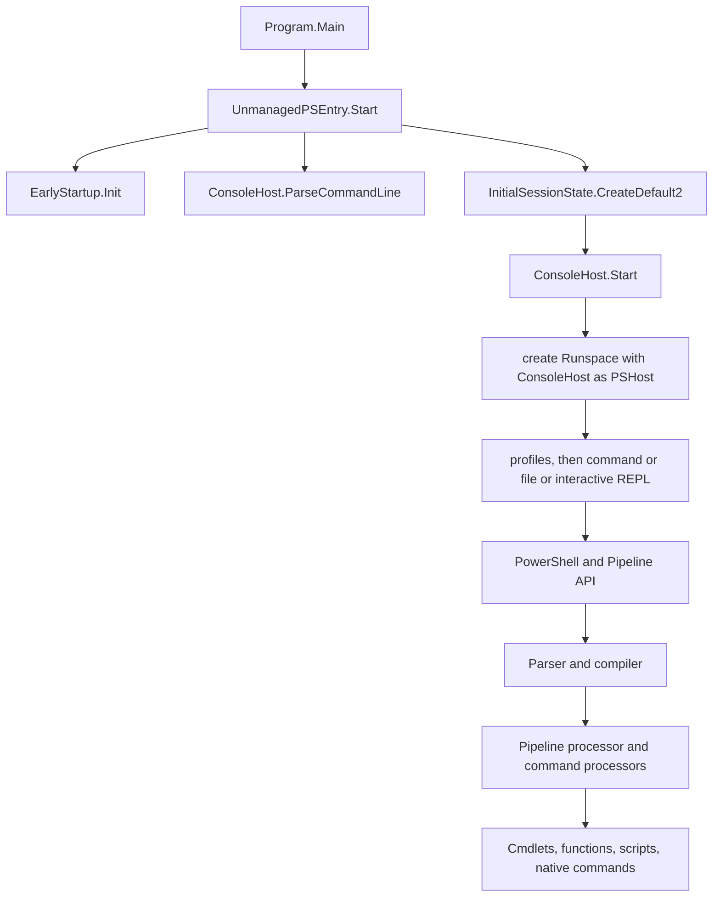

# Layered architecture

> STATIC-ONLY — behavior not run-verified. Layer assignment is read from project references and entry-point code (`FACT-SRC`); labels like "layer" are this study's grouping (`INFERENCE`).

## 1. Purpose and scope [SPEC]

One-page map of the product: which projects form which layer, who references whom, and how a process start reaches the engine. Detail documents: language pipeline in [02-language](../02-language/00-pipeline-map.md), runtime in `03-runtime/`, hosting in `04-hosting/`, remoting in `05-remoting/`, command modules in `10-command-modules/`.

## 2. Source map

| Layer | Projects (path under `src/`) | Role | Tier |
|---|---|---|---|
| L0 Process entry | `powershell` (shared `Program.cs`), `powershell-unix`, `powershell-win-core`, `Microsoft.PowerShell.GlobalTool.Shim` | `pwsh` executable projects; the shim is the .NET global-tool entry | C |
| L1 Host | `Microsoft.PowerShell.ConsoleHost` | Console host: command-line parsing, REPL, console UI, transcription, `ConsoleShell`/`UnmanagedPSEntry` entry points | B |
| L2 SDK facade | `Microsoft.PowerShell.SDK` | Meta-project referencing the engine, host and command modules; the NuGet package for embedding | B |
| L3 Engine | `System.Management.Automation` ("SMA") | Language pipeline, runtime, pipeline/runspaces, session state, providers, ETS, formatting, modules, help, security, remoting, jobs, debugger | A/B |
| L4 Command modules | `Microsoft.PowerShell.Commands.Management`, `...Commands.Utility`, `...Commands.Diagnostics` (Windows), `Microsoft.PowerShell.Security`, `Microsoft.WSMan.Management`, `Microsoft.WSMan.Runtime`, `Microsoft.Management.Infrastructure.CimCmdlets` (Windows), `Microsoft.PowerShell.GraphicalHost` (`Microsoft.Management.UI.Internal`, Windows) | Cmdlets and providers plugged into the engine | C |
| L5 Content | `Modules/Shared`, `Modules/Unix`, `Modules/Windows` (script modules, manifests, `.ps1xml`), bundled Gallery modules | Script-implemented commands and format/type data | C |
| L6 Platform | `Microsoft.PowerShell.CoreCLR.Eventing` (Windows ETW), native shim package `Microsoft.PowerShell.Native` (external), P/Invoke layers inside SMA (`engine/Interop`, `security/nativeMethods.cs`, `CoreCLR/CorePsPlatform.cs`) | OS access | B/C |
| L7 Tooling | `ResGen`, `TypeCatalogGen`, `SourceGenerators/PSVersionInfoGenerator`, `build.psm1`, `tools/` | Build-time code generation and packaging | C |
| Tests | `test/xUnit`, `test/powershell` (Pester), `test/hosting`, `test/perf`, `test/tools/*` | See Phase 6 documents | C |

Project counts per layer and the full reference graph are generated in [project-dependency-graph.md](project-dependency-graph.md).

## 3. Responsibilities and non-responsibilities

The engine (L3) owns all language and runtime semantics and knows nothing about the console; hosts implement `PSHost` abstractions (L1). Cmdlet assemblies (L4) depend on the engine, never the reverse, except that the engine's initial session state names the built-in cmdlet types and snap-in assemblies it loads.

## 4. Key types and contracts [IMPL]

- Entry: `src/powershell/Program.cs::ManagedPSEntry.Main@L67` (on UNIX it first calls `AttemptExecPwshLogin(args)` for login-shell handling, `#if UNIX`) returns `UnmanagedPSEntry.Start(args, args.Length)`.
- `src/Microsoft.PowerShell.ConsoleHost/host/msh/ManagedEntrance.cs::UnmanagedPSEntry.Start@L50` performs, in order: `EarlyStartup.Init()` (background warm-up; defined in `src/System.Management.Automation/engine/InitialSessionState.cs@L29`), set thread UI culture and culture from the native culture resolver, `ConsoleHost.ParseCommandLine(args)`, `PSEtwLog.LogConsoleStartup()`, build the banner from `PSVersionInfo.GitCommitId`, set `ConsoleHost.DefaultInitialSessionState = InitialSessionState.CreateDefault2()`, then `ConsoleHost.Start(bannerText, helpText, issProvidedExternally: false)` (`ConsoleHost.cs::ConsoleHost.Start@L100`). Host exceptions caused by a killed console (Win32 error 0x6 or 1236) return quietly; any other exception calls `Environment.FailFast`.
- Embedding entry: `ConsoleShell.Start(bannerText, helpText, args)` and `ConsoleShell.Start(InitialSessionState, ...)` (`ConsoleShell.cs@L22-L58`) parse the command line, set the default initial session state and call `ConsoleHost.Start` — the way a custom host reuses the PowerShell console host.
- Reference direction (from `ProjectReference` items, `FACT-SRC`): `Microsoft.PowerShell.SDK` -> {`Commands.Management`, `Commands.Utility`, `ConsoleHost`, `Security`, `System.Management.Automation`}; `ConsoleHost`, `Commands.Utility`, `Commands.Diagnostics`, `Security`, `WSMan.Management` -> `System.Management.Automation`; `Commands.Management` -> `Security`; `WSMan.Management` -> `WSMan.Runtime`; `powershell-unix` -> `Microsoft.PowerShell.SDK`; `powershell-win-core` -> `Microsoft.PowerShell.SDK`, `Commands.Diagnostics`, `CimCmdlets`, `WSMan.Management` and, only when `SDKToUse == Microsoft.NET.Sdk.WindowsDesktop`, `Microsoft.PowerShell.GraphicalHost`; `Microsoft.PowerShell.GlobalTool.Shim` has no project references.

## 5. Data model

Namespace distribution of the engine's types (`data/types.json`, `APPROX`; top namespaces by type count): `System.Management.Automation` (969), `...Interpreter` (271), `...Language` (257), `Microsoft.PowerShell.Commands.Internal.Format` (251), `Microsoft.PowerShell.Commands` (143), `...Remoting` (133), `...Runspaces` (124), `...Internal` (97), `...Remoting.Client` (91), `...Security` (75), `...ComInterop` (64). Engine totals: <!--N:TYPES_SMA-->2857<!--/N--> types in <!--N:CS_FILES_SMA-->705<!--/N--> C# files / <!--N:CS_LOC_SMA-->563843<!--/N--> lines.

## 6. Control flow

Boxes F–H are `INFERENCE` from the host's role until the Phase 4 console-host document confirms them; boxes I–L are detailed in [LIFECYCLE-script-execution](../02-language/LIFECYCLE-script-execution.md).

## 7. Algorithms

Not applicable.

## 8. Observable behavior [SPEC]

`pwsh` starts, parses its command line (`-Command`, `-File`, `-EncodedCommand`, interactive), creates the initial session state with the built-in cmdlet set and runs. No golden sample: STATIC-ONLY.

## 9. Error handling and edge cases

Startup failures terminate the process by `Environment.FailFast` except benign console-loss cases (see Key types).

## 10. Concurrency and threading

`EarlyStartup.Init()` warms components on background threads before command-line parsing (comment in `ManagedEntrance.cs@L66`).

## 11. Extension points and customization hooks

Host abstraction (`PSHost`, implemented by `ConsoleHost`), `InitialSessionState`, `ConsoleShell.Start` for custom console hosts, `Microsoft.PowerShell.SDK` for embedding, cmdlet/provider assemblies, subsystems (`engine/Subsystem`: prediction, feedback, DSC — `APPROX` from directory names).

## 12. Dependencies

Inbound: OS process loader / `dotnet` host. Outbound: .NET (`net10.0`), packages in [external-dependencies](external-dependencies.md).

## 13. Performance notes

Startup work is pushed to `EarlyStartup`; ReadyToRun and tiered JIT settings are in [build-system](../01-repository/build-system.md).

## 14. Security considerations

Trust boundaries relevant to the layers: script/module input to the engine (L3), remoting endpoints (L3/L4), host UI (L1), native interop (L6), package/module sources (L5/L7). Enforcement points are catalogued in Phase 5 (`07-security/enforcement-points.md`).

## 15. Enterprise considerations

Layering is clean in one direction (cmdlets and hosts depend on the engine), which lets a different host or a reduced command set be built from the same engine. Gaps: the engine assembly also contains the remoting stack, help, formatting, providers and debugger (one 563,843-line assembly), so no part can be omitted without source changes (`INFERENCE` from the single `System.Management.Automation.csproj`).

## 16. Tests

Layer-level tests: `test/hosting` (embedding via SDK), `test/xUnit`, Pester suites under `test/powershell` (see Phase 6).

## 17. Design decisions and trade-offs

One engine assembly with `InternalsVisibleTo` friends gives cmdlet assemblies access to internals (see `internals_visible_to` in `data/projects.json`) at the cost of a very wide internal API surface (`INFERENCE`).

## 18. Guidance for the new shell [LESSON]

- **LSN-LAYER-01** [REPLICATE] (area: NLD-RUN) Keep the dependency direction host -> engine <- command modules, with the host abstraction (`PSHost`) as the only UI contract. Evidence: `src/Microsoft.PowerShell.ConsoleHost/Microsoft.PowerShell.ConsoleHost.csproj` (references only the engine).
- **LSN-LAYER-02** [ADAPT] (area: NLD-MOD) Split the engine into separately packaged components (language core, runtime, remoting, formatting, help) so enterprise deployments can omit unneeded subsystems and shrink the attack surface; the observable language behavior stays unchanged. Evidence: single-assembly layout `src/System.Management.Automation/System.Management.Automation.csproj`; namespace counts above.
- **LSN-LAYER-03** [REPLICATE] (area: NLD-TOOL) Provide a one-call embedding entry that takes an initial session state (as `ConsoleShell.Start` does). Evidence: `src/Microsoft.PowerShell.ConsoleHost/host/msh/ConsoleShell.cs@L38`.

## 19. Open questions / UNVERIFIED items

- `UNVERIFIED`: the internals of `ConsoleHost.Start` (boxes F–H) pending Phase 4.
- `UNVERIFIED`: which subsystems are registered by default (`engine/Subsystem`).

Verification: project references read from `.csproj` files via `data/projects.json`; entry code read in `Program.cs`, `ManagedEntrance.cs`, `ConsoleShell.cs`; counts from `numbers.json`.
