# Project dependency graph

> STATIC-ONLY — behavior not run-verified. All counts are `APPROX`/`GENERATED` from regex and own-scanner extraction (no .NET SDK on the study host).

Edges are `ProjectReference` items (dashed = analyzer/source generator, label = MSBuild condition when present; conditions are **not evaluated**). Node suffix `*` = not in `PowerShell.sln`.

```mermaid
flowchart LR
  docs_host_powershell_sample_MyApp_MyApp_csproj["MyApp*"]
  src_GlobalTools_PowerShell_Windows_x64_PowerShell_Windows_x64_csproj["PowerShell.Windows.x64*"]
  src_Microsoft_Management_Infrastructure_CimCmdlets_Microsoft_Management_Infrastructure_CimCmdlets_csproj["Microsoft.Management.Infrastructure.CimCmdlets"]
  src_Microsoft_Management_UI_Internal_Microsoft_PowerShell_GraphicalHost_csproj["Microsoft.PowerShell.GraphicalHost*"]
  src_Microsoft_PowerShell_Commands_Diagnostics_Microsoft_PowerShell_Commands_Diagnostics_csproj["Microsoft.PowerShell.Commands.Diagnostics"]
  src_Microsoft_PowerShell_Commands_Management_Microsoft_PowerShell_Commands_Management_csproj["Microsoft.PowerShell.Commands.Management"]
  tools_packaging_projects_reference_Microsoft_PowerShell_Commands_Utility_Microsoft_PowerShell_Commands_Utility_csproj["Microsoft.PowerShell.Commands.Utility"]
  tools_packaging_projects_reference_Microsoft_PowerShell_ConsoleHost_Microsoft_PowerShell_ConsoleHost_csproj["Microsoft.PowerShell.ConsoleHost"]
  src_Microsoft_PowerShell_CoreCLR_Eventing_Microsoft_PowerShell_CoreCLR_Eventing_csproj["Microsoft.PowerShell.CoreCLR.Eventing"]
  src_Microsoft_PowerShell_GlobalTool_Shim_Microsoft_PowerShell_GlobalTool_Shim_csproj["Microsoft.PowerShell.GlobalTool.Shim*"]
  src_Microsoft_PowerShell_SDK_Microsoft_PowerShell_SDK_csproj["Microsoft.PowerShell.SDK"]
  src_Microsoft_PowerShell_Security_Microsoft_PowerShell_Security_csproj["Microsoft.PowerShell.Security"]
  src_Microsoft_WSMan_Management_Microsoft_WSMan_Management_csproj["Microsoft.WSMan.Management"]
  src_Microsoft_WSMan_Runtime_Microsoft_WSMan_Runtime_csproj["Microsoft.WSMan.Runtime"]
  src_Modules_PSGalleryModules_csproj["PSGalleryModules*"]
  src_ResGen_ResGen_csproj["ResGen*"]
  tools_packaging_projects_reference_System_Management_Automation_System_Management_Automation_csproj["System.Management.Automation"]
  src_System_Management_Automation_SourceGenerators_PSVersionInfoGenerator_PSVersionInfoGenerator_csproj["PSVersionInfoGenerator"]
  src_TypeCatalogGen_TypeCatalogGen_csproj["TypeCatalogGen*"]
  src_powershell_unix_powershell_unix_csproj["powershell-unix"]
  src_powershell_win_core_powershell_win_core_csproj["powershell-win-core"]
  test_hosting_hosting_tests_csproj["hosting.tests*"]
  test_perf_benchmarks_powershell_perf_csproj["powershell-perf*"]
  test_perf_dotnet_tools_BenchmarkDotNet_Extensions_BenchmarkDotNet_Extensions_csproj["BenchmarkDotNet.Extensions*"]
  test_perf_dotnet_tools_Reporting_Reporting_csproj["Reporting*"]
  test_perf_dotnet_tools_ResultsComparer_ResultsComparer_csproj["ResultsComparer*"]
  test_tools_Modules_PSGalleryTestModules_csproj["PSGalleryTestModules*"]
  test_tools_NamedPipeConnection_src_code_Microsoft_PowerShell_NamedPipeConnection_csproj["Microsoft.PowerShell.NamedPipeConnection*"]
  test_tools_TestAlc_init_Test_Isolated_Init_csproj["Test.Isolated.Init*"]
  test_tools_TestAlc_nested_Test_Isolated_Nested_csproj["Test.Isolated.Nested*"]
  test_tools_TestAlc_root_Test_Isolated_Root_csproj["Test.Isolated.Root*"]
  test_tools_TestExe_TestExe_csproj["TestExe*"]
  test_tools_TestService_TestService_csproj["TestService*"]
  test_tools_UnixSocket_UnixSocket_csproj["UnixSocket*"]
  test_tools_WebListener_WebListener_csproj["WebListener*"]
  test_xUnit_xUnit_tests_csproj["xUnit.tests"]
  tools_packaging_projects_reference_Microsoft_PowerShell_Commands_Utility_Microsoft_PowerShell_Commands_Utility_csproj["Microsoft.PowerShell.Commands.Utility*"]
  tools_packaging_projects_reference_Microsoft_PowerShell_ConsoleHost_Microsoft_PowerShell_ConsoleHost_csproj["Microsoft.PowerShell.ConsoleHost*"]
  tools_packaging_projects_reference_System_Management_Automation_System_Management_Automation_csproj["System.Management.Automation*"]
  tools_wix_Microsoft_PowerShell_Packaging_csproj["Microsoft.PowerShell.Packaging*"]
  src_GlobalTools_PowerShell_Windows_x64_PowerShell_Windows_x64_csproj --> src_Microsoft_PowerShell_SDK_Microsoft_PowerShell_SDK_csproj
  src_GlobalTools_PowerShell_Windows_x64_PowerShell_Windows_x64_csproj --> src_Microsoft_PowerShell_Commands_Diagnostics_Microsoft_PowerShell_Commands_Diagnostics_csproj
  src_GlobalTools_PowerShell_Windows_x64_PowerShell_Windows_x64_csproj --> src_Microsoft_Management_Infrastructure_CimCmdlets_Microsoft_Management_Infrastructure_CimCmdlets_csproj
  src_GlobalTools_PowerShell_Windows_x64_PowerShell_Windows_x64_csproj --> src_Microsoft_WSMan_Management_Microsoft_WSMan_Management_csproj
  src_Microsoft_Management_Infrastructure_CimCmdlets_Microsoft_Management_Infrastructure_CimCmdlets_csproj --> tools_packaging_projects_reference_System_Management_Automation_System_Management_Automation_csproj
  src_Microsoft_Management_UI_Internal_Microsoft_PowerShell_GraphicalHost_csproj --> tools_packaging_projects_reference_System_Management_Automation_System_Management_Automation_csproj
  src_Microsoft_Management_UI_Internal_Microsoft_PowerShell_GraphicalHost_csproj --> tools_packaging_projects_reference_Microsoft_PowerShell_Commands_Utility_Microsoft_PowerShell_Commands_Utility_csproj
  src_Microsoft_PowerShell_Commands_Diagnostics_Microsoft_PowerShell_Commands_Diagnostics_csproj --> tools_packaging_projects_reference_System_Management_Automation_System_Management_Automation_csproj
  src_Microsoft_PowerShell_Commands_Management_Microsoft_PowerShell_Commands_Management_csproj --> src_Microsoft_PowerShell_Security_Microsoft_PowerShell_Security_csproj
  tools_packaging_projects_reference_Microsoft_PowerShell_Commands_Utility_Microsoft_PowerShell_Commands_Utility_csproj --> tools_packaging_projects_reference_System_Management_Automation_System_Management_Automation_csproj
  tools_packaging_projects_reference_Microsoft_PowerShell_ConsoleHost_Microsoft_PowerShell_ConsoleHost_csproj --> tools_packaging_projects_reference_System_Management_Automation_System_Management_Automation_csproj
  src_Microsoft_PowerShell_SDK_Microsoft_PowerShell_SDK_csproj --> src_Microsoft_PowerShell_Commands_Management_Microsoft_PowerShell_Commands_Management_csproj
  src_Microsoft_PowerShell_SDK_Microsoft_PowerShell_SDK_csproj --> tools_packaging_projects_reference_Microsoft_PowerShell_Commands_Utility_Microsoft_PowerShell_Commands_Utility_csproj
  src_Microsoft_PowerShell_SDK_Microsoft_PowerShell_SDK_csproj --> tools_packaging_projects_reference_Microsoft_PowerShell_ConsoleHost_Microsoft_PowerShell_ConsoleHost_csproj
  src_Microsoft_PowerShell_SDK_Microsoft_PowerShell_SDK_csproj --> src_Microsoft_PowerShell_Security_Microsoft_PowerShell_Security_csproj
  src_Microsoft_PowerShell_SDK_Microsoft_PowerShell_SDK_csproj --> tools_packaging_projects_reference_System_Management_Automation_System_Management_Automation_csproj
  src_Microsoft_PowerShell_Security_Microsoft_PowerShell_Security_csproj --> tools_packaging_projects_reference_System_Management_Automation_System_Management_Automation_csproj
  src_Microsoft_WSMan_Management_Microsoft_WSMan_Management_csproj --> tools_packaging_projects_reference_System_Management_Automation_System_Management_Automation_csproj
  src_Microsoft_WSMan_Management_Microsoft_WSMan_Management_csproj --> src_Microsoft_WSMan_Runtime_Microsoft_WSMan_Runtime_csproj
  tools_packaging_projects_reference_System_Management_Automation_System_Management_Automation_csproj -.-> src_System_Management_Automation_SourceGenerators_PSVersionInfoGenerator_PSVersionInfoGenerator_csproj
  tools_packaging_projects_reference_System_Management_Automation_System_Management_Automation_csproj -->|" '$(IsWindows)' == 'true' "| src_Microsoft_PowerShell_CoreCLR_Eventing_Microsoft_PowerShell_CoreCLR_Eventing_csproj
  src_powershell_unix_powershell_unix_csproj --> src_Microsoft_PowerShell_SDK_Microsoft_PowerShell_SDK_csproj
  src_powershell_win_core_powershell_win_core_csproj --> src_Microsoft_PowerShell_SDK_Microsoft_PowerShell_SDK_csproj
  src_powershell_win_core_powershell_win_core_csproj --> src_Microsoft_PowerShell_Commands_Diagnostics_Microsoft_PowerShell_Commands_Diagnostics_csproj
  src_powershell_win_core_powershell_win_core_csproj --> src_Microsoft_Management_Infrastructure_CimCmdlets_Microsoft_Management_Infrastructure_CimCmdlets_csproj
  src_powershell_win_core_powershell_win_core_csproj --> src_Microsoft_WSMan_Management_Microsoft_WSMan_Management_csproj
  src_powershell_win_core_powershell_win_core_csproj -->|"'$(SDKToUse)' == 'Microsoft.NET.Sdk.Wind"| src_Microsoft_Management_UI_Internal_Microsoft_PowerShell_GraphicalHost_csproj
  test_perf_benchmarks_powershell_perf_csproj --> test_perf_dotnet_tools_BenchmarkDotNet_Extensions_BenchmarkDotNet_Extensions_csproj
  test_perf_benchmarks_powershell_perf_csproj -->|"'$(PerfTargetVersion)' == ''"| src_Microsoft_PowerShell_SDK_Microsoft_PowerShell_SDK_csproj
  test_perf_benchmarks_powershell_perf_csproj -->|"'$(PerfTargetVersion)' == ''"| src_Microsoft_PowerShell_Commands_Diagnostics_Microsoft_PowerShell_Commands_Diagnostics_csproj
  test_perf_benchmarks_powershell_perf_csproj -->|"'$(PerfTargetVersion)' == ''"| src_Microsoft_WSMan_Management_Microsoft_WSMan_Management_csproj
  test_perf_dotnet_tools_BenchmarkDotNet_Extensions_BenchmarkDotNet_Extensions_csproj --> test_perf_dotnet_tools_Reporting_Reporting_csproj
  test_xUnit_xUnit_tests_csproj --> src_Microsoft_PowerShell_SDK_Microsoft_PowerShell_SDK_csproj
  test_xUnit_xUnit_tests_csproj --> src_Microsoft_PowerShell_Commands_Diagnostics_Microsoft_PowerShell_Commands_Diagnostics_csproj
  test_xUnit_xUnit_tests_csproj --> src_Microsoft_WSMan_Management_Microsoft_WSMan_Management_csproj
  test_xUnit_xUnit_tests_csproj --> src_Microsoft_Management_Infrastructure_CimCmdlets_Microsoft_Management_Infrastructure_CimCmdlets_csproj
```

## Project table (`GENERATED`)

| Project | Path | Output | TFM | In sln | Project refs | Package refs |
|---|---|---|---|---|---:|---:|
| `MyApp` | `docs/host-powershell/sample/MyApp/MyApp.csproj` | Exe | netcoreapp2.1 | no | 0 | 3 |
| `PowerShell.Windows.x64` | `src/GlobalTools/PowerShell.Windows.x64/PowerShell.Windows.x64.csproj` | Exe | net10.0 | no | 4 | 0 |
| `Microsoft.Management.Infrastructure.CimCmdlets` | `src/Microsoft.Management.Infrastructure.CimCmdlets/Microsoft.Management.Infrastructure.CimCmdlets.csproj` | (inherited/Library) | net10.0 | yes | 1 | 0 |
| `Microsoft.PowerShell.GraphicalHost` | `src/Microsoft.Management.UI.Internal/Microsoft.PowerShell.GraphicalHost.csproj` | (inherited/Library) | net10.0 | no | 2 | 0 |
| `Microsoft.PowerShell.Commands.Diagnostics` | `src/Microsoft.PowerShell.Commands.Diagnostics/Microsoft.PowerShell.Commands.Diagnostics.csproj` | (inherited/Library) | net10.0 | yes | 1 | 4 |
| `Microsoft.PowerShell.Commands.Management` | `src/Microsoft.PowerShell.Commands.Management/Microsoft.PowerShell.Commands.Management.csproj` | (inherited/Library) | net10.0 | yes | 1 | 2 |
| `Microsoft.PowerShell.Commands.Utility` | `src/Microsoft.PowerShell.Commands.Utility/Microsoft.PowerShell.Commands.Utility.csproj` | (inherited/Library) | net10.0 | yes | 1 | 6 |
| `Microsoft.PowerShell.ConsoleHost` | `src/Microsoft.PowerShell.ConsoleHost/Microsoft.PowerShell.ConsoleHost.csproj` | (inherited/Library) | net10.0 | yes | 1 | 0 |
| `Microsoft.PowerShell.CoreCLR.Eventing` | `src/Microsoft.PowerShell.CoreCLR.Eventing/Microsoft.PowerShell.CoreCLR.Eventing.csproj` | (inherited/Library) | net10.0 | yes | 0 | 1 |
| `Microsoft.PowerShell.GlobalTool.Shim` | `src/Microsoft.PowerShell.GlobalTool.Shim/Microsoft.PowerShell.GlobalTool.Shim.csproj` | EXE | net10.0 | no | 0 | 0 |
| `Microsoft.PowerShell.SDK` | `src/Microsoft.PowerShell.SDK/Microsoft.PowerShell.SDK.csproj` | (inherited/Library) | net10.0 | yes | 5 | 53 |
| `Microsoft.PowerShell.Security` | `src/Microsoft.PowerShell.Security/Microsoft.PowerShell.Security.csproj` | (inherited/Library) | net10.0 | yes | 1 | 0 |
| `Microsoft.WSMan.Management` | `src/Microsoft.WSMan.Management/Microsoft.WSMan.Management.csproj` | (inherited/Library) | net10.0 | yes | 2 | 2 |
| `Microsoft.WSMan.Runtime` | `src/Microsoft.WSMan.Runtime/Microsoft.WSMan.Runtime.csproj` | (inherited/Library) | net10.0 | yes | 0 | 0 |
| `PSGalleryModules` | `src/Modules/PSGalleryModules.csproj` | (inherited/Library) | net10.0 | no | 0 | 6 |
| `ResGen` | `src/ResGen/ResGen.csproj` | Exe | net10.0 | no | 0 | 0 |
| `System.Management.Automation` | `src/System.Management.Automation/System.Management.Automation.csproj` | (inherited/Library) | net10.0 | yes | 2 | 15 |
| `PSVersionInfoGenerator` | `src/System.Management.Automation/SourceGenerators/PSVersionInfoGenerator/PSVersionInfoGenerator.csproj` | (inherited/Library) | netstandard2.0 | yes | 0 | 10 |
| `TypeCatalogGen` | `src/TypeCatalogGen/TypeCatalogGen.csproj` | Exe | net10.0 | no | 0 | 0 |
| `powershell-unix` | `src/powershell-unix/powershell-unix.csproj` | Exe | net10.0 | yes | 1 | 0 |
| `powershell-win-core` | `src/powershell-win-core/powershell-win-core.csproj` | Exe | net10.0 | yes | 5 | 0 |
| `hosting.tests` | `test/hosting/hosting.tests.csproj` | (inherited/Library) | net10.0 | no | 0 | 12 |
| `powershell-perf` | `test/perf/benchmarks/powershell-perf.csproj` | Exe | net10.0 | no | 4 | 10 |
| `BenchmarkDotNet.Extensions` | `test/perf/dotnet-tools/BenchmarkDotNet.Extensions/BenchmarkDotNet.Extensions.csproj` | Library | netstandard2.0 | no | 1 | 13 |
| `Reporting` | `test/perf/dotnet-tools/Reporting/Reporting.csproj` | Library | netstandard2.0 | no | 0 | 3 |
| `ResultsComparer` | `test/perf/dotnet-tools/ResultsComparer/ResultsComparer.csproj` | Exe | $(PERFLAB_TARGET_FRAMEWORKS) | no | 0 | 15 |
| `PSGalleryTestModules` | `test/tools/Modules/PSGalleryTestModules.csproj` | (inherited/Library) | net10.0 | no | 0 | 1 |
| `Microsoft.PowerShell.NamedPipeConnection` | `test/tools/NamedPipeConnection/src/code/Microsoft.PowerShell.NamedPipeConnection.csproj` | Library | net10.0 | no | 0 | 14 |
| `Test.Isolated.Init` | `test/tools/TestAlc/init/Test.Isolated.Init.csproj` | (inherited/Library) | net10.0 | no | 0 | 1 |
| `Test.Isolated.Nested` | `test/tools/TestAlc/nested/Test.Isolated.Nested.csproj` | (inherited/Library) | net10.0 | no | 0 | 2 |
| `Test.Isolated.Root` | `test/tools/TestAlc/root/Test.Isolated.Root.csproj` | (inherited/Library) | net10.0 | no | 0 | 1 |
| `TestExe` | `test/tools/TestExe/TestExe.csproj` | Exe | net10.0 | no | 0 | 0 |
| `TestService` | `test/tools/TestService/TestService.csproj` | Exe | net10.0 | no | 0 | 46 |
| `UnixSocket` | `test/tools/UnixSocket/UnixSocket.csproj` | Exe | net10.0 | no | 0 | 0 |
| `WebListener` | `test/tools/WebListener/WebListener.csproj` | (inherited/Library) | net10.0 | no | 0 | 4 |
| `xUnit.tests` | `test/xUnit/xUnit.tests.csproj` | (inherited/Library) | net10.0 | yes | 4 | 5 |
| `Microsoft.PowerShell.Commands.Utility` | `tools/packaging/projects/reference/Microsoft.PowerShell.Commands.Utility/Microsoft.PowerShell.Commands.Utility.csproj` | (inherited/Library) | net10.0 | no | 0 | 2 |
| `Microsoft.PowerShell.ConsoleHost` | `tools/packaging/projects/reference/Microsoft.PowerShell.ConsoleHost/Microsoft.PowerShell.ConsoleHost.csproj` | (inherited/Library) | net10.0 | no | 0 | 0 |
| `System.Management.Automation` | `tools/packaging/projects/reference/System.Management.Automation/System.Management.Automation.csproj` | (inherited/Library) | net10.0 | no | 0 | 1 |
| `Microsoft.PowerShell.Packaging` | `tools/wix/Microsoft.PowerShell.Packaging.csproj` | (inherited/Library) | net10.0 | no | 0 | 1 |

## Package references (`GENERATED`)

| Project | Package | Version | Condition |
|---|---|---|---|
| `MyApp` | Microsoft.PowerShell.SDK | 6.1.1 |  |
| `MyApp` | Microsoft.PowerShell.Commands.Diagnostics | 6.1.1 |  |
| `MyApp` | Microsoft.WSMan.Management | 6.1.1 |  |
| `Microsoft.PowerShell.Commands.Diagnostics` | System.Configuration.ConfigurationManager | 10.0.14 |  |
| `Microsoft.PowerShell.Commands.Diagnostics` | System.Diagnostics.EventLog | 10.0.14 |  |
| `Microsoft.PowerShell.Commands.Diagnostics` | System.Security.Cryptography.ProtectedData | 10.0.14 |  |
| `Microsoft.PowerShell.Commands.Diagnostics` | System.Diagnostics.PerformanceCounter | 10.0.14 |  |
| `Microsoft.PowerShell.Commands.Management` | System.Diagnostics.EventLog | 10.0.14 |  |
| `Microsoft.PowerShell.Commands.Management` | System.ServiceProcess.ServiceController | 10.0.14 |  |
| `Microsoft.PowerShell.Commands.Utility` | Microsoft.Win32.SystemEvents | 10.0.14 |  |
| `Microsoft.PowerShell.Commands.Utility` | Markdig.Signed | 0.44.0 |  |
| `Microsoft.PowerShell.Commands.Utility` | Microsoft.PowerShell.MarkdownRender | 7.2.1 |  |
| `Microsoft.PowerShell.Commands.Utility` | Microsoft.CodeAnalysis.CSharp | 5.0.0 |  |
| `Microsoft.PowerShell.Commands.Utility` | System.Drawing.Common | 10.0.14 |  |
| `Microsoft.PowerShell.Commands.Utility` | JsonSchema.Net | 7.4.0 |  |
| `Microsoft.PowerShell.CoreCLR.Eventing` | System.Diagnostics.EventLog | 10.0.14 |  |
| `Microsoft.PowerShell.SDK` | Microsoft.Bcl.AsyncInterfaces | 10.0.14 |  |
| `Microsoft.PowerShell.SDK` | Microsoft.Extensions.ObjectPool | 10.0.14 |  |
| `Microsoft.PowerShell.SDK` | Microsoft.Win32.Registry.AccessControl | 10.0.14 |  |
| `Microsoft.PowerShell.SDK` | Microsoft.Win32.SystemEvents | 10.0.14 |  |
| `Microsoft.PowerShell.SDK` | runtime.android-arm.runtime.native.System.IO.Ports | 10.0.14 |  |
| `Microsoft.PowerShell.SDK` | runtime.android-arm64.runtime.native.System.IO.Ports | 10.0.14 |  |
| `Microsoft.PowerShell.SDK` | runtime.android-x64.runtime.native.System.IO.Ports | 10.0.14 |  |
| `Microsoft.PowerShell.SDK` | runtime.android-x86.runtime.native.System.IO.Ports | 10.0.14 |  |
| `Microsoft.PowerShell.SDK` | runtime.linux-arm.runtime.native.System.IO.Ports | 10.0.14 |  |
| `Microsoft.PowerShell.SDK` | runtime.linux-arm64.runtime.native.System.IO.Ports | 10.0.14 |  |
| `Microsoft.PowerShell.SDK` | runtime.linux-bionic-arm64.runtime.native.System.IO.Ports | 10.0.14 |  |
| `Microsoft.PowerShell.SDK` | runtime.linux-bionic-x64.runtime.native.System.IO.Ports | 10.0.14 |  |
| `Microsoft.PowerShell.SDK` | runtime.linux-musl-arm.runtime.native.System.IO.Ports | 10.0.14 |  |
| `Microsoft.PowerShell.SDK` | runtime.linux-musl-arm64.runtime.native.System.IO.Ports | 10.0.14 |  |
| `Microsoft.PowerShell.SDK` | runtime.linux-musl-x64.runtime.native.System.IO.Ports | 10.0.14 |  |
| `Microsoft.PowerShell.SDK` | runtime.linux-x64.runtime.native.System.IO.Ports | 10.0.14 |  |
| `Microsoft.PowerShell.SDK` | runtime.maccatalyst-arm64.runtime.native.System.IO.Ports | 10.0.14 |  |
| `Microsoft.PowerShell.SDK` | runtime.maccatalyst-x64.runtime.native.System.IO.Ports | 10.0.14 |  |
| `Microsoft.PowerShell.SDK` | runtime.native.System.IO.Ports | 10.0.14 |  |
| `Microsoft.PowerShell.SDK` | runtime.osx-arm64.runtime.native.System.IO.Ports | 10.0.14 |  |
| `Microsoft.PowerShell.SDK` | runtime.osx-x64.runtime.native.System.IO.Ports | 10.0.14 |  |
| `Microsoft.PowerShell.SDK` | System.CodeDom | 10.0.14 |  |
| `Microsoft.PowerShell.SDK` | System.ComponentModel.Composition | 10.0.14 |  |
| `Microsoft.PowerShell.SDK` | System.ComponentModel.Composition.Registration | 10.0.14 |  |
| `Microsoft.PowerShell.SDK` | System.Configuration.ConfigurationManager | 10.0.14 |  |
| `Microsoft.PowerShell.SDK` | System.Data.Odbc | 10.0.14 |  |
| `Microsoft.PowerShell.SDK` | System.Data.OleDb | 10.0.14 |  |
| `Microsoft.PowerShell.SDK` | System.Data.SqlClient | 4.9.1 |  |
| `Microsoft.PowerShell.SDK` | System.Diagnostics.EventLog | 10.0.14 |  |
| `Microsoft.PowerShell.SDK` | System.Diagnostics.PerformanceCounter | 10.0.14 |  |
| `Microsoft.PowerShell.SDK` | System.DirectoryServices | 10.0.14 |  |
| `Microsoft.PowerShell.SDK` | System.DirectoryServices.AccountManagement | 10.0.14 |  |
| `Microsoft.PowerShell.SDK` | System.DirectoryServices.Protocols | 10.0.14 |  |
| `Microsoft.PowerShell.SDK` | System.Drawing.Common | 10.0.14 |  |
| `Microsoft.PowerShell.SDK` | System.IO.Packaging | 10.0.14 |  |
| `Microsoft.PowerShell.SDK` | System.IO.Ports | 10.0.14 |  |
| `Microsoft.PowerShell.SDK` | System.Management | 10.0.14 |  |
| `Microsoft.PowerShell.SDK` | System.Net.Http.WinHttpHandler | 10.0.14 |  |
| `Microsoft.PowerShell.SDK` | System.Reflection.Context | 10.0.14 |  |
| `Microsoft.PowerShell.SDK` | System.Runtime.Caching | 10.0.14 |  |
| `Microsoft.PowerShell.SDK` | System.Security.Cryptography.Pkcs | 10.0.14 |  |
| `Microsoft.PowerShell.SDK` | System.Security.Cryptography.ProtectedData | 10.0.14 |  |
| `Microsoft.PowerShell.SDK` | System.Security.Cryptography.Xml | 10.0.14 |  |
| `Microsoft.PowerShell.SDK` | System.Security.Permissions | 10.0.14 |  |
| `Microsoft.PowerShell.SDK` | System.ServiceModel.Http | 10.0.652802 |  |
| `Microsoft.PowerShell.SDK` | System.ServiceModel.NetFramingBase | 10.0.652802 |  |
| `Microsoft.PowerShell.SDK` | System.ServiceModel.NetTcp | 10.0.652802 |  |
| `Microsoft.PowerShell.SDK` | System.ServiceModel.Primitives | 10.0.652802 |  |
| `Microsoft.PowerShell.SDK` | Microsoft.Windows.Compatibility | 10.0.14 |  |
| `Microsoft.PowerShell.SDK` | System.ServiceModel.Syndication | 10.0.14 |  |
| `Microsoft.PowerShell.SDK` | System.ServiceProcess.ServiceController | 10.0.14 |  |
| `Microsoft.PowerShell.SDK` | System.Speech | 10.0.14 |  |
| `Microsoft.PowerShell.SDK` | System.Windows.Extensions | 10.0.14 |  |
| `Microsoft.WSMan.Management` | System.Diagnostics.EventLog | 10.0.14 |  |
| `Microsoft.WSMan.Management` | System.ServiceProcess.ServiceController | 10.0.14 |  |
| `PSGalleryModules` | PowerShellGet | 2.2.5 |  |
| `PSGalleryModules` | PackageManagement | 1.4.8.1 |  |
| `PSGalleryModules` | Microsoft.PowerShell.PSResourceGet | 1.2.0 |  |
| `PSGalleryModules` | Microsoft.PowerShell.Archive | 1.2.6 |  |
| `PSGalleryModules` | PSReadLine | 2.4.5 |  |
| `PSGalleryModules` | Microsoft.PowerShell.ThreadJob | 2.2.0 |  |
| `System.Management.Automation` | Newtonsoft.Json | 13.0.4 |  |
| `System.Management.Automation` | Microsoft.ApplicationInsights | 2.23.0 |  |
| `System.Management.Automation` | Microsoft.Win32.Registry.AccessControl | 10.0.14 |  |
| `System.Management.Automation` | System.CodeDom | 10.0.14 |  |
| `System.Management.Automation` | System.Configuration.ConfigurationManager | 10.0.14 |  |
| `System.Management.Automation` | System.Diagnostics.EventLog | 10.0.14 |  |
| `System.Management.Automation` | System.DirectoryServices | 10.0.14 |  |
| `System.Management.Automation` | System.Management | 10.0.14 |  |
| `System.Management.Automation` | System.Security.Cryptography.Pkcs | 10.0.14 |  |
| `System.Management.Automation` | System.Security.Cryptography.ProtectedData | 10.0.14 |  |
| `System.Management.Automation` | System.Security.Permissions | 10.0.14 |  |
| `System.Management.Automation` | Microsoft.Management.Infrastructure | 3.0.0 |  |
| `System.Management.Automation` | Microsoft.PowerShell.Native | 700.0.2 |  |
| `System.Management.Automation` | Microsoft.Security.Extensions | 1.4.0 |  |
| `System.Management.Automation` | System.Windows.Extensions | 10.0.14 |  |
| `PSVersionInfoGenerator` | Microsoft.CodeAnalysis.CSharp | 5.0.0 |  |
| `PSVersionInfoGenerator` | Microsoft.CodeAnalysis.Analyzers | 5.3.0 |  |
| `PSVersionInfoGenerator` | Microsoft.NETCore.Platforms | 1.1.2 |  |
| `PSVersionInfoGenerator` | System.Buffers | 4.6.1 |  |
| `PSVersionInfoGenerator` | System.Collections.Immutable | 9.0.21 |  |
| `PSVersionInfoGenerator` | System.Memory | 4.6.3 |  |
| `PSVersionInfoGenerator` | System.Numerics.Vectors | 4.6.1 |  |
| `PSVersionInfoGenerator` | System.Reflection.Metadata | 9.0.21 |  |
| `PSVersionInfoGenerator` | System.Runtime.CompilerServices.Unsafe | 6.1.2 |  |
| `PSVersionInfoGenerator` | System.Threading.Tasks.Extensions | 4.6.3 |  |
| `hosting.tests` | xunit | 2.4.1 |  |
| `hosting.tests` | XunitXml.TestLogger | 2.0.0 |  |
| `hosting.tests` | Microsoft.PowerShell.SDK | $(RELEASE_VERSION) |  |
| `hosting.tests` | Xunit.SkippableFact | 1.3.6 |  |
| `hosting.tests` | xunit.runner.visualstudio | 2.4.3 |  |
| `hosting.tests` | Microsoft.NET.Test.Sdk | 16.7.1 |  |
| `hosting.tests` | System.ServiceModel.Duplex | 4.10.3 |  |
| `hosting.tests` | System.ServiceModel.Http | 4.10.3 |  |
| `hosting.tests` | System.ServiceModel.NetTcp | 4.10.3 |  |
| `hosting.tests` | System.ServiceModel.Primitives | 4.10.3 |  |
| `hosting.tests` | System.ServiceModel.Security | 4.10.3 |  |
| `hosting.tests` | System.Private.ServiceModel | 4.10.3 |  |
| `powershell-perf` | Microsoft.PowerShell.SDK | $(PerfTargetVersion) | '$(PerfTargetVersion)' != '' |
| `powershell-perf` | Microsoft.PowerShell.Commands.Diagnostics | $(PerfTargetVersion) | '$(PerfTargetVersion)' != '' |
| `powershell-perf` | Microsoft.PowerShell.Commands.Management | $(PerfTargetVersion) | '$(PerfTargetVersion)' != '' |
| `powershell-perf` | Microsoft.PowerShell.Commands.Utility | $(PerfTargetVersion) | '$(PerfTargetVersion)' != '' |
| `powershell-perf` | Microsoft.PowerShell.ConsoleHost | $(PerfTargetVersion) | '$(PerfTargetVersion)' != '' |
| `powershell-perf` | Microsoft.PowerShell.Security | $(PerfTargetVersion) | '$(PerfTargetVersion)' != '' |
| `powershell-perf` | Microsoft.PowerShell.CoreCLR.Eventing | $(PerfTargetVersion) | '$(PerfTargetVersion)' != '' |
| `powershell-perf` | Microsoft.WSMan.Management | $(PerfTargetVersion) | '$(PerfTargetVersion)' != '' |
| `powershell-perf` | Microsoft.WSMan.Runtime | $(PerfTargetVersion) | '$(PerfTargetVersion)' != '' |
| `powershell-perf` | System.Management.Automation | $(PerfTargetVersion) | '$(PerfTargetVersion)' != '' |
| `BenchmarkDotNet.Extensions` | BenchmarkDotNet | 0.15.8 |  |
| `BenchmarkDotNet.Extensions` | BenchmarkDotNet.Diagnostics.Windows | 0.15.8 |  |
| `BenchmarkDotNet.Extensions` | Microsoft.Bcl.AsyncInterfaces | 9.0.21 |  |
| `BenchmarkDotNet.Extensions` | Microsoft.Diagnostics.NETCore.Client | 0.2.750501 |  |
| `BenchmarkDotNet.Extensions` | Microsoft.Diagnostics.Tracing.TraceEvent | 3.1.30 |  |
| `BenchmarkDotNet.Extensions` | Microsoft.NETCore.Platforms | 1.1.2 |  |
| `BenchmarkDotNet.Extensions` | System.CodeDom | 9.0.21 |  |
| `BenchmarkDotNet.Extensions` | System.Collections.Immutable | 9.0.21 |  |
| `BenchmarkDotNet.Extensions` | System.IO.Pipelines | 9.0.21 |  |
| `BenchmarkDotNet.Extensions` | System.Management | 9.0.21 |  |
| `BenchmarkDotNet.Extensions` | System.Reflection.Metadata | 9.0.21 |  |
| `BenchmarkDotNet.Extensions` | System.Text.Encodings.Web | 9.0.21 |  |
| `BenchmarkDotNet.Extensions` | System.Text.Json | 9.0.21 |  |
| `Reporting` | Microsoft.NETCore.Platforms | 1.1.2 |  |
| `Reporting` | Newtonsoft.Json | 13.0.4 |  |
| `Reporting` | Microsoft.DotNet.PlatformAbstractions | 5.0.0-preview.5.20278.1 |  |
| `ResultsComparer` | CommandLineParser | 2.9.1 |  |
| `ResultsComparer` | MarkdownLog.NS20 | 0.10.1 |  |
| `ResultsComparer` | Microsoft.Bcl.AsyncInterfaces | 9.0.21 |  |
| `ResultsComparer` | Microsoft.Diagnostics.NETCore.Client | 0.2.750501 |  |
| `ResultsComparer` | Microsoft.Diagnostics.Tracing.TraceEvent | 3.1.30 |  |
| `ResultsComparer` | Newtonsoft.Json | 13.0.4 |  |
| `ResultsComparer` | BenchmarkDotNet | 0.15.8 |  |
| `ResultsComparer` | Perfolizer | 0.6.1 |  |
| `ResultsComparer` | System.CodeDom | 9.0.21 |  |
| `ResultsComparer` | System.Collections.Immutable | 9.0.21 |  |
| `ResultsComparer` | System.IO.Pipelines | 9.0.21 |  |
| `ResultsComparer` | System.Management | 9.0.21 |  |
| `ResultsComparer` | System.Reflection.Metadata | 9.0.21 |  |
| `ResultsComparer` | System.Text.Encodings.Web | 9.0.21 |  |
| `ResultsComparer` | System.Text.Json | 9.0.21 |  |
| `PSGalleryTestModules` | SelfSignedCertificate | 0.0.4 |  |
| `Microsoft.PowerShell.NamedPipeConnection` | Microsoft.CSharp | 4.7.0 |  |
| `Microsoft.PowerShell.NamedPipeConnection` | Microsoft.PowerShell.CoreCLR.Eventing | 7.6.8 |  |
| `Microsoft.PowerShell.NamedPipeConnection` | Microsoft.Win32.Registry.AccessControl | 9.0.21 |  |
| `Microsoft.PowerShell.NamedPipeConnection` | Newtonsoft.Json | 13.0.4 |  |
| `Microsoft.PowerShell.NamedPipeConnection` | System.CodeDom | 9.0.21 |  |
| `Microsoft.PowerShell.NamedPipeConnection` | System.Configuration.ConfigurationManager | 9.0.21 |  |
| `Microsoft.PowerShell.NamedPipeConnection` | System.Diagnostics.EventLog | 10.0.14 |  |
| `Microsoft.PowerShell.NamedPipeConnection` | System.DirectoryServices | 9.0.21 |  |
| `Microsoft.PowerShell.NamedPipeConnection` | System.Management | 9.0.21 |  |
| `Microsoft.PowerShell.NamedPipeConnection` | System.Management.Automation | 7.6.0-preview.2 |  |
| `Microsoft.PowerShell.NamedPipeConnection` | System.Security.Cryptography.Pkcs | 9.0.21 |  |
| `Microsoft.PowerShell.NamedPipeConnection` | System.Security.Cryptography.ProtectedData | 9.0.21 |  |
| `Microsoft.PowerShell.NamedPipeConnection` | System.Security.Permissions | 9.0.21 |  |
| `Microsoft.PowerShell.NamedPipeConnection` | System.Windows.Extensions | 9.0.21 |  |
| `Test.Isolated.Init` | PowerShellStandard.Library | 5.1.1 |  |
| `Test.Isolated.Nested` | PowerShellStandard.Library | 5.1.1 |  |
| `Test.Isolated.Nested` | System.CommandLine | 2.0.0 |  |
| `Test.Isolated.Root` | PowerShellStandard.Library | 5.1.1 |  |
| `TestService` | Microsoft.Win32.Registry.AccessControl | 10.0.5 |  |
| `TestService` | Microsoft.Win32.SystemEvents | 10.0.5 |  |
| `TestService` | Microsoft.Windows.Compatibility | 10.0.5 |  |
| `TestService` | runtime.android-arm.runtime.native.System.IO.Ports | 10.0.5 |  |
| `TestService` | runtime.android-arm64.runtime.native.System.IO.Ports | 10.0.5 |  |
| `TestService` | runtime.android-x64.runtime.native.System.IO.Ports | 10.0.5 |  |
| `TestService` | runtime.android-x86.runtime.native.System.IO.Ports | 10.0.5 |  |
| `TestService` | runtime.linux-arm.runtime.native.System.IO.Ports | 10.0.5 |  |
| `TestService` | runtime.linux-arm64.runtime.native.System.IO.Ports | 10.0.5 |  |
| `TestService` | runtime.linux-bionic-arm64.runtime.native.System.IO.Ports | 10.0.5 |  |
| `TestService` | runtime.linux-bionic-x64.runtime.native.System.IO.Ports | 10.0.5 |  |
| `TestService` | runtime.linux-musl-arm.runtime.native.System.IO.Ports | 10.0.5 |  |
| `TestService` | runtime.linux-musl-arm64.runtime.native.System.IO.Ports | 10.0.5 |  |
| `TestService` | runtime.linux-musl-x64.runtime.native.System.IO.Ports | 10.0.5 |  |
| `TestService` | runtime.linux-x64.runtime.native.System.IO.Ports | 10.0.5 |  |
| `TestService` | runtime.maccatalyst-arm64.runtime.native.System.IO.Ports | 10.0.5 |  |
| `TestService` | runtime.maccatalyst-x64.runtime.native.System.IO.Ports | 10.0.5 |  |
| `TestService` | runtime.native.System.IO.Ports | 10.0.5 |  |
| `TestService` | runtime.osx-arm64.runtime.native.System.IO.Ports | 10.0.5 |  |
| `TestService` | runtime.osx-x64.runtime.native.System.IO.Ports | 10.0.5 |  |
| `TestService` | System.CodeDom | 10.0.5 |  |
| `TestService` | System.ComponentModel.Composition | 10.0.5 |  |
| `TestService` | System.ComponentModel.Composition.Registration | 10.0.5 |  |
| `TestService` | System.Configuration.ConfigurationManager | 10.0.5 |  |
| `TestService` | System.Data.Odbc | 10.0.5 |  |
| `TestService` | System.Data.OleDb | 10.0.5 |  |
| `TestService` | System.Data.SqlClient | 4.9.1 |  |
| `TestService` | System.Diagnostics.EventLog | 10.0.5 |  |
| `TestService` | System.Diagnostics.PerformanceCounter | 10.0.5 |  |
| `TestService` | System.DirectoryServices | 10.0.5 |  |
| `TestService` | System.DirectoryServices.AccountManagement | 10.0.5 |  |
| `TestService` | System.DirectoryServices.Protocols | 10.0.5 |  |
| `TestService` | System.Drawing.Common | 10.0.5 |  |
| `TestService` | System.IO.Packaging | 10.0.5 |  |
| `TestService` | System.IO.Ports | 10.0.5 |  |
| `TestService` | System.Management | 10.0.5 |  |
| `TestService` | System.Reflection.Context | 10.0.5 |  |
| `TestService` | System.Runtime.Caching | 10.0.5 |  |
| `TestService` | System.Security.Cryptography.Pkcs | 10.0.13 |  |
| `TestService` | System.Security.Cryptography.ProtectedData | 10.0.5 |  |
| `TestService` | System.Security.Cryptography.Xml | 10.0.13 |  |
| `TestService` | System.Security.Permissions | 10.0.5 |  |
| `TestService` | System.ServiceModel.Syndication | 10.0.5 |  |
| `TestService` | System.ServiceProcess.ServiceController | 10.0.5 |  |
| `TestService` | System.Speech | 10.0.5 |  |
| `TestService` | System.Windows.Extensions | 10.0.5 |  |
| `WebListener` | Microsoft.AspNetCore.JsonPatch | 10.0.14 |  |
| `WebListener` | Microsoft.AspNetCore.Mvc.NewtonsoftJson | 10.0.14 |  |
| `WebListener` | Newtonsoft.Json | 13.0.4 |  |
| `WebListener` | Newtonsoft.Json.Bson | 1.0.3 |  |
| `xUnit.tests` | xunit | 2.9.3 |  |
| `xUnit.tests` | Xunit.SkippableFact | 1.5.85 |  |
| `xUnit.tests` | xunit.runner.visualstudio | 3.1.5 |  |
| `xUnit.tests` | XunitXml.TestLogger | 8.0.0 |  |
| `xUnit.tests` | Microsoft.NET.Test.Sdk | 18.0.1 |  |
| `Microsoft.PowerShell.Commands.Utility` | Newtonsoft.Json | 13.0.3 |  |
| `Microsoft.PowerShell.Commands.Utility` | Microsoft.PowerShell.MarkdownRender | 7.2.1 |  |
| `System.Management.Automation` | Microsoft.Management.Infrastructure | 3.0.0 |  |
| `Microsoft.PowerShell.Packaging` | Microsoft.Signed.Wix | 3.14.1-8722.20240403.1 |  |

## `InternalsVisibleTo` (`GENERATED`)

- `Microsoft.Management.Infrastructure.CimCmdlets`: `Microsoft.Windows.DSC.CoreConfProviders,PublicKey=0024000004800000940000000602000000240000525341310004000001000100b5fc90e7027f67871e773a8fde8938c81dd402ba65b9201d60593e96c492651e889cc13f1415ebb53fac1131ae0bd333c5ee6021672d9718ea31a8aebd0da0072f25d87dba6fc90ffd598ed4da35e44c398c454307e8e33b8426143daec9f596836f97c8f74750e5975c64e2189f45def46b2a2b1247adc3652bf5c308055da9`
- `Microsoft.PowerShell.ConsoleHost`: `powershell-tests,PublicKey=0024000004800000940000000602000000240000525341310004000001000100b5fc90e7027f67871e773a8fde8938c81dd402ba65b9201d60593e96c492651e889cc13f1415ebb53fac1131ae0bd333c5ee6021672d9718ea31a8aebd0da0072f25d87dba6fc90ffd598ed4da35e44c398c454307e8e33b8426143daec9f596836f97c8f74750e5975c64e2189f45def46b2a2b1247adc3652bf5c308055da9`
- `Microsoft.PowerShell.CoreCLR.Eventing`: `System.Management.Automation,PublicKey=0024000004800000940000000602000000240000525341310004000001000100b5fc90e7027f67871e773a8fde8938c81dd402ba65b9201d60593e96c492651e889cc13f1415ebb53fac1131ae0bd333c5ee6021672d9718ea31a8aebd0da0072f25d87dba6fc90ffd598ed4da35e44c398c454307e8e33b8426143daec9f596836f97c8f74750e5975c64e2189f45def46b2a2b1247adc3652bf5c308055da9`
- `System.Management.Automation`: `powershell-perf,PublicKey=0024000004800000940000000602000000240000525341310004000001000100b5fc90e7027f67871e773a8fde8938c81dd402ba65b9201d60593e96c492651e889cc13f1415ebb53fac1131ae0bd333c5ee6021672d9718ea31a8aebd0da0072f25d87dba6fc90ffd598ed4da35e44c398c454307e8e33b8426143daec9f596836f97c8f74750e5975c64e2189f45def46b2a2b1247adc3652bf5c308055da9`, `powershell-tests,PublicKey=0024000004800000940000000602000000240000525341310004000001000100b5fc90e7027f67871e773a8fde8938c81dd402ba65b9201d60593e96c492651e889cc13f1415ebb53fac1131ae0bd333c5ee6021672d9718ea31a8aebd0da0072f25d87dba6fc90ffd598ed4da35e44c398c454307e8e33b8426143daec9f596836f97c8f74750e5975c64e2189f45def46b2a2b1247adc3652bf5c308055da9`

Verification: parsed with `xml.etree` from every `.csproj`; MSBuild property functions/conditions unevaluated.
