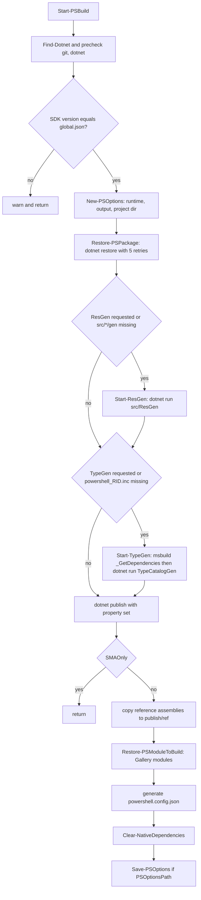

# Build system

> STATIC-ONLY — behavior not run-verified. Nothing in this document was executed; statements come from reading `build.psm1`, MSBuild props and project files (`FACT-SRC`) or are marked `INFERENCE`.

## 1. Purpose and scope [SPEC]

Describes how the repository is turned into a runnable `pwsh`: the `build.psm1` module, the MSBuild property files, generated sources (resource bindings, type catalog, version info), the configuration/runtime matrix, and experimental-feature list generation. Packaging and CI are in [ci-cd-and-packaging.md](ci-cd-and-packaging.md). Scope class is `OUT-OF-SCOPE-DOCUMENTED` for the new shell (build tooling is replaceable); the lessons below are about build design, not language behavior.

## 2. Source map

| Path | Role | Tier |
|---|---|---|
| `build.psm1` (4,900 lines, 66 functions) | PowerShell build module: bootstrap, build, test runners, options, helpers | C |
| `PowerShell.Common.props` | Shared MSBuild properties and the version-computation target | C |
| `Analyzers.props` | Adds `StyleCop.Analyzers` and `DotNetAnalyzers.DocumentationAnalyzers` to every project that imports it | C |
| `global.json` | Pins SDK `10.0.403` | C |
| `nuget.config` | Clears sources; one feed (PowerShell Azure Artifacts) | C |
| `src/powershell-unix/powershell-unix.csproj`, `src/powershell-win-core/powershell-win-core.csproj` | Top-level executable projects producing `pwsh` | C |
| `src/Microsoft.PowerShell.GlobalTool.Shim` | Entry point for the framework-dependent .NET global tool package | C |
| `src/ResGen/Program.cs` | Generates strongly typed C# accessors for `.resx` files | C |
| `src/TypeCatalogGen/TypeCatalogGen.cs` | Generates `CorePsTypeCatalog.cs` (type name to assembly catalog) | C |
| `src/System.Management.Automation/SourceGenerators/PSVersionInfoGenerator` | Roslyn source generator for version info | C |
| `src/Modules/PSGalleryModules.csproj` | Declares Gallery modules restored into the build output | C |

## 3. Responsibilities and non-responsibilities

Responsible for: restore, resource/type-catalog generation, `dotnet publish` per runtime identifier, module restore, `powershell.config.json` generation, native-dependency cleanup, test-runner entry points. Not responsible for: signing, installers, release orchestration (see packaging document).

## 4. Key types and contracts [IMPL]

`build.psm1` function inventory (names and start lines from `rg '^function '`; `GENERATED`): `Start-PSBuild`@L335, `Switch-PSNugetConfig`@L900, `Restore-PSPackage`@L1033, `Restore-PSModuleToBuild`@L1164, `Restore-PSPester`@L1190, `New-PSOptions`@L1230, `Get-PSOptions`@L1401, `Start-PSPester`@L1703, `Start-PSxUnit`@L2509, `Install-Dotnet`@L2670, `Start-PSBootstrap`@L2865, `Start-DevPowerShell`@L3188, `Start-TypeGen`@L3276, `Start-ResGen`@L3314, `Find-Dotnet`@L3337, `Copy-PSGalleryModules`@L3624, `Save-PSOptions`@L4125, `New-PSOptionsObject`@L4195, `Clear-NativeDependencies`@L4771, `Update-DotNetSdkVersion`@L4848 and others (full list: 66 functions).

The central contract is the **PSOptions** hashtable returned by `New-PSOptions` (`build.psm1::New-PSOptions@L1230-L1400`, then `New-PSOptionsObject`@L4195): `Configuration`, `Framework`, `Runtime`, `Output` (full path of the executable), `Top` (project directory), `SMAOnly`, `PSModuleRestore`, `ForMinimalSize`, `RootInfo`. It is stored with `Save-PSOptions` and reloaded with `Restore-PSOptions` so later steps (tests, packaging) reuse the same build description.

## 5. Data model

Configuration ∈ {`Debug`, `Release`, `CodeCoverage`, `StaticAnalysis`} (`ValidateSet` at `Start-PSBuild@L438`). Runtime identifiers accepted: `linux-musl-x64`, `fxdependent`, `fxdependent-noopt-linux-musl-x64`, `fxdependent-linux-x64`, `fxdependent-linux-arm64`, `fxdependent-win-desktop`, `linux-arm`, `linux-arm64`, `linux-x64`, `osx-arm64`, `osx-x64`, `win-arm`, `win-arm64`, `win7-x64`, `win7-x86` (15 values, `Start-PSBuild@L421-L435`). Framework is fixed to `net10.0` (`New-PSOptions` `ValidateSet("net10.0")`). Output path: `src/<powershell-win-core|powershell-unix>/bin/<Configuration>/<Framework>/<Runtime>/publish/<pwsh|pwsh.exe|pwsh.dll>` (`New-PSOptions@L1330-L1356`). A release build expects the repo at the file-system root under the folder name `PowerShell` (`RootInfo.ValidPath`, warning otherwise).

## 6. Control flow [IMPL]

Ordered steps (`build.psm1::Start-PSBuild@L335-L898`): validate cross-compile combinations (linux-arm only on Ubuntu/Mariner hosts; win-arm/win-arm64 only on Windows; minimal-size only for six runtimes, `@L459-L471`); optionally `Switch-PSNugetConfig -Source Public` for `-UseNuGetOrg`; optional `git clean -fdX` with exclusions for `-Clean`; locate the SDK and check it equals the required version, else warn and return (`@L519-L539`); build the option set; assemble `dotnet publish` arguments (`@L561-L657`); restore; run ResGen/TypeGen heuristics; publish; remove satellite assemblies when not needed; publish reference assemblies; restore modules; write `powershell.config.json`; optionally restore Pester for `-CI`; clean native dependencies.

## 7. Algorithms

- **Self-contained vs framework-dependent.** `fxdependent*` runtimes get `--no-self-contained` and `UseAppHost=true`; every other runtime gets `--self-contained` (`@L578-L587`). `AppDeployment` property: `FxDependent` (global-tool and zip packages), `FxDependentDeployment` (the "optimized" framework-dependent runtime matched by `$optimizedFddRegex`) or `SelfContained` (`@L610-L627`).
- **SDK selection.** `win7-*` and `win-arm64` (not minimal-size) publish with `Microsoft.NET.Sdk.WindowsDesktop` so WPF/WinForms and the GraphicalHost assemblies are included; others use `Microsoft.NET.Sdk` (`@L697-L709`, also in `Restore-PSPackage@L1074-L1084`).
- **IsWindows property.** `win*` runtimes (or fxdependent on a Windows host) pass `/property:IsWindows=true`, plus `EnableWindowsTargeting=true` when the host is not Windows; others pass `IsWindows=false` (`@L600-L608`). `PowerShell.Common.props` turns this into the `UNIX` define (`DefineConstants += UNIX` when `IsWindows != true`) and always defines `CORECLR`. This is the origin of the two preprocessor families visible in `data/conditional-compilation.json`.
- **Satellite assemblies.** Localized resources are produced only for `win7-x64`, `win7-x86`, `win-arm64` (non-minimal) unless `-ForceProduceLocalizedResources`; otherwise `SatelliteResourceLanguages=en` and `System.Management.Automation.resources.dll` directories are deleted after publish (`@L563-L572`, `@L748-L760`).
- **ReadyToRun.** `PublishReadyToRun=true` only for `Release` and (`SelfContained` and not `ForMinimalSize`) or `FxDependentDeployment`; never for `FxDependent` (`PowerShell.Common.props`, property groups after `Define properties for Framework dependent deployments`).
- **Version computation.** MSBuild target `GetPSCoreVersionFromGit` (before `_GenerateRestoreProjectSpec;GenerateNuspec;BeforeBuild`) runs `git describe --abbrev=60 --long` and parses `^v(.+)-(\d+)-g(.+)` into version, additional commits and SHA; with `ReleaseTag` set, the tag is parsed by `^((\d+).(\d+).(\d+))(-(\w+)(.(\d+))?)?$`: `7.2.0` -> `7.2.0`, `7.2.0-preview.1` -> `7.2.0.1`, `7.2.0-rc.1` -> `7.2.0.101` (RC iteration offset 100, from the comment in the props file). `AssemblyVersion` keeps the build field at 0 so servicing releases do not change it (`PowerShell.Common.props` comment).
- **Experimental-feature list.** Only for preview, non-RC versions: either the freshly built `pwsh` is run to enumerate features, or the pre-generated `experimental-feature-windows.json`/`experimental-feature-linux.json` at the repo root are used (`Start-PSBuild@L842-L871`, `Test-ShouldGenerateExperimentalFeatures`@L982). The switch `-SkipExperimentalFeatureGeneration` exists because "bugs [in parsing/compilation] can mean we can't get past this step" (comment `@L407-L409`, `INFERENCE` about consequences).
- **Config file.** On Windows runtimes the generated `powershell.config.json` sets `Microsoft.PowerShell:ExecutionPolicy = RemoteSigned` and a `WindowsPowerShellCompatibilityModuleDenyList` of `PSScheduledJob`, `BestPractices`, `UpdateServices` (`@L836-L840`).

## 8. Observable behavior [SPEC]

Output of a successful full build is a self-contained publish folder containing `pwsh` (or `pwsh.exe`), `System.Management.Automation.dll` and the other product assemblies, a `ref/` folder of .NET reference assemblies taken from `powershell_<RID>.inc` entries matching `microsoft.netcore.app`, a `Modules/` folder with Gallery modules (`PSReadLine`, `PowerShellGet`, `PackageManagement`, `Microsoft.PowerShell.PSResourceGet`, `Microsoft.PowerShell.Archive`, `Microsoft.PowerShell.ThreadJob`, see [external dependencies](../00-overview/external-dependencies.md)) and `powershell.config.json`. No golden sample: STATIC-ONLY.

## 9. Error handling and edge cases

`dotnet restore` is retried up to 5 times per project (`Restore-PSPackage@L1105-L1160`); when `ENABLE_MSBUILD_BINLOGS=true` the binlog is copied out on final failure. A mismatched SDK produces a warning with fix steps and the function returns without building. **Fork-specific edge case (`INFERENCE`, not run):** the version target executes `git describe` unconditionally, and this repository has no tags (`git describe` reports "No names found"); a build of this fork therefore needs a local tag (for example `git tag v7.6.9`) or `Sync-PSTags` (`build.psm1::Sync-PSTags@L35`) against a reachable upstream. `Exec` without `ContinueOnError` fails the build when the command fails (MSBuild behavior, `EXTERNAL`).

## 10. Concurrency and threading

Not applicable: sequential script; MSBuild parallelism is outside this repository's control.

## 11. Extension points and customization hooks

Parameters of `Start-PSBuild` (`-Runtime`, `-Configuration`, `-ReleaseTag`, `-SMAOnly` for fast engine-only iteration, `-ForMinimalSize`, `-SkipRoslynAnalyzers`, `-UseNuGetOrg`, `-PSOptionsPath`), environment variables (`ENABLE_MSBUILD_BINLOGS`, `OB_OUTPUTDIRECTORY`), MSBuild properties `AppDeployment`, `SDKToUse`, `ForMinimalSize`, `ReleaseTag`, `RunAnalyzersDuringBuild`.

## 12. Dependencies

Inbound: CI pipelines and packaging call `Start-PSBuild`. Outbound: `git`, .NET SDK 10.0.403 (`global.json`), the PowerShell Azure Artifacts NuGet feed (`nuget.config`) or nuget.org with `-UseNuGetOrg`, an existing `pwsh` to run the module itself (the build is written in PowerShell; bootstrap details in `Start-PSBootstrap`@L2865).

## 13. Performance notes

Top-level executable projects enable `TieredCompilation`, `TieredCompilationQuickJit` and `TieredCompilationQuickJitForLoops` (`src/powershell-unix/powershell-unix.csproj`); ReadyToRun is the startup optimization for Release builds (see Algorithms). `rollForwardOnNoCandidateFx: 1` in `runtimeconfig.template.json` permits roll-forward to a newer minor/patch runtime for framework-dependent runs.

## 14. Security considerations

Supply chain: `nuget.config` clears all sources and names a single feed; `-UseNuGetOrg` switches to public sources explicitly. Assemblies use `DelaySign` with `../signing/visualstudiopublic.snk` and `SignAssembly=true` (`PowerShell.Common.props`): the committed key is a public key for delay signing; real signing happens in the release pipelines. `TreatWarningsAsErrors=true`, `EnforceCodeStyleInBuild=true`, `Features=strict`, `AllowUnsafeBlocks=true`. `Clear-NativeDependencies` rewrites `pwsh.deps.json` to drop unneeded `microsoft.diasymreader.native.*` DLL entries (`@L4771-L4847`). No SEC-ENF points live here.

## 15. Enterprise considerations

Reproducibility depends on git tags and the single package feed; there is no lock file in the repository tree (no `packages.lock.json` found in `data/files.csv`, `APPROX`); build metadata (`ProductVersion`, commit SHA) is embedded via `PSVersionInfoGenerator`. Supportability: `Write-LogGroup*` helpers produce collapsible CI logs.

## 16. Tests

Build helpers are exercised by `tools/ci.psm1` stage functions (`Invoke-CIBuild`@L102, `Invoke-CIxUnit`@L201, `Invoke-CITest`@L271) and the infrastructure job in `.github/workflows/linux-ci.yml`; see [ci-cd-and-packaging.md](ci-cd-and-packaging.md) and the Phase 6 engineering documents.

## 17. Design decisions and trade-offs

- Build logic lives in a PowerShell module rather than in MSBuild: flexible orchestration, but it makes the first build depend on an installed PowerShell (bootstrap problem; `INFERENCE`).
- Heuristic generation (`ResGen` when `src/Microsoft.PowerShell.ConsoleHost/gen` is missing; `TypeGen` when the `.inc` file is missing) trades determinism for convenience (`FACT-SRC`: `@L664-L682`).
- The type catalog `CorePsTypeCatalog.cs` is generated from the dependency closure of `Microsoft.PowerShell.SDK` so type-name resolution does not need reflection over all assemblies (`INFERENCE` from `Start-TypeGen` doc comment: "maps .NET types to their containing assemblies").
- A comment/code mismatch: the `.PARAMETER Framework` text of `New-PSOptions` says the default is `net11.0` while code and props use `net10.0`; the code wins (rule 1) — recorded as CON-001.

## 18. Guidance for the new shell [LESSON]

- **LSN-BUILD-01** [ADAPT] (area: NLD-RUN) Build with standard `dotnet` tooling and MSBuild props only, with version computed from one tag plus an explicit override, instead of an orchestration module needing an installed shell. Evidence: `PowerShell.Common.props::GetPSCoreVersionFromGit`; `build.psm1::Start-PSBuild@L335-L898`. 
- **LSN-BUILD-02** [REPLICATE] (area: NLD-TOOL) Keep the two preprocessor families (`UNIX`/`CORECLR`) out of the language core by isolating platform code behind an interface; PowerShell's use of `IsWindows` to drive `DefineConstants` spreads `#if UNIX` through the engine. Evidence: `PowerShell.Common.props` (`DefineConstants`), `data/conditional-compilation.json`.
- **LSN-BUILD-03** [ADAPT] (area: NLD-SEC) Pin a single package feed and commit lock files; PowerShell pins one feed but ships no lock files. Evidence: `nuget.config`.
- **LSN-BUILD-04** [REPLICATE] (area: NLD-TOOL) Generate resource accessors and type catalogs at build time with small console tools that are themselves part of the repository (`ResGen`, `TypeCatalogGen`). Evidence: `src/ResGen/Program.cs`, `build.psm1::Start-ResGen@L3314-L3335`.

## 19. Open questions / UNVERIFIED items

- `UNVERIFIED`: that a tag-less clone fails at `git describe` (not run; no .NET SDK available). Fix: run `Start-PSBuild` on a machine with the SDK after tagging.
- `UNVERIFIED`: contents of the omitted lines of `Start-PSBootstrap`, `Install-Dotnet` (read only the signatures).

Verification: function list from `rg '^function ' build.psm1` (66); `Start-PSBuild` (L335-L898), `New-PSOptions` (L1230-L1400), `Restore-PSPackage`, `Restore-PSModuleToBuild`, `Clear-NativeDependencies`, `Start-TypeGen`, `Start-ResGen` read in full; props files read in full; project count from `numbers.json` (<!--N:PROJECT_COUNT-->40<!--/N--> projects).
