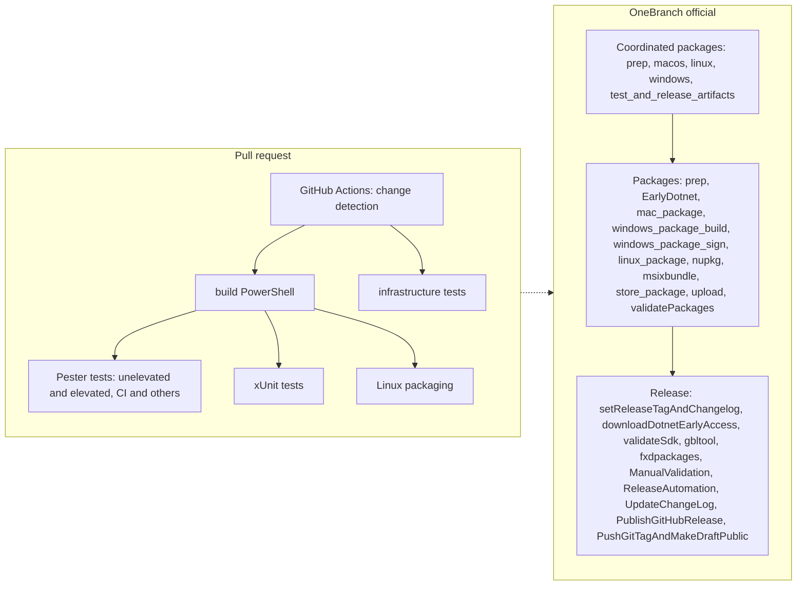

# CI/CD and packaging pipelines

> STATIC-ONLY — behavior not run-verified. Pipelines were read, not executed; pipeline definitions can reference templates or service connections that are not in this repository (`UNVERIFIED` where noted).

## 1. Purpose and scope [SPEC]

Inventory of the automation around the source tree: public GitHub Actions CI, Azure DevOps CI definitions, the internal OneBranch "official" pipelines that build, sign, package and release, and the packaging library (`tools/packaging/packaging.psm1`). Build mechanics are in [build-system.md](build-system.md).

## 2. Source map

| Path | Role | Tier |
|---|---|---|
| `.github/workflows/*.yml` (11 workflows) | GitHub Actions: `linux-ci`, `windows-ci`, `macos-ci`, `xunit-tests` (reusable), `analyze-reusable` (CodeQL, reusable), `dependency-review`, `scorecards`, `verify-markdown-links`, `labels`, `copilot-setup-steps`, `windows-packaging-reusable` | C |
| `.github/actions/**` | Composite actions: build/ci, test (linux-packaging, nix, windows, process-pester-results), infrastructure (get-changed-files, markdownlinks, merge-conflict-checker, path-filters) | C |
| `.github/instructions/*.md`, `.github/agents`, `.github/chatmodes` | Contributor/AI-agent guidance files for build, OneBranch and Pester conventions | C |
| `.vsts-ci/*.yml` | Azure DevOps CI: `linux`, `windows`, `mac`, daily variants, `windows-arm64`, `sshremoting-tests`, `psresourceget-acr`, `install-ps`, `linux-internal`, `misc-analysis`, templates | C |
| `.pipelines/*.yml`, `.pipelines/templates/**` | OneBranch official/non-official pipelines: coordinated packages, packages, release, release-Azure, vPack, MSIX bundle vPack, apiscan notice | C |
| `.pipelines/EV2Specs/**` | EV2 rollout specs for Linux package upload | C |
| `.pipelines/store/PDPs/**` | Microsoft Store product description pages (per locale) | C |
| `tools/ci.psm1` | CI stage functions called by the pipelines | C |
| `tools/packaging/packaging.psm1` (5,276 lines) | Package creation for all formats | C |
| `tools/releaseBuild`, `tools/releaseTools.psm1`, `tools/Sign-Package.ps1` | Release tag and signing helpers | C |
| `.config/*.json|xml` | Security and compliance configuration (TSA options, code-sign policy, suppressions) | C |

## 3. Responsibilities and non-responsibilities

Responsible: build/test on three OS families, packaging into MSI, MSIX, deb, rpm, macOS pkg, tar, zip, NuGet and global-tool packages, signing, release validation and publishing. Not responsible for: language or engine behavior.

## 4. Key types and contracts [IMPL]

- `tools/ci.psm1` stage functions (line numbers from `rg '^function '`, `GENERATED`): `Invoke-CIFull`@L85, `Invoke-CIBuild`@L102, `Invoke-CIInstall`@L140, `Invoke-CIxUnit`@L201, `Install-CIPester`@L232, `Invoke-CITest`@L271, `New-CodeCoverageAndTestPackage`@L443, `Invoke-CIFinish`@L554, `Invoke-LinuxTestsCore`@L749, `New-LinuxPackage`@L897.
- `tools/packaging/packaging.psm1::Start-PSPackage@L38`: `-Type` is a `ValidateSet` of 19 values: `msix`, `deb`, `deb-arm64`, `osxpkg`, `rpm`, `rpm-fxdependent`, `rpm-fxdependent-arm64`, `msi`, `zip`, `zip-pdb`, `tar`, `tar-arm`, `tar-arm64`, `tar-alpine`, `fxdependent`, `fxdependent-win-desktop`, `min-size-x64`, `min-size-arm64`, `tar-alpine-fxdependent`; `-WindowsRuntime` ∈ {`win7-x86`,`win7-x64`,`win-arm`,`win-arm64`}; `-MacOSRuntime` ∈ {`osx-x64`,`osx-arm64`}. Supporting functions (names and lines): `New-TarballPackage`@L691, `New-UnixPackage`@L994, `New-NativeDeb`@L1739, `New-RpmSpec`@L1580, `New-MacOSPackage`@L1956, `New-ZipPackage`@L2509, `New-NugetPackage`@L3325, `New-MSIPackage`@L3557, `New-MSIXPackage`@L3949, `New-GlobalToolNupkgSource`@L4459, `Test-PackageManifest`@L4839, `Test-Bom`@L5123.

## 5. Data model

Pipeline parameters carry the release tag, runtime/SDK versions for "early access" .NET builds and signing switches (parameters `Release Tag`, `Skip Signing`, `Early Access Feed`, `Runtime version of early access build`, `SDK version of early access build` in `.pipelines/PowerShell-Packages-Official.yml`). Package metadata derives from the release tag (`Get-PackageSemanticVersion`@L3385, `Get-LinuxPackageSemanticVersion`@L3419, `Get-NugetSemanticVersion`@L3446).

## 6. Control flow [IMPL]

Stage names are quoted from `.pipelines/templates/stages/*.yml` (`FACT-SRC`): Coordinated packages stages `prep`, `macos`, `linux`, `windows`, `test_and_release_artifacts`; Packages stages `prep`, `EarlyDotnet`, `mac_package`, `windows_package_build`, `windows_package_sign`, `linux_package`, `nupkg`, `msixbundle`, `store_package`, `upload`, `validatePackages`; Release stages `setReleaseTagAndChangelog`, `downloadDotnetEarlyAccess`, `validateSdk`, `gbltool`, `fxdpackages`, `ManualValidation`, `ReleaseAutomation`, `UpdateChangeLog`, `PublishGitHubRelease`, `PushGitTagAndMakeDraftPublic`; vPack: one `BuildStage`/`BuildJob`.

## 7. Algorithms

- **PR change detection.** `linux-ci.yml` runs a `changes` job first; build and test jobs depend on it (`needs: changes`) and path filters for pull requests live in that job (comment at `linux-ci.yml` "Path filters for PRs need to go into the changes job").
- **Linux job graph** (`.github/workflows/linux-ci.yml`): `changes` → `ci_build` → {`linux_test_unelevated_ci`, `linux_test_elevated_ci`, `linux_test_unelevated_others`, `linux_test_elevated_others`, `xunit_tests`, `linux_packaging`}, plus `merge_conflict_check`, `infrastructure_tests`, and `ready_to_merge` delegating to an external reusable workflow pinned by commit SHA.
- **Concurrency.** `concurrency.group = workflow-ref`; in-progress runs are cancelled only for refs containing `merge`.
- **Triggers.** Push to `master`, `release/**`, `github-mirror`, `servicing-*`; pull requests also for `*-feature` branches; `.pipelines/**` and `test/perf/**` paths excluded from push triggers.

## 8. Observable behavior [SPEC]

Produces build artifacts and test results per platform and release assets. No golden sample: STATIC-ONLY.

## 9. Error handling and edge cases

`pull_request` workflows for forks run with reduced permissions (GitHub behavior, `EXTERNAL`). `Invoke-CIFinish`@L554 uploads artifacts and publishes results; failing tests are reported via the `process-pester-results` action. Release validation includes manual and "release automation" stages that require human sign-off (`ManualValidation`, `approvalJob.yml`).

## 10. Concurrency and threading

Job-level parallelism only (GitHub `needs` graph; OneBranch stage graph).

## 11. Extension points and customization hooks

Reusable workflows (`xunit-tests`, `analyze-reusable`, `windows-packaging-reusable`), composite actions under `.github/actions`, template YAML under `.pipelines/templates`, variable templates under `.pipelines/templates/variables`.

## 12. Dependencies

OneBranch templates (`v2/OneBranch.Official.CrossPlat.yml@onebranchTemplates`), Microsoft-internal signing and ESRP-like services, `PowerShell/compliance` workflow, Azure Artifacts feed, Azure Blob storage (`uploadToAzure.yml`, `checkAzureContainer.yml`), GitHub Releases, packages.microsoft.com publication (`release-publish-pmc.yml`), WinGet release script (`tools/releaseToWinget.ps1`). Internal service details are not in the repo (`UNVERIFIED`).

## 13. Performance notes

Not applicable for pipelines beyond job parallelism and ReadyToRun options passed through `Start-PSBuild` (see build-system).

## 14. Security considerations

Supply-chain controls present in the repo (`FACT-SRC`): `scorecards.yml` (OpenSSF Scorecard), `dependency-review.yml` on pull requests, CodeQL via `analyze-reusable.yml` (called from `windows-ci.yml`; the call in `linux-ci.yml` is commented out), Dependabot for GitHub Actions and Docker (`.github/dependabot.yml`), SHA-pinned external reusable workflow (`ready_to_merge`), credential scanning templates (`.vsts-ci/templates/credscan.yml`, `tools/credScan`), component governance (`tools/ComponentGovernance`, `tools/cgmanifest`), and a code-sign validation policy (`.config/codesignpolicy.xml`, a WDAC-style `SiPolicy` that accepts only the "Windows Internal Build Tools" signer for vPack payloads, per its own comment). Signing configuration guidance is in `.github/instructions/onebranch-signing-configuration.instructions.md`. These are enforcement points of the *release process*, not of the runtime; the runtime enforcement points are catalogued in Phase 5.

## 15. Enterprise considerations

Strengths: multi-platform matrix, signed artifacts, validation of SDK, global-tool and framework-dependent packages before release. Gaps for a new product: reliance on internal Microsoft services (OneBranch, EV2) that cannot be reproduced; no SBOM generation step was found by name (`UNVERIFIED`; `tools/cgmanifest` is a component manifest, not verified to be an SBOM).

## 16. Tests

CI runs Pester (`Invoke-CITest`@L271), xUnit (`Invoke-CIxUnit`@L201), infrastructure tests, markdown link verification (`verify-markdown-links.yml`). Test layout is documented in the Phase 6 documents.

## 17. Design decisions and trade-offs

- Dual CI (GitHub Actions public, Azure DevOps and OneBranch internal) keeps public contributor feedback separate from signed release builds (`INFERENCE`).
- Packaging code is a 5,276-line PowerShell module with one entry point and per-format helpers; flexibility over testability (`INFERENCE`; test hooks exist: `Test-PackageManifest`, `Test-Bom`, `Test-Dependencies`).

## 18. Guidance for the new shell [LESSON]

- **LSN-CICD-01** [ADAPT] (area: NLD-TOOL) Use declarative pipeline templates plus a thin script layer; keep package-format code behind a single `Start-Package`-style entry with a closed format list as `Start-PSPackage` does. Evidence: `tools/packaging/packaging.psm1::Start-PSPackage@L38`.
- **LSN-CICD-02** [REPLICATE] (area: NLD-SEC) Pin third-party workflows by commit SHA and run dependency review, CodeQL and Scorecard on every change. Evidence: `.github/workflows/linux-ci.yml` (`ready_to_merge` reference), `.github/workflows/dependency-review.yml`, `scorecards.yml`.
- **LSN-CICD-03** [REPLICATE] (area: NLD-SEC) Validate signed payloads against an explicit allow-list signer policy before publishing. Evidence: `.config/codesignpolicy.xml`.

## 19. Open questions / UNVERIFIED items

- `UNVERIFIED`: job steps inside `.vsts-ci/templates/*` and `.pipelines/templates/*` were inventoried by name, not read line by line.
- `UNVERIFIED`: whether an SBOM is produced.

Verification: workflow list from the directory listing (11 files); stage names grepped from the four stage templates; `ci.psm1` and `packaging.psm1` function names from `rg '^function '`; `Start-PSPackage` `ValidateSet` read in full.
