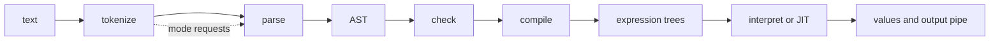

# Language pipeline map

> STATIC-ONLY — behavior not run-verified. One page: stage → files → entry points → data handed to the next stage. Details: [STAGE-CONTRACTS.md](STAGE-CONTRACTS.md) (exact contracts), [CALL-GRAPHS.md](CALL-GRAPHS.md), [LIFECYCLE-script-execution.md](LIFECYCLE-script-execution.md).

| # | Stage | Files (under `src/System.Management.Automation/engine/`) | Entry point | Hands to next stage | Document |
|---|---|---|---|---|---|
| 1 | Tokenize | `parser/tokenizer.cs`, `parser/token.cs`, `parser/CharTraits.cs` | `Tokenizer.NextToken` (pull, mode-driven) | `Token` objects, optional token list | [02.1-tokenizer.md](02.1-tokenizer.md), [TOKEN-CATALOG.md](TOKEN-CATALOG.md) |
| 2 | Parse | `parser/Parser.cs` | `Parser.ParseInput` / `ParseFile` | `ScriptBlockAst`, `Token[]`, `ParseError[]` | [02.2-parser.md](02.2-parser.md), [GRAMMAR.ebnf.md](GRAMMAR.ebnf.md), [ERROR-CATALOG.md](ERROR-CATALOG.md) |
| 3 | AST | `parser/ast.cs`, `parser/AstVisitor.cs`, `parser/PreOrderVisitor.cs` | `new …Ast(…)` in the parser | the tree (parents, extents) | [02.3-ast.md](02.3-ast.md), [AST-CATALOG.md](AST-CATALOG.md) |
| 4 | Check | `parser/SymbolResolver.cs`, `parser/SemanticChecks.cs`, `parser/TypeResolver.cs`, `parser/VariableAnalysis.cs` | `ScriptBlockAst.PerformPostParseChecks` | extra `ParseError`s; node annotations | [02.4-semantic-analysis.md](02.4-semantic-analysis.md) |
| 5 | Compile | `parser/Compiler.cs`, `runtime/CompiledScriptBlock.cs` | `CompiledScriptBlockData.Compile` → `Compiler.Compile` | per-block `Action<FunctionContext>` (tiered delegate) | [02.5-compiler-and-engine.md](02.5-compiler-and-engine.md), [COMPILATION-MAP.md](COMPILATION-MAP.md), [IR-SPEC.md](IR-SPEC.md) |
| 6 | Tier | `interpreter/*.cs` | `LightCompiler.CompileTop`, `LightLambda` | interpreted or JIT code | [TIERING-POLICY.md](TIERING-POLICY.md), [INSTRUCTION-SET.md](INSTRUCTION-SET.md), [EQUIVALENCE-SPEC.md](EQUIVALENCE-SPEC.md) |
| 7 | Execute | `runtime/Binding/Binders.cs`, `runtime/Operations/*.cs`, `LanguagePrimitives.cs`, session state | `ScriptBlock.InvokeWithPipeImpl` | values, errors, output-pipe writes | [02.6-types-and-operators.md](02.6-types-and-operators.md), [BINDER-CATALOG.md](BINDER-CATALOG.md), [RUNTIME-OPERATIONS.md](RUNTIME-OPERATIONS.md), [SCOPE-AND-VARIABLES.md](SCOPE-AND-VARIABLES.md) |

Cross-cutting: scopes and variables ([SCOPE-AND-VARIABLES.md](SCOPE-AND-VARIABLES.md)), script blocks ([SCRIPT-BLOCKS.md](SCRIPT-BLOCKS.md)), language features ([02.7-language-features.md](02.7-language-features.md)), tooling ([02.8-language-tooling.md](02.8-language-tooling.md)), extension ([HOWTO-extend-language.md](HOWTO-extend-language.md)).

Two facts that shape the map: the **tokenizer is not a separate pass** (the parser pulls tokens and sets the tokenizer mode per rule, [02.1-tokenizer.md](02.1-tokenizer.md) §6.2), and PowerShell does **not** interpret the AST directly: it compiles the AST to expression trees and then interprets or JIT-compiles those ([02.5-compiler-and-engine.md](02.5-compiler-and-engine.md) §1).

Verification: stage names and entry points taken from the documents linked in each row; file lists from `data/files.csv` areas.
