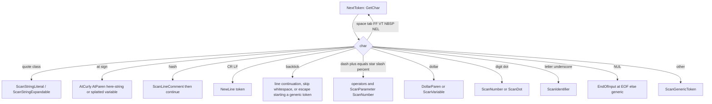

# Tokenizer

> STATIC-ONLY — behavior not run-verified. Statements are `FACT-SRC` (read in the cited source) unless marked `INFERENCE` or `UNVERIFIED`. Full catalogs (every token kind, flag, keyword, dash operator, character class) are in [TOKEN-CATALOG.md](TOKEN-CATALOG.md) and are `GENERATED`.

## 1. Purpose and scope [SPEC]

The tokenizer turns script text into `Token` objects on demand: the parser calls `NextToken()` one token at a time and tells the tokenizer, through a `Mode` property, how to read the next characters. There is **no pre-pass** that tokenizes the whole file: the same characters can become different tokens depending on the mode the parser requests. `FACT-SRC` (`src/System.Management.Automation/engine/parser/tokenizer.cs::Tokenizer.NextToken@L4612-L5081`, `src/System.Management.Automation/engine/parser/Parser.cs::Parser.SetTokenizerMode@L499-L535`).

Scope: character-level rules, mode handling, number/string/variable/comment lexical rules, position tracking, the pushback (`Resync`) mechanism, and the `#requires` pre-processing that lives in `tokenizer.cs`. Out of scope here: grammar (see [02.2-parser.md](02.2-parser.md), planned T22), the AST, and DSC dynamic-keyword semantics beyond how they change keyword recognition.

Terminology: this study says *tokenize* (text → tokens), *parse* (tokens → AST), per [GLOSSARY](../GLOSSARY.md).

## 2. Source map

| path | type | role | tier |
|---|---|---|---|
| `src/System.Management.Automation/engine/parser/tokenizer.cs::Tokenizer@L594-L5083` | `internal class` | the tokenizer: ~5000 lines, whole file read in 16 windows | A |
| `src/System.Management.Automation/engine/parser/token.cs::TokenKind@L18-L595` | `public enum` | token kinds (see [TOKEN-CATALOG](TOKEN-CATALOG.md) §3) | A |
| `src/System.Management.Automation/engine/parser/token.cs::TokenFlags@L601-L752` | `[Flags] public enum` | static traits of a kind (precedence, keyword, operator class...) | A |
| `src/System.Management.Automation/engine/parser/token.cs::TokenTraits@L759-L1211` | static class | `s_staticTokenFlags` and `s_tokenText` tables, `GetTraits`, `Text`, `GetBinaryPrecedence` | A |
| `src/System.Management.Automation/engine/parser/token.cs::Token@L1216-L1280` | `public class` | base token: kind, flags, extent | A |
| `src/System.Management.Automation/engine/parser/CharTraits.cs::CharTraits@L28-L89` | `internal enum` | per-character class bits; 128-entry ASCII table at `s_traits` | A |
| `src/System.Management.Automation/engine/parser/CharTraits.cs::CharExtensions@L230-L413` | static class | `IsWhitespace`, `IsDash`, `IsVariableStart`, `ForceStartNewToken`, ... | A |
| `src/System.Management.Automation/engine/parser/tokenizer.cs::DynamicKeyword@L71-L357` | `public class` | thread-local table of DSC dynamic keywords consulted when recognizing keywords | A |
| `src/System.Management.Automation/engine/parser/tokenizer.cs::TokenizerState@L582-L593` | `internal class` | snapshot used by nested scans | A |

`tokenizer.cs` also holds the `DynamicKeyword` family (L24-L488) and the `#requires` processor (L1892-L2275); neither is tokenizing proper (`FACT-SRC`, notes W1-W2, W7-W8).

## 3. Responsibilities and non-responsibilities

Responsible for: classifying characters (`CharTraits`), producing tokens in a mode, tracking token extents (including compensation for rewritten text), comment handling, signature-block detection, `#requires` extraction, number literal parsing to a typed value, pushback support.
Not responsible for: grammar decisions, newline significance (the tokenizer emits `NewLine` tokens; the parser decides), semantic checks, evaluating expandable strings (it only records nested tokens and a format string).

## 4. Key types and contracts [IMPL]

**Entry points** (`src/System.Management.Automation/engine/parser/tokenizer.cs::Tokenizer.Initialize@L762-L797`, `Tokenizer.NextToken@L4612-L5081`): `Initialize(fileName, input, tokenList)` builds the line-start table and sets `Mode = Command`; `NextToken()` returns the next `Token`; `GetRestorePoint()`/`Resync()` support backtracking (§6.6).

**Token classes** (`src/System.Management.Automation/engine/parser/token.cs::Token@L1216-L1280` and subclasses, L1281-L1575):

| Class | Extra data | Used for kinds |
|---|---|---|
| `Token` | `Kind`, `TokenFlags`, `Extent`, `Text` | punctuators, operators, keywords, `Identifier`, `NewLine`, `Comment`, `EndOfInput`, `Unknown` |
| `NumberToken` | `Value` (typed object) | `Number` |
| `ParameterToken` | `ParameterName`, `UsedColon` | `Parameter` |
| `VariableToken` | `VariablePath`, `Name` | `Variable`, `SplattedVariable` |
| `StringLiteralToken` / `StringExpandableToken` | `Value`; expandable adds `NestedTokens`, internal `FormatString` | `StringLiteral`, `StringExpandable`, `HereStringLiteral`, `HereStringExpandable`, and `Generic` |
| `LabelToken` | `LabelText` | `Label` |
| `InputRedirectionToken`, `MergingRedirectionToken` (`FromStream`, `ToStream`), `FileRedirectionToken` (`FromStream`, `Append`) | stream numbers | `Redirection` |
| `UnscannedSubExprToken` (internal) | `SkippedCharOffsets` (`BitArray`) | text of a `$(...)` inside a string, scanned later |

`TokenKind` has <!--N:TOKENKIND_MEMBERS-->157<!--/N--> named members with explicit values 0..170; values 105-118 are 14 unnamed reserved slots (`FACT-SRC`, `src/System.Management.Automation/engine/parser/token.cs::TokenKind@L18-L595`, table placeholders `Reserved slot N`). The comment on L20-22 requires that adding a kind also updates `s_staticTokenFlags` and `s_tokenText`; a `#if DEBUG` static constructor asserts both tables have `(int)TokenKind.Clean + 1` entries (`src/System.Management.Automation/engine/parser/token.cs::TokenTraits@L1159-L1180`).

**Mode** (`src/System.Management.Automation/engine/parser/tokenizer.cs::TokenizerMode@L489-L495`): `Command`, `Expression`, `TypeName`, `Signature` (class/method declaration). `Initialize` sets `Command`. Two further switches are properties of the tokenizer, not modes: `AllowSignedNumbers`, `ForceEndNumberOnTernaryOpChars`, and `WantSimpleName` (`src/System.Management.Automation/engine/parser/tokenizer.cs::Tokenizer.Mode@L729-L752`).

## 5. Data model

- State: `_script`, `_tokenStart`, `_currentIndex`, `_nestedTokensAdjustment`, `_skippedCharOffsets`, `_beginSignatureExtent`, `TokenList`, `FirstToken`, `LastToken`, `RequiresTokens` (`src/System.Management.Automation/engine/parser/tokenizer.cs::Tokenizer@L597-L621`).
- Character classes: 128-entry `s_traits` table with bits `IdentifierStart`, `MultiplierStart`, `TypeSuffix`, `Whitespace`, `Newline`, `HexDigit`, `Digit`, `VarNameFirst`, `ForceStartNewToken`, `ForceStartNewAssemblyNameSpecToken`, `ForceStartNewTokenAfterNumber` (`src/System.Management.Automation/engine/parser/CharTraits.cs::CharTraits@L28-L89`; generated list in [TOKEN-CATALOG](TOKEN-CATALOG.md) §7). Characters ≥ 128 fall back to `char.IsLetter`/`IsLetterOrDigit`/`IsSeparator` (`src/System.Management.Automation/engine/parser/CharTraits.cs::CharExtensions@L230-L413`).
- **Newline is not whitespace** in the character classes (comment L235-236) — `NextToken` returns a `NewLine` token for `\r`/`\n` (`FACT-SRC`).
- Quote characters: single-quote class = `'` U+2018 U+2019 U+201A U+201B; double-quote class includes U+201C U+201D U+201E; dash class = `-` U+2013 U+2014 U+2015 (`src/System.Management.Automation/engine/parser/CharTraits.cs::SpecialChars@L6-L25`, `CharExtensions.IsDash`, `IsSingleQuote`, `IsDoubleQuote`).

## 6. Control flow

### 6.1 Dispatcher

`NextToken` is a single `switch` on the current character (`src/System.Management.Automation/engine/parser/tokenizer.cs::Tokenizer.NextToken@L4612-L5081`). Skeleton, verified in source:

Rules by first character (all `FACT-SRC`, `src/System.Management.Automation/engine/parser/tokenizer.cs::Tokenizer.NextToken@L4612-L5081` unless stated):

| First char | Result |
|---|---|
| whitespace (` `, `\t`, `\f`, `\v`, NBSP, NEL, any `IsWhitespace`) | skipped |
| `'` or smart single quote | single-quoted string (`ScanStringLiteral`) |
| `"` or smart double quote | expandable string (`ScanStringExpandable`) |
| `@` | `@{` → `AtCurly`; `@(` → `AtParen`; `@'` / `@"` → here-string; `@` + variable-start → splatted variable; else error `UnrecognizedToken` and an `Unknown` token |
| `#` | line comment, consumed and **not returned** (saved only in `TokenList`); `<#` is a block comment |
| `\n`, `\r`(`\n`) | `NewLine` token |
| `` ` `` | followed by CR/LF → `LineContinuation` consumed, scanning continues; followed by other whitespace → whitespace skipped; at EOF → `IncompleteString`-class error; otherwise an escape (`Backtick`) that starts a generic token |
| `$` | `$(` → `DollarParen`; else `ScanVariable` |
| `<` | `InputRedirectionToken` (`RedirectInStd`) |
| `>` | `>>` append / `>` file redirection (stream 1) |
| digit `1`-`6` followed by `>` | stream-numbered redirection (`2>`, `2>>`, `2>&1`); only streams 1-6 |
| other digits, `.` + digit | number (`ScanNumber`); `.` otherwise `ScanDot` |
| letter, `_`, non-ASCII letter | `ScanIdentifier` |
| `(` `)` `{` `}` `]` `,` `;` | punctuator tokens |
| `[` | in Command mode followed by a non-terminator → generic token starting with `[`; else `LBracket` |
| `&` / `|` | `&&` / `||` (`AndAnd`/`OrOr`) else `Ampersand` / `Pipe`, **in every mode** |
| `?` | only in Expression mode: `??=`, `??`, `?`; elsewhere falls to the default → generic (so `?` as an alias name works in commands) |
| `!` | see §6.4 |
| `:` | `::` → `ColonColon` (generic in Command mode when a non-terminator follows); single `:` in Command mode → `ScanLabel`, else `Colon` |
| `\0` | at end of script → `EndOfInput` (extent one past the end); NUL inside the script → generic |
| anything else (`^`, `~`, `\`, ...) | default → generic token |

### 6.2 Modes: what changes

Only these call sites select a mode (`FACT-SRC`; each `SetTokenizerMode` is paired with a `finally` restoring the previous mode):

| Trigger (parser method) | Mode set | Why (`INFERENCE` from the surrounding grammar comment) | Evidence |
|---|---|---|---|
| start of every `Initialize` | `Command` | a script starts as statement/command text | `src/System.Management.Automation/engine/parser/tokenizer.cs::Tokenizer.Initialize@L762-L797` |
| `CommandRule` | `Command` | arguments are barewords | `src/System.Management.Automation/engine/parser/Parser.cs::Parser.CommandRule@L6444-L6684` (L6482) |
| `GetSingleCommandArgument` | `Command` | one argument | `src/System.Management.Automation/engine/parser/Parser.cs::Parser.GetSingleCommandArgument@L6266-L6283` |
| `ScriptBlockExpressionRule`, `SubExpressionRule`, `ParenthesizedExpressionRule` (body of `{ }`, `$( )`, `( )`) | `Command` | a nested block starts at statement level | L7505, L7536, L7584 |
| `ExpressionRule`, `BinaryExpressionRule` | `Expression` | operators, no barewords | `src/System.Management.Automation/engine/parser/Parser.cs::Parser.ExpressionRule@L6696-L6790` (L6712), `Parser.BinaryExpressionRule@L6798-L6950` (L6842) |
| first element of a pipeline / pipeline chain when no command is found | `Expression` | an expression can start a pipeline (`"x" \| %`) | `src/System.Management.Automation/engine/parser/Parser.cs::Parser.PipelineRule@L5990-L6160` (L6022), `Parser.PipelineChainRule@L5773-L5988` (L5799) |
| `ParameterRule`, `AttributeRule`, `GetKeyValuePair` (value), `EnumMemberRule` | `Expression` | parameter defaults, attribute arguments, hashtable values | L970, L1094, L7416, L4848 |
| `TypeNameRule`, `NextTypeIdentifierToken`, `GenericMethodArgumentsRule` | `TypeName` | body of `[...]` type literals | L1312, L4684, L7800 |
| `ClassDefinitionRule`, `EnumDefinitionRule`, `MethodDeclarationRule` (header) | `Signature` | keywords such as `class`/`hidden` must be recognized | L4269, L4735, L5211 |
| `MethodDeclarationRule` (body) | `Command` | method bodies are statements | L5303 |

Switching is **not free**: `SetTokenizerMode` first checks whether the already-peeked (`_ungotToken`) token's kind has the `ParseModeInvariant` trait; if it does not, the token is thrown away and the characters are rescanned in the new mode via `Resync` (`src/System.Management.Automation/engine/parser/Parser.cs::Parser.SetTokenizerMode@L499-L535`). `ParseModeInvariant` is set statically for `NewLine`, `LineContinuation`, `Comment`, `EndOfInput`, the four string kinds, `LParen RParen LCurly RCurly RBracket AtParen AtCurly DollarParen Semi AndAnd OrOr Ampersand Pipe Comma RedirectInStd` (`src/System.Management.Automation/engine/parser/token.cs::TokenTraits.s_staticTokenFlags@L759-L957`, notes). The parser supports one token of lookahead only (`Diagnostics.Assert(_ungotToken == null, "Only 1 token lookahead is supported")`, `src/System.Management.Automation/engine/parser/Parser.cs::Parser@L495-L497`).

<!--CF:CF-LEX-001-->**Mode rule.** The tokenizer starts in Command mode; the parser switches to Expression mode when it parses an expression operand/operator position (including the first element of a pipeline when it is not a command), to Command mode when it parses a command's arguments or the body of `{ }`, `( )`, `$( )`, to TypeName mode inside `[...]` type literals, and to Signature mode for class/enum/method headers; every switch is restored in a `finally` block, and a switch discards and rescans a pending lookahead token unless its kind is `ParseModeInvariant`.<!--/CF-->

### 6.3 What differs between Command and Expression mode

(all `FACT-SRC` in `src/System.Management.Automation/engine/parser/tokenizer.cs::Tokenizer`)

| Construct | Command mode | Expression mode | Evidence |
|---|---|---|---|
| `-name` after a dash | `ParameterToken`, even `-eq`, `-and`; digits and `-`/`_` stay in the name | dash operator if the text is in the operator table (`-eq`, `-and`, `-f`, ...), else `ParameterToken`; digits are not appended | `ScanParameter@L3185-L3338` |
| `-` followed by space/other | a lone `-` followed by a non-terminator (not a letter, `_`, `?`) starts a generic token (`a-b` is one word because the identifier scan hands over) | `Minus` | `CheckOperatorInCommandMode@L3340-L3380` |
| `+ = * / % ++ -- += -= ...` | if the next char is not a token terminator, becomes the start of a **generic token** | operator token | `CheckOperatorInCommandMode@L3340-L3380` |
| identifier then non-terminator (`foo-bar`, `a.b`) | generic token | identifier | `ScanIdentifier@L4402-L4458` |
| keywords (`if`, `foreach`, ...) | recognized (unless `WantSimpleName`) | **never** recognized; plain `Identifier` | `ScanIdentifier@L4402-L4458` |
| `[` | generic token if followed by a non-terminator | `LBracket` | `NextToken@L4612-L5081` |
| `.` | `.` followed by whitespace/NUL/CR/LF is the dot-source operator; `.\x`, `.foo` become generic; `..` is `DotDot` only when a terminator follows | `Dot` / `DotDot` | `ScanDot@L4367-L4400` |
| `?` | generic word | `?`, `??`, `??=` | `NextToken@L4612-L5081` |
| `!` | generic if a non-terminator follows | generic only if an identifier start follows; else `Exclaim` (digits probed as a number) | `NextToken@L4612-L5081` |
| `:` | `ScanLabel` (statement labels `:outer`) | `Colon` | `ScanLabel@L4574-L4610` |
| number followed by letters (`77z.exe`, `1k`) | not a number → generic | not a number → generic (or `BadNumericConstant` if the shape is numeric but the value overflows) | `ScanNumber@L3884-L3931` |
| variable with trailing non-name char (`$a-b`, `${a}b`) | rescanned as one generic expandable token | `$a` then `-b` | `ScanVariable@L2872-L3180` |
| quote inside a `-param` | rescan as generic | stop | `ScanParameter@L3185-L3338` |

Stop-parsing (`--%`): the parser asks `GetVerbatimCommandArgument`, which reads raw text to end of line, stopping early at `|` or `&&` that is outside double quotes (`src/System.Management.Automation/engine/parser/tokenizer.cs::Tokenizer.GetVerbatimCommandArgument@L2283-L2315`).

### 6.4 `-` and numbers

`-`, `+`: `--` → `MinusMinus`, `-=` → `MinusEquals`; a following letter, `_` or `?` → `ScanParameter` (which may yield a dash operator in Expression mode); a digit or `.` → `ScanNumber` **only if `AllowSignedNumbers`** is set; otherwise `Minus` (`FACT-SRC`, `src/System.Management.Automation/engine/parser/tokenizer.cs::Tokenizer.NextToken@L4745-L4772`). `AllowSignedNumbers` is set to true by the parser's `UnaryExpressionRule` for the duration of that rule and restored afterwards, and once by a static helper that parses a number string (`src/System.Management.Automation/engine/parser/Parser.cs::Parser.UnaryExpressionRule@L7029-L7226` (L7059-L7088), `src/System.Management.Automation/engine/parser/Parser.cs::Parser@L244-L252`). `INFERENCE`: `1 -1` therefore tokenizes `-1` as a number only where the grammar is at a unary position; in a binary position the parser did not set the flag for that token, so it is `Minus` + `1`.

### 6.5 Statement and expression termination

The tokenizer returns `NewLine` and `Semi` tokens and does not decide what they mean. It offers helpers: `SkipNewlines(skipSemis)` consumes whitespace, newlines, optionally `;`, comments and backtick continuations (`src/System.Management.Automation/engine/parser/tokenizer.cs::Tokenizer.SkipNewlines@L898-L974`); `IsPipeContinuation` / `ContinuationAfterExtent` look past blank text for a following `|` and return false when a blank or whitespace-only line intervenes ("blank or whitespace-only lines are not allowed in automatic line continuation") (`src/System.Management.Automation/engine/parser/tokenizer.cs::Tokenizer.ContinuationAfterExtent@L1367-L1431`). The rule that a newline ends a statement is therefore a parser rule; see [02.2-parser.md](02.2-parser.md).

### 6.6 Pushback and rescan

`GetRestorePoint()` returns the current token start; `Resync(int)` recomputes `_currentIndex` (accounting for `_skippedCharOffsets`), clears `FirstToken` if it starts at or after the new position, and removes saved tokens ending after it from `TokenList` and `RequiresTokens`. `Resync` does **not** reset `LastToken` or `Mode` (`src/System.Management.Automation/engine/parser/tokenizer.cs::Tokenizer.Resync@L1039-L1078`, `RemoveTokensFromListDuringResync@L1080-L1100`). This is the whole backtracking mechanism: the parser re-asks for the same characters in another mode.

## 7. Algorithms

### 7.1 Numeric literals (`ScanNumberHelper`, `TryGetNumberValue`)

<!--CF:CF-LEX-002-->**Numeric literal rules.** A number is an optional sign (`-`, en/em dash/horizontal bar, or `+`; only when `AllowSignedNumbers`), then either `.digits[exponent]`, `0x` hex digits, `0b` binary digits, or decimal digits with optional `.digits` and `e/E[+|-]digits`; then an optional type suffix (`u s l d y n`, plus a second character only after `u`: `ul us uy`), then an optional multiplier `k m g t p` that **must be followed by `b`/`B`** (powers of 1024; the suffix comes before the multiplier); the literal must be followed by a token terminator (in Expression mode also by a binary-operator start character) or the text is not a number and is rescanned as a generic token. Value typing: no suffix → `int`, else `long`, else (decimal format only) `decimal`, else `double`; real literals → `double` unless suffix `d` (`decimal`); hex and binary are two's complement with the sign decided by the top digit (`0xFFFFFFFF` → `-1`, `0xFF` → `255`), a 16-hex-digit or 64-bit-digit literal without `u` becomes `long`; the multiplier is applied to the value before the range cast and failure to fit returns `false` (reported as `BadNumericConstant` in Expression mode, otherwise the text becomes a generic token).<!--/CF-->

Details (`FACT-SRC`, `src/System.Management.Automation/engine/parser/tokenizer.cs::Tokenizer.ScanNumberHelper@L3933-L4163`, `Tokenizer.TryGetNumberValue@L3555-L3882`, `Tokenizer.ScanNumber@L3884-L3931`):

1. Leading `.` → `ScanNumberAfterDot`; a decimal number followed by `..` ungets the first dot so `1..2` is `1`, `..`, `2` (range operator).
2. `0x`: the scanner prepends `0` to the digit string so the top bit acts as sign; `0x` alone has no digits to validate (the emptiness test cannot fire) — behavior of `0x` alone is `UNVERIFIED`.
3. Suffix table: `y` sbyte, `uy` byte, `s` short, `us` ushort, `l` long, `ul` ulong, `u` uint (else ulong), `d` decimal, `n` BigInteger (`NumberSuffixFlags`, [TOKEN-CATALOG](TOKEN-CATALOG.md) §8). Signed non-hex values are range-checked after multiplication.
4. Multiplier factors: `k`=1024, `m`=1024², `g`=1024³, `t`=1024⁴, `p`=1024⁵.
5. Real literal with an integer suffix: the `double` is rounded (`Utils.AsBigInt`) and cast; failure → not a number (`src/System.Management.Automation/engine/Utils.cs::Utils@L42-L162`, notes).
6. Dash characters in sign/exponent position are normalized to `-`.

### 7.2 Strings

| Kind | Rules | Evidence |
|---|---|---|
| single-quoted | terminated by any single-quote-class char; a doubled quote yields one quote; backtick is **not** an escape; unterminated → `TerminatorExpectedAtEndOfString` | `ScanStringLiteral@L2317-L2360` |
| double-quoted (expandable) | doubled quote = one quote; `` ` `` escapes via `Backtick`; `$name`, `${..}`, `$(..)` become nested tokens; `{`/`}` are doubled in the stored `FormatString` and each nested part is replaced by `{N}` | `ScanStringExpandable@L2449-L2516`, `ScanDollarInStringExpandable@L2518-L2566` |
| here-string `@'..'@` / `@".."@` | header `@'` / `@"` must be followed (after optional whitespace) by a newline; the footer is quote + `@` **at the start of a line**; content is everything between, with the last newline (LF or CRLF) removed; expandable variant supports `$` and backtick but a lone `"` is literal | `ScanAfterHereStringHeader@L2578-L2635`, `ScanHereStringLiteral@L2685-L2753`, `ScanHereStringExpandable@L2755-L2865` |
| sub-expression in a string | `$(` ... `)` is pre-scanned by **counting parentheses only** (quotes and comments are not understood at this stage) and re-tokenized later by a nested scan; doubled `""` and `` `" `` inside it are collapsed with their offsets recorded so extents stay correct | `ScanSubExpression@L2362-L2447`, `StartNestedScan@L799-L822` |
| escapes (`Backtick`) | `` `0 `` NUL, `` `a `` BEL, `` `b ``, `` `e `` ESC, `` `f ``, `` `n ``, `` `r ``, `` `t ``, `` `v ``, `` `u{HHHHHH} `` (1-6 hex digits, up to U+10FFFF, surrogate pair emitted for > U+FFFF), any other char = itself | `Backtick@L1463-L1492`, `ScanUnicodeEscape@L1494-L1588` |

The `INFERENCE` that follows from paren-only counting: a `)` inside a quoted string within `$(...)` inside a string ends the pre-scan early. No test was read for this; `UNVERIFIED` (backlog).

### 7.3 Variables (`ScanVariable`)

(`src/System.Management.Automation/engine/parser/tokenizer.cs::Tokenizer.ScanVariable@L2872-L3180`)

- `${ ... }`: reads to `}`; backtick escapes allowed; an unescaped `{` inside is an error but kept; empty name is an error (`EmptyVariableReference`); EOF → `IncompleteDollarVariableReference`. In Command mode, if the char after `}` is not a terminator (and not `.` or `[`), the text is rescanned as a generic token.
- `$name`: name chars are letters, digits, `_`, `?`, and `:` (a `:` followed by another `:` stops the name — `$a::b`); `$$`, `$?`, `$^` are single-char names. `-` is **not** a name char, so `$a-b` is `$a` then `-b` in Expression mode but one generic token in Command mode.
- `@name` produces a splatted variable (`SplattedVariable`). `$using:`/scope prefixes are not parsed here: the full text goes into `VariablePath`, which interprets drive/scope qualifiers (`INFERENCE`; `VariablePath` is outside this file).
- Empty unqualified path → `InvalidVariableReference` (or the `...WithDrive` message for `$env:`).

### 7.4 Comments and `#requires`

- Line comment: `#` to end of line, token kind `Comment`, never returned by `NextToken` (`src/System.Management.Automation/engine/parser/tokenizer.cs::Tokenizer.ScanLineComment@L1792-L1807`).
- Block comment: `<# ... #>`, not nested; EOF → `MissingTerminatorMultiLineComment` (`ScanBlockComment@L1809-L1837`).
- `#requires`: while scanning a line comment the tokenizer runs a small state machine that matches the letters `requires` **immediately** after `#`; any other char (including whitespace) breaks the match; a match records the comment token in `RequiresTokens` (only for the main script, not nested scans) (`ScanToEndOfCommentLine@L1605-L1754`, `ScanLineComment@L1792-L1807`). The recognition does not check the character after `requires` (`FACT-SRC` code shape; behavioral consequence `INFERENCE`).
- Processing of `#requires` lines happens in `GetScriptRequirements` by re-running the command parser on the comment text (`@L1894-L1987`); parameters are matched by **prefix** on the text (`StartsWith`) in the order runasadministrator, shellid, pssnapin, psedition, version, assembly, modules; arguments must be constants (`HandleRequiresParameter@L1997-L2214`). Candidate to omit for MicroteamShell (§18, LSN-TOK-07).
- Signature blocks: a comment line whose whitespace-stripped lowercase text is within Levenshtein distance < 10 (bounds: length 14..34) of `sig#beginsignatureblock\n` sets `_beginSignatureExtent`; later code triggers `TokenAfterEndOfValidScriptText` (`CheckAstIsBeforeSignature@L1133-L1144`, `ScanToEndOfCommentLine@L1605-L1754`). Security-relevant (§14).

### 7.5 Redirection, generic tokens, identifiers, labels

- `NewFileRedirectionToken(from, append, fromSpecifiedExplicitly)`: in **Expression** mode an explicit stream number (`2>`) is handled by ungetting the `>` and returning a `Number` token — so `2>x` in Expression mode is number `2` followed by `>` (`src/System.Management.Automation/engine/parser/tokenizer.cs::Tokenizer.NewFileRedirectionToken@L1300-L1315`).
- Generic token: continues until a `ForceStartNewToken` char (whitespace, NUL, `;`, `&`, `(`, `)`, `,`, `{`, `|`, `}`); `#`, `@`, `<`, `>`, `[`, `]`, `=` do **not** end it; quotes and `$` inside are scanned inline, so a generic token may carry nested tokens (an expandable generic) (`ScanGenericToken@L3382-L3479`). Dynamic keywords are recognized at the end of a generic scan.
- Identifier: `ScanIdentifier` reads `IsIdentifierFollow` chars; TypeName mode → `ScanTypeName` (adds `. _ + # \ \``) ; Command mode with a non-terminator next → generic token; keywords are looked up only when `!WantSimpleName` and mode is Command or Signature; `inlinescript` only when `InWorkflowContext` (`ScanIdentifier@L4402-L4458`).
- Member access (parser-driven, no whitespace skipping): `GetMemberAccessOperator(allowLBracket)` yields `Dot`, `ColonColon`, `QuestionDot`, `QuestionLBracket`, `LBracket`; block comments are skipped "for backward compatibility"; `GetInvokeMemberOpenParen` accepts `(` or `{` immediately after a member name (`@L4167-L4262`, `@L4264-L4283`).
- Attribute/type `[`: `GetLBracket` exists because in Command mode `[` can start a generic token (`@L4285-L4365`).
- Assembly-qualified type names are tokenized by `GetAssemblyNameSpec` (`@L4519-L4572`).

### 7.6 Position tracking

`Initialize` builds a line-start map; **only `\r`, `\n` and `\r\n`** end lines (`src/System.Management.Automation/engine/parser/tokenizer.cs::Tokenizer.Initialize@L762-L797`). `CurrentExtent()` computes start/end from `_tokenStart`/`_currentIndex` plus `_nestedTokensAdjustment`, then corrects for characters removed from nested sub-expression text: each set bit in `_skippedCharOffsets` before the start shifts both ends by one, bits inside extend the end (`CurrentExtent@L1181-L1207`). `GetChar` increments the index even past the end and returns `\0`; `AtEof` is therefore `_currentIndex > _script.Length` (`GetChar@L837-L881`). The `EndOfInput` token's extent is one past the end of the script (`NextToken`, `\0` case).

## 8. Observable behavior [SPEC]

No golden sample: STATIC-ONLY. The behaviors in §6-§7 are read from source; where repo tests assert them, the tests are in `test/powershell/Language/Parser/` (inventory in `data/tests.json`; a per-assertion mapping is `UNVERIFIED` and listed in §19). Examples whose shape follows directly from the dispatcher:

- `echo a-b` → one generic argument `a-b`; `1+2` → `1`, `+`, `2`; `echo -eq` → a `Parameter` token named `eq` (Command mode).
- `$a-b` in an expression → variable `$a` then `-b` (a `Parameter` token, or a dash operator if the text matches); in a command → one generic token.
- `1kb` → number 1024; `1k` → not a number (generic).
- `` "a`n$x" `` → expandable string with nested variable `x`.

All labelled `INFERENCE` until verified with `pwsh` (corpus candidates planned for the verification phase).

## 9. Error handling and edge cases

- Errors are reported through the parser (`ReportError`, `ReportIncompleteInput`), not thrown: the tokenizer continues and marks the token `TokenInError` (`src/System.Management.Automation/engine/parser/tokenizer.cs::Tokenizer.ReportError@L1146-L1164`, `ReportIncompleteInput@L1166-L1174`). Examples: unterminated strings, unterminated block comment, bad Unicode escape (`InvalidUnicodeEscapeSequence` family), too-many hex digits, unexpected characters after a here-string header (recovery: skip to a same-quote-plus-`@` terminator or end of line).
- `BadNumericConstant` is reported only in Expression mode; in other modes an invalid number becomes a generic word.
- Deep recursion in `ScanSubExpression` is guarded by `RuntimeHelpers.EnsureSufficientExecutionStack()` (`@L2362-L2447`).
- `AtEof` semantics and `\0` handling (§7.6): a literal NUL char inside the script is a generic token.
- Pitfall candidates (code shape): `DynamicKeywordExtension.IsMetaDSCResource` discards a computed value (`src/System.Management.Automation/engine/parser/tokenizer.cs::DynamicKeywordExtension@L359-L379`) — not tokenizing; `0x` alone (§7.1); `#requires` suffix (§7.4).

## 10. Concurrency and threading

The dynamic-keyword table is `[ThreadStatic]` (`src/System.Management.Automation/engine/parser/tokenizer.cs::DynamicKeyword@L71-L127`), so keyword recognition depends on the thread that parses. A `Tokenizer` instance is owned by one `Parser` and is not thread-safe; the string-builder pool is a static `Queue` capped at 10 buffers (capacity < 1024) (`@L1758-L1788`) — `INFERENCE`: pooled instances are accessed from the owning parse only; thread safety of the pool itself was not analysed (`UNVERIFIED`).

## 11. Extension points and customization hooks

Add a keyword: add rows to `s_keywordText`/`s_keywordTokenKind`, a `TokenKind` member, and rows to `s_staticTokenFlags`/`s_tokenText` (the `DEBUG` assertions will fail otherwise). Add a dash operator: rows in `_operatorText`/`s_operatorTokenKind` plus the kind tables and precedence flag. Detailed recipes are in HOWTO-extend-language (planned, T210). Dynamic keywords (DSC) add keywords at run time.

## 12. Dependencies

Inbound: `Parser` (all calls), `ScriptBlock`/completion APIs via `Parser.ParseInput`/`Tokenize`. Outbound: `PositionHelper`, `InternalScriptExtent`, `VariablePath`, `Utils.AsBigInt/TryCast/ParseBinary`, `LanguagePrimitives.ConvertTo<ModuleSpecification>` (`#requires`), `DynamicKeyword`/DSC subsystem (`ICrossPlatformDsc`). See the `using` list at `src/System.Management.Automation/engine/parser/tokenizer.cs::Tokenizer@L4-L17`.

## 13. Performance notes

`StringBuilder` pooling in the scanner (`GetStringBuilder`/`Release`, `@L1763-L1790`); the char-class table is a flat 128-entry array; the `Resync` design rescans text instead of keeping parallel token streams (`INFERENCE`: cheap because lookahead is one token).

## 14. Security considerations (mandatory)

- The tokenizer enforces no policy. It **does** carry security-relevant behavior: signature-block lookalike detection (Levenshtein threshold 10 on text between 14 and 34 characters) exists "to disallow code after anything that looks like a signature" so trailing code cannot hide behind a fake signature (comments `src/System.Management.Automation/engine/parser/tokenizer.cs::Tokenizer.ScanToEndOfCommentLine@L1605-L1754`; wording `FACT-SRC` for the code, intent from comments).
- Unicode normalization surface: smart quotes and en/em dash are treated as ASCII quotes/dashes (§5), which is a visible-vs-actual-text risk for copy-pasted scripts (`INFERENCE`).
- Static `TokenFlags.DisallowedInRestrictedMode` on kinds feeds the constrained/restricted-language checks done elsewhere ([TOKEN-CATALOG](TOKEN-CATALOG.md) §3-4).
- `#requires` evaluation is performed at parse time (tokenizer-owned) and can name modules/assemblies but does not load them here (`UNVERIFIED`: loading occurs later).

## 15. Enterprise considerations

Observability: tokens can be saved in `TokenList` with comments for tooling; testability: pure function of text + mode, so the whole tokenizer can be unit-tested if mode sequencing is simulated; resource limits: recursion guard only; no limit on token length. Missing: no token-length or nesting-depth limit beyond the stack check.

## 16. Tests

Parser/language tests: `test/powershell/Language/Parser/` (counts in `data/tests.json`, `APPROX`). Tokenizer-focused: token tests and number/string tests in that folder (exact assertion mapping `UNVERIFIED`).

## 17. Design decisions and trade-offs

| Decision | Label | Consequence |
|---|---|---|
| on-demand, mode-driven tokenization with one-token lookahead and rescan | `FACT-SRC` (§6.2) | context-sensitive barewords without a separate command grammar; cost: the parser owns mode correctness and tokens cannot be tokenized in isolation |
| table-driven char classes for ASCII, `char.Is*` fallback above 127 | `FACT-SRC` | fast; non-ASCII letters/digits/dashes/quotes accepted in many positions |
| `$(...)` inside strings pre-scanned by paren counting, tokenized later | `FACT-SRC` | simple; mis-handles `)` in nested quotes (`UNVERIFIED`) |
| comments swallowed by `NextToken`, kept only in `TokenList` | `FACT-SRC` | parser never sees comments; tooling can |
| `#requires` and signature detection live in the tokenizer | `FACT-SRC` | tokenizer has side effects beyond tokens |

## 18. Guidance for MicroteamShell [LESSON]

- **LSN-TOK-01** [REPLICATE] (area: NLD-LEX) Keep a parser-selected `Mode` (Command / Expression / TypeName / Signature) on a pull-style tokenizer; initial mode Command; each switch restored in `finally`. Evidence: `src/System.Management.Automation/engine/parser/Parser.cs::Parser.SetTokenizerMode@L499-L535`.
- **LSN-TOK-02** [REPLICATE] (area: NLD-LEX) Treat `-name` as a parameter in Command mode and as dash-operator-or-parameter in Expression mode; recognize keywords only in Command/Signature mode. Evidence: `src/System.Management.Automation/engine/parser/tokenizer.cs::Tokenizer.ScanParameter@L3185-L3338`, `Tokenizer.ScanIdentifier@L4402-L4458`.
- **LSN-TOK-03** [REPLICATE] (area: NLD-LEX) Reproduce the generic-token rule in Command mode: operator characters and non-terminators glue into one word, with the exact terminator set (`ForceStartNewToken`). Evidence: `src/System.Management.Automation/engine/parser/tokenizer.cs::Tokenizer.ScanGenericToken@L3382-L3479`, `src/System.Management.Automation/engine/parser/CharTraits.cs::CharExtensions@L230-L413`.
- **LSN-TOK-04** [ADAPT] (area: NLD-LEX) Implement rescan with an explicit snapshot (position + mode) instead of resyncing from a token, but keep the one-token-lookahead contract so a mode switch re-reads the peeked token. Why: same observable behavior, simpler to reason about. Evidence: `src/System.Management.Automation/engine/parser/tokenizer.cs::Tokenizer.Resync@L1039-L1078`.
- **LSN-TOK-05** [REPLICATE] (area: NLD-LEX) Number literal grammar: suffix before multiplier, multiplier needs `b`, two's-complement hex/binary, int→long→decimal→double promotion. Evidence: `src/System.Management.Automation/engine/parser/tokenizer.cs::Tokenizer.TryGetNumberValue@L3555-L3882`.
- **LSN-TOK-06** [ADAPT] (area: NLD-LEX) Pre-scan `$(...)` inside strings with a tokenizer-aware scan (quotes and comments), not paren counting alone. Why: avoids the early-`)` edge case; observable behavior for valid scripts is identical. Evidence: `src/System.Management.Automation/engine/parser/tokenizer.cs::Tokenizer.ScanSubExpression@L2362-L2447`.
- **LSN-TOK-07** [AVOID] (area: NLD-LEX) Leave `#requires` processing and signature lookalike detection out of the tokenizer (move to a later phase or omit); replace with a dedicated pragma pass if the owner wants it. Evidence: `src/System.Management.Automation/engine/parser/tokenizer.cs::Tokenizer.GetScriptRequirements@L1894-L1987`. DEV: DEV-LEX-001

## 19. Open questions / UNVERIFIED

- `0x` alone as a number, `#requiresX` acceptance, early-`)` in nested sub-expression strings (all `UNVERIFIED`; corpus candidates to confirm with `pwsh`).
- Exact tests asserting tokenizer behavior (mapping from `test/powershell/Language/Parser/*.ps1` assertions).
- `src/System.Management.Automation/engine/parser/Parser.cs` call-site list in §6.2 is from the mode-switch grep (`FACT-SRC`) but the `why` column is `INFERENCE`.
- Token → parser-rule consumer mapping: answered per method by the generated production table in [02.2-parser.md](02.2-parser.md) §7.1 (tokens referenced, `APPROX`); a per-token inverse index is not produced.

Verification: every method cited in §6-§7 was read in a ≤300-line window (notes `.work/notes/src__System.Management.Automation__engine__parser__tokenizer.cs.md`, W1-W16; `token.cs` W1-W5; `CharTraits.cs` whole file); mode-switch table re-derived by `grep -n "SetTokenizerMode(TokenizerMode\\."` on `Parser.cs` and mapped to methods with `data/parser-methods.json`; `NextToken` dash/plus cases re-read at L4724-L4772; `TokenKind` count reconciled with `data/numbers.json` (`TOKENKIND_MEMBERS`); catalog tables are `GENERATED` by `tools/gen_T21.py` with length assertions.
