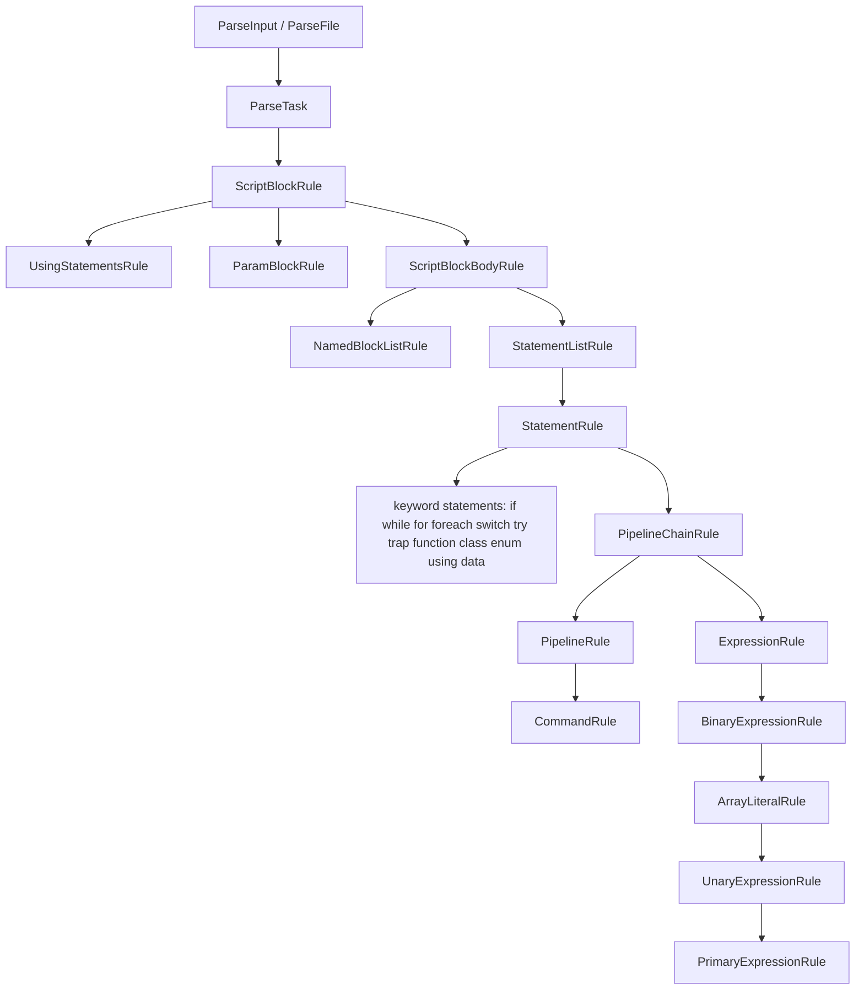

# Parser

> STATIC-ONLY — behavior not run-verified. `FACT-SRC` unless marked. Grammar: [GRAMMAR.ebnf.md](GRAMMAR.ebnf.md). Errors: [ERROR-CATALOG.md](ERROR-CATALOG.md). Tokens: [02.1-tokenizer.md](02.1-tokenizer.md), [TOKEN-CATALOG.md](TOKEN-CATALOG.md).

## 1. Purpose and scope [SPEC]

The parser turns script text into a `ScriptBlockAst`. It is a hand-written **recursive-descent parser** with a **one-token lookahead** that pulls tokens from the tokenizer on demand and tells the tokenizer which mode to use (see CF-LEX-001 in [02.1-tokenizer.md](02.1-tokenizer.md) §6.2). Binary expressions use precedence climbing with an operand stack and an operator stack, not one method per precedence level. It reports errors into a list and keeps going, so a script with errors still yields a (partial) AST. `FACT-SRC` (`src/System.Management.Automation/engine/parser/Parser.cs::Parser@L36-L8191`).

In scope: entry points, the rule structure, statement and expression parsing, command parsing, operator precedence, error recovery, parse-time side effects. Out of scope: AST classes ([02.3-ast.md](02.3-ast.md)), semantic checks run after the parse ([02.4-semantic-analysis.md](02.4-semantic-analysis.md), planned T24).

## 2. Source map

| path | type | role | tier |
|---|---|---|---|
| `src/System.Management.Automation/engine/parser/Parser.cs::Parser@L36-L8191` | `public sealed class` | whole parser: <!--N:PARSER_METHODS-->157<!--/N--> methods in `data/parser-methods.json`; every `*Rule` method is one production | A |
| `src/System.Management.Automation/engine/parser/Parser.cs::ParseError@L8193-L8241` | `public class` | error record: `Extent`, `ErrorId`, `Message`, `IncompleteInput` | A |
| `src/System.Management.Automation/engine/parser/Parser.cs::ParserEventSource@L8247-L8278` | event source | ETW events ParseStart/Stop, ResolveSymbols, SemanticChecks, CheckSecurity, Compile | A |
| `src/System.Management.Automation/engine/parser/Parser.cs::ParseMode@L26-L30` | enum | `Default`, `ModuleAnalysis` (the latter skips post-parse semantic checks) | A |
| `src/System.Management.Automation/engine/parser/tokenizer.cs::Tokenizer@L594-L5083` | class | token source, see [02.1-tokenizer.md](02.1-tokenizer.md) | A |

## 3. Responsibilities and non-responsibilities

Responsible for: choosing tokenizer modes, building the AST, error reporting and recovery, parse-time handling of `using`, `class`, `enum`, `configuration` and dynamic keywords, running `PerformPostParseChecks` after the parse. Not responsible for: tokenizing, semantic checks (called, not implemented here), execution.

## 4. Key types and contracts [IMPL]

**Public entry points** (`FACT-SRC`):

| API | Behavior | Evidence |
|---|---|---|
| `Parser.ParseFile(fileName, out tokens, out errors)` | reads the file (`ExternalScriptInfo.ScriptContents`); on read failure returns an empty `ScriptBlockAst` and a `FileReadError` error; special handling for `*.schema.psm1` DSC files | `src/System.Management.Automation/engine/parser/Parser.cs::Parser.ParseFile@L66-L120` |
| `Parser.ParseInput(input, out tokens, out errors)` (+ overload with file name) | parses a string; `null` input → `ArgumentNullException` | `src/System.Management.Automation/engine/parser/Parser.cs::Parser.ParseInput@L131-L162` |
| internal `Parse` → `ParseTask` | `tokenizer.Initialize`, `ErrorList.Clear()`, `ScriptBlockRule(null, isFilter: false)`, `GetScriptRequirements()`, then `PerformPostParseChecks` when `ParseMode.Default` | `src/System.Management.Automation/engine/parser/Parser.cs::Parser.ParseTask@L176-L227` |
| static helpers `ScanNumber`, `ScanType`, `ScanString` | parse a number/type/string from text for runtime use (e.g. `LanguagePrimitives`); throw `ParseException` if errors | `src/System.Management.Automation/engine/parser/Parser.cs::Parser.ScanNumber@L230-L268`, `Parser.ScanType@L270-L290`, `Parser.ScanString@L292-L305` |

Any exception that is not a syntax error escaping `ParseFile`/`ParseInput` becomes `ParseException(UnrecoverableParserError)` (notes W1; see CF-ERR-002 in [ERROR-CATALOG.md](ERROR-CATALOG.md)).

**State** (`src/System.Management.Automation/engine/parser/Parser.cs::Parser@L36-L60`): `_tokenizer`, `_ungotToken` (the single pushed-back token), `_disableCommaOperator`, `_savingTokens`, `_inConfiguration`, `_parseMode`, `_fileName`, `ErrorList`. Constants `VERBATIM_ARGUMENT = "--%"` and `VERBATIM_PARAMETERNAME = "-%"`.

**Token plumbing**: `NextToken`/`PeekToken`/`UngetToken` (`src/System.Management.Automation/engine/parser/Parser.cs::Parser.NextToken@L434-L446`; unget asserts only one token of lookahead, `@L493-L497`); `SetTokenizerMode` (rescans the peeked token when the mode changes, §6.3); `NextMemberAccessToken`, `NextInvokeMemberToken`, `NextLBracket`, `GetVerbatimCommandArgumentToken` return `null` when a token is already pushed back (error state) (`@L448-L485`); `SkipNewlines` only calls the tokenizer if no token is pending or the pending token is a `NewLine` (`@L348-L355`).

## 5. Data model

- The parser produces AST nodes (catalog in [AST-CATALOG.md](AST-CATALOG.md)): `ScriptBlockAst` → `ParamBlockAst`, `NamedBlockAst`, `StatementBlockAst` → statements (`PipelineAst`, `PipelineChainAst`, `AssignmentStatementAst`, `IfStatementAst`, loops, `TryStatementAst`, `FunctionDefinitionAst`, `TypeDefinitionAst`, `UsingStatementAst`, ...) → `CommandAst` / `CommandExpressionAst` → expressions.
- Error nodes: `ErrorStatementAst` and `ErrorExpressionAst` hold the sub-nodes parsed before the error so tools (completion) can still use them.
- Positions: every node gets an extent built by helpers `ExtentOf`, `Before`, `After`, `ExtentFromFirstOf`, `LastCharacterOf` (`src/System.Management.Automation/engine/parser/Parser.cs::Parser.ExtentOf@L572-L702`).
- `$^` and `$$` are updated from the first/last token of each statement via `SetPreviousFirstLastToken` (ignores tokens whose text is `$^` or `$$`) (`src/System.Management.Automation/engine/parser/Parser.cs::Parser.SetPreviousFirstLastToken@L317-L342`).

## 6. Control flow

### 6.1 Overall structure

`ScriptBlockRule(lCurly, isFilter)`: using statements only for the top-level script (no `{`), then a **speculative** `ParamBlockRule` (restore point + `Resync` if no `param (` follows, so a command named `param` is not an error), then the body (`src/System.Management.Automation/engine/parser/Parser.cs::Parser.ScriptBlockRule@L777-L809`). A body with a block-name keyword (`begin process end dynamicparam clean`, flagged `ScriptBlockBlockName`) goes to `NamedBlockListRule`, otherwise to a loop of `StatementListRule`/`CompleteScriptBlockBody` (`@L1682-L1725`, `@L1727-L1857`). At top level, a stray token that cannot start a statement produces `UnexpectedToken`, is **eaten**, and parsing loops (`CompleteScriptBlockBody`, `@L1629-L1680`).

### 6.2 Commands vs expressions at the start of a statement

`StatementRule` switches on the first token kind (keyword → keyword rule; label; `class`/`enum`/`using`/dynamic keyword) and otherwise calls `PipelineChainRule` (`src/System.Management.Automation/engine/parser/Parser.cs::Parser.StatementRule@L1950-L2159`). `PipelineChainRule` **first** switches to Expression mode and tries `ExpressionRule`; the outcome decides everything:

1. Expression found and next token has the `AssignmentOperator` trait → `AssignmentStatementAst`, right side is `StatementRule()` after newlines (so `$x = if (...) {...}` and `$x = 1 | f` work) (`@L5786-L5840`).
2. Expression found, no assignment → it becomes the first element of the pipeline (`PipelineRule(startExpression)`).
3. No expression (e.g. a bareword such as `Get-Item`) → `PipelineRule()` parses a `CommandRule` in Command mode.

This is the parser-side answer to command-vs-expression ambiguity: **try expression first in Expression mode; fall back to command**. The tokenizer mode switch discards and rescans the pending lookahead token because identifier-like text tokenizes differently in the two modes (CF-LEX-001). `INFERENCE`: because expression parsing runs first, anything that parses as an expression (a number, string, variable, `(...)`, `[type]`...) is never a command name unless it is introduced by `&` or `.`.

### 6.3 Pipelines, chains and terminators

- `PipelineChainRule` loops: parse a pipeline; if the next token is `&&` or `||`, skip newlines after it, build a left-nested `PipelineChainAst`; `&` ends the chain and sets `Background` (an `&` followed by `&&`/`||` is `BackgroundOperatorInPipelineChain`); with no operator it returns the plain `PipelineAst` (no wrapper node) (`src/System.Management.Automation/engine/parser/Parser.cs::Parser.PipelineChainRule@L5773-L5988`).
- `PipelineRule` parses elements separated by `|`; after `|` newlines are skipped; a **newline followed by a line starting with `|`** also continues the pipeline (`IsPipeContinuation`, [02.1-tokenizer.md](02.1-tokenizer.md) §6.5). An element that starts with an expression after the first element is `ExpressionsMustBeFirstInPipeline` (a semantic error, parse continues). A pipeline stops without error at `;`, newline, `)`, `}`, `&&`, `||`, end of input; any other token → `UnexpectedToken` (`src/System.Management.Automation/engine/parser/Parser.cs::Parser.PipelineRule@L5990-L6160`).
- **Statement and terminator rule** (canonical fact CF-GRM-001, owner [GRAMMAR.ebnf.md](GRAMMAR.ebnf.md) §3a): statements are separated by optional runs of newlines and semicolons; no terminator is required after a statement that ends in `}`; a pipeline ends at newline, `;`, `)`, `}`, `&&`/`||`, `&` or end of input; newlines continue a construct only after the places listed in the fact.
- `StatementListRule` collects `TrapStatementAst` into a separate list from ordinary statements (`src/System.Management.Automation/engine/parser/Parser.cs::Parser.StatementListRule@L1897-L1944`).

### 6.4 Tokenizer-mode switching points

The parser selects Command mode for `CommandRule`, single command arguments and the bodies of `{ }`, `$( )`, `( )`; Expression mode for `ExpressionRule`, `BinaryExpressionRule`, parameter defaults, attribute arguments and hashtable values; TypeName mode for `[...]`; Signature mode for class/enum/method headers. The full table with line numbers is in [02.1-tokenizer.md](02.1-tokenizer.md) §6.2. Each switch is restored in a `finally` block.

## 7. Algorithms

### 7.1 Production table (every method)

<!--GEN:productions-->
| Production (method) | Kind | File@Lines | Tokens referenced (`TokenKind`, APPROX) | AST created (`new …Ast(`, APPROX) | Error IDs (`ParserStrings`, APPROX) |
|---|---|---|---|---|---|
| `Parser` | helper | `src/System.Management.Automation/engine/parser/Parser.cs::Parser.Parser@L52-L57` | — | — | — |
| `ParseFile` | helper | `src/System.Management.Automation/engine/parser/Parser.cs::Parser.ParseFile@L66-L120` | — | `ScriptBlockAst`, `StatementBlockAst` | — |
| `ParseInput` | helper | `src/System.Management.Automation/engine/parser/Parser.cs::Parser.ParseInput@L131-L134` | — | — | — |
| `ParseInput` | helper | `src/System.Management.Automation/engine/parser/Parser.cs::Parser.ParseInput@L144-L162` | — | — | — |
| `Parse` | helper | `src/System.Management.Automation/engine/parser/Parser.cs::Parser.Parse@L164-L174` | — | — | — |
| `ParseTask` | helper | `src/System.Management.Automation/engine/parser/Parser.cs::Parser.ParseTask@L176-L227` | — | — | `ScriptTooComplicated` |
| `ScanNumber` | helper | `src/System.Management.Automation/engine/parser/Parser.cs::Parser.ScanNumber@L230-L268` | — | — | — |
| `ScanType` | helper | `src/System.Management.Automation/engine/parser/Parser.cs::Parser.ScanType@L270-L290` | — | — | — |
| `ScanString` | helper | `src/System.Management.Automation/engine/parser/Parser.cs::Parser.ScanString@L292-L305` | — | — | — |
| `IgnoreTokenWhenUpdatingPreviousFirstLast` | helper | `src/System.Management.Automation/engine/parser/Parser.cs::Parser.IgnoreTokenWhenUpdatingPreviousFirstLast@L310-L315` | `Generic`, `Variable` | — | — |
| `SetPreviousFirstLastToken` | helper | `src/System.Management.Automation/engine/parser/Parser.cs::Parser.SetPreviousFirstLastToken@L317-L342` | — | — | — |
| `SkipNewlines` | helper | `src/System.Management.Automation/engine/parser/Parser.cs::Parser.SkipNewlines@L348-L355` | `NewLine` | — | — |
| `SkipNewlinesAndSemicolons` | helper | `src/System.Management.Automation/engine/parser/Parser.cs::Parser.SkipNewlinesAndSemicolons@L357-L364` | `NewLine`, `Semi` | — | — |
| `SyncOnError` | helper | `src/System.Management.Automation/engine/parser/Parser.cs::Parser.SyncOnError@L366-L432` | `EndOfInput`, `LBracket`, `LCurly`, `LParen`, `RBracket`, `RCurly`, `RParen` | — | — |
| `NextToken` | helper | `src/System.Management.Automation/engine/parser/Parser.cs::Parser.NextToken@L434-L439` | — | — | — |
| `PeekToken` | helper | `src/System.Management.Automation/engine/parser/Parser.cs::Parser.PeekToken@L441-L446` | — | — | — |
| `NextMemberAccessToken` | helper | `src/System.Management.Automation/engine/parser/Parser.cs::Parser.NextMemberAccessToken@L448-L454` | — | — | — |
| `NextInvokeMemberToken` | helper | `src/System.Management.Automation/engine/parser/Parser.cs::Parser.NextInvokeMemberToken@L456-L462` | — | — | — |
| `NextLBracket` | helper | `src/System.Management.Automation/engine/parser/Parser.cs::Parser.NextLBracket@L464-L474` | `LBracket` | — | — |
| `GetVerbatimCommandArgumentToken` | helper | `src/System.Management.Automation/engine/parser/Parser.cs::Parser.GetVerbatimCommandArgumentToken@L476-L485` | `Parameter` | — | — |
| `SkipToken` | helper | `src/System.Management.Automation/engine/parser/Parser.cs::Parser.SkipToken@L487-L491` | — | — | — |
| `UngetToken` | helper | `src/System.Management.Automation/engine/parser/Parser.cs::Parser.UngetToken@L493-L497` | — | — | — |
| `SetTokenizerMode` | helper | `src/System.Management.Automation/engine/parser/Parser.cs::Parser.SetTokenizerMode@L499-L536` | `EndOfInput` | — | — |
| `Resync` | helper | `src/System.Management.Automation/engine/parser/Parser.cs::Parser.Resync@L538-L542` | — | — | — |
| `Resync` | helper | `src/System.Management.Automation/engine/parser/Parser.cs::Parser.Resync@L544-L548` | — | — | — |
| `IsSpecificParameter` | helper | `src/System.Management.Automation/engine/parser/Parser.cs::Parser.IsSpecificParameter@L550-L555` | `Parameter` | — | — |
| `RequireStatementTerminator` | helper | `src/System.Management.Automation/engine/parser/Parser.cs::Parser.RequireStatementTerminator@L557-L570` | `EndOfInput`, `NewLine`, `Semi` | — | `MissingStatementTerminator` |
| `ExtentOf` | helper | `src/System.Management.Automation/engine/parser/Parser.cs::Parser.ExtentOf@L572-L583` | — | — | — |
| `Before` | helper | `src/System.Management.Automation/engine/parser/Parser.cs::Parser.Before@L585-L592` | — | — | — |
| `After` | helper | `src/System.Management.Automation/engine/parser/Parser.cs::Parser.After@L594-L600` | — | — | — |
| `LastCharacterOf` | helper | `src/System.Management.Automation/engine/parser/Parser.cs::Parser.LastCharacterOf@L602-L613` | — | — | — |
| `ExtentFromFirstOf` | helper | `src/System.Management.Automation/engine/parser/Parser.cs::Parser.ExtentFromFirstOf@L615-L646` | — | — | — |
| `ExtentOf` | helper | `src/System.Management.Automation/engine/parser/Parser.cs::Parser.ExtentOf@L648-L648` | — | — | — |
| `ExtentOf` | helper | `src/System.Management.Automation/engine/parser/Parser.cs::Parser.ExtentOf@L650-L650` | — | — | — |
| `ExtentOf` | helper | `src/System.Management.Automation/engine/parser/Parser.cs::Parser.ExtentOf@L652-L652` | — | — | — |
| `ExtentOf` | helper | `src/System.Management.Automation/engine/parser/Parser.cs::Parser.ExtentOf@L654-L654` | — | — | — |
| `ExtentOf` | helper | `src/System.Management.Automation/engine/parser/Parser.cs::Parser.ExtentOf@L656-L656` | — | — | — |
| `ExtentOf` | helper | `src/System.Management.Automation/engine/parser/Parser.cs::Parser.ExtentOf@L658-L658` | — | — | — |
| `ExtentOf` | helper | `src/System.Management.Automation/engine/parser/Parser.cs::Parser.ExtentOf@L660-L660` | — | — | — |
| `ExtentOf` | helper | `src/System.Management.Automation/engine/parser/Parser.cs::Parser.ExtentOf@L662-L662` | — | — | — |
| `Before` | helper | `src/System.Management.Automation/engine/parser/Parser.cs::Parser.Before@L665-L665` | — | — | — |
| `After` | helper | `src/System.Management.Automation/engine/parser/Parser.cs::Parser.After@L667-L667` | — | — | — |
| `After` | helper | `src/System.Management.Automation/engine/parser/Parser.cs::Parser.After@L669-L669` | — | — | — |
| `GetNestedErrorAsts` | helper | `src/System.Management.Automation/engine/parser/Parser.cs::Parser.GetNestedErrorAsts@L671-L702` | — | — | — |
| `TryParseAsConstantHashtable` | helper | `src/System.Management.Automation/engine/parser/Parser.cs::Parser.TryParseAsConstantHashtable@L710-L766` | — | — | — |
| `ScriptBlockRule` | rule | `src/System.Management.Automation/engine/parser/Parser.cs::Parser.ScriptBlockRule@L772-L775` | — | — | — |
| `ScriptBlockRule` | rule | `src/System.Management.Automation/engine/parser/Parser.cs::Parser.ScriptBlockRule@L777-L809` | — | — | — |
| `UsingStatementsRule` | rule | `src/System.Management.Automation/engine/parser/Parser.cs::Parser.UsingStatementsRule@L811-L843` | `Using` | — | — |
| `ParamBlockRule` | rule | `src/System.Management.Automation/engine/parser/Parser.cs::Parser.ParamBlockRule@L845-L912` | `LParen`, `Param`, `RParen` | `ParamBlockAst` | `MissingEndParenthesisInFunctionParameterList`, `TypeNotAllowedBeforeParam` |
| `ParameterListRule` | rule | `src/System.Management.Automation/engine/parser/Parser.cs::Parser.ParameterListRule@L914-L952` | `Comma` | — | `MissingExpressionAfterToken` |
| `ParameterRule` | rule | `src/System.Management.Automation/engine/parser/Parser.cs::Parser.ParameterRule@L954-L1025` | `Equals`, `RParen`, `SplattedVariable`, `Variable` | `ParameterAst`, `VariableExpressionAst` | `InvalidFunctionParameter`, `MissingExpressionAfterToken` |
| `AttributeListRule` | rule | `src/System.Management.Automation/engine/parser/Parser.cs::Parser.AttributeListRule@L1027-L1052` | — | — | — |
| `AttributeRule` | rule | `src/System.Management.Automation/engine/parser/Parser.cs::Parser.AttributeRule@L1054-L1153` | `Identifier`, `LParen`, `RBracket`, `RParen` | `AttributeAst`, `TypeConstraintAst` | `EndSquareBracketExpectedAtEndOfAttribute`, `MissingEndParenthesisInExpression`, `MissingTypename` |
| `AttributeArgumentsRule` | rule | `src/System.Management.Automation/engine/parser/Parser.cs::Parser.AttributeArgumentsRule@L1155-L1269` | `Comma`, `Equals`, `NewLine`, `RBracket`, `RParen` | `ConstantExpressionAst`, `ErrorExpressionAst`, `NamedAttributeArgumentAst` | `DuplicateNamedArgument`, `MissingExpressionAfterToken`, `MissingExpressionInNamedArgument` |
| `TypeNameRule` | rule | `src/System.Management.Automation/engine/parser/Parser.cs::Parser.TypeNameRule@L1271-L1331` | `Identifier` | — | — |
| `FinishTypeNameRule` | rule | `src/System.Management.Automation/engine/parser/Parser.cs::Parser.FinishTypeNameRule@L1333-L1395` | `Comma`, `EndOfInput`, `Identifier`, `LBracket`, `RBracket` | — | `MissingAssemblyNameSpecification`, `MissingTypename`, `UnexpectedToken` |
| `GetSingleGenericArgument` | helper | `src/System.Management.Automation/engine/parser/Parser.cs::Parser.GetSingleGenericArgument@L1397-L1432` | `Identifier`, `LBracket`, `RBracket` | — | `EndSquareBracketExpectedAtEndOfType`, `MissingTypename` |
| `GenericTypeArgumentsRule` | rule | `src/System.Management.Automation/engine/parser/Parser.cs::Parser.GenericTypeArgumentsRule@L1434-L1473` | `Comma`, `Identifier`, `LBracket` | — | `MissingTypename` |
| `GenericTypeNameRule` | rule | `src/System.Management.Automation/engine/parser/Parser.cs::Parser.GenericTypeNameRule@L1475-L1521` | `Comma`, `LBracket`, `RBracket` | — | `EndSquareBracketExpectedAtEndOfAttribute`, `MissingAssemblyNameSpecification` |
| `CompleteArrayTypeName` | helper | `src/System.Management.Automation/engine/parser/Parser.cs::Parser.CompleteArrayTypeName@L1523-L1627` | `Comma`, `EndOfInput`, `LBracket`, `RBracket` | — | `ArrayHasTooManyDimensions`, `EndSquareBracketExpectedAtEndOfAttribute`, `MissingAssemblyNameSpecification`, `UnexpectedToken` |
| `CompleteScriptBlockBody` | helper | `src/System.Management.Automation/engine/parser/Parser.cs::Parser.CompleteScriptBlockBody@L1629-L1680` | `EndOfInput`, `RCurly` | — | `MissingEndCurlyBrace`, `UnexpectedToken` |
| `ScriptBlockBodyRule` | rule | `src/System.Management.Automation/engine/parser/Parser.cs::Parser.ScriptBlockBodyRule@L1682-L1725` | — | `ScriptBlockAst`, `StatementBlockAst` | — |
| `NamedBlockListRule` | rule | `src/System.Management.Automation/engine/parser/Parser.cs::Parser.NamedBlockListRule@L1727-L1857` | `Begin`, `Clean`, `Dynamicparam`, `End`, `EndOfInput`, `Process`, `RCurly` | `NamedBlockAst`, `ScriptBlockAst`, `StatementBlockAst` | `DuplicateScriptCommandClause`, `MissingNamedBlocks`, `MissingNamedStatementBlock` |
| `StatementBlockRule` | rule | `src/System.Management.Automation/engine/parser/Parser.cs::Parser.StatementBlockRule@L1859-L1895` | `LCurly`, `RCurly` | `StatementBlockAst` | `MissingEndCurlyBrace` |
| `StatementListRule` | rule | `src/System.Management.Automation/engine/parser/Parser.cs::Parser.StatementListRule@L1897-L1944` | `RCurly`, `RParen` | — | — |
| `StatementRule` | rule | `src/System.Management.Automation/engine/parser/Parser.cs::Parser.StatementRule@L1950-L2159` | `Break`, `Catch`, `Class`, `Configuration`, `Continue`, `Data`, `Define`, `Do`, `DynamicKeyword`, `Else`, `ElseIf`, `EndOfInput`, `Enum`, `Exit` +20 | `ErrorStatementAst` | `ReservedKeywordNotAllowed`, `TypeNotAllowedBeforeStatement`, `UnexpectedAttribute`, `UsingMustBeAtStartOfScript` |
| `SimpleNameRule` | rule | `src/System.Management.Automation/engine/parser/Parser.cs::Parser.SimpleNameRule@L2161-L2165` | — | — | — |
| `SimpleNameRule` | rule | `src/System.Management.Automation/engine/parser/Parser.cs::Parser.SimpleNameRule@L2167-L2190` | `Identifier` | `StringConstantExpressionAst` | — |
| `LabelOrKeyRule` | rule | `src/System.Management.Automation/engine/parser/Parser.cs::Parser.LabelOrKeyRule@L2192-L2234` | `NewLine`, `Semi` | — | — |
| `BreakStatementRule` | rule | `src/System.Management.Automation/engine/parser/Parser.cs::Parser.BreakStatementRule@L2236-L2247` | — | `BreakStatementAst` | — |
| `ContinueStatementRule` | rule | `src/System.Management.Automation/engine/parser/Parser.cs::Parser.ContinueStatementRule@L2249-L2260` | — | `ContinueStatementAst` | — |
| `ReturnStatementRule` | rule | `src/System.Management.Automation/engine/parser/Parser.cs::Parser.ReturnStatementRule@L2262-L2272` | — | `ReturnStatementAst` | — |
| `ExitStatementRule` | rule | `src/System.Management.Automation/engine/parser/Parser.cs::Parser.ExitStatementRule@L2274-L2284` | — | `ExitStatementAst` | — |
| `ThrowStatementRule` | rule | `src/System.Management.Automation/engine/parser/Parser.cs::Parser.ThrowStatementRule@L2286-L2297` | — | `ThrowStatementAst` | — |
| `LabeledStatementRule` | rule | `src/System.Management.Automation/engine/parser/Parser.cs::Parser.LabeledStatementRule@L2299-L2339` | `Do`, `For`, `Foreach`, `Switch`, `While` | — | — |
| `BlockStatementRule` | rule | `src/System.Management.Automation/engine/parser/Parser.cs::Parser.BlockStatementRule@L2341-L2359` | — | `BlockStatementAst`, `ErrorStatementAst` | `MissingStatementAfterKeyword` |
| `InlineScriptRule` | rule | `src/System.Management.Automation/engine/parser/Parser.cs::Parser.InlineScriptRule@L2370-L2398` | `LCurly` | `StringConstantExpressionAst` | `MissingStatementAfterKeyword` |
| `IfStatementRule` | rule | `src/System.Management.Automation/engine/parser/Parser.cs::Parser.IfStatementRule@L2400-L2541` | `Else`, `ElseIf`, `LParen`, `RParen` | `ErrorStatementAst`, `IfStatementAst` | `IfStatementMissingCondition`, `MissingEndParenthesisAfterStatement`, `MissingOpenParenthesisInIfStatement`, `MissingStatementBlock`, `MissingStatementBlockAfterElse` |
| `SwitchStatementRule` | rule | `src/System.Management.Automation/engine/parser/Parser.cs::Parser.SwitchStatementRule@L2543-L2891` | `Default`, `EndOfInput`, `LCurly`, `LParen`, `Minus`, `Parameter`, `RCurly`, `RParen` | `CommandExpressionAst`, `ErrorStatementAst`, `PipelineAst`, `StringConstantExpressionAst`, `SwitchStatementAst` | `InvalidSwitchFlag`, `MissingCurlyBraceInSwitchStatement`, `MissingEndCurlyBrace`, `MissingEndParenthesisInSwitchStatement`, `MissingFilenameOption`, `MissingSwitchConditionExpression`, `MissingSwitchStatementClause`, `MultipleSwitchDefaultClauses` +1 |
| `ConfigurationStatementRule` | rule | `src/System.Management.Automation/engine/parser/Parser.cs::Parser.ConfigurationStatementRule@L2893-L3322` | `Comma`, `EndOfInput`, `LCurly` | `ConfigurationDefinitionAst`, `ErrorStatementAst` | `ConfigurationBodyEmpty`, `ConfigurationNotAllowedInConstrainedLanguage`, `ConfigurationNotAllowedOnArm64`, `ConfigurationNotAllowedOnWinPE`, `InvalidConfigurationName`, `MissingConfigurationName`, `MissingCurlyInConfigurationStatement`, `ParserError` |
| `GetWordOrExpression` | helper | `src/System.Management.Automation/engine/parser/Parser.cs::Parser.GetWordOrExpression@L3331-L3356` | `EndOfInput` | — | `ParameterRequiresArgument`, `RequiredNameOrExpressionMissing` |
| `ForeachStatementRule` | rule | `src/System.Management.Automation/engine/parser/Parser.cs::Parser.ForeachStatementRule@L3358-L3518` | `In`, `LParen`, `Parameter`, `RParen`, `SplattedVariable`, `Variable` | `ErrorStatementAst`, `ForEachStatementAst`, `VariableExpressionAst` | `InvalidForeachFlag`, `MissingEndParenthesisAfterForeach`, `MissingForeachExpression`, `MissingForeachStatement`, `MissingInInForeach`, `MissingOpenParenthesisAfterKeyword`, `MissingThrottleLimit`, `MissingVariableNameAfterForeach` |
| `ForStatementRule` | rule | `src/System.Management.Automation/engine/parser/Parser.cs::Parser.ForStatementRule@L3520-L3626` | `LParen`, `RParen`, `Semi` | `ErrorStatementAst`, `ForStatementAst` | `MissingEndParenthesisAfterStatement`, `MissingLoopStatement`, `MissingOpenParenthesisAfterKeyword` |
| `WhileStatementRule` | rule | `src/System.Management.Automation/engine/parser/Parser.cs::Parser.WhileStatementRule@L3628-L3708` | `LParen`, `RParen` | `ErrorStatementAst`, `WhileStatementAst` | `MissingEndParenthesisAfterStatement`, `MissingExpressionAfterKeyword`, `MissingLoopStatement`, `MissingOpenParenthesisAfterKeyword` |
| `DynamicKeywordStatementRule` | rule | `src/System.Management.Automation/engine/parser/Parser.cs::Parser.DynamicKeywordStatementRule@L3724-L4090` | `Dot`, `DynamicKeyword`, `EndOfInput`, `Identifier`, `LCurly` | `DynamicKeywordStatementAst`, `ErrorExpressionAst`, `ErrorStatementAst`, `MemberExpressionAst`, `StringConstantExpressionAst` | `DynamicKeywordPostParseException`, `DynamicKeywordPreParseException`, `MissingBraceInObjectDefinition`, `MissingStatementAfterKeyword`, `RequiredNameOrExpressionMissing`, `UnexpectedNameForType`, `UnexpectedToken`, `UnexpectedTokenInDynamicKeyword` +2 |
| `CreateErrorStatementAst` | helper | `src/System.Management.Automation/engine/parser/Parser.cs::Parser.CreateErrorStatementAst@L4092-L4098` | — | `ErrorStatementAst` | — |
| `DoWhileStatementRule` | rule | `src/System.Management.Automation/engine/parser/Parser.cs::Parser.DoWhileStatementRule@L4100-L4206` | `Do`, `LParen`, `RParen`, `Until`, `While` | `DoUntilStatementAst`, `DoWhileStatementAst`, `ErrorStatementAst` | `MissingEndParenthesisAfterStatement`, `MissingExpressionAfterKeyword`, `MissingLoopStatement`, `MissingOpenParenthesisAfterKeyword`, `MissingWhileOrUntilInDoWhile` |
| `ClassDefinitionRule` | rule | `src/System.Management.Automation/engine/parser/Parser.cs::Parser.ClassDefinitionRule@L4208-L4379` | `Colon`, `Comma`, `LCurly`, `RCurly` | `ErrorStatementAst`, `TypeConstraintAst`, `TypeDefinitionAst` | `ClassesNotAllowedInConstrainedLanguage`, `MissingEndCurlyBrace`, `MissingNameAfterKeyword`, `MissingTypeBody`, `TypeNameExpected` |
| `ClassMemberRule` | rule | `src/System.Management.Automation/engine/parser/Parser.cs::Parser.ClassMemberRule@L4381-L4639` | `Equals`, `Hidden`, `NewLine`, `Private`, `Public`, `RCurly`, `Semi`, `Static`, `Variable` | `FunctionMemberAst`, `PropertyMemberAst` | `DuplicateQualifier`, `IncompleteMemberDefinition`, `MissingPropertyTerminator`, `ModifiersCannotBeCombined`, `TooManyTypes` |
| `TryUseTokenAsSimpleName` | helper | `src/System.Management.Automation/engine/parser/Parser.cs::Parser.TryUseTokenAsSimpleName@L4641-L4652` | `DynamicKeyword`, `Identifier` | — | — |
| `RecordErrorAsts` | helper | `src/System.Management.Automation/engine/parser/Parser.cs::Parser.RecordErrorAsts@L4654-L4664` | — | — | — |
| `RecordErrorAsts` | helper | `src/System.Management.Automation/engine/parser/Parser.cs::Parser.RecordErrorAsts@L4666-L4676` | — | — | — |
| `NextTypeIdentifierToken` | helper | `src/System.Management.Automation/engine/parser/Parser.cs::Parser.NextTypeIdentifierToken@L4678-L4699` | `Identifier` | — | — |
| `EnumDefinitionRule` | rule | `src/System.Management.Automation/engine/parser/Parser.cs::Parser.EnumDefinitionRule@L4701-L4820` | `Colon`, `LCurly`, `RCurly` | `ErrorStatementAst`, `TypeConstraintAst`, `TypeDefinitionAst` | `InvalidUnderlyingType`, `MissingEndCurlyBrace`, `MissingNameAfterKeyword`, `MissingTypeBody`, `TypeNameExpected` |
| `EnumMemberRule` | rule | `src/System.Management.Automation/engine/parser/Parser.cs::Parser.EnumMemberRule@L4822-L4895` | `Equals`, `NewLine`, `RCurly`, `Semi` | `PropertyMemberAst` | `ExpectedValueExpression`, `MissingPropertyTerminator` |
| `UsingStatementRule` | rule | `src/System.Management.Automation/engine/parser/Parser.cs::Parser.UsingStatementRule@L4897-L5086` | `Assembly`, `Comma`, `Command`, `EndOfInput`, `Equals`, `Module`, `Namespace`, `NewLine`, `Semi`, `Type` | `ErrorStatementAst`, `UsingStatementAst` | `InvalidValueForUsingItemName`, `MissingEqualsInUsingAlias`, `MissingNamespaceAlias`, `MissingUsingItemName`, `MissingUsingStatementDirective`, `UnexpectedUnaryOperator` |
| `ResolveUsingAssembly` | helper | `src/System.Management.Automation/engine/parser/Parser.cs::Parser.ResolveUsingAssembly@L5088-L5168` | — | `StringConstantExpressionAst` | `CannotLoadAssemblyFromUncPath`, `CannotLoadAssemblyWithUriSchema`, `ErrorLoadingAssembly` |
| `MethodDeclarationRule` | rule | `src/System.Management.Automation/engine/parser/Parser.cs::Parser.MethodDeclarationRule@L5170-L5314` | `Base`, `Colon`, `LCurly`, `LParen` | `BaseCtorInvokeMemberExpressionAst`, `CommandExpressionAst`, `ErrorStatementAst`, `FunctionDefinitionAst` | `MissingBaseCtorCall`, `MissingFunctionBody`, `MissingMethodParameterList` |
| `FunctionDeclarationRule` | rule | `src/System.Management.Automation/engine/parser/Parser.cs::Parser.FunctionDeclarationRule@L5316-L5413` | `Ampersand`, `AndAnd`, `AtCurly`, `AtParen`, `EndOfInput`, `Filter`, `Generic`, `HereStringExpandable`, `HereStringLiteral`, `LCurly`, `LParen`, `OrOr`, `Pipe`, `RCurly` +9 | `ErrorStatementAst`, `FunctionDefinitionAst` | `MissingFunctionBody`, `MissingNameAfterKeyword` |
| `FunctionParameterDeclarationRule` | rule | `src/System.Management.Automation/engine/parser/Parser.cs::Parser.FunctionParameterDeclarationRule@L5415-L5447` | `LParen`, `RParen` | — | `MissingEndParenthesisInFunctionParameterList` |
| `TrapStatementRule` | rule | `src/System.Management.Automation/engine/parser/Parser.cs::Parser.TrapStatementRule@L5449-L5481` | — | `ErrorStatementAst`, `TrapStatementAst` | `MissingTrapStatement` |
| `CatchBlockRule` | rule | `src/System.Management.Automation/engine/parser/Parser.cs::Parser.CatchBlockRule@L5494-L5591` | `Catch`, `Comma` | `CatchClauseAst` | `MissingCatchHandlerBlock`, `MissingTypeLiteralToken` |
| `TryStatementRule` | rule | `src/System.Management.Automation/engine/parser/Parser.cs::Parser.TryStatementRule@L5593-L5670` | `Finally` | `ErrorStatementAst`, `TryStatementAst` | `MissingCatchOrFinally`, `MissingFinallyStatementBlock`, `MissingTryStatementBlock` |
| `DataStatementRule` | rule | `src/System.Management.Automation/engine/parser/Parser.cs::Parser.DataStatementRule@L5672-L5767` | `Comma`, `Parameter` | `DataStatementAst`, `ErrorStatementAst` | `InvalidParameterForDataSectionStatement`, `MissingStatementBlockForDataSection`, `MissingValueForSupportedCommandInDataSectionStatement` |
| `PipelineChainRule` | rule | `src/System.Management.Automation/engine/parser/Parser.cs::Parser.PipelineChainRule@L5773-L5988` | `Ampersand`, `AndAnd`, `Dot`, `EndOfInput`, `OrOr` | `AssignmentStatementAst`, `ErrorStatementAst`, `PipelineChainAst` | `BackgroundOperatorInPipelineChain`, `EmptyPipelineChainElement`, `ExpectedValueExpression` |
| `PipelineRule` | rule | `src/System.Management.Automation/engine/parser/Parser.cs::Parser.PipelineRule@L5990-L6160` | `Ampersand`, `AndAnd`, `EndOfInput`, `NewLine`, `OrOr`, `Pipe`, `RCurly`, `RParen`, `Semi` | `CommandExpressionAst`, `PipelineAst` | `EmptyPipeElement`, `ExpressionsMustBeFirstInPipeline`, `UnexpectedToken` |
| `RedirectionRule` | rule | `src/System.Management.Automation/engine/parser/Parser.cs::Parser.RedirectionRule@L6162-L6264` | — | `ErrorExpressionAst`, `FileRedirectionAst`, `MergingRedirectionAst` | `MissingFileSpecification`, `RedirectionNotSupported`, `StreamAlreadyRedirected` |
| `GetSingleCommandArgument` | helper | `src/System.Management.Automation/engine/parser/Parser.cs::Parser.GetSingleCommandArgument@L6266-L6283` | `Comma`, `EndOfInput` | — | — |
| `GetCommandArgument` | helper | `src/System.Management.Automation/engine/parser/Parser.cs::Parser.GetCommandArgument@L6295-L6442` | `Ampersand`, `AndAnd`, `AtCurly`, `AtParen`, `Comma`, `DollarParen`, `EndOfInput`, `Generic`, `HereStringExpandable`, `HereStringLiteral`, `LCurly`, `LParen`, `MinusMinus`, `NewLine` +12 | `ArrayLiteralAst`, `ErrorExpressionAst`, `ExpandableStringExpressionAst`, `StringConstantExpressionAst` | `MissingExpression` |
| `CommandRule` | rule | `src/System.Management.Automation/engine/parser/Parser.cs::Parser.CommandRule@L6444-L6684` | `Ampersand`, `AndAnd`, `Comma`, `Dot`, `EndOfInput`, `InlineScript`, `MinusMinus`, `NewLine`, `OrOr`, `Parameter`, `Pipe`, `RCurly`, `RParen`, `RedirectInStd` +3 | `CommandAst`, `CommandParameterAst`, `DynamicKeywordStatementAst`, `StringConstantExpressionAst` | `MissingArgument`, `MissingExpression`, `ParameterRequiresArgument` |
| `ExpressionRule` | rule | `src/System.Management.Automation/engine/parser/Parser.cs::Parser.ExpressionRule@L6696-L6790` | `Colon`, `QuestionMark` | `ErrorExpressionAst`, `TernaryExpressionAst` | `ExpectedValueExpression`, `MissingColonInTernaryExpression` |
| `BinaryExpressionRule` | rule | `src/System.Management.Automation/engine/parser/Parser.cs::Parser.BinaryExpressionRule@L6798-L6950` | `AndAnd`, `OrOr` | `BinaryExpressionAst`, `ErrorExpressionAst` | `ExpectedValueExpression` |
| `ErrorRecoveryParameterInExpression` | helper | `src/System.Management.Automation/engine/parser/Parser.cs::Parser.ErrorRecoveryParameterInExpression@L6952-L6967` | — | `CommandParameterAst`, `ErrorExpressionAst` | `UnexpectedToken` |
| `ArrayLiteralRule` | rule | `src/System.Management.Automation/engine/parser/Parser.cs::Parser.ArrayLiteralRule@L6975-L7021` | `Comma` | `ArrayLiteralAst`, `ErrorExpressionAst` | `MissingExpressionAfterToken` |
| `UnaryExpressionRule` | rule | `src/System.Management.Automation/engine/parser/Parser.cs::Parser.UnaryExpressionRule@L7029-L7226` | `Comma`, `Generic`, `LBracket`, `Minus`, `MinusMinus`, `NewLine`, `PlusPlus`, `PostfixMinusMinus`, `PostfixPlusPlus`, `Unknown` | `ArrayLiteralAst`, `AttributedExpressionAst`, `ConvertExpressionAst`, `ErrorExpressionAst`, `TypeExpressionAst`, `UnaryExpressionAst` | `MissingExpressionAfterOperator`, `UnexpectedAttribute` |
| `PrimaryExpressionRule` | rule | `src/System.Management.Automation/engine/parser/Parser.cs::Parser.PrimaryExpressionRule@L7228-L7299` | `AtCurly`, `AtParen`, `DollarParen`, `HereStringExpandable`, `HereStringLiteral`, `LCurly`, `LParen`, `Number`, `SplattedVariable`, `StringExpandable`, `StringLiteral`, `Variable` | `ConstantExpressionAst`, `StringConstantExpressionAst` | — |
| `CheckUsingVariable` | helper | `src/System.Management.Automation/engine/parser/Parser.cs::Parser.CheckUsingVariable@L7301-L7317` | `SplattedVariable` | `UsingExpressionAst`, `VariableExpressionAst` | — |
| `CheckPostPrimaryExpressionOperators` | helper | `src/System.Management.Automation/engine/parser/Parser.cs::Parser.CheckPostPrimaryExpressionOperators@L7319-L7339` | `ColonColon`, `Dot`, `LBracket`, `QuestionDot`, `QuestionLBracket` | — | — |
| `HashExpressionRule` | rule | `src/System.Management.Automation/engine/parser/Parser.cs::Parser.HashExpressionRule@L7341-L7403` | `NewLine`, `RCurly`, `Semi` | `HashtableAst` | `IncompletePropertyAssignmentBlock`, `MissingEndCurlyBrace` |
| `GetKeyValuePair` | helper | `src/System.Management.Automation/engine/parser/Parser.cs::Parser.GetKeyValuePair@L7405-L7491` | `Equals`, `NewLine`, `RCurly`, `Semi` | `ErrorStatementAst` | `MissingEqualsInHashLiteral`, `MissingEqualsInPropertyAssignmentBlock`, `MissingStatementInHashLiteral` |
| `ScriptBlockExpressionRule` | rule | `src/System.Management.Automation/engine/parser/Parser.cs::Parser.ScriptBlockExpressionRule@L7493-L7517` | — | `ScriptBlockExpressionAst` | — |
| `SubExpressionRule` | rule | `src/System.Management.Automation/engine/parser/Parser.cs::Parser.SubExpressionRule@L7519-L7571` | `AtParen`, `DollarParen`, `RParen` | `ArrayExpressionAst`, `StatementBlockAst`, `SubExpressionAst` | `MissingEndParenthesisInSubexpression` |
| `ParenthesizedExpressionRule` | rule | `src/System.Management.Automation/engine/parser/Parser.cs::Parser.ParenthesizedExpressionRule@L7573-L7619` | `RParen` | `ErrorStatementAst`, `ParenExpressionAst` | `ExpectedExpression`, `MissingEndParenthesisInExpression` |
| `ParseNestedExpressions` | helper | `src/System.Management.Automation/engine/parser/Parser.cs::Parser.ParseNestedExpressions@L7621-L7672` | `Unknown` | `StringConstantExpressionAst` | — |
| `ExpandableStringRule` | rule | `src/System.Management.Automation/engine/parser/Parser.cs::Parser.ExpandableStringRule@L7674-L7692` | — | `ExpandableStringExpressionAst`, `StringConstantExpressionAst` | — |
| `MemberNameRule` | rule | `src/System.Management.Automation/engine/parser/Parser.cs::Parser.MemberNameRule@L7694-L7716` | `LBracket` | — | — |
| `MemberAccessRule` | rule | `src/System.Management.Automation/engine/parser/Parser.cs::Parser.MemberAccessRule@L7718-L7775` | `ColonColon`, `LCurly`, `LParen`, `QuestionDot` | `ErrorExpressionAst`, `MemberExpressionAst` | `MissingPropertyName` |
| `GenericMethodArgumentsRule` | rule | `src/System.Management.Automation/engine/parser/Parser.cs::Parser.GenericMethodArgumentsRule@L7777-L7847` | `Identifier`, `LBracket`, `RBracket` | — | `EndSquareBracketExpectedAtEndOfType` |
| `MemberInvokeRule` | rule | `src/System.Management.Automation/engine/parser/Parser.cs::Parser.MemberInvokeRule@L7849-L7887` | `ColonColon`, `LParen`, `QuestionDot` | `InvokeMemberExpressionAst` | — |
| `InvokeParamParenListRule` | rule | `src/System.Management.Automation/engine/parser/Parser.cs::Parser.InvokeParamParenListRule@L7889-L7968` | `Comma`, `RParen` | — | `MissingEndParenthesisInMethodCall`, `MissingExpressionAfterToken` |
| `ElementAccessRule` | rule | `src/System.Management.Automation/engine/parser/Parser.cs::Parser.ElementAccessRule@L7970-L8020` | `QuestionLBracket`, `RBracket` | `ErrorExpressionAst`, `IndexExpressionAst` | `MissingArrayIndexExpression`, `MissingEndSquareBracket` |
| `SaveError` | helper | `src/System.Management.Automation/engine/parser/Parser.cs::Parser.SaveError@L8026-L8044` | — | — | — |
| `SaveError` | helper | `src/System.Management.Automation/engine/parser/Parser.cs::Parser.SaveError@L8046-L8057` | — | — | — |
| `AssertErrorIdCorrespondsToMsgString` | helper | `src/System.Management.Automation/engine/parser/Parser.cs::Parser.AssertErrorIdCorrespondsToMsgString@L8067-L8093` | — | — | — |
| `ReportIncompleteInput` | helper | `src/System.Management.Automation/engine/parser/Parser.cs::Parser.ReportIncompleteInput@L8111-L8118` | — | — | — |
| `ReportIncompleteInput` | helper | `src/System.Management.Automation/engine/parser/Parser.cs::Parser.ReportIncompleteInput@L8120-L8128` | — | — | — |
| `ReportIncompleteInput` | helper | `src/System.Management.Automation/engine/parser/Parser.cs::Parser.ReportIncompleteInput@L8130-L8141` | — | — | — |
| `ReportError` | helper | `src/System.Management.Automation/engine/parser/Parser.cs::Parser.ReportError@L8143-L8146` | — | — | — |
| `ReportError` | helper | `src/System.Management.Automation/engine/parser/Parser.cs::Parser.ReportError@L8148-L8152` | — | — | — |
| `ReportError` | helper | `src/System.Management.Automation/engine/parser/Parser.cs::Parser.ReportError@L8154-L8159` | — | — | — |
| `ReportError` | helper | `src/System.Management.Automation/engine/parser/Parser.cs::Parser.ReportError@L8161-L8164` | — | — | — |
| `ReportError` | helper | `src/System.Management.Automation/engine/parser/Parser.cs::Parser.ReportError@L8166-L8169` | — | — | — |
| `ReportErrorsAsWarnings` | helper | `src/System.Management.Automation/engine/parser/Parser.cs::Parser.ReportErrorsAsWarnings@L8171-L8184` | — | — | — |
| `ParseError` | helper | `src/System.Management.Automation/engine/parser/Parser.cs::ParseError.ParseError@L8201-L8204` | — | — | — |
| `ParseError` | helper | `src/System.Management.Automation/engine/parser/Parser.cs::ParseError.ParseError@L8206-L8216` | — | — | — |
| `ToString` | helper | `src/System.Management.Automation/engine/parser/Parser.cs::ParseError.ToString@L8221-L8224` | — | — | — |
| `ParseStart` | helper | `src/System.Management.Automation/engine/parser/Parser.cs::ParserEventSource.ParseStart@L8254-L8254` | — | — | — |
| `ParseStop` | helper | `src/System.Management.Automation/engine/parser/Parser.cs::ParserEventSource.ParseStop@L8256-L8256` | — | — | — |
| `ResolveSymbolsStart` | helper | `src/System.Management.Automation/engine/parser/Parser.cs::ParserEventSource.ResolveSymbolsStart@L8258-L8258` | — | — | — |
| `ResolveSymbolsStop` | helper | `src/System.Management.Automation/engine/parser/Parser.cs::ParserEventSource.ResolveSymbolsStop@L8260-L8260` | — | — | — |
| `SemanticChecksStart` | helper | `src/System.Management.Automation/engine/parser/Parser.cs::ParserEventSource.SemanticChecksStart@L8262-L8262` | — | — | — |
| `SemanticChecksStop` | helper | `src/System.Management.Automation/engine/parser/Parser.cs::ParserEventSource.SemanticChecksStop@L8264-L8264` | — | — | — |
| `CheckSecurityStart` | helper | `src/System.Management.Automation/engine/parser/Parser.cs::ParserEventSource.CheckSecurityStart@L8266-L8266` | — | — | — |
| `CheckSecurityStop` | helper | `src/System.Management.Automation/engine/parser/Parser.cs::ParserEventSource.CheckSecurityStop@L8268-L8268` | — | — | — |
| `CompileStart` | helper | `src/System.Management.Automation/engine/parser/Parser.cs::ParserEventSource.CompileStart@L8270-L8270` | — | — | — |
| `CompileStop` | helper | `src/System.Management.Automation/engine/parser/Parser.cs::ParserEventSource.CompileStop@L8272-L8272` | — | — | — |
| `GetFileOrScript` | helper | `src/System.Management.Automation/engine/parser/Parser.cs::ParserEventSource.GetFileOrScript@L8274-L8277` | — | — | — |
<!--/GEN:productions-->

Columns come from `tools/gen_T22.py` by regex over each method body (`APPROX`): tokens are every `TokenKind.X` mentioned, AST names are every `new …Ast(`, error IDs are every `nameof(ParserStrings.X)`. A token that is only compared or skipped is also listed; read the method for the real grammar (see [GRAMMAR.ebnf.md](GRAMMAR.ebnf.md), which is verified by reading).

### 7.2 Binary operators: precedence climbing

`BinaryExpressionRule` parses an operand with `ArrayLiteralRule` (so the comma operator binds **tighter than every binary operator**), then repeatedly: peek a token with the `BinaryOperator` trait (but not `&&`/`||`), skip newlines, parse the next operand, and reduce while the new operator's precedence is **less than or equal to** the stack top's. Because the test is `<=`, **all binary operators are left-associative**, including `-and`, `-or`, comparison operators, `??`, `-f` and `..` (`FACT-SRC`, `src/System.Management.Automation/engine/parser/Parser.cs::Parser.BinaryExpressionRule@L6798-L6950`, loop at L6869-L6937). Precedence is the `BinaryPrecedence*` value in the kind's static flags (`src/System.Management.Automation/engine/parser/token.cs::TokenTraits.GetBinaryPrecedence@L1198-L1205`). A parameter token right after an operand (`1 -foo`) yields `UnexpectedToken` with an `ErrorExpressionAst` (`@L6952-L6967`). The `?:` ternary is handled above this level (§7.3).

Generated from `TokenFlags` (`GENERATED`, <!--N:BINARY_OPERATORS-->52<!--/N--> binary operator kinds; higher level binds tighter):

<!--GEN:precedence-->
| Level (value) | Level name | TokenKind | Text | Also unary | Constant-folded | Restricted-mode flag |
|---:|---|---|---|---|---|---|
| 1 | Logical | `And` | `-and` |  | CanConstantFold |  |
| 1 | Logical | `Or` | `-or` |  | CanConstantFold |  |
| 1 | Logical | `Xor` | `-xor` |  | CanConstantFold |  |
| 2 | Bitwise | `Band` | `-band` |  | CanConstantFold |  |
| 2 | Bitwise | `Bor` | `-bor` |  | CanConstantFold |  |
| 2 | Bitwise | `Bxor` | `-bxor` |  | CanConstantFold |  |
| 5 | Comparison | `As` | `-as` |  |  | DisallowedInRestrictedMode |
| 5 | Comparison | `Ccontains` | `-ccontains` |  |  |  |
| 5 | Comparison | `Ceq` | `-ceq` |  |  |  |
| 5 | Comparison | `Cge` | `-cge` |  |  |  |
| 5 | Comparison | `Cgt` | `-cgt` |  |  |  |
| 5 | Comparison | `Cin` | `-cin` |  |  |  |
| 5 | Comparison | `Cle` | `-cle` |  |  |  |
| 5 | Comparison | `Clike` | `-clike` |  |  |  |
| 5 | Comparison | `Clt` | `-clt` |  |  |  |
| 5 | Comparison | `Cmatch` | `-cmatch` |  |  | DisallowedInRestrictedMode |
| 5 | Comparison | `Cne` | `-cne` |  |  |  |
| 5 | Comparison | `Cnotcontains` | `-cnotcontains` |  |  |  |
| 5 | Comparison | `Cnotin` | `-cnotin` |  |  |  |
| 5 | Comparison | `Cnotlike` | `-cnotlike` |  |  |  |
| 5 | Comparison | `Cnotmatch` | `-cnotmatch` |  |  | DisallowedInRestrictedMode |
| 5 | Comparison | `Creplace` | `-creplace` |  |  | DisallowedInRestrictedMode |
| 5 | Comparison | `Csplit` | `-csplit` | Unary |  | DisallowedInRestrictedMode |
| 5 | Comparison | `Icontains` | `-icontains` |  |  |  |
| 5 | Comparison | `Ieq` | `-eq` |  |  |  |
| 5 | Comparison | `Ige` | `-ge` |  |  |  |
| 5 | Comparison | `Igt` | `-gt` |  |  |  |
| 5 | Comparison | `Iin` | `-iin` |  |  |  |
| 5 | Comparison | `Ile` | `-le` |  |  |  |
| 5 | Comparison | `Ilike` | `-ilike` |  |  |  |
| 5 | Comparison | `Ilt` | `-lt` |  |  |  |
| 5 | Comparison | `Imatch` | `-imatch` |  |  | DisallowedInRestrictedMode |
| 5 | Comparison | `Ine` | `-ne` |  |  |  |
| 5 | Comparison | `Inotcontains` | `-inotcontains` |  |  |  |
| 5 | Comparison | `Inotin` | `-inotin` |  |  |  |
| 5 | Comparison | `Inotlike` | `-inotlike` |  |  |  |
| 5 | Comparison | `Inotmatch` | `-inotmatch` |  |  | DisallowedInRestrictedMode |
| 5 | Comparison | `Ireplace` | `-ireplace` |  |  | DisallowedInRestrictedMode |
| 5 | Comparison | `Is` | `-is` |  |  |  |
| 5 | Comparison | `IsNot` | `-isnot` |  |  |  |
| 5 | Comparison | `Isplit` | `-isplit` | Unary |  | DisallowedInRestrictedMode |
| 5 | Comparison | `Join` | `-join` | Unary |  | DisallowedInRestrictedMode |
| 5 | Comparison | `Shl` | `-shl` |  | CanConstantFold |  |
| 5 | Comparison | `Shr` | `-shr` |  | CanConstantFold |  |
| 7 | Coalesce | `QuestionQuestion` | `??` |  |  |  |
| 9 | Add | `Minus` | `-` | Unary | CanConstantFold |  |
| 9 | Add | `Plus` | `+` | Unary | CanConstantFold |  |
| 10 | Multiply | `Divide` | `/` |  | CanConstantFold |  |
| 10 | Multiply | `Multiply` | `*` |  | CanConstantFold |  |
| 10 | Multiply | `Rem` | `%` |  | CanConstantFold |  |
| 12 | Format | `Format` | `-f` |  |  | DisallowedInRestrictedMode |
| 13 | Range | `DotDot` | `..` |  |  | DisallowedInRestrictedMode |
<!--/GEN:precedence-->

Notes (`FACT-SRC`): comparison, `-as`, `-is`, `-join` (binary form), `-split` forms and `-shl`/`-shr` all share one level (5), so `-shl` binds like `-eq`; `??` is its own level (7) above comparison and below `+`; `-f` (12) binds tighter than `*` (10), and `..` (13) tighter than `-f`; `-and`/`-or`/`-xor` share level 1 so `$a -or $b -and $c` groups left to right. The single authoritative operator table is [OPERATOR-TABLE.md](OPERATOR-TABLE.md) (CF-OP-001); this section is the parser's view.

### 7.3 Ternary, unary, array literal, postfix

- Ternary: `ExpressionRule` parses a binary expression, then `?` (newlines skipped), a full `ExpressionRule` for the true branch (with `endNumberOnTernaryOpChars` so `1?2:3`-style numbers end at `?`/`:`), `:` (`MissingColonInTernaryExpression`), a full `ExpressionRule` for the false branch; right-nested (`src/System.Management.Automation/engine/parser/Parser.cs::Parser.ExpressionRule@L6696-L6790`). The in-source grammar comment says the branches are `ternary-expression`; the code uses the full expression (comment vs code, recorded as CON-004).
- `ArrayLiteralRule`: `unary (',' unary)*`; skipped when `_disableCommaOperator` is set (parameter defaults, method-call arguments) (`@L6975-L7021`).
- `UnaryExpressionRule`: turns on `AllowSignedNumbers`; unary operators (`,` `-not` `!` `-bnot` `+` `-` `++` `--` `-split` `-join`) take a unary operand with newlines allowed after the operator; `[` starts attributes/type constraints → `AttributedExpressionAst`, `ConvertExpressionAst` (cast) or `TypeExpressionAst` (followed by `::`); postfix `++`/`--` apply once to a primary expression (`@L7029-L7226`).
- `PrimaryExpressionRule`: variable (with `$using:` → `UsingExpressionAst`), number, strings (expandable ones parse their nested `$()`/`${}` via a nested tokenizer scan, `ParseNestedExpressions`), `(`, `$(`, `@(`, `@{`, `{`, then a loop of **postfix operators**: `.`, `::`, `?.` member access, `[`/`?[` element access (`@L7228-L7299`, `@L7621-L7672`).
- Member access has **no whitespace** before the operator or the `(`/`{` of an invocation (tokenizer-enforced); `$x.Method{ ... }` passes a script block; generic method arguments `.M[T1,T2]( args )` use TypeName mode and fall back if no `(` follows (`@L7694-L7775`, `@L7777-L7887`).
- Hashtable `@{ ... }`: entries separated by newline or `;`; **the value is a statement** parsed with `StatementRule` in Command mode (`@L7341-L7491`).

### 7.4 Commands

`CommandRule` (Command mode) reads elements until `|`, `}`, `)`, end of input, newline, `;`, `&&`, `||`, `&`. A leading `&` or `.` sets the invocation operator and the name may then be an expression. Per element: a `Parameter` token becomes `CommandParameterAst` (with the argument if it ended in `:`); a generic or other token becomes an argument via `GetCommandArgument` (barewords are `StringConstantExpressionAst` with `BareWord` quote type; a `Keyword` flag is cleared so keywords as arguments are plain words); comma-separated arguments become an `ArrayLiteralAst`; redirections become `RedirectionAst`; `--` and `--%` (verbatim) switch to raw handling (`src/System.Management.Automation/engine/parser/Parser.cs::Parser.CommandRule@L6444-L6684`, `Parser.GetCommandArgument@L6295-L6442`, `Parser.RedirectionRule@L6162-L6264`). Never allowed as argument start: `|` `}` `)` end-of-input newline `;` redirection `&&` `||` `&` `--` `,`.

### 7.5 Keyword statements (summary)

`if/elseif/else` (`@L2400-L2541`; restore point after the last `}` preserves newlines for hashtable contexts), `switch` with flags `-regex -wildcard -exact -casesensitive -parallel -file` matched by prefix (`@L2543-L2891`), `foreach` (`-parallel`, `-throttlelimit`), `for`, `while`, `do … while|until` (`@L3358-L4206`), `try/catch/finally` (`@L5593-L5670`, catch type lists), `trap`, `data`, `function/filter/workflow` (name tokens that are punctuation, strings or variables are rejected, `@L5316-L5413`), `class` / `enum` / `using` / `configuration` (§14), dynamic keywords (`@L3724-L4090`). Detail per rule is in [GRAMMAR.ebnf.md](GRAMMAR.ebnf.md) with the method link for each production.

## 8. Observable behavior [SPEC]

No golden sample: STATIC-ONLY. Behaviors read from source: (a) `$x = 1 | f` parses as an assignment whose right side is a pipeline; (b) `a && b || c` is left-nested; (c) `1 2` is an error but `if ($x) {1} 2` is not; (d) `a |` followed by newline continues; (e) `"a" | % { $_ }` starts a pipeline with an expression; (f) `-and` chains group left to right. Parser tests: `test/powershell/Language/Parser/` (`data/tests.json`); mapping `UNVERIFIED` (VB-005).

## 9. Error handling and edge cases

CF-ERR-002 (recovery and limits) lives in [ERROR-CATALOG.md](ERROR-CATALOG.md); the recovery tools are: pretend-present closing tokens (`MissingEndCurlyBrace` etc.), `SyncOnError(consumeClosingToken, syncTokens)` — skips tokens tracking `()`/`{}`/`[]` nesting until a closer or sync token, never consuming end of input (`src/System.Management.Automation/engine/parser/Parser.cs::Parser.SyncOnError@L366-L432`) — error AST nodes, and eating a stray token at top level. `ReportIncompleteInput` marks errors at end-of-script so a REPL can request more input (`src/System.Management.Automation/engine/parser/Parser.cs::Parser.ReportIncompleteInput@L8111-L8141`). `RuntimeHelpers.EnsureSufficientExecutionStack()` guards the recursive rules (e.g. `StatementRule`, `PipelineChainRule`, `ExpressionRule`, `UnaryExpressionRule`); an `InsufficientExecutionStackException` retries the parse once on a new thread (`src/System.Management.Automation/engine/parser/Parser.cs::Parser.ParseTask@L176-L227`). Comment-vs-code mismatches recorded: `StatementRule` doc says it never returns null but returns null at end of input (CON-005).

## 10. Concurrency and threading

A `Parser` instance is single-threaded (own `Tokenizer`, own error list). The argument arrays reused by `ReportError`/`ReportIncompleteInput` are `[ThreadStatic]` fields (`src/System.Management.Automation/engine/parser/Parser.cs::Parser@L8100-L8110`). The stack-overflow retry runs the parse on another thread and blocks (`task.Wait()`). The dynamic-keyword table is thread-local ([02.1-tokenizer.md](02.1-tokenizer.md) §10).

## 11. Extension points and customization hooks

New statement keyword: add a `TokenKind` + keyword table row (tokenizer), a `case` in `StatementRule`, a `*Rule` method, an AST class, semantic checks. New operator: tokenizer tables + `TokenFlags` precedence; `BinaryExpressionRule` needs no change for a binary operator with an existing level. Dynamic keywords (DSC/custom) plug in through `DynamicKeyword.PreParse/PostParse/SemanticCheck`. Recipes: [HOWTO-extend-language.md](HOWTO-extend-language.md).

## 12. Dependencies

Inbound: `ScriptBlock`/`CompiledScriptBlock` compile paths, completion, `LanguagePrimitives` (via `ScanNumber`/`ScanType`), module analysis. Outbound: `Tokenizer`, AST classes, `SemanticChecks` (`PerformPostParseChecks`), `ParserStrings`, `DynamicKeyword`, `SystemPolicy`, `Runspace`, DSC subsystem.

## 13. Performance notes

One-token lookahead means mode changes re-scan at most one token. Binary-expression parsing is a loop (stack depth does not grow with the number of operators), but nesting (parentheses, blocks) is recursive and guarded. `INFERENCE`: error de-duplication in `SaveError` is linear in the error count per new error.

## 14. Security considerations (mandatory)

The parser is not a security boundary, but it has **parse-time side effects and policy checks** (all `FACT-SRC`):

- `class`: in Constrained Language Mode the parser refuses `class` (`ClassesNotAllowedInConstrainedLanguage`) unless the lockdown policy is `Audit`, in which case it logs a WDAC audit message and continues (`src/System.Management.Automation/engine/parser/Parser.cs::Parser.ClassDefinitionRule@L4208-L4379`, L4226-L4244).
- `configuration`: same gate (`ConfigurationNotAllowedInConstrainedLanguage`), refuses on ARM64 and WinPE, creates a default runspace if none exists, and swaps the engine parser while loading DSC keywords (`src/System.Management.Automation/engine/parser/Parser.cs::Parser.ConfigurationStatementRule@L2893-L3322`).
- `using assembly`: the **assembly path is resolved at parse time** (UNC paths and non-`file` URI schemes rejected; relative paths resolved against the script directory or the current location; existence checked) (`src/System.Management.Automation/engine/parser/Parser.cs::Parser.ResolveUsingAssembly@L5088-L5168`). `using module` / `using namespace` / `using type` only record the directive here.
- `ParseFile` reads the file through `ExternalScriptInfo`.
- Parse of untrusted text is bounded only by the stack guard: no limit on token count or nesting depth beyond `ScriptTooComplicated`; array-type dimension is limited to 32 (`ArrayHasTooManyDimensions`, `@L1523-L1627`).
- Restricted-language checks are not in the parser: they use token traits (`DisallowedInRestrictedMode`), see [TOKEN-CATALOG.md](TOKEN-CATALOG.md).

## 15. Enterprise considerations

Observability: ETW `Microsoft-PowerShell-Parser` events around parse and later stages (`src/System.Management.Automation/engine/parser/Parser.cs::ParserEventSource@L8247-L8278`; `GetFileOrScript` logs the file name or the first 256 characters of the script, while `ParserEventSource.MaxScriptLengthToLog = 50` is declared on L8252 and is not referenced in `Parser.cs` — recorded as CON-006). Supportability: error IDs are stable resource keys. Missing: no error-count cap, no cancellation token for long parses.

## 16. Tests

`test/powershell/Language/Parser/*` (`data/tests.json`). Per-rule mapping `UNVERIFIED` (VB-005). The parser asserts only in `DEBUG` builds (token rescan equality, `CheckAllParentsSet`).

## 17. Design decisions and trade-offs

| Decision | Label | Consequence |
|---|---|---|
| expression first, then command, in `PipelineChainRule` | `FACT-SRC` | one entry for assignment, expression pipelines and commands; cost: mode switch and rescan of the first token |
| precedence climbing with level numbers from token flags | `FACT-SRC` | new binary operator = new row, no new method; all operators left-associative |
| comma binds tighter than binary operators | `FACT-SRC` | `1,2 -eq 3` compares an array |
| statements as hashtable values | `FACT-SRC` | `@{ a = if ($x) {1} }` is valid |
| recovery by error nodes and pretended closers | `FACT-SRC` | tools get partial ASTs; many errors per script |
| semantic checks run as a separate pass | `FACT-SRC` | parse stays syntax-only; `ModuleAnalysis` mode skips the pass |
| parse-time side effects (`using assembly`, configuration, class gate) | `FACT-SRC` | parsing is not pure; see §14 |

## 18. Guidance for MicroteamShell [LESSON]

- **LSN-PARSER-01** [REPLICATE] (area: NLD-GRM) Hand-written recursive descent with exactly one token of lookahead; the parser, not the tokenizer, owns Command/Expression mode and restores it after each rule. Evidence: `src/System.Management.Automation/engine/parser/Parser.cs::Parser.SetTokenizerMode@L499-L535`.
- **LSN-PARSER-02** [REPLICATE] (area: NLD-GRM) At a statement start try an expression in Expression mode first (assignment target or first pipeline element), then fall back to a command. Evidence: `src/System.Management.Automation/engine/parser/Parser.cs::Parser.PipelineChainRule@L5773-L5988`.
- **LSN-PARSER-03** [REPLICATE] (area: NLD-OP) Parse binary operators with an operand stack and operator stack driven by a per-operator precedence level, all left-associative; comma binds tighter than every binary operator; ternary and assignment sit above. Evidence: `src/System.Management.Automation/engine/parser/Parser.cs::Parser.BinaryExpressionRule@L6798-L6950`.
- **LSN-PARSER-04** [REPLICATE] (area: NLD-GRM) Do not require a terminator after block statements; skip optional newlines and semicolons between statements, and stop pipelines at newline, `;`, `)`, `}`, `&&`, `||`, `&`. Evidence: `src/System.Management.Automation/engine/parser/Parser.cs::Parser.StatementListRule@L1897-L1944`.
- **LSN-PARSER-05** [REPLICATE] (area: NLD-ERR) Collect errors with de-duplication, return error AST nodes and recover by pretending closers or skipping to a sync token; mark errors at end-of-script as incomplete input so the REPL can continue the line. Evidence: `src/System.Management.Automation/engine/parser/Parser.cs::Parser.SyncOnError@L366-L432`, `Parser.ReportIncompleteInput@L8111-L8141`.
- **LSN-PARSER-06** [ADAPT] (area: NLD-GRM) Keep stack-depth protection but replace the retry-on-new-thread with a fixed nesting limit that reports `ScriptTooComplicated`. Why: same observable error, deterministic and testable. Evidence: `src/System.Management.Automation/engine/parser/Parser.cs::Parser.ParseTask@L176-L227`.
- **LSN-PARSER-07** [AVOID] (area: NLD-GRM) Do not perform filesystem access or runspace creation while parsing (`using assembly` resolution, `configuration`); resolve such directives in a later phase. Evidence: `src/System.Management.Automation/engine/parser/Parser.cs::Parser.ResolveUsingAssembly@L5088-L5168`. DEV: DEV-GRM-010

## 19. Open questions / UNVERIFIED

- Exact message shape and ordering of errors for common mistakes (needs `pwsh`).
- Behavior of `Resync` interplay with `_ungotToken` in rarely exercised rules (class member parsing); not exercised by reading.
- Which parser tests assert which production (VB-005).
- Whether any caller depends on `StatementRule` returning null at end of input vs the doc comment (CON-005).

Verification: all `*Rule` methods were read in ≤300-line windows (notes `.work/notes/src_System.Management.Automation_engine_parser_Parser.cs.md`, W1-W28); re-read for this document: `ParseTask`, `SaveError`, `ReportIncompleteInput`, `SyncOnError`, `StatementListRule`, `PipelineChainRule` entry and exit, all `SetTokenizerMode` call sites; method count and the production table reconciled with `data/parser-methods.json` (`PARSER_METHODS`); precedence table generated from `token.cs` static flags and cross-checked against the shunting-yard loop; binary-operator count registered as `BINARY_OPERATORS`.
