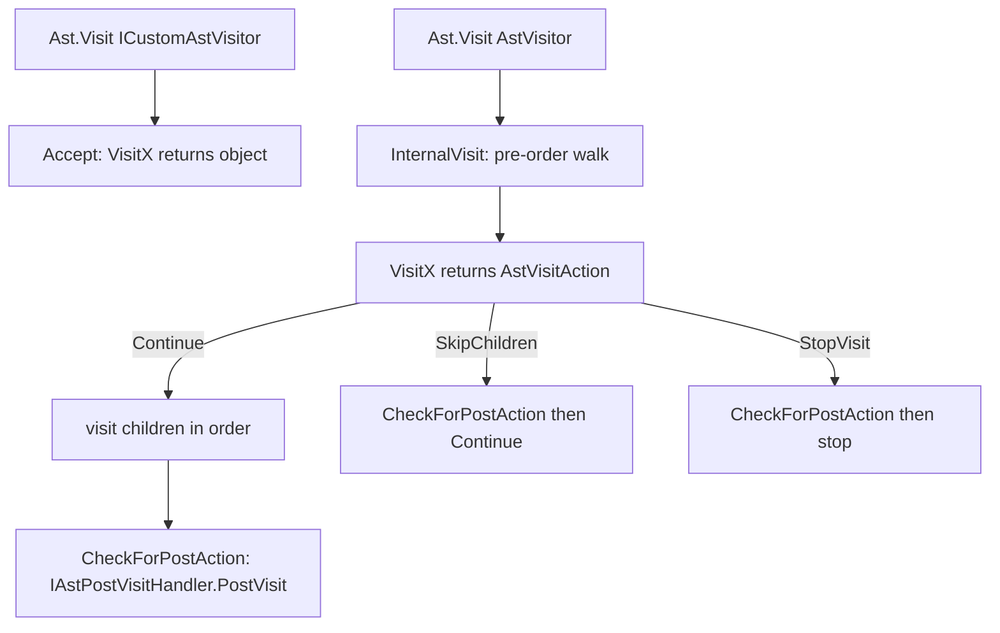

# AST

> STATIC-ONLY — behavior not run-verified. `FACT-SRC` unless marked. Every node, its children and its consumers: [AST-CATALOG.md](AST-CATALOG.md) (`GENERATED`). Producer: [02.2-parser.md](02.2-parser.md). Checks run on the tree: [02.4-semantic-analysis.md](02.4-semantic-analysis.md) (planned, T24).

## 1. Purpose and scope [SPEC]

The AST is the object tree produced by the parser: one class per syntactic construct, all deriving from `Ast`. It is the interface between parsing and everything else: semantic checks, compilation to expression trees, completion, constant folding, safe-value evaluation, and `ScriptBlock` creation. This document covers the base contract, the visitor infrastructure, search/copy/extent helpers, constant and safe-value evaluation, and the type-name classes that live in `ast.cs`. Node-by-node data is in the catalog. `FACT-SRC` (`src/System.Management.Automation/engine/parser/ast.cs::Ast@L91-L420`).

## 2. Source map

| path | type | role | tier |
|---|---|---|---|
| `src/System.Management.Automation/engine/parser/ast.cs::Ast@L91-L420` | abstract class | base: `Extent`, `Parent`, `Visit`, `Find`/`FindAll`, `Copy`, `SafeGetValue` | A |
| `src/System.Management.Automation/engine/parser/ast.cs::ScriptBlockAst@L775-L1739` | class | root; named blocks, `param`, using statements, `ScriptRequirements` | A |
| `src/System.Management.Automation/engine/parser/AstVisitor.cs::ICustomAstVisitor@L14-L202` | interface | value-returning visitor (default interface methods call `DefaultVisit`) | A |
| `src/System.Management.Automation/engine/parser/AstVisitor.cs::ICustomAstVisitor2@L207-L235` | interface | adds the nine second-generation node visits | A |
| `src/System.Management.Automation/engine/parser/AstVisitor.cs::AstSearcher@L404-L617` | class | implements `Find`/`FindAll`/`FindFirst` | A |
| `src/System.Management.Automation/engine/parser/AstVisitor.cs::DefaultCustomAstVisitor@L622-L788` | abstract class | no-op base for `ICustomAstVisitor` | A |
| `src/System.Management.Automation/engine/parser/PreOrderVisitor.cs::AstVisitor@L35-L215` | abstract class | pre-order visitor returning `AstVisitAction`; post-visit hook | A |
| `src/System.Management.Automation/engine/parser/PreOrderVisitor.cs::AstVisitAction@L12-L28` | enum | `Continue`, `SkipChildren`, `StopVisit` | A |
| `src/System.Management.Automation/engine/parser/ConstantValues.cs::IsConstantValueVisitor@L18-L330` | class | decides whether a node is a compile-time constant | A |
| `src/System.Management.Automation/engine/parser/ConstantValues.cs::ConstantValueVisitor@L332-L577` | class | computes the constant value (by compiling and invoking) | A |
| `src/System.Management.Automation/engine/parser/SafeValues.cs::IsSafeValueVisitor@L39-L356` | class | decides whether a node is safe to evaluate from untrusted data | A |
| `src/System.Management.Automation/engine/parser/SafeValues.cs::GetSafeValueVisitor@L363-L806` | class | evaluates safe nodes without executing commands | A |
| `src/System.Management.Automation/engine/parser/Position.cs::PositionUtilities@L114-L385` | static class | extent arithmetic, error-message rendering | A |

## 3. Responsibilities and non-responsibilities

Responsible for: node construction invariants (argument checks), parent links, deep copy, child traversal order, search, text round-trip helpers for remoting (`ToStringForSerialization`), and the constant/safe evaluators. Not responsible for: building nodes from tokens (parser), semantic validation (`SemanticChecks`, `SymbolResolver`, `VariableAnalysis`), execution (compiler, [02.5-compiler-and-engine.md](02.5-compiler-and-engine.md), planned T25).

## 4. Key types and contracts [IMPL]

**`Ast` contract** (`src/System.Management.Automation/engine/parser/ast.cs::Ast@L91-L420`):

- Constructor `protected Ast(IScriptExtent)` throws if the extent is null; `Extent` is get-only; `Parent` has a **private setter** (L108-L118).
- Parent links are set once by the owning node's constructor through `SetParent`/`SetParents`; `SetParent` throws `InvalidOperationException(ParserStrings.AstIsReused)` if the child already has a parent (L267-L300). Constructors that re-home a node call `ClearParent()` first (e.g. `NamedBlockAst` takes the statements out of a `StatementBlockAst`; `AssignmentStatementAst` replaces a one-element pipeline by its `CommandExpressionAst`).
- `Visit(ICustomAstVisitor)` → internal `Accept`; `Visit(AstVisitor)` → internal `InternalVisit` (L126-L140).
- `Find(predicate, searchNestedScriptBlocks)` / `FindAll(...)` → `AstSearcher` (L156-L172). `ToString()` returns `Extent.Text`. `Copy()` is abstract; helpers `CopyElement`/`CopyElements` are null-safe (L185-L264).
- `SafeGetValue(skipHashtableSizeCheck = false)`: evaluates the node with `GetSafeValueVisitor`; **any** exception is rethrown as `InvalidOperationException(CantConvertWithDynamicExpression, Extent.Text)` (L203-L232).
- `IsInWorkflow()` and ancestor helpers walk `Parent` and stop at function boundaries (L313-L417).
- Internal marker interfaces used by the compiler: `ISupportsAssignment`, `IAssignableValue` (compile-time assignment protocol on nodes), `IParameterMetadataProvider` (implemented by `ScriptBlockAst`, `FunctionDefinitionAst`, `FunctionMemberAst`), `ISupportsTypeCaching` (L34-L85, L8416).

**Counts.** `ast.cs` declares <!--N:AST_CLASSES_ASTCS-->76<!--/N--> `Ast`-derived classes (<!--N:AST_CLASSES_ABSTRACT-->11<!--/N--> abstract; catalog §3). `ICustomAstVisitor` has <!--N:ICUSTOMASTVISITOR_METHODS-->54<!--/N--> visit methods and `ICustomAstVisitor2` adds <!--N:ICUSTOMASTVISITOR2_METHODS-->9<!--/N-->.

**Node families** (names are `…Ast`; see catalog for children):

| Family | Nodes |
|---|---|
| Root and blocks | `ScriptBlockAst`, `ParamBlockAst`, `NamedBlockAst`, `StatementBlockAst` |
| Attributes and parameters | `AttributeBaseAst` → `AttributeAst`, `TypeConstraintAst`; `NamedAttributeArgumentAst`, `ParameterAst` |
| Statements | `StatementAst` → `PipelineBaseAst` → `PipelineAst`, `PipelineChainAst` (via `ChainableAst`), `AssignmentStatementAst`, `ErrorStatementAst`; `CommandBaseAst` → `CommandAst`, `CommandExpressionAst`; `LabeledStatementAst` → `SwitchStatementAst`, `LoopStatementAst` → `ForEach/For/While/DoWhile/DoUntil`; `IfStatementAst`, `TryStatementAst`, `CatchClauseAst`, `TrapStatementAst`, `Break/Continue/Return/Exit/ThrowStatementAst`, `FunctionDefinitionAst`, `DataStatementAst`, `BlockStatementAst`, `UsingStatementAst`, `TypeDefinitionAst`, `ConfigurationDefinitionAst`, `DynamicKeywordStatementAst` |
| Command elements | `CommandElementAst` → `CommandParameterAst`, `ExpressionAst` |
| Redirections | `RedirectionAst` → `FileRedirectionAst`, `MergingRedirectionAst` |
| Expressions | `BinaryExpressionAst`, `UnaryExpressionAst`, `TernaryExpressionAst`, `ConvertExpressionAst`, `AttributedExpressionAst`, `MemberExpressionAst` → `InvokeMemberExpressionAst` → `BaseCtorInvokeMemberExpressionAst`, `IndexExpressionAst`, `ConstantExpressionAst` → `StringConstantExpressionAst`, `ExpandableStringExpressionAst`, `VariableExpressionAst`, `TypeExpressionAst`, `ArrayLiteralAst`, `ArrayExpressionAst`, `HashtableAst`, `ScriptBlockExpressionAst`, `ParenExpressionAst`, `SubExpressionAst`, `UsingExpressionAst`, `ErrorExpressionAst` |
| Class members | `MemberAst` → `PropertyMemberAst`, `FunctionMemberAst`, `CompilerGeneratedMemberFunctionAst` (internal) |
| Not produced by the parser | `SequencePointAst` (compiler only; all visit methods `Assert(false)`), `CompilerGeneratedMemberFunctionAst` |

## 5. Data model

- **Immutability.** Public properties are get-only; collections are `ReadOnlyCollection<T>` (never null for statement lists; null when absent for optional single children). One exception: `ArrayLiteralAst` wraps the caller's `IList` without copying (`src/System.Management.Automation/engine/parser/ast.cs::ArrayLiteralAst@L10048-L10123`, `INFERENCE`: caller mutation would be visible).
- **Mutable annotations.** Some nodes carry mutable internal fields filled by later phases: `VariableExpressionAst.TupleIndex/Automatic/Assigned` and `DataStatementAst.TupleIndex` (set by variable analysis, used by the compiler), `UsingExpressionAst.RuntimeUsingIndex`, `TypeDefinitionAst.Type` (null → `TypeBuilder` → runtime type), `ScriptBlockAst.HadErrors/PostParseChecksPerformed/IsConfiguration`, `PipelineAst.Background` (internal setter, set by the parser after construction), `ErrorStatementAst` extras. `INFERENCE`: the tree is therefore immutable in shape but not in annotations; `Copy()` does not copy these caches except where noted below.
- **Tuple children.** `IfStatementAst.Clauses` = `Tuple<PipelineBaseAst, StatementBlockAst>`, `SwitchStatementAst.Clauses` = `Tuple<ExpressionAst, StatementBlockAst>`, `HashtableAst.KeyValuePairs` = `Tuple<ExpressionAst, StatementAst>` — a hashtable **value is a statement** (matches the parser) (`src/System.Management.Automation/engine/parser/ast.cs::HashtableAst@L10128-L10218`).
- **Normalizations in constructors.** `AssignmentStatementAst` requires the operator kind to carry `AssignmentOperator` and replaces a right side that is a non-background `PipelineAst` with one `CommandExpressionAst` by that expression (`@L6379-L6470`). `ScriptBlockAst` built from a statement block wraps it in an unnamed `NamedBlockAst` (`Process` for filters, otherwise `End`) (`@L1125-L1162`). `NamedBlockAst` rejects block kinds without the `ScriptBlockBlockName` trait (`@L1864-L2026`).
- **Type names are not nodes.** `ITypeName` (`TypeName`, `GenericTypeName`, `ArrayTypeName`, `ReflectionTypeName`) are plain objects held by `TypeConstraintAst`, `TypeExpressionAst`, `AttributeBaseAst`; they resolve to a runtime `Type` lazily (`GetReflectionType`) and cache the result with `Interlocked.CompareExchange` (`@L8369-L9345`). Nested array/generic names are guarded by `EnsureSufficientExecutionStack`.
- **Extents.** Each node has an `IScriptExtent` (start/end line, column, offset, text). Positions are computed lazily from a shared `PositionHelper` line-start table; `ScriptPosition`/`ScriptExtent` are the public, helper-free variants (`src/System.Management.Automation/engine/parser/Position.cs::PositionHelper@L391-L437`, `InternalScriptExtent@L470-L543`).
- **`ScriptRequirements`** and **`CommentHelpInfo`** are plain classes in `ast.cs`, not nodes (`@L713-L770`, `@L10655-L10845`).

## 6. Control flow

### 6.1 Two visitor families

- **`ICustomAstVisitor` / `ICustomAstVisitor2`** (`Accept`): the visitor decides recursion itself and returns an `object`. Used by the compiler, constant/safe evaluators, variable analysis, type inference. Every interface method has a default body calling `DefaultVisit(ast)` which returns `null` (`src/System.Management.Automation/engine/parser/AstVisitor.cs::ICustomAstVisitor@L14-L202`).
- **`AstVisitor` / `AstVisitor2`** (`InternalVisit`): pre-order walk. `VisitX(node)` is called **before** the children; the return value controls the walk (`Continue`, `SkipChildren`, `StopVisit`). `IAstPostVisitHandler.PostVisit(ast)` is called after the children **on every exit path**, including `SkipChildren` and `StopVisit` (`src/System.Management.Automation/engine/parser/PreOrderVisitor.cs::AstVisitor.CheckForPostAction@L35-L43`).
- Canonical `InternalVisit` shape (every node): call `visitor.VisitX(this)`; if `SkipChildren` → return `CheckForPostAction(this, Continue)`; if `Continue` → visit children in fixed order, stopping at the first non-`Continue`; return `CheckForPostAction(this, action)` (`src/System.Management.Automation/engine/parser/ast.cs::ErrorStatementAst@L456-L648`, `IfStatementAst@L4059-L4157`).

### 6.2 Version gating of nodes added after v1

The nine second-generation nodes (`TypeDefinitionAst`, `PropertyMemberAst`, `FunctionMemberAst`, `BaseCtorInvokeMemberExpressionAst`, `UsingStatementAst`, `ConfigurationDefinitionAst`, `DynamicKeywordStatementAst`, `TernaryExpressionAst`, `PipelineChainAst`) are visited only by `AstVisitor2` / `ICustomAstVisitor2`:

- `Accept` on them casts the visitor to `ICustomAstVisitor2` and **returns `null` for a plain `ICustomAstVisitor`**.
- `InternalVisit` calls their `VisitX` only for `AstVisitor2`. Whether children are still visited for a v1 visitor differs per node: `TypeDefinitionAst`, `TernaryExpressionAst`, `PipelineChainAst` and `BaseCtorInvokeMemberExpressionAst` visit children for every visitor; `PropertyMemberAst`, `FunctionMemberAst` and `UsingStatementAst` visit nothing for a v1 visitor (`UsingStatementAst` also returns `SkipChildren` unchanged to `CheckForPostAction`). Evidence: `src/System.Management.Automation/engine/parser/ast.cs::TypeDefinitionAst@L2667-L2865`, `UsingStatementAst@L2901-L3105`, `PropertyMemberAst@L3156-L3315`, `FunctionMemberAst@L3342-L3630`, `PipelineChainAst@L5549-L5650`, `TernaryExpressionAst@L7404-L7500`.

The column "v2" in the catalog marks nodes whose `InternalVisit` mentions `AstVisitor2`.

### 6.3 Search

`Find`/`FindAll` run `AstSearcher` (a pre-order visitor) starting at the node **itself** (the root is tested first). With `searchNestedScriptBlocks = false` the searcher returns `SkipChildren` after testing a `FunctionDefinitionAst`, `TrapStatementAst` or `ScriptBlockExpressionAst`, so those are tested but not entered; it does **not** skip a nested `ScriptBlockAst` (`src/System.Management.Automation/engine/parser/AstVisitor.cs::AstSearcher@L404-L617`). Cross-reference: `IsUsingDollarInput` looks for `$input` without entering nested script blocks.

## 7. Algorithms

### 7.1 Constant folding support (`IsConstantValueVisitor`, `ConstantValueVisitor`)

`IsConstant(ast, out value, forAttribute, forRequires)`: ask `IsConstantValueVisitor`; if true and the node has a `DataStatementAst` ancestor → **not** constant; otherwise compute the value with `ConstantValueVisitor`; any exception during the computation (e.g. an invalid cast) makes the node non-constant (`src/System.Management.Automation/engine/parser/ConstantValues.cs::IsConstantValueVisitor.IsConstant@L20-L53`). Rules (`FACT-SRC`, L61-L330): only expressions can be constant; `BinaryExpressionAst` needs the `CanConstantFold` token trait on the operator and constant operands and not a divisor that is `$null`/`$false` variable; `UnaryExpressionAst` likewise; `ConvertExpressionAst` needs a resolvable safe primitive type; `$true/$false/$null` variables are constants; a static `const` field of a resolvable type is constant; arrays/hashtables/script blocks are constant only in attribute-argument or `#requires` contexts. **The value is computed by compiling the node and invoking the delegate** (`CompileAndInvoke` with a `Compiler` in `CompilingConstantExpression` mode), so folded operators use the real operator implementations (`src/System.Management.Automation/engine/parser/ConstantValues.cs::ConstantValueVisitor@L332-L577`).

### 7.2 Safe values (`IsSafeValueVisitor`, `GetSafeValueVisitor`)

Purpose: evaluate data-only expressions (module manifests, `-Data` sections, argument-completion helpers) without running arbitrary code. `IsSafeValueVisitor` first decides safety: all statement kinds, commands, assignments, member invocations, and **binary expressions** are unsafe (the source comment gives a denial-of-service example, `"AAAA"*2*2…`); type and member expressions are unsafe (they would reveal installed types); unary and convert expressions are safe only when the operator is constant-foldable, not restricted, and the type is a safe primitive; the visit counter is capped at 5000 nodes and hashtables at 500 keys unless `SkipHashtableSizeCheck` is requested (`src/System.Management.Automation/engine/parser/SafeValues.cs::IsSafeValueVisitor@L39-L356`, constants in the constructor L47-L53). `GetSafeValueVisitor` then evaluates by itself, except that unary/convert/ternary operands go through the compiler (`Compiler.GetExpressionValue(..., isTrustedInput: true, ...)`); `$PSScriptRoot`, `$true/$false/$null` and—when an execution context exists—ordinary variables are resolved; an expandable string joins arrays with `$OFS` (default space); a script block expression yields a new `ScriptBlock` from its text without invoking it (`src/System.Management.Automation/engine/parser/SafeValues.cs::GetSafeValueVisitor@L363-L806`). Contexts: `Default`, `GetPowerShell`, `ModuleAnalysis`, `SkipHashtableSizeCheck`.

### 7.3 Copying

`Copy()` deep-copies children with `CopyElement(s)`; it preserves script-level annotations selectively (`ScriptBlockAst.Copy` keeps `IsConfiguration` and shares `ScriptRequirements`, drops `HadErrors`/`PostParseChecksPerformed`; `UsingExpressionAst` keeps `RuntimeUsingIndex`; `CommandAst` keeps `DefiningKeyword`) (`src/System.Management.Automation/engine/parser/ast.cs::ScriptBlockAst@L775-L1739`).

## 8. Observable behavior [SPEC]

No golden sample: STATIC-ONLY. Observable through the public API: `Parser.ParseInput` returns the root; `Ast.FindAll(pred, true)` enumerates nodes in pre-order; `Ast.ToString()` returns the source text; `ScriptBlockAst.GetScriptBlock()` runs the post-parse checks if needed and throws `ParseException` on errors; `Ast.SafeGetValue()` throws `InvalidOperationException` for anything unsafe. Tests: `test/powershell/Language/Parser/` and `test/xUnit/csharp/test_AstDefaultVisit.cs` (default-visit behavior of the four visitor bases) (`data/tests.json`; per-assertion mapping `UNVERIFIED`, VB-005).

## 9. Error handling and edge cases

- Constructors throw `ArgumentNullException`/`ArgumentException` for invalid combinations (e.g. `IfStatementAst` with no clause, `SwitchStatementAst` with no clauses and no default, `TryStatementAst` with neither catch nor finally, `FunctionDefinitionAst` both filter and workflow, `PipelineChainAst` operator not `&&`/`||`, `UnaryExpressionAst`/`BinaryExpressionAst` operator without the matching token trait).
- Re-using a node under two parents throws `AstIsReused`.
- `ErrorStatementAst`/`ErrorExpressionAst` carry what parsed before an error (parser recovery); they are never produced by valid scripts.
- `ScriptBlockAst.GetScriptBlock()` throws if the tree had errors (`PSInvalidOperationException`) or if post-parse checks report errors (`ParseException`) (`src/System.Management.Automation/engine/parser/ast.cs::ScriptBlockAst.GetScriptBlock@L1250-L1272`).
- Reading observations that look like defects (`INFERENCE`, not run; recorded in the backlog VB-008 to VB-012): `UsingStatementAst.Copy` selects its constructor from `Alias != null` only and loses the module-spec forms (`@L3037-L3045`); `ConfigurationDefinitionAst.InternalVisit` ignores the action returned for its body (`@L6599-L6620`); `BaseCtorInvokeMemberExpressionAst` has no `Copy` override so a copy becomes a plain `InvokeMemberExpressionAst`; `ForEachStatementAst.ThrottleLimit` and `DataStatementAst.CommandsAllowed` are not visited (`@L4469`, `@L4242-L4250`); multi-line `ScriptExtent.Text` indexes the first line with a 1-based column (`src/System.Management.Automation/engine/parser/Position.cs::ScriptExtent@L696-L815`).
- Comment-versus-code: the file header says private/internal methods live in `AstCompile.cs`, which does not exist (CON-007); the `SafeValues.cs` comment says `$OFS` cannot be used but the code reads it from the session state when a context exists (CON-008); the study prompt's hint that `AstVisitor.cs` defines `AstVisitor` is wrong, it is in `PreOrderVisitor.cs`.

## 10. Concurrency and threading

AST objects are shared between threads after construction (script blocks are cached and executed concurrently), which works because shape is immutable; annotation fields set by the compiler are not locked (`INFERENCE`). Type resolution caches publish with `Interlocked.CompareExchange`. `GetSafeValueVisitor` keeps its context in a `[ThreadStatic]` field (`t_context`). Lazily built DSC caches in `ConfigurationDefinitionAst` have no lock (out of scope).

## 11. Extension points and customization hooks

Subclass `AstVisitor`/`AstVisitor2` (pre-order walk with skip/stop), `DefaultCustomAstVisitor(2)` (return values), or implement `IAstPostVisitHandler` for a post-order hook. Adding a node means: a class, `Copy`, `Accept`, `InternalVisit`, a `VisitX` in both interface families (with a default body), the debug-only `CheckAllParentsSet` visitor, the compiler `VisitX`, and semantic/variable-analysis handling. Recipes: HOWTO-extend-language (planned T210).

## 12. Dependencies

Inbound: parser (construction), `SemanticChecks`, `SymbolResolver`, `VariableAnalysis`, `Compiler`, `TypeInferenceVisitor`, completion, module analysis (`ExportVisitor`), debugger (`CheckBreakpointInScript`), `ScriptBlockToPowerShellChecker`, telemetry (`ScriptBlockTelemetry`) — full list in [AST-CATALOG.md](AST-CATALOG.md) §6. Outbound: `TokenKind`/`TokenFlags` (operator validation), `Compiler` (assignment protocol and constant evaluation), `TypeResolver`, `HelpCommentsParser`, `LanguagePrimitives`, `Parser` (`ScanString`, parse of fixed text in DSC helpers).

## 13. Performance notes

Parent links make ancestor walks O(depth); `Find` walks the whole tree. Constant evaluation compiles a lambda per folded expression (`INFERENCE`: expensive for many constants, bounded by tiering decisions elsewhere). Type-name resolution is cached per `TypeName`.

## 14. Security considerations (mandatory)

- `SafeGetValue` is the sanctioned way to read literal data from untrusted script text: the safe-value visitors forbid commands, assignments, method calls, type and member expressions, binary operators, and cap visits (5000) and hashtable keys (500). Evidence: `src/System.Management.Automation/engine/parser/SafeValues.cs::IsSafeValueVisitor@L39-L356`. The comment-documented threats are denial of service (large repeated operations) and type fingerprinting.
- `ModuleAnalysis` context returns `null` instead of throwing for unsafe nodes.
- `ConstantValueVisitor` **does execute** compiled code for constant-foldable operators; safety rests on `CanConstantFold` excluding culture- and context-dependent operators (comment `src/System.Management.Automation/engine/parser/token.cs::TokenFlags@L742-L745`).
- `ConfigurationDefinitionAst` synthesizes AST for DSC at parse time; out of scope here.

## 15. Enterprise considerations

Observability: `HasSuspiciousContent` flag on nodes (set by security scanning, `src/System.Management.Automation/engine/parser/ast.cs::Ast@L349`) and parent links give tooling stable navigation. Testability: pure data structure; `DEBUG` visitors check parent links and `TypeBuilder` leakage. Missing: no tree version/serialization format, no node ids.

## 16. Tests

`test/xUnit/csharp/test_AstDefaultVisit.cs` (default-visit behavior), `test/powershell/Language/Parser/*` (`data/tests.json`). Mapping `UNVERIFIED`.

## 17. Design decisions and trade-offs

| Decision | Label | Consequence |
|---|---|---|
| tree is built once with parent links set in constructors | `FACT-SRC` | simple ownership; nodes cannot be shared between trees (must `Copy`) |
| two visitor families (value-returning and pre-order walk with actions) | `FACT-SRC` | flexibility; every new node must be added to four visitor bases |
| second-generation nodes gated by `*Visitor2` | `FACT-SRC` | old external visitors keep compiling; behavior for new nodes differs per node (§6.2) |
| compile-time caches and assignment logic live on nodes | `FACT-SRC` | fast compile; couples AST to compiler and makes nodes not purely syntactic |
| constants are computed by compiling and running the expression | `FACT-SRC` | exact operator semantics, but evaluation needs the engine |
| separate "is it safe" and "evaluate it" visitors | `FACT-SRC` | auditable allow-list for untrusted data |

## 18. Guidance for MicroteamShell [LESSON]

- **LSN-AST-01** [REPLICATE] (area: NLD-GRM) One class per construct, get-only properties, constructor invariants that throw on invalid combinations, and parent links set exactly once. Evidence: `src/System.Management.Automation/engine/parser/ast.cs::Ast@L91-L420`.
- **LSN-AST-02** [REPLICATE] (area: NLD-GRM) Provide a pre-order visitor with `Continue`/`SkipChildren`/`StopVisit` and a post-visit hook that fires on every exit path. Evidence: `src/System.Management.Automation/engine/parser/PreOrderVisitor.cs::AstVisitor@L35-L215`.
- **LSN-AST-03** [REPLICATE] (area: NLD-GRM) Keep error nodes (`ErrorStatementAst`, `ErrorExpressionAst`) that hold partially parsed children so tooling works on broken scripts. Evidence: `src/System.Management.Automation/engine/parser/ast.cs::ErrorStatementAst@L456-L648`.
- **LSN-AST-04** [REPLICATE] (area: NLD-GRM) Treat hashtable values as statements and keep `PipelineChainAst` left-nested with a plain `PipelineAst` on the right, as the parser produces them. Evidence: `src/System.Management.Automation/engine/parser/ast.cs::HashtableAst@L10128-L10218`, `PipelineChainAst@L5549-L5650`.
- **LSN-AST-05** [ADAPT] (area: NLD-GRM) Use one visitor family with a default `Visit` for new nodes instead of two families gated by "v2" interfaces. Why: the v1/v2 split exists for source compatibility with external visitors, which a new shell does not have. Evidence: `src/System.Management.Automation/engine/parser/AstVisitor.cs::ICustomAstVisitor2@L207-L235`.
- **LSN-AST-06** [ADAPT] (area: NLD-GRM) Make type names (`ITypeName`) plain syntax objects resolved lazily by the type system, with a cache owned by the resolver. Why: keeps the AST free of reflection state while keeping the observable `[type]` resolution. Evidence: `src/System.Management.Automation/engine/parser/ast.cs::TypeName@L8425-L8724`.
- **LSN-AST-07** [AVOID] (area: NLD-GRM) Do not store compiler caches (`TupleIndex`, `RuntimeUsingIndex`, `TypeDefinitionAst.Type`) or assignment-code-generation methods on AST nodes; keep them in side tables keyed by node. Evidence: `src/System.Management.Automation/engine/parser/ast.cs::VariableExpressionAst@L9404-L9624`. DEV: DEV-AST-020
- **LSN-AST-08** [ADAPT] (area: NLD-SEC) Provide an allow-list "literal data" evaluator (no commands, no member calls, no binary operators, node and key caps) for manifests and data sections, evaluated without the compiler. Why: same observable safety as `SafeGetValue`, without depending on the compiler for unary/convert nodes. Evidence: `src/System.Management.Automation/engine/parser/SafeValues.cs::IsSafeValueVisitor@L39-L356`.

## 19. Open questions / UNVERIFIED

- The `INFERENCE` defects in §9 need a run to confirm (VB-008 to VB-012).
- Complete list of external consumers of `Accept`-style visitors in `Compiler.cs` is T25's.
- `HasSuspiciousContent` setters not traced.
- Mapping of `test_AstDefaultVisit.cs` assertions not read.

Verification: `ast.cs` (10,845 lines), `AstVisitor.cs` (822), `PreOrderVisitor.cs` (264), `ConstantValues.cs` (578), `SafeValues.cs` (807) and `Position.cs` (816) were read in full windows (notes `.work/notes/…ast.cs.md` W1-W36 and the per-file notes); node, base and visitor counts reconciled with `data/ast-hierarchy.json` (file filter `ast.cs`) and `data/visitors.json` via `tools/gen_T23.py --count`; the catalog's children column was spot-checked against `InternalVisit` bodies of `IfStatementAst`, `ScriptBlockAst`, `ErrorStatementAst`, `InvokeMemberExpressionAst`.
