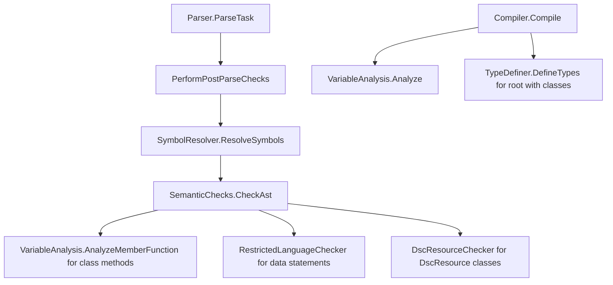

# Semantic analysis

> STATIC-ONLY — behavior not run-verified. `FACT-SRC` unless marked. Inputs: the AST of [02.3-ast.md](02.3-ast.md); producer of errors in the same list as [ERROR-CATALOG.md](ERROR-CATALOG.md); consumer of the output: [02.5-compiler-and-engine.md](02.5-compiler-and-engine.md).

## 1. Purpose and scope [SPEC]

After parsing, three kinds of analysis run over the tree: (a) **symbol resolution** (classes, enums, `using module` types, type names), (b) **semantic checks** (rules the grammar cannot express: duplicate parameters, `break` placement, assignment targets, attribute arguments, class members, restricted-language rules for `data` sections), and (c) **variable analysis** (which variables can live in fixed tuple slots; used by the compiler, partly also by the checks). A fourth stage, **type definition** (`TypeDefiner`), also reports parse-style errors but runs only when the root script block is compiled. This document gives the order, the rules, and a generated table of every check with its error ID. `FACT-SRC` (src/System.Management.Automation/engine/parser/SemanticChecks.cs::SemanticChecks@L21-L1514).

## 2. Source map

| path | type | role | tier |
|---|---|---|---|
| src/System.Management.Automation/engine/parser/SemanticChecks.cs::SemanticChecks@L21-L1514 | `AstVisitor2`, `IAstPostVisitHandler` | the semantic checker (partial class, one `Visit*` per rule) | A |
| src/System.Management.Automation/engine/parser/SemanticChecks.cs::RestrictedLanguageChecker@L1807-L2454 | `AstVisitor` | allow-list checker for `data` sections, manifests, restricted evaluation | A |
| src/System.Management.Automation/engine/parser/SemanticChecks.cs::DscResourceChecker@L1516-L1805 | static class | checks a class decorated `[DscResource()]` (DSC; out of scope, summarized) | A |
| src/System.Management.Automation/engine/parser/SymbolResolver.cs::SymbolResolver@L275-L729 | `AstVisitor2`, `IAstPostVisitHandler` | scopes, type table, `using module` import, type-name binding | A |
| src/System.Management.Automation/engine/parser/SymbolResolver.cs::SymbolTable@L161-L273 | class | stack of scopes with type/variable tables | A |
| src/System.Management.Automation/engine/parser/VariableAnalysis.cs::VariableAnalysis@L325-L1847 | `ICustomAstVisitor2` | flow-graph based variable slot allocation and type deduction | A |
| src/System.Management.Automation/engine/parser/VariableAnalysis.cs::FindAllVariablesVisitor@L44-L323 | `AstVisitor` | first pass: collect variable names, decide on pessimizing | A |
| src/System.Management.Automation/engine/parser/TypeResolver.cs::TypeResolver@L31-L506 | static class | `[type]` name to `Type` resolution | A |
| src/System.Management.Automation/engine/parser/TypeResolver.cs::TypeAccelerators@L844-L979 | static class | built-in and user type accelerators | A |
| src/System.Management.Automation/engine/parser/PSType.cs::TypeDefiner@L18-L1505 | static class | Reflection.Emit definition of PowerShell classes and enums | A |

## 3. Responsibilities and non-responsibilities

Responsible for: reporting rule violations as parse errors, binding type names to classes/types, deciding variable slots. Not responsible for: syntax (parser), evaluating anything (compiler), command resolution (runtime; commands are never resolved at parse time).

## 4. Key types and contracts [IMPL]

- **Order.** `Parser.ParseTask` calls `ScriptBlockAst.PerformPostParseChecks(parser)` for `ParseMode.Default`: first `SymbolResolver.ResolveSymbols(parser, ast)`, then `SemanticChecks.CheckAst(parser, ast)`; the semantic pass sets `PostParseChecksPerformed` and `HadErrors` on every script block it leaves (src/System.Management.Automation/engine/parser/ast.cs::ScriptBlockAst.PerformPostParseChecks@L1416-L1432, src/System.Management.Automation/engine/parser/SemanticChecks.cs::SemanticChecks.CheckAst@L39-L47, src/System.Management.Automation/engine/parser/SemanticChecks.cs::SemanticChecks.PostVisit@L1490-L1513). `ParseMode.ModuleAnalysis` skips both (so module analysis tolerates unresolved classes).
- `SemanticChecks` is a pre-order visitor with a post-visit hook: it keeps a stack of enclosing script blocks (`_scopeStack`) and of class-member scopes (`_memberScopeStack`) pushed in `VisitScriptBlock`/`VisitFunctionMember` and popped in `PostVisit`.
- `SymbolResolver` keeps a `SymbolTable` (stack of `Scope` objects of kinds `Type`, `Method`, `Function`, `ScriptBlock`). Entering a scope pre-registers every class/enum defined in it (forward references between classes work); a class property name is registered once per type; duplicate type names report `MemberAlreadyDefined`.
- `VariableAnalysis` exposes `Analyze` (script blocks/functions), `AnalyzeTrap`, `AnalyzeExpression` (default-argument expressions, single expressions) and `AnalyzeMemberFunction`; its result is a `Tuple<Type, Dictionary<string,int>>`: the `MutableTuple` type for the locals and the name → slot map.

## 5. Data model

- `VariableAnalysisDetails` per variable: slot `BitIndex`/`LocalTupleIndex`, deduced `Type`, `Automatic`, `PreferenceVariable`, `Assigned`, associated variable nodes. Results are written back onto `VariableExpressionAst.TupleIndex/Automatic/Assigned` (see [02.3-ast.md](02.3-ast.md) §5). Sentinels: `Unanalyzed = -1`, `ForceDynamic = -2` (variable is accessed by name through the session state instead of a slot) (src/System.Management.Automation/engine/parser/VariableAnalysis.cs::VariableAnalysis@L325-L1847).
- `Block` = flow-graph node holding the variable nodes it visits plus successor/predecessor links and `throws/returns/unreachable` flags.
- Type resolution caches: `TypeResolutionState` (namespaces from `using namespace`, assemblies, defined types, generic argument count, attribute flag; immutable), a process-wide `TypeCache` keyed by (type name, state), `CoreTypes` accelerators fully supported in Constrained Language Mode.

## 6. Control flow

1. Symbol resolution (`SymbolResolver`): enter the root scope with the `TypeResolutionState` built from `using namespace` statements; visit type definitions, functions, script block expressions (each opens a scope); for `using module` load the module at **parse time** via a `PowerShell` instance running `Get-Module -FullyQualifiedName … -ListAvailable` and register its exported classes by simple and `Module.Type` names; bind every type name (type expression, type constraint, attribute) to a local class definition or, failing that, to a CLR type through `TypeResolver`.
2. Semantic checks (`SemanticChecks`): one pre-order walk; each rule in the generated table below.
3. Variable analysis (`VariableAnalysis`): normally run **by the compiler** (not at parse time) for each script block; run at semantic-check time only for class methods (to verify that all paths return).
4. Type definition (`TypeDefiner`): run by `Compiler.GenerateTypesAndUsings` when the root script block is compiled; errors there are collected in a fresh `Parser`, the half-built types are wiped and a `ParseException` is thrown (src/System.Management.Automation/engine/parser/PSType.cs::TypeDefiner@L18-L1505). The source comment calls this a short-term solution (the checks belong at parse time); recorded as CON-009.

## 7. Algorithms

### 7.1 Type-name resolution order (`TypeResolver`)

For a type name with resolution state `S` (`ResolveTypeNameWithContext`, cache first): (1) script-defined types in the current session-state scope chain (`using type`, classes); (2) built-in type accelerators; (3) assemblies listed in `S` (reporting ambiguity if two assemblies define the name); (4) user type accelerators; then retries with each `using namespace` namespace prefix; two namespaces matching → `AmbiguousTypeReference`. Generic names retry with `` `N`` appended; attribute names retry with `Attribute` appended. Assembly-qualified names use `Type.GetType(FullName)` (then with `System.` prefixed) and require a public type. Evidence: src/System.Management.Automation/engine/parser/TypeResolver.cs::TypeResolver@L31-L506, src/System.Management.Automation/engine/parser/TypeResolver.cs::TypeResolutionState@L520-L670, src/System.Management.Automation/engine/parser/TypeResolver.cs::TypeCache@L672-L701. An unresolved type outside a type definition produces **no** parse error; it is resolved again at run time (`SymbolResolver` reports `TypeNotFound` only inside a type definition and not for `[ordered]`).

### 7.2 Variable slot allocation (`VariableAnalysis`)

1. `FindAllVariablesVisitor` collects local variable names (unscoped, `local:`, `private:`; `PSItem` is aliased to `_`) and disables optimization for the whole block when it sees `New-Variable`, `Remove-Variable`, `Set-Variable`, `Set-PSBreakpoint` (or their aliases/module-qualified names), a dot-sourcing operator, or a `$private:` variable.
2. The constructor seeds the automatic variables (`$_`, `$args`, `$this`, `$input`, `$PSCmdlet`, `$PSBoundParameters`, `$MyInvocation`, `$PSScriptRoot`, `$PSCommandPath`, … in a fixed order) and, for script cmdlets, the preference variables.
3. A flow graph is built per statement kind (loops, `try`, `switch`, `break/continue/return/throw/exit`, `&&`/`||` as short circuits). `try` is modeled conservatively (catch and finally reachable from the block before the `try`), and a pipeline containing any command inside a loop adds pessimistic edges to all enclosing loop exits.
4. Definite-assignment dataflow: a variable gets a fixed slot only if every read is dominated by an assignment; a read that is not yet definitely assigned, a non-local scope (`$global:`, `$script:`, `$using:`, drive-qualified), a type change between assignments, validation/transformation attributes, more than one conversion, an unresolved conversion type, `[ref]`, or a mutable value type (not `SwitchParameter`) forces `ForceDynamic`.
5. Output: tuple type from the deduced slot types and the name → index map (`FinishAnalysis`). When optimization is disabled only automatic variables (and preference variables for script cmdlets) are allocated.
6. `AnyVariablesCouldBeAllScope` (static registry of names known to be `AllScope`) is consulted at run time: if any allocated variable could be `AllScope`, the optimized code is not used (src/System.Management.Automation/engine/runtime/CompiledScriptBlock.cs::CompiledScriptBlockData.Compile@L57-L83, see [TIERING-POLICY.md](TIERING-POLICY.md)).

## 8. Observable behavior [SPEC]

Parse-time errors listed below are visible through `Parser.ParseInput` and as `ParseException` from `ScriptBlock.Create`. Examples read from source: duplicate parameter names in a `param` block are an error; `break`/`continue` with a label that matches no enclosing loop is an error only inside a class method; `return` with a value in a `void` method is an error; `$a++` requires a variable or property; `&&`/`||` as binary expression operands outside a pipeline chain give `InvalidEndOfLine`; hashtable literals with duplicate keys are an error (`DuplicateKeyInHashLiteral`); a `finally` block that contains `break`, `continue` or `return` that leaves it is an error (`ControlLeavingFinally`); `$using:` accepts only variable, member and constant-index chains. No golden sample: STATIC-ONLY. Tests: `test/powershell/Language/Parser/*` (`data/tests.json`, mapping `UNVERIFIED`).

## 9. Error handling and edge cases

All rules call `Parser.ReportError`, so they share the de-duplication and no-limit behavior of CF-ERR-002 ([ERROR-CATALOG.md](ERROR-CATALOG.md)). `CheckArrayTypeNameDepth` reports `ScriptTooComplicated` for type names nested deeper than 200. `VariableNotLocal` is the only check that reads `TupleIndex`, so it depends on variable analysis having run for that block. `SemanticChecks` marks every ancestor of a risky node (`[Type]` expression, non-constant member name, static member on a non-type) with `HasSuspiciousContent = true`, which later forces script block logging.

## 10. Concurrency and threading

`SymbolResolver` keeps its `PowerShell` instance for `using module` in a `[ThreadStatic]` field; `TypeCache` is a process-wide `ConcurrentDictionary` (first writer wins; null results are cached too); `TypeAccelerators.Add` has no lock while readers lock `userTypeAccelerators` (`INFERENCE`: a data race on user accelerators); `VariableAnalysis` keeps a static `ConcurrentDictionary` of known `AllScope` variable names.

## 11. Extension points and customization hooks

Dynamic keywords can register a `SemanticCheck` callback (`Func<DynamicKeywordStatementAst, ParseError[]>`) run from `VisitDynamicKeywordStatement`. New rule = a `Visit*` override in `SemanticChecks` that calls `ReportError` with a new `ParserStrings` key.

## 12. Dependencies

Inbound: `Parser.ParseTask`, `Compiler.Compile` (variable analysis, type definition), `ScriptBlockAst.GetScriptBlock`. Outbound: `IsConstantValueVisitor` (constant attribute arguments), `TypeResolver`, `ExecutionContext`/`SessionState` (type tables), `PowerShell` + `Get-Module` (using module), DSC subsystem, WDAC audit logging (`SystemPolicy`), `Utils`.

## 13. Performance notes

`SymbolResolver` pre-registers all types per scope without descending into nested script blocks; `TypeResolver` caches per (name, state). `using module` costs one `Get-Module -ListAvailable` per module at parse time. Variable analysis is linear in nodes plus a dataflow over blocks.

## 14. Security considerations (mandatory)

- **Data sections** (`data { }`) are checked by `RestrictedLanguageChecker`: only allow-listed commands, constants, simple operators, no dot-sourcing, no script blocks, no variables except `$PSCulture`, `$PSUICulture`, `$true`, `$false`, `$null` (and the names the caller allows). Operators with the `DisallowedInRestrictedMode` token trait are rejected. In Constrained Language Mode a `data` statement with allowed commands is refused at run time unless the system lockdown policy is `Audit` (then a WDAC audit message is logged) (`CheckDataStatementLanguageModeAtRuntime`). Evidence: src/System.Management.Automation/engine/parser/SemanticChecks.cs::RestrictedLanguageChecker@L1807-L2454.
- `using module` executes a module lookup (`Get-Module -ListAvailable`) while parsing; wildcard module names are rejected; relative paths resolve against the script directory.
- `HasSuspiciousContent` marking feeds forced logging ([02.3-ast.md](02.3-ast.md) §14).
- Type resolution can load assemblies for assembly-qualified names (`ResolveAssemblyQualifiedTypeName`); constrained language restricts `[type]` use elsewhere (runtime).

## 15. Enterprise considerations

Observability: ETW `SemanticChecks` start/stop and `ResolveSymbols` events exist (src/System.Management.Automation/engine/parser/Parser.cs::ParserEventSource@L8248-L8278). Supportability: every rule has a stable resource key. Missing: no rule IDs separate from message keys; checks are not individually switchable; several class-definition errors surface at compile time rather than parse time (§6.4).

## 16. Tests

`test/powershell/Language/Parser/*` and class tests under `test/powershell/Language/Classes/` (`data/tests.json`; per-rule mapping `UNVERIFIED`, VB-005).

## 17. Design decisions and trade-offs

| Decision | Label | Consequence |
|---|---|---|
| semantic rules in a separate visitor after parsing | `FACT-SRC` | parser stays syntax-only; rules can be skipped (`ModuleAnalysis`) |
| classes are validated partly at compile time (`TypeDefiner`) | `FACT-SRC` | some class errors appear only when the script block is first compiled |
| slot allocation by dataflow with a safe fallback (`ForceDynamic`) | `FACT-SRC` | most variables are array slots; any doubt falls back to dynamic lookup |
| pessimistic handling of commands in loops and of `try` | `FACT-SRC` | correctness over speed; possible lost optimization |
| unresolved types are not errors outside class definitions | `FACT-SRC` | late binding; typos in `[type]` surface at run time |

## 18. Guidance for MicroteamShell [LESSON]

- **LSN-SEM-01** [REPLICATE] (area: NLD-GRM) Keep semantic rules (duplicate parameters, loop-control placement, assignment targets, attribute-argument constants, hashtable duplicate keys, `$using` shape) as a post-parse pass that reports into the parser's error list. Evidence: src/System.Management.Automation/engine/parser/SemanticChecks.cs::SemanticChecks@L21-L1514.
- **LSN-SEM-02** [REPLICATE] (area: NLD-SEC) Validate `data` sections with an allow-list checker and refuse operators flagged as disallowed in restricted mode. Evidence: src/System.Management.Automation/engine/parser/SemanticChecks.cs::RestrictedLanguageChecker@L1807-L2454.
- **LSN-SEM-03** [REPLICATE] (area: NLD-TYP) Resolve type names in a fixed order (script types, accelerators, assemblies, user accelerators, `using namespace` retries) and cache results per (name, state). Evidence: src/System.Management.Automation/engine/parser/TypeResolver.cs::TypeResolver@L31-L506.
- **LSN-SEM-04** [ADAPT] (area: NLD-SCP) Do slot allocation as a separate pass with a definite-assignment analysis, but start with a simple rule (slot only if assigned before every read, never for non-local scopes) and keep a dynamic-lookup fallback. Why: same observable variable behavior with far less code than the flow-graph analysis. Evidence: src/System.Management.Automation/engine/parser/VariableAnalysis.cs::VariableAnalysis@L325-L1847.
- **LSN-SEM-05** [ADAPT] (area: NLD-GRM) Report all class-definition errors in the semantic pass instead of at first compile. Why: same error set, earlier and deterministic. Evidence: src/System.Management.Automation/engine/parser/PSType.cs::TypeDefiner@L18-L1505. 
- **LSN-SEM-06** [AVOID] (area: NLD-SEC) Do not run module lookups (`Get-Module -ListAvailable`) while parsing `using module`; record the directive and resolve it in a later phase. Evidence: src/System.Management.Automation/engine/parser/SymbolResolver.cs::SymbolResolver@L275-L729. DEV: DEV-SEM-030

## 19. Open questions / UNVERIFIED

- Detailed semantics of DSC checks (`DscResourceChecker`, configuration rules) are summarized only (out of scope).
- `TypeInferenceVisitor` (completion) is not analyzed here (`EXTENDED`).
- Whether any rule is unreachable (e.g. `NonStaticMemberAccessInStaticMember` paths) is not established.
- Behavior of `VariableAnalysis` on exotic flows (`trap` with `continue`, nested `switch -file`) is read, not run.

## 20. Generated check table

Every `nameof(ParserStrings.X)` site in `SemanticChecks.cs`, `SymbolResolver.cs` and `PSType.cs` (`GENERATED`, `APPROX`; member = innermost member containing the site; trigger = the message template of the resource key; the same key can appear at several sites):

<!--GEN:checks-->
| Check (member) | Where | Error ID | Trigger (message template) | Runs when |
|---|---|---|---|---|
| `Scope.AddType` | `src/System.Management.Automation/engine/parser/SymbolResolver.cs@L98` | `MemberAlreadyDefined` | The member '{0}' is already defined. | post-parse, symbol resolution (before semantic checks) |
| `Scope.AddTypeFromUsingModule` | `src/System.Management.Automation/engine/parser/SymbolResolver.cs@L131` | `MemberAlreadyDefined` | The member '{0}' is already defined. | post-parse, symbol resolution (before semantic checks) |
| `SymbolResolver.VisitAssignmentStatement` | `src/System.Management.Automation/engine/parser/SymbolResolver.cs@L409` | `MissingTypeInStaticPropertyAssignment` | Cannot assign property, use '{0}{1}'. | post-parse, symbol resolution (before semantic checks) |
| `SymbolResolver.VisitAssignmentStatement` | `src/System.Management.Automation/engine/parser/SymbolResolver.cs@L417` | `MissingThis` | Cannot assign property, use '{0}{1}'. | post-parse, symbol resolution (before semantic checks) |
| `SymbolResolver.VisitUsingStatement` | `src/System.Management.Automation/engine/parser/SymbolResolver.cs@L545` | `RequiresArgumentMustBeConstant` | Argument must be constant. | post-parse, symbol resolution (before semantic checks) |
| `SymbolResolver.VisitUsingStatement` | `src/System.Management.Automation/engine/parser/SymbolResolver.cs@L552` | `RequiresModuleInvalid` | The argument for the Module parameter is not valid. {0} | post-parse, symbol resolution (before semantic checks) |
| `SymbolResolver.VisitUsingStatement` | `src/System.Management.Automation/engine/parser/SymbolResolver.cs@L559` | `WildCardModuleNameError` | Wildcard characters are not supported for module names. | post-parse, symbol resolution (before semantic checks) |
| `SymbolResolver.VisitUsingStatement` | `src/System.Management.Automation/engine/parser/SymbolResolver.cs@L580` | `ModuleNotFoundDuringParse` | Could not find the module '{0}'. | post-parse, symbol resolution (before semantic checks) |
| `SymbolResolver.VisitTypeName` | `src/System.Management.Automation/engine/parser/SymbolResolver.cs@L642` | `AmbiguousTypeReference` | Type name '{0}' is ambiguous, it could be '{1}' or '{2}'. | post-parse, symbol resolution (before semantic checks) |
| `SymbolResolver.VisitTypeName` | `src/System.Management.Automation/engine/parser/SymbolResolver.cs@L671` | `CustomAttributeTypeNotFound` | Cannot find the type for custom attribute '{0}'. Make sure that the assembly that contains this type is loaded. | post-parse, symbol resolution (before semantic checks) |
| `SymbolResolver.VisitTypeName` | `src/System.Management.Automation/engine/parser/SymbolResolver.cs@L676` | `TypeNotFound` | Unable to find type [{0}]. | post-parse, symbol resolution (before semantic checks) |
| `SemanticChecks.static` | `src/System.Management.Automation/engine/parser/SemanticChecks.cs@L77` | `ParameterAttributeArgumentNeedsToBeConstant` | Attribute argument must be a constant. | post-parse semantic checks (`PerformPostParseChecks`) |
| `SemanticChecks.static` | `src/System.Management.Automation/engine/parser/SemanticChecks.cs@L81` | `ParameterAttributeArgumentNeedsToBeConstantOrScriptBlock` | Attribute argument must be a constant or a script block. | post-parse semantic checks (`PerformPostParseChecks`) |
| `SemanticChecks.CheckForDuplicateParameters` | `src/System.Management.Automation/engine/parser/SemanticChecks.cs@L96` | `DuplicateFormalParameter` | Duplicate parameter ${0} in parameter list. | post-parse semantic checks (`PerformPostParseChecks`) |
| `SemanticChecks.CheckForDuplicateParameters` | `src/System.Management.Automation/engine/parser/SemanticChecks.cs@L107` | `VoidTypeConstraintNotAllowed` | [void] cannot be used as a parameter type, or on the left side of an assignment. | post-parse semantic checks (`PerformPostParseChecks`) |
| `SemanticChecks.VisitAttribute` | `src/System.Management.Automation/engine/parser/SemanticChecks.cs@L187` | `AttributeNotAllowedOnDeclaration` | Attribute '{0}' is not valid on this declaration. It is valid on '{1}' declarations only. | post-parse semantic checks (`PerformPostParseChecks`) |
| `SemanticChecks.VisitAttribute` | `src/System.Management.Automation/engine/parser/SemanticChecks.cs@L203` | `PropertyNotFoundForAttribute` | Property '{0}' cannot be found for attribute '{1}'. Specify one of the following properties: {2}. | post-parse semantic checks (`PerformPostParseChecks`) |
| `SemanticChecks.VisitAttribute` | `src/System.Management.Automation/engine/parser/SemanticChecks.cs@L244` | `DuplicateNamedArgument` | Duplicate named arguments '{0}' are not allowed. | post-parse semantic checks (`PerformPostParseChecks`) |
| `SemanticChecks.VisitParameter` | `src/System.Management.Automation/engine/parser/SemanticChecks.cs@L307` | `OrderedAttributeOnlyOnHashLiteralNode` | The {0} attribute can be specified only on a hash literal node. | post-parse semantic checks (`PerformPostParseChecks`) |
| `SemanticChecks.VisitParameter` | `src/System.Management.Automation/engine/parser/SemanticChecks.cs@L319` | `MultipleTypeConstraintsOnMethodParam` | Multiple type constraints are not allowed on a method parameter. | post-parse semantic checks (`PerformPostParseChecks`) |
| `SemanticChecks.CheckArrayTypeNameDepth` | `src/System.Management.Automation/engine/parser/SemanticChecks.cs@L355` | `ScriptTooComplicated` | Processing was stopped because the script is too complex. | post-parse semantic checks (`PerformPostParseChecks`) |
| `SemanticChecks.VisitFunctionMember` | `src/System.Management.Automation/engine/parser/SemanticChecks.cs@L400` | `ParamBlockNotAllowedInMethod` | A param block is not allowed in a class method. | post-parse semantic checks (`PerformPostParseChecks`) |
| `SemanticChecks.VisitFunctionMember` | `src/System.Management.Automation/engine/parser/SemanticChecks.cs@L411` | `NamedBlockNotAllowedInMethod` | A named block is not allowed in a class method. | post-parse semantic checks (`PerformPostParseChecks`) |
| `SemanticChecks.VisitFunctionMember` | `src/System.Management.Automation/engine/parser/SemanticChecks.cs@L418` | `ConstructorCantHaveReturnType` | A constructor cannot specify a return type. | post-parse semantic checks (`PerformPostParseChecks`) |
| `SemanticChecks.VisitFunctionMember` | `src/System.Management.Automation/engine/parser/SemanticChecks.cs@L427` | `MethodHasCodePathNotReturn` | Not all code path returns value within method. | post-parse semantic checks (`PerformPostParseChecks`) |
| `SemanticChecks.VisitFunctionDefinition` | `src/System.Management.Automation/engine/parser/SemanticChecks.cs@L440` | `OnlyOneParameterListAllowed` | The param statement cannot be used if arguments were specified in the function declaration. | post-parse semantic checks (`PerformPostParseChecks`) |
| `SemanticChecks.VisitFunctionDefinition` | `src/System.Management.Automation/engine/parser/SemanticChecks.cs@L451` | `WorkflowNotSupportedInPowerShellCore` | Workflow is not supported in PowerShell 6+. | post-parse semantic checks (`PerformPostParseChecks`) |
| `SemanticChecks.VisitSwitchStatement` | `src/System.Management.Automation/engine/parser/SemanticChecks.cs@L465` | `KeywordParameterReservedForFutureUse` | The {0} '-{1}' parameter is reserved for future use. | post-parse semantic checks (`PerformPostParseChecks`) |
| `SemanticChecks.VisitForEachStatement` | `src/System.Management.Automation/engine/parser/SemanticChecks.cs@L500` | `KeywordParameterReservedForFutureUse` | The {0} '-{1}' parameter is reserved for future use. | post-parse semantic checks (`PerformPostParseChecks`) |
| `SemanticChecks.VisitForEachStatement` | `src/System.Management.Automation/engine/parser/SemanticChecks.cs@L510` | `KeywordParameterReservedForFutureUse` | The {0} '-{1}' parameter is reserved for future use. | post-parse semantic checks (`PerformPostParseChecks`) |
| `SemanticChecks.VisitForEachStatement` | `src/System.Management.Automation/engine/parser/SemanticChecks.cs@L522` | `ThrottleLimitRequiresParallelFlag` | The ThrottleLimit parameter is only supported on foreach statements that use the Parallel parameter. | post-parse semantic checks (`PerformPostParseChecks`) |
| `SemanticChecks.VisitTryStatement` | `src/System.Management.Automation/engine/parser/SemanticChecks.cs@L546` | `EmptyCatchNotLast` | Catch block must be the last catch block. | post-parse semantic checks (`PerformPostParseChecks`) |
| `SemanticChecks.VisitTryStatement` | `src/System.Management.Automation/engine/parser/SemanticChecks.cs@L573` | `ExceptionTypeAlreadyCaught` | Exception type {0} is already handled by a previous handler. | post-parse semantic checks (`PerformPostParseChecks`) |
| `SemanticChecks.CheckLabelExists` | `src/System.Management.Automation/engine/parser/SemanticChecks.cs@L606` | `LabelNotFound` | Label '{0}' not found inside the method. | post-parse semantic checks (`PerformPostParseChecks`) |
| `SemanticChecks.CheckForFlowOutOfFinally` | `src/System.Management.Automation/engine/parser/SemanticChecks.cs@L659` | `ControlLeavingFinally` | Flow of control cannot leave a Finally block. | post-parse semantic checks (`PerformPostParseChecks`) |
| `SemanticChecks.CheckForReturnStatement` | `src/System.Management.Automation/engine/parser/SemanticChecks.cs@L710` | `VoidMethodHasReturn` | Invalid return statement within void method. | post-parse semantic checks (`PerformPostParseChecks`) |
| `SemanticChecks.CheckForReturnStatement` | `src/System.Management.Automation/engine/parser/SemanticChecks.cs@L719` | `NonVoidMethodMissingReturnValue` | Invalid return statement within non-void method. | post-parse semantic checks (`PerformPostParseChecks`) |
| `SemanticChecks.CheckAssignmentTarget` | `src/System.Management.Automation/engine/parser/SemanticChecks.cs@L801` | `VoidTypeConstraintNotAllowed` | [void] cannot be used as a parameter type, or on the left side of an assignment. | post-parse semantic checks (`PerformPostParseChecks`) |
| `SemanticChecks.CheckAssignmentTarget` | `src/System.Management.Automation/engine/parser/SemanticChecks.cs@L812` | `ReferenceNeedsToBeByItselfInTypeConstraint` | Cannot use [ref] with other types in a type constraint. | post-parse semantic checks (`PerformPostParseChecks`) |
| `SemanticChecks.CheckAssignmentTarget` | `src/System.Management.Automation/engine/parser/SemanticChecks.cs@L832` | `AssignmentStatementToAutomaticNotSupported` | Cannot assign automatic variable '{0}' with type '{1}' | post-parse semantic checks (`PerformPostParseChecks`) |
| `SemanticChecks.VisitAssignmentStatement` | `src/System.Management.Automation/engine/parser/SemanticChecks.cs@L871` | `InvalidLeftHandSide` | The assignment expression is not valid. The input to an assignment operator must be an object that is able to accept assignments, such as a variable or a property. | post-parse semantic checks (`PerformPostParseChecks`) |
| `SemanticChecks.VisitBinaryExpression` | `src/System.Management.Automation/engine/parser/SemanticChecks.cs@L883` | `InvalidEndOfLine` | The token '{0}' is not a valid statement separator in this version. | post-parse semantic checks (`PerformPostParseChecks`) |
| `SemanticChecks.VisitUnaryExpression` | `src/System.Management.Automation/engine/parser/SemanticChecks.cs@L901` | `OperatorRequiresVariableOrProperty` | The '{0}' operator works only on variables or on properties. | post-parse semantic checks (`PerformPostParseChecks`) |
| `SemanticChecks.VisitConvertExpression` | `src/System.Management.Automation/engine/parser/SemanticChecks.cs@L920` | `OrderedAttributeOnlyOnHashLiteralNode` | The {0} attribute can be specified only on a hash literal node. | post-parse semantic checks (`PerformPostParseChecks`) |
| `SemanticChecks.VisitConvertExpression` | `src/System.Management.Automation/engine/parser/SemanticChecks.cs@L948` | `ReferenceNeedsToBeByItselfInTypeSequence` | Cannot have two occurrences of [ref] in a type sequence. | post-parse semantic checks (`PerformPostParseChecks`) |
| `SemanticChecks.VisitConvertExpression` | `src/System.Management.Automation/engine/parser/SemanticChecks.cs@L995` | `ReferenceNeedsToBeLastTypeInTypeConversion` | [ref] can only be the final type in type conversion sequence. | post-parse semantic checks (`PerformPostParseChecks`) |
| `SemanticChecks.VisitUsingExpression` | `src/System.Management.Automation/engine/parser/SemanticChecks.cs@L1024` | `InvalidUsingExpression` | Expression is not allowed in a Using expression. | post-parse semantic checks (`PerformPostParseChecks`) |
| `SemanticChecks.VisitVariableExpression` | `src/System.Management.Automation/engine/parser/SemanticChecks.cs@L1070` | `SplattingNotPermittedInArgumentList` | Splatted variables like '@{0}' cannot be part of a comma-separated list of arguments. | post-parse semantic checks (`PerformPostParseChecks`) |
| `SemanticChecks.VisitVariableExpression` | `src/System.Management.Automation/engine/parser/SemanticChecks.cs@L1077` | `SplattingNotPermitted` | The splatting operator '@' cannot be used to reference variables in an expression. '@{0}' can be used only as an argument to a command. To reference variables in an expression use '${0}'. | post-parse semantic checks (`PerformPostParseChecks`) |
| `SemanticChecks.VisitVariableExpression` | `src/System.Management.Automation/engine/parser/SemanticChecks.cs@L1093` | `VariableNotLocal` | Variable is not assigned in the method. | post-parse semantic checks (`PerformPostParseChecks`) |
| `SemanticChecks.VisitVariableExpression` | `src/System.Management.Automation/engine/parser/SemanticChecks.cs@L1103` | `NonStaticMemberAccessInStaticMember` | Cannot access the non-static member '{0}' in a static method or initializer of a static property. | post-parse semantic checks (`PerformPostParseChecks`) |
| `SemanticChecks.VisitHashtable` | `src/System.Management.Automation/engine/parser/SemanticChecks.cs@L1127` | `DuplicatePropertyInInstanceDefinition` | Duplicate property assignments are not allowed in an instance definition. | post-parse semantic checks (`PerformPostParseChecks`) |
| `SemanticChecks.VisitHashtable` | `src/System.Management.Automation/engine/parser/SemanticChecks.cs@L1132` | `DuplicateKeyInHashLiteral` | Duplicate keys '{0}' are not allowed in hash literals. | post-parse semantic checks (`PerformPostParseChecks`) |
| `SemanticChecks.VisitAttributedExpression` | `src/System.Management.Automation/engine/parser/SemanticChecks.cs@L1159` | `UnexpectedAttribute` | Unexpected attribute '{0}'. | post-parse semantic checks (`PerformPostParseChecks`) |
| `SemanticChecks.VisitBlockStatement` | `src/System.Management.Automation/engine/parser/SemanticChecks.cs@L1174` | `UnexpectedKeyword` | Unexpected keyword '{0}'. | post-parse semantic checks (`PerformPostParseChecks`) |
| `SemanticChecks.VisitScriptBlockExpression` | `src/System.Management.Automation/engine/parser/SemanticChecks.cs@L1291` | `ResourceNotDefined` | Undefined DSC resource '{0}'. Use Import-DSCResource to import the resource. | post-parse semantic checks (`PerformPostParseChecks`) |
| `SemanticChecks.VisitUsingStatement` | `src/System.Management.Automation/engine/parser/SemanticChecks.cs@L1319` | `UsingStatementNotSupported` | This syntax of the 'using' statement is not supported. | post-parse semantic checks (`PerformPostParseChecks`) |
| `SemanticChecks.VisitUsingStatement` | `src/System.Management.Automation/engine/parser/SemanticChecks.cs@L1330` | `InvalidNamespaceValue` | The specified namespace in the 'using' statement contains invalid characters. | post-parse semantic checks (`PerformPostParseChecks`) |
| `SemanticChecks.VisitConfigurationDefinition` | `src/System.Management.Automation/engine/parser/SemanticChecks.cs@L1371` | `UnsupportedNamedBlockInConfiguration` | Configuration only supports the End block in its body. Begin, Process and DynamicParam blocks are not allowed in a configuration. | post-parse semantic checks (`PerformPostParseChecks`) |
| `SemanticChecks.VisitDynamicKeywordStatement` | `src/System.Management.Automation/engine/parser/SemanticChecks.cs@L1398` | `DynamicKeywordSemanticCheckException` | Exception occurred when performing semantic check for dynamic keyword '{0}' with details '{1}'. | post-parse semantic checks (`PerformPostParseChecks`) |
| `SemanticChecks.VisitDynamicKeywordStatement` | `src/System.Management.Automation/engine/parser/SemanticChecks.cs@L1418` | `ConfigurationInvalidPropertyName` | An attribute name for resource '{0}' was found that is not valid. An attribute name must be a simple string, and cannot contain variables or expressions. Replace '{1}' with a simple string. | post-parse semantic checks (`PerformPostParseChecks`) |
| `SemanticChecks.VisitDynamicKeywordStatement` | `src/System.Management.Automation/engine/parser/SemanticChecks.cs@L1429` | `InvalidInstanceProperty` | The member '{0}' is not valid. Valid members are '{1}'. | post-parse semantic checks (`PerformPostParseChecks`) |
| `SemanticChecks.VisitDynamicKeywordStatement` | `src/System.Management.Automation/engine/parser/SemanticChecks.cs@L1453` | `RegularResourceUsedInMetaConfig` | Regular DSC resource {0} is not allowed in the meta configuration.  | post-parse semantic checks (`PerformPostParseChecks`) |
| `SemanticChecks.VisitDynamicKeywordStatement` | `src/System.Management.Automation/engine/parser/SemanticChecks.cs@L1460` | `MetaConfigurationUsedInRegularConfig` | Meta Configuration resource {0} is not allowed in the regular configuration. Use meta configuration resources in a configuration with [DscLocalConfigurationManager()] attribute. | post-parse semantic checks (`PerformPostParseChecks`) |
| `SemanticChecks.VisitPropertyMember` | `src/System.Management.Automation/engine/parser/SemanticChecks.cs@L1480` | `TypeNotAllowedForProperty` | The type '{0}' is not allowed on a property. | post-parse semantic checks (`PerformPostParseChecks`) |
| `DscResourceChecker.CheckType` | `src/System.Management.Automation/engine/parser/SemanticChecks.cs@L1574` | `DscResourceMissingSetMethod` | The DSC resource '{0}' is missing a Set method that returns [void] and accepts no parameters. | post-parse, only for classes with `[DscResource()]` |
| `DscResourceChecker.CheckType` | `src/System.Management.Automation/engine/parser/SemanticChecks.cs@L1582` | `DscResourceMissingGetMethod` | The DSC resource '{0}' is missing a Get method that returns [{0}] and accepts no parameters. | post-parse, only for classes with `[DscResource()]` |
| `DscResourceChecker.CheckType` | `src/System.Management.Automation/engine/parser/SemanticChecks.cs@L1590` | `DscResourceMissingTestMethod` | The DSC resource '{0}' is missing a Test method that returns [bool] and accepts no parameters. | post-parse, only for classes with `[DscResource()]` |
| `DscResourceChecker.CheckType` | `src/System.Management.Automation/engine/parser/SemanticChecks.cs@L1598` | `DscResourceMissingDefaultConstructor` | The DSC resource '{0}' has no default constructor. | post-parse, only for classes with `[DscResource()]` |
| `DscResourceChecker.CheckType` | `src/System.Management.Automation/engine/parser/SemanticChecks.cs@L1606` | `DscResourceMissingKeyProperty` | The DSC resource '{0}' must have at least one key property (using the syntax [DscProperty(Key)].) | post-parse, only for classes with `[DscResource()]` |
| `DscResourceChecker.CheckGet` | `src/System.Management.Automation/engine/parser/SemanticChecks.cs@L1694` | `DscResourceInvalidGetMethod` | Invalid Get method. Get method must return [{0}] and accepts no parameters. | post-parse, only for classes with `[DscResource()]` |
| `DscResourceChecker.CheckGet` | `src/System.Management.Automation/engine/parser/SemanticChecks.cs@L1702` | `DscResourceInvalidGetMethod` | Invalid Get method. Get method must return [{0}] and accepts no parameters. | post-parse, only for classes with `[DscResource()]` |
| `DscResourceChecker.CheckKey` | `src/System.Management.Automation/engine/parser/SemanticChecks.cs@L1794` | `DscResourceInvalidKeyProperty` | Invalid key property. The key property must be of [string], signed/unsigned integer, or Enum types. | post-parse, only for classes with `[DscResource()]` |
| `RestrictedLanguageChecker.CheckDataStatementLanguageModeAtRuntime` | `src/System.Management.Automation/engine/parser/SemanticChecks.cs@L1860` | `DataSectionAllowedCommandDisallowed` | Cannot define data section. Definition of additional supported commands is not supported in this language mode. | `data` section semantic check; module-manifest / restricted evaluation; runtime check of data sections |
| `RestrictedLanguageChecker.VisitScriptBlock` | `src/System.Management.Automation/engine/parser/SemanticChecks.cs@L1905` | `ScriptBlockNotSupportedInDataSection` | Script block literals are not allowed in restricted language mode or a Data section. | `data` section semantic check; module-manifest / restricted evaluation; runtime check of data sections |
| `RestrictedLanguageChecker.VisitParamBlock` | `src/System.Management.Automation/engine/parser/SemanticChecks.cs@L1914` | `ParameterDeclarationNotSupportedInDataSection` | Parameter declarations are not allowed in restricted language mode or a Data section. | `data` section semantic check; module-manifest / restricted evaluation; runtime check of data sections |
| `RestrictedLanguageChecker.CheckTypeName` | `src/System.Management.Automation/engine/parser/SemanticChecks.cs@L1939` | `TypeNotAllowedInDataSection` | The type {0} is not allowed in restricted language mode or a Data section. | `data` section semantic check; module-manifest / restricted evaluation; runtime check of data sections |
| `RestrictedLanguageChecker.VisitAttribute` | `src/System.Management.Automation/engine/parser/SemanticChecks.cs@L1956` | `AttributeNotSupportedInDataSection` | Attributes are not allowed in restricted language mode or a Data section. | `data` section semantic check; module-manifest / restricted evaluation; runtime check of data sections |
| `RestrictedLanguageChecker.VisitFunctionDefinition` | `src/System.Management.Automation/engine/parser/SemanticChecks.cs@L1979` | `FunctionDeclarationNotSupportedInDataSection` | Function declarations are not allowed in restricted language mode or a Data section. | `data` section semantic check; module-manifest / restricted evaluation; runtime check of data sections |
| `RestrictedLanguageChecker.VisitTrap` | `src/System.Management.Automation/engine/parser/SemanticChecks.cs@L2002` | `TrapStatementNotSupportedInDataSection` | The Trap statement is not allowed in restricted language mode or a Data section. | `data` section semantic check; module-manifest / restricted evaluation; runtime check of data sections |
| `RestrictedLanguageChecker.VisitSwitchStatement` | `src/System.Management.Automation/engine/parser/SemanticChecks.cs@L2011` | `SwitchStatementNotSupportedInDataSection` | The switch statement is not allowed in restricted language mode or a Data section. | `data` section semantic check; module-manifest / restricted evaluation; runtime check of data sections |
| `RestrictedLanguageChecker.VisitDataStatement` | `src/System.Management.Automation/engine/parser/SemanticChecks.cs@L2020` | `DataSectionStatementNotSupportedInDataSection` | The data statement is not allowed in restricted language mode or another Data section. | `data` section semantic check; module-manifest / restricted evaluation; runtime check of data sections |
| `RestrictedLanguageChecker.VisitForEachStatement` | `src/System.Management.Automation/engine/parser/SemanticChecks.cs@L2029` | `ForeachStatementNotSupportedInDataSection` | Foreach statements are not allowed in restricted language mode or a Data section. | `data` section semantic check; module-manifest / restricted evaluation; runtime check of data sections |
| `RestrictedLanguageChecker.VisitDoWhileStatement` | `src/System.Management.Automation/engine/parser/SemanticChecks.cs@L2038` | `DoWhileStatementNotSupportedInDataSection` | The Do and While statements are not allowed in restricted language mode or a Data section. | `data` section semantic check; module-manifest / restricted evaluation; runtime check of data sections |
| `RestrictedLanguageChecker.VisitForStatement` | `src/System.Management.Automation/engine/parser/SemanticChecks.cs@L2047` | `ForWhileStatementNotSupportedInDataSection` | For and While statements are not allowed in restricted language mode or a Data section. | `data` section semantic check; module-manifest / restricted evaluation; runtime check of data sections |
| `RestrictedLanguageChecker.VisitWhileStatement` | `src/System.Management.Automation/engine/parser/SemanticChecks.cs@L2056` | `ForWhileStatementNotSupportedInDataSection` | For and While statements are not allowed in restricted language mode or a Data section. | `data` section semantic check; module-manifest / restricted evaluation; runtime check of data sections |
| `RestrictedLanguageChecker.VisitTryStatement` | `src/System.Management.Automation/engine/parser/SemanticChecks.cs@L2072` | `TryStatementNotSupportedInDataSection` | The Try statement is not allowed in restricted language mode or a Data section. | `data` section semantic check; module-manifest / restricted evaluation; runtime check of data sections |
| `RestrictedLanguageChecker.VisitBreakStatement` | `src/System.Management.Automation/engine/parser/SemanticChecks.cs@L2081` | `FlowControlStatementNotSupportedInDataSection` | Flow control statements such as Break, Continue, Return, Exit, and Throw are not allowed in restricted language mode or a Data section. | `data` section semantic check; module-manifest / restricted evaluation; runtime check of data sections |
| `RestrictedLanguageChecker.VisitContinueStatement` | `src/System.Management.Automation/engine/parser/SemanticChecks.cs@L2090` | `FlowControlStatementNotSupportedInDataSection` | Flow control statements such as Break, Continue, Return, Exit, and Throw are not allowed in restricted language mode or a Data section. | `data` section semantic check; module-manifest / restricted evaluation; runtime check of data sections |
| `RestrictedLanguageChecker.VisitReturnStatement` | `src/System.Management.Automation/engine/parser/SemanticChecks.cs@L2099` | `FlowControlStatementNotSupportedInDataSection` | Flow control statements such as Break, Continue, Return, Exit, and Throw are not allowed in restricted language mode or a Data section. | `data` section semantic check; module-manifest / restricted evaluation; runtime check of data sections |
| `RestrictedLanguageChecker.VisitExitStatement` | `src/System.Management.Automation/engine/parser/SemanticChecks.cs@L2108` | `FlowControlStatementNotSupportedInDataSection` | Flow control statements such as Break, Continue, Return, Exit, and Throw are not allowed in restricted language mode or a Data section. | `data` section semantic check; module-manifest / restricted evaluation; runtime check of data sections |
| `RestrictedLanguageChecker.VisitThrowStatement` | `src/System.Management.Automation/engine/parser/SemanticChecks.cs@L2117` | `FlowControlStatementNotSupportedInDataSection` | Flow control statements such as Break, Continue, Return, Exit, and Throw are not allowed in restricted language mode or a Data section. | `data` section semantic check; module-manifest / restricted evaluation; runtime check of data sections |
| `RestrictedLanguageChecker.VisitDoUntilStatement` | `src/System.Management.Automation/engine/parser/SemanticChecks.cs@L2126` | `DoWhileStatementNotSupportedInDataSection` | The Do and While statements are not allowed in restricted language mode or a Data section. | `data` section semantic check; module-manifest / restricted evaluation; runtime check of data sections |
| `RestrictedLanguageChecker.VisitAssignmentStatement` | `src/System.Management.Automation/engine/parser/SemanticChecks.cs@L2136` | `AssignmentStatementNotSupportedInDataSection` | Assignment statements are not allowed in restricted language mode or a Data section. | `data` section semantic check; module-manifest / restricted evaluation; runtime check of data sections |
| `RestrictedLanguageChecker.VisitCommand` | `src/System.Management.Automation/engine/parser/SemanticChecks.cs@L2159` | `DotSourcingNotSupportedInDataSection` | Dot sourcing is not allowed in restricted language mode or a Data section. | `data` section semantic check; module-manifest / restricted evaluation; runtime check of data sections |
| `RestrictedLanguageChecker.VisitCommand` | `src/System.Management.Automation/engine/parser/SemanticChecks.cs@L2173` | `OperatorNotSupportedInDataSection` | The '{0}' operator is not allowed in restricted language mode or a Data section. | `data` section semantic check; module-manifest / restricted evaluation; runtime check of data sections |
| `RestrictedLanguageChecker.VisitCommand` | `src/System.Management.Automation/engine/parser/SemanticChecks.cs@L2180` | `CmdletNotInAllowedListForDataSection` | The command '{0}' is not allowed in restricted language mode or a Data section. | `data` section semantic check; module-manifest / restricted evaluation; runtime check of data sections |
| `RestrictedLanguageChecker.VisitCommand` | `src/System.Management.Automation/engine/parser/SemanticChecks.cs@L2194` | `CmdletNotInAllowedListForDataSection` | The command '{0}' is not allowed in restricted language mode or a Data section. | `data` section semantic check; module-manifest / restricted evaluation; runtime check of data sections |
| `RestrictedLanguageChecker.VisitMergingRedirection` | `src/System.Management.Automation/engine/parser/SemanticChecks.cs@L2218` | `RedirectionNotSupportedInDataSection` | Redirection is not allowed in restricted language mode or a Data section. | `data` section semantic check; module-manifest / restricted evaluation; runtime check of data sections |
| `RestrictedLanguageChecker.VisitFileRedirection` | `src/System.Management.Automation/engine/parser/SemanticChecks.cs@L2227` | `RedirectionNotSupportedInDataSection` | Redirection is not allowed in restricted language mode or a Data section. | `data` section semantic check; module-manifest / restricted evaluation; runtime check of data sections |
| `RestrictedLanguageChecker.VisitBinaryExpression` | `src/System.Management.Automation/engine/parser/SemanticChecks.cs@L2248` | `OperatorNotSupportedInDataSection` | The '{0}' operator is not allowed in restricted language mode or a Data section. | `data` section semantic check; module-manifest / restricted evaluation; runtime check of data sections |
| `RestrictedLanguageChecker.VisitUnaryExpression` | `src/System.Management.Automation/engine/parser/SemanticChecks.cs@L2261` | `OperatorNotSupportedInDataSection` | The '{0}' operator is not allowed in restricted language mode or a Data section. | `data` section semantic check; module-manifest / restricted evaluation; runtime check of data sections |
| `RestrictedLanguageChecker.VisitVariableExpression` | `src/System.Management.Automation/engine/parser/SemanticChecks.cs@L2347` | `VariableReferenceNotSupportedInDataSection` | A variable that cannot be referenced in restricted language mode or a Data section is being referenced. Variables that can be referenced include the following: {0}. | `data` section semantic check; module-manifest / restricted evaluation; runtime check of data sections |
| `RestrictedLanguageChecker.VisitMemberExpression` | `src/System.Management.Automation/engine/parser/SemanticChecks.cs@L2357` | `PropertyReferenceNotSupportedInDataSection` | Property references are not allowed in restricted language mode or a Data section. | `data` section semantic check; module-manifest / restricted evaluation; runtime check of data sections |
| `RestrictedLanguageChecker.VisitInvokeMemberExpression` | `src/System.Management.Automation/engine/parser/SemanticChecks.cs@L2366` | `MethodCallNotSupportedInDataSection` | Method calls are not allowed in restricted language mode or a Data section. | `data` section semantic check; module-manifest / restricted evaluation; runtime check of data sections |
| `RestrictedLanguageChecker.VisitScriptBlockExpression` | `src/System.Management.Automation/engine/parser/SemanticChecks.cs@L2396` | `ScriptBlockNotSupportedInDataSection` | Script block literals are not allowed in restricted language mode or a Data section. | `data` section semantic check; module-manifest / restricted evaluation; runtime check of data sections |
| `RestrictedLanguageChecker.VisitIndexExpression` | `src/System.Management.Automation/engine/parser/SemanticChecks.cs@L2422` | `ArrayReferenceNotSupportedInDataSection` | Array references are not allowed in restricted language mode or a Data section. | `data` section semantic check; module-manifest / restricted evaluation; runtime check of data sections |
| `RestrictedLanguageChecker.VisitAttributedExpression` | `src/System.Management.Automation/engine/parser/SemanticChecks.cs@L2432` | `AttributeNotSupportedInDataSection` | Attributes are not allowed in restricted language mode or a Data section. | `data` section semantic check; module-manifest / restricted evaluation; runtime check of data sections |
| `RestrictedLanguageChecker.VisitBlockStatement` | `src/System.Management.Automation/engine/parser/SemanticChecks.cs@L2442` | `ParallelAndSequenceBlockNotSupportedInDataSection` | Parallel and sequence blocks are not allowed in restricted language mode or a Data section. | `data` section semantic check; module-manifest / restricted evaluation; runtime check of data sections |
| `TypeDefiner.TryConvertArg` | `src/System.Management.Automation/engine/parser/PSType.cs@L46` | `CannotConvertValue` | Cannot convert the value to type "{0}". | compile of the root script block (class/enum definition) |
| `TypeDefiner.DefineTypeHelper.GetBaseTypes` | `src/System.Management.Automation/engine/parser/PSType.cs@L336` | `SubtypeArray` | Invalid base type '{0}'. Base type cannot be an array. | compile of the root script block (class/enum definition) |
| `TypeDefiner.DefineTypeHelper.GetBaseTypes` | `src/System.Management.Automation/engine/parser/PSType.cs@L347` | `TypeNotFound` | Unable to find type [{0}]. | compile of the root script block (class/enum definition) |
| `TypeDefiner.DefineTypeHelper.GetBaseTypes` | `src/System.Management.Automation/engine/parser/PSType.cs@L357` | `SealedBaseClass` | Cannot inherit from sealed class '{0}'. | compile of the root script block (class/enum definition) |
| `TypeDefiner.DefineTypeHelper.GetBaseTypes` | `src/System.Management.Automation/engine/parser/PSType.cs@L366` | `SubtypeUnclosedGeneric` | Invalid base type '{0}'. Base type cannot be a generic with unspecified parameters. | compile of the root script block (class/enum definition) |
| `TypeDefiner.DefineTypeHelper.GetBaseTypes` | `src/System.Management.Automation/engine/parser/PSType.cs@L401` | `SubtypeArray` | Invalid base type '{0}'. Base type cannot be an array. | compile of the root script block (class/enum definition) |
| `TypeDefiner.DefineTypeHelper.GetBaseTypes` | `src/System.Management.Automation/engine/parser/PSType.cs@L413` | `SubtypeArray` | Invalid base type '{0}'. Base type cannot be an array. | compile of the root script block (class/enum definition) |
| `TypeDefiner.DefineTypeHelper.GetBaseTypes` | `src/System.Management.Automation/engine/parser/PSType.cs@L423` | `TypeNotFound` | Unable to find type [{0}]. | compile of the root script block (class/enum definition) |
| `TypeDefiner.DefineTypeHelper.GetBaseTypes` | `src/System.Management.Automation/engine/parser/PSType.cs@L436` | `InterfaceNameExpected` | '{0}': Interface name expected. | compile of the root script block (class/enum definition) |
| `TypeDefiner.DefineTypeHelper.DefineMembers` | `src/System.Management.Automation/engine/parser/PSType.cs@L589` | `BaseClassNoDefaultCtor` | Base class '{0}' does not contain a parameterless constructor. | compile of the root script block (class/enum definition) |
| `TypeDefiner.DefineTypeHelper.DefineProperty` | `src/System.Management.Automation/engine/parser/PSType.cs@L602` | `MemberAlreadyDefined` | The member '{0}' is already defined. | compile of the root script block (class/enum definition) |
| `TypeDefiner.DefineTypeHelper.CheckForDuplicateOverload` | `src/System.Management.Automation/engine/parser/PSType.cs@L785` | `MemberAlreadyDefined` | The member '{0}' is already defined. | compile of the root script block (class/enum definition) |
| `TypeDefiner.DefineTypeHelper.GetParameterTypes` | `src/System.Management.Automation/engine/parser/PSType.cs@L817` | `TypeNotFound` | Unable to find type [{0}]. | compile of the root script block (class/enum definition) |
| `TypeDefiner.DefineTypeHelper.GetParameterTypes` | `src/System.Management.Automation/engine/parser/PSType.cs@L825` | `TypeNotAllowedForParameter` | The type '{0}' is not allowed on a parameter. | compile of the root script block (class/enum definition) |
| `TypeDefiner.DefineTypeHelper.DefineMethod` | `src/System.Management.Automation/engine/parser/PSType.cs@L875` | `StaticConstructorCantHaveParameters` | A static constructor cannot have any parameters. | compile of the root script block (class/enum definition) |
| `TypeDefiner.DefineTypeHelper.DefineMethod` | `src/System.Management.Automation/engine/parser/PSType.cs@L909` | `TypeNotFound` | Unable to find type [{0}]. | compile of the root script block (class/enum definition) |
| `TypeDefiner.DefineEnumHelper.Sort` | `src/System.Management.Automation/engine/parser/PSType.cs@L1174` | `CycleInEnumInitializers` | Cannot define enum because of a cycle in the initialization expressions. | compile of the root script block (class/enum definition) |
| `TypeDefiner.DefineEnumHelper.DefineEnum` | `src/System.Management.Automation/engine/parser/PSType.cs@L1227` | `InvalidUnderlyingType` | '{0}' is not a valid underlying type for enums. Expected a builtin integral type (one of byte, sbyte, short, ushort, int, uint, long or ulong) | compile of the root script block (class/enum definition) |
| `TypeDefiner.DefineEnumHelper.DefineEnum` | `src/System.Management.Automation/engine/parser/PSType.cs@L1250` | `EnumeratorValueOutOfBounds` | Enumerator value is either too large or too small for {0}. | compile of the root script block (class/enum definition) |
| `TypeDefiner.DefineEnumHelper.DefineEnum` | `src/System.Management.Automation/engine/parser/PSType.cs@L1258` | `CannotConvertValue` | Cannot convert the value to type "{0}". | compile of the root script block (class/enum definition) |
| `TypeDefiner.DefineEnumHelper.DefineEnum` | `src/System.Management.Automation/engine/parser/PSType.cs@L1268` | `EnumeratorValueMustBeConstant` | Enumerator value must be a constant value. | compile of the root script block (class/enum definition) |
| `TypeDefiner.DefineEnumHelper.DefineEnum` | `src/System.Management.Automation/engine/parser/PSType.cs@L1279` | `EnumeratorValueOutOfBounds` | Enumerator value is either too large or too small for {0}. | compile of the root script block (class/enum definition) |
| `TypeDefiner.DefineEnumHelper.DefineEnum` | `src/System.Management.Automation/engine/parser/PSType.cs@L1288` | `MemberAlreadyDefined` | The member '{0}' is already defined. | compile of the root script block (class/enum definition) |
| `TypeDefiner.DefineTypes` | `src/System.Management.Automation/engine/parser/PSType.cs@L1419` | `TypeCreationError` | Error during creation of type "{0}". Error message: {1} | compile of the root script block (class/enum definition) |
<!--/GEN:checks-->

Rows: <!--N:SEMANTIC_CHECK_SITES-->133<!--/N--> sites, <!--N:SEMANTIC_CHECK_IDS-->104<!--/N--> distinct IDs.

Verification: `SemanticChecks.cs` (2,455 lines), `SymbolResolver.cs` (763), `TypeResolver.cs` (980), `PSType.cs` (1,520) and `VariableAnalysis.cs` (1,848) were read in full windows (notes `.work/notes/src-System.Management.Automation-engine-parser-*.md`); the table is generated, with sites counted by `tools/gen_T24.py --count`; type-resolution order and the variable-analysis rules were re-read from `TypeResolver.ResolveTypeNameWorker` and `VariableAnalysis.FinishAnalysis/AnalyzeBlock/CheckLHSAssignVar` notes.
