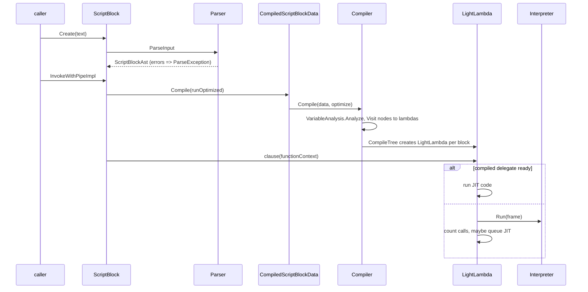

# Compiler and execution engine

> STATIC-ONLY — behavior not run-verified. `FACT-SRC` unless marked. Companion documents: [COMPILATION-MAP.md](COMPILATION-MAP.md) (node → compiled form, generated), [IR-SPEC.md](IR-SPEC.md) (the tree contract), [TIERING-POLICY.md](TIERING-POLICY.md) (compile vs interpret), [INSTRUCTION-SET.md](INSTRUCTION-SET.md), [EQUIVALENCE-SPEC.md](EQUIVALENCE-SPEC.md). Upstream: [02.3-ast.md](02.3-ast.md), [02.4-semantic-analysis.md](02.4-semantic-analysis.md).

## 1. Purpose and scope [SPEC]

How a parsed script becomes running code: `ScriptBlock` creation and caching, the AST → expression-tree compiler (`Compiler`), the choice between interpreting and JIT-compiling the tree, and how each language construct is executed (statement output, flow control, errors). PowerShell does **not** tree-walk the AST: it compiles it to an IR first (`FACT-SRC`, src/System.Management.Automation/engine/parser/Compiler.cs::Compiler@L816-L6661 is an `ICustomAstVisitor2` that returns `Expression` objects). A labelled `INFERENCE` section (§7.4) states what a tree-walking evaluator must preserve.

## 2. Source map

| path | type | role | tier |
|---|---|---|---|
| src/System.Management.Automation/engine/parser/Compiler.cs::Compiler@L816-L6661 | class | AST → expression trees (`Visit*` per node, ~99 helpers) | A |
| src/System.Management.Automation/engine/runtime/CompiledScriptBlock.cs::CompiledScriptBlockData@L41-L540 | class | per-script-block data: AST, compiled delegates (optimized and unoptimized), metadata | A |
| src/System.Management.Automation/engine/runtime/CompiledScriptBlock.cs::ScriptBlock@L542-L2177 | partial class | creation, cache, `InvokeWithPipeImpl` | A |
| src/System.Management.Automation/engine/runtime/CompiledScriptBlock.cs::PSScriptCmdlet@L2179-L2552 | class | runs a script block as an advanced function / script cmdlet | A |
| src/System.Management.Automation/engine/parser/Compiler.cs::FunctionContext@L784-L814 | class | per-invocation state read by compiled code | A |
| src/System.Management.Automation/engine/interpreter/LightCompiler.cs::LightCompiler@L271-L2051 | class | expression tree → instructions | A |
| src/System.Management.Automation/engine/interpreter/Interpreter.cs::Interpreter@L31-L109 | class | stack-machine loop | A |
| src/System.Management.Automation/engine/lang/parserutils.cs::ParserOps@L232-L1624 | static class | runtime helpers for operators (despite the file name; hint mismatch) | A |

## 3. Responsibilities and non-responsibilities

Responsible for: compiling named blocks, parameter metadata and attributes, per-statement error handling, output capture, flow-control implementation, sequence points. Not responsible for: command discovery and parameter binding (runtime, T32/T33), binder rules (T26), conversion rules (T28).

## 4. Key types and contracts [IMPL]

- `CompiledScriptBlockData.Compile(bool optimized)` is the entry used at run time; it calls `new Compiler().Compile(data, optimize)` once per variant under a lock (src/System.Management.Automation/engine/runtime/CompiledScriptBlock.cs::CompiledScriptBlockData.ReallyCompile@L163-L195), after `PerformSecurityChecks` (AMSI scan for top-level script blocks, suspicious-content flag).
- `Compiler.Compile(data, optimize)`: variable analysis → lambdas → `CompileTree` per named block (src/System.Management.Automation/engine/parser/Compiler.cs::Compiler.Compile@L961-L964).
- Script block creation: `ScriptBlock.Create(text)` parses (`ParseException` on errors), caches by (file name, text) in `s_cachedScripts` (cap 1024, cleared completely when exceeded; skipped for scripts with `using module/assembly` or dynamic keywords) and returns a `Clone()` that shares the compiled data (src/System.Management.Automation/engine/runtime/CompiledScriptBlock.cs::ScriptBlock.CacheScriptBlock@L609-L637).
- **Two execution entries share one set of rules.** (1) Command invocation of script text, functions and scripts goes through a command processor: `DlrScriptCommandProcessor` for ordinary script blocks, `CommandProcessor` + `PSScriptCmdlet` for advanced functions; the `DlrScriptCommandProcessor` constructor calls `ScriptBlock.Compile(optimized: debugging off && new scope)` and `RunClause` runs each clause (src/System.Management.Automation/engine/ScriptCommandProcessor.cs::DlrScriptCommandProcessor@L232-L625, see [LIFECYCLE-script-execution.md](LIFECYCLE-script-execution.md) §6). (2) The direct API `ScriptBlock.Invoke*` runs `ScriptBlock.InvokeWithPipeImpl` (src/System.Management.Automation/engine/runtime/CompiledScriptBlock.cs::ScriptBlock.InvokeWithPipeImpl@L961-L1263). Both choose the variant with the same two conditions, create the locals tuple, switch the language mode and set `$_`/`$input`; the details below are read from entry (2) and checked against entry (1).

## 5. Data model

- Per named block: one delegate per variant (`Action<FunctionContext>`); locals tuple type and creator; name → slot map (optimized only); sequence points array (shared).
- `FunctionContext` per call ([IR-SPEC.md](IR-SPEC.md) §4.2); `MutableTuple` locals; `Pipe` output objects.
- Classes defined by `class`/`enum` live in a dynamic assembly created at compile time of the root block (`TypeDefiner`, [02.4-semantic-analysis.md](02.4-semantic-analysis.md) §6).

## 6. Control flow

### 6.1 From text to output

`InvokeWithPipeImpl` order (the API entry; the command-processor entry does the same steps in `Prepare`, `DoBegin`/`ProcessRecord`/`Complete` and `RunClause`) (`FACT-SRC`, notes W4): a `Clean` clause is not supported through this entry (`PSNotSupportedException`); a missing clause returns silently; pick the clause; decide `runOptimized` (CF-CMP-003); create the locals tuple (`MakeLocalsTuple`); set `$_`, `$input`, `$this`; set `$PSScriptRoot`/`$PSCommandPath`; apply language-mode switch rules; set up scope (new local scope with the locals tuple, or dot-source scope pushed onto `DottedScopes`); bind arguments (`BindArgumentsForScriptblockInvoke`); build the `FunctionContext`; log start; call the delegate in `try/finally`; restore language mode, pipes, scope, backed-up variables.

### 6.2 Statement lists and error handling

`CompileStatementListWithTraps` is the core of statement-level semantics (src/System.Management.Automation/engine/parser/Compiler.cs::Compiler.CompileStatementListWithTraps@L3046-L3268):

- 0 statements → empty; the statement count feeds the tiering decision.
- With `trap` statements: set `context.PropagateExceptionsToEnclosingStatementBlock = true`, compile each trap into its own lambda, `funcContext.PushTrapHandlers(types, delegates, tuple types)` for the duration, pop in a `finally`.
- Without traps but inside a block that has them: push null handlers so `CheckActionPreference` rethrows instead of handling.
- 1 statement: `try { stmt; $? = true } catch (FlowControlException) { throw } catch (Exception e) { CheckActionPreference(funcContext, e) }`.
- ≥ 2 statements: a dispatch index `stmt` with a `switch` jumping to the label of statement *i*; the same two catch blocks; after `CheckActionPreference` returns, control `goto`s the dispatch, which runs the statement *after* the one that failed. This is how a non-terminating-style error (ErrorAction Continue / handled) lets the script continue.

### 6.3 Loops

All loops come from `GenerateWhileLoop` (while, for with continue-action, switch, foreach through `GenerateIteratorStatement`) and `GenerateDoLoop`. Shape (`FACT-SRC`, comments L4763-L4803): `LoopTop: [loop counter] if (condition) { try { check-for-interrupts; body } catch (BreakException be) { if (be.MatchLabel(label)) goto Break; throw } catch (ContinueException ce) { if (ce.MatchLabel(label)) goto Continue; throw } Continue: [continue-action]; goto LoopTop } Break:`. `break`/`continue` to a loop of the *same lambda* compile to direct jumps; otherwise they throw. `foreach` evaluates the pipeline once, builds an `IEnumerator` with `PSEnumerableBinder` (a non-enumerable value is wrapped as a one-element array; a `null` enumerator skips the loop for `foreach`), stores it in `$foreach`, and for each item assigns the loop variable. `switch` saves `$_`, iterates the same way over `$switch`, and **tests every clause for every item** (all matching clauses run) before running `default` if none matched. `a..b` as the enumerated expression uses a range enumerator without materializing an array.

### 6.4 try / catch / finally / trap / throw

- `try`: body compiled with its own statement list; `PropagateExceptionsToEnclosingStatementBlock` set to true inside and restored in a `finally`.
- Catch dispatch: a catch-all-only `try` catches `RuntimeException` (`PipelineStoppedException` is rethrown first); typed catches call `ExceptionHandlingOps.FindMatchingHandler(locals, rte, catchTypes, context)` and `switch` on the returned handler index; unresolved catch types are resolved lazily and cached. In a handler `$_` is set to a new `ErrorRecord` wrapping the exception and `context.CurrentExceptionBeingHandled` is set, both restored afterwards. If no handler matches, `CheckActionPreference` runs.
- `finally`: user statements run inside `try { … } finally { RestoreStoppingPipeline }` after `SuspendStoppingPipeline` (so a stopped pipeline can still run cleanup).
- `throw expr` → `ExceptionHandlingOps.ConvertToException`; bare `throw` rethrows `CurrentExceptionBeingHandled`; `exit n` → `ExitException`.
- Leaving a `finally` block with `break`/`continue`/`return`/`throw` is a parse-time error (`ControlLeavingFinally`, [02.4-semantic-analysis.md](02.4-semantic-analysis.md)); `return` inside `try` runs the `finally` first (expression-tree `TryFinally` semantics, `EXTERNAL`).
- `trap`: each trap becomes its own lambda (always JIT-compiled), its type list pushed with `PushTrapHandlers`; a `return`/`continue` inside a trap lambda is implemented by `ReturnException`.

### 6.5 Statement output rule

A command or a bare expression statement writes to the **current output pipe** (`funcContext._outputPipe`); assignments, `++`/`--`, and pure `[void]`-style statements write nothing. `$(…)`, `@(…)`, conditions, assignment right-hand sides and hashtable values run with a **temporary pipe** that collects into a list (`CaptureAstResults`), converted to: the value (assignment; `AutomationNull`, one item or `object[]`), a `bool` (conditions, via `PSPipelineResultToBoolBinder`), or the list as an enumerable (`foreach`, `@()`). If the captured statement throws, the already collected output is either flushed to the outer pipe (`AssignmentWithResultPreservation`, used for `( … )` and `$( … )` where `ShouldPreserveOutputInCaseOfException`) or discarded. `return expr` therefore does not "return a value": it writes the value to the output pipe and jumps to the return label, so the function result is everything written to its output pipe; in class methods the value is converted to the declared return type and written to a separate return pipe.

## 7. Algorithms

### 7.1 Compile entry

src/System.Management.Automation/engine/parser/Compiler.cs::Compiler.Compile@L961-L964: set `Optimize`; `_compilingScriptCmdlet = UsesCmdletBinding`; `VariableAnalysis.Analyze(body, disableOptimizations: !optimize, scriptCmdlet)`; look up the `$switch`/`$foreach` slots; build the locals parameter; for class members set member-function mode; `body.Accept(this)` (→ `VisitScriptBlock` builds up to five lambdas); add one sequence point for the whole body if there is none; choose the tiering mode (`_stmtCount > 300`); `CompileTree` each lambda into the optimized or unoptimized fields. Named-block order and names: src/System.Management.Automation/engine/parser/Compiler.cs::Compiler.VisitScriptBlock@L2450-L2502.

### 7.2 Parameter metadata

Parameters are not compiled. `GetParameterMetaData` builds a `RuntimeDefinedParameterDictionary`: attributes are created by built-in generators (`CmdletBinding`, `Parameter`, `OutputType`, `Alias`, `ValidateSet`, `ValidateNotNull(OrEmpty)`, `DebuggerHidden`, `Experimental`) or a compiled generator per attribute type; positions are assigned automatically (0.. for non-switch parameters) when no explicit positions/parameter sets are used; default values that are constants are stored as values, others as `DefaultValueExpressionWrapper` evaluated lazily with `GetExpressionValue` (src/System.Management.Automation/engine/parser/Compiler.cs::Compiler.GetRuntimeDefinedParameter@L1819-L1907).

### 7.3 Assignment

`CompileAssignment` → `ReduceAssignment`: `=` → `IAssignableValue.SetValue`; `+= -= *= /= %=` → dynamic binary operation on `GetValue()` and the right side then `SetValue`; `??=` → `SetValue(Coalesce(get, right))`. Destructuring (`$a, $b = …`) captures the right side as an enumerable and assigns elements through `PSArrayAssignmentRHSBinder`. A converted left side (`[int]$x = …`) stores the attributes with the variable. Variables: slot assignment or `VariableOps.SetVariableValue`. Evidence: src/System.Management.Automation/engine/parser/Compiler.cs::Compiler.ReduceAssignment@L993-L1023, src/System.Management.Automation/engine/parser/Compiler.cs::Compiler.CompileAssignment@L3527-L3563.

### 7.4 Tree-walker requirements [INFERENCE]

A tree-walking evaluator over the AST is a valid start. It must preserve (each item is a protocol or behavior above): the output-pipe model (§6.5) including temporary pipes and `return` writing to the pipe; `$?` rules; per-statement error-action resume (§6.2); loop label matching and the exception form of non-local `break`/`continue`; `switch` testing all clauses; `foreach` enumeration rules; `try/catch` handler matching order, `$_`, `finally` after `return`; variable visibility (slots vs name lookup are an optimization; scopes, `AllScope`, dot-sourcing behavior must not change); error positions (sequence points); evaluation order (right side of an assignment before the left target's index/member evaluation as in `IAssignableValue.GetValue/SetValue`); strict-mode checks on call syntax. See [EQUIVALENCE-SPEC.md](EQUIVALENCE-SPEC.md).

## 8. Observable behavior [SPEC]

Read from source, not run: `1; 2` writes both values; `$x = 1,2` stores an array; `if (gci) {…}` converts the captured output to bool; an error in the 2nd of 3 statements (default `Continue` preference) lets the 3rd run; `switch (1,2) {…}` evaluates `default` per item only when no clause matched; `foreach ($i in $null)` runs zero times for `$null` expression results (enumerable of nothing) — `UNVERIFIED` in detail. Tests: `test/powershell/Language/` (`data/tests.json`). No golden sample: STATIC-ONLY.

## 9. Error handling and edge cases

Runtime errors raised by the interpreter helpers use `InterpreterError`, whose message IDs are `ParserStrings` keys (so the resx is shared by parse, semantic, compile and runtime errors, see [ERROR-CATALOG.md](ERROR-CATALOG.md) §4). Class-definition errors found by `TypeDefiner` throw `ParseException` at compile time (CON-009). The compile step may throw (e.g. `ScriptHasAdminBlockedContent`, AMSI-detected content → `ScriptContainedMaliciousContent`) and leaves the script block uncompiled. Single-expression evaluation swallows `FlowControlException`.

## 10. Concurrency and threading

Compilation of each variant is under `lock(this)` with double-checked flags; the delegates are read without locks after publication. JIT promotion runs on the thread pool ([TIERING-POLICY.md](TIERING-POLICY.md)). `DefaultValueExpressionWrapper` and `ExpressionCache`-style shared state take locks or are immutable. Script block text segments for logging use `Random.Shared`.

## 11. Extension points and customization hooks

Attribute generators registered in `Compiler`'s static constructor; `InternalTestHooks` (cache bypass); `ScriptBlock` language-mode capture at creation. Recipes for adding syntax: [HOWTO-extend-language.md](HOWTO-extend-language.md).

## 12. Dependencies

Inbound: all script execution (`ScriptBlock`, `FunctionInfo`, `ExternalScriptInfo`, `PSScriptCmdlet`), constant folding (`IsConstantValueVisitor` calls back into a `Compiler` in `CompilingConstantExpression` mode), `Parser`/`TypeDefiner`. Outbound: the PowerShell binders, `ParserOps`, `PipelineOps`, `ExceptionHandlingOps`, `VariableOps`, `TypeOps`, `System.Linq.Expressions`, the debugger.

## 13. Performance notes

Statement dispatch (`switch` + `goto`) was chosen for lists with several statements; the comment warns that JIT time grows with the number of try/catch regions. Optimized variant stores variables in typed tuple fields. Constant folding happens at compile time.

## 14. Security considerations (mandatory)

- Before compiling a top-level script block: AMSI scan of the script text (detected content → `ParseException`), checks for admin-blocked content, and the suspicious-content check (hashed pattern table, 29-character maximum pattern) that forces script block logging (`PerformSecurityChecks`, `CheckSuspiciousContent`; AMSI/logging themselves are OUT-OF-SCOPE, see 07-security).
- Language mode is captured when a script block is created and applied on invoke; a switch from a restricted mode to Full Language by dot-sourcing is only audited in Audit mode, otherwise not performed (`InvokeWithPipeImpl`, notes W4).
- `data` statements run in restricted language mode and restore the previous mode in a `finally`.
- Script block logging splits long text into segments of 10,000 plus a random 0..9,999 characters when length ≥ 20,000.

## 15. Enterprise considerations

Observability: ETW compile events, script block logging, debugger hooks (`EnterScriptFunction`, `OnSequencePointHit`). Resource limits: none on script size beyond the tiering cutoffs; call-depth limits were not analyzed here (`UNVERIFIED`). Missing: no compile cancellation, no per-script resource accounting.

## 16. Tests

`test/powershell/Language/` (flow control, functions, scoping); xUnit tests of the interpreter were not located (VB-014).

## 17. Design decisions and trade-offs

| Decision | Label | Consequence |
|---|---|---|
| compile to LINQ trees rather than tree-walk | `FACT-SRC` | reuse of the .NET JIT and DLR sites; large compiler class (≈6,600 lines) tightly coupled to the AST |
| per-statement exception wrapper | `FACT-SRC` | script-level continue-on-error semantics |
| output through a mutable pipe object | `FACT-SRC` | `return` and bare expressions behave as output; capturing needs temporary pipes |
| two compile variants (optimized/unoptimized) | `FACT-SRC` | speed vs dynamic variable access (dot-sourcing, debugging) |
| functions compiled lazily when first invoked | `FACT-SRC` | `VisitFunctionDefinition` only defines the function; body compiled on first use |

## 18. Guidance for MicroteamShell [LESSON]

- **LSN-ENG-01** [ADAPT] (area: NLD-RUN) Start with a tree-walking evaluator over the AST that implements the protocols of §6 and [IR-SPEC.md](IR-SPEC.md) §5; add an IR later only if profiling demands it. Why: same observable behavior, far less code than a 6,600-line expression-tree compiler. Evidence: src/System.Management.Automation/engine/parser/Compiler.cs::Compiler@L816-L6661.
- **LSN-ENG-02** [REPLICATE] (area: NLD-PIP) Implement statement output as writes to the current output pipe with temporary capture pipes for conditions, assignments, `$()` and `@()`. Evidence: src/System.Management.Automation/engine/parser/Compiler.cs::Compiler.CaptureAstResults@L2264-L2355.
- **LSN-ENG-03** [REPLICATE] (area: NLD-ERR) Keep statement-level error handling with resume-at-next-statement, rethrowing flow-control signals untouched. Evidence: src/System.Management.Automation/engine/parser/Compiler.cs::Compiler.CompileStatementListWithTraps@L3046-L3268.
- **LSN-ENG-04** [REPLICATE] (area: NLD-ERR) Match `try/catch/finally` semantics: typed handlers in order, `$_` bound to an `ErrorRecord`, `finally` runs after `return`, cleanup runs even for a stopped pipeline. Evidence: src/System.Management.Automation/engine/parser/Compiler.cs::Compiler.VisitTryStatement@L5247-L5509.
- **LSN-ENG-05** [REPLICATE] (area: NLD-RUN) `switch` evaluates every clause per item; `foreach` wraps a non-enumerable in a one-element sequence; loop labels match case-insensitively with an empty label matching any loop. Evidence: src/System.Management.Automation/engine/parser/Compiler.cs::Compiler.VisitSwitchStatement@L4410-L4542, src/System.Management.Automation/engine/lang/parserutils.cs::LoopFlowException@L36-L67.
- **LSN-ENG-06** [ADAPT] (area: NLD-RUN) Cache parsed script blocks by (file, text) but share only immutable compiled data between clones. Why: PowerShell clears the whole cache at 1024 entries; use an LRU instead. Evidence: src/System.Management.Automation/engine/runtime/CompiledScriptBlock.cs::ScriptBlock.CacheScriptBlock@L609-L637.
- **LSN-ENG-07** [AVOID] (area: NLD-SEC) Do not run an AMSI scan, suspicious-pattern hashing or admin-block checks as part of compilation in MicroteamShell; add a separate policy hook if needed. Evidence: src/System.Management.Automation/engine/runtime/CompiledScriptBlock.cs::CompiledScriptBlockData.PerformSecurityChecks@L197-L283. DEV: DEV-ENG-040

## 19. Open questions / UNVERIFIED

- Runtime double evaluation of a side-effecting target in `?.`: the generated tree contains the target expression twice (`GetNullConditionalWrappedExpression`); whether a temp is used was not confirmed (VB-015).
- Behavior of `exit` inside nested script blocks and of `ExitNestedPromptException` (host layer).
- Tests for interpreter/JIT parity (VB-014).

Verification: `Compiler.cs` was read in 21 windows (notes W1-W21) covering all 63 `Visit*` methods; `CompiledScriptBlock.cs` (2,553 lines) in 9 windows; re-read for this document: `GenerateWhileLoop` (L4760-L4864), `VisitPipeline` (L3736-L3866), compile entry (L2040-L2097); counts (63 Visit methods, 99 helpers) from `data/members-tierA.json` via `tools/gen_T25.py --count`.
