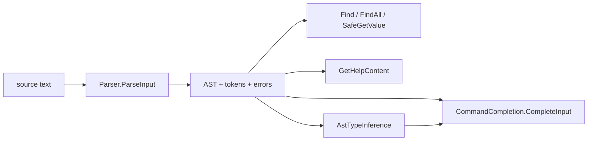

# Language tooling

> STATIC-ONLY — behavior not run-verified. `FACT-SRC` unless marked. Scope `EXTENDED`: the engine exposes its tokenizer, parser, AST, type inference and completion to editors and analyzers. MicroteamShell does not need these for the language core, but its design should keep the same hooks possible. Completion internals (≈15,000 lines) are Tier C and described only by API surface.

## 1. Purpose and scope [SPEC]

What a tool (editor, linter, formatter, test harness) can obtain from the engine without running a script: tokens, comments, an AST with extents and parse errors, constant evaluation of data literals, help comments, script requirements, inferred types, and completion results.

## 2. Source map

| path | type | role | tier |
|---|---|---|---|
| src/System.Management.Automation/engine/parser/Parser.cs::Parser@L36-L8187 | public sealed class | `ParseInput`, `ParseFile` return AST, token array, error array ([02.2-parser.md](02.2-parser.md) §4) | A |
| src/System.Management.Automation/engine/lang/interface/PSParser.cs::PSParser@L64-L193 | public sealed class | legacy tokenizer API `Tokenize(string, out errors)` | B |
| src/System.Management.Automation/engine/lang/interface/PSToken.cs::PSToken@L28-L363 | public sealed class | legacy token with `PSTokenType` | B |
| src/System.Management.Automation/engine/parser/TypeInferenceVisitor.cs::AstTypeInference@L40-L110 | internal static class | type inference for completion (public API is a wrapper elsewhere, hint mismatch) | A |
| src/System.Management.Automation/engine/CommandCompletion/CommandCompletion.cs::CommandCompletion@L20-L563 | public class | `CompleteInput`, `MapStringInputToParsedInput`, `GetNextResult` | C |

## 3. Responsibilities and non-responsibilities

Expose analysis results; no execution. Execution-dependent helpers (completion of command names, parameter values, type inference through commands) call into the runtime and **can run code**, see §14.

## 4. Key types and contracts [IMPL]

- **Parsing for tools**: `Parser.ParseInput(input, out Token[] tokens, out ParseError[] errors)` and `ParseFile(path, …)` return the root `ScriptBlockAst`; tokens include comments, newlines and line continuations because the token list is requested ([02.1-tokenizer.md](02.1-tokenizer.md) §4: `TokenList`); errors are the full list of CF-ERR-002; the AST has error nodes for broken input ([02.3-ast.md](02.3-ast.md) §4).
- **Legacy tokens**: `PSParser.Tokenize` creates a `Parser` with `ProduceV2Tokens = true`, parses in `ParseMode.Default` with a token list, ignores any exception, drops the last token (end of input) and maps each `Token` to a `PSToken`; errors are mapped to `PSParseError`. With `ProduceV2Tokens` the parser **rewrites the saved token list** for attributes and type constraints: the tokens `[`, type name, `(` or `]` are replaced by a single `Identifier` token flagged `TypeName` (`Tokenizer.ReplaceSavedTokens`), reproducing the PowerShell 2 tokenizer's output (src/System.Management.Automation/engine/parser/Parser.cs::Parser.AttributeRule@L1054-L1153, src/System.Management.Automation/engine/parser/tokenizer.cs::Tokenizer.ReplaceSavedTokens@L1102-L1122).
- **AST queries**: `Ast.Find`/`FindAll` with a predicate and a nested-script-block flag; `Ast.SafeGetValue()` for literal data; `ScriptBlockAst.GetHelpContent()` / `FunctionDefinitionAst.GetHelpContent()` return a `CommentHelpInfo` parsed from the comment tokens; `ScriptBlockAst.ScriptRequirements` lists `#requires` data ([02.1-tokenizer.md](02.1-tokenizer.md) §7.4).
- **Type inference** (`AstTypeInference.InferTypeOf` overloads taking an AST, optional `PowerShell` and `TypeInferenceRuntimePermissions {None, AllowSafeEval}`) returns the distinct inferred type names (distinct by name) (src/System.Management.Automation/engine/parser/TypeInferenceVisitor.cs::TypeInferenceVisitor@L550-L3285).
- **Completion**: `CommandCompletion.CompleteInput(input, cursorIndex, options[, PowerShell])` and the overload taking an existing AST, token array and cursor position; `MapStringInputToParsedInput` parses a string plus cursor into (AST, tokens, position); the result object offers `GetNextResult(forward)` for cycling (src/System.Management.Automation/engine/CommandCompletion/CommandCompletion.cs::CommandCompletion.CompleteInput@L92-L108). Extensible completers: `ExtensibleCompletion.cs` (argument completers, `CustomArgumentCompleters` on the context).

## 5. Data model

Token list (with comments), `ParseError[]`, AST with extents (line/column/offset), `CompletionResult` items (text, list text, type, tooltip), inferred `PSTypeName`s (synthetic type names carry member names for hashtable and custom-object shapes).

## 6. Control flow

## 7. Algorithms

**Type inference** (read in the T24 notes, `TypeInferenceVisitor.cs`, `FACT-SRC`): a visitor over the AST returns possible type names per node: literals and casts give their type; arrays give element types; hashtables give a synthetic type with the key names; binary operators give `bool` for comparison/logic, `string` for replace/format/join, `string[]` for split, otherwise the left operand's types refined by public static `op_*` methods on the left CLR types; variables use the last textual assignment in the enclosing scope (a type constraint wins) with special handling for `$_`/`$PSItem` (catch, trap, switch, `Where` target, pipeline predecessor) and `$this`; commands use `OutputType` metadata, special cases for `New-Object`, `Where-Object`, `ForEach-Object`, `Select-Object`, `Group-Object`, `Get-Random`, `Get-CimInstance`, and for script functions without `OutputType` the body is analyzed with a recursion guard; members are looked up through the type table and reflection.

**Completion** analysis (positions → context → completers) is in `CompletionAnalysis.cs` (2,693 lines) and `CompletionCompleters.cs` (9,251 lines): `UNVERIFIED`, not read (VB-023).

## 8. Observable behavior [SPEC]

Examples from the API shape: `[Parser]::ParseInput("1 +", …)` returns an AST plus an incomplete-input error; `PSParser.Tokenize` returns tokens without the final end-of-input token; completion returns a `CommandCompletion` with `ReplacementIndex`/`ReplacementLength`/`CompletionMatches` (names from the type; `UNVERIFIED`). No golden sample: STATIC-ONLY.

## 9. Error handling and edge cases

`PSParser.Tokenize` swallows exceptions from parsing, so a failure yields an empty token list and the errors collection (possibly null → `NullReferenceException` risk when `_errors` was never assigned, `INFERENCE`). Type inference requires a non-null result from the visitor and swallows `RuntimeException` when instantiating attributes.

## 10. Concurrency and threading

`Parser` instances are single-threaded; the dynamic-keyword table is thread-local; type inference with a `PowerShell` object needs a free runspace thread. Static caches are concurrent.

## 11. Extension points and customization hooks

Custom argument completers (`Register-ArgumentCompleter` equivalents), `ValidateSet` generators, `IArgumentCompleter`, class-based completers (`ExtensibleCompletion.cs`), `DynamicKeyword.SemanticCheck`.

## 12. Dependencies

Inbound: editors (PowerShell extension, PSReadLine in a separate repository), analyzers, tests (`PSTests.Parallel.*` AST visitor tests). Outbound: parser, AST, runtime (type table, command discovery, providers), `PowerShell` API.

## 13. Performance notes

Completion parses and walks the AST per request; type inference caches nothing across calls except the binder/type-table caches (`INFERENCE`).

## 14. Security considerations (mandatory)

Tooling is not side-effect free: type inference may call `Get-CimClass` through a `PowerShell` helper for CIM type names, may evaluate expressions with `SafeExprEvaluator` (hashtable keys and values are evaluated even without `AllowSafeEval`, an inconsistency candidate), and may resolve commands (`CommandDiscovery.LookupCommandInfo`); completion of file paths and commands touches the file system and module cache. Parsing a file for tools triggers the parse-time effects of [02.2-parser.md](02.2-parser.md) §14 (`using module`, `using assembly`) unless `ParseMode.ModuleAnalysis` is chosen.

## 15. Enterprise considerations

Stable public parse API and token/AST shapes are the main integration points for third-party analyzers; ETW events around parse/semantic/compile give timing data.

## 16. Tests

`test/xUnit/csharp/test_AstDefaultVisit.cs` and the `PSTests.Parallel` visitors (default-visit contracts); completion tests under `test/powershell/engine/Api/` and `Host/TabCompletion/` (`data/tests.json`; per-assertion mapping `UNVERIFIED`).

## 17. Design decisions and trade-offs

| Decision | Label | Consequence |
|---|---|---|
| tools use the same parser as the engine | `FACT-SRC` | exact agreement with execution; parse-time side effects leak to tools |
| tokens returned with comments, error nodes in the AST | `FACT-SRC` | formatters and completion work on broken code |
| legacy tokenizer API kept by rewriting tokens | `FACT-SRC` | compatibility cost inside the parser (`ProduceV2Tokens` branches) |
| type inference may execute helper commands | `FACT-SRC` | richer results, side effects |

## 18. Guidance for MicroteamShell [LESSON]

- **LSN-TOOLS-01** [REPLICATE] (area: NLD-TOOL) Expose `Parse(text)` returning AST, tokens (with comments) and all errors, with error nodes for broken input, from day one. Evidence: src/System.Management.Automation/engine/parser/Parser.cs::Parser.ParseInput@L131-L134.
- **LSN-TOOLS-02** [REPLICATE] (area: NLD-TOOL) Provide `Find/FindAll` over the AST and a pure "literal data" evaluator for manifests and configuration. Evidence: src/System.Management.Automation/engine/parser/ast.cs::Ast@L91-L420.
- **LSN-TOOLS-03** [AVOID] (area: NLD-TOOL) Do not build the PowerShell 2 compatible token API or the V2 token rewriting. Evidence: src/System.Management.Automation/engine/lang/interface/PSParser.cs::PSParser@L64-L193. DEV: DEV-TOOLS-100
- **LSN-TOOLS-04** [ADAPT] (area: NLD-TOOL) If completion is added, keep type inference side-effect free (no command execution, no CIM lookups). Why: same completion quality for the shell's own types without running code. Evidence: src/System.Management.Automation/engine/parser/TypeInferenceVisitor.cs::AstTypeInference@L40-L110.

## 19. Open questions / UNVERIFIED

- Completion analysis and completers (Tier C, ≈12,000 lines) not read (VB-023).
- Public wrappers around `AstTypeInference` (the internal class here is reached through other types).
- `PSTokenType` mapping table (`GetPSTokenType`) not read.

Verification: `PSParser.cs` (194 lines) read in full; `Parser.AttributeRule` V2 branch (L1136-L1141) and `ParseInput`/`ParseFile` re-read; `TypeInferenceVisitor.cs` from the T24 notes (3,338 lines, full); `CommandCompletion.cs` public signatures only.
