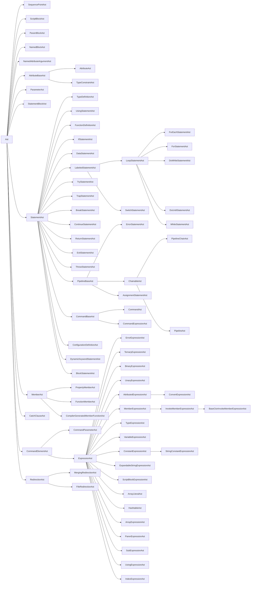

# AST node catalog

> STATIC-ONLY — behavior not run-verified. Every table is `GENERATED` by `docs-out/tools/gen_T23.py` (`APPROX`: regex extraction, see the column notes). Narrative: [02.3-ast.md](02.3-ast.md).

## 1. Purpose and scope [SPEC]

Complete list of the AST classes declared in `ast.cs` (<!--N:AST_CLASSES_ASTCS-->76<!--/N--> classes, <!--N:AST_CLASSES_ABSTRACT-->11<!--/N--> of them abstract), with base class, visit-order children, parser productions that create them, and the visitors that handle them; the two visitor interface method lists; the inheritance diagram; and the enums declared in `ast.cs`. Count source: `data/ast-hierarchy.json` filtered to `ast.cs` (the dataset has one more row from `VariableAnalysis.cs`, a private helper class, which is excluded).

## 2. Source map

| path | type | role |
|---|---|---|
| `src/System.Management.Automation/engine/parser/ast.cs::Ast@L91-L420` | abstract class | root of all nodes |
| `src/System.Management.Automation/engine/parser/AstVisitor.cs` | file | `ICustomAstVisitor(2)`, `DefaultCustomAstVisitor(2)`, `AstSearcher`, DEBUG checkers |
| `src/System.Management.Automation/engine/parser/PreOrderVisitor.cs` | file | `AstVisitAction`, `AstVisitor(2)`, `IAstPostVisitHandler` |

## 3. Node catalog

Column notes: **Base** = direct base class; **Children (visit order)** = receivers of `.InternalVisit(` in the node's `InternalVisit` method, in source order (`—` = leaf or no `InternalVisit`); **v2** = the method mentions `AstVisitor2`, i.e. visiting is gated or extended for second-generation visitors; **Created by** = parser methods containing `new <Node>(` (`—` = not created by `Parser.cs`: abstract, compiler-synthesized or created in other files); **Consumed by** = non-default visitor classes that define `Visit<Node>` (first six, then `+N`).

| Node | Kind | Base | Children (visit order, APPROX) | v2 | Created by (Parser.cs) | Consumed by (APPROX) | Source |
|---|---|---|---|---|---|---|---|
| `SequencePointAst` | internal | `Ast` | — |  | — | — | `src/System.Management.Automation/engine/parser/ast.cs::SequencePointAst@L424-L451` |
| `ErrorStatementAst` | concrete | `PipelineBaseAst` | `NestedAst[]`, `Flags.Values[].Item2`, `Conditions[]`, `Bodies[]` |  | `BlockStatementRule`, `ClassDefinitionRule`, `ConfigurationStatementRule`, `CreateErrorStatementAst`, `DataStatementRule`, `DoWhileStatementRule`, `DynamicKeywordStatementRule`, `EnumDefinitionRule`, `ForStatementRule`, `ForeachStatementRule`, `FunctionDeclarationRule`, `GetKeyValuePair`, `IfStatementRule`, `MethodDeclarationRule`, `ParenthesizedExpressionRule`, `PipelineChainRule`, `StatementRule`, `SwitchStatementRule`, `TrapStatementRule`, `TryStatementRule`, `UsingStatementRule`, `WhileStatementRule` | `AstSearcher`, `CheckAllParentsSet`, `Compiler`, `ConstantValueVisitor`, `GetSafeValueVisitor`, `IsConstantValueVisitor` +3 | `src/System.Management.Automation/engine/parser/ast.cs::ErrorStatementAst@L456-L648` |
| `ErrorExpressionAst` | concrete | `ExpressionAst` | `NestedAst[]` |  | `ArrayLiteralRule`, `AttributeArgumentsRule`, `BinaryExpressionRule`, `DynamicKeywordStatementRule`, `ElementAccessRule`, `ErrorRecoveryParameterInExpression`, `ExpressionRule`, `GetCommandArgument`, `MemberAccessRule`, `RedirectionRule`, `UnaryExpressionRule` | `AstSearcher`, `CheckAllParentsSet`, `Compiler`, `ConstantValueVisitor`, `GetSafeValueVisitor`, `IsConstantValueVisitor` +3 | `src/System.Management.Automation/engine/parser/ast.cs::ErrorExpressionAst@L653-L707` |
| `ScriptBlockAst` | concrete | `Ast` | `UsingStatements[]`, `Attributes[]`, `ParamBlock`, `DynamicParamBlock`, `BeginBlock`, `ProcessBlock`, `EndBlock`, `CleanBlock` | yes | `NamedBlockListRule`, `ParseFile`, `ScriptBlockBodyRule` | `AstSearcher`, `CheckAllParentsSet`, `Compiler`, `ConstantValueVisitor`, `GetSafeValueVisitor`, `IsConstantValueVisitor` +5 | `src/System.Management.Automation/engine/parser/ast.cs::ScriptBlockAst@L775-L1739` |
| `ParamBlockAst` | concrete | `Ast` | `Attributes[]`, `Parameters[]` |  | `ParamBlockRule` | `AstSearcher`, `CheckAllParentsSet`, `Compiler`, `ConstantValueVisitor`, `GetSafeValueVisitor`, `IsConstantValueVisitor` +5 | `src/System.Management.Automation/engine/parser/ast.cs::ParamBlockAst@L1745-L1858` |
| `NamedBlockAst` | concrete | `Ast` | `Traps, Statements (static helper)` |  | `NamedBlockListRule` | `AstSearcher`, `CheckAllParentsSet`, `Compiler`, `ConstantValueVisitor`, `GetSafeValueVisitor`, `IsConstantValueVisitor` +5 | `src/System.Management.Automation/engine/parser/ast.cs::NamedBlockAst@L1864-L2026` |
| `NamedAttributeArgumentAst` | concrete | `Ast` | `Argument` |  | `AttributeArgumentsRule` | `AstSearcher`, `CheckAllParentsSet`, `Compiler`, `ConstantValueVisitor`, `GetSafeValueVisitor`, `IsConstantValueVisitor` +4 | `src/System.Management.Automation/engine/parser/ast.cs::NamedAttributeArgumentAst@L2032-L2113` |
| `AttributeBaseAst` | abstract | `Ast` | — |  | — | — | `src/System.Management.Automation/engine/parser/ast.cs::AttributeBaseAst@L2119-L2146` |
| `AttributeAst` | concrete | `AttributeBaseAst` | `PositionalArguments[]`, `NamedArguments[]` |  | `AttributeRule` | `AstSearcher`, `CheckAllParentsSet`, `Compiler`, `ConstantValueVisitor`, `FindVariablesVisitor`, `GetSafeValueVisitor` +8 | `src/System.Management.Automation/engine/parser/ast.cs::AttributeAst@L2151-L2257` |
| `TypeConstraintAst` | concrete | `AttributeBaseAst` | — |  | `AttributeRule`, `ClassDefinitionRule`, `EnumDefinitionRule` | `AstSearcher`, `CheckAllParentsSet`, `CheckTypeBuilder`, `Compiler`, `ConstantValueVisitor`, `GetSafeValueVisitor` +7 | `src/System.Management.Automation/engine/parser/ast.cs::TypeConstraintAst@L2262-L2317` |
| `ParameterAst` | concrete | `Ast` | `Attributes[]`, `Name`, `DefaultValue` |  | `ParameterRule` | `AstSearcher`, `CheckAllParentsSet`, `Compiler`, `ConstantValueVisitor`, `FindVariablesVisitor`, `GetSafeValueVisitor` +8 | `src/System.Management.Automation/engine/parser/ast.cs::ParameterAst@L2323-L2512` |
| `StatementBlockAst` | concrete | `Ast` | `traps[]`, `statements[]` |  | `NamedBlockListRule`, `ParseFile`, `ScriptBlockBodyRule`, `StatementBlockRule`, `SubExpressionRule` | `AstSearcher`, `CheckAllParentsSet`, `Compiler`, `ConstantValueVisitor`, `GetSafeValueVisitor`, `IsConstantValueVisitor` +4 | `src/System.Management.Automation/engine/parser/ast.cs::StatementBlockAst@L2522-L2624` |
| `StatementAst` | abstract | `Ast` | — |  | — | — | `src/System.Management.Automation/engine/parser/ast.cs::StatementAst@L2629-L2642` |
| `TypeDefinitionAst` | concrete | `StatementAst` | `Attributes[]`, `BaseTypes[]`, `Members[]` | yes | `ClassDefinitionRule`, `EnumDefinitionRule` | `AstSearcher`, `CheckAllParentsSet`, `Compiler`, `ConstantValueVisitor`, `ExportVisitor`, `GetSafeValueVisitor` +8 | `src/System.Management.Automation/engine/parser/ast.cs::TypeDefinitionAst@L2667-L2865` |
| `UsingStatementAst` | concrete | `StatementAst` | `Name`, `ModuleSpecification`, `Alias` | yes | `UsingStatementRule` | `AstSearcher`, `CheckAllParentsSet`, `Compiler`, `ConstantValueVisitor`, `GetSafeValueVisitor`, `IsConstantValueVisitor` +5 | `src/System.Management.Automation/engine/parser/ast.cs::UsingStatementAst@L2901-L3105` |
| `MemberAst` | abstract | `Ast` | — |  | — | — | `src/System.Management.Automation/engine/parser/ast.cs::MemberAst@L3110-L3126` |
| `PropertyMemberAst` | concrete | `MemberAst` | `PropertyType`, `Attributes[]`, `InitialValue` | yes | `ClassMemberRule`, `EnumMemberRule` | `AstSearcher`, `CheckAllParentsSet`, `Compiler`, `ConstantValueVisitor`, `GetSafeValueVisitor`, `IsConstantValueVisitor` +5 | `src/System.Management.Automation/engine/parser/ast.cs::PropertyMemberAst@L3156-L3315` |
| `FunctionMemberAst` | concrete | `MemberAst` | `Attributes[]`, `ReturnType`, `_functionDefinitionAst` | yes | `ClassMemberRule` | `AstSearcher`, `CheckAllParentsSet`, `Compiler`, `ConstantValueVisitor`, `GetSafeValueVisitor`, `IsConstantValueVisitor` +6 | `src/System.Management.Automation/engine/parser/ast.cs::FunctionMemberAst@L3342-L3633` |
| `CompilerGeneratedMemberFunctionAst` | internal | `MemberAst` | — |  | — | — | `src/System.Management.Automation/engine/parser/ast.cs::CompilerGeneratedMemberFunctionAst@L3642-L3740` |
| `FunctionDefinitionAst` | concrete | `StatementAst` | `Parameters[]`, `Body` |  | `FunctionDeclarationRule`, `MethodDeclarationRule` | `AstSearcher`, `CheckAllParentsSet`, `CheckBreakpointInScript`, `Compiler`, `ConstantValueVisitor`, `ExportVisitor` +15 | `src/System.Management.Automation/engine/parser/ast.cs::FunctionDefinitionAst@L3745-L4054` |
| `IfStatementAst` | concrete | `StatementAst` | `Clauses[].Item1`, `Clauses[].Item2`, `ElseClause` |  | `IfStatementRule` | `AstSearcher`, `CheckAllParentsSet`, `Compiler`, `ConstantValueVisitor`, `ExportVisitor`, `GetSafeValueVisitor` +5 | `src/System.Management.Automation/engine/parser/ast.cs::IfStatementAst@L4059-L4157` |
| `DataStatementAst` | concrete | `StatementAst` | `Body` |  | `DataStatementRule` | `AstSearcher`, `CheckAllParentsSet`, `Compiler`, `ConstantValueVisitor`, `ExportVisitor`, `FindAllVariablesVisitor` +9 | `src/System.Management.Automation/engine/parser/ast.cs::DataStatementAst@L4162-L4259` |
| `LabeledStatementAst` | abstract | `StatementAst` | — |  | — | — | `src/System.Management.Automation/engine/parser/ast.cs::LabeledStatementAst@L4266-L4303` |
| `LoopStatementAst` | abstract | `LabeledStatementAst` | — |  | — | — | `src/System.Management.Automation/engine/parser/ast.cs::LoopStatementAst@L4309-L4337` |
| `ForEachStatementAst` | concrete | `LoopStatementAst` | `Variable`, `Condition`, `Body` |  | `ForeachStatementRule` | `AstSearcher`, `CheckAllParentsSet`, `Compiler`, `ConstantValueVisitor`, `ExportVisitor`, `FindAllVariablesVisitor` +9 | `src/System.Management.Automation/engine/parser/ast.cs::ForEachStatementAst@L4363-L4484` |
| `ForStatementAst` | concrete | `LoopStatementAst` | `Initializer`, `Condition`, `Iterator`, `Body` |  | `ForStatementRule` | `AstSearcher`, `CheckAllParentsSet`, `Compiler`, `ConstantValueVisitor`, `ExportVisitor`, `GetSafeValueVisitor` +5 | `src/System.Management.Automation/engine/parser/ast.cs::ForStatementAst@L4489-L4571` |
| `DoWhileStatementAst` | concrete | `LoopStatementAst` | `Condition`, `Body` |  | `DoWhileStatementRule` | `AstSearcher`, `CheckAllParentsSet`, `Compiler`, `ConstantValueVisitor`, `ExportVisitor`, `GetSafeValueVisitor` +5 | `src/System.Management.Automation/engine/parser/ast.cs::DoWhileStatementAst@L4576-L4627` |
| `DoUntilStatementAst` | concrete | `LoopStatementAst` | `Condition`, `Body` |  | `DoWhileStatementRule` | `AstSearcher`, `CheckAllParentsSet`, `Compiler`, `ConstantValueVisitor`, `ExportVisitor`, `GetSafeValueVisitor` +5 | `src/System.Management.Automation/engine/parser/ast.cs::DoUntilStatementAst@L4632-L4683` |
| `WhileStatementAst` | concrete | `LoopStatementAst` | `Condition`, `Body` |  | `WhileStatementRule` | `AstSearcher`, `CheckAllParentsSet`, `Compiler`, `ConstantValueVisitor`, `ExportVisitor`, `GetSafeValueVisitor` +5 | `src/System.Management.Automation/engine/parser/ast.cs::WhileStatementAst@L4688-L4739` |
| `SwitchStatementAst` | concrete | `LabeledStatementAst` | `Condition`, `Clauses[].Item1`, `Clauses[].Item2`, `Default` |  | `SwitchStatementRule` | `AstSearcher`, `CheckAllParentsSet`, `Compiler`, `ConstantValueVisitor`, `ExportVisitor`, `FindAllVariablesVisitor` +7 | `src/System.Management.Automation/engine/parser/ast.cs::SwitchStatementAst@L4791-L4913` |
| `CatchClauseAst` | concrete | `Ast` | `CatchTypes[]`, `Body` |  | `CatchBlockRule` | `AstSearcher`, `CheckAllParentsSet`, `Compiler`, `ConstantValueVisitor`, `GetSafeValueVisitor`, `IsConstantValueVisitor` +4 | `src/System.Management.Automation/engine/parser/ast.cs::CatchClauseAst@L4922-L5010` |
| `TryStatementAst` | concrete | `StatementAst` | `Body`, `CatchClauses[]`, `Finally` |  | `TryStatementRule` | `AstSearcher`, `CheckAllParentsSet`, `Compiler`, `ConstantValueVisitor`, `GetSafeValueVisitor`, `IsConstantValueVisitor` +5 | `src/System.Management.Automation/engine/parser/ast.cs::TryStatementAst@L5015-L5130` |
| `TrapStatementAst` | concrete | `StatementAst` | `TrapType`, `Body` |  | `TrapStatementRule` | — | `src/System.Management.Automation/engine/parser/ast.cs::TrapStatementAst@L5135-L5206` |
| `BreakStatementAst` | concrete | `StatementAst` | `Label` |  | `BreakStatementRule` | `AstSearcher`, `CheckAllParentsSet`, `Compiler`, `ConstantValueVisitor`, `GetSafeValueVisitor`, `IsConstantValueVisitor` +5 | `src/System.Management.Automation/engine/parser/ast.cs::BreakStatementAst@L5215-L5267` |
| `ContinueStatementAst` | concrete | `StatementAst` | `Label` |  | `ContinueStatementRule` | `AstSearcher`, `CheckAllParentsSet`, `Compiler`, `ConstantValueVisitor`, `GetSafeValueVisitor`, `IsConstantValueVisitor` +5 | `src/System.Management.Automation/engine/parser/ast.cs::ContinueStatementAst@L5272-L5324` |
| `ReturnStatementAst` | concrete | `StatementAst` | `Pipeline` |  | `ReturnStatementRule` | `AstSearcher`, `CheckAllParentsSet`, `Compiler`, `ConstantValueVisitor`, `GetSafeValueVisitor`, `IsConstantValueVisitor` +5 | `src/System.Management.Automation/engine/parser/ast.cs::ReturnStatementAst@L5329-L5381` |
| `ExitStatementAst` | concrete | `StatementAst` | `Pipeline` |  | `ExitStatementRule` | `AstSearcher`, `CheckAllParentsSet`, `Compiler`, `ConstantValueVisitor`, `GetSafeValueVisitor`, `IsConstantValueVisitor` +4 | `src/System.Management.Automation/engine/parser/ast.cs::ExitStatementAst@L5386-L5438` |
| `ThrowStatementAst` | concrete | `StatementAst` | `Pipeline` |  | `ThrowStatementRule` | `AstSearcher`, `CheckAllParentsSet`, `Compiler`, `ConstantValueVisitor`, `GetSafeValueVisitor`, `IsConstantValueVisitor` +4 | `src/System.Management.Automation/engine/parser/ast.cs::ThrowStatementAst@L5443-L5529` |
| `ChainableAst` | abstract | `PipelineBaseAst` | — |  | — | — | `src/System.Management.Automation/engine/parser/ast.cs::ChainableAst@L5534-L5543` |
| `PipelineChainAst` | concrete | `ChainableAst` | `LhsPipelineChain`, `RhsPipeline` | yes | `PipelineChainRule` | `AstSearcher`, `CheckAllParentsSet`, `Compiler`, `SafeExprEvaluator` | `src/System.Management.Automation/engine/parser/ast.cs::PipelineChainAst@L5549-L5647` |
| `PipelineBaseAst` | abstract | `StatementAst` | — |  | — | — | `src/System.Management.Automation/engine/parser/ast.cs::PipelineBaseAst@L5657-L5678` |
| `PipelineAst` | concrete | `ChainableAst` | `PipelineElements[]` |  | `PipelineRule`, `SwitchStatementRule` | `AstSearcher`, `CheckAllParentsSet`, `Compiler`, `ConstantValueVisitor`, `GetSafeValueVisitor`, `IsConstantValueVisitor` +6 | `src/System.Management.Automation/engine/parser/ast.cs::PipelineAst@L5684-L5825` |
| `CommandElementAst` | abstract | `Ast` | — |  | — | — | `src/System.Management.Automation/engine/parser/ast.cs::CommandElementAst@L5830-L5843` |
| `CommandParameterAst` | concrete | `CommandElementAst` | `Argument` |  | `CommandRule`, `ErrorRecoveryParameterInExpression` | `AstSearcher`, `CheckAllParentsSet`, `Compiler`, `ConstantValueVisitor`, `GetSafeValueVisitor`, `IsConstantValueVisitor` +4 | `src/System.Management.Automation/engine/parser/ast.cs::CommandParameterAst@L5853-L5944` |
| `CommandBaseAst` | abstract | `StatementAst` | — |  | — | — | `src/System.Management.Automation/engine/parser/ast.cs::CommandBaseAst@L5949-L5982` |
| `CommandAst` | concrete | `CommandBaseAst` | `CommandElements[]`, `Redirections[]` |  | `CommandRule` | `AstSearcher`, `CheckAllParentsSet`, `Compiler`, `ConstantValueVisitor`, `ExportVisitor`, `FindAllVariablesVisitor` +10 | `src/System.Management.Automation/engine/parser/ast.cs::CommandAst@L5987-L6111` |
| `CommandExpressionAst` | concrete | `CommandBaseAst` | `Expression`, `Redirections[]` |  | `MethodDeclarationRule`, `PipelineRule`, `SwitchStatementRule` | `AstSearcher`, `CheckAllParentsSet`, `Compiler`, `ConstantValueVisitor`, `GetSafeValueVisitor`, `IsConstantValueVisitor` +4 | `src/System.Management.Automation/engine/parser/ast.cs::CommandExpressionAst@L6116-L6186` |
| `RedirectionAst` | abstract | `Ast` | — |  | — | — | `src/System.Management.Automation/engine/parser/ast.cs::RedirectionAst@L6191-L6208` |
| `MergingRedirectionAst` | concrete | `RedirectionAst` | — |  | `RedirectionRule` | `AstSearcher`, `CheckAllParentsSet`, `Compiler`, `ConstantValueVisitor`, `GetSafeValueVisitor`, `IsConstantValueVisitor` +5 | `src/System.Management.Automation/engine/parser/ast.cs::MergingRedirectionAst@L6255-L6297` |
| `FileRedirectionAst` | concrete | `RedirectionAst` | `Location` |  | `RedirectionRule` | `AstSearcher`, `CheckAllParentsSet`, `Compiler`, `ConstantValueVisitor`, `GetSafeValueVisitor`, `IsConstantValueVisitor` +5 | `src/System.Management.Automation/engine/parser/ast.cs::FileRedirectionAst@L6302-L6372` |
| `AssignmentStatementAst` | concrete | `PipelineBaseAst` | `Left`, `Right` |  | `PipelineChainRule` | `AstSearcher`, `CheckAllParentsSet`, `Compiler`, `ConstantValueVisitor`, `ExportVisitor`, `FindVariablesVisitor` +9 | `src/System.Management.Automation/engine/parser/ast.cs::AssignmentStatementAst@L6379-L6495` |
| `ConfigurationDefinitionAst` | concrete | `StatementAst` | `InstanceName`, `Body` | yes | `ConfigurationStatementRule` | `AstSearcher`, `CheckAllParentsSet`, `Compiler`, `ConstantValueVisitor`, `GetSafeValueVisitor`, `IsConstantValueVisitor` +4 | `src/System.Management.Automation/engine/parser/ast.cs::ConfigurationDefinitionAst@L6516-L6998` |
| `DynamicKeywordStatementAst` | concrete | `StatementAst` | `CommandElements[]` | yes | `CommandRule`, `DynamicKeywordStatementRule` | `AstSearcher`, `CheckAllParentsSet`, `Compiler`, `ConstantValueVisitor`, `GetSafeValueVisitor`, `IsConstantValueVisitor` +4 | `src/System.Management.Automation/engine/parser/ast.cs::DynamicKeywordStatementAst@L7003-L7335` |
| `ExpressionAst` | abstract | `CommandElementAst` | — |  | — | — | `src/System.Management.Automation/engine/parser/ast.cs::ExpressionAst@L7344-L7399` |
| `TernaryExpressionAst` | concrete | `ExpressionAst` | `Condition`, `IfTrue`, `IfFalse` | yes | `ExpressionRule` | `AstSearcher`, `CheckAllParentsSet`, `Compiler`, `ConstantValueVisitor`, `ExportVisitor`, `GetSafeValueVisitor` +4 | `src/System.Management.Automation/engine/parser/ast.cs::TernaryExpressionAst@L7404-L7497` |
| `BinaryExpressionAst` | concrete | `ExpressionAst` | `Left`, `Right` |  | `BinaryExpressionRule` | `AstSearcher`, `CheckAllParentsSet`, `Compiler`, `ConstantValueVisitor`, `GetSafeValueVisitor`, `IsConstantValueVisitor` +5 | `src/System.Management.Automation/engine/parser/ast.cs::BinaryExpressionAst@L7502-L7617` |
| `UnaryExpressionAst` | concrete | `ExpressionAst` | `Child` |  | `UnaryExpressionRule` | `AstSearcher`, `CheckAllParentsSet`, `Compiler`, `ConstantValueVisitor`, `GetSafeValueVisitor`, `IsConstantValueVisitor` +5 | `src/System.Management.Automation/engine/parser/ast.cs::UnaryExpressionAst@L7622-L7704` |
| `BlockStatementAst` | concrete | `StatementAst` | `Body` |  | `BlockStatementRule` | `AstSearcher`, `CheckAllParentsSet`, `Compiler`, `ConstantValueVisitor`, `GetSafeValueVisitor`, `IsConstantValueVisitor` +6 | `src/System.Management.Automation/engine/parser/ast.cs::BlockStatementAst@L7710-L7773` |
| `AttributedExpressionAst` | concrete | `ExpressionAst` | `Attribute`, `Child` |  | `UnaryExpressionRule` | `AstSearcher`, `CheckAllParentsSet`, `Compiler`, `ConstantValueVisitor`, `GetSafeValueVisitor`, `IsConstantValueVisitor` +5 | `src/System.Management.Automation/engine/parser/ast.cs::AttributedExpressionAst@L7779-L7901` |
| `ConvertExpressionAst` | concrete | `AttributedExpressionAst` | `Type`, `Child` |  | `UnaryExpressionRule` | `AstSearcher`, `CheckAllParentsSet`, `Compiler`, `ConstantValueVisitor`, `GetSafeValueVisitor`, `IsConstantValueVisitor` +6 | `src/System.Management.Automation/engine/parser/ast.cs::ConvertExpressionAst@L7906-L7990` |
| `MemberExpressionAst` | concrete | `ExpressionAst` | `Expression`, `Member` |  | `DynamicKeywordStatementRule`, `MemberAccessRule` | `AstSearcher`, `CheckAllParentsSet`, `Compiler`, `ConstantValueVisitor`, `GetSafeValueVisitor`, `IsConstantValueVisitor` +5 | `src/System.Management.Automation/engine/parser/ast.cs::MemberExpressionAst@L7997-L8110` |
| `InvokeMemberExpressionAst` | concrete | `MemberExpressionAst` | `Expression`, `Member`, `Arguments[]` |  | `MemberInvokeRule` | `AstSearcher`, `CheckAllParentsSet`, `Compiler`, `ConstantValueVisitor`, `ExportVisitor`, `GetSafeValueVisitor` +6 | `src/System.Management.Automation/engine/parser/ast.cs::InvokeMemberExpressionAst@L8115-L8310` |
| `BaseCtorInvokeMemberExpressionAst` | concrete | `InvokeMemberExpressionAst` | — | yes | `MethodDeclarationRule` | `Compiler`, `ConstantValueVisitor`, `GetSafeValueVisitor`, `IsConstantValueVisitor`, `IsSafeValueVisitor`, `SafeExprEvaluator` +1 | `src/System.Management.Automation/engine/parser/ast.cs::BaseCtorInvokeMemberExpressionAst@L8315-L8363` |
| `TypeExpressionAst` | concrete | `ExpressionAst` | — |  | `UnaryExpressionRule` | `AstSearcher`, `CheckAllParentsSet`, `Compiler`, `ConstantValueVisitor`, `GetSafeValueVisitor`, `IsConstantValueVisitor` +6 | `src/System.Management.Automation/engine/parser/ast.cs::TypeExpressionAst@L9345-L9398` |
| `VariableExpressionAst` | concrete | `ExpressionAst` | — |  | `CheckUsingVariable`, `ForeachStatementRule`, `ParameterRule` | `AstSearcher`, `CheckAllParentsSet`, `Compiler`, `ConstantValueVisitor`, `FindAllVariablesVisitor`, `GetSafeValueVisitor` +7 | `src/System.Management.Automation/engine/parser/ast.cs::VariableExpressionAst@L9404-L9624` |
| `ConstantExpressionAst` | concrete | `ExpressionAst` | — |  | `AttributeArgumentsRule`, `PrimaryExpressionRule` | `AstSearcher`, `CheckAllParentsSet`, `Compiler`, `ConstantValueVisitor`, `GetSafeValueVisitor`, `IsConstantValueVisitor` +4 | `src/System.Management.Automation/engine/parser/ast.cs::ConstantExpressionAst@L9631-L9688` |
| `StringConstantExpressionAst` | concrete | `ConstantExpressionAst` | — |  | `CommandRule`, `DynamicKeywordStatementRule`, `ExpandableStringRule`, `GetCommandArgument`, `InlineScriptRule`, `ParseNestedExpressions`, `PrimaryExpressionRule`, `ResolveUsingAssembly`, `SimpleNameRule`, `SwitchStatementRule` | `AstSearcher`, `CheckAllParentsSet`, `Compiler`, `ConstantValueVisitor`, `GetSafeValueVisitor`, `IsConstantValueVisitor` +5 | `src/System.Management.Automation/engine/parser/ast.cs::StringConstantExpressionAst@L9732-L9819` |
| `ExpandableStringExpressionAst` | concrete | `ExpressionAst` | `NestedExpressions[]` |  | `ExpandableStringRule`, `GetCommandArgument` | `AstSearcher`, `CheckAllParentsSet`, `Compiler`, `ConstantValueVisitor`, `GetSafeValueVisitor`, `IsConstantValueVisitor` +5 | `src/System.Management.Automation/engine/parser/ast.cs::ExpandableStringExpressionAst@L9825-L9974` |
| `ScriptBlockExpressionAst` | concrete | `ExpressionAst` | `ScriptBlock` |  | `ScriptBlockExpressionRule` | `AstSearcher`, `CheckAllParentsSet`, `CheckBreakpointInScript`, `Compiler`, `ConstantValueVisitor`, `FindAllVariablesVisitor` +13 | `src/System.Management.Automation/engine/parser/ast.cs::ScriptBlockExpressionAst@L9979-L10041` |
| `ArrayLiteralAst` | concrete | `ExpressionAst` | `Elements[]` |  | `ArrayLiteralRule`, `GetCommandArgument`, `UnaryExpressionRule` | `AstSearcher`, `CheckAllParentsSet`, `Compiler`, `ConstantValueVisitor`, `GetSafeValueVisitor`, `IsConstantValueVisitor` +5 | `src/System.Management.Automation/engine/parser/ast.cs::ArrayLiteralAst@L10048-L10123` |
| `HashtableAst` | concrete | `ExpressionAst` | `KeyValuePairs[].Item1`, `KeyValuePairs[].Item2` |  | `HashExpressionRule` | `AstSearcher`, `CheckAllParentsSet`, `Compiler`, `ConstantValueVisitor`, `GetSafeValueVisitor`, `IsConstantValueVisitor` +5 | `src/System.Management.Automation/engine/parser/ast.cs::HashtableAst@L10128-L10218` |
| `ArrayExpressionAst` | concrete | `ExpressionAst` | `SubExpression` |  | `SubExpressionRule` | `AstSearcher`, `CheckAllParentsSet`, `Compiler`, `ConstantValueVisitor`, `GetSafeValueVisitor`, `IsConstantValueVisitor` +4 | `src/System.Management.Automation/engine/parser/ast.cs::ArrayExpressionAst@L10224-L10284` |
| `ParenExpressionAst` | concrete | `ExpressionAst` | `Pipeline` |  | `ParenthesizedExpressionRule` | `AstSearcher`, `CheckAllParentsSet`, `Compiler`, `ConstantValueVisitor`, `GetSafeValueVisitor`, `IsConstantValueVisitor` +4 | `src/System.Management.Automation/engine/parser/ast.cs::ParenExpressionAst@L10290-L10350` |
| `SubExpressionAst` | concrete | `ExpressionAst` | `SubExpression` |  | `SubExpressionRule` | `AstSearcher`, `CheckAllParentsSet`, `Compiler`, `ConstantValueVisitor`, `GetSafeValueVisitor`, `IsConstantValueVisitor` +4 | `src/System.Management.Automation/engine/parser/ast.cs::SubExpressionAst@L10356-L10411` |
| `UsingExpressionAst` | concrete | `ExpressionAst` | `SubExpression` |  | `CheckUsingVariable` | `AstSearcher`, `CheckAllParentsSet`, `Compiler`, `ConstantValueVisitor`, `FindAllVariablesVisitor`, `GetSafeValueVisitor` +7 | `src/System.Management.Automation/engine/parser/ast.cs::UsingExpressionAst@L10416-L10550` |
| `IndexExpressionAst` | concrete | `ExpressionAst` | `Target`, `Index` |  | `ElementAccessRule` | `AstSearcher`, `CheckAllParentsSet`, `Compiler`, `ConstantValueVisitor`, `GetSafeValueVisitor`, `IsConstantValueVisitor` +4 | `src/System.Management.Automation/engine/parser/ast.cs::IndexExpressionAst@L10555-L10646` |

Rows: **76** (`GENERATED`). Concrete nodes with no recognized child visit: 9 (leaves, or children visited through a different construct).

## 4. Inheritance diagram

## 5. Visitor interfaces

Method lists are the `Visit*` methods found in each type (`GENERATED`, `APPROX`). `ICustomAstVisitor` returns `object`; `AstVisitor` returns `AstVisitAction`.

**ICustomAstVisitor** (`src/System.Management.Automation/engine/parser/AstVisitor.cs::ICustomAstVisitor@L14-L202`, 54 visit methods): `VisitArrayExpression`, `VisitArrayLiteral`, `VisitAssignmentStatement`, `VisitAttribute`, `VisitAttributedExpression`, `VisitBinaryExpression`, `VisitBlockStatement`, `VisitBreakStatement`, `VisitCatchClause`, `VisitCommand`, `VisitCommandExpression`, `VisitCommandParameter`, `VisitConstantExpression`, `VisitContinueStatement`, `VisitConvertExpression`, `VisitDataStatement`, `VisitDoUntilStatement`, `VisitDoWhileStatement`, `VisitErrorExpression`, `VisitErrorStatement`, `VisitExitStatement`, `VisitExpandableStringExpression`, `VisitFileRedirection`, `VisitForEachStatement`, `VisitForStatement`, `VisitFunctionDefinition`, `VisitHashtable`, `VisitIfStatement`, `VisitIndexExpression`, `VisitInvokeMemberExpression`, `VisitMemberExpression`, `VisitMergingRedirection`, `VisitNamedAttributeArgument`, `VisitNamedBlock`, `VisitParamBlock`, `VisitParameter`, `VisitParenExpression`, `VisitPipeline`, `VisitReturnStatement`, `VisitScriptBlock`, `VisitScriptBlockExpression`, `VisitStatementBlock`, `VisitStringConstantExpression`, `VisitSubExpression`, `VisitSwitchStatement`, `VisitThrowStatement`, `VisitTrap`, `VisitTryStatement`, `VisitTypeConstraint`, `VisitTypeExpression`, `VisitUnaryExpression`, `VisitUsingExpression`, `VisitVariableExpression`, `VisitWhileStatement`

**ICustomAstVisitor2** (`src/System.Management.Automation/engine/parser/AstVisitor.cs::ICustomAstVisitor2@L207-L235`, 9 visit methods): `VisitBaseCtorInvokeMemberExpression`, `VisitConfigurationDefinition`, `VisitDynamicKeywordStatement`, `VisitFunctionMember`, `VisitPipelineChain`, `VisitPropertyMember`, `VisitTernaryExpression`, `VisitTypeDefinition`, `VisitUsingStatement`

**AstVisitor** (`src/System.Management.Automation/engine/parser/PreOrderVisitor.cs::AstVisitor@L35-L215`, 54 visit methods): `VisitArrayExpression`, `VisitArrayLiteral`, `VisitAssignmentStatement`, `VisitAttribute`, `VisitAttributedExpression`, `VisitBinaryExpression`, `VisitBlockStatement`, `VisitBreakStatement`, `VisitCatchClause`, `VisitCommand`, `VisitCommandExpression`, `VisitCommandParameter`, `VisitConstantExpression`, `VisitContinueStatement`, `VisitConvertExpression`, `VisitDataStatement`, `VisitDoUntilStatement`, `VisitDoWhileStatement`, `VisitErrorExpression`, `VisitErrorStatement`, `VisitExitStatement`, `VisitExpandableStringExpression`, `VisitFileRedirection`, `VisitForEachStatement`, `VisitForStatement`, `VisitFunctionDefinition`, `VisitHashtable`, `VisitIfStatement`, `VisitIndexExpression`, `VisitInvokeMemberExpression`, `VisitMemberExpression`, `VisitMergingRedirection`, `VisitNamedAttributeArgument`, `VisitNamedBlock`, `VisitParamBlock`, `VisitParameter`, `VisitParenExpression`, `VisitPipeline`, `VisitReturnStatement`, `VisitScriptBlock`, `VisitScriptBlockExpression`, `VisitStatementBlock`, `VisitStringConstantExpression`, `VisitSubExpression`, `VisitSwitchStatement`, `VisitThrowStatement`, `VisitTrap`, `VisitTryStatement`, `VisitTypeConstraint`, `VisitTypeExpression`, `VisitUnaryExpression`, `VisitUsingExpression`, `VisitVariableExpression`, `VisitWhileStatement`

**AstVisitor2** (`src/System.Management.Automation/engine/parser/PreOrderVisitor.cs::AstVisitor2@L220-L248`, 9 visit methods): `VisitBaseCtorInvokeMemberExpression`, `VisitConfigurationDefinition`, `VisitDynamicKeywordStatement`, `VisitFunctionMember`, `VisitPipelineChain`, `VisitPropertyMember`, `VisitTernaryExpression`, `VisitTypeDefinition`, `VisitUsingStatement`

## 6. Visitor implementations in the repository

| Class | Bases | Visit methods defined | File |
|---|---|---:|---|
| `ScriptBlockTelemetry` | `AstVisitor2` | 10 | `src/System.Management.Automation/utils/PSTelemetryMethods.cs` |
| `MyAstVisitor2` | `AstVisitor2` | 0 | `test/xUnit/csharp/test_AstDefaultVisit.cs` |
| `MyDefaultCustomAstVisitor2` | `DefaultCustomAstVisitor2` | 0 | `test/xUnit/csharp/test_AstDefaultVisit.cs` |
| `MyICustomAstVisitor2` | `ICustomAstVisitor2` | 0 | `test/xUnit/csharp/test_AstDefaultVisit.cs` |
| `FindFunctionsVisitor` | `AstVisitor` | 1 | `src/System.Management.Automation/engine/CommandCompletion/CompletionCompleters.cs` |
| `FindVariablesVisitor` | `AstVisitor2` | 8 | `src/System.Management.Automation/engine/CommandCompletion/CompletionCompleters.cs` |
| `ExportVisitor` | `AstVisitor2` | 14 | `src/System.Management.Automation/engine/Modules/ScriptAnalysis.cs` |
| `AstSearcher` | `AstVisitor2` | 62 | `src/System.Management.Automation/engine/parser/AstVisitor.cs` |
| `AstVisitor` | — | 54 | `src/System.Management.Automation/engine/parser/PreOrderVisitor.cs` |
| `AstVisitor2` | `AstVisitor` | 9 | `src/System.Management.Automation/engine/parser/PreOrderVisitor.cs` |
| `AstVisitor2` | `AstVisitor` | 9 | `src/System.Management.Automation/engine/parser/PreOrderVisitor.cs` |
| `CheckAllParentsSet` | `AstVisitor2` | 62 | `src/System.Management.Automation/engine/parser/AstVisitor.cs` |
| `CheckTypeBuilder` | `AstVisitor2` | 1 | `src/System.Management.Automation/engine/parser/AstVisitor.cs` |
| `Compiler` | `ICustomAstVisitor2` | 63 | `src/System.Management.Automation/engine/parser/Compiler.cs` |
| `ConstantValueVisitor` | `ICustomAstVisitor2` | 62 | `src/System.Management.Automation/engine/parser/ConstantValues.cs` |
| `DefaultCustomAstVisitor` | `ICustomAstVisitor` | 54 | `src/System.Management.Automation/engine/parser/AstVisitor.cs` |
| `DefaultCustomAstVisitor2` | `DefaultCustomAstVisitor`, `ICustomAstVisitor2` | 9 | `src/System.Management.Automation/engine/parser/AstVisitor.cs` |
| `FindAllVariablesVisitor` | `AstVisitor` | 11 | `src/System.Management.Automation/engine/parser/VariableAnalysis.cs` |
| `GetSafeValueVisitor` | `ICustomAstVisitor2` | 62 | `src/System.Management.Automation/engine/parser/SafeValues.cs` |
| `ICustomAstVisitor` | — | 54 | `src/System.Management.Automation/engine/parser/AstVisitor.cs` |
| `ICustomAstVisitor2` | `ICustomAstVisitor` | 9 | `src/System.Management.Automation/engine/parser/AstVisitor.cs` |
| `IsConstantValueVisitor` | `ICustomAstVisitor2` | 62 | `src/System.Management.Automation/engine/parser/ConstantValues.cs` |
| `IsSafeValueVisitor` | `ICustomAstVisitor2` | 62 | `src/System.Management.Automation/engine/parser/SafeValues.cs` |
| `RestrictedLanguageChecker` | `AstVisitor` | 52 | `src/System.Management.Automation/engine/parser/SemanticChecks.cs` |
| `SemanticChecks` | `AstVisitor2`, `IAstPostVisitHandler` | 32 | `src/System.Management.Automation/engine/parser/SemanticChecks.cs` |
| `SymbolResolvePostActionVisitor` | `DefaultCustomAstVisitor2` | 4 | `src/System.Management.Automation/engine/parser/SymbolResolver.cs` |
| `SymbolResolver` | `AstVisitor2`, `IAstPostVisitHandler` | 13 | `src/System.Management.Automation/engine/parser/SymbolResolver.cs` |
| `VariableAnalysis` | `ICustomAstVisitor2` | 62 | `src/System.Management.Automation/engine/parser/VariableAnalysis.cs` |
| `CheckBreakpointInScript` | `AstVisitor` | 2 | `src/System.Management.Automation/engine/debugger/Breakpoint.cs` |
| `SafeExprEvaluator` | `ICustomAstVisitor2` | 63 | `src/System.Management.Automation/engine/CommandCompletion/CompletionCompleters.cs` |
| `ScriptBlockToPowerShellChecker` | `AstVisitor` | 8 | `src/System.Management.Automation/engine/runtime/ScriptBlockToPowerShell.cs` |
| `TypeInferenceVisitor` | `ICustomAstVisitor2` | 0 | `src/System.Management.Automation/engine/parser/TypeInferenceVisitor.cs` |
| `VariableAssignmentVisitor` | `AstVisitor2` | 9 | `src/System.Management.Automation/engine/parser/TypeInferenceVisitor.cs` |
| `UsingExpressionAstSearcher` | `AstSearcher` | 1 | `src/System.Management.Automation/engine/runtime/ScriptBlockToPowerShell.cs` |

## 7. Enums declared in ast.cs

- `TypeAttributes` (`src/System.Management.Automation/engine/parser/ast.cs::TypeAttributes@L2648-L2661`): `None`=0x00, `Class`=0x01, `Interface`=0x02, `Enum`=0x04
- `UsingStatementKind` (`src/System.Management.Automation/engine/parser/ast.cs::UsingStatementKind@L2870-L2896`): `Assembly`=0, `Command`=1, `Module`=2, `Namespace`=3, `Type`=4
- `PropertyAttributes` (`src/System.Management.Automation/engine/parser/ast.cs::PropertyAttributes@L3132-L3151`): `None`=0x00, `Public`=0x01, `Private`=0x02, `Static`=0x10, `Literal`=0x20, `Hidden`=0x40
- `MethodAttributes` (`src/System.Management.Automation/engine/parser/ast.cs::MethodAttributes@L3321-L3337`): `None`=0x00, `Public`=0x01, `Private`=0x02, `Static`=0x10, `Hidden`=0x40
- `SpecialMemberFunctionType` (`src/System.Management.Automation/engine/parser/ast.cs::SpecialMemberFunctionType@L3635-L3640`): `None`, `DefaultConstructor`, `StaticConstructor`
- `ForEachFlags` (`src/System.Management.Automation/engine/parser/ast.cs::ForEachFlags@L4344-L4358`): `None`=0x00, `Parallel`=0x01
- `SwitchFlags` (`src/System.Management.Automation/engine/parser/ast.cs::SwitchFlags@L4746-L4786`): `None`=0x00, `File`=0x01, `Regex`=0x02, `Wildcard`=0x04, `Exact`=0x08, `CaseSensitive`=0x10, `Parallel`=0x20
- `RedirectionStream` (`src/System.Management.Automation/engine/parser/ast.cs::RedirectionStream@L6214-L6250`): `All`=0, `Output`=1, `Error`=2, `Warning`=3, `Verbose`=4, `Debug`=5, `Information`=6
- `ConfigurationType` (`src/System.Management.Automation/engine/parser/ast.cs::ConfigurationType@L6500-L6511`): `Resource`=0, `Meta`=1
- `StringConstantType` (`src/System.Management.Automation/engine/parser/ast.cs::StringConstantType@L9693-L9725`): `SingleQuoted`, `SingleQuotedHereString`, `DoubleQuoted`, `DoubleQuotedHereString`, `BareWord`

## 8. Non-AST public types in ast.cs

Type names (`ITypeName` family), `ScriptRequirements` and `CommentHelpInfo` live in `ast.cs` but are not `Ast` nodes (read in notes, `FACT-SRC`): see [02.3-ast.md](02.3-ast.md) §5.

Verification: node rows reconciled with `data/ast-hierarchy.json` (filtered by file); `InternalVisit` ranges come from `data/members-tierA.json`; edges in the diagram are the direct base of each row; visitor lists reconcile with `data/visitors.json`.

