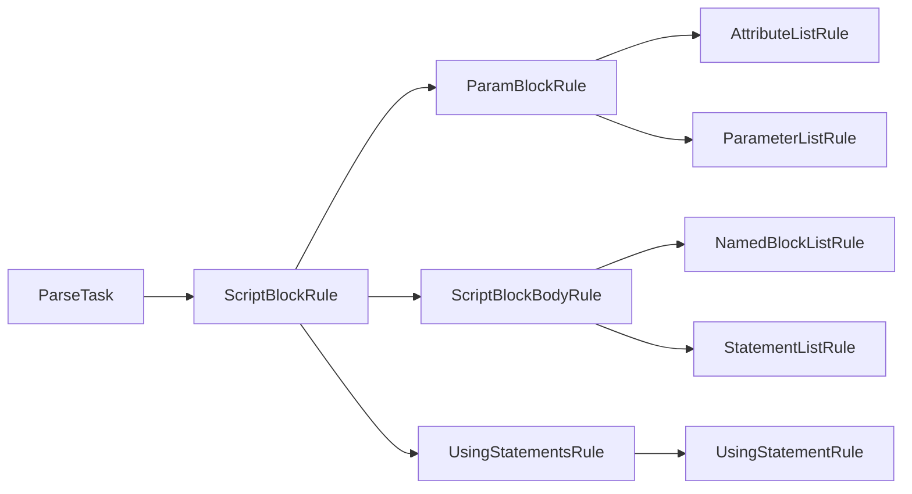
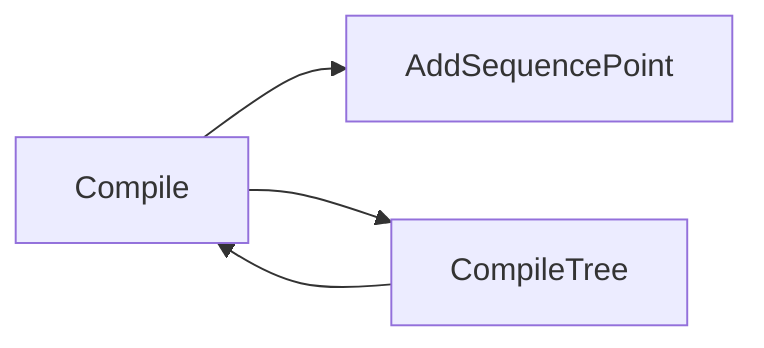
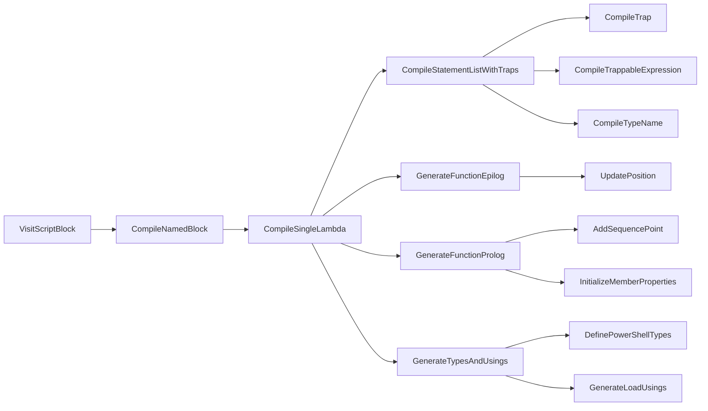
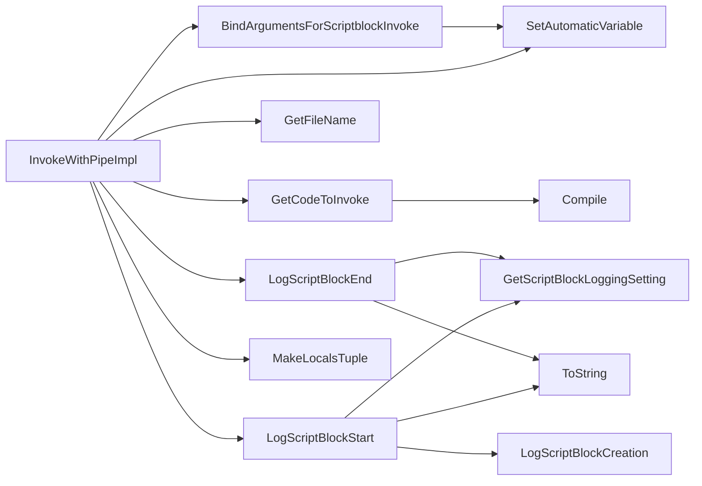

# Call graphs

> STATIC-ONLY — behavior not run-verified. Every graph is `GENERATED` by `docs-out/tools/gen_coord.py` from `data/members-tierA.json` and the member line ranges (`APPROX`: an edge A → B means the name `B` followed by `(` or `<` appears in the body of `A`, so overloads and same-named members of other types can create false edges, and calls through delegates or interfaces are missing). Use them as maps, then read the method. Sequence-level narrative: [LIFECYCLE-script-execution.md](LIFECYCLE-script-execution.md); stage data contracts: [STAGE-CONTRACTS.md](STAGE-CONTRACTS.md).

## 1. Purpose and scope [SPEC]

Entry-point call graphs for **tokenize**, **parse**, **check**, **compile** and **invoke**. 'Check' is not generated (the semantic passes are visitors, entered through `PerformPostParseChecks`) and is given as a hand-written chain in §5.

## 2. Source map

| graph | entry | file |
|---|---|---|
| tokenize | `Tokenizer.NextToken` | `src/System.Management.Automation/engine/parser/tokenizer.cs` |
| parse | `Parser.ParseTask` → `ScriptBlockRule` | `src/System.Management.Automation/engine/parser/Parser.cs` |
| compile | `Compiler.Compile` | `src/System.Management.Automation/engine/parser/Compiler.cs` |
| invoke | `ScriptBlock.InvokeWithPipeImpl` | `src/System.Management.Automation/engine/runtime/CompiledScriptBlock.cs` |

## 3. Tokenize

`NextToken` and its scanners, depth 3 (`Tokenizer`, name-based). Nodes: 40, edges: 169.

```mermaid
flowchart LR
  Backtick --> ScanUnicodeEscape
  CheckOperatorInCommandMode --> GetStringBuilder
  CheckOperatorInCommandMode --> InCommandMode
  CheckOperatorInCommandMode --> NewToken
  CheckOperatorInCommandMode --> PeekChar
  CheckOperatorInCommandMode --> ScanGenericToken
  NewCommentToken --> CurrentExtent
  NewCommentToken --> SaveToken
  NewFileRedirectionToken --> CurrentExtent
  NewFileRedirectionToken --> InExpressionMode
  NewFileRedirectionToken --> NewNumberToken
  NewFileRedirectionToken --> SaveToken
  NewFileRedirectionToken --> UngetChar
  NewInputRedirectionToken --> CurrentExtent
  NewInputRedirectionToken --> SaveToken
  NewMergingRedirectionToken --> CurrentExtent
  NewMergingRedirectionToken --> SaveToken
  NewNumberToken --> CurrentExtent
  NewNumberToken --> SaveToken
  NewToken --> CurrentExtent
  NewToken --> SaveToken
  NextToken --> AtEof
  NextToken --> Backtick
  NextToken --> CheckOperatorInCommandMode
  NextToken --> GetChar
  NextToken --> GetStringBuilder
  NextToken --> InCommandMode
  NextToken --> InExpressionMode
  NextToken --> NewFileRedirectionToken
  NextToken --> NewInputRedirectionToken
  NextToken --> NewMergingRedirectionToken
  NextToken --> NewScriptExtent
  NextToken --> NewToken
  NextToken --> NormalizeCRLF
  NextToken --> PeekChar
  NextToken --> ReportError
  NextToken --> ReportIncompleteInput
  NextToken --> SaveToken
  NextToken --> ScanBlockComment
  NextToken --> ScanDot
  NextToken --> ScanGenericToken
  NextToken --> ScanHereStringExpandable
  NextToken --> ScanHereStringLiteral
  NextToken --> ScanIdentifier
  NextToken --> ScanLabel
  NextToken --> ScanLineComment
  NextToken --> ScanNumber
  NextToken --> ScanNumberHelper
  NextToken --> ScanParameter
  NextToken --> ScanStringExpandable
  NextToken --> ScanStringLiteral
  NextToken --> ScanVariable
  NextToken --> SkipChar
  NextToken --> SkipWhiteSpace
  NextToken --> UngetChar
  NormalizeCRLF --> PeekChar
  NormalizeCRLF --> SkipChar
  ReportError --> NewScriptExtent
  ReportIncompleteInput --> NewScriptExtent
  ScanBlockComment --> AtEof
  ScanBlockComment --> GetChar
  ScanBlockComment --> NewCommentToken
  ScanBlockComment --> NormalizeCRLF
  ScanBlockComment --> PeekChar
  ScanBlockComment --> ReportIncompleteInput
  ScanBlockComment --> SkipChar
  ScanBlockComment --> UngetChar
  ScanDot --> InCommandMode
  ScanDot --> NewToken
  ScanDot --> PeekChar
  ScanDot --> ScanGenericToken
  ScanDot --> ScanNumber
  ScanDot --> SkipChar
  ScanDot --> UngetChar
  ScanGenericToken --> Backtick
  ScanGenericToken --> GetChar
  ScanGenericToken --> GetStringBuilder
  ScanGenericToken --> NewToken
  ScanGenericToken --> PeekChar
  ScanGenericToken --> ScanStringExpandable
  ScanGenericToken --> ScanStringLiteral
  ScanGenericToken --> SkipChar
  ScanGenericToken --> UngetChar
  ScanHereStringExpandable --> AtEof
  ScanHereStringExpandable --> Backtick
  ScanHereStringExpandable --> GetChar
  ScanHereStringExpandable --> GetStringBuilder
  ScanHereStringExpandable --> PeekChar
  ScanHereStringExpandable --> ReportIncompleteInput
  ScanHereStringExpandable --> SkipChar
  ScanHereStringExpandable --> UngetChar
  ScanHereStringLiteral --> AtEof
  ScanHereStringLiteral --> GetChar
  ScanHereStringLiteral --> GetStringBuilder
  ScanHereStringLiteral --> PeekChar
  ScanHereStringLiteral --> ReportIncompleteInput
  ScanHereStringLiteral --> SkipChar
  ScanHereStringLiteral --> UngetChar
  ScanIdentifier --> GetChar
  ScanIdentifier --> GetStringBuilder
  ScanIdentifier --> InCommandMode
  ScanIdentifier --> NewToken
  ScanIdentifier --> ScanGenericToken
  ScanIdentifier --> UngetChar
  ScanLabel --> GetChar
  ScanLabel --> GetStringBuilder
  ScanLabel --> InCommandMode
  ScanLabel --> ScanGenericToken
  ScanLabel --> UngetChar
  ScanLineComment --> CurrentExtent
  ScanLineComment --> NewCommentToken
  ScanLineComment --> ScanToEndOfCommentLine
  ScanNumber --> GetStringBuilder
  ScanNumber --> InExpressionMode
  ScanNumber --> NewNumberToken
  ScanNumber --> NewScriptExtent
  ScanNumber --> ReportError
  ScanNumber --> ScanGenericToken
  ScanNumber --> ScanNumberHelper
  ScanNumberHelper --> GetChar
  ScanNumberHelper --> GetStringBuilder
  ScanNumberHelper --> InExpressionMode
  ScanNumberHelper --> PeekChar
  ScanNumberHelper --> SkipChar
  ScanNumberHelper --> UngetChar
  ScanParameter --> GetChar
  ScanParameter --> GetStringBuilder
  ScanParameter --> InCommandMode
  ScanParameter --> InExpressionMode
  ScanParameter --> NewToken
  ScanParameter --> ScanGenericToken
  ScanParameter --> UngetChar
  ScanStringExpandable --> AtEof
  ScanStringExpandable --> Backtick
  ScanStringExpandable --> GetChar
  ScanStringExpandable --> GetStringBuilder
  ScanStringExpandable --> PeekChar
  ScanStringExpandable --> ReportIncompleteInput
  ScanStringExpandable --> SkipChar
  ScanStringExpandable --> UngetChar
  ScanStringLiteral --> AtEof
  ScanStringLiteral --> GetChar
  ScanStringLiteral --> GetStringBuilder
  ScanStringLiteral --> PeekChar
  ScanStringLiteral --> ReportIncompleteInput
  ScanStringLiteral --> UngetChar
  ScanToEndOfCommentLine --> AtEof
  ScanToEndOfCommentLine --> GetChar
  ScanToEndOfCommentLine --> GetStringBuilder
  ScanToEndOfCommentLine --> UngetChar
  ScanUnicodeEscape --> GetChar
  ScanUnicodeEscape --> GetStringBuilder
  ScanUnicodeEscape --> NewScriptExtent
  ScanUnicodeEscape --> ReportError
  ScanUnicodeEscape --> UngetChar
  ScanVariable --> AtEof
  ScanVariable --> Backtick
  ScanVariable --> GetChar
  ScanVariable --> GetStringBuilder
  ScanVariable --> InCommandMode
  ScanVariable --> NewScriptExtent
  ScanVariable --> NewToken
  ScanVariable --> PeekChar
  ScanVariable --> ReportError
  ScanVariable --> ReportIncompleteInput
  ScanVariable --> ScanGenericToken
  ScanVariable --> UngetChar
  SkipWhiteSpace --> PeekChar
  SkipWhiteSpace --> SkipChar
```

## 4. Parse: entry chain

From `ParseTask` through the first rules, depth 3. Nodes: 10, edges: 9.

## 5. Check (hand-written chain)

`Parser.ParseTask` → `ScriptBlockAst.PerformPostParseChecks` → `SymbolResolver.ResolveSymbols` (visitor over the AST) → `SemanticChecks.CheckAst` (visitor; for class methods `VariableAnalysis.AnalyzeMemberFunction`; for `data` statements `RestrictedLanguageChecker`). Compile-time: `Compiler.Compile` → `VariableAnalysis.Analyze` and, for the root block, `Compiler.GenerateTypesAndUsings` → `TypeDefiner.DefineTypes`. Evidence: [02.4-semantic-analysis.md](02.4-semantic-analysis.md) §6.

## 6. Compile

From `Compiler.Compile` through helpers (the 63 `Visit*` methods are omitted from the graph; see [COMPILATION-MAP.md](COMPILATION-MAP.md)), depth 3. Nodes: 3, edges: 3.

## 6b. Compile: script block body

From `Compiler.VisitScriptBlock` (called through `body.Accept(this)` inside `Compile`) through the lambda builders, depth 4. Nodes: 15, edges: 14.

## 7. Invoke

From `ScriptBlock.InvokeWithPipeImpl`, depth 2. Nodes: 12, edges: 14.

## 8. Parser rule-to-rule edges (complete list, `*Rule` methods reachable from `ScriptBlockRule`)

<!--N:PARSER_RULE_NODES-->62<!--/N--> rules, 124 edges (`GENERATED`, `APPROX`). Each row lists the callee rules of one rule.

| Rule | Calls (rules) |
|---|---|
| `ArrayLiteralRule` | `UnaryExpressionRule` |
| `AttributeArgumentsRule` | `ExpressionRule`, `SimpleNameRule` |
| `AttributeListRule` | `AttributeRule` |
| `AttributeRule` | `AttributeArgumentsRule`, `TypeNameRule` |
| `BinaryExpressionRule` | `ArrayLiteralRule` |
| `BlockStatementRule` | `StatementBlockRule` |
| `BreakStatementRule` | `LabelOrKeyRule` |
| `CatchBlockRule` | `AttributeRule`, `StatementBlockRule` |
| `ClassDefinitionRule` | `ClassMemberRule`, `SimpleNameRule`, `TypeNameRule` |
| `ClassMemberRule` | `AttributeRule`, `ExpressionRule`, `MethodDeclarationRule` |
| `CommandRule` | `InlineScriptRule`, `RedirectionRule` |
| `ConfigurationStatementRule` | `ScriptBlockExpressionRule` |
| `ContinueStatementRule` | `LabelOrKeyRule` |
| `DataStatementRule` | `SimpleNameRule`, `StatementBlockRule` |
| `DoWhileStatementRule` | `PipelineChainRule`, `StatementBlockRule` |
| `DynamicKeywordStatementRule` | `CommandRule`, `HashExpressionRule`, `ScriptBlockExpressionRule` |
| `EnumDefinitionRule` | `EnumMemberRule`, `SimpleNameRule`, `TypeNameRule` |
| `EnumMemberRule` | `ExpressionRule`, `SimpleNameRule` |
| `ExitStatementRule` | `PipelineChainRule` |
| `ExpressionRule` | `BinaryExpressionRule` |
| `FinishTypeNameRule` | `GenericTypeNameRule` |
| `ForStatementRule` | `PipelineChainRule`, `StatementBlockRule` |
| `ForeachStatementRule` | `PipelineChainRule`, `StatementBlockRule` |
| `FunctionDeclarationRule` | `FunctionParameterDeclarationRule`, `ScriptBlockRule` |
| `FunctionParameterDeclarationRule` | `ParameterListRule` |
| `GenericTypeNameRule` | `GenericTypeArgumentsRule` |
| `IfStatementRule` | `PipelineChainRule`, `StatementBlockRule` |
| `InlineScriptRule` | `ScriptBlockExpressionRule` |
| `InvokeParamParenListRule` | `ExpressionRule` |
| `LabelOrKeyRule` | `SimpleNameRule`, `UnaryExpressionRule` |
| `LabeledStatementRule` | `DoWhileStatementRule`, `ForStatementRule`, `ForeachStatementRule`, `PipelineChainRule`, `SwitchStatementRule`, `WhileStatementRule` |
| `MethodDeclarationRule` | `FunctionParameterDeclarationRule`, `InvokeParamParenListRule`, `ScriptBlockRule` |
| `NamedBlockListRule` | `StatementBlockRule` |
| `ParamBlockRule` | `AttributeListRule`, `ParameterListRule` |
| `ParameterListRule` | `ParameterRule` |
| `ParameterRule` | `AttributeListRule`, `ExpressionRule` |
| `ParenthesizedExpressionRule` | `PipelineChainRule` |
| `PipelineChainRule` | `ExpressionRule`, `PipelineRule`, `StatementRule` |
| `PipelineRule` | `CommandRule`, `ExpressionRule`, `RedirectionRule` |
| `PrimaryExpressionRule` | `ExpandableStringRule`, `HashExpressionRule`, `ParenthesizedExpressionRule`, `ScriptBlockExpressionRule`, `SubExpressionRule` |
| `ReturnStatementRule` | `PipelineChainRule` |
| `ScriptBlockBodyRule` | `NamedBlockListRule`, `StatementListRule` |
| `ScriptBlockExpressionRule` | `ScriptBlockRule` |
| `ScriptBlockRule` | `ParamBlockRule`, `ScriptBlockBodyRule`, `UsingStatementsRule` |
| `StatementBlockRule` | `StatementListRule` |
| `StatementListRule` | `StatementRule` |
| `StatementRule` | `AttributeListRule`, `BlockStatementRule`, `BreakStatementRule`, `ClassDefinitionRule`, `ConfigurationStatementRule`, `ContinueStatementRule`, `DataStatementRule`, `DoWhileStatementRule`, `DynamicKeywordStatementRule`, `EnumDefinitionRule`, `ExitStatementRule`, `ForStatementRule`, `ForeachStatementRule`, `FunctionDeclarationRule`, `IfStatementRule`, `LabeledStatementRule`, `PipelineChainRule`, `ReturnStatementRule`, `SwitchStatementRule`, `ThrowStatementRule`, `TrapStatementRule`, `TryStatementRule`, `UsingStatementRule`, `WhileStatementRule` |
| `SubExpressionRule` | `StatementListRule` |
| `SwitchStatementRule` | `PipelineChainRule`, `StatementBlockRule` |
| `ThrowStatementRule` | `PipelineChainRule` |
| `TrapStatementRule` | `AttributeRule`, `StatementBlockRule` |
| `TryStatementRule` | `CatchBlockRule`, `StatementBlockRule` |
| `TypeNameRule` | `FinishTypeNameRule` |
| `UnaryExpressionRule` | `AttributeListRule`, `PrimaryExpressionRule` |
| `UsingStatementsRule` | `UsingStatementRule` |
| `WhileStatementRule` | `PipelineChainRule`, `StatementBlockRule` |

## 9. Guidance for MicroteamShell [LESSON]

- **LSN-CALLG-01** [REPLICATE] (area: NLD-TOOL) Keep the five entry points (tokenize, parse, check, compile, invoke) as separate callable stages with narrow signatures so each can be tested alone. Evidence: `src/System.Management.Automation/engine/parser/Parser.cs::Parser.ParseTask@L176-L227`.
- **LSN-CALLG-02** [ADAPT] (area: NLD-TOOL) Generate such graphs in CI from the shell's own sources to catch accidental coupling between stages. Why: the PowerShell graphs show the compiler calling parser-time helpers and the AST calling the compiler. Evidence: `src/System.Management.Automation/engine/parser/ast.cs::VariableExpressionAst@L9404-L9624`.

Verification: graphs are produced by the script from member ranges; `ParseTask`, `ScriptBlockRule`, `NextToken`, `Compiler.Compile` and `InvokeWithPipeImpl` exist in `data/members-tierA.json`; spot-checked edges: `ParseTask → ScriptBlockRule`, `NextToken → ScanVariable`, `Compile → CompileTree`.

