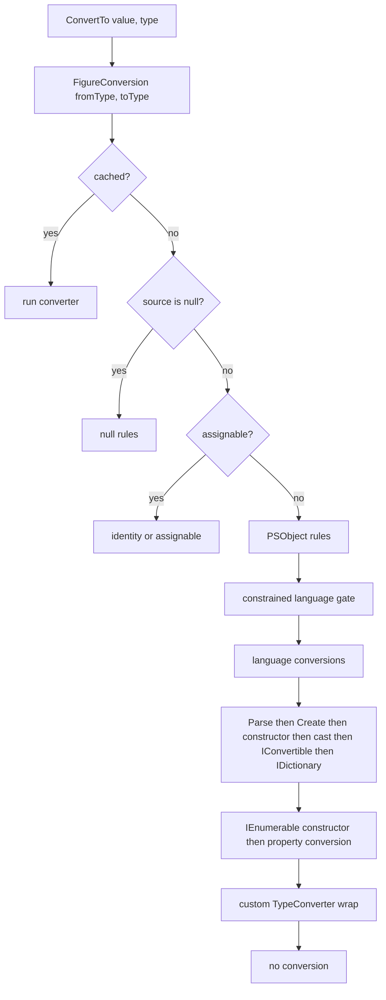

# Conversion rules

> STATIC-ONLY — behavior not run-verified. `FACT-SRC` unless marked. Where conversions are used: operators ([OPERATOR-TABLE.md](OPERATOR-TABLE.md)), casts `[type]value`, typed variables and parameters ([SCOPE-AND-VARIABLES.md](SCOPE-AND-VARIABLES.md), parameter binding in T33), and comparison. Overview: [02.6-types-and-operators.md](02.6-types-and-operators.md).

## 1. Purpose and scope [SPEC]

The conversion algorithm of `LanguagePrimitives.ConvertTo`: how the engine chooses a converter for (source type, target type), in which order the candidates are tried, which rank each gets, and the behavior of the main converters (string ↔ number, bool, arrays, enums, null, objects). Rank values drive overload resolution in method calls as well.

## 2. Source map

| path | type | role | tier |
|---|---|---|---|
| src/System.Management.Automation/engine/LanguagePrimitives.cs::LanguagePrimitives@L298-L5885 | static class | the converter library (≈5,900 lines; conversion core read, see §19) | A |
| src/System.Management.Automation/engine/LanguagePrimitives.cs::ConversionRank@L251-L292 | enum | quality of a conversion | A |
| src/System.Management.Automation/engine/LanguagePrimitives.cs::IConversionData@L4371-L4383 | interface | a cached converter plus its rank | A |

## 3. Responsibilities and non-responsibilities

Chooses and runs converters; does not bind parameters (T33) or format output. Member/method binding rules that use these ranks live in the binders (T26).

## 4. Key types and contracts [IMPL]

- `ConvertTo(value, type)` (public) uses `CultureInfo.InvariantCulture`; internal overload `ConvertTo(value, type, recursion, formatProvider, backupTypeTable)` finds `FigureConversion(value, type, out debase)` and invokes it, passing the base object when the source is a `PSObject` that should be unwrapped (src/System.Management.Automation/engine/LanguagePrimitives.cs::LanguagePrimitives.ConvertTo@L1670-L1673).
- `FigureConversion(fromType, toType)` returns an `IConversionData` (converter + `ConversionRank`) and caches it per type pair in a process-wide cache (`CacheConversion`, `GetConversionData`, `RebuildConversionCache` pre-populates numeric ↔ string/char/bool conversions).
- `IsTrue(object)` is the truthiness function (§7.3).
- `Equals`/`Compare` implement the comparison operators' non-numeric fallbacks (§7.6).

## 5. Data model — ranks

Higher rank = better match. `…S2A` variants are the same conversion applied to a scalar that is wrapped into an array. `ValueDependent` marks conversions whose applicability depends on the value (e.g. scalar to array).

<!--GEN:ranks-->
| Rank name | Value | Source line |
|---|---|---:|
| `None` | `0x0000` | L253 |
| `UnrelatedArraysS2A` | `0x0007` | L254 |
| `UnrelatedArrays` | `0x000F` | L255 |
| `ToStringS2A` | `0x0017` | L256 |
| `ToString` | `0x001F` | L257 |
| `CustomS2A` | `0x0027` | L258 |
| `Custom` | `0x002F` | L259 |
| `IConvertibleS2A` | `0x0037` | L260 |
| `IConvertible` | `0x003F` | L261 |
| `ImplicitCastS2A` | `0x0047` | L262 |
| `ImplicitCast` | `0x004F` | L263 |
| `ExplicitCastS2A` | `0x0057` | L264 |
| `ExplicitCast` | `0x005F` | L265 |
| `ConstructorS2A` | `0x0067` | L266 |
| `Constructor` | `0x006F` | L267 |
| `Create` | `0x0073` | L268 |
| `ParseS2A` | `0x0077` | L269 |
| `Parse` | `0x007F` | L270 |
| `PSObjectS2A` | `0x0087` | L271 |
| `PSObject` | `0x008F` | L272 |
| `LanguageS2A` | `0x0097` | L273 |
| `Language` | `0x009F` | L274 |
| `NullToValue` | `0x00AF` | L275 |
| `NullToRef` | `0x00BF` | L276 |
| `NumericExplicitS2A` | `0x00C7` | L277 |
| `NumericExplicit` | `0x00CF` | L278 |
| `NumericExplicit1S2A` | `0x00D7` | L279 |
| `NumericExplicit1` | `0x00DF` | L280 |
| `NumericStringS2A` | `0x00E7` | L281 |
| `NumericString` | `0x00EF` | L282 |
| `NumericImplicitS2A` | `0x00F7` | L283 |
| `NumericImplicit` | `0x00FF` | L284 |
| `AssignableS2A` | `0x0107` | L285 |
| `Assignable` | `0x010F` | L286 |
| `IdentityS2A` | `0x0117` | L287 |
| `StringToCharArray` | `0x011A` | L288 |
| `Identity` | `0x011F` | L289 |
| `ValueDependent` | `0xFFF7` | L291 |
<!--/GEN:ranks-->

Rows: <!--N:CONVERSION_RANKS-->38<!--/N--> (`GENERATED` from `data/enums.json`).

## 6. Control flow

## 7. Algorithms

### 7.1 Converter selection (CF-CNV-001)

<!--CF:CF-CNV-001-->**Conversion algorithm and converter order.** For a source type S and target type T the engine returns the first applicable converter in this order (cached per type pair): (1) a cached entry; (2) if S is the null type: `Nullable<…>` → null, any reference type → null, a value type → no conversion (numeric, `char`, `string`, `bool`, `PSReference`, `switch` and `void` targets have pre-cached null conversions); (3) if T is assignable from S: identity (same type) or assignable; (4) by-ref-like types: none; (5) S is a `PSObject`: none (the caller unwraps first); (6) T is `PSObject`: wrap; (7) under Constrained Language Mode: only targets `object`, `object[]` or the core type list are converted (others are refused, or only audited in WDAC audit mode); (8) **language conversions**: `Nullable<U>` through U, `void`, `bool` (from `IList`, enum, value type, class), `string`, arrays (related arrays element-wise, unrelated arrays per element, enumerable to array, scalar to one-element array), `Array`, `Hashtable` from `IDictionary`, `PSReference`, `XmlDocument`, `StringCollection`, `ScriptBlock` to delegate, `PSCustomObject`, integer to enum, `PSMethod` to delegate; (9) a static `Parse` method on T; (10) a static `Create` method; (11) a constructor of T taking S; (12) a cast operator (implicit, then explicit) on S or T; (13) `IConvertible` (numeric sources through the string-convertible path, other `IConvertible` sources via `Convert`); (14) for an `IDictionary` source: T's no-argument constructor then property assignment from the keys; (15) an `IEnumerable` constructor; (16) property-based conversion; if S or T may have a `TypeConverter`/`PSTypeConverter`, or a value-dependent converter was found, the result is wrapped to try the custom/value-dependent converter first and the found converter second; (17) otherwise no conversion (rank `None`, a failing converter that raises `PSInvalidCastException`). Numeric-to-numeric, number-to-string, number-to-bool and null-to-number conversions are pre-cached with fixed ranks.<!--/CF-->

Evidence: `src/System.Management.Automation/engine/LanguagePrimitives.cs::LanguagePrimitives.FigureConversion@L5641-L5828`, `LanguagePrimitives.FigureLanguageConversion@L4966`, `LanguagePrimitives.FigureConversionFromNull@L5830-L5848`, `LanguagePrimitives.RebuildConversionCache@L4468`, src/System.Management.Automation/engine/LanguagePrimitives.cs::LanguagePrimitives.ConvertTo@L1670-L1673.

### 7.2 String ↔ number

- **String → number** (`ConvertStringToInteger/Decimal/Real`): empty string → 0; otherwise the text is scanned with the **language number parser** (`Parser.ScanNumber(text, type, shouldTryCoercion: false)`), so hexadecimal (`0x`), binary, type suffixes and multipliers (`kb`…) are accepted exactly as in the tokenizer (CF-LEX-002 in [02.1-tokenizer.md](02.1-tokenizer.md)); the result is converted to the target type with invariant culture; if that fails, a type-converter parse is tried, and on `FormatException` a conversion through `double`; any remaining failure raises `PSInvalidCastException` (`InvalidCastFromStringToInteger`/`…ToDecimal`).
- **Number → string** (`ConvertNumericToString`): if the value came from a numeric literal the original **token text** is used; otherwise `double` uses format `G15`, `float` uses `G7`, `BigInteger` and the others use invariant culture formatting.
- **Other → string** (`ConvertNonNumericToString`): `PSObject.ToStringParser(context, value, formatProvider)` (honors `ToString` overrides and `$OFS` for collections, per ETS).

### 7.3 Truthiness (`IsTrue`)

`$null` and `AutomationNull` → false; after unwrapping `PSObject`: `bool` as is; `string` → true iff non-empty; numeric types → true iff non-zero; `SwitchParameter` → its value; `IList`: 0 elements → false, 1 element → truthiness of that element (if that element is itself a list: true iff it is non-empty), more than 1 → true; every other object → true. Evidence: src/System.Management.Automation/engine/LanguagePrimitives.cs::LanguagePrimitives.IsTrue@L980-L1017.

### 7.4 Enums

String → enum: case-sensitive parse, then case-insensitive, then **unique-prefix disambiguation** (`EnumMinimumDisambiguation`); an undefined numeric value is an error; integer → enum is a language conversion; an enumerable of strings is joined with commas then parsed (flags).

### 7.5 Arrays and hashtables

Related arrays (element type assignable): element-wise; unrelated arrays: each element converted; any enumerable → array of converted elements; a scalar convertible to the element type → one-element array (value-dependent, ranks with `S2A`); `Hashtable` from any `IDictionary` copies entries.

### 7.6 Equality and comparison fallbacks

`LanguagePrimitives.Equals(first, second, ignoreCase, culture)`: unwrap `PSObject`; null equals only null; if `first` is a string the second is converted to string and compared with the culture's `CompareInfo` (ignore-case option); `first.Equals(second)`; both numeric → numeric comparison; `char` with ignore-case compares upper-cased characters; otherwise convert `second` to `first`'s type and `Equals`, an `InvalidCastException` giving false. `Compare` follows the same shape (null sorts before numbers by sign rule, string by culture compare, numeric compare, else convert the second operand to the first's type and use `IComparable`; failures raise `ComparisonFailure`; non-comparable → `NotIcomparable`). Evidence: src/System.Management.Automation/engine/LanguagePrimitives.cs::LanguagePrimitives.Equals@L599-L602, src/System.Management.Automation/engine/LanguagePrimitives.cs::LanguagePrimitives.Compare@L742-L745.

## 8. Observable behavior [SPEC]

Read from source: `[int]"0x1F"` → 31; `[int]""` → 0; `[string]1.5` → "1.5"; `[bool]"false"` → true (non-empty string); `[bool]@()` → false; `[bool]@(0)` → false (one element: truthiness of `0`); `[bool]@(1,2)` → true; `[int[]]"1"` → one-element array. No golden sample: STATIC-ONLY. Tests: `test/powershell/Language/Operators/` and type-conversion tests (`data/tests.json`, mapping `UNVERIFIED`).

## 9. Error handling and edge cases

Failures raise `PSInvalidCastException` (message ids such as `InvalidCastFromStringToInteger`) or `PSArgumentException` for comparison failures. A converter exception unwraps its inner exception first for string → number. Conversion of `null` to a value type without a pre-cached null converter has rank `None`. `ConvertTo<T>` returns `value` directly if it is already a `T`.

## 10. Concurrency and threading

The conversion cache is a process-wide dictionary guarded by a lock on rebuild (`lock (s_converterCache)`) and `ConcurrentDictionary`-style access for lookups (`INFERENCE` from `RebuildConversionCache`); a type-table-dependent cache is rebuilt when the type table changes.

## 11. Extension points and customization hooks

`PSTypeConverter`/`TypeConverter` attributes (checked in step 16), `ETS` type-table converters (`UpdateTypeConvertFromTypeTable`), static `Parse`/`Create`, constructors and cast operators on user types, `ArgumentTransformationAttribute` on variables and parameters (applied before this layer).

## 12. Dependencies

Inbound: binders (`PSConvertBinder`), cast expressions, typed variables, parameter binder, comparison operators. Outbound: `Parser.ScanNumber`, `PSObject`, `TypeTable`, reflection, `SystemPolicy`.

## 13. Performance notes

Converters are cached per type pair; dynamic call sites call the converter directly after a rank check; numeric conversions are pre-seeded to avoid reflection on first use.

## 14. Security considerations (mandatory)

Constrained Language Mode refuses conversions to arbitrary types (step 7) — the main gate against constructing disallowed .NET types through casts; WDAC audit mode logs instead. User-defined `Parse`/constructor/cast conversions run arbitrary code in Full Language mode.

## 15. Enterprise considerations

`typeConversion` trace source records each conversion step (`WriteLine`) for diagnostics (`Trace-Command -Name TypeConversion`, `INFERENCE`). Missing: no way to disable individual conversion steps.

## 16. Tests

Not read per assertion (VB-005).

## 17. Design decisions and trade-offs

| Decision | Label | Consequence |
|---|---|---|
| one ordered search over many conversion mechanisms | `FACT-SRC` | very permissive casts (`[type]` works for anything with a parse/ctor/cast) |
| ranks double as overload-resolution scores | `FACT-SRC` | single scoring scale for conversion and method binding |
| string → number reuses the language number parser | `FACT-SRC` | literal syntax and string conversion agree |
| invariant culture for ordinary conversions | `FACT-SRC` | scripts behave the same on every machine |

## 18. Guidance for MicroteamShell [LESSON]

- **LSN-CONV-01** [REPLICATE] (area: NLD-TYP) Use the search order of §7.1 with a per-(source,target) cache and an explicit rank for each outcome. Evidence: `src/System.Management.Automation/engine/LanguagePrimitives.cs::LanguagePrimitives.FigureConversion@L5641-L5828`.
- **LSN-CONV-02** [REPLICATE] (area: NLD-TYP) Convert strings to numbers with the same scanner as the tokenizer (hex, binary, suffixes, multipliers) and numbers to strings with invariant formatting (`G15`/`G7`, literal token text preserved). Evidence: src/System.Management.Automation/engine/LanguagePrimitives.cs::LanguagePrimitives.TryScanNumber@L2882-L2906, src/System.Management.Automation/engine/LanguagePrimitives.cs::LanguagePrimitives.ConvertNumericToString@L3322-L3363.
- **LSN-CONV-03** [REPLICATE] (area: NLD-TYP) Implement `IsTrue` exactly as in §7.3, including the one-element-list rule. Evidence: src/System.Management.Automation/engine/LanguagePrimitives.cs::LanguagePrimitives.IsTrue@L980-L1017.
- **LSN-CONV-04** [ADAPT] (area: NLD-TYP) Support the language conversions (§7.1 step 8) and `Parse`/constructor/cast mechanisms for MicroteamShell's own types first; add reflection-based discovery of .NET `Parse`/`Create`/constructors only for the .NET types the shell exposes. Why: same observable casts for supported types without reflection over arbitrary assemblies. Evidence: src/System.Management.Automation/engine/LanguagePrimitives.cs::LanguagePrimitives.FigureLanguageConversion@L4966-L5154.
- **LSN-CONV-05** [AVOID] (area: NLD-SEC) Do not copy the Constrained-Language gate or the WDAC audit hook in the conversion layer; use an allow-list of target types at the shell's type-system boundary if a restricted mode is wanted. Evidence: `src/System.Management.Automation/engine/LanguagePrimitives.cs::LanguagePrimitives.FigureConversion@L5641-L5828`. DEV: DEV-TYP-070

## 19. Open questions / UNVERIFIED

- Not read: the value-based `FigureConversion` overload (debasing rules), `FigureStaticCreateMethodConversion`, `FigureParseConversion`, `FigureConstructorConversion`, `FigureCastConversion`, `FigurePropertyConversion`, and the null converters' bodies (names and order only). The statements in §7.1 steps 9-16 are therefore `FACT-SRC` for **order** and `UNVERIFIED` for **detail** (VB-018).
- Exact numeric widening/narrowing rules for numeric ↔ numeric casts (`ConvertNumeric`, `ConvertIConvertible`) and bool ↔ string-valued conversions at the edges.
- Culture handling when a non-invariant provider is passed.

Verification: `LanguagePrimitives.cs` windows read: L449-L560 (enumerables), L599-L865 (Equals, Compare), L980-L1060 (IsTrue), L1670-L1770 and L4860-L4895 (ConvertTo), L2882-L3074 (string → number), L3096-L3135 and L3322-L3400 (void, bool, string conversions), L3581-L3660 (enum), L4468-L4520 (cache seeding), L4966-L5120 (language conversions), L5641-L5848 (FigureConversion, null); rank table generated from `data/enums.json`.
