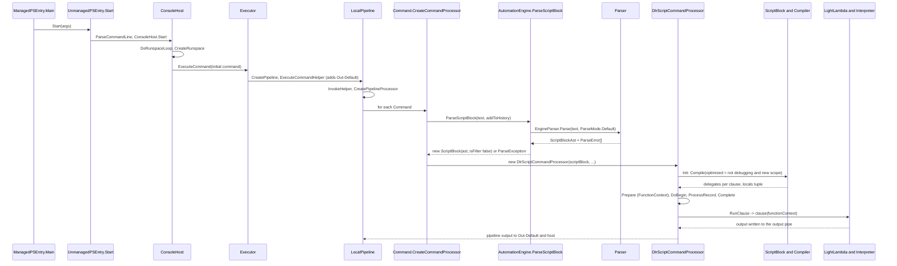

# Script execution lifecycle

> STATIC-ONLY — behavior not run-verified. End-to-end sequence from `pwsh -c "<text>"` to output, naming the classes and methods touched. Host steps are summarized from [layered-architecture](../00-overview/layered-architecture.md); the engine steps were read for this document (`FACT-SRC`); steps whose bodies were not read are marked `UNVERIFIED`. Stage contracts: [STAGE-CONTRACTS.md](STAGE-CONTRACTS.md); call graphs: [CALL-GRAPHS.md](CALL-GRAPHS.md).

## 1. Purpose and scope [SPEC]

One continuous trace of what happens to the text of a command line script, with the decision points that matter to a re-implementation: where parsing happens, where the language-mode and restricted-language checks run, where the script block is compiled, how the tier is chosen, and how output reaches the host.

## 2. Source map

| Step group | Path | Type | Role |
|---|---|---|---|
| Entry | `src/powershell/Program.cs`, `ManagedEntrance.cs` | `ManagedPSEntry`, `UnmanagedPSEntry` | process entry and start-up |
| Host | `ConsoleHost.cs`, `Executor.cs` | `ConsoleHost`, `Executor` | command-line handling, runspace loop, run a command string |
| Pipeline | src/System.Management.Automation/engine/hostifaces/LocalPipeline.cs::LocalPipeline@L21-L1143, src/System.Management.Automation/engine/hostifaces/Command.cs::Command@L18-L774 | | pipeline of commands, command processor creation |
| Parse | src/System.Management.Automation/engine/AutomationEngine.cs::AutomationEngine@L15-L128 | | `ParseScriptBlock` |
| Run | src/System.Management.Automation/engine/ScriptCommandProcessor.cs::DlrScriptCommandProcessor@L232-L661 | | runs a script block as a command |

## 3. Responsibilities and non-responsibilities

Lifecycle only; stage internals are in the stage documents.

## 4. Key types and contracts [IMPL]

Contracts per boundary: [STAGE-CONTRACTS.md](STAGE-CONTRACTS.md) §4.

## 5. Data model

Objects created along the way: `Runspace` + `ExecutionContext`, `Pipeline` with one `Command` (`IsScript`), `PipelineProcessor`, `ScriptBlock`/`ScriptBlockAst`, `DlrScriptCommandProcessor` with `FunctionContext` and locals tuple, the output `Pipe`, error records.

## 6. Control flow

Ordered steps (`FACT-SRC` unless marked):

1. **Process start**: `ManagedPSEntry.Main` → `UnmanagedPSEntry.Start`: early start-up warm-up, culture setup, `ConsoleHost.ParseCommandLine`, default initial session state, `ConsoleHost.Start` ([layered-architecture](../00-overview/layered-architecture.md) §4).
2. **Runspace loop**: `ConsoleHost.DoRunspaceLoop(initialCommand, …)` creates a runspace for each session iteration (`CreateRunspace`), runs the initial command through `InitializeRunspaceHelper` → `Executor.ExecuteCommand(command, out exception, options)`; at the end it reads `$global:?` to compute the exit code (success only if `$?` is true and the runspace initialized) (src/Microsoft.PowerShell.ConsoleHost/host/msh/ConsoleHost.cs::ConsoleHost.DoRunspaceLoop@L1643-L1700).
3. **Pipeline creation**: `Executor.ExecuteCommand(string, …)` calls `CreatePipeline(command, addToHistory)` and `ExecuteCommandHelper`; when the `AddOutputter` option is set and the pipeline has a single command, the command's error results are merged into output and an `Out-Default` command is appended so results are rendered (src/Microsoft.PowerShell.ConsoleHost/host/msh/Executor.cs::Executor.ExecuteCommandHelper@L335-L357).
4. **Pipeline invoke**: `LocalPipeline.InvokeHelper` raises pipeline state events, transcribes script commands, and creates a `PipelineProcessor` with `CreatePipelineProcessor`, which asks every `Command` for a command processor (`command.CreateCommandProcessor(executionContext, addToHistory, origin)`) (src/System.Management.Automation/engine/hostifaces/LocalPipeline.cs::LocalPipeline.CreatePipelineProcessor@L817-L900). The `PipelineProcessor` then drives the command processors (`UNVERIFIED`: body not read, see §19).
5. **Script text becomes a script block**: for a script command, `Command.CreateCommandProcessor` first rejects scripts when the language mode is `NoLanguage` and the origin is the runspace (`ScriptsNotAllowed`), then calls `AutomationEngine.ParseScriptBlock(text, addToHistory)`: `EngineParser.Parse(fileName, script, null, out errors, ParseMode.Default)` (tokenize, parse, symbol resolution and semantic checks, [02.2-parser.md](02.2-parser.md), [02.4-semantic-analysis.md](02.4-semantic-analysis.md)); with `addToHistory` the parser records `$^`/`$$`; if any error exists it throws `IncompleteParseException` (when the first error is incomplete input, so a REPL can continue) or `ParseException(errors)`; otherwise `new ScriptBlock(ast, isFilter: false)` — **not** through the script block cache (src/System.Management.Automation/engine/AutomationEngine.cs::AutomationEngine.ParseScriptBlock@L96-L127, src/System.Management.Automation/engine/hostifaces/Command.cs::Command.CreateCommandProcessor@L450-L540).
6. **Language-mode gate**: internal-origin commands run `FullLanguage`; `RestrictedLanguage` calls `CheckRestrictedLanguage` (the data-section style check over the whole script); `ConstrainedLanguage` is enforced at run time ([02.4-semantic-analysis.md](02.4-semantic-analysis.md) §14).
7. **Command processor**: a script block with `[CmdletBinding()]`/`[Parameter()]` becomes a `FunctionInfo` and a `CommandProcessor`; otherwise a `DlrScriptCommandProcessor` (named for the DLR-based compiled code).
8. **Compile**: the constructor `Init()` calls `ScriptBlock.Compile(optimized: _context._debuggingMode <= 0 && UseLocalScope)` (CF-CMP-003), which runs `CompiledScriptBlockData.Compile` → `Compiler.Compile` → per-clause `CompileTree` (interpreter delegate, CF-CMP-001) and creates the locals tuple (`MakeLocalsTuple`); with a local scope the tuple is installed on the new command scope ([02.5-compiler-and-engine.md](02.5-compiler-and-engine.md), [TIERING-POLICY.md](TIERING-POLICY.md)).
9. **Prepare / begin / process / complete**: `Prepare` stores `$MyInvocation`, `$PSScriptRoot`/`$PSCommandPath` and builds the `FunctionContext` (execution context, output pipe, locals tuple, script block, file, debugger flags, sequence points); `DoBegin` runs the `begin` clause once; `ProcessRecord` runs `process` (once per input object when input is expected, else once); `Complete` runs `end` (reading all input first when the block has no `process` clause) (src/System.Management.Automation/engine/ScriptCommandProcessor.cs::DlrScriptCommandProcessor.Prepare@L298-L313, src/System.Management.Automation/engine/ScriptCommandProcessor.cs::DlrScriptCommandProcessor.ProcessRecord@L352-L393).
10. **Run a clause**: `RunClause(clause, $_, input)` checks the stack depth, switches the language mode if the script block carries one, sets the scope origin, `EnterScope`, merges or redirects the error pipe, sets `$_` and `$input` (an enumerator over the input list), and calls `clause(_functionContext)`. Catches: `ExitException` (for script files sets `$LASTEXITCODE` and marks the pipeline failed when non-zero; otherwise rethrown), `FlowControlException` (rethrown — so `break`/`continue` escape a function), `RuntimeException` (`ManageScriptException`), other exceptions (wrapped). Finally restore error pipe, language mode and scope origin (src/System.Management.Automation/engine/ScriptCommandProcessor.cs::DlrScriptCommandProcessor.RunClause@L485-L623).
11. **Execute**: the delegate is a `LightLambda`: interpreted by `Interpreter.Run` over the instruction array until the call counter triggers JIT (CF-CMP-001); statements run through the protocols of [IR-SPEC.md](IR-SPEC.md) §5 — binders choose operations ([BINDER-CATALOG.md](BINDER-CATALOG.md)), runtime helpers implement them ([RUNTIME-OPERATIONS.md](RUNTIME-OPERATIONS.md)); output is written to the output pipe (CF-PIP-001); errors go through `CheckActionPreference`.
12. **Render**: the appended `Out-Default` command receives the objects and the host writes them (`UNVERIFIED`: formatting and host UI not analyzed; Phase 3/4).
13. **Exit**: `DoRunspaceLoop` computes the exit code from `$?`; the runspace is closed.

## 7. Algorithms

Not applicable.

## 8. Observable behavior [SPEC]

`pwsh -c "1+1"` parses, creates one script command plus `Out-Default`, compiles the block, interprets it, writes `2` to the output pipe, and renders it. A parse error produces a `ParseException` whose first error id is the key reported in [ERROR-CATALOG.md](ERROR-CATALOG.md). No golden sample: STATIC-ONLY.

## 9. Error handling and edge cases

Parse errors stop before any command runs (the whole text is parsed first); runtime errors in the script are handled per statement (RUNTIME-OPERATIONS §6.1); an `ExitException` outside a script file is rethrown to the pipeline; `FlowControlException` crosses the command-processor boundary.

## 10. Concurrency and threading

Command line scripts run on the runspace pipeline thread; JIT promotion happens on the thread pool ([TIERING-POLICY.md](TIERING-POLICY.md) §7.5).

## 11. Extension points and customization hooks

Custom hosts (`ConsoleShell.Start` / `PSHost`), `InitialSessionState`, language mode, `Out-Default` replacement.

## 12. Dependencies

Host layer → engine layer ([layered-architecture](../00-overview/layered-architecture.md)).

## 13. Performance notes

Interactive and `-Command` text is parsed on every execution (no script cache on this path); compiled data live in the new `ScriptBlock` object and die with it.

## 14. Security considerations (mandatory)

Checks on this path, in order: `NoLanguage` rejection, parse, `CheckRestrictedLanguage` (restricted mode), compile-time security checks (`PerformSecurityChecks`: content scan, logging), run-time language-mode transitions in `RunClause`. A new shell should keep the same order: reject → parse → static policy → scan/log → run.

## 15. Enterprise considerations

Script block start/stop logging (`LogScriptBlockStart/End`), transcription of script commands in `LocalPipeline`, history ids on errors.

## 16. Tests

Host behavior tests: `test/powershell/Host/` (`data/tests.json`; mapping `UNVERIFIED`).

## 17. Design decisions and trade-offs

| Decision | Label | Consequence |
|---|---|---|
| command-line text is just a one-command pipeline plus `Out-Default` | `FACT-SRC` | one execution path for interactive and non-interactive use |
| script text parsed per execution, not cached on this path | `FACT-SRC` | simple; repeated identical commands re-parse |
| flow-control exceptions cross function boundaries | `FACT-SRC` | `break` in a function can end the caller's loop (SEMANTIC-QUIRKS) |

## 18. Guidance for MicroteamShell [LESSON]

- **LSN-LIFE-01** [REPLICATE] (area: NLD-RUN) Treat the command line as one script command followed by an output command in an ordinary pipeline, so interactive and file execution share a path. Evidence: src/Microsoft.PowerShell.ConsoleHost/host/msh/Executor.cs::Executor.ExecuteCommandHelper@L335-L357.
- **LSN-LIFE-02** [REPLICATE] (area: NLD-ERR) Parse the whole text before running anything and report incomplete input distinctly so a REPL can ask for another line. Evidence: src/System.Management.Automation/engine/AutomationEngine.cs::AutomationEngine.ParseScriptBlock@L96-L127.
- **LSN-LIFE-03** [REPLICATE] (area: NLD-RUN) Run script blocks through a begin/process/end command processor that sets `$_`/`$input`, scopes, error pipe and language mode around each clause. Evidence: src/System.Management.Automation/engine/ScriptCommandProcessor.cs::DlrScriptCommandProcessor.RunClause@L485-L623.
- **LSN-LIFE-04** [ADAPT] (area: NLD-RUN) Merge the `CommandProcessor`/`DlrScriptCommandProcessor` split into one script command processor. Why: the split exists for cmdlet-style binding of advanced functions; the observable begin/process/end behavior is the same. Evidence: src/System.Management.Automation/engine/hostifaces/Command.cs::Command.CreateCommandProcessor@L450-L540.

## 19. Open questions / UNVERIFIED

- `PipelineProcessor` execution, `Pipeline.Invoke` threading and `Out-Default` rendering were not read (Phase 3/4, T31/T36).
- Host: `-File`, `-EncodedCommand` and interactive loop differences.

Verification: `ConsoleHost.DoRunspaceLoop` (L1643-L1700), `Executor.ExecuteCommandHelper` (L335-L357), `LocalPipeline.InvokeHelper` start and `CreatePipelineProcessor` (L279-L340, L817-L900), `Command.CreateCommandProcessor` (L450-L540), `AutomationEngine.ParseScriptBlock` (L91-L126), `DlrScriptCommandProcessor` (L232-L625) were read.
