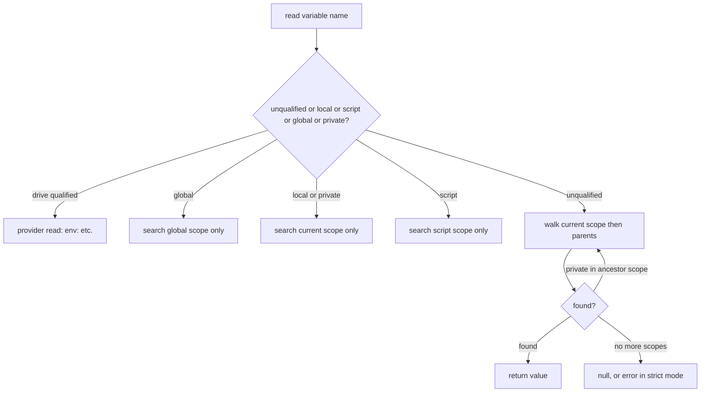

# Scopes and variables

> STATIC-ONLY — behavior not run-verified. `FACT-SRC` unless marked. Where the execution context and session state fit: [../03-runtime/execution-context-and-session-state.md](../03-runtime/execution-context-and-session-state.md). How the compiler avoids name lookups: [02.4-semantic-analysis.md](02.4-semantic-analysis.md) §7.2 and [TIERING-POLICY.md](TIERING-POLICY.md) §7.1.

## 1. Purpose and scope [SPEC]

Rules for variable names (`$x`, `$global:x`, `${env:PATH}`-style drive paths), the scope chain, reading and writing variables, variable options (`ReadOnly`, `Constant`, `Private`, `AllScope`), automatic and preference variables, dot-sourcing, and `$using:`. Scope handling for functions, aliases, drives and cmdlet tables follows the same chain and is only mentioned.

## 2. Source map

| path | type | role | tier |
|---|---|---|---|
| src/System.Management.Automation/engine/VariablePath.cs::VariablePath@L29-L313 | class | parses a variable name into scope/drive qualifiers | A |
| src/System.Management.Automation/engine/SessionStateScope.cs::SessionStateScope@L17-L2012 | class | one scope: variable table, tables for functions/aliases/cmdlets/drives, locals tuple, dotted scopes | A |
| src/System.Management.Automation/engine/SessionStateScopeAPIs.cs::SessionStateInternal@L14-L323 | partial class | `NewScope`, `RemoveScope`, current scope | A |
| src/System.Management.Automation/engine/SessionStateVariableAPIs.cs::SessionStateInternal@L21-L1862 | partial class | get/set/new/remove variable entry points | A |
| src/System.Management.Automation/engine/ScopedItemSearcher.cs::VariableScopeItemSearcher@L244-L297 | class | scope walk for a variable lookup | A |
| src/System.Management.Automation/engine/ShellVariable.cs::PSVariable@L15-L754 | class | a variable object (name, value, options, attributes) | A |
| src/System.Management.Automation/engine/ShellVariable.cs::ScopedItemOptions@L882-L915 | enum | `None`, `ReadOnly`, `Constant`, `Private`, `AllScope`, `Unspecified` | A |
| src/System.Management.Automation/engine/SpecialVariables.cs::SpecialVariables@L22-L399 | static class | names, types and order of automatic/preference variables | A |
| src/System.Management.Automation/engine/runtime/Operations/VariableOps.cs::VariableOps@L15-L326 | static class | variable access called from compiled code | A |

## 3. Responsibilities and non-responsibilities

Responsible for variable naming, visibility, creation and assignment rules. Not responsible for fast-slot allocation (compiler), for function/alias lookup order (command discovery, T32), or for provider drive operations beyond the `drive:name` read/write redirect.

## 4. Key types and contracts [IMPL]

- `VariablePath(path)` classifies a name. Flags: `Local`, `Script`, `Global`, `Private`, `Variable`, `Function`, `DriveQualified`, `Unqualified` (src/System.Management.Automation/engine/VariablePath.cs::VariablePathFlags@L10-L24). Prefix matching is case-insensitive on `global:`, `local:`, `private:`, `script:` and `variable:` (the latter may be followed by another scope prefix, e.g. `variable:global:x`). If no scope word matches and the text contains a `:` after position 0, the path is **drive-qualified** (a provider path such as `env:PATH`); otherwise it is an unqualified variable. `UnqualifiedPath` is the text after the last scanned colon. `IsUnscopedVariable` is true when none of Local, Script, Global, Private, Function, DriveQualified is set.
- `SessionStateScope` has `Parent`, `ScopeOrigin`, `ScriptScope` (set to itself for a script scope, else inherited from the parent), `StrictModeVersion`, `LocalsTuple` (slot storage from the compiler) and a stack of `DottedScopes` (src/System.Management.Automation/engine/SessionStateScope.cs::SessionStateScope@L17-L2012).
- `PSVariable`: `Name`, `Value`, `Options`, `Attributes` (validation/transformation), `Description`, `IsPrivate`, `IsAllScope`, `IsReadOnly`, `IsConstant`.

## 5. Data model

- Each scope holds a lazily created, case-insensitive dictionary of `PSVariable` plus the compiled **locals tuple** (typed slots, see the compiler docs). A variable can therefore live in a tuple slot (`LocalVariable`) or in the dictionary; lookups consult both (§7.1).
- The **global scope** is the root; its default variables are `$null`, `$false`, `$true` (marked `AllScope`). Every new scope copies, **by reference**, all parent variables marked `AllScope` into its own table (src/System.Management.Automation/engine/SessionStateScope.cs::SessionStateScope.AddSessionStateScopeDefaultVariables@L1756-L1777).
- Automatic variables with fixed tuple slots 0..8 (`AutomaticVariable` enum order): `$_`, `$args`, `$this`, `$input`, `$PSCmdlet`, `$PSBoundParameters`, `$MyInvocation`, `$PSScriptRoot`, `$PSCommandPath`; preference variables 9..16: `Debug`, `Verbose`, `Error`(Action), `WhatIf`, `Warning`, `Information`, `Confirm`, `Progress` (`PreferenceVariable` enum). Types of the nine automatic slots: object, object[], object, object, `PSScriptCmdlet`, `PSBoundParametersDictionary`, `InvocationInfo`, string, string (src/System.Management.Automation/engine/SpecialVariables.cs::SpecialVariables@L22-L399). The generated table below lists every name constant in `SpecialVariables.cs`.

<!--GEN:specialvars-->
| Field | Variable name | Line | References (APPROX) |
|---|---|---:|---:|
| `HistorySize` | `$MaximumHistoryCount` | L24 | 2 |
| `MyInvocation` | `$MyInvocation` | L28 | 3 |
| `OFS` | `$OFS` | L32 | 1 |
| `PSStyle` | `$PSStyle` | L36 | 1 |
| `OutputEncoding` | `$OutputEncoding` | L40 | 3 |
| `VerboseHelpErrors` | `$VerboseHelpErrors` | L44 | 1 |
| `LogEngineHealthEvent` | `$LogEngineHealthEvent` | L50 | 1 |
| `LogEngineLifecycleEvent` | `$LogEngineLifecycleEvent` | L54 | 1 |
| `LogCommandHealthEvent` | `$LogCommandHealthEvent` | L58 | 1 |
| `LogCommandLifecycleEvent` | `$LogCommandLifecycleEvent` | L62 | 1 |
| `LogProviderHealthEvent` | `$LogProviderHealthEvent` | L66 | 1 |
| `LogProviderLifecycleEvent` | `$LogProviderLifecycleEvent` | L70 | 1 |
| `LogSettingsEvent` | `$LogSettingsEvent` | L74 | 1 |
| `PSLogUserData` | `$PSLogUserData` | L78 | 0 |
| `NestedPromptLevel` | `$NestedPromptLevel` | L84 | 2 |
| `CurrentlyExecutingCommand` | `$CurrentlyExecutingCommand` | L88 | 3 |
| `PSBoundParameters` | `$PSBoundParameters` | L92 | 5 |
| `Matches` | `$Matches` | L96 | 3 |
| `LastExitCode` | `$LASTEXITCODE` | L100 | 7 |
| `PSDebugContext` | `$PSDebugContext` | L104 | 2 |
| `StackTrace` | `$StackTrace` | L108 | 3 |
| `FirstToken` | `$^` | L112 | 2 |
| `LastToken` | `$$` | L116 | 2 |
| `PSItem` | `$PSItem` | L122 | 5 |
| `Underbar` | `$_` | L123 | 6 |
| `Question` | `$?` | L127 | 4 |
| `Args` | `$args` | L131 | 4 |
| `This` | `$this` | L135 | 5 |
| `Input` | `$input` | L139 | 3 |
| `PSCmdlet` | `$PSCmdlet` | L143 | 2 |
| `Error` | `$error` | L147 | 4 |
| `EventError` | `$error` | L151 | 1 |
| `PathExt` | `$env:PATHEXT` | L155 | 0 |
| `PSEmailServer` | `$PSEmailServer` | L159 | 1 |
| `PSDefaultParameterValues` | `$PSDefaultParameterValues` | L163 | 2 |
| `PSScriptRoot` | `$PSScriptRoot` | L167 | 18 |
| `PSCommandPath` | `$PSCommandPath` | L171 | 10 |
| `PSSenderInfo` | `$PSSenderInfo` | L175 | 1 |
| `pwd` | `$PWD` | L187 | 1 |
| `Null` | `$null` | L191 | 7 |
| `True` | `$true` | L195 | 4 |
| `False` | `$false` | L199 | 5 |
| `PSModuleAutoLoading` | `$PSModuleAutoLoadingPreference` | L203 | 1 |
| `IsLinux` | `$IsLinux` | L209 | 1 |
| `IsMacOS` | `$IsMacOS` | L213 | 1 |
| `IsWindows` | `$IsWindows` | L217 | 1 |
| `IsCoreCLR` | `$IsCoreCLR` | L221 | 1 |
| `DebugPreference` | `$DebugPreference` | L229 | 5 |
| `ErrorActionPreference` | `$ErrorActionPreference` | L233 | 7 |
| `ProgressPreference` | `$ProgressPreference` | L237 | 5 |
| `VerbosePreference` | `$VerbosePreference` | L241 | 5 |
| `WarningPreference` | `$WarningPreference` | L245 | 5 |
| `WhatIfPreference` | `$WhatIfPreference` | L249 | 5 |
| `ConfirmPreference` | `$ConfirmPreference` | L253 | 5 |
| `InformationPreference` | `$InformationPreference` | L257 | 5 |
| `NativeArgumentPassing` | `$PSNativeCommandArgumentPassing` | L269 | 2 |
| `ErrorView` | `$ErrorView` | L273 | 1 |
| `PSSessionConfigurationName` | `$PSSessionConfigurationName` | L280 | 2 |
| `PSSessionApplicationName` | `$PSSessionApplicationName` | L288 | 2 |
| `ExecutionContext` | `$ExecutionContext` | L294 | 1 |
| `Home` | `$HOME` | L295 | 1 |
| `Host` | `$Host` | L296 | 1 |
| `PID` | `$PID` | L297 | 1 |
| `PSCulture` | `$PSCulture` | L298 | 1 |
| `PSHome` | `$PSHOME` | L299 | 1 |
| `PSUICulture` | `$PSUICulture` | L300 | 1 |
| `PSVersionTable` | `$PSVersionTable` | L301 | 1 |
| `PSEdition` | `$PSEdition` | L302 | 2 |
| `ShellId` | `$ShellId` | L303 | 1 |
| `EnabledExperimentalFeatures` | `$EnabledExperimentalFeatures` | L304 | 2 |

`AutomaticVariable` (`src/System.Management.Automation/engine/SpecialVariables.cs::AutomaticVariable@L401-L413`): `Underbar`=0, `Args`=1, `This`=2, `Input`=3, `PSCmdlet`=4, `PSBoundParameters`=5, `MyInvocation`=6, `PSScriptRoot`=7, `PSCommandPath`=8, `NumberOfAutomaticVariables`=9

`PreferenceVariable` (`src/System.Management.Automation/engine/SpecialVariables.cs::PreferenceVariable@L415-L425`): `Debug`=9, `Verbose`=10, `Error`=11, `WhatIf`=12, `Warning`=13, `Information`=14, `Confirm`=15, `Progress`=16

<!--/GEN:specialvars-->

## 6. Control flow

## 7. Algorithms

### 7.1 Scope and lookup rules (CF-SCP-001)

<!--CF:CF-SCP-001-->**Scope, lookup and assignment rules.** A variable name is parsed into an optional scope qualifier (`global:`, `local:`, `script:`, `private:`) or a provider drive (`name:`), and an unqualified name. **Reading:** an unqualified name is searched in the current scope and then in each parent scope up to the global scope, and the first match wins; a variable marked `Private` is skipped when it is found in any scope other than the current one; `global:`, `local:`/`private:` and `script:` search exactly one scope (the global scope, the current scope, the script scope respectively); inside one scope the compiled locals tuple (and any dot-sourced tuples) is checked before the variable table; a drive-qualified name is read through the provider. A name that is not found yields `$null`, or a `VariableIsUndefined` error under strict mode (version 2: always; version 1: except inside expandable strings). **Writing:** an unqualified or `local:`/`private:` assignment always targets the current scope (a parent's variable of the same name is never modified; a new local variable is created if the current scope has none), `script:` and `global:` target the script and global scope; assigning to an existing variable in the target scope keeps its object and replaces its value after running its attributes (transformation, then validation), and a `ReadOnly` or `Constant` variable cannot be written (`VariableNotWritable`; `-Force` can overwrite `ReadOnly` but never `Constant`). **New scopes:** every function or script block call (not dot-sourcing) creates a child scope whose parent is the caller's scope; the script scope is the nearest enclosing scope created for a script file, or the global scope; variables marked `AllScope` are shared by reference with every new scope. **Dot-sourcing** creates no scope: the callee's locals tuple is pushed onto the current scope's `DottedScopes` for the duration of the call.<!--/CF-->

Evidence: src/System.Management.Automation/engine/ScopedItemSearcher.cs::VariableScopeItemSearcher@L244-L297 (private skip), src/System.Management.Automation/engine/ScopedItemSearcher.cs::ScopedItemSearcher@L15-L239 (single-scope vs chain), src/System.Management.Automation/engine/SessionStateScope.cs::SessionStateScope.TryGetVariable@L324-L341, src/System.Management.Automation/engine/SessionStateScope.cs::SessionStateScope.TryGetLocalVariableFromTuple@L680-L692, src/System.Management.Automation/engine/SessionStateScope.cs::SessionStateScope.SetVariable@L401-L510, src/System.Management.Automation/engine/runtime/Operations/VariableOps.cs::VariableOps.SetVariableValue@L17-L121 (unqualified → `CloneAndSetLocal`), src/System.Management.Automation/engine/SessionStateVariableAPIs.cs::SessionStateInternal.GetVariableItem@L532-L558, src/System.Management.Automation/engine/SessionStateScopeAPIs.cs::SessionStateInternal.NewScope@L227-L243, src/System.Management.Automation/engine/ExecutionContext.cs::ExecutionContext.IsStrictVersion@L105-L110, src/System.Management.Automation/engine/runtime/Operations/VariableOps.cs::VariableOps.GetVariableValue@L181-L214.

### 7.2 Assignment details (`VariableOps.SetVariableValue`)

1. Non-variable path (drive) → provider write.
2. Unscoped path → `CloneAndSetLocal` (forced local).
3. Look the variable up (`GetVariableItem`, single scope for a local path). If missing: create a `PSVariable` with the attributes from a type-constraint (`[int]$x = …`), store it in the target scope, notify the debugger.
4. If present and attributes were supplied: reject `ReadOnly`/`Constant`; run `TransformValue`, then `IsValidValue` (a failure throws `ValidationMetadataException`); store the raw value; **replace** the variable's attributes with the new ones.
5. If present and no attributes: plain `Value` set (the property setter runs the variable's existing attributes and debugger write check).
6. In Constrained Language Mode, values assigned to `global:` variables (and `script:` variables in a module scope) are marked untrusted (`MarkObjectAsUntrustedForVariableAssignment`).

### 7.3 Reading details (`VariableOps.GetVariableValue`)

Found → `var.Value` (getter may run debugger read check). Not found → debugger read check, then strict-mode rule above, else `$null`. `GetAutomaticVariableValue(tupleIndex)` reads the automatic slot and maps `AutomationNull` to `$null`/strict error.

### 7.4 `$using:`

`$using:name` is rewritten before execution: the compiler asks `VariableOps.GetUsingValue(locals, key, index, context)`, which looks for the key (or, for old callers, the index) in `$PSBoundParameters.ImplicitUsingParameters` of the current locals tuple, then of every enclosing scope's `LocalsTuple` and dotted scopes. The values are supplied by whoever starts the remote or job script block (`ScriptBlockToPowerShell`, see [SCRIPT-BLOCKS.md](SCRIPT-BLOCKS.md)).

### 7.5 Options

`ReadOnly` — write blocked unless forced; `Constant` — never writable or removable (a constant cannot be created with `AllScope` removed, etc.); `Private` — visible only in the scope that owns it; `AllScope` — copied into every new scope; `Unspecified` — "leave unchanged". An `AllScope` variable cannot have the option removed later for aliases and functions (`...AllScopeOptionCannotBeRemoved` errors); for variables the code path for locals with different options raises `VariableNotWritableRare`.

## 8. Observable behavior [SPEC]

Read from source: `function f { $x = 2 }` leaves the caller's `$x` unchanged; `$global:x = 2` and `$script:x = 2` write the named scope; `$private:x` is invisible to child scopes; `. f` runs `f` in the caller's scope; `[int]$n = "5"` stores an int and later `$n = "abc"` fails validation. No golden sample: STATIC-ONLY. Tests: `test/powershell/Language/Scripting/` and `Operators/` (`data/tests.json`; mapping `UNVERIFIED`).

## 9. Error handling and edge cases

`VariableNotWritable`, `VariableNotWritableRare`, `ValidationMetadataException`, `VariableIsUndefined` (strict), `NonExistingVariableReference` (`[ref]$undefined`), `SessionStateUnauthorizedAccessException` for removals of constants. `fastPath` assignment into the global table is only allowed for the root scope. `VariablePath("")` throws `ArgumentException`. Unusual: `variable:` prefix followed by a scope prefix is accepted; the drive check requires a `:` at index > 0.

## 10. Concurrency and threading

Scope tables are plain dictionaries, accessed on the runspace's thread; compiled code is not re-entrant per scope. `AllScope` variable names known to the compiler are kept in a static concurrent dictionary ([02.4-semantic-analysis.md](02.4-semantic-analysis.md) §10).

## 11. Extension points and customization hooks

`PSVariable` subclasses (`LocalVariable`, `NullVariable`, custom variable types with getter/setter) and `ValidateArgumentsAttribute`/`ArgumentTransformationAttribute` on variables. New automatic variable: see [HOWTO-extend-language.md](HOWTO-extend-language.md).

## 12. Dependencies

Inbound: compiled code (`VariableOps`), cmdlets (`Get/Set/New-Variable`), providers (`Variable:` drive), `InvokeWithPipeImpl`. Outbound: `ExecutionContext`, `SessionStateInternal`, debugger, language mode, `MutableTuple`.

## 13. Performance notes

Slots avoid dictionary lookups; the dictionary is created lazily; `AllScope` copying is done at scope creation (a loop over parent variables), so many `AllScope` variables slow every call.

## 14. Security considerations (mandatory)

Constrained Language Mode marks assigned objects untrusted for `global:` and module `script:` variables; `CheckVariableChangeInConstrainedLanguage` runs when a variable is stored and Constrained Language has ever been used in the process; `Private` and `ReadOnly`/`Constant` options are the only protection of variables from callee code (a callee can still use `global:`). Evidence: src/System.Management.Automation/engine/SessionStateScope.cs::SessionStateScope.CheckVariableChangeInConstrainedLanguage@L1983-L2009.

## 15. Enterprise considerations

Debugger hooks on variable read/write; trace level 2 logs assignments (`Set-PSDebug -Trace 2`). Missing: no per-variable access log other than debugging.

## 16. Tests

Not read per assertion (VB-005).

## 17. Design decisions and trade-offs

| Decision | Label | Consequence |
|---|---|---|
| assignment is always local to the current scope | `FACT-SRC` | callee cannot modify caller variables unintentionally; explicit `script:`/`global:` needed |
| reading falls through to parents | `FACT-SRC` | dynamic scoping: callees see caller variables |
| `AllScope` copies the same object into every scope | `FACT-SRC` | shared mutable state for `$null/$true/$false` and some engine variables |
| slots + dictionary dual storage | `FACT-SRC` | speed at the price of two lookup paths |

## 18. Guidance for MicroteamShell [LESSON]

- **LSN-SCOPE-01** [REPLICATE] (area: NLD-SCP) Dynamic scoping for reads (walk to parents, skip `private`), local-only writes, explicit `script:`/`global:`/`local:`/`private:` qualifiers. Evidence: src/System.Management.Automation/engine/ScopedItemSearcher.cs::VariableScopeItemSearcher@L244-L297, src/System.Management.Automation/engine/runtime/Operations/VariableOps.cs::VariableOps.SetVariableValue@L17-L121.
- **LSN-SCOPE-02** [REPLICATE] (area: NLD-SCP) Each function/script-block call creates a child scope; dot-sourcing runs in the caller's scope; a script file is a script scope. Evidence: src/System.Management.Automation/engine/SessionStateScopeAPIs.cs::SessionStateInternal.NewScope@L227-L243.
- **LSN-SCOPE-03** [REPLICATE] (area: NLD-SCP) Type constraints on assignment (`[int]$x = …`) attach transformation/validation attributes to the variable and replace the previous ones on re-declaration. Evidence: src/System.Management.Automation/engine/runtime/Operations/VariableOps.cs::VariableOps.SetVariableValue@L17-L121.
- **LSN-SCOPE-04** [REPLICATE] (area: NLD-SCP) Support `ReadOnly`, `Constant`, `Private`, `AllScope`, with the write rules of §7.1. Evidence: src/System.Management.Automation/engine/ShellVariable.cs::ScopedItemOptions@L882-L915.
- **LSN-SCOPE-05** [ADAPT] (area: NLD-SCP) Keep one variable store per scope (no tuple slots) in the first implementation, but keep the lookup API narrow so slots can be added. Why: same observable behavior; slots are an optimization. Evidence: src/System.Management.Automation/engine/SessionStateScope.cs::SessionStateScope.TryGetLocalVariableFromTuple@L680-L692.
- **LSN-SCOPE-06** [REPLICATE] (area: NLD-SCP) Strict-mode version is found by walking scopes, stopping at the module scope; version 0 means off. Evidence: src/System.Management.Automation/engine/ExecutionContext.cs::ExecutionContext.IsStrictVersion@L105-L110.
- **LSN-SCOPE-07** [AVOID] (area: NLD-SEC) Do not implement the untrusted-value marking tied to Constrained Language Mode unless a language-mode feature is adopted. Evidence: src/System.Management.Automation/engine/runtime/Operations/VariableOps.cs::VariableOps.SetVariableValue@L17-L121. DEV: DEV-SCP-080

## 19. Open questions / UNVERIFIED

- Exact behavior of `PSVariable.Value` setter and getter (attribute transformation order with `ValidateSet`) was not read line by line (VB-017).
- `Set-Variable -Scope N` numeric scope indexing and `Get-Variable` listing rules were not analyzed.
- Behavior of dotted scopes with `private:` variables.

Verification: `VariablePath.cs` (322 lines) and `VariableOps.cs` (327) read in full; `SessionStateScope` (`TryGetVariable`, `SetVariable`, `TryGetLocalVariableFromTuple`, default variables), `ScopedItemSearcher` (variable searcher), `SessionStateVariableAPIs` (`GetVariableItem`, `SetVariable`), `SessionStateScopeAPIs.NewScope`, `ExecutionContext.IsStrictVersion` read in targeted windows (notes `.work/notes/T29-scope.md`); variable name table generated from `data/auto-variables.json` (`SPECIAL_VARIABLE_CONSTANTS`).
