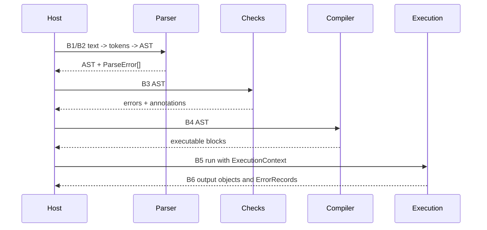

# Stage contracts

> STATIC-ONLY — behavior not run-verified. The data contract at each pipeline boundary: types exchanged, ownership and lifetime, invariants, error channel, threading, and the natural place for a policy or security hook. Each contract ends with a `NEW-SHELL CONTRACT` recommendation (`INFERENCE`; verdict vocabulary in [SEMANTIC-QUIRKS.md](SEMANTIC-QUIRKS.md)). Map: [00-pipeline-map.md](00-pipeline-map.md).

## 1. Purpose and scope [SPEC]

Six boundaries: (B1) text → tokens, (B2) tokens → AST, (B3) AST → checks and annotations, (B4) AST → compiled artifact, (B5) runtime → values, (B6) values → output objects. These contracts are the spine of a re-implementation.

## 2. Source map

| Boundary | Producer | Consumer | Key members |
|---|---|---|---|
| B1 | src/System.Management.Automation/engine/parser/tokenizer.cs::Tokenizer@L595-L5082 (file `tokenizer.cs`) | src/System.Management.Automation/engine/parser/Parser.cs::Parser@L36-L8187 | `NextToken`, `Mode`, `Resync` |
| B2 | `Parser` | all later stages | `ParseInput`, `ParseFile`, `ParseTask` |
| B3 | `SymbolResolver`, `SemanticChecks` | compiler | `PerformPostParseChecks` |
| B4 | `Compiler` | `ScriptBlock` invocation | `Compile`, `CompileTree` |
| B5 | binders, runtime operations | compiled code | `ConvertTo`, binder rules |
| B6 | compiled code | command processors, host | `Pipe.Add`, `CheckActionPreference` |

## 3. Responsibilities and non-responsibilities

Contracts only; behavior of each stage is in its own document.

## 4. Key types and contracts [IMPL]

### B1 — text → tokens

- **Types**: `Token` and subclasses (`NumberToken`, `ParameterToken`, `VariableToken`, `StringLiteralToken`, `StringExpandableToken`, `LabelToken`, redirection tokens); input is a `string`; the tokenizer owns a line-start table ([02.1-tokenizer.md](02.1-tokenizer.md) §4, §7.6).
- **Ownership and lifetime**: tokens are created on demand and referenced by the parser (one pushed-back token) and optionally by a caller-supplied token list; a rescan after a mode change discards the pending token ([02.1-tokenizer.md](02.1-tokenizer.md) §6.6).
- **Invariants**: extents are contiguous and refer to the original text (compensated for rewritten sub-expression text); `EndOfInput` is returned at the end; newlines are tokens; comments are not returned but can be saved.
- **Error channel**: not an exception; the tokenizer calls `Parser.ReportError`/`ReportIncompleteInput` and marks tokens `TokenInError` ([ERROR-CATALOG.md](ERROR-CATALOG.md)).
- **Threading**: one tokenizer per parser, single thread; the dynamic-keyword table is thread-local.
- **Hook point**: before tokenization (input size, encoding, source provenance).
- **NEW-SHELL CONTRACT**: `Tokenizer.Next(mode)` returns one immutable token with an extent; mode is an argument, not hidden state; the tokenizer reports diagnostics into a collection owned by the parse. Why: makes mode switching testable and removes the rescan hack's need for hidden state.

### B2 — tokens → AST

- **Types**: output `ScriptBlockAst` (root), `Token[]` (if requested), `ParseError[]`; entry `Parser.ParseInput(string, out Token[], out ParseError[])` ([02.2-parser.md](02.2-parser.md) §4).
- **Ownership**: the tree owns its nodes; each node has exactly one parent set at construction ([02.3-ast.md](02.3-ast.md) §4); the parser instance is discarded after the parse.
- **Invariants**: a script with errors still yields a tree (with `ErrorStatementAst`/`ErrorExpressionAst`); extents nest; hashtable values and assignment right sides are statements; terminator rules per CF-GRM-001.
- **Error channel**: `ParseError` (id = resource key, extent, message, `IncompleteInput`), de-duplicated and unlimited (CF-ERR-002); fatal parser exceptions become `ParseException(UnrecoverableParserError)`; `ScriptBlock.Create` throws `ParseException` for any error.
- **Threading**: a parser is single-threaded; on stack exhaustion the parse is retried once on a new thread.
- **Hook point**: right after parsing, before checks — policy on syntax (banned statements, size, nesting depth).
- **NEW-SHELL CONTRACT**: `Parse(text) → ParseResult { Ast, Tokens, Diagnostics }` that never throws for bad input and has a configurable nesting limit.

### B3 — AST → checks and annotations

- **Types**: in: the root `ScriptBlockAst`; out: additional `ParseError`s and annotations on nodes (`VariableExpressionAst.TupleIndex/Assigned`, `HasSuspiciousContent`, cached resolved types, `ScriptBlockAst.HadErrors/PostParseChecksPerformed`) ([02.4-semantic-analysis.md](02.4-semantic-analysis.md) §4-5).
- **Invariants**: runs only for `ParseMode.Default`; symbol resolution before semantic checks; class-definition errors that depend on Reflection.Emit appear later, at compile (CON-009).
- **Error channel**: the same `ParseError` list.
- **Threading**: visitors run on the parsing thread; module lookup for `using module` uses a thread-static `PowerShell`.
- **Hook point**: **the** place for static policy (restricted language checks for `data` sections, Constrained Language rules, forbidden commands/types).
- **NEW-SHELL CONTRACT**: a pure `Check(ast, options) → diagnostics + SemanticModel` where annotations live in a side model keyed by node (DEV-AST-020), with no I/O.

### B4 — AST → compiled artifact

- **Types**: in: `ScriptBlockAst` (via `CompiledScriptBlockData`); out: one `Action<FunctionContext>` per named block and variant, plus locals tuple type, name → slot map, sequence points ([COMPILATION-MAP.md](COMPILATION-MAP.md), [IR-SPEC.md](IR-SPEC.md) §4).
- **Ownership and lifetime**: compiled data are shared by all clones of a script block and cached (up to 1,024 parsed scripts); delegates are published under locks ([TIERING-POLICY.md](TIERING-POLICY.md)).
- **Invariants**: the IR implements the protocols of [IR-SPEC.md](IR-SPEC.md) §5 (output pipe, `$?`, error-action resume, positions, flow control); both execution tiers are equivalent ([EQUIVALENCE-SPEC.md](EQUIVALENCE-SPEC.md)).
- **Error channel**: `ParseException` from class definition or security checks; compile exceptions propagate to the caller.
- **Threading**: compile under `lock`; tier promotion on the thread pool.
- **Hook point**: `PerformSecurityChecks` before compiling (content scan, logging), and the per-block compile call.
- **NEW-SHELL CONTRACT**: `Compile(ast, variant) → Executable` where `Executable.Run(Frame)` is the only entry; the executable may be the AST itself (tree-walker) ([INTERPRETER-DESIGN-SPACE.md](INTERPRETER-DESIGN-SPACE.md)).

### B5 — runtime → values

- **Types**: arbitrary .NET objects, `PSObject` wrappers, `AutomationNull.Value`; operations go through binders and runtime helpers ([BINDER-CATALOG.md](BINDER-CATALOG.md), [RUNTIME-OPERATIONS.md](RUNTIME-OPERATIONS.md)); conversions by [CONVERSION-RULES.md](CONVERSION-RULES.md).
- **Invariants**: left-operand-driven typing; null/`AutomationNull` distinction; enumeration rule CF-PIP-001; variables via scope rules CF-SCP-001.
- **Error channel**: `RuntimeException` (wrapping `ErrorRecord` with script position), `PSInvalidCastException`, flow-control exceptions (`BreakException`, `ContinueException`, `ReturnException`, `ExitException`).
- **Threading**: one runspace thread executes a pipeline; caches are concurrent.
- **Hook point**: binder construction and conversion selection (language mode checks happen here); member-invocation logging.
- **NEW-SHELL CONTRACT**: a `Value` model with explicit `Null` and `NoValue`, one `Convert(value, type, context)` entry, and one `Invoke(target, member, args, context)` entry through which every host call passes (the policy choke point).

### B6 — values → output objects

- **Types**: the output pipe (`Pipe`) receives objects; non-enumerable values are written whole, enumerables unrolled one level (CF-PIP-001); errors become `ErrorRecord`s on the error stream via `CheckActionPreference` ([RUNTIME-OPERATIONS.md](RUNTIME-OPERATIONS.md) §6.1).
- **Invariants**: a statement's value is output only for bare expressions and commands; temporary pipes capture output for conditions, assignments, `$()` and `@()` ([02.5-compiler-and-engine.md](02.5-compiler-and-engine.md) §6.5).
- **Error channel**: `ErrorRecord` (category, target, script position, history id) written to the error stream or thrown.
- **Threading**: pipes belong to the executing pipeline; stopping is cooperative (`CheckForInterrupts`).
- **Hook point**: pipe writers and the host UI (formatting), error reporting.
- **NEW-SHELL CONTRACT**: an `OutputSink` interface with `Write(object)`, `WriteError(ErrorRecord)` and capture scopes; the formatting layer is outside the language core.

## 5. Data model

See the type lists per boundary; the shared objects are `Token`, `Ast` + `ParseError`, `FunctionContext` ([IR-SPEC.md](IR-SPEC.md) §4.2), `ExecutionContext` ([execution-context-and-session-state.md](../03-runtime/execution-context-and-session-state.md)) and `ErrorRecord`.

## 6. Control flow

## 7. Algorithms

Not applicable.

## 8. Observable behavior [SPEC]

Not applicable (interfaces).

## 9. Error handling and edge cases

Three error channels: `ParseError` before execution, `RuntimeException` during execution, `ErrorRecord` on the error stream; flow-control exceptions are control signals, not errors.

## 10. Concurrency and threading

One thread per pipeline; compile and tier promotion are concurrent-safe; parser objects are not shared.

## 11. Extension points and customization hooks

Hook points per boundary above; dynamic keywords at B2/B3; type accelerators and ETS at B5.

## 12. Dependencies

All 02-language documents.

## 13. Performance notes

Boundaries B1-B2 cost O(n); B4 cost is amortized by caching; B5 uses per-site caches.

## 14. Security considerations (mandatory)

The hook points are the answer to "where can policy be enforced": B3 (static), B4 (content scanning), B5 (dynamic: every member call and conversion), B6 (output filtering). PowerShell enforces language mode at B3 (`data` sections), B5 (binders, conversion gate) and B4 (`PerformSecurityChecks`).

## 15. Enterprise considerations

Diagnostics exist at every boundary (ETW parse/compile events, error ids, script block logging); a new shell should add a structured trace per boundary.

## 16. Tests

Boundary-level tests are the Language Pester tests ([REFERENCE-TEST-CORPUS.md](REFERENCE-TEST-CORPUS.md)).

## 17. Design decisions and trade-offs

| Decision | Label | Consequence |
|---|---|---|
| tokenizer driven by the parser through a mode | `FACT-SRC` | context-sensitive tokenizing; tokens not reusable in isolation |
| AST carries annotations for later stages | `FACT-SRC` | convenient, couples stages |
| runtime errors carry script positions through sequence points | `FACT-SRC` | good diagnostics; needs position bookkeeping at run time |

## 18. Guidance for MicroteamShell [LESSON]

- **LSN-STAGES-01** [REPLICATE] (area: NLD-TOOL) Keep the six boundaries as explicit interfaces with the three error channels (diagnostics, runtime exception, error record). Evidence: `src/System.Management.Automation/engine/parser/Parser.cs::Parser.ParseTask@L176-L227`.
- **LSN-STAGES-02** [REPLICATE] (area: NLD-SEC) Place static policy at B3, content policy at B4, and a single invoke/convert choke point at B5. Evidence: `src/System.Management.Automation/engine/runtime/CompiledScriptBlock.cs::CompiledScriptBlockData.PerformSecurityChecks@L197-L283`.
- **LSN-STAGES-03** [ADAPT] (area: NLD-GRM) Pass tokenizer mode as an argument and keep annotations in a side model. Why: same behavior, removes hidden state. Evidence: `src/System.Management.Automation/engine/parser/Parser.cs::Parser.SetTokenizerMode@L499-L535`.

## 19. Open questions / UNVERIFIED

- `Pipe` internals and command-processor boundaries (Phase 3).
- Threading rules of runspace pipelines are summarized from the context document only.

Verification: every contract cites the owning document section, which cites source; hook points are `INFERENCE` unless a document section is cited.
