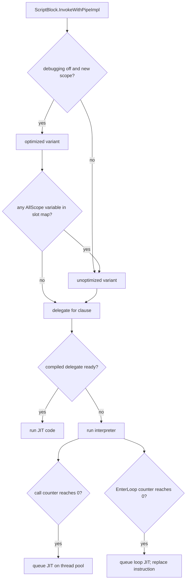

# Tiering policy

> STATIC-ONLY — behavior not run-verified. `FACT-SRC` unless marked. This document is the single owner of the compile-versus-interpret rule and of every tiering threshold. Related: [02.5-compiler-and-engine.md](02.5-compiler-and-engine.md), [IR-SPEC.md](IR-SPEC.md), [INSTRUCTION-SET.md](INSTRUCTION-SET.md), [EQUIVALENCE-SPEC.md](EQUIVALENCE-SPEC.md).

## 1. Purpose and scope [SPEC]

PowerShell compiles each script block twice over: first into a **LINQ expression tree** (the IR), then into something executable. The executable form is chosen by *tiering*: new code is **interpreted** by a small stack machine; hot code is **JIT-compiled** by `System.Linq.Expressions` (`LambdaExpression.Compile()`). A second, independent choice is **optimized vs unoptimized** code (fixed-slot locals vs name lookup). This document states the rules and the numbers. Terminology: *compile* = AST → IR; *JIT-compile* = IR → delegate; *interpret* = run IR through the instruction interpreter; *tier* = interpret or JIT ([GLOSSARY](../GLOSSARY.md)).

## 2. Source map

| path | type | role |
|---|---|---|
| src/System.Management.Automation/engine/parser/Compiler.cs::Compiler.Compile@L961-L964 | method | per script block: variable analysis, build lambdas, choose the tiering mode |
| src/System.Management.Automation/engine/parser/Compiler.cs::Compiler.CompileTree@L2079-L2097 | method | build the tiered delegate for one lambda |
| src/System.Management.Automation/engine/interpreter/LightCompiler.cs::LightCompiler@L271-L2051 | class | IR → instructions; holds the call-count threshold |
| src/System.Management.Automation/engine/interpreter/LightDelegateCreator.cs::LightDelegateCreator@L30-L219 | class | owns the interpreter and the (lazy) compiled delegate |
| src/System.Management.Automation/engine/interpreter/LightLambda.cs::LightLambda@L43-L302 | class | per-delegate call counter; triggers JIT |
| src/System.Management.Automation/engine/interpreter/ControlFlowInstructions.cs::EnterLoopInstruction@L692-L778 | class | per-loop iteration counter; triggers loop JIT |
| src/System.Management.Automation/engine/interpreter/LoopCompiler.cs::LoopCompiler@L29-L384 | class | JIT-compiles one loop out of an interpreted frame |
| src/System.Management.Automation/engine/runtime/CompiledScriptBlock.cs::CompiledScriptBlockData@L41-L540 | class | optimized/unoptimized compile and caches |

## 3. Responsibilities and non-responsibilities

Chooses *when* code is interpreted or JIT-compiled and *which variant* runs. Does not change observable results: both tiers must agree ([EQUIVALENCE-SPEC.md](EQUIVALENCE-SPEC.md)).

## 4. Key types and contracts [IMPL]

`CompileInterpretChoice { NeverCompile, AlwaysCompile, CompileOnDemand }` (src/System.Management.Automation/engine/runtime/CompiledScriptBlock.cs::CompileInterpretChoice@L25-L30). `LightCompiler(int compilationThreshold)`: a negative threshold means `DefaultCompilationThreshold`; zero or one means synchronous compilation (src/System.Management.Automation/engine/interpreter/LightCompiler.cs::LightCompiler@L271-L2051, src/System.Management.Automation/engine/interpreter/Interpreter.cs::Interpreter@L31-L109).

## 5. Data model

- One delegate per named block (`DynamicParam`, `Begin`, `Process`, `End`, `Clean`) **per variant** (optimized, unoptimized): ten fields on `CompiledScriptBlockData`.
- `LightLambda` holds a mutable `int` call counter (copied from the interpreter's threshold when the delegate is created); `EnterLoopInstruction` holds a mutable loop-iteration counter.
- `LightDelegateCreator` holds the lazily built compiled delegate shared by all `LightLambda` instances created from it.

## 6. Control flow

## 7. Algorithm — the rule

### 7.1 Which variant (CF-CMP-003)

<!--CF:CF-CMP-003-->**Optimized versus unoptimized.** A script block clause is run from the optimized code (variables in fixed tuple slots) only if the engine is not debugging (`ExecutionContext._debuggingMode <= 0`) **and** the invocation creates a new local scope (`createLocalScope`, i.e. not dot-sourced); the same two conditions are used for script cmdlets. If the optimized compile shows that any slot-allocated variable name could be an `AllScope` variable (`VariableAnalysis.AnyVariablesCouldBeAllScope`), the unoptimized variant is used instead, and both variants are compiled. In the unoptimized variant only the automatic variables (plus the preference variables for script cmdlets) get tuple slots and every other variable is looked up by name. Independently of this choice, variable analysis allocates no slots for a block that uses `New-Variable`, `Remove-Variable`, `Set-Variable`, `Set-PSBreakpoint` (or their aliases), dot-sourcing or `$private:` variables.<!--/CF-->

Evidence: src/System.Management.Automation/engine/runtime/CompiledScriptBlock.cs::ScriptBlock.InvokeWithPipeImpl@L935-L959 (`runOptimized = context._debuggingMode <= 0 && createLocalScope`), src/System.Management.Automation/engine/runtime/CompiledScriptBlock.cs::CompiledScriptBlockData.Compile@L57-L83, src/System.Management.Automation/engine/runtime/CompiledScriptBlock.cs::PSScriptCmdlet@L2179-L2552 (constructor), src/System.Management.Automation/engine/parser/VariableAnalysis.cs::VariableAnalysis@L325-L1847, src/System.Management.Automation/engine/parser/VariableAnalysis.cs::FindAllVariablesVisitor@L44-L323.

### 7.2 Interpret versus JIT (CF-CMP-001)

<!--CF:CF-CMP-001-->**Compile-versus-interpret rule.** Every named block is turned into one expression-tree lambda. At creation of the delegate (`Compiler.CompileTree`), the tiering mode is `NeverCompile` if the script block's total statement count (`_stmtCount`) is greater than 300, otherwise `CompileOnDemand`; `AlwaysCompile` exists but no caller passes it. The delegate starts as an **interpreted** `LightLambda` with a call counter of 32 (`CompileOnDemand`, threshold -1 mapped to `DefaultCompilationThreshold`) or `int.MaxValue` (`NeverCompile`). Each call decrements the counter; the call that reads 0 (the 33rd) queues JIT compilation of the whole lambda on a thread-pool thread and is itself still interpreted; once the compiled delegate exists, every later call uses it. A lambda is **never interpreted** (JIT-compiled at once, synchronously) when the light compiler meets a method call with a by-ref parameter, an instance call on a non-primitive value type, or a constructor with a by-ref parameter; and trap-handler lambdas and single-expression lambdas are always built with `LambdaExpression.Compile()` (never interpreted). Loops are promoted separately (CF-CMP-002).<!--/CF-->

Evidence: src/System.Management.Automation/engine/parser/Compiler.cs::Compiler.Compile@L961-L964 (L2050 mode selection), src/System.Management.Automation/engine/parser/Compiler.cs::Compiler.CompileTree@L2079-L2097, src/System.Management.Automation/engine/interpreter/LightCompiler.cs::LightCompiler@L271-L2051 (threshold, `_forceCompile`), src/System.Management.Automation/engine/interpreter/LightLambda.cs::LightLambda.TryGetCompiled@L197-L246, src/System.Management.Automation/engine/interpreter/LightDelegateCreator.cs::LightDelegateCreator.CreateDelegate@L78-L81, src/System.Management.Automation/engine/parser/Compiler.cs::Compiler.CompileTrap@L2529-L2550, src/System.Management.Automation/engine/parser/Compiler.cs::Compiler.CompileSingleExpression@L2204-L2226.

### 7.3 Loop promotion

A loop may be JIT-compiled **while it is running** in the interpreter. `GenerateWhileLoop`/`GenerateDoLoop` emit an `EnterLoopExpression` at the loop top; it becomes an `EnterLoopInstruction` only if the loop's own statement count is below the limit. On each arrival at the loop top the counter is decremented; when the read value is 0 the loop body is compiled by `LoopCompiler` (queued on the thread pool unless the interpreter is in synchronous mode) and the instruction in the instruction array is replaced by a `CompiledLoopInstruction` that runs the rest of the loop in JIT code and returns the instruction offset to continue at. The frame's local array, closure boxes and the frame object itself are handed over; the evaluation stack is not (a loop is a statement). `NeverCompile` does not disable loop promotion.

### 7.4 Constants and limits (CF-CMP-002)

<!--CF:CF-CMP-002-->**Tiering thresholds and limits.** Statement count above which a script block is never JIT-compiled by call count: 300 (`_stmtCount > 300`, `Compiler.Compile`). Interpreted calls before JIT: 32 (`LightCompiler.DefaultCompilationThreshold`), so JIT starts on the 33rd call; `int.MaxValue` for `NeverCompile`; threshold 0 or 1 means synchronous compilation (never produced by `Compiler`). Loop iterations before loop JIT: 16 (constructor argument of `EnterLoopInstruction` in `EnterLoopExpression.AddInstructions`), so the loop JIT starts on the 17th arrival at the loop top. Loop statement count at or above which a loop is never promoted: 300 (`LoopStatementCount < 300` required to emit the loop counter). Maximum delegate parameters of an interpreted lambda: 16 (`LightLambda.MaxParameters`). Compile helper cache of delegate `Run` factories: 100 entries (`CacheDict` in `LightLambda`). Parsed-script cache (shares compiled delegates between clones): cleared completely when it holds more than 1024 entries (`ScriptBlock.CacheScriptBlock`).<!--/CF-->

Evidence: src/System.Management.Automation/engine/parser/Compiler.cs::Compiler.Compile@L961-L964, src/System.Management.Automation/engine/interpreter/LightCompiler.cs::LightCompiler@L271-L2051, src/System.Management.Automation/engine/parser/Compiler.cs::EnterLoopExpression@L6991-L7023, src/System.Management.Automation/engine/interpreter/ControlFlowInstructions.cs::EnterLoopInstruction@L692-L778, src/System.Management.Automation/engine/interpreter/LightLambda.cs::LightLambda@L43-L302, src/System.Management.Automation/engine/runtime/CompiledScriptBlock.cs::ScriptBlock.CacheScriptBlock@L609-L637.

### 7.5 Concurrency of the decision

Counters are decremented without locks on the hot path (racing threads may lose decrements or both enter the "compile" branch); `LightDelegateCreator.Compile` takes a lock and runs once. JIT runs on thread-pool threads, so *which tier executes a given call is not deterministic*; results must not depend on it. `FACT-SRC` (comments in `LightLambda.TryGetCompiled`).

## 8. Observable behavior [SPEC]

Only indirect: performance, stack traces (interpreted frames are grouped by `InterpretedFrame`), debugger behavior (debugging forces unoptimized code). No golden sample: STATIC-ONLY. Whether results are identical across tiers is the subject of [EQUIVALENCE-SPEC.md](EQUIVALENCE-SPEC.md).

## 9. Error handling and edge cases

The light compiler throws `NotImplementedException`/`NotSupportedException` for IR shapes it does not support (see [IR-SPEC.md](IR-SPEC.md) §5); no handler for that was found in `Compiler.CompileTree` (`UNVERIFIED`: the IR emitted by `Compiler` is believed to avoid them, VB-013). A compile exception on the thread-pool thread is not observed by the caller (`INFERENCE`).

## 10. Concurrency and threading

See §7.5. The compiled delegate is published by `LightDelegateCreator` under a lock; `LightLambda` and `EnterLoopInstruction` counters are plain fields.

## 11. Extension points and customization hooks

None public. `InternalTestHooks` can disable the script block cache. `CompileSynchronously` (interpreter threshold ≤ 1) exists for tests.

## 12. Dependencies

Inbound: `ScriptBlock` invocation, `PSScriptCmdlet`, `Compiler`. Outbound: `System.Linq.Expressions`, `ThreadPool`.

## 13. Performance notes

Tiering exists to keep start-up cheap (scripts that run once never pay JIT cost) and still speed up hot functions and loops. The 300-statement guards avoid very expensive JIT of huge blocks (comments in `EnterLoopExpression.AddInstructions` and `Compiler.CompileStatementListWithTraps`: JIT cost grows badly with the number of `try/catch` blocks).

## 14. Security considerations (mandatory)

Tiering has no security role, but two items matter: (a) debugging switches to unoptimized code, so a debugger sees variables by name; (b) compiled delegates are shared between `ScriptBlock` clones, so any state captured in them must not be session-specific (the script block cache returns clones for that reason).

## 15. Enterprise considerations

Observability: ETW `CompileStart/Stop` around `ReallyCompile` (src/System.Management.Automation/engine/runtime/CompiledScriptBlock.cs::CompiledScriptBlockData.ReallyCompile@L163-L195). Missing: no switch to force one tier, no metrics on promotions, no way to bound background JIT threads.

## 16. Tests

No tiering-specific test was read. `test/powershell/Language/` loops and functions exercise both tiers implicitly (`UNVERIFIED`, VB-014).

## 17. Design decisions and trade-offs

| Decision | Label | Consequence |
|---|---|---|
| interpret first, JIT after 32 calls | `FACT-SRC` | cheap start; hot code speeds up; nondeterministic tier per call |
| loops promoted independently after 16 iterations | `FACT-SRC` | long-running top-level loops get fast without waiting for a second call |
| statement-count cutoffs (300) | `FACT-SRC` | bounds JIT cost; large scripts stay interpreted |
| optimized variant only without debugging and with a new scope | `FACT-SRC` | dot-sourcing and debugging pay name lookups |

## 18. Guidance for MicroteamShell [LESSON]

- **LSN-TIER-01** [REPLICATE] (area: NLD-RUN) Start with a tree-walking evaluator only; it is a valid first tier (all observable behavior is defined by the IR semantics, not by the JIT). `INFERENCE`: PowerShell's tiers are equivalent by design ([EQUIVALENCE-SPEC.md](EQUIVALENCE-SPEC.md)). Evidence: src/System.Management.Automation/engine/parser/Compiler.cs::Compiler.CompileTree@L2079-L2097.
- **LSN-TIER-02** [ADAPT] (area: NLD-RUN) If a second tier is ever added, trigger it by call count with a deterministic (synchronous) policy first, and keep results independent of the tier. Why: PowerShell's asynchronous promotion makes tier choice nondeterministic. Evidence: src/System.Management.Automation/engine/interpreter/LightLambda.cs::LightLambda.TryGetCompiled@L197-L246.
- **LSN-TIER-03** [REPLICATE] (area: NLD-SCP) Keep two variable-storage strategies visible in the design: fast slots when the scope is private and analyzable, dynamic lookup when debugging, dot-sourcing, or `AllScope`/`New-Variable`-style access is possible. Evidence: src/System.Management.Automation/engine/runtime/CompiledScriptBlock.cs::CompiledScriptBlockData.Compile@L57-L83.
- **LSN-TIER-04** [AVOID] (area: NLD-RUN) Do not copy background (thread-pool) compilation of hot loops with an in-place instruction replacement; it needs the interpreter and compiled code to share frames exactly. Replace by an explicit, synchronous optimization step if a loop optimizer is wanted. Evidence: src/System.Management.Automation/engine/interpreter/ControlFlowInstructions.cs::EnterLoopInstruction@L692-L778. DEV: DEV-TIER-060

## 19. Open questions / UNVERIFIED

- Where `NotImplementedException` from the light compiler would surface (VB-013).
- Whether `AlwaysCompile` is reachable through any other assembly (searched `engine/`; only `Compiler.CompileTree` references it).
- Effect of tiering on `$?`/stack traces is not tested here.

Verification: thresholds re-read from `Compiler.cs` (L2050-2097, L7008-7020), `LightCompiler.cs` (L271-301), `LightLambda.cs` (L197-246), `CompiledScriptBlock.cs` (L57-83, L1004-1010) and `ControlFlowInstructions.cs` (`EnterLoopInstruction`, notes W1-W3); `rg "AlwaysCompile|NeverCompile|CompileOnDemand" engine/` shows the three enum members and the three uses in `Compiler.cs` only.
