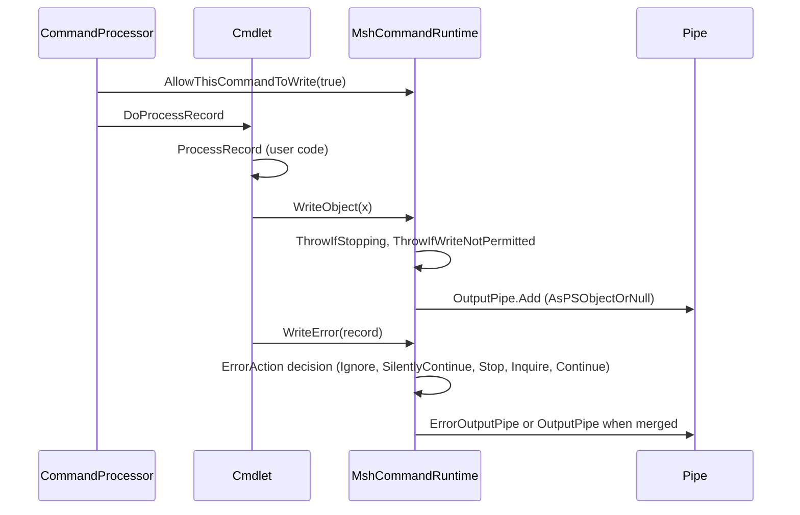

# Cmdlet infrastructure

> STATIC-ONLY — behavior not run-verified. `FACT-SRC` unless marked. Lifecycle ordering is CF-LCY-001 in [runspace-and-pipeline](runspace-and-pipeline.md); binding is in [parameter-binding](parameter-binding.md); script cmdlets (advanced functions) in [SCRIPT-BLOCKS](../02-language/SCRIPT-BLOCKS.md); error semantics in [errors-and-diagnostics](errors-and-diagnostics.md).

## 1. Purpose and scope [SPEC]

A *cmdlet* is a command implemented as a .NET class. The base classes (`InternalCommand` → `Cmdlet` → `PSCmdlet`) define the lifecycle hooks and the API a cmdlet uses to write output, errors and other streams, ask for confirmation (`ShouldProcess`, `ShouldContinue`), and reach the engine. The *command runtime* (`MshCommandRuntime`) is the engine-side object behind those calls: it applies stream preferences, merges streams, writes to pipes and enforces when writing is allowed. Advanced functions use the same runtime through `PSScriptCmdlet`.

## 2. Source map

| path | type | role | tier |
|---|---|---|---|
| src/System.Management.Automation/engine/CommandBase.cs::InternalCommand@L39-L283 | abstract class | internal base: lifecycle `Do*` hooks, `MyInvocation`, `Stopping`, `CurrentPipelineObject`, `Context` | B |
| src/System.Management.Automation/engine/cmdlet.cs::Cmdlet@L33-L1829 | abstract class | public base: `BeginProcessing`…`StopProcessing`, `Write*`, `ShouldProcess`, `ShouldContinue`, `ThrowTerminatingError` | B |
| src/System.Management.Automation/engine/CommandBase.cs::PSCmdlet@L415-L603 | abstract partial class | adds `SessionState`, `Host`, `Events`, `InvokeProvider`, `InvokeCommand`, `ParameterSetName`, path helpers, variable access | B |
| src/System.Management.Automation/engine/MshCommandRuntime.cs::MshCommandRuntime@L29-L3829 | class | the command runtime: pipes, preferences, write permission, `ShouldProcess`, error-action | B |
| src/System.Management.Automation/engine/DefaultCommandRuntime.cs::DefaultCommandRuntime@L15-L245 | class | a runtime for cmdlets invoked directly as .NET objects (no pipeline) | B |
| src/System.Management.Automation/engine/CommonCommandParameters.cs::CommonParameters@L13-L283 | sealed class | the common parameters | B |
| src/System.Management.Automation/engine/UserFeedbackParameters.cs::ShouldProcessParameters@L104-L166 | sealed class | `-WhatIf`, `-Confirm` | B |
| src/System.Management.Automation/engine/UserFeedbackParameters.cs::PagingParameters@L13-L96 | sealed class | `-First`, `-Skip`, `-IncludeTotalCount` | B |
| src/System.Management.Automation/engine/runtime/CompiledScriptBlock.cs::PSScriptCmdlet@L2179-L2552 | sealed class | the cmdlet that runs an advanced function's script block | B |

## 3. Responsibilities and non-responsibilities

Owns: the hook contract (what a cmdlet may override and when it is called), the stream-writing API semantics, preference-driven behavior of verbose/debug/warning/information/progress/error, confirmation logic, write-permission windows. Does not own: pipeline ordering (T31), parameter binding (T33), formatting of what is written (T36), the cmdlet inventory (Phase 4 module families).

## 4. Key types and contracts [IMPL]

- **Lifecycle hooks**: `Cmdlet.BeginProcessing`, `ProcessRecord`, `EndProcessing`, `StopProcessing` are `protected virtual` and empty; the engine calls internal `DoBeginProcessing` / `DoProcessRecord` / `DoEndProcessing` / `DoStopProcessing`, which for a cmdlet forward to them; `DoBeginProcessing` first verifies that a transaction exists when `-UseTransaction` was given (`InvalidOperationException` with `NoTransactionStarted*` text otherwise) (src/System.Management.Automation/engine/cmdlet.cs::Cmdlet.DoBeginProcessing@L141-L166). `DoCleanResource` is the hook of the `clean` phase (script cmdlets).
- **`Stopping`** is true once the pipeline is stopping; the runtime calls `ThrowIfStopping` before every write, which throws `PipelineStoppedException`.
- **Write API** (`WriteObject(obj)`, `WriteObject(obj, enumerateCollection)`, `WriteError`, `WriteWarning`, `WriteVerbose`, `WriteDebug`, `WriteInformation`, `WriteProgress`, `WriteCommandDetail`) forwards to the command runtime. `WriteObject` checks stopping, checks that writing is permitted, drops `AutomationNull`, wraps the value as `PSObject` (`AsPSObjectOrNull`) and adds it to the output pipe; with `enumerateCollection` an enumerable is expanded and its non-`AutomationNull` elements added together via `AddItems` (src/System.Management.Automation/engine/MshCommandRuntime.cs::MshCommandRuntime._WriteObjectSkipAllowCheck@L2648-L2658, src/System.Management.Automation/engine/MshCommandRuntime.cs::MshCommandRuntime._EnumerateAndWriteObjectSkipAllowCheck@L2672-L2698).
- **Write permission**: writing is allowed only while the pipeline processor's `_permittedToWrite` equals this command, on the thread that was recorded when the permission was granted, and (for pipeline writes) when `_permittedToWriteToPipeline` is true; otherwise `WriteNotPermitted`. The permission is granted by `AllowThisCommandToWrite` (a disposable that saves and restores the three fields) around binding (no pipeline writes), begin, process, end and clean (src/System.Management.Automation/engine/MshCommandRuntime.cs::MshCommandRuntime.ThrowIfWriteNotPermitted@L2325-L2341, src/System.Management.Automation/engine/MshCommandRuntime.cs::MshCommandRuntime.AllowThisCommandToWrite@L2349-L2352). This means a cmdlet that stores a runtime reference and writes from another thread fails.
- **Error stream** (`_WriteErrorSkipAllowCheck`): marks the pipeline `ExecutionFailed`; picks the action preference (explicit argument or `ErrorAction`); `Ignore` returns without writing or recording; `SilentlyContinue` appends to the error variables and returns; if a previous prompt answered "yes to all" the preference becomes `Continue`; `Stop` throws `ActionPreferenceStopException` (via `ManageException`); `Inquire` asks the host; otherwise the record is appended to the error variables and written, as a `PSObject` marked with the error stream, to the output pipe when the error stream is merged into output (`2>&1`), else to the error pipe (transcribed first if transcribing). Native-stderr text uses the same path without setting failure (src/System.Management.Automation/engine/MshCommandRuntime.cs::MshCommandRuntime._WriteErrorSkipAllowCheck@L2858-L2968).
- **Other streams** use one rule (`WriteHelper`, `WriteWarning`): if the preference is `Ignore`, `SilentlyContinue`, `Continue` or `Break` the answer is "yes"; `Stop` throws `ActionPreferenceStopException` with the preference variable name; `Inquire` prompts (allowing "yes to all"); remembered "yes/no to all" answers short-circuit later calls. A warning is written to the warning pipe (as `PSObject` with the warning stream tag) or, without a pipe, to the host; a `Break` preference enters the debugger; the record is always appended to the warning variables (src/System.Management.Automation/engine/MshCommandRuntime.cs::MshCommandRuntime.WriteWarning@L678-L738, src/System.Management.Automation/engine/MshCommandRuntime.cs::MshCommandRuntime.WriteHelper@L3522-L3573).
- **`ShouldProcess`** (`DoShouldProcess`): a remembered "no to all"/"yes to all" answer wins; with `-WhatIf` the message "What if: …" is written to the host and the call returns false; if the command's `ConfirmImpact` is below the `-Confirm`/`$ConfirmPreference` threshold (or the threshold is `None`) the call returns true, writing the description to the verbose stream when `-Verbose`; otherwise the user is asked (yes, no, yes-to-all, no-to-all, halt) and the answer decides (src/System.Management.Automation/engine/MshCommandRuntime.cs::MshCommandRuntime.DoShouldProcess@L1515-L1621). `-Confirm` forces the threshold to `Low`; an explicit `-Confirm:$false` sets it to `None`. A runtime "optimization" query reports whether the call can be skipped (auto-yes without verbose), made asynchronously (auto-yes with verbose, or what-if) or must be synchronous.
- **Common parameters**: `-Verbose` (`vb`), `-Debug` (`db`), `-ErrorAction` (`ea`), `-WarningAction` (`wa`), `-InformationAction` (`infa`), `-ProgressAction` (`proga`), `-ErrorVariable` (`ev`), `-WarningVariable` (`wv`), `-InformationVariable` (`iv`), `-OutVariable` (`ov`), `-OutBuffer` (`ob`), `-PipelineVariable` (`pv`) (src/System.Management.Automation/engine/CommonCommandParameters.cs::CommonParameters@L13-L283). They are forwarded to the command runtime. `-OutBuffer` sets the output pipe's `OutBufferCount` (see [runspace-and-pipeline](runspace-and-pipeline.md)). Variable parameters are set up by the pipeline processor after binding (`SetupOutVariable` etc.).

## 5. Data model

`MshCommandRuntime` holds: the three standard pipes (`InputPipe`, `OutputPipe`, `ErrorOutputPipe`) plus optional warning/verbose/debug/information/progress pipes for redirection, the `PipelineProcessor` back-reference, per-stream "last continue status" (for yes/no-to-all), cached preference values, merge settings (`ErrorMergeTo`, etc.), `MergeUnclaimedPreviousErrorResults`, `IsClosed` (no more input), and the variable lists for `-OutVariable` and friends. `InternalCommand` holds `MyInvocation` (`InvocationInfo`: name, position message, pipeline position and length, bound parameters, unbound arguments, `CommandOrigin`, history id) and `CurrentPipelineObject` (`$_`/`$PSItem`).

## 6. Control flow

Ordered steps for one `WriteError`: stopping check → text-lookup error logged → execution-detail log → mark failure → preference (Ignore → silent return; SilentlyContinue → record in variables, return; Stop → throw; Inquire → prompt) → record in variables → wrap and write to the error or merged-output pipe.

## 7. Algorithms

Stream decisions are table-driven by `ActionPreference` (`SilentlyContinue`, `Stop`, `Continue`, `Inquire`, `Ignore`, `Suspend` (not seen here), `Break`); the table for `WriteHelper` is in §4. `ShouldProcess` is the decision list in §4. No further non-trivial algorithm in this document (error-action propagation across statements is in [errors-and-diagnostics](errors-and-diagnostics.md)).

## 8. Observable behavior [SPEC]

- A cmdlet that writes outside its lifecycle windows or from a foreign thread fails with "the command cannot write at this time".
- `-ErrorAction Ignore` leaves no trace in `$Error`; `SilentlyContinue` records but prints nothing; `Stop` makes the error terminating (`ActionPreferenceStopException`); `-ErrorVariable` receives records even when silenced.
- `-WhatIf` prints "What if: …" and the cmdlet skips the action; `-Confirm` prompts for commands whose impact is at or above the preference.
- `$_` inside `process` is the current pipeline object.
- Tests: §16. No golden sample: STATIC-ONLY.

## 9. Error handling and edge cases

`ThrowTerminatingError` goes through the runtime (`ManageException`) when a runtime exists, else rethrows the record's exception or an `InvalidOperationException`; it runs inside an engine protection scope (transactions). Writing after the pipeline started stopping throws `PipelineStoppedException`. A host-less runtime for warnings asserts. A transaction is required only if `-UseTransaction` was bound.

## 10. Concurrency and threading

Cmdlet code runs on the pipeline thread; the write-permission record includes the thread, so asynchronous callbacks must marshal back to it (the documented pattern is to collect results and write from `ProcessRecord`/`EndProcessing`). `StopProcessing` is called from another thread (see CF-LCY-001), so cmdlets must make it thread-safe. `DefaultCommandRuntime` exists for direct .NET invocation without a pipeline.

## 11. Extension points and customization hooks

Derive from `Cmdlet` or `PSCmdlet` and add `[Cmdlet(verb, noun)]` (`CmdletAttribute`: `DefaultParameterSetName`, `SupportsShouldProcess`, `SupportsPaging`, `SupportsTransactions`, `ConfirmImpact`, `RemotingCapability`), `[OutputType]`, parameters with `[Parameter]`, `[Alias]`, validation attributes (`ValidateSet`, `ValidateRange`, `ValidatePattern`, `ValidateLength`, `ValidateCount`, `ValidateScript`, `ValidateNotNull*`, `ValidateTrustedData`, `ValidateUserDrive`, `AllowNull`, `AllowEmptyString`, `AllowEmptyCollection`, argument transformation) (src/System.Management.Automation/engine/Attributes.cs). Dynamic parameters via `IDynamicParameters`. Advanced functions use `[CmdletBinding()]` and the `begin`/`process`/`end`/`clean` blocks; `PSScriptCmdlet` adapts them to the same hooks and exposes `$PSCmdlet`.

## 12. Dependencies

Inbound: `CommandProcessor`, the compiler (for `$PSCmdlet` methods), module authors. Outbound: `PipelineProcessor` (write-permission fields, `ExecutionFailed`), `Pipe`, the host UI (prompts, verbose/debug/warning display), `InternalHost`, `PSTransactionManager`, the debugger (`Break`), `MshLog`.

## 13. Performance notes

`ShouldProcess` has an optimization query so callers can avoid building descriptions when the answer is predictable. Preferences are cached per command (`_isConfirmPreferenceCached`). Every `WriteObject` wraps in `PSObject` (allocation) and re-checks stopping and permission; the compiler special-cases some operations to avoid it (not read here).

## 14. Security considerations

Enforced here: write-permission windows (a cmdlet cannot inject output into another command's pipe at an arbitrary time or thread); `ConfirmImpact` and `-Confirm`/`-WhatIf` as a user-consent mechanism; the debugger break on warnings/errors with `Break`; transcript hooks on error and warning output. Not enforced here: what a cmdlet is allowed to do (cmdlets are trusted .NET code). The `ValidateTrustedData` attribute marks parameters that must not receive untrusted data in constrained language (`UNVERIFIED` enforcement location, Phase 5).

### Security surface

<!--GEN:secseeds-->
| Category | Seed hits |
|---|---:|
| language-mode | 4 |
| **total** | 4 |

Files with most hits:

| File | Hits |
|---|---:|
| `src/System.Management.Automation/engine/MshCommandRuntime.cs` | 4 |

These are regex scanner hits (`APPROX`, `verified: false`, no `SEC-ENF` ID yet). Phase 5 verifies them and assigns IDs; none is claimed here as an enforcement point.
<!--/GEN:secseeds-->

What the new shell must guarantee here: a command can write only through its own runtime and only inside its windows; consent (`ShouldProcess`) results are recorded in audit logs with the decision source (what-if, preference, user); trusted-data validation is part of the parameter contract.

## 15. Enterprise considerations

Security first: §14. Observability: error/warning/verbose/debug/information/progress are separate typed streams with records that carry the invocation info; they are transcribed and can be captured in variables. Supportability: `ErrorRecord` carries category, target and recommended action. Testability: `DefaultCommandRuntime` lets a cmdlet run without an engine pipeline. Resource limits: none on stream volume. Missing: structured, schema-versioned output records beyond `PSObject`.

## 16. Tests

<!--GEN:tests-->
| Pester file | Describe | Context | It |
|---|---:|---:|---:|
| `test/powershell/Language/Scripting/CommonParameters.Tests.ps1` | 1 | 10 | 22 |
| `test/powershell/Language/Scripting/Dynamicparameters.Tests.ps1` | 1 | 0 | 5 |
| `test/powershell/engine/Basic/DefaultCommands.Tests.ps1` | 2 | 0 | 6 |
| **total (3 files)** | 4 | 10 | 33 |

No xUnit file matched the path keywords.

Matching is by path keyword (`APPROX`): `Scripting/CmdletBinding`, `Scripting/ShouldProcess`, `engine/Basic/DefaultCommands`, `CommonParameters`, `Scripting/AdvancedFunction`, `Scripting/Functions`, `Scripting/Dynamicparameters`.
<!--/GEN:tests-->

## 17. Design decisions and trade-offs

- `FACT-SRC`: all stream behavior sits in one runtime class, so cmdlets and script commands share behavior; the price is a 3,800-line class.
- `INFERENCE`: the thread-and-window write check exists to keep the single-threaded pipeline model sound (a cmdlet writing from a timer thread would corrupt downstream state).
- `FACT-SRC`: preferences are variables read through normal scope lookup (see [execution-context-and-session-state](execution-context-and-session-state.md)), so scripts can set them per scope.
- `FACT-SRC`: "yes to all" memory is kept per stream per command instance.

## 18. Guidance for the new shell [LESSON]

- **LSN-RTCMD-01** [REPLICATE] (area: NLD-CMD) Keep the four hooks (begin, process, end, stop) plus clean, with `Stopping` checked on every write. Evidence: src/System.Management.Automation/engine/cmdlet.cs::Cmdlet.DoBeginProcessing@L141-L166.
- **LSN-RTCMD-02** [REPLICATE] (area: NLD-CMD) Separate typed streams with per-stream action preferences and the Ignore / SilentlyContinue / Continue / Inquire / Stop semantics. Evidence: src/System.Management.Automation/engine/MshCommandRuntime.cs::MshCommandRuntime._WriteErrorSkipAllowCheck@L2858-L2968.
- **LSN-RTCMD-03** [REPLICATE] (area: NLD-CMD) `ShouldProcess` decision order (remembered answer → what-if → impact threshold → prompt). Evidence: src/System.Management.Automation/engine/MshCommandRuntime.cs::MshCommandRuntime.DoShouldProcess@L1515-L1621.
- **LSN-RTCMD-04** [ADAPT] (area: NLD-SEC) Make write permission a capability object passed to the cmdlet for the duration of a phase instead of three mutable fields on the pipeline processor checked against the current thread. Evidence: src/System.Management.Automation/engine/MshCommandRuntime.cs::MshCommandRuntime.AllowThisCommandToWrite@L2349-L2352.
- **LSN-RTCMD-05** [ADAPT] (area: NLD-CMD) Split the 3,800-line runtime into stream writers (one per stream) behind one interface, keeping behavior identical. Evidence: src/System.Management.Automation/engine/MshCommandRuntime.cs::MshCommandRuntime@L29-L3829.
- **LSN-RTCMD-06** [AVOID] (area: NLD-CMD) Do not carry transaction support (`-UseTransaction`, `SupportsTransactions`, the engine protection scope) into the new shell; the feature is Windows-only and out of core scope. DEV: DEV-CMDLET-135. Evidence: src/System.Management.Automation/engine/cmdlet.cs::Cmdlet.DoBeginProcessing@L141-L166.

## 19. Open questions / UNVERIFIED items

- `UNVERIFIED` (VB-033): the rest of `MshCommandRuntime` (verbose/debug/information/progress writers, `ManageException`, `InquireHelper` prompt rules, variable setup and `AppendErrorToVariables`, `IsPipelineInputExpected`), `Cmdlet` members not listed, `PSCmdlet` helper members, `PSScriptCmdlet` internals (covered functionally in [SCRIPT-BLOCKS](../02-language/SCRIPT-BLOCKS.md)), `DefaultCommandRuntime`.
- `UNVERIFIED` (VB-034): `CmdletInfo`/`CmdletAttribute` metadata flow into `CommandMetadata`.

Verification: `cmdlet.cs` lines 120–215 and 1738–1770, `CommandBase.cs` lines 250–270, `MshCommandRuntime.cs` lines 164–292, 667–742, 1446–1655, 2325–2400, 2648–2730, 2858–3010, 3516–3600, and the first lines of `CommonCommandParameters.cs` (aliases) were read; ranges are in `T31_T39.csv`. This document is tier B: contracts and the algorithms above were read, other members were taken from signatures only.
