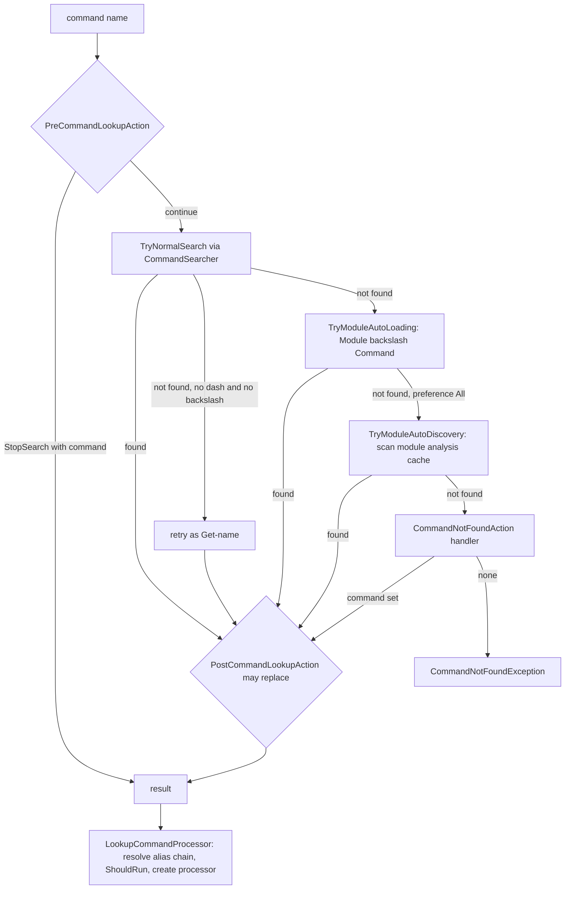

# Command discovery and invocation

> STATIC-ONLY — behavior not run-verified. `FACT-SRC` unless marked. The pipeline that drives the processors is in [runspace-and-pipeline](runspace-and-pipeline.md); binding in [parameter-binding](parameter-binding.md); module auto-loading in [modules](modules.md); script execution inside a processor in [LIFECYCLE-script-execution](../02-language/LIFECYCLE-script-execution.md) and [SCRIPT-BLOCKS](../02-language/SCRIPT-BLOCKS.md).

## 1. Purpose and scope [SPEC]

Turn a command *name* typed in a script (or given to the API) into a *command processor* that can run. Two steps: **discovery** (name → `CommandInfo`: alias, function, filter, cmdlet, external script, application, script, configuration) and **invocation** (`CommandInfo` → processor: `CommandProcessor` for cmdlets and advanced functions, `DlrScriptCommandProcessor` for other script code, `NativeCommandProcessor` for external programs). Native process handling (argument passing, redirection, encoding, lifecycle) is part of this document.

## 2. Source map

| path | type | role | tier |
|---|---|---|---|
| src/System.Management.Automation/engine/CommandDiscovery.cs::CommandDiscovery@L118-L1464 | class | name → info → processor; module auto-load; event hooks; PATH cache | A |
| src/System.Management.Automation/engine/CommandSearcher.cs::CommandSearcher@L22-L1708 | class | the resolution state machine (an enumerator of matches) | A |
| src/System.Management.Automation/engine/CommandPathSearch.cs::CommandPathSearch@L18-L595 | class | enumerates files in the lookup directories (used by the searcher) | A |
| src/System.Management.Automation/engine/CommandInfo.cs::CommandInfo@L82-L737 | abstract class | base of `AliasInfo`, `FunctionInfo`, `FilterInfo`, `CmdletInfo`, `ExternalScriptInfo`, `ApplicationInfo`, `ScriptInfo`, `ConfigurationInfo` | A |
| src/System.Management.Automation/engine/NativeCommandProcessor.cs::NativeCommandProcessor@L197-L1955 | class | runs an external program | A |
| src/System.Management.Automation/engine/NativeCommandParameterBinder.cs::NativeCommandParameterBinder@L21-L519 | class | turns bound arguments into a command line and an argument list | A |
| src/System.Management.Automation/engine/ScriptCommandProcessor.cs::DlrScriptCommandProcessor@L232-L661 | class | runs compiled script code as a command | A |

## 3. Responsibilities and non-responsibilities

Owns: the resolution order, the command-type set, visibility and authorization checks at lookup time, the lookup events (`PreCommandLookupAction`, `CommandNotFoundAction`, `PostCommandLookupAction`), requirement checks for script files (`#requires`), native process start/stop and stream wiring. Does not own: the contents of the cmdlet/function/alias tables (session state, T29/T37), module analysis (T37), parameter binding for cmdlets and scripts (T33), scope creation (T29).

## 4. Key types and contracts [IMPL]

- `CommandTypes` (flags): `Alias=0x1`, `Function=0x2`, `Filter=0x4`, `Cmdlet=0x8`, `ExternalScript=0x10`, `Application=0x20`, `Script=0x40`, `Configuration=0x100`, `All` = the union (src/System.Management.Automation/engine/CommandInfo.cs::CommandTypes@L23-L76). **There is no `Workflow` member in this version** (the study prompt lists one; `VERSION-MISMATCH`, recorded as a hint-vs-reality item).
- `CommandSearcher` implements `IEnumerable<CommandInfo>` over itself: each `MoveNext` yields the next match for one name in a fixed state order (§7). It is constructed with the name, `SearchResolutionOptions` (pattern flags, abbreviation expansion, search all scopes, `ResolveLiteralThenPathPatterns`), the allowed `CommandTypes`, and the context; `CommandOrigin` is set separately (src/System.Management.Automation/engine/CommandSearcher.cs::CommandSearcher.MoveNext@L78-L239).
- `CommandDiscovery.LookupCommandInfo(name, types, options, origin, context)` is the static lookup entry; the instance overloads default to `CommandTypes.All`, `ResolveLiteralThenPathPatterns` and `CommandOrigin.Internal` (src/System.Management.Automation/engine/CommandDiscovery.cs::CommandDiscovery.LookupCommandInfo@L641-L644). `LookupCommandProcessor(name | info, origin, useLocalScope, …)` returns a ready processor and sets `InvocationName` to the name used (src/System.Management.Automation/engine/CommandDiscovery.cs::CommandDiscovery.LookupCommandProcessor@L276-L291).
- `CommandOrigin` has two values used here: `Runspace` (name typed by a user or the API) and `Internal` (name written in engine or module code). Visibility checks apply to `Runspace` origin only.
- Result of processor creation by `CommandInfo` type (src/System.Management.Automation/engine/CommandDiscovery.cs::CommandDiscovery.LookupCommandProcessor@L276-L291): `Application` → `NativeCommandProcessor`; `Cmdlet` → `CommandProcessor`; `ExternalScript` → (requirement checks, then) script processor; `Filter`/`Function`/`Configuration` → script processor over the function's script block; `Script` → script processor; anything else (including an unresolved alias) → `CommandNotFoundException`. A script processor is a `CommandProcessor` (with a `PSScriptCmdlet`) when the script block uses `[CmdletBinding()]`, otherwise a `DlrScriptCommandProcessor` (src/System.Management.Automation/engine/CommandDiscovery.cs::CommandDiscovery.GetScriptAsCmdletProcessor@L615-L625). Default for `useLocalScope` is **true** (a new scope per call).

## 5. Data model

`CommandInfo` carries: name, type, definition, module name and module, visibility (`SessionStateEntryVisibility`), the defining language mode, `CommandMetadata` (parameters), and for aliases the resolved target. Lookup tables live in session state: alias table, function table, cmdlet table (name → list of `CmdletInfo`, because several modules may export the same cmdlet name), plus allow-lists `Applications` and `Scripts` (strings) used in restricted sessions (src/System.Management.Automation/engine/CommandDiscovery.cs::CommandDiscovery.GetCmdletInfo@L1358-L1423, src/System.Management.Automation/engine/CommandSearcher.cs::CommandSearcher.MoveNext@L78-L239). The discovery object caches the split `PATH` (keyed by the raw `PATH` string, with `~` and `~/` expanded) and the lower-cased `PATHEXT` list (keyed by the raw value) (src/System.Management.Automation/engine/CommandDiscovery.cs::CommandDiscovery.GetLookupDirectoryPaths@L1200-L1259, src/System.Management.Automation/engine/CommandDiscovery.cs::CommandDiscovery.InitPathExtCache@L1319-L1332).

## 6. Control flow

<!--CF:CF-DSC-001-->**Command resolution order (CF-DSC-001).** For one name the searcher tries, in this order and returning the first match that is allowed: (1) **alias** (a match whose visibility does not allow the caller's origin is skipped and the search continues with functions); (2) **function / filter / configuration**; (3) **cmdlet** (a module-qualified name `Module\Cmdlet` matches only cmdlets of that module; with several cmdlets of the same name in different modules, the first in table order is returned unless all scopes are searched); (4) if application or external-script types are allowed: a name that is a *qualified provider path* is resolved as a path; then an absolute path to an existing file; then the file system search of each `PATH` directory in order (for a name with a directory part: only that directory); then a PowerShell-relative path (name starting with `.`, `~` or `\`). Within one directory the candidate file names are, in order: the name itself first if it already has an extension; `name.ps1` when external scripts are allowed (also `.psm1` and `.psd1` in non-discovery searches); on Windows every `PATHEXT` extension when applications are allowed; then the bare name if not yet added. A `.ps1` file becomes an external script; any other existing file becomes an application. If the normal search fails and the name contains neither `-` nor `\`, the lookup is repeated once with the name prefixed with `Get-`. If still unresolved, module-qualified names trigger module auto-loading, and (with `$PSModuleAutoLoadingPreference` = `All`, the default) other names trigger module auto-discovery against the module analysis cache; then the *command-not-found* handler runs; then a `CommandNotFoundException` is raised. In a session whose origin is `Runspace`, application and external-script types are removed from the search when the session state has no allowed applications or scripts, and a name with a directory part must match an allow-list entry (prefix match, or the list is exactly `*`).<!--/CF-->

**Invocation after lookup** (src/System.Management.Automation/engine/CommandDiscovery.cs::CommandDiscovery.LookupCommandProcessor@L276-L291): (1) follow an alias chain while the item is an alias that is visible to the caller (a `HashSet` of names already seen stops loops); an alias whose target cannot be resolved raises `AliasNotResolvedException`; (2) `ShouldRun`: for `Runspace` origin a non-public command is reported as not found; then the authorization manager (`ShouldRunInternal`: execution policy / signature rules) is asked, and a `PSSecurityException` is logged as a health event and as a terminated command before rethrow; (3) create the processor by type (§4); (4) set `CommandOrigin` and `InvocationName` on the command.

**External scripts**: `SignatureChecked` is set before creating the processor; `VerifyScriptRequirements` then checks, in order, elevation, `#requires -Version`, `#requires -PSEdition`, and required modules (loaded with `LoadRequiredModule`; a failure raises `ScriptRequiresMissingModules` unless the lookup is for completion); a script that names a `#requires -ShellId` application id fails with `RequiresShellIDInvalidForSingleShell` (src/System.Management.Automation/engine/CommandDiscovery.cs::CommandDiscovery.CreateScriptProcessorForSingleShell@L323-L340).

## 7. Algorithms

**The searcher state machine** (src/System.Management.Automation/engine/CommandSearcher.cs::CommandSearcher.MoveNext@L78-L239): states `SearchingAliases` → `SearchingFunctions` → `SearchingCmdlets` → `StartSearchingForExternalCommands` → `PowerShellPathResolution` → `QualifiedFileSystemPath` → `PathSearch` → `PowerShellRelativePath` → `NoMoreMatches`. Each call continues from the saved state, so the same enumerator can yield several matches (wildcard or fuzzy searches, as used by `Get-Command`). Without pattern options, alias, function and cmdlet steps yield at most one match each and then advance the state.

**Constrained-language filter** (src/System.Management.Automation/engine/CommandSearcher.cs::CommandSearcher.ShouldSkipCommandResolutionForConstrainedLanguage@L836-L876): a found command is hidden (treated as not found) when it was defined in `ConstrainedLanguage` and the session now runs in `FullLanguage` — unless the system lockdown policy is `Audit`, in which case it is logged and kept; a function defined in `FullLanguage` is hidden when the session is in `ConstrainedLanguage` *and the debugger is stopped at a breakpoint* and the function is not in the global scope table. The filter is applied to alias, function and file results.

**Native argument building** (src/System.Management.Automation/engine/NativeCommandParameterBinder.cs::NativeCommandParameterBinder.BindParameters@L70-L130, `AppendOneNativeArgument`, `PossiblyGlobArg`): arguments are rendered both as one command-line string (`Arguments`) and as a list (`ArgumentList`); which one is used depends on the *argument-passing style* variable `$PSNativeCommandArgumentPassing` (`Legacy`, `Standard`, `Windows`; the variable is initialized to `Windows` on Windows and `Standard` on Unix, and an unset variable reads as `Standard`; an unconvertible value falls back to `Legacy`) (src/System.Management.Automation/engine/InitialSessionState.cs::InitialSessionState.GetPassingStyle@L4675-L4682) (src/System.Management.Automation/engine/NativeCommandParameterBinder.cs::NativeCommandParameterBinder.ArgumentPassingStyle@L192-L208): `Legacy` → always the string; `Windows` → the string only for files with extension `.js .wsf .cmd .bat .vbs` or commands named `cmd cscript find sqlcmd wscript`, otherwise the list; `Standard` → the list (src/System.Management.Automation/engine/NativeCommandProcessor.cs::NativeCommandProcessor.UseSpecialArgumentPassing@L1586-L1592). Rules read: an enumerable argument is expanded, one element per argument (elements of a comma list written in source are re-joined with the separator text used in the source: `,`, `, `, ` ,` or ` , `; elements of other enumerables are joined with a space); an empty-string argument is dropped in `Legacy` and passed as an empty argument otherwise; after the `--%` marker the remaining text is passed verbatim (environment variables expanded); an argument needs quotes when it contains whitespace outside balanced quotes; an unquoted argument containing wildcard characters is expanded on Unix when the current location is the file system and every match is a file-system item; an unquoted `~` or `~/…` is replaced by the file-system provider's home; bare words keep `-name:value` form (`name:` and value are joined unless a space followed the colon).

**Redirection decision** (src/System.Management.Automation/engine/NativeCommandProcessor.cs::NativeCommandProcessor.CalculateIORedirection@L1762-L1884): input is redirected when the command expects pipeline input; output and error are redirected by default; if the command is last in the pipeline and its downstream is `Out-Default` (without `-Transcript`) and no explicit stdout destination is set, output is *not* redirected (the child writes straight to the console); error is not redirected when it is not merged into output and its downstream is `Out-Default`; for server-side (remoting) hosts everything is redirected; on Windows a non-Windows-GUI program forces a hidden console. If none of the three streams is redirected the process runs *stand-alone*. When transcription is on and the host cannot read the screen buffer, output and error are redirected after all.

## 8. Observable behavior [SPEC]

- A function or alias shadows a cmdlet of the same name; a cmdlet shadows a file on `PATH`; `Module\Cmdlet` forces a module.
- An unknown name that is not a path first tries `Get-<name>`, so `process` can run `Get-Process`.
- Running a program whose exit code is non-zero sets `$LASTEXITCODE` and marks the pipeline's `$?` false; an error is raised only when `$PSNativeCommandUseErrorActionPreference` is true (the error id is `ProgramExitedWithNonZeroCode`, category `NotSpecified`, carrying path, exit code and process id).
- A program in the middle of a pipeline has its output captured and delivered as objects (text lines); a program last in the pipeline into `Out-Default` writes directly to the console.
- Tests that specify these behaviors are listed in §16. No golden sample: STATIC-ONLY.

## 9. Error handling and edge cases

- Errors during search that are *not* "not found" (bad characters, path too long, bad file format, metadata errors) are remembered as `lastError` and attached as the inner exception of the final `CommandNotFoundException` (`TryNormalSearch`).
- Event handlers (pre/post lookup, command-not-found) are invoked with the exception swallowed; a re-entrancy guard (`RegisterLookupCommandInfoAction`) prevents a handler's own lookups from invoking the same handler again.
- Auto-loading raises `CouldNotAutoLoadModule` / `CouldNotAutoloadMatchingModule` as `CommandNotFoundException`; other exceptions during auto-discovery are swallowed.
- Starting a process: a `Win32Exception` is retried on Windows through the file-association executable; a solo command may be re-tried with shell execute and no redirection; otherwise `ApplicationFailedException` is thrown with the command name, the cause and the position message. A document (non-executable) cannot run on Nano/IoT, and cannot run inside a pipeline (src/System.Management.Automation/engine/NativeCommandProcessor.cs::NativeCommandProcessor.GetProcessStartInfo@L1602-L1712).
- If the pipeline is stopping before the process starts, `PipelineStoppedException`.

## 10. Concurrency and threading

The searcher and discovery object are used on the pipeline thread; the `PATH` and `PATHEXT` caches use a static lock for `PATHEXT`. The native processor has a lock (`_sync`) protecting process start and `_stopped`; `StopProcessing` can be called from another thread: it sets `_stopped`, stops the input writer, disposes the byte-transfer and kills the process (only when not running stand-alone). Output from a redirected process is consumed through a queue filled on process-output callbacks and drained on the pipeline thread (src/System.Management.Automation/engine/NativeCommandProcessor.cs::NativeCommandProcessor.ConsumeAvailableNativeProcessOutput@L1044-L1080).

**Process lifecycle** (src/System.Management.Automation/engine/NativeCommandProcessor.cs::NativeCommandProcessor.Prepare@L557-L579, `ProcessRecord`, `Complete`): *the process is started in the prepare step* (before any begin block runs), after the arguments are bound and I/O redirection is decided; `ProcessRecord` feeds each pipeline object to the child's input writer (not when the upstream command is also native — then bytes are connected directly); `Complete` closes the input, reads remaining output until the process ends, waits for exit, stores the exit code in `$LASTEXITCODE` and applies the error rule of §8; clean-up always runs and restores the host (`NotifyBeginApplication` / end-application notifications). The last program in a pipeline is treated as a *background* program (not waited for) when it was started through shell execute or is a Windows GUI-subsystem application; otherwise it is waited for. Clean-up reports end-of-application to the host, and on Unix kills a still-running child unless it is a background program that was not asked to be killed.

## 11. Extension points and customization hooks

`$ExecutionContext.InvokeCommand.PreCommandLookupAction`, `PostCommandLookupAction` and `CommandNotFoundAction` (event arguments carry `CommandName`, `CommandOrigin`, `CommandScriptBlock`/`Command`, `StopSearch`); `$PSModuleAutoLoadingPreference` (`None`, `ModuleQualified`, `All`) and the environment fallback; `$PSNativeCommandArgumentPassing`; `$PSNativeCommandUseErrorActionPreference`; `$PSDefaultParameterValues` (applied at binding); session-state `Applications` / `Scripts` allow-lists and command visibility in constrained runspaces (`InitialSessionState` entries).

## 12. Dependencies

Inbound: pipeline creation (`Command.CreateCommandProcessor`, `LocalPipeline`), script command invocations in compiled code, `Get-Command`, completion. Outbound: session state tables (T29), `AnalysisCache`/module loader (T37), `AuthorizationManager` (execution policy), `LocationGlobber`/providers (T34) for path resolution, `PSObject.ToStringParser` for argument text, the host (`NotifyBeginApplication`), `Console.OutputEncoding` for process stream encoding.

## 13. Performance notes

`PATH` and `PATHEXT` splits are cached by raw string; cmdlet instances are created through cached compiled factories (see [runspace-and-pipeline](runspace-and-pipeline.md) §13); auto-discovery walks every module file found under `PSModulePath` through the analysis cache only after normal search and module-qualified loading failed, so the cost lands on *misspelled or unknown* names. Pattern searches materialize all matching aliases/functions/cmdlets before enumerating.

## 14. Security considerations

Trust assumptions: the name resolution result decides what code runs, so everything that can add an alias, function or `PATH` entry can redirect commands (that is why trusted runspaces limit `Applications`/`Scripts`, and why a name with a directory part is checked against allow-lists in `Runspace` origin). Enforced at lookup: (a) visibility for `Runspace` origin (src/System.Management.Automation/engine/CommandDiscovery.cs::CommandDiscovery.ShouldRun@L538-L564); (b) the authorization manager (execution policy and signatures) for every command that is run; (c) hiding of commands defined in a *less* trusted language mode when the session is in a more trusted one (src/System.Management.Automation/engine/CommandSearcher.cs::CommandSearcher.ShouldSkipCommandResolutionForConstrainedLanguage@L836-L876, with audit mode logging a WDAC message); (d) module auto-loading only when `Import-Module` (and `Get-Module` for discovery) is visible to the caller; (e) `#requires` checks for scripts. Native commands run with the engine's own privileges and environment; the working directory is the file-system provider's current location; Windows adds `PSModulePath` for Windows PowerShell child processes.

### Security surface

<!--GEN:secseeds-->
| Category | Seed hits |
|---|---:|
| language-mode | 22 |
| app-control | 4 |
| logging | 1 |
| remoting-deser | 1 |
| **total** | 28 |

Files with most hits:

| File | Hits |
|---|---:|
| `src/System.Management.Automation/engine/ScriptCommandProcessor.cs` | 13 |
| `src/System.Management.Automation/engine/CommandSearcher.cs` | 9 |
| `src/System.Management.Automation/engine/CommandInfo.cs` | 4 |
| `src/System.Management.Automation/engine/NativeCommandProcessor.cs` | 2 |

These are regex scanner hits (`APPROX`, `verified: false`, no `SEC-ENF` ID yet). Phase 5 verifies them and assigns IDs; none is claimed here as an enforcement point.
<!--/GEN:secseeds-->

What the new shell must guarantee here: command identity is resolved once, with the resolved *path or definition* recorded in the audit trail; policy decisions (allow/deny) are taken on the resolved identity, not on the typed name; implicit behaviors that widen the search (the `Get-` prefix retry and module auto-discovery) are individually switchable by policy; hiding commands by trust level is enforced at lookup *and* at invocation of an already-held `CommandInfo`.

## 15. Enterprise considerations

Security first: §14. Observability: ETW events for lookup start/stop, module auto-discovery and auto-loading; tracer `discoveryTracer`; command lifecycle events from the pipeline. Supportability: the error ids (`CommandNotFoundException`, `AliasNotResolvedException`, `CouldNotAutoLoadModule`, `ScriptRequires*`) are specific. Testability: `CommandSearcher` is an enumerator and can be exercised alone, but needs an `ExecutionContext`. Resource limits: none on lookup time; discovery scans may be slow on large module paths. Missing: a resolution *trace* result for diagnostics (the tracer is developer-facing), policy hooks per resolution step, signed command catalogs.

## 16. Tests

<!--GEN:tests-->
| Pester file | Describe | Context | It |
|---|---:|---:|---:|
| `test/powershell/Language/Scripting/NativeExecution/NativeCommandArguments.Tests.ps1` | 5 | 0 | 15 |
| `test/powershell/Language/Scripting/NativeExecution/NativeCommandPathUpdate.Tests.ps1` | 1 | 2 | 9 |
| `test/powershell/Language/Scripting/NativeExecution/NativeCommandProcessor.Tests.ps1` | 6 | 0 | 15 |
| `test/powershell/Language/Scripting/NativeExecution/NativeLinuxCommands.Tests.ps1` | 2 | 0 | 8 |
| `test/powershell/Language/Scripting/NativeExecution/NativeStreams.Tests.ps1` | 2 | 1 | 6 |
| `test/powershell/Language/Scripting/NativeExecution/NativeUnixGlobbing.Tests.ps1` | 1 | 0 | 17 |
| `test/powershell/Language/Scripting/NativeExecution/NativeWindowsTildeExpansion.Tests.ps1` | 1 | 0 | 3 |
| `test/powershell/Language/Scripting/Requires.Tests.ps1` | 2 | 7 | 8 |
| `test/powershell/Modules/Microsoft.PowerShell.Core/Get-Command.Tests.ps1` | 1 | 0 | 16 |
| `test/powershell/Modules/Microsoft.PowerShell.Utility/Get-Command.Tests.ps1` | 2 | 4 | 17 |
| `test/powershell/engine/Basic/CommandDiscovery.Tests.ps1` | 1 | 4 | 15 |
| `test/powershell/engine/Basic/NativeCommandBytePiping.Tests.ps1` | 1 | 0 | 8 |
| `test/powershell/engine/Basic/NativeCommandErrorHandling.Tests.ps1` | 1 | 2 | 10 |
| **total (13 files)** | 26 | 20 | 147 |

No xUnit file matched the path keywords.

Matching is by path keyword (`APPROX`): `engine/Basic/CommandDiscovery`, `NativeExecution/`, `engine/Basic/NativeCommand`, `Microsoft.PowerShell.Core/Get-Command`, `Microsoft.PowerShell.Utility/Get-Command`, `Scripting/Requires`.
<!--/GEN:tests-->

## 17. Design decisions and trade-offs

- `FACT-SRC`: aliases are searched before functions, which are searched before cmdlets — user-level definitions override built-ins by design (`INFERENCE` on intent).
- `FACT-SRC`: the file search is the last step; an application name never beats an in-session command.
- `INFERENCE`: the `Get-` prefix retry exists so that short names (`date`, `process`) work for verbs-nouns; it makes failed lookups cost two searches.
- `FACT-SRC`: three argument-passing styles exist because argument quoting changed incompatibly; the default is `Standard` on Unix and `Windows` on Windows (a hybrid: `Standard` except for a fixed list of legacy programs), with `Legacy` still available.
- `FACT-SRC`: the native process starts at prepare time, so a program in a pipeline begins running before earlier commands have run their begin blocks.

## 18. Guidance for the new shell [LESSON]

- **LSN-RTDISC-01** [REPLICATE] (area: NLD-CMD) Resolution order alias → function → cmdlet → path/file, with module-qualified names bypassing precedence; it is observable language behavior. Evidence: src/System.Management.Automation/engine/CommandSearcher.cs::CommandSearcher.MoveNext@L78-L239.
- **LSN-RTDISC-02** [REPLICATE] (area: NLD-CMD) Make the searcher a resumable enumerator so `Get-Command`-style wildcard queries share the code with single lookups. Evidence: src/System.Management.Automation/engine/CommandSearcher.cs::CommandSearcher@L22-L1708.
- **LSN-RTDISC-03** [ADAPT] (area: NLD-SEC) Keep the lookup events (pre, not-found, post) but give them typed results and a re-entrancy guard in the type system instead of a name→set dictionary of strings. Evidence: src/System.Management.Automation/engine/CommandDiscovery.cs::CommandDiscovery.RegisterLookupCommandInfoAction@L1156-L1169.
- **LSN-RTDISC-04** [REPLICATE] (area: NLD-SEC) Visibility and trust-level filtering belong in the lookup, not only at run time. Evidence: src/System.Management.Automation/engine/CommandSearcher.cs::CommandSearcher.ShouldSkipCommandResolutionForConstrainedLanguage@L836-L876.
- **LSN-RTDISC-05** [REDESIGN] (area: NLD-CMD) Replace module auto-discovery by file analysis on every unknown name with an explicit, signed command index that is refreshed on module install/update; keep module-qualified auto-load. DEV: DEV-DISC-120. Evidence: src/System.Management.Automation/engine/CommandDiscovery.cs::CommandDiscovery.TryModuleAutoDiscovery@L951-L1055.
- **LSN-RTDISC-06** [AVOID] (area: NLD-CMD) Do not implement the `Legacy` native-argument passing style (string re-quoting) or the name-based legacy-program list; offer only list-based passing (`Standard`) and a per-command opt-in for programs that need a raw command line. DEV: DEV-DISC-121. Evidence: src/System.Management.Automation/engine/NativeCommandProcessor.cs::NativeCommandProcessor.ShouldUseLegacyPassingStyle@L1720-L1729.
- **LSN-RTDISC-07** [ADAPT] (area: NLD-CMD) Start the child process after all begin phases (or make the start point explicit) so pipeline ordering is the same for cmdlets and programs; keep the "console-direct when last into the default output" optimization. Evidence: src/System.Management.Automation/engine/NativeCommandProcessor.cs::NativeCommandProcessor.Prepare@L557-L579.
- **LSN-RTDISC-08** [REPLICATE] (area: NLD-CMD) `$LASTEXITCODE` set on every native exit; error-on-non-zero as an opt-in preference. Evidence: src/System.Management.Automation/engine/NativeCommandProcessor.cs::NativeCommandProcessor.Complete@L1082-L1237.

## 19. Open questions / UNVERIFIED items

- `UNVERIFIED` (VB-027): `CommandPathSearch` internals (directory enumeration, ordering inside a directory, case rules, caching), `CommandInfo` subclasses other than their use here, `GetCommandCommand` (how pattern/abbreviation options are used).
- `UNVERIFIED` (VB-028): `NativeCommandProcessor` parts not read: `InitOutputQueue`/`ProcessOutputRecord` (decoding and line splitting), `KillProcess*`, byte-pipe classes (`BytePipe`, `AsyncByteStreamTransfer`), `MinishellParameterBinderController`, package-manager path update (Windows).
- `UNVERIFIED` (VB-029): the `AuthorizationManager.ShouldRunInternal` algorithm (execution policy; Phase 5).

Verification: all non-comment lines of `CommandSearcher.cs` lines 22-1100 and 1322-1640, `CommandDiscovery.cs` lines 276-660, 862-1260, 1284-1464, `NativeCommandProcessor.cs` lines 557-606, 715-967, 1082-1237, 1449-1475, 1586-1884 and `NativeCommandParameterBinder.cs` lines 58-470 were read; ranges are in ledger proposal `T31_T39.csv`. The `CommandTypes` members were checked against source (no `Workflow`). Test counts: `data/tests.json` through `tools/gen_T3.py`.
