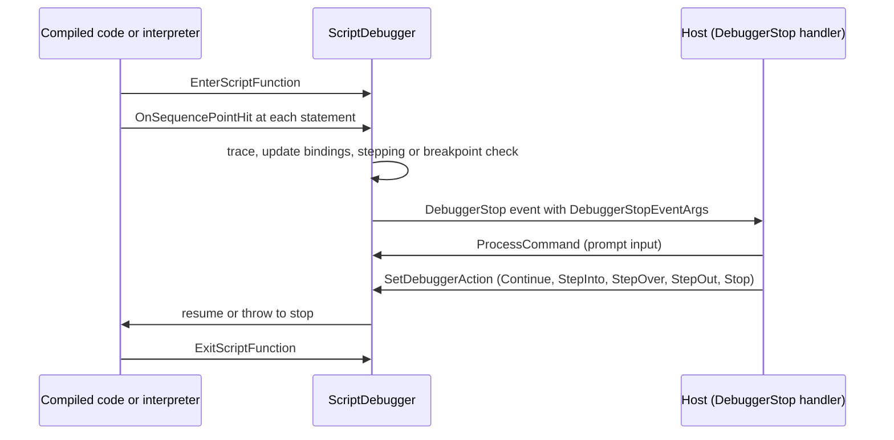

# Debugger

> STATIC-ONLY — behavior not run-verified. `FACT-SRC` unless marked. Scope `EXTENDED`. Where sequence points come from (compiler) and how the interpreter reaches the debugger hook: [02.5-compiler-and-engine](../02-language/02.5-compiler-and-engine.md) and [TIERING-POLICY](../02-language/TIERING-POLICY.md) (debugging forces the unoptimized variant).

## 1. Purpose and scope [SPEC]

The debugger lets a host stop running script at breakpoints or steps, inspect and change state, and resume. This document covers the debugger object model (`Debugger`, `ScriptDebugger`, nested/runspace debuggers), breakpoint kinds, the engine hooks that trigger it, the resume actions and the command set at the debugger prompt. Remote runspace debugging and job debugging are noted but not analysed.

## 2. Source map

| path | type | role | tier |
|---|---|---|---|
| src/System.Management.Automation/engine/debugger/debugger.cs::Debugger@L320-L966 | abstract class | public debugger API: modes, breakpoints, `ProcessCommand`, `SetDebuggerAction`, events | B |
| src/System.Management.Automation/engine/debugger/debugger.cs::ScriptDebugger@L975-L4218 | sealed class | the local script debugger: call stack, breakpoint tables, stepping, stop handling | B |
| src/System.Management.Automation/engine/debugger/debugger.cs::NestedRunspaceDebugger@L4227-L4629 | abstract class | debugging another runspace/job from the current one (`Standalone…`, `Embedded…`) | B |
| src/System.Management.Automation/engine/debugger/debugger.cs::DebuggerCommandProcessor@L5085-L5419 | class | the prompt command table (`s`, `v`, `o`, `c`, `q`, `d`, `k`, `l`, `h`) | B |
| src/System.Management.Automation/engine/debugger/debugger.cs::DebuggerStopEventArgs@L58-L115 | class | data of the stop event: invocation info, breakpoints, resume action | B |
| src/System.Management.Automation/engine/debugger/Breakpoint.cs::Breakpoint@L16-L150 | abstract class | base breakpoint: id, script, action, enabled, hit count | B |
| src/System.Management.Automation/engine/debugger/Breakpoint.cs::LineBreakpoint@L356-L611 | class | line and column breakpoints | B |
| src/System.Management.Automation/engine/debugger/Breakpoint.cs::CommandBreakpoint@L155-L252 | class | breakpoint on a command name (wildcards) | B |
| src/System.Management.Automation/engine/debugger/Breakpoint.cs::VariableBreakpoint@L276-L351 | class | breakpoint on variable read/write/both | B |

## 3. Responsibilities and non-responsibilities

Owns: breakpoint tables per script/function and their binding to sequence points, the stepping state machine, the stop/resume protocol, debugger commands, call-stack frames. Does not own: sequence point generation (compiler), the interactive prompt UI (host `PSHost.EnterNestedPrompt`), the `*-PSBreakpoint` cmdlets (command-module family), remoting transport.

## 4. Key types and contracts [IMPL]

- **`DebuggerResumeAction`**: `Continue=0`, `StepInto=1`, `StepOut=2`, `StepOver=3`, `Stop=4` (src/System.Management.Automation/engine/debugger/debugger.cs::DebuggerResumeAction@L31-L53). **`DebugModes`** flags: `None=0`, `Default=1`, `LocalScript=2`, `RemoteScript=4`.
- **Debugger API**: `IsActive`, `InBreakpoint`, `ProcessCommand(PSCommand, output)` (run a command in the stopped scope), `SetDebuggerAction`, `GetDebuggerStopArgs`, `StopProcessCommand`, `SetDebugMode`, `GetCallStack`, `Get/SetBreakpoints`, `SetCommandBreakpoint`, `SetLineBreakpoint`, `SetVariableBreakpoint`, `Remove/Enable/DisableBreakpoint`, `SetDebuggerStepMode`, `CancelDebuggerProcessing`; events `DebuggerStop`, `BreakpointUpdated`; internal `Break(triggerObject)` to enter the debugger from code (used for `Break` action preferences) and `DebugJob`/`DebugRunspace` for nested debugging.
- **Breakpoint kinds**: line (script path, line, optional column), command (name pattern, optional script scope), variable (name, access mode read/write/read-write); each has an optional **action** script block that decides whether to stop (a `break` in the action stops; other results continue), an enabled flag and a hit counter (`UNVERIFIED` details).
- **Engine hooks** (called by compiled code and command processors only when `ExecutionContext._debuggingMode` is non-zero): `EnterScriptFunction(functionContext)` / `ExitScriptFunction()` maintain the debugger's call stack of function contexts; `OnSequencePointHit(functionContext)` is called at each sequence point; `CheckCommand(invocationInfo)` is called before a command's `BeginProcessing` (for non-script cmdlets: `CommandProcessorBase.DoBegin` and `CommandProcessor.ProcessRecord` check `_debuggingMode > 0 && Command is not PSScriptCmdlet`); `CheckVariableRead/Write(name)` on variable access when variable breakpoints exist.
- **`OnSequencePointHit` algorithm** (src/System.Management.Automation/engine/debugger/debugger.cs::ScriptDebugger.OnSequencePointHit@L1537-L1604): (1) if statement tracing is on (`Set-PSDebug -Trace`), and the frame is not hidden and the function is not marked step-through and the position is a real position, print the trace line; (2) if a nested debugger stop was requested, stop now; (3) update breakpoint bindings for this function context (`UpdateBreakpoints`); (4) if the stepping mode is *step in* and the current frame is the one being stepped over/out (or none), stop on this sequence point unless the frame is hidden (a hidden frame during step-in resumes with *step out*); (5) otherwise, if the function's breakpoint bit set marks this sequence point, take the *enabled* line breakpoints bound to it, run `TriggerBreakpoints` (conditions/actions), and stop with the survivors. `CheckCommand` filters enabled command breakpoints by `Trigger(invocationInfo)`, triggers them, and if any survive stops with the function's current position and tells the caller to skip line-breakpoint checks for that command (src/System.Management.Automation/engine/debugger/debugger.cs::ScriptDebugger.CheckCommand@L1389-L1417).
- **Prompt commands** (`DebuggerCommandProcessor`): `continue`/`c`, `stepInto`/`s` (repeat on empty Enter), `stepOver`/`v` (repeat on Enter), `stepOut`/`o`, `quit`/`q` (stop), `detach`/`d`, `k` (= `Get-PSCallStack`), `list`/`l` (default 16 lines, repeats on Enter), `h`/`?` (help); everything else is run as script in the stopped scope; the empty command repeats the last repeatable command. Resume actions map to `DebuggerResumeAction` values.

## 5. Data model

`ScriptDebugger` holds: the call stack (`CallStackFrame`s with function context, position, hidden flag), the command-breakpoint table, per-script line-breakpoint tables, the current stepping mode (`StepIn`, over/out frame reference), the current debugger action, the pending-stop state, and an event for the host. A `FunctionContext` carries `_breakPoints` (bit array indexed by sequence point), `_boundBreakpoints` (sequence point → breakpoints), `_currentSequencePointIndex`, `_debuggerHidden` and `_debuggerStepThrough` flags. `PSDebugContext` is the object bound to `$PSDebugContext` while stopped (invocation info and breakpoints).

## 6. Control flow

Ordered steps at a stop: freeze the pipeline, raise `DebuggerStop` (or enter a nested prompt on the host), read commands until a resume action is set, apply the action (stepping modes set the frame reference), continue. `UNVERIFIED`: the locking and the exact way `Stop` unwinds (via `ScriptCallDepth`/`PipelineStopped` style exceptions).

## 7. Algorithms

Stepping: *step in* stops at the next sequence point in any non-hidden frame; *step over* sets the over/out frame to the current frame and stops at the next sequence point of that frame (or a shallower one); *step out* stops after the current frame returns; hidden frames are skipped by resuming with *step out* (`INFERENCE` from the code above). Breakpoint binding: line breakpoints are resolved to sequence points when the script block is compiled/entered (`UpdateBreakpoints`), stored as a bit in `_breakPoints` for O(1) checks per sequence point.

## 8. Observable behavior [SPEC]

- `Set-PSBreakpoint -Script -Line` stops before the statement at that line; `-Command` stops when the command is about to run; `-Variable` stops on access; `-Action` runs a script block that can `break`.
- At the `DBG>` prompt, `s`, `v`, `o`, `c`, `q`, `k`, `l`, `h` behave as above; any other input runs in the stopped scope.
- Debugging is only active in runspaces where debug mode is enabled; debugging forces the slower (unoptimized) script execution variant.
- Tests: §16. No golden sample: STATIC-ONLY.

## 9. Error handling and edge cases

A breakpoint action that throws is reported; nested debugger stop requests are queued; debugging a constrained-language session is limited (`ConstrainedLanguageDebugger.Tests.ps1`: commands typed at the prompt are restricted); hidden frames (`DebuggerHidden` attribute) are skipped; `IsPendingDebugStopEvent` marks a stop requested from another thread; the debugger refuses invalid transitions (for example resume while not stopped; `UNVERIFIED` messages).

## 10. Concurrency and threading

Stop events are raised on the pipeline thread that hit the breakpoint; `Break`-all and `Debug-Runspace`/`Enable-RunspaceDebug` request a stop asynchronously from another thread, so `ScriptDebugger` keeps pending-stop state and synchronization primitives (`UNVERIFIED` details). Nested debugger types serialize commands through a processing lock.

## 11. Extension points and customization hooks

Host `DebuggerStop` handler / nested prompt; breakpoint `-Action`; `Set-PSDebug -Trace/-Step/-Strict`; `Wait-Debugger`; `[System.Diagnostics.DebuggerHidden()]`/`DebuggerStepThrough` attributes on functions; `Enable-RunspaceDebug`; `Debug-Job`/`Debug-Runspace`; `PSDebugContext`/`$PSDebugContext` in the prompt; custom debugger implementations in hosts (public abstract `Debugger`).

## 12. Dependencies

Inbound: compiled code and interpreter (sequence points), command processors (`CheckCommand`), variable access (variable breakpoints), `Warning`/`Error` preference `Break`, jobs (`AtBreakpoint` state), runspaces (`Runspace.Debugger`). Outbound: host UI (prompt), script parser positions, `PowerShell` API (`ProcessCommand` runs commands), remoting for remote debugging.

## 13. Performance notes

When no breakpoints or tracing exist the hook is not called (`_debuggingMode == 0`), and the optimized variant is used; when debugging is enabled the unoptimized variant runs and every sequence point calls into the debugger (O(1) bit check). Breakpoint tables are rebuilt per function entry.

## 14. Security considerations

The debugger is a code-execution and state-inspection channel: at a stop, arbitrary commands run in the stopped scope with its variables; a remote debugger can attach to another runspace. Enforcement seen: debugging in constrained language mode restricts what can be run at the prompt (test `ConstrainedLanguageDebugger`, enforcement location `UNVERIFIED`); a function defined in full language is hidden from command resolution while stopped in a constrained session (see [command-discovery-and-invocation](command-discovery-and-invocation.md) §7); `CommandProcessorBase.DoBegin` only calls the hook for non-script cmdlets.

### Security surface

<!--GEN:secseeds-->
| Category | Seed hits |
|---|---:|
| language-mode | 6 |
| app-control | 1 |
| **total** | 7 |

Files with most hits:

| File | Hits |
|---|---:|
| `src/System.Management.Automation/engine/debugger/debugger.cs` | 7 |

These are regex scanner hits (`APPROX`, `verified: false`, no `SEC-ENF` ID yet). Phase 5 verifies them and assigns IDs; none is claimed here as an enforcement point.
<!--/GEN:secseeds-->

What the new shell must guarantee here: attaching a debugger requires an explicit privilege and is audited; the debug prompt runs under the *lowest* language mode in the stack; breakpoint actions run under the mode of their definer; debug mode can be disabled by policy and then no hook costs or state exist.

## 15. Enterprise considerations

Security first: §14. Observability: breakpoint hit counts, trace lines, `$PSDebugContext`, call stack (`Get-PSCallStack`). Supportability: standard prompt commands and listing. Testability: the SDK exposes `Debugger` for automated tests (see SDK tests). Resource limits: none on breakpoint count. Missing: audit log of debug sessions, per-user permission model, non-interactive debug adapters (DAP is external).

## 16. Tests

<!--GEN:tests-->
| Pester file | Describe | Context | It |
|---|---:|---:|---:|
| `test/powershell/Language/Scripting/Debugging/DebuggerCommand.Tests.ps1` | 3 | 9 | 51 |
| `test/powershell/Language/Scripting/Debugging/DebuggerScriptTests.Tests.ps1` | 9 | 1 | 22 |
| `test/powershell/Language/Scripting/Debugging/Debugging.Tests.ps1` | 3 | 9 | 19 |
| `test/powershell/Language/Scripting/Debugging/DebuggingInHost.Tests.ps1` | 1 | 0 | 4 |
| `test/powershell/Modules/Microsoft.PowerShell.Core/Set-PSDebug.Tests.ps1` | 1 | 1 | 3 |
| `test/powershell/Modules/Microsoft.PowerShell.Security/ConstrainedLanguageDebugger.Tests.ps1` | 1 | 0 | 2 |
| `test/powershell/Modules/Microsoft.PowerShell.Utility/Debug-Runspace.Tests.ps1` | 1 | 0 | 4 |
| `test/powershell/Modules/Microsoft.PowerShell.Utility/Disable-PSBreakpoint.Tests.ps1` | 1 | 0 | 2 |
| `test/powershell/Modules/Microsoft.PowerShell.Utility/Enable-PSBreakpoint.Tests.ps1` | 1 | 0 | 2 |
| `test/powershell/Modules/Microsoft.PowerShell.Utility/Get-PSBreakpoint.Tests.ps1` | 1 | 0 | 2 |
| `test/powershell/Modules/Microsoft.PowerShell.Utility/Get-RunspaceDebug.Tests.ps1` | 1 | 1 | 1 |
| `test/powershell/Modules/Microsoft.PowerShell.Utility/Remove-PSBreakpoint.Tests.ps1` | 1 | 1 | 7 |
| `test/powershell/Modules/Microsoft.PowerShell.Utility/RunspaceBreakpointManagement.Tests.ps1` | 1 | 3 | 20 |
| `test/powershell/Modules/Microsoft.PowerShell.Utility/Set-PSBreakpoint.Tests.ps1` | 2 | 0 | 24 |
| `test/powershell/Modules/Microsoft.PowerShell.Utility/Wait-Debugger.Tests.ps1` | 1 | 1 | 2 |
| `test/powershell/SDK/Breakpoint.Tests.ps1` | 1 | 5 | 35 |
| `test/powershell/SDK/PSDebugging.Tests.ps1` | 2 | 2 | 12 |
| `test/powershell/engine/Remoting/InvokeCommandRemoteDebug.Tests.ps1` | 1 | 0 | 4 |
| **total (18 files)** | 32 | 33 | 216 |

No xUnit file matched the path keywords.

Matching is by path keyword (`APPROX`): `ConstrainedLanguageDebugger`, `Set-PSDebug`, `Disable-PSBreakpoint`, `Enable-PSBreakpoint`, `Remove-PSBreakpoint`, `Get-RunspaceDebug`, `RunspaceBreakpointManagement`, `Debug-Runspace`, `Get-PSBreakpoint`, `Wait-Debugger`, `Set-PSBreakpoint`, `SDK/Breakpoint`, `SDK/PSDebugging`, `InvokeCommandRemoteDebug`, `Scripting/Debugging/`.
<!--/GEN:tests-->

## 17. Design decisions and trade-offs

- `FACT-SRC`: debugging works on sequence points with a bit array per function, so the disabled cost is a flag check and the enabled cost per statement is small.
- `FACT-SRC`: the debugger is a public abstract class so hosts can replace it.
- `INFERENCE`: restricting hooks to non-script cmdlets avoids double-stopping for script commands (their sequence points already stop).
- `FACT-SRC`: two prompt commands repeat on Enter (step into/over) to speed stepping.

## 18. Guidance for the new shell [LESSON]

- **LSN-RTDBG-01** [REPLICATE] (area: NLD-TOOL) Sequence points with per-function bit arrays and a single hook called only in debug mode. Evidence: src/System.Management.Automation/engine/debugger/debugger.cs::ScriptDebugger.OnSequencePointHit@L1537-L1604.
- **LSN-RTDBG-02** [REPLICATE] (area: NLD-TOOL) Three breakpoint kinds (line, command, variable) with action blocks, and the five resume actions. Evidence: src/System.Management.Automation/engine/debugger/Breakpoint.cs::Breakpoint@L16-L150.
- **LSN-RTDBG-03** [ADAPT] (area: NLD-TOOL) Expose the debugger through a protocol-neutral interface suited to an external adapter (the Debug Adapter Protocol), keeping the prompt commands for terminals. Evidence: src/System.Management.Automation/engine/debugger/debugger.cs::Debugger@L320-L966.
- **LSN-RTDBG-04** [REDESIGN] (area: NLD-SEC) Debugger attach/enable is a policy-controlled, audited privilege, and the prompt runs under the lowest trust level present on the stack. DEV: DEV-DBG-195. Evidence: src/System.Management.Automation/engine/debugger/debugger.cs::NestedRunspaceDebugger@L4227-L4629.
- **LSN-RTDBG-05** [AVOID] (area: NLD-TOOL) Do not port nested debugging of jobs and remote runspaces (`DebugJob`, `Embedded/StandaloneRunspaceDebugger`) in the first version. DEV: DEV-DBG-196. Evidence: src/System.Management.Automation/engine/debugger/debugger.cs::StandaloneRunspaceDebugger@L4636-L4729.

## 19. Open questions / UNVERIFIED items

- `UNVERIFIED` (VB-053): `ScriptDebugger` stop/resume machinery (lines 1700–2400, 2400–4200): `OnDebuggerStop`, `ResumeExecution`, locking, `ProcessCommand`, remote and nested debuggers.
- `UNVERIFIED` (VB-054): breakpoint classes' trigger rules (`LineBreakpoint.Trigger`, wildcard rules of `CommandBreakpoint`), `BreakpointUpdated` events, `UpdateBreakpoints` binding algorithm, `PSDebugContext`, `CallStackFrame`.
- `UNVERIFIED` (VB-055): the cmdlets `Set/Get/Remove/Enable/Disable-PSBreakpoint`, `Debug-Runspace`, `Wait-Debugger`, and the host prompt integration.

Verification: `debugger.cs` lines 31–60 (enum values), 320–460 (outline by grep), 1389–1440, 1537–1600 and the member list by grep; `DebuggerCommandProcessor` lines 5085–5160 were read; other ranges are from signatures only. Ranges in `T31_T39.csv`.
