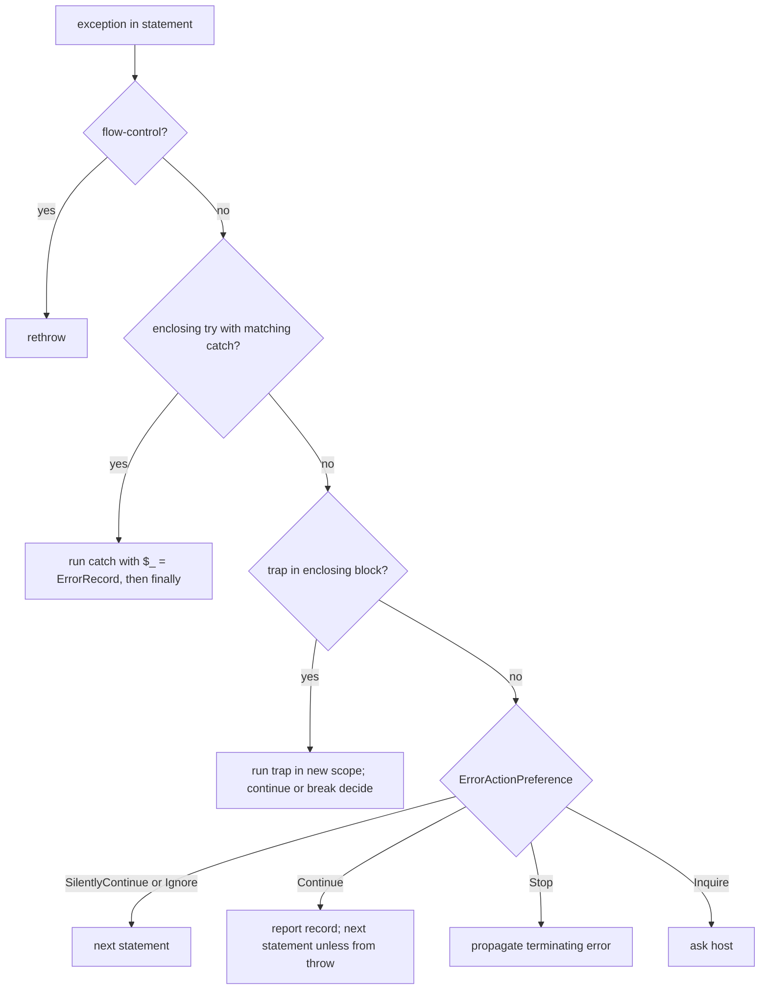

# Errors and diagnostics

> STATIC-ONLY — behavior not run-verified. `FACT-SRC` unless marked. The statement-level protocol (`CheckActionPreference`, traps, try/catch lowering) is documented where it is implemented: [RUNTIME-OPERATIONS](../02-language/RUNTIME-OPERATIONS.md) §6.1 and [02.5-compiler-and-engine](../02-language/02.5-compiler-and-engine.md) §6.2–6.4. Cmdlet-side stream behavior: [cmdlet-infrastructure](cmdlet-infrastructure.md). Pipeline first-error rule: [runspace-and-pipeline](runspace-and-pipeline.md). Parse errors: [ERROR-CATALOG](../02-language/ERROR-CATALOG.md).

## 1. Purpose and scope [SPEC]

How failures are represented, reported and observed: the `ErrorRecord` data model, the exception hierarchy, the `$Error` history, `$?`, `$LASTEXITCODE`, `$ErrorActionPreference` and `-ErrorAction`, the error views, and transcripts. This document ties the per-layer rules together and owns the canonical statement of terminating versus non-terminating errors (CF-ERR-001).

## 2. Source map

| path | type | role | tier |
|---|---|---|---|
| src/System.Management.Automation/engine/ErrorPackage.cs::ErrorRecord@L988-L1699 | class | the error data model | B |
| src/System.Management.Automation/engine/ErrorPackage.cs::ErrorDetails@L530-L962 | class | optional replacement message, recommended action | B |
| src/System.Management.Automation/engine/ErrorPackage.cs::ErrorCategory@L28-L189 | enum | 32 categories | B |
| src/System.Management.Automation/engine/runtime/Operations/MiscOps.cs::ExceptionHandlingOps | static class | statement-level handling, traps, `$?` | B |
| src/System.Management.Automation/engine/ExecutionContext.cs::ExecutionContext.AppendDollarError@L818-L858 | method | `$Error` maintenance | B |
| src/System.Management.Automation/engine/QuestionMarkVariable.cs::QuestionMarkVariable@L9-L42 | class | the `$?` variable | B |
| src/System.Management.Automation/engine/MshCommandRuntime.cs | class | cmdlet-side error writing and variables | B |
| src/System.Management.Automation/engine/hostifaces/MshHostUserInterface.cs::TranscriptionData@L1190-L1210 | class | transcript state | B |
| src/System.Management.Automation/engine/NativeCommandProcessor.cs | class | `$LASTEXITCODE` and native exit rule | A |

## 3. Responsibilities and non-responsibilities

Owns: the error model, history, status variables, view enumeration, the combined terminating/non-terminating rules. Does not own: parse error ids (T22), the per-statement compiled protocol (T25/T26, referenced), the console renderer of error views (formatting, T36), the `Start-Transcript` cmdlet (host family).

## 4. Key types and contracts [IMPL]

- **`ErrorRecord`** wraps: `Exception`, `TargetObject`, `CategoryInfo` (category, activity, reason, target name/type), `FullyQualifiedErrorId`, `ErrorDetails` (replacement message, recommended action), `InvocationInfo` (where the error was raised), `ScriptStackTrace`, `PipelineIterationInfo` and a "serialized" form used for remoting (`_serializedFullyQualifiedErrorId`, deserialization constructor). A `ParentContainsErrorRecordException` wraps an exception around an existing record.
- **`ErrorCategory`** (32 values, numeric order): `NotSpecified=0`, `OpenError`, `CloseError`, `DeviceError`, `DeadlockDetected`, `InvalidArgument`, `InvalidData`, `InvalidOperation`, `InvalidResult`, `InvalidType`, `MetadataError`, `NotImplemented`, `NotInstalled`, `ObjectNotFound`, `OperationStopped`, `OperationTimeout`, `SyntaxError`, `ParserError`, `PermissionDenied`, `ResourceBusy`, `ResourceExists`, `ResourceUnavailable`, `ReadError`, `WriteError`, `FromStdErr`, `SecurityError`, `ProtocolError`, `ConnectionError`, `AuthenticationError`, `LimitsExceeded`, `QuotaExceeded`, `NotEnabled` (src/System.Management.Automation/engine/ErrorPackage.cs::ErrorCategory@L28-L189).
- **Exception hierarchy** (from the type scan, direct bases): `RuntimeException` is the engine's root script-visible exception; its direct subclasses include `CmdletInvocationException`, `ParameterBindingException`, `ParseException`, `CommandNotFoundException`, `ProviderInvocationException`, `SessionStateException`, `MetadataException`, `ExtendedTypeSystemException`, `PSSecurityException`, `PipelineStoppedException`, `PipelineClosedException`, `ActionPreferenceStopException`, `ApplicationFailedException`, `NativeCommandExitException`, `ScriptRequiresException`, `HostException`, `RedirectedException`, `RemoteException`, `WildcardPatternException`, `PSSnapInException`, `TypeTableLoadException`, `FormatTableLoadException`. Direct subclasses of `SystemException` that are **not** runtime exceptions include the flow-control family (`FlowControlException`: break, continue, return, exit, terminate), `HaltCommandException`, `ScriptCallDepthException`, `PipelineDepthException`, `RethrowException`, `ParentContainsErrorRecordException`, the "invalid state" exceptions (`InvalidRunspaceStateException`, `InvalidPipelineStateException`, `InvalidPowerShellStateException`, `InvalidRunspacePoolStateException`, `InvalidJobStateException`), `JobFailedException`, `HelpNotFoundException`, `PSConsoleLoadException`, and `AssertException`.
- **`$Error`** (`AppendDollarError`): accepts an `ErrorRecord` or an `Exception`; the list is a global constant `ArrayList`; an object identical to the first element, or an error record whose exception equals the first record's exception, is not added again; the list keeps at most **256** entries (`maxErrorCount` constant; older entries beyond 255 are removed before inserting at index 0), newest first (src/System.Management.Automation/engine/ExecutionContext.cs::ExecutionContext.AppendDollarError@L818-L858).
- **`$?`**: a read-only, all-scope variable whose value is the context's `QuestionMarkVariableValue`; assignments are blocked by the read-only option; the value is set by statement handling (`CheckActionPreference` sets it false; statements set it true after success) and by command completion (for native commands see below) (src/System.Management.Automation/engine/QuestionMarkVariable.cs::QuestionMarkVariable@L9-L42).
- **`$LASTEXITCODE`** and native failure: after a native process exits its exit code is stored in `$LASTEXITCODE`; a non-zero code marks the pipeline's execution as failed (so `$?` is false); only when `$PSNativeCommandUseErrorActionPreference` is true is an error record `ProgramExitedWithNonZeroCode` (`NativeCommandExitException`) written through the normal error path, so `$ErrorActionPreference = 'Stop'` then terminates (src/System.Management.Automation/engine/NativeCommandProcessor.cs::NativeCommandProcessor.Complete@L1082-L1237).
- **Error views** (`$ErrorView`, `ErrorView` enum): `NormalView=0`, `CategoryView=1`, `ConciseView=2`, `DetailedView=3` (src/System.Management.Automation/engine/CommandBase.cs::ErrorView@L312-L325); rendering is format data/code (`UNVERIFIED`, VB-048).
- **Transcripts**: transcript state is `TranscriptionData` (list of transcripts, an optional system-wide transcript, the command being ignored, a helper flag, prompt text `PS>`). `TranscribeCommand` appends the command text to each active transcript: for the first line it can add a header (`**********************`, "Command start time: yyyyMMddHHmmss", `**********************`) when the transcript includes invocation headers, then `PS>` plus text; continuation lines get `>> `; commands that the transcript ignores (helper commands such as `Out-Default` added for transcription) are skipped. `TranscribeResult`, `TranscribeError`, `TranscribeCommandComplete` and `TranscribePipelineComplete` are the other hooks; output is buffered in `OutputToLog` and flushed to the file with the file's detected encoding (src/System.Management.Automation/engine/hostifaces/MshHostUserInterface.cs::PSHostUserInterface.TranscribeCommand@L418-L460, `TranscriptionOption@L1213-L1300`).

<!--CF:CF-ERR-001-->**Terminating versus non-terminating errors; try/catch/finally/trap ordering (CF-ERR-001).** (1) A *non-terminating* error is an `ErrorRecord` written to the error stream by a command (`WriteError`); it does not interrupt the command or the pipeline, sets the pipeline's failed state and `$?` to false, and is subject to the command's `ErrorAction` (`Ignore`: dropped, not recorded; `SilentlyContinue`: recorded in `$Error`/`-ErrorVariable` but not shown; `Continue`: recorded and written; `Inquire`: ask, then as `Continue` or stop; `Stop`: converted to a terminating `ActionPreferenceStopException`). (2) A *terminating* error is an exception: `ThrowTerminatingError` from a cmdlet (wrapped as `CmdletInvocationException`), `throw`, a runtime error in an expression, or `ActionPreferenceStop`. It stops the current *statement* and, unless handled, the command, and is recorded as the pipeline's first terminating error (later ones are only logged). (3) In **script code every statement is guarded**: when a statement throws a non-flow-control exception the engine consults `$ErrorActionPreference` (default `Continue`): `SilentlyContinue`/`Ignore` resume with the next statement; `Continue` reports the error record and resumes with the next statement — except that an exception produced by a `throw` statement is rethrown when no trap is present; `Stop` rethrows (terminates the enclosing scope and propagates); `Inquire` prompts. (4) **Handler order** for one thrown exception: innermost enclosing `try` is searched first; its `catch` clauses are tried in source order with the first matching type winning (a catch without a type matches any `RuntimeException`; `PipelineStoppedException` is never caught by a type-less catch); `finally` runs after the try/catch block completes, on normal exit, after a caught exception, and while an unhandled exception propagates; if no `catch` in the `try` matches, the exception propagates to the enclosing `try`, then to `trap` handlers of the enclosing blocks (a trap matches by the exception type, trying the inner exception before the outer one), then to the statement-level preference rule of (3). A `trap` runs in a new scope with `$_` set to the error record; `continue` in a trap means *SilentlyContinue*, `break` means *Stop*; otherwise the action is the current preference. (5) Flow control (`break`, `continue`, `return`, `exit`) travels as exceptions that are never caught by `catch` or traps and are rethrown by the statement guard. (6) `$?` is true after a statement that completes without error and false after a statement in which an error (terminating-handled or non-terminating) occurred; the pipeline-level failed state also covers errors written by commands.<!--/CF-->

## 5. Data model

`ErrorRecord` instances are wrapped in `PSObject` with a stream tag when written (`WriteStreamType.Error`) so that merging operators can recognize them. The history list is per runspace (global `$Error`), plus per-command variable lists (`-ErrorVariable`) in pipes. `ExecutionContext` holds `QuestionMarkVariableValue`, `CurrentExceptionBeingHandled`, and the `PropagateExceptionsToEnclosingStatementBlock` flag (used by traps to decide whether an exception should reach outer handlers).

## 6. Control flow

## 7. Algorithms

The statement guard and trap processing are specified in [RUNTIME-OPERATIONS](../02-language/RUNTIME-OPERATIONS.md) §6.1 (ordered steps with source ranges); try/catch dispatch in [02.5-compiler-and-engine](../02-language/02.5-compiler-and-engine.md) §6.4. The cmdlet-level `WriteError` decision list is in [cmdlet-infrastructure](cmdlet-infrastructure.md) §4. This document does not repeat them.

## 8. Observable behavior [SPEC]

- In a script, a failing statement prints an error and the script continues (default `Continue`); `$ErrorActionPreference = 'Stop'` makes it terminate; `throw` terminates unless trapped or caught; `-ErrorAction` applies per command and overrides the preference for non-terminating errors from that command.
- `$Error[0]` is the latest error; at most 256 are kept; the same error is not added twice in a row.
- `$?` reflects the last statement; for native programs it is false when the exit code is non-zero, and `$LASTEXITCODE` holds the code.
- `try { } catch { } finally { }` behaves as in CF-ERR-001; `clean` blocks run even when stopped (see [runspace-and-pipeline](runspace-and-pipeline.md)).
- Transcripts capture commands, their output and errors.
- Tests: §16. No golden sample: STATIC-ONLY.

## 9. Error handling and edge cases

Errors in `clean` blocks are written to the error stream (`ReportCleanupError`) and set `$?` false. A second failure during stop is logged, not thrown. `ScriptCallDepthException` is raised by the stack-depth check and is not a runtime exception. Disposal errors become `CmdletInvocationException` warnings. Incomplete-input parse errors are `IncompleteParseException` and do not enter history. Native stderr text is turned into error records (`FromStdErr`) without marking the pipeline as failed (src/System.Management.Automation/engine/MshCommandRuntime.cs::MshCommandRuntime._WriteErrorSkipAllowCheck@L2858-L2968).

## 10. Concurrency and threading

`$Error` and `$?` are per runspace and touched only on the pipeline thread. Transcript buffers are locked per transcript (`lock (transcript.OutputToLog)`, `OutputBeingLogged`) and flushed by host code; `PipelineProcessor.RecordFailure` locks around the first-error record.

## 11. Extension points and customization hooks

`$ErrorActionPreference`, `-ErrorAction`, `-ErrorVariable`, `$ErrorView`, (no `MaximumErrorCount` identifier exists in this source, searched; the 256 limit is a constant), `trap`, `try/catch/finally`, custom exceptions deriving from `Exception` (wrapped), `ErrorRecord` with `ErrorDetails` for localized messages, `Write-Error`/`$PSCmdlet.WriteError`/`ThrowTerminatingError`, `Start-Transcript` with options (invocation header, path), PowerShell policy for transcription (`PSConfiguration` transcription settings: enable flag, output directory, invocation header).

## 12. Dependencies

Inbound: all commands, the compiler's statement guard, hosts (display of errors), remoting (serialization of records). Outbound: `InvocationInfo`/`ScriptPosition` for positions, the debugger (`Break` preference), format code for views, host UI for prompts and transcripts, `MshLog` for health events.

## 13. Performance notes

Statement guards add a try/catch frame per statement block; errors build `InvocationInfo` and script stack trace lazily (`ScriptStackTrace` is a property computed on demand, `UNVERIFIED`); the `$Error` list is an `ArrayList` with `Insert(0)` (O(n) per error, bounded by 256).

## 14. Security considerations

Error records can leak data: `TargetObject`, `InvocationInfo.Line` and `PositionMessage` can contain secrets typed on the command line; transcripts store command text and output on disk (the file's access control is the only protection); remote error serialization includes script stack traces. Enforcement here: none beyond policy-driven transcription settings. `PSSecurityException` carries blocked-execution reasons for logging.

### Security surface

<!--GEN:secseeds-->
| Category | Seed hits |
|---|---:|
| logging | 90 |
| app-control | 16 |
| language-mode | 12 |
| constrained-types | 2 |
| securestring | 1 |
| amsi | 1 |
| **total** | 122 |

Files with most hits:

| File | Hits |
|---|---:|
| `src/System.Management.Automation/engine/hostifaces/MshHostUserInterface.cs` | 91 |
| `src/System.Management.Automation/engine/runtime/Operations/MiscOps.cs` | 31 |

These are regex scanner hits (`APPROX`, `verified: false`, no `SEC-ENF` ID yet). Phase 5 verifies them and assigns IDs; none is claimed here as an enforcement point.
<!--/GEN:secseeds-->

What the new shell must guarantee here: audit records for policy-denied operations are produced independently of user-visible errors; transcripts and logs apply the same redaction rules as the host display; error text shown to a remote caller excludes local paths and script text unless policy allows it.

## 15. Enterprise considerations

Security first: §14. Observability: `$Error` history, `-ErrorVariable`, transcripts, health events (`MshLog`), `Get-Error` for detailed views, error ids that are stable strings. Supportability: `FullyQualifiedErrorId` and categories allow filtering. Testability: error behavior is well covered by language tests (§16). Resource limits: `$Error` capped at 256 entries; transcripts unbounded. Missing: structured error export schema, correlation ids across commands/remote sessions.

## 16. Tests

<!--GEN:tests-->
| Pester file | Describe | Context | It |
|---|---:|---:|---:|
| `test/powershell/Language/Classes/Scripting.Classes.Exceptions.Tests.ps1` | 3 | 3 | 14 |
| `test/powershell/Language/Scripting/CleanBlockErrorHandling.Tests.ps1` | 3 | 0 | 49 |
| `test/powershell/Language/Scripting/CommandErrorHandling.Tests.ps1` | 1 | 3 | 22 |
| `test/powershell/Language/Scripting/ErrorHistoryId.Tests.ps1` | 1 | 0 | 3 |
| `test/powershell/Language/Scripting/ErrorPosition.Tests.ps1` | 1 | 0 | 2 |
| `test/powershell/Language/Scripting/OutErrorVariable.Tests.ps1` | 3 | 1 | 15 |
| `test/powershell/Language/Scripting/Trap.Tests.ps1` | 1 | 1 | 4 |
| `test/powershell/Language/Scripting/TryCatch.Tests.ps1` | 1 | 10 | 37 |
| `test/powershell/Modules/Microsoft.PowerShell.Core/Get-Error.Tests.ps1` | 1 | 0 | 2 |
| `test/powershell/Modules/Microsoft.PowerShell.Utility/Get-Error.Tests.ps1` | 1 | 0 | 10 |
| `test/powershell/Modules/Microsoft.PowerShell.Utility/Write-Error.Tests.ps1` | 1 | 0 | 11 |
| `test/powershell/Modules/Microsoft.Powershell.Host/Start-Transcript.Tests.ps1` | 1 | 0 | 22 |
| `test/powershell/engine/Basic/NativeCommandErrorHandling.Tests.ps1` | 1 | 2 | 10 |
| `test/powershell/engine/Formatting/ErrorView.Tests.ps1` | 1 | 3 | 22 |
| **total (14 files)** | 20 | 23 | 223 |

No xUnit file matched the path keywords.

Matching is by path keyword (`APPROX`): `Host/Start-Transcript`, `Utility/Write-Error`, `Utility/Get-Error`, `Core/Get-Error`, `engine/Basic/NativeCommandErrorHandling`, `Formatting/ErrorView`, `Classes.Exceptions`, `Scripting/Trap`, `Scripting/CommandErrorHandling`, `Scripting/ErrorHistoryId`, `Scripting/TryCatch`, `Scripting/CleanBlockErrorHandling`, `Scripting/ErrorPosition`, `Scripting/OutErrorVariable`.
<!--/GEN:tests-->

## 17. Design decisions and trade-offs

- `FACT-SRC`: errors are split into data (`ErrorRecord`) and control (exceptions) so commands can report many problems without aborting.
- `FACT-SRC`: the default for script statements is to continue after errors, a deliberate departure from most languages (and a frequent source of surprises); preferences make it configurable.
- `INFERENCE`: the exception types that do *not* derive from `RuntimeException` (flow control, halt, stack depth) are those that must pass through `catch` clauses untouched.
- `FACT-SRC`: `$Error` de-duplicates the first element to avoid duplicates when an error is reported at several layers.
- `FACT-SRC`: native-command failures are not errors unless the opt-in preference is set.

## 18. Guidance for the new shell [LESSON]

- **LSN-RTERR-01** [REPLICATE] (area: NLD-ERR) Split errors into records (non-terminating, streamed) and exceptions (terminating), with the `ErrorAction` decision list; it defines script behavior. Evidence: src/System.Management.Automation/engine/MshCommandRuntime.cs::MshCommandRuntime._WriteErrorSkipAllowCheck@L2858-L2968.
- **LSN-RTERR-02** [REPLICATE] (area: NLD-ERR) Statement-level guard with continue-by-default and `throw` as the always-terminating form; keep traps with `continue`/`break` semantics. Evidence: src/System.Management.Automation/engine/runtime/Operations/MiscOps.cs::ExceptionHandlingOps.CheckActionPreference@L1699-L1788.
- **LSN-RTERR-03** [REPLICATE] (area: NLD-ERR) `$Error` as a bounded, newest-first, de-duplicated history; `$?` as a read-only all-scope variable. Evidence: src/System.Management.Automation/engine/ExecutionContext.cs::ExecutionContext.AppendDollarError@L818-L858.
- **LSN-RTERR-04** [ADAPT] (area: NLD-ERR) Keep `ErrorRecord` fields and the 32 categories but add a schema version, a correlation id and a redaction marker for sensitive fields. Evidence: src/System.Management.Automation/engine/ErrorPackage.cs::ErrorRecord@L988-L1699.
- **LSN-RTERR-05** [ADAPT] (area: NLD-ERR) Make the `$Error` capacity configurable (the source hard-codes 256 and no preference variable controls it). Evidence: src/System.Management.Automation/engine/ExecutionContext.cs::ExecutionContext.AppendDollarError@L847-L855.
- **LSN-RTERR-06** [REPLICATE] (area: NLD-ERR) Native exit codes in `$LASTEXITCODE` and `$?`, error on non-zero only by preference. Evidence: src/System.Management.Automation/engine/NativeCommandProcessor.cs::NativeCommandProcessor.Complete@L1082-L1237.
- **LSN-RTERR-07** [REDESIGN] (area: NLD-SEC) Separate the audit stream (policy decisions, denials) from the user error stream so that `-ErrorAction SilentlyContinue` or `Ignore` can never suppress an audit record. DEV: DEV-ERR-180. Evidence: src/System.Management.Automation/engine/MshCommandRuntime.cs::MshCommandRuntime._WriteErrorSkipAllowCheck@L2858-L2968.

## 19. Open questions / UNVERIFIED items

- `UNVERIFIED` (VB-048): `ErrorRecord` internals (fields, `ToString`, serialization, `ScriptStackTrace`), `ErrorDetails`, the error-view rendering code and format data, `Get-Error`.
- `UNVERIFIED` (VB-049): exact semantics of `ThrowTerminatingError` vs `throw` inside traps for each case; the `try`/`finally` behavior on `PipelineStoppedException`; `RethrowException` use; `HaltCommandException` consumers.
- `UNVERIFIED` (VB-050): `ConsoleHost` transcript cmdlets and the policy-driven transcription path (`PSConfiguration` settings), and the `MshLog` health-event mapping.

Verification: `ExecutionContext.cs` lines 818–858, `QuestionMarkVariable.cs` (whole file), `MshHostUserInterface.cs` lines 418–470 and 1190–1260, `NativeCommandProcessor.cs` lines 1082–1237 (read for T32), `MshCommandRuntime.cs` lines 2858–3010 (read for T33), and the earlier documents' §6.1/§6.4 text were used; enum members were read from source (`ErrorCategory` 32 values counted from source, `ErrorView` 4 values). Exception lists come from `data/types.json` (`APPROX`). Ranges in `T31_T39.csv`.
