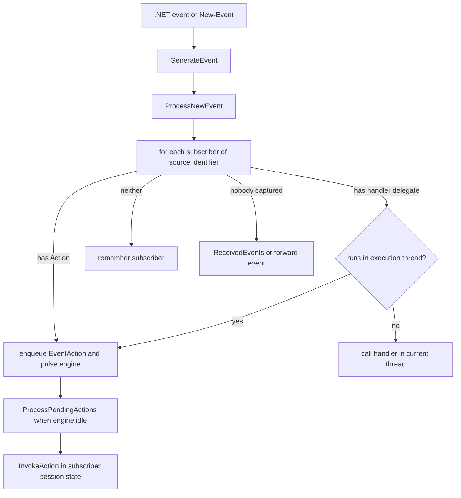

# Eventing and engine events

> STATIC-ONLY — behavior not run-verified. `FACT-SRC` unless marked. Scope `EXTENDED`. Event actions run as jobs ([jobs-and-concurrency](jobs-and-concurrency.md)); the "pulse" that lets the engine run actions while idle is in [runspace-and-pipeline](runspace-and-pipeline.md) §10.

## 1. Purpose and scope [SPEC]

The event model lets script react to .NET events and to engine-generated or user-generated events. A *subscriber* names a source (a .NET object and event name, or a *source identifier* string); a *handler* is either a script-block *action* or a delegate; when an event is raised the engine either runs the action, calls the handler, or queues the event for `Get-Event`/`Wait-Event`. This document covers the manager, subscriptions, delivery rules, the action queue and the built-in engine events.

## 2. Source map

| path | type | role | tier |
|---|---|---|---|
| src/System.Management.Automation/engine/EventManager.cs::PSEventManager@L22-L316 | abstract class | public contract: `GenerateEvent`, `SubscribeEvent`, `UnsubscribeEvent`, `GetEventSubscribers`, `ReceivedEvents`, `Subscribers` | B |
| src/System.Management.Automation/engine/EventManager.cs::PSLocalEventManager@L321-L1546 | class | the in-process manager | B |
| src/System.Management.Automation/engine/EventManager.cs::PSEventSubscriber@L1852-L2078 | class | one subscription | B |
| src/System.Management.Automation/engine/EventManager.cs::PSEventArgs@L2191-L2311 | class | one event instance | B |
| src/System.Management.Automation/engine/EventManager.cs::EventAction@L2437-L2454 | class | a queued (subscriber, event) pair | B |
| src/System.Management.Automation/engine/EventManager.cs::PSEventJob@L2459-L2647 | class | the job that represents an action subscription | B |
| src/System.Management.Automation/engine/EventManager.cs::PSRemoteEventManager | class | forwards events from a remote session | B |
| src/Microsoft.PowerShell.Commands.Utility/commands/utility/RegisterObjectEventCommand.cs::RegisterObjectEventCommand@L13-L72, NewEventCommand.cs | cmdlets | `Register-ObjectEvent`, `New-Event` | B |

## 3. Responsibilities and non-responsibilities

Owns: subscriptions, event ids and queues, delivery rules, runtime generation of event handler types, engine events, forwarding hooks. Does not own: the `*-Event` cmdlet surface (utility family), WMI/CIM event sources, remoting transport of forwarded events (Phase 4).

## 4. Key types and contracts [IMPL]

- **`PSEventManager`**: `GenerateEvent(sourceIdentifier, sender, args, extraData[, processInCurrentThread, waitForCompletionInCurrentThread])` creates a `PSEventArgs` (ids from a per-manager counter starting at 1) and calls `ProcessNewEvent`; `SubscribeEvent` overloads take either a .NET `source`+`eventName` or just a `sourceIdentifier`, plus `data`, an optional handler delegate, `supportEvent` (hidden subscription), `forwardEvent` and a maximum trigger count; `ReceivedEvents` is the queue of undelivered events.
- **Subscribing to a .NET event** (`ProcessNewSubscriber`): reject source identifiers that start with `PowerShell.` (reserved; error `ReservedIdentifier`); find the event by name (case-insensitive, public instance or static); WinRT types are not supported; if the type has a writable `EnableRaisingEvents` property it is set to true; the event's delegate type must return `void`; an event-handler **class is generated at run time** with `Reflection.Emit` (dynamic assembly `PSEventHandler`, module `PSGenericEventModule`) matching the delegate signature, cached by `"<source type full name>|<event name>"`; a delegate of the generated class is added to the event; when the event fires it calls `GenerateEvent` with the sender, the event arguments and the subscriber's data (src/System.Management.Automation/engine/EventManager.cs::PSLocalEventManager.ProcessNewSubscriber@L645-L796).
- **Engine events** (`PSEngineEvent`): source identifiers `PowerShell.Exiting` and `PowerShell.OnIdle` (public) and `PowerShell.OnScriptBlockInvoke`, `PowerShell.GetCommandInfoParameterMetadata` (internal). A subscription with no `source` whose identifier is in the engine-event set is an engine subscription (`OnIdle` starts a timer, `UNVERIFIED` details).
- **Delivery** (`ProcessNewEventImplementation`): for each subscriber of the event's source identifier (in subscription order): set the event's `ForwardEvent` flag from the subscriber; if the subscriber has an **action**, enqueue an `EventAction` (captured); else if it has a **handler delegate**, either enqueue it (when it must run in the execution thread) or call it in the current thread after the loop (captured); else remember it as "without action". After the loop, if no subscriber captured the event: if it is a forwarded event, raise the forward event; otherwise **add it to `ReceivedEvents`** (under its sync lock); subscribers without action or handler that were auto-unregister are then unregistered. Handlers run in the current thread are followed by `AutoUnregisterEventIfNecessary` (src/System.Management.Automation/engine/EventManager.cs::PSLocalEventManager.ProcessNewEventImplementation@L957-L1018).
- **Action queue and execution**: actions are added to a queue under its lock, then the engine is **pulsed** (the runspace's `Pulse` runs an empty pipeline when idle). `ProcessPendingActions` returns at once if the queue is empty or an action is already executing; otherwise, under the processing lock, it dequeues and runs up to `throttleLimit × throttleChecks` actions per call (limit 1, the check counter increases while the queue stays non-empty and resets after progress); in `finally`, if actions remain, it schedules a re-pulse after a 100 ms sleep on the thread pool. `InvokeAction` switches the engine session state to the action script block's session state, sets the default runspace, invokes the action (`Sender.Action.Invoke(sender, args)`) or the delegate, and restores state; a `PipelineStoppedException` from the action re-queues the action; waiting event generators (`EventProcessed` handle) are released when the action completes (src/System.Management.Automation/engine/EventManager.cs::PSLocalEventManager.ProcessPendingActionsImpl@L1072-L1137, `InvokeAction@L1222-L1281`).
- **`PSEventJob`** represents an action subscription as a job (`Get-Job` shows it); `RegisterJob` associates the subscriber with it; unsubscribing stops it.

## 5. Data model

Manager state: `_eventSubscribers` (subscriber → generated delegate), `_engineEventSubscribers` (engine event name → subscribers, case-insensitive), `_actionQueue`, the next subscription id, throttle counters, the dynamic assembly/module and a static cache of generated handler types, timer state for `OnIdle`. `PSEventSubscriber`: subscription id, source object, event name, source identifier, action, handler delegate, `SupportEvent`, `ForwardEvent`, `AutoUnregister` (max trigger count), `Data`, job. `PSEventArgs`: event identifier, source identifier, sender, source args, message data (`extraData`), time generated, forward flag, `EventProcessed` wait handle.

## 6. Control flow

## 7. Algorithms

Generated handler types (one per (source type, event) pair) bind arbitrary delegate signatures to the single `GenerateEvent` call, avoiding reflection per event. Throttling is described in §4. Unsubscribe removes the delegate from the source event and the subscriber from the tables (`UNVERIFIED` details).

## 8. Observable behavior [SPEC]

- `Register-ObjectEvent` returns a subscription (and a job when an action is given); events with an action run the action in the subscriber's session state when the engine is idle; events without action are queued for `Get-Event`/`Wait-Event`.
- Events are delivered one action at a time (no overlapping actions); events raised while an action runs wait.
- `New-Event` raises a user event with a source identifier.
- Identifiers beginning with `PowerShell.` are reserved for the engine.
- Tests: §16. No golden sample: STATIC-ONLY.

## 9. Error handling and edge cases

Unknown event name → `CouldNotFindEvent`; non-void delegate → `NonVoidDelegateNotSupported`; WinRT sources unsupported; a throwing action does not unsubscribe (errors surface through the event job, `UNVERIFIED`); a `PipelineStoppedException` re-queues the action; disposal clears subscribers; action processing is skipped if called re-entrantly from within an action.

## 10. Concurrency and threading

Events can be raised on any thread (a .NET event source); queue operations lock the queue; processing is serialized by `_actionProcessingLock`; `IsExecutingEventAction` prevents re-entrancy; synchronous generation can wait on the action's `EventProcessed` handle; the engine pulse uses the runspace's pulse pipeline when no pipeline runs. Actions never run concurrently with a running pipeline of the same runspace (they run when the runspace is idle or at pipeline boundaries via `ProcessPendingActions` in the pipeline's `finally`).

## 11. Extension points and customization hooks

`Register-ObjectEvent`, `Register-EngineEvent`, `New-Event`, `Get-Event`, `Wait-Event`, `Remove-Event`, `Unregister-Event`, `Get-EventSubscriber`; `-Action`, `-MessageData`, `-SupportEvent`, `-Forward`, `-MaxTriggerCount`; host code can subscribe through `Runspace.Events` (`PSEventManager`); `PSEngineEvent.OnIdle` and `Exiting`.

## 12. Dependencies

Inbound: event cmdlets, module `OnRemove`/exit handling (`Exiting` event; `UNVERIFIED`), hosts. Outbound: `LocalRunspace.Pulse` (engine idle processing), session state of the action script block, `Reflection.Emit` (dynamic types), jobs (`PSEventJob`), `ExecutionContext`.

## 13. Performance notes

Handler classes are generated once per (type, event) and cached; each event costs a queue operation and an engine pulse; throttle limit 1 per pulse with a 100 ms re-pulse bounds CPU use but adds latency under load; `ReceivedEvents` is unbounded.

## 14. Security considerations

Event actions are script blocks that run later in the subscriber's session state, which can be a more privileged state than the code that raises the event; the source of an event can be any .NET object the script can reach. Dynamic code generation (`Reflection.Emit`) creates types at run time (not available under some application-control policies; `UNVERIFIED`). Forwarded events carry data to another session (remoting) and must be treated as untrusted on the receiving side. The reserved `PowerShell.` prefix protects engine events from user spoofing at subscription time (not at `New-Event`, `UNVERIFIED`).

### Security surface

<!--GEN:secseeds-->
No scanner seed hit under the prefixes of this subsystem (`UNVERIFIED`: absence of a hit is not proof of absence of a check).
<!--/GEN:secseeds-->

What the new shell must guarantee here: an action runs with the language mode and permissions of its subscriber, never of the raiser; engine event identifiers can be generated only by the engine; event queues are bounded and rate-limited; forwarded events are tagged with origin and are not trusted.

## 15. Enterprise considerations

Security first: §14. Observability: `Get-EventSubscriber`, `Get-Event`, event jobs, event ids and time stamps. Supportability: source identifiers give stable names for monitoring. Testability: events are driven through cmdlets and `GenerateEvent`. Resource limits: `ReceivedEvents` unbounded; one action at a time. Missing: bounded queues, back-pressure, delivery guarantees, audit of subscriptions.

## 16. Tests

<!--GEN:tests-->
| Pester file | Describe | Context | It |
|---|---:|---:|---:|
| `test/powershell/Modules/Microsoft.PowerShell.Management/New-EventLog.Tests.ps1` | 1 | 0 | 5 |
| `test/powershell/Modules/Microsoft.PowerShell.Management/Remove-EventLog.Tests.ps1` | 1 | 0 | 2 |
| `test/powershell/Modules/Microsoft.PowerShell.Utility/Eventing.Tests.ps1` | 1 | 0 | 3 |
| `test/powershell/Modules/Microsoft.PowerShell.Utility/Get-Event.Tests.ps1` | 1 | 2 | 4 |
| `test/powershell/Modules/Microsoft.PowerShell.Utility/Get-EventSubscriber.Tests.ps1` | 1 | 2 | 3 |
| `test/powershell/Modules/Microsoft.PowerShell.Utility/New-Event.Tests.ps1` | 1 | 2 | 3 |
| `test/powershell/Modules/Microsoft.PowerShell.Utility/Register-EngineEvent.Tests.ps1` | 1 | 1 | 1 |
| `test/powershell/Modules/Microsoft.PowerShell.Utility/Register-ObjectEvent.Tests.ps1` | 1 | 2 | 3 |
| `test/powershell/Modules/Microsoft.PowerShell.Utility/Remove-Event.Tests.ps1` | 1 | 1 | 4 |
| `test/powershell/Modules/Microsoft.PowerShell.Utility/Wait-Event.Tests.ps1` | 1 | 1 | 1 |
| **total (10 files)** | 10 | 11 | 29 |

No xUnit file matched the path keywords.

Matching is by path keyword (`APPROX`): `Register-EngineEvent`, `New-Event`, `Register-ObjectEvent`, `Get-EventSubscriber`, `Remove-Event`, `Get-Event.Tests`, `Utility/Eventing`, `Wait-Event`.
<!--/GEN:tests-->

## 17. Design decisions and trade-offs

- `FACT-SRC`: actions run only when the runspace is idle (no overlap with user code), which avoids re-entrancy in a single-threaded session at the price of delivery latency.
- `FACT-SRC`: handler types are generated at run time to support any delegate signature.
- `INFERENCE`: the throttle of one action per pulse protects interactive use.
- `FACT-SRC`: events nobody handles accumulate in `ReceivedEvents` rather than being dropped.

## 18. Guidance for the new shell [LESSON]

- **LSN-RTEVT-01** [REPLICATE] (area: NLD-RUN) Source-identifier based events with queue, actions, auto-unregister and reserved engine identifiers. Evidence: src/System.Management.Automation/engine/EventManager.cs::PSLocalEventManager.ProcessNewEventImplementation@L957-L1018.
- **LSN-RTEVT-02** [REPLICATE] (area: NLD-RUN) Run actions serially at idle points in the subscriber's session state. Evidence: src/System.Management.Automation/engine/EventManager.cs::PSLocalEventManager.InvokeAction@L1222-L1281.
- **LSN-RTEVT-03** [ADAPT] (area: NLD-RUN) Replace `Reflection.Emit` handler generation with expression-tree or `Delegate.CreateDelegate` adapters (or `DynamicInvoke` fallback) so the feature works where dynamic assemblies are blocked. Evidence: src/System.Management.Automation/engine/EventManager.cs::PSLocalEventManager.ProcessNewSubscriber@L645-L796.
- **LSN-RTEVT-04** [REDESIGN] (area: NLD-SEC) Bound the received-event queue and action queue with policy-defined limits and drop/oldest rules. DEV: DEV-EVT-198. Evidence: src/System.Management.Automation/engine/EventManager.cs::PSLocalEventManager.ProcessPendingActionsImpl@L1072-L1137.
- **LSN-RTEVT-05** [AVOID] (area: NLD-RUN) Do not port forwarded events (`PSRemoteEventManager`) or the WMI/CIM event sources in the first version. DEV: DEV-EVT-199. Evidence: src/System.Management.Automation/engine/EventManager.cs::PSRemoteEventManager@L1551-L1811.

## 19. Open questions / UNVERIFIED items

- `UNVERIFIED` (VB-056): `OnIdle` timer logic, `UnsubscribeEvent`, `GenerateEventHandler` (IL emission), `PSEventSubscriber` members, `PSEventJob`, `PSRemoteEventManager`, `Register-ObjectEvent` parameter handling, `PSEventArgsCollection`.
- `UNVERIFIED` (VB-057): where the `Exiting` event is raised and who consumes `OnScriptBlockInvoke`.

Verification: `EventManager.cs` lines 22–140, 326–392 (selected), 510–572, 645–760, 957–1137, 1222–1295 and 1821–1850 were read; the rest is from signatures. Ranges in `T31_T39.csv`.
