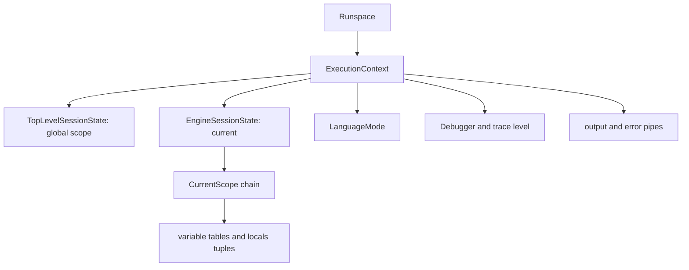

# Execution context and session state

> STATIC-ONLY — behavior not run-verified. `FACT-SRC` unless marked. Scope and variable rules live in [SCOPE-AND-VARIABLES](../02-language/SCOPE-AND-VARIABLES.md). Compiled code receives the context through `FunctionContext` ([IR-SPEC](../02-language/IR-SPEC.md) §4).

## 1. Purpose and scope [SPEC]

`ExecutionContext` is the per-runspace object that holds everything a running script needs: the current session state (scopes, functions, aliases, drives), the language mode, strict mode, the debugger, output pipes, the current exception, the type table and the command discovery object. `SessionState`/`SessionStateInternal` is the tree of scopes and the tables inside them. A new shell needs the same split: a *context* (one per interpreter instance) and a *session state* (one per module or top level).

## 2. Source map

| path | type | role | tier |
|---|---|---|---|
| src/System.Management.Automation/engine/ExecutionContext.cs::ExecutionContext@L28-L1679 | class | the per-runspace engine context (`<!--N:EXECCONTEXT_MEMBERS-->124<!--/N-->` members in the scan) | A |
| src/System.Management.Automation/engine/SessionStateScopeAPIs.cs::SessionStateInternal@L14-L323 | partial class | scope stack: `CurrentScope`, `GlobalScope`, `ScriptScope`, `NewScope`, `RemoveScope` | A |
| src/System.Management.Automation/engine/SessionStateScope.cs::SessionStateScope@L17-L2012 | class | one scope | A |

## 3. Responsibilities and non-responsibilities

Holds state and policy flags; does not execute anything. Command resolution (`CommandDiscovery`) hangs off the context but is owned by T32.

## 4. Key types and contracts [IMPL]

- `EngineSessionState` — the session state currently in effect (changes while a module's code runs); `TopLevelSessionState` — the runspace's top-level one (private setter); `SessionState` — the public wrapper of the engine one (src/System.Management.Automation/engine/ExecutionContext.cs::ExecutionContext@L28-L1679).
- `LanguageMode` (`FullLanguage`, `ConstrainedLanguage`, …): switching to `ConstrainedLanguage` records that the runspace has used it and **invalidates the cached binding rules** (after that the binders encode the language mode in the generated rules); the restore to constrained mode after running trusted code does not invalidate again (src/System.Management.Automation/engine/ExecutionContext.cs::ExecutionContext.LanguageMode@L275-L328).
- `IsStrictVersion(major)`: walks from the current scope to its parents; the first scope with a non-null `StrictModeVersion` decides (`Major >= requested`); a walk does not continue past the module scope; no `Set-StrictMode` → false (src/System.Management.Automation/engine/ExecutionContext.cs::ExecutionContext.IsStrictVersion@L105-L110).
- Preference lookup: `GetEnumPreference<T>(path, default, out defaultUsed)` reads the preference variable through the normal variable lookup; a value of type `T` is used directly, a string is parsed case-insensitively, any other value is unwrapped from `PSObject`; invalid values fall back to the default and report that the default was used (src/System.Management.Automation/engine/ExecutionContext.cs::ExecutionContext.GetEnumPreference@L521-L572).
- `CheckStackDepth()` converts `InsufficientExecutionStackException` into `ScriptCallDepthException` (src/System.Management.Automation/engine/ExecutionContext.cs::ExecutionContext.CheckStackDepth@L869-L879).

## 5. Data model

Members by role (names from the member scan, behavior `INFERENCE` unless stated): debugger (`Debugger`, `_debuggingMode`, `PSDebugTraceLevel`, `PSDebugTraceStep`), module state (`ModuleBeingProcessed`, `Modules`, `PreviousModuleProcessed`, `AutoLoadingModuleInProgress`), security (`LanguageMode`, `HasEverUsedConstrainedLanguage`, `MarkObjectAsUntrusted`, `AuthorizationManager`), output (`ExternalSuccessOutput`, `ExternalErrorOutput`, `ExternalProgressOutput`, `ShellFunctionErrorOutputPipe`, `Expression*OutputPipe`, `RedirectErrorPipe`, `AppendDollarError`), exception state (`CurrentExceptionBeingHandled`, `PropagateExceptionsToEnclosingStatementBlock`, `QuestionMarkVariableValue`), preference accessors (`DebugPreferenceVariable` … `ConfirmPreferenceVariable`), engine services (`CommandDiscovery`, `TypeTable`, `FormatDBManager`, `AssemblyCache`, `LocationGlobber`, `HelpSystem`, `EngineHostInterface`, `InternalHost`, `Events`).

## 6. Control flow

Module code runs with `EngineSessionState` switched to the module's session state; leaving restores it. The scope chain of a module ends at its module scope, which is why strict-mode lookup stops there.

## 7. Algorithms

Not applicable beyond §4 (strict mode walk, preference conversion, language-mode switch).

## 8. Observable behavior [SPEC]

`$ErrorActionPreference = 'Stop'` is read by error handling through `GetEnumPreference`; an invalid string value is replaced by the default in the engine's view (the visible variable is unchanged, `INFERENCE`). `Set-StrictMode -Version 2` affects code in the scope where it was set and its children until a module boundary. No golden sample: STATIC-ONLY.

## 9. Error handling and edge cases

`ScriptCallDepthException` on deep recursion; `GetEnumPreference` swallows conversion failures (falls back to default); a null context passed to the static `IsStrictVersion` helper is replaced by the thread-local context.

## 10. Concurrency and threading

The context is bound to a runspace and used from its pipeline thread; the language-mode setter takes a lock when invalidating binder caches; the "current context" is found through thread-local storage (`LocalPipeline.GetExecutionContextFromTLS`).

## 11. Extension points and customization hooks

Host interface (`EngineHostInterface`), `InitialSessionState`, custom argument completers (`CustomArgumentCompleters`, `NativeArgumentCompleters`), `Events`.

## 12. Dependencies

Inbound: everything in the engine (`ExecutionContext` is passed to nearly every runtime helper, see [IR-SPEC](../02-language/IR-SPEC.md) §5). Outbound: session state, providers, debugger, host.

## 13. Performance notes

`IsStrictVersion` is called from compiled code paths (strict checks on variable reads, call syntax) and walks scopes each time (`INFERENCE`: cheap when no strict mode is set because the walk reaches the root).

## 14. Security considerations (mandatory)

Language mode is a context property; switching it invalidates caches so constrained rules cannot be bypassed by cached full-language binder rules (`FACT-SRC` comment in the setter). `MarkObjectAsUntrusted*` and `IsMarkedAsUntrusted` support the data-trust model of Constrained Language Mode (details: 07-security, planned).

## 15. Enterprise considerations

Debug trace levels, host-visible streams and event manager give observability. Missing: no resource accounting per context.

## 16. Tests

Not read.

## 17. Design decisions and trade-offs

| Decision | Label | Consequence |
|---|---|---|
| one context object passed everywhere | `FACT-SRC` | no global state, easy to test, wide coupling |
| engine session state switched for module code | `FACT-SRC` | modules see their own scope chain |
| language mode in the context plus binder-cache invalidation | `FACT-SRC` | policy enforced at binding time, cached rules must be flushed on change |

## 18. Guidance for MicroteamShell [LESSON]

- **LSN-CTX-01** [REPLICATE] (area: NLD-SCP) One interpreter context object holding the current session state, strict mode, preference lookup and error state; pass it to runtime helpers instead of using globals. Evidence: src/System.Management.Automation/engine/ExecutionContext.cs::ExecutionContext@L28-L1679.
- **LSN-CTX-02** [REPLICATE] (area: NLD-SCP) Resolve preference variables through the normal variable lookup with a typed fallback. Evidence: src/System.Management.Automation/engine/ExecutionContext.cs::ExecutionContext.GetEnumPreference@L521-L572.
- **LSN-CTX-03** [REPLICATE] (area: NLD-RUN) Guard recursion with a stack-depth check that raises a dedicated "script call depth" error. Evidence: src/System.Management.Automation/engine/ExecutionContext.cs::ExecutionContext.CheckStackDepth@L869-L879.
- **LSN-CTX-04** [AVOID] (area: NLD-SEC) Leave out language modes and binder-cache invalidation unless a restricted mode is added later. Evidence: src/System.Management.Automation/engine/ExecutionContext.cs::ExecutionContext.LanguageMode@L275-L328. DEV: DEV-CTX-081

## 19. Open questions / UNVERIFIED

- Only the members named in §4 were read; the rest of the 1,711-line file (output redirection, `AppendDollarError`, assembly cache, startup error reporting) is inventory (names only). `UNVERIFIED` behavior of those members.
- Relationship between `TopLevelSessionState` and nested runspaces.

Verification: `ExecutionContext.IsStrictVersion`, `GetEnumPreference`, `CheckStackDepth`, `LanguageMode` setter and the `EngineSessionState` declaration were read; the member count comes from `data/members-tierA.json`; the remaining members are listed by name only.
