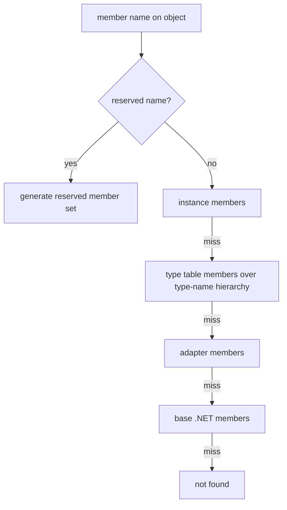

# Extended type system

> STATIC-ONLY — behavior not run-verified. `FACT-SRC` unless marked. Conversion rules are in [CONVERSION-RULES](../02-language/CONVERSION-RULES.md); how compiled code reads members through binders in [BINDER-CATALOG](../02-language/BINDER-CATALOG.md) and [RUNTIME-OPERATIONS](../02-language/RUNTIME-OPERATIONS.md); the minimal ETS the core needs is called out in §18.

## 1. Purpose and scope [SPEC]

The extended type system (ETS) gives every value a uniform *member view*: properties, methods, events and sets of them, regardless of whether the value is a .NET object, XML node, database row, COM object, a deserialized object or a script-made custom object. `PSObject` wraps a value; *adapters* expose the value's native members; the *type table* adds script-level members by type name; instance members can be added to a single object (`Add-Member`). Scripts, formatting, serialization and `Select-Object` all work through this view.

## 2. Source map

| path | type | role | tier |
|---|---|---|---|
| src/System.Management.Automation/engine/MshObject.cs::PSObject@L47-L2430 | class | wrapper; member collections; adapter selection; type names | B |
| src/System.Management.Automation/engine/MshMemberInfo.cs::PSMemberInfo@L173-L299 | abstract class | base of all member kinds | B |
| src/System.Management.Automation/engine/MshMemberInfo.cs::PSMemberInfoIntegratingCollection@L4503-L5152 | class | the merged member view used by `PSObject.Members` | B |
| src/System.Management.Automation/engine/MshMemberInfo.cs::CollectionEntry@L4367-L4417 | class | one source of members (type table, adapter, base) | B |
| src/System.Management.Automation/engine/CoreAdapter.cs::Adapter@L38-L2049 | abstract class | adapter contract (get member, property get/set, method invoke, definitions) | B |
| src/System.Management.Automation/engine/CoreAdapter.cs::DotNetAdapter@L2616-L4655 | class | reflection-based adapter with per-type caches | B |
| src/System.Management.Automation/engine/TypeTable.cs::TypeTable@L2764-L4778 | class | members, converters, adapters, serialization data by type name | B |
| src/System.Management.Automation/engine/ExtraAdapter.cs, ManagementObjectAdapter.cs, ThirdPartyAdapter.cs | classes | XML/DataRow/DirectoryEntry/WMI/CIM adapters; `PSPropertyAdapter` bridge | B |
| src/System.Management.Automation/engine/TypeTable_Types_Ps1Xml.cs (+2 siblings) | generated partial `TypeTable` | the built-in type data compiled into code (instead of loading `types.ps1xml`) | B |

## 3. Responsibilities and non-responsibilities

Owns: member lookup and enumeration, adapter choice, type-name hierarchy, instance and type-table members, `PSObject` identity and base-object unwrapping, type-data update. Does not own: operator semantics and conversion (T28), method overload resolution at call sites (binders, T26), formatting (T36), serialization format (Phase 4 remoting).

## 4. Key types and contracts [IMPL]

- **`PSObject`** holds the wrapped value (`BaseObject`), instance members, optional type-name list (`TypeNames`/`pstypenames`), the adapter set, deserialization fields (`AdaptedMembers`, `ClrMembers`, `IsDeserialized`) and the `WriteStream` tag used by the stream-merging code. `AsPSObject` wraps a value (or returns it if already wrapped); `Base(obj)` unwraps. A value of type `PSCustomObject`-style "empty base" has `ImmediateBaseObjectIsEmpty`.
- **Member kinds** (`PSMemberTypes` flags): `AliasProperty=1`, `CodeProperty=2`, `Property=4`, `NoteProperty=8`, `ScriptProperty=16`, `PropertySet=32`, `Method=64`, `CodeMethod=128`, `ScriptMethod=256`, `ParameterizedProperty=512`, `MemberSet=1024`, `Event=2048` (src/System.Management.Automation/engine/MshMemberInfo.cs::PSMemberTypes@L33-L118). Classes: `PSAliasProperty`, `PSCodeProperty`, `PSProperty` (adapted `PSAdaptedProperty`), `PSNoteProperty` (`PSVariableProperty`), `PSScriptProperty`, `PSMethod`, `PSCodeMethod`, `PSScriptMethod`, `PSParameterizedProperty`, `PSMemberSet`, `PSPropertySet`, `PSEvent`, `PSDynamicMember`.
- **Views** (`PSMemberViewTypes` flags): `Extended=1`, `Adapted=2`, `Base=4`, `All`.
- **Adapter contract** (`Adapter`): `GetMember<T>(obj, name)`, `GetFirstMemberOrDefault`, `GetMembers<T>(obj)`, `GetTypeNameHierarchy`, property operations (`PropertyGet/Set`, `IsGettable/IsSettable`, `PropertyType`, `PropertyAttributes`), method operations (`MethodInvoke`, `MethodDefinitions`), parameterized-property operations, and `CanSiteBinderOptimize`. An `AdapterSet` pairs the *original* adapter with an optional `.NET` adapter used for the *base* view.
- **Adapter selection** (`GetMappedAdapter(obj, typeTable)`): (1) an adapter registered in the type table for the object's type **by exact full type name** (no inheritance; source comment marks this as a known limitation); (2) a cached per-type result; (3) the built-in mappers in this order: `PSMemberSet` → member-set adapter; `PSObject` → `PSObject` adapter; `CimInstance` → CIM adapter; on Windows `ManagementClass`, `ManagementBaseObject`, `DirectoryEntry`; `DataRowView`; `DataRow`; `XmlNode`; (4) otherwise a COM object (Windows) gets a COM adapter built from its type info (or the .NET adapter with COM type name), and everything else gets the .NET instance adapter. The result is cached per type (src/System.Management.Automation/engine/MshObject.cs::PSObject.GetMappedAdapter@L460-L538).
- **Type table**: `GetMembers(typeNames)` builds (and caches by the joined type-name key) a merged member collection: type names are processed from the **last (least specific) to the first (most specific)**; a member of a more specific type replaces a same-named member of a less specific type; if both are member sets and the new one has `InheritMembers`, their members are merged instead (new members added, same-named members replaced). Converters and adapters are looked up by name (src/System.Management.Automation/engine/TypeTable.cs::TypeTable.MemberFactory@L3985-L4041).
- **Script members**: a `PSScriptProperty` created from text (type data) records a `PSLanguageMode` and applies it to its getter and setter script blocks when they are created, so the script runs under the language mode in force when the type data was loaded; getter and setter run with the object as `$this` and are marked step-through for the debugger (src/System.Management.Automation/engine/MshMemberInfo.cs::PSScriptProperty@L1537-L1905).

<!--CF:CF-ETS-001-->**Member resolution order (CF-ETS-001).** Looking up member *name* on a value `v` (wrapped as a `PSObject`) proceeds in this order and returns the first hit: (1) the reserved names `psbase`, `psadapted`, `psextended`, `psobject` and `pstypenames`, generated on demand; (2) **instance members** added to this object (for example by `Add-Member`); (3) **type-table (extended) members** merged over the object's type-name hierarchy, most specific type name winning; (4) **adapted members** from the adapter chosen for the object; (5) **base members**: the .NET members of the wrapped object, only when the chosen adapter is not already the .NET adapter. Member-name matching in the .NET adapter is case-insensitive (its binding flags include `IgnoreCase`). Type-table collection entries are marked "replicate and clone when returning" (a copy bound to the current object is handed out), adapted and base entries are not; the enumeration order across sources is `UNVERIFIED` (VB-038). Member lookup on a `PSMemberSet` owner searches the set's own members first, then the same collections.<!--/CF-->

## 5. Data model

`PSObject` fields: base object, `InstanceMembers` (lazily created collection), `_typeNames` (`ConsolidatedString` with an interned key used for type-table caching), `_adapterSet`, `HasGeneratedReservedMembers`, `ToStringFromDeserialization`, `TokenText`, `WriteStream`. `TypeTable`: maps type name → members (`_extendedMembers`), type name → converter, type name → adapter, type name → serialization settings (`GetSpecificProperties`), and a consolidated-members cache. Static caches in `DotNetAdapter`: per-`Type` property, method and event cache tables for instance and static views (`s_instancePropertyCacheTable`, `s_staticMethodCacheTable`, …) and `s_adapterMapping` (`Type` → `AdapterSet`).

## 6. Control flow

## 7. Algorithms

Adapter selection and type-table merge are given in §4. Type-name hierarchy for a .NET object comes from the adapter (`GetTypeNameHierarchy`): for the .NET adapter the runtime type, its base types and interfaces as arranged by the adapter (`UNVERIFIED` exact order, VB-038); instance `TypeNames` can be replaced per object (`pstypenames`). The merged type-table collection is cached by the joined type-name key, so changing type data clears it (`Update` in `TypeTable`).

## 8. Observable behavior [SPEC]

- `Get-Member` lists members of all views (`-View Extended|Adapted|Base|All`); `$o.psobject.Properties` is the property view; `$o.pstypenames` shows the type-name list.
- `Add-Member` adds an instance member; adding a name that the type data already defines is an error (`AlreadyPresentInTypesXml`); reserved names cannot be added (`PSObjectMembersMembersAddReservedName`); adding a plain `Property` or `Method` is not allowed (`CannotAddMethodOrProperty`).
- `Update-TypeData` / `Remove-TypeData` change type-table members.
- A deserialized object keeps its adapted/CLR members as data and loses behavior.
- Tests: §16. No golden sample: STATIC-ONLY.

## 9. Error handling and edge cases

`ExtendedTypeSystemException` with ids such as `CannotAddMethodOrProperty`, `CannotChangeReservedMember`, `RemoveMemberFromStaticMemberSet`, `AlreadyPresentInTypesXml`; `GetValueException` / `SetValueException` when a getter or setter is missing or throws (for example `GetWithoutGetterFromScriptPropertyValue`); adapter exceptions during `IsGettable` etc. are converted to ETS exceptions with `CatchFrom…` ids. Case-insensitive lookup in the .NET adapter can make two members with names differing only by case ambiguous (`UNVERIFIED` handling).

## 10. Concurrency and threading

Static caches (`s_adapterMapping`, the `DotNetAdapter` per-type tables) are shared by all runspaces; adapter mapping takes a lock for the mapper list and uses concurrent dictionaries; `TypeTable` consolidated members are held in a concurrent cache. A `PSObject` itself is not thread-safe.

## 11. Extension points and customization hooks

`Update-TypeData` (type, member kind, serialization settings), type `*.ps1xml` files, `PSPropertyAdapter` (third-party property adapters registered by type name through the type table), `Add-Member` instance members (note, script property/method, alias, code members, member sets), `ETS` converters (`PSTypeConverter`, `TypeConverter` registered in type data), `DefaultDisplayPropertySet` and `PSStandardMembers` for display and serialization defaults (`GetPSStandardMember`).

## 12. Dependencies

Inbound: every cmdlet and the runtime (`PSObject.AsPSObject` at pipe boundaries), the binders (member access), formatting, serialization, `Select-Object`, `Where-Object`, `Sort-Object`. Outbound: `LanguagePrimitives` (enumeration, conversion), `ExecutionContext` (the type table; `GetTypeTable` falls back to the thread's context), reflection, script blocks for script members.

## 13. Performance notes

Per-type reflection caches (properties, methods with `MethodInformation` arrays, events) avoid repeated reflection; the adapter mapping is cached per `Type`; the consolidated type-table members are cached per type-name key; `CanSiteBinderOptimize` lets call-site binders skip the generic path for the .NET adapter. Member collections for instance members are created lazily. Wrapping every pipeline value in `PSObject` allocates; `ImmediateBaseObjectIsEmpty` and `AsPSObject` reuse limit it.

## 14. Security considerations

ETS is a policy surface: (a) script properties and script methods from type data run script, under the language mode captured at load; (b) the type table is a global mutation point — `Update-TypeData` can change how values behave for later code, so it must be restricted in constrained sessions (`UNVERIFIED` where enforced, Phase 5); (c) adapters decide which native members are visible — the `.NET` adapter exposes public members of any type that the process can load, which is why constrained language restricts method calls and property sets on non-core types at the binder level (not here); (d) deserialized objects must not regain behavior (`IsDeserialized` keeps data-only members).

### Security surface

<!--GEN:secseeds-->
| Category | Seed hits |
|---|---:|
| language-mode | 10 |
| constrained-types | 1 |
| **total** | 11 |

Files with most hits:

| File | Hits |
|---|---:|
| `src/System.Management.Automation/engine/MshMemberInfo.cs` | 8 |
| `src/System.Management.Automation/engine/TypeTable.cs` | 2 |
| `src/System.Management.Automation/engine/MshObject.cs` | 1 |

These are regex scanner hits (`APPROX`, `verified: false`, no `SEC-ENF` ID yet). Phase 5 verifies them and assigns IDs; none is claimed here as an enforcement point.
<!--/GEN:secseeds-->

What the new shell must guarantee here: type-data mutation is a policy-controlled operation; script members are bound to the language mode of their definer; member visibility for a value can be restricted per session without changing the value; deserialized data never resolves to live adapters.

## 15. Enterprise considerations

Security first: §14. Observability: a member-resolution tracer (`PSObject.MemberResolution`) records each lookup step ("Found PSObject instance member", "present in type table", "Adapted member", "DotNet member"). Supportability: `Get-Member` plus the tracer explain where a member comes from. Testability: ETS is exercised through the language, plus xUnit tests on `PSObject`. Resource limits: unbounded caches keyed by type; no eviction (`INFERENCE`). Missing: scoped (per-runspace) adapter registration for non-type-table adapters (the mapping cache is static).

## 16. Tests

<!--GEN:tests-->
| Pester file | Describe | Context | It |
|---|---:|---:|---:|
| `test/powershell/Language/Scripting/Adapter.Tests.ps1` | 2 | 0 | 5 |
| `test/powershell/Language/Scripting/HashtableToPSCustomObjectConversion.Tests.ps1` | 2 | 0 | 11 |
| `test/powershell/Modules/Microsoft.PowerShell.Utility/Add-Member.Tests.ps1` | 2 | 0 | 25 |
| `test/powershell/Modules/Microsoft.PowerShell.Utility/Get-Member.Tests.ps1` | 2 | 3 | 15 |
| `test/powershell/Modules/Microsoft.PowerShell.Utility/Remove-TypeData.Tests.ps1` | 1 | 0 | 3 |
| `test/powershell/Modules/Microsoft.PowerShell.Utility/Update-TypeData.Tests.ps1` | 1 | 1 | 18 |
| `test/powershell/engine/ETS/Adapter.Tests.ps1` | 4 | 7 | 26 |
| `test/powershell/engine/ETS/CimAdapter.Tests.ps1` | 1 | 0 | 15 |
| `test/powershell/engine/ETS/TypeTable.Tests.ps1` | 1 | 0 | 4 |
| **total (9 files)** | 16 | 11 | 122 |

| xUnit file | Facts | Theories | Classes |
|---|---:|---:|---|
| `test/xUnit/csharp/test_PSObject.cs` | 8 | 0 | `PSObjectTests` |

Matching is by path keyword (`APPROX`): `engine/ETS/`, `Scripting/Adapter.Tests`, `Utility/Update-TypeData`, `Utility/Remove-TypeData`, `Utility/Add-Member`, `Utility/Get-Member`, `HashtableToPSCustomObjectConversion`, `test_PSObject`.
<!--/GEN:tests-->

## 17. Design decisions and trade-offs

- `FACT-SRC`: layered member view (instance → type table → adapter → base) lets scripts add or override behavior without changing the runtime type.
- `FACT-SRC`: adapter lookup by exact type name is documented in source as a stop-gap (comment says it should honour type hierarchy).
- `INFERENCE`: wrapping values in `PSObject` only at boundaries (not on every operation) balances the cost of the dual view.
- `FACT-SRC`: the built-in type data is compiled into C# (`TypeTable_Types_Ps1Xml.cs`) so start-up does not parse XML.
- `FACT-SRC`: reserved names are generated lazily the first time any reserved member is asked for.

## 18. Guidance for the new shell [LESSON]

- **LSN-RTETS-01** [REPLICATE] (area: NLD-TYP) Keep the member resolution order instance → type data → adapter → base with the five reserved names; scripts depend on it. Evidence: src/System.Management.Automation/engine/MshMemberInfo.cs::PSMemberInfoIntegratingCollection@L4503-L5152.
- **LSN-RTETS-02** [REPLICATE] (area: NLD-TYP) Merge type data from the least to the most specific type name, with member-set inheritance. Evidence: src/System.Management.Automation/engine/TypeTable.cs::TypeTable.MemberFactory@L3985-L4041.
- **LSN-RTETS-03** [ADAPT] (area: NLD-TYP) Select adapters by type with inheritance (nearest registered base type wins) instead of exact full-name match, as the source comment itself proposes. Evidence: src/System.Management.Automation/engine/TypeTable.cs::TypeTable.GetTypeAdapter@L4064-L4099.
- **LSN-RTETS-04** [ADAPT] (area: NLD-TYP) Make adapter and type-table registries per-runspace (or per-session-state) objects rather than static caches, so one session cannot change another's member view. Evidence: src/System.Management.Automation/engine/MshObject.cs::PSObject.GetMappedAdapter@L460-L538.
- **LSN-RTETS-05** [REPLICATE] (area: NLD-SEC) Bind script members to the definer's language mode and keep deserialized objects data-only. Evidence: src/System.Management.Automation/engine/MshMemberInfo.cs::PSScriptProperty@L1537-L1905.
- **LSN-RTETS-06** [AVOID] (area: NLD-TYP) Do not carry the WMI, DirectoryEntry, DataRow/DataRowView and COM adapters into the first version; keep .NET, XML, `PSObject`, member-set and the third-party adapter bridge. DEV: DEV-ETS-150. Evidence: src/System.Management.Automation/engine/MshObject.cs::PSObject.MappedInternalAdapterSet@L433-L454.
- **LSN-RTETS-07** [REDESIGN] (area: NLD-TYP) Compile the built-in type data to a table at build time (as PowerShell does) but also publish it as a versioned data file, so tooling and a clean-room implementation share one source. DEV: DEV-ETS-151. Evidence: src/System.Management.Automation/engine/TypeTable_Types_Ps1Xml.cs::TypeTable@L12-L9138.

## 19. Open questions / UNVERIFIED items

- `UNVERIFIED` (VB-038): `DotNetAdapter` member discovery (overload tables, property caches, hidden members, case-collision handling), type-name hierarchy order, `PSMethod` invocation path, `PSObject` members not read (formatting-related `ToString`, comparison, `Copy`, serialization helpers), `TypeTable.Update` and types.ps1xml loading.
- `UNVERIFIED` (VB-039): `PSMemberSet`/`PSPropertySet` semantics beyond lookup; `PSEvent`; `PSDynamicMember`.

Verification: `MshObject.cs` lines 245–330, 426–545, 1938–2116, `MshMemberInfo.cs` lines 4503–4560, 4799–4860 and the member-type enums and class list, `TypeTable.cs` lines 3965–4110, `CoreAdapter.cs` declarations (lines 38–330, 2616–2700) were read. Remaining content is from signatures (tier B). Ranges in `T31_T39.csv`.
