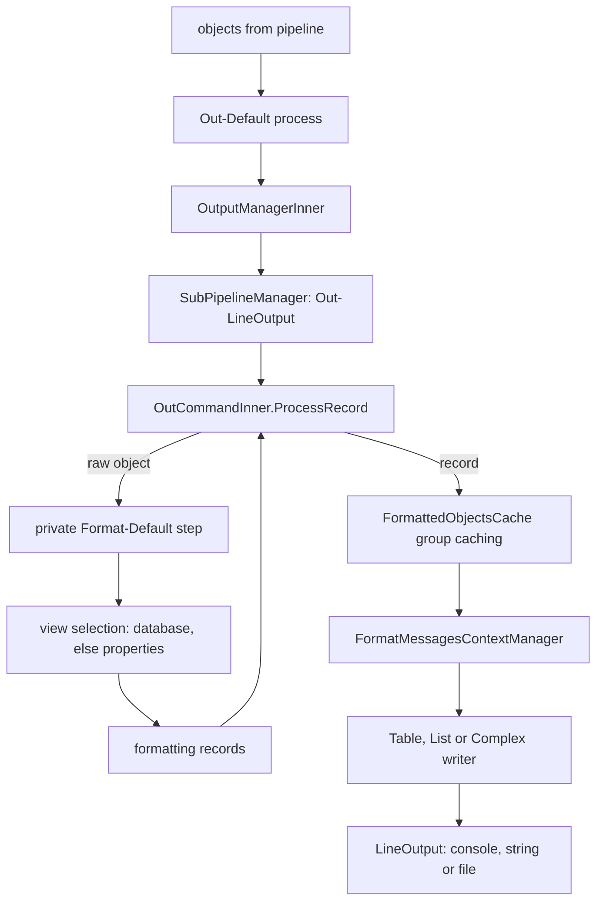

# Formatting and output

> STATIC-ONLY — behavior not run-verified. `FACT-SRC` unless marked. Scope `EXTENDED`. The run-time command that ends every interactive pipeline is `Out-Default` (see [runspace-and-pipeline](runspace-and-pipeline.md) §14: transcription appends it). Member access used by views: [extended-type-system](extended-type-system.md). Error rendering: [errors-and-diagnostics](errors-and-diagnostics.md).

## 1. Purpose and scope [SPEC]

Turns objects into text for a host. Objects that reach `Out-Default` are given to a hidden formatting step (`Format-Default`) which picks a *view* (table, list, wide, or custom/"complex") from a *display database* built from format data (`*.format.ps1xml`) and produces *formatting records*; a writer then lays the records out as lines on a `LineOutput` (console, string, file). This document covers the pipeline of format/out commands, view selection, the record protocol, layout caching and the output sinks. Colors and ANSI (`PSStyle`) are named but not analysed.

## 2. Source map

| path | type | role | tier |
|---|---|---|---|
| src/System.Management.Automation/FormatAndOutput/out-console/OutConsole.cs::OutDefaultCommand@L44-L163 | cmdlet | `Out-Default`: sends objects to the console writer; captures `-OutVariable` | B |
| src/System.Management.Automation/FormatAndOutput/out-console/OutConsole.cs::OutHostCommand@L169-L211 | cmdlet | `Out-Host` | B |
| src/System.Management.Automation/FormatAndOutput/format-default/format-default.cs::FormatDefaultCommand@L14-L38 | cmdlet | `Format-Default`: shape undefined (let the database decide) | B |
| src/System.Management.Automation/FormatAndOutput/common/BaseCommand.cs::FrontEndCommandBase@L147-L270 | abstract cmdlet | thin cmdlet shell delegating to an *implementation* object | B |
| src/System.Management.Automation/FormatAndOutput/common/BaseCommand.cs::CommandWrapper@L39-L140 | class | runs a cmdlet as a private sub-pipeline step-by-step | B |
| src/System.Management.Automation/FormatAndOutput/common/OutputManager.cs::OutputManagerInner@L19-L134 | class | implementation of Out-Default/Out-Host: owns the sub-pipeline manager | B |
| src/System.Management.Automation/FormatAndOutput/common/OutputManager.cs::SubPipelineManager@L141-L326 | class | creates the hidden `Out-LineOutput` sub-pipeline | B |
| src/System.Management.Automation/FormatAndOutput/out-textInterface/OutTextInterface.cs::OutLineOutputCommand@L18-L91 | cmdlet | `Out-LineOutput`: consumes formatting records, writes lines | B |
| src/System.Management.Automation/FormatAndOutput/common/BaseOutputtingCommand.cs::OutCommandInner@L16-L1394 | class | formatting-record consumer: state machine, caching, group handling | B |
| src/System.Management.Automation/FormatAndOutput/common/BaseFormattingCommand.cs::InnerFormatShapeCommand@L44-L543 | class | producer: selects a view and emits formatting records | B |
| src/System.Management.Automation/FormatAndOutput/common/FormatViewManager.cs::FormatViewManager@L69-L460 | class | view selection | B |
| src/System.Management.Automation/FormatAndOutput/common/DisplayDatabase/typeDataQuery.cs::DisplayDataQuery@L244-L672 | class | queries the database by shape, type names and view name | B |
| src/System.Management.Automation/FormatAndOutput/common/DisplayDatabase/typeDataManager.cs::TypeInfoDataBaseManager@L20-L569 | class | loads and holds the database | B |
| src/System.Management.Automation/FormatAndOutput/common/TableWriter.cs, ListWriter.cs, ComplexWriter.cs | classes | line layout per shape | B |
| src/System.Management.Automation/FormatAndOutput/common/ILineOutput.cs::LineOutput@L215-L304 | abstract class | the output sink contract | B |
| src/System.Management.Automation/FormatAndOutput/out-console/ConsoleLineOutput.cs::ConsoleLineOutput@L83-L548 | class | console sink (paging, wrapping) | B |
| src/System.Management.Automation/FormatAndOutput/DefaultFormatters/*.cs | generated classes | built-in format data compiled into code | B |
| src/System.Management.Automation/FormatAndOutput/common/PSStyle.cs::PSStyle@L43-L913 | class | ANSI styles and output-rendering mode | B |

## 3. Responsibilities and non-responsibilities

Owns: view selection, formatting-record protocol, layout and column width logic, sink contract. Does not own: object member access (ETS), host UI primitives (`PSHostUserInterface`, Phase 4), the cmdlets `Format-Table`, `Format-List`, `Format-Wide`, `Format-Custom`, `Out-File`, `Out-String` (command-module family `Microsoft.PowerShell.Utility`; they reuse `InnerFormatShapeCommand` / `OutCommandInner`).

## 4. Key types and contracts [IMPL]

- **`FrontEndCommandBase`** (base of `Out-Default`, `Out-Host`, `Format-*`, `Out-LineOutput`) holds one `ImplementationCommandBase` and wires three callbacks (outer cmdlet, read input object, write object). All real work is in the implementation, so the same logic runs as a cmdlet or inside a sub-pipeline.
- **`CommandWrapper`** builds a one-command `PipelineProcessor` over a `CmdletInfo`/`CommandProcessor` pair and drives it with `Process(o)` (calls `Step`) and `ShutDown()` (calls `SynchronousExecuteEnumerate`), so formatting commands can call each other without a parser (src/System.Management.Automation/FormatAndOutput/common/BaseCommand.cs::CommandWrapper@L39-L140).
- **Out-Default flow**: `BeginProcessing` creates a console `LineOutput`, sets `MergeUnclaimedPreviousErrorResults = true` on its runtime (so earlier commands' unclaimed error output is routed to it), optionally starts transcribe-only mode (`-Transcript`), and, when `-OutVariable` is bound, collects non-error, non-formatting objects; `ProcessRecord` forwards each input object to `OutputManagerInner`, which lazily creates a `SubPipelineManager` that runs the hidden `Out-LineOutput` cmdlet with the line sink as a named parameter (src/System.Management.Automation/FormatAndOutput/out-console/OutConsole.cs::OutDefaultCommand@L44-L163, src/System.Management.Automation/FormatAndOutput/common/OutputManager.cs::SubPipelineManager@L141-L326). The manager has one *default* handler (`out-lineoutput`) and a list of per-type handlers (empty in this version).
- **Raw object vs formatting record**: in `OutCommandInner.ProcessRecord`, an object is first tried as a formatting record (`FormatStartData`, `GroupStartData`, `FormatEntryData`, `GroupEndData`, `FormatEndData`); if it is not one, it is sent through a private `format-default` command (`ApplyFormatting`) and each result is processed as a record (src/System.Management.Automation/FormatAndOutput/common/BaseOutputtingCommand.cs::OutCommandInner@L16-L1394).
- **Record state machine** (`NeedsPreprocessing`): states `Reset` → (`FormatStartData`) `Formatting` → (`GroupStartData`) `InsideGroup` → entries → (`GroupEndData`) → `Formatting` → (`FormatEndData`) `Reset`. An entry that is "out of band" is allowed anywhere. A new `FormatStartData` while inside a group ends the current formatting first (flush) and begins again. Wrong order raises a formatting error.

- **View selection** (`FormatViewManager.Initialize`): inputs are the object's type-name list (`InternalTypeNames`), a requested shape (`Undefined` for `Format-Default`), and command-line parameters. (1) shape undefined → `GetDefaultView` over the database; (2) a view found → use it; (3) not found → `SelectViewGeneratorFromProperties`; with explicit properties → property view of the requested shape; with an explicit `-View` name → that named view of the shape, else `ProcessUnknownViewName` raises an error; otherwise → the first applicable view of the shape; none → property view (src/System.Management.Automation/FormatAndOutput/common/FormatViewManager.cs::FormatViewManager.Initialize@L91-L204). A view matches by *applies-to* lists of type names and type groups; the database is walked in order, skipping out-of-band list/complex views and views of other shapes; the first *perfect match* of the object's type names wins, otherwise the *best match* (`TypeMatch.BestMatch`); if none matches and the type names carry the deserialization prefix of the type names, the search repeats without the prefix (src/System.Management.Automation/FormatAndOutput/common/DisplayDatabase/typeDataQuery.cs::DisplayDataQuery@L244-L672). `UNVERIFIED` (VB-040): the exact `TypeMatch.PerfectMatch`/`BestMatch` ranking.
- **Property view fallback** (no view in the database): the shape comes from the database's shape directives for the type, else from the count of the object's *default display property set* (`PSStandardMembers.DefaultDisplayPropertySet`), falling back to *all* properties when no default set exists: **table when the count is at or below the database's `PropertyCountForTable` threshold, else list** (src/System.Management.Automation/FormatAndOutput/common/DisplayDatabase/typeDataQuery.cs::DisplayDataQuery.GetShapeFromPropertyCount@L333-L339). The threshold value is data (`UNVERIFIED` in source here; commonly 4, `EXTERNAL`).

## 5. Data model

Format data model (`displayDescriptionData*.cs`): `TypeInfoDataBase` with sections for default settings (shape-selection directives, display-error and string-substitution settings, `autosize`), type groups, and view definitions (`name`, `appliesTo` type/group references, `mainControl` = table/list/wide/complex control body, `outOfBand`, `groupBy`). Formatting records (`FormatStartData` with shape header info, `GroupStartData`, `FormatEntryData` with payload, `GroupEndData`, `FormatEndData`) travel through the pipeline as `PSObject`s of internal types in the namespace `Microsoft.PowerShell.Commands.Internal.Format`. `OutCommandInner` keeps a `FormattedObjectsCache` and a `FormatMessagesContextManager` (callbacks: context creation, format start/end, group start/end, payload).

## 6. Control flow

**Table layout caching**: when the format-start record carries autosize information, the cache holds the first *n* objects of the group (`objectCount`) before writing, so column widths can be computed from them; when the header's first column width is 0 (auto), caching is enabled with a **300 ms** time window; otherwise records are written as they arrive. The sink may require buffering (`RequiresBuffering`), in which case playback of the cache is delegated to the sink (`ExecuteBufferPlayBack`); otherwise the cache is drained at end of input (src/System.Management.Automation/FormatAndOutput/common/BaseOutputtingCommand.cs::OutCommandInner@L16-L1394).

## 7. Algorithms

View selection and shape fallback are in §4. Column width computation (`ColumnWidthManager`), wrapping, truncation and the console paging logic are `UNVERIFIED` (VB-041).

## 8. Observable behavior [SPEC]

- Objects with no format data print as a table when they have at most the threshold number of display properties, else as a list; `Format-List`/`Format-Table`/`Format-Wide`/`Format-Custom` force a shape; `-View` picks a named view; `-Property` forces a property view.
- Table output of a first batch can be delayed up to about 300 ms to compute column widths when widths are automatic.
- Error records reaching `Out-Default` are formatted with the error view (`$ErrorView`, see errors document).
- `Out-Default -Transcript` writes objects to the transcript only.
- Tests: §16. No golden sample: STATIC-ONLY.

## 9. Error handling and edge cases

`FormatErrorManager` collects property-expression failures and string-format errors and turns them into error records (`DrainFailedResultList`). Unknown view name → terminating error through `TerminatingErrorContext`. An out-of-order formatting record → format-state error. Objects that cannot be formatted fall back to `ToString` (`GenerateOutOfBandObjectAsToString`). Deserialized objects use the `Deserialized.` prefix fallback.

## 10. Concurrency and threading

Runs on the pipeline thread; `OutputManagerInner.StopProcessing` takes a lock and stops the sink (`_isStopped`), because stop requests arrive from another thread. The 300 ms grouping window is evaluated on arrival of records, not with a timer (`INFERENCE`; `FormattedObjectsCache` not read in full).

## 11. Extension points and customization hooks

Format data files (`Update-FormatData`, module `FormatsToProcess`, `types` + `format.ps1xml`), `PSStandardMembers` default display property set, `ToString` of objects, `$FormatEnumerationLimit`, `PSStyle` and `$PSStyle.OutputRendering`, custom `LineOutput` implementations (internal), `Out-*` cmdlets as sinks (`Out-File`, `Out-String`, `Out-Null`, `Out-Printer` where present).

## 12. Dependencies

Inbound: every interactive pipeline (host appends `Out-Default`), `Out-String`, `Out-File`, error display. Outbound: ETS property expressions (`PSPropertyExpression`), `LanguagePrimitives` string conversion, the host UI (`ConsoleLineOutput` uses host raw UI for width/height and paging), `PSStyle`, the format database (`TypeInfoDataBaseManager` held by the execution context: `FormatDBManager`).

## 13. Performance notes

Built-in format data is compiled to C# (`DefaultFormatters/*.cs`) instead of parsing XML at start-up; per-type view lookup walks the view list linearly on every record batch (`UNVERIFIED` caching); table width computation needs up to *n* objects or 300 ms of buffering, which delays first output.

## 14. Security considerations

Formatting runs user-influenced code: property expressions in views can contain script blocks, and `ToString` of arbitrary objects runs object code, so format data is a code-execution surface (format data from untrusted modules is loaded only when the module is imported; `UNVERIFIED` language-mode checks, Phase 5). Output sinks write to host and transcript, so redaction and `SecureString` handling matter here (`SecureString` prints as its type name). Escape sequences in object text can attack terminals; `PSStyle.OutputRendering` and string-decoration code (`StringDecorated`) exist for that (`UNVERIFIED` scope).

### Security surface

<!--GEN:secseeds-->
| Category | Seed hits |
|---|---:|
| remoting-deser | 10 |
| jea | 4 |
| logging | 3 |
| language-mode | 2 |
| app-control | 1 |
| securestring | 1 |
| **total** | 21 |

Files with most hits:

| File | Hits |
|---|---:|
| `src/System.Management.Automation/FormatAndOutput/common/Utilities/MshParameter.cs` | 9 |
| `src/System.Management.Automation/FormatAndOutput/DefaultFormatters/PowerShellCore_format_ps1xml.cs` | 4 |
| `src/System.Management.Automation/FormatAndOutput/out-console/OutConsole.cs` | 3 |
| `src/System.Management.Automation/FormatAndOutput/common/DisplayDatabase/XmlLoaderBase.cs` | 2 |
| `src/System.Management.Automation/FormatAndOutput/common/DisplayDatabase/typeDataXmlLoader.cs` | 1 |
| `src/System.Management.Automation/FormatAndOutput/common/FormatViewManager.cs` | 1 |
| `src/System.Management.Automation/FormatAndOutput/common/Utilities/MshObjectUtil.cs` | 1 |

These are regex scanner hits (`APPROX`, `verified: false`, no `SEC-ENF` ID yet). Phase 5 verifies them and assigns IDs; none is claimed here as an enforcement point.
<!--/GEN:secseeds-->

What the new shell must guarantee here: view selection and property evaluation run under the caller's language mode; display never executes code from format data that its policy forbids; terminal control sequences from data are neutralized before reaching a terminal unless rendering is explicitly enabled; transcripts receive the same redaction as the console.

## 15. Enterprise considerations

Security first: §14. Observability: format-view binding tracer (`format_view_binding`), formatting error collection. Supportability: `-View` and `Get-FormatData`/`Update-FormatData` allow inspection and override. Testability: formatting is deterministic given width; hard to unit-test because it depends on host width/height. Resource limits: group caching bounds memory by object count or time; no limit on line length except host width. Missing: structured (non-text) output channels for machine consumers (`ConvertTo-Json` is separate).

## 16. Tests

<!--GEN:tests-->
| Pester file | Describe | Context | It |
|---|---:|---:|---:|
| `test/powershell/Modules/Microsoft.PowerShell.Core/Out-Default.Tests.ps1` | 1 | 0 | 4 |
| `test/powershell/Modules/Microsoft.PowerShell.Core/Out-Host.Tests.ps1` | 1 | 0 | 1 |
| `test/powershell/Modules/Microsoft.PowerShell.Utility/Format-Custom.Tests.ps1` | 3 | 2 | 11 |
| `test/powershell/Modules/Microsoft.PowerShell.Utility/Format-List.Tests.ps1` | 3 | 0 | 23 |
| `test/powershell/Modules/Microsoft.PowerShell.Utility/Format-Table.Tests.ps1` | 2 | 0 | 36 |
| `test/powershell/Modules/Microsoft.PowerShell.Utility/Format-Wide.Tests.ps1` | 2 | 0 | 14 |
| `test/powershell/Modules/Microsoft.PowerShell.Utility/Out-File.Tests.ps1` | 2 | 0 | 11 |
| `test/powershell/Modules/Microsoft.PowerShell.Utility/Out-String.Tests.ps1` | 2 | 0 | 8 |
| `test/powershell/engine/Formatting/BugFix.Tests.ps1` | 1 | 0 | 3 |
| `test/powershell/engine/Formatting/ErrorView.Tests.ps1` | 1 | 3 | 22 |
| `test/powershell/engine/Formatting/OutputRendering.Tests.ps1` | 1 | 0 | 4 |
| `test/powershell/engine/Formatting/PSStyle.Tests.ps1` | 3 | 0 | 37 |
| **total (12 files)** | 22 | 5 | 174 |

No xUnit file matched the path keywords.

Matching is by path keyword (`APPROX`): `Core/Out-Default`, `Core/Out-Host`, `Utility/Out-String`, `Utility/Format-Custom`, `Utility/Format-Wide`, `Utility/Out-File`, `Utility/Format-Table`, `Utility/Format-List`, `engine/Formatting/`.
<!--/GEN:tests-->

## 17. Design decisions and trade-offs

- `FACT-SRC`: formatting is a separate pipeline stage that turns objects into *records* (data) and a second stage that turns records into text; this lets `Format-*` cmdlets and `Out-*` cmdlets be combined (formatting objects are what `Format-Table | Out-File` passes).
- `FACT-SRC`: the display database selects by type-name list, so inheritance order of type names (ETS) is the specificity rule.
- `INFERENCE`: the sub-pipeline and `CommandWrapper` exist to reuse cmdlet code paths without exposing internal commands in the command table.
- `FACT-SRC`: an empty per-type handler list in `SubPipelineManager` is an unused extension point.

## 18. Guidance for the new shell [LESSON]

- **LSN-RTFMT-01** [REPLICATE] (area: NLD-RUN) Two-stage output: objects → formatting records (data) → line layout, with the record state machine; `Format-*` output can be piped to `Out-*`. Evidence: src/System.Management.Automation/FormatAndOutput/common/BaseOutputtingCommand.cs::OutCommandInner@L16-L1394.
- **LSN-RTFMT-02** [REPLICATE] (area: NLD-RUN) View selection by type-name list with perfect match then best match, then property-count fallback (table at or below the threshold, else list). Evidence: src/System.Management.Automation/FormatAndOutput/common/FormatViewManager.cs::FormatViewManager.Initialize@L91-L204.
- **LSN-RTFMT-03** [ADAPT] (area: NLD-RUN) Replace the hidden sub-pipeline (`CommandWrapper` over `Out-LineOutput`) by a direct call to the formatter and sink objects, keeping the same observable output. Evidence: src/System.Management.Automation/FormatAndOutput/common/OutputManager.cs::SubPipelineManager@L141-L326.
- **LSN-RTFMT-04** [ADAPT] (area: NLD-RUN) Keep table width auto-sizing but make the buffering window a configurable policy (count and time) instead of the fixed 300 ms. Evidence: src/System.Management.Automation/FormatAndOutput/common/BaseOutputtingCommand.cs::OutCommandInner@L16-L1394.
- **LSN-RTFMT-05** [REDESIGN] (area: NLD-RUN) Provide an optional structured output sink (typed records for machines) next to the text sink, so enterprise tooling does not parse text. DEV: DEV-FMT-160. Evidence: src/System.Management.Automation/FormatAndOutput/common/ILineOutput.cs::LineOutput@L215-L304.
- **LSN-RTFMT-06** [AVOID] (area: NLD-RUN) Do not carry the format XML loader family (`typeDataXmlLoader*`, schema validation) in the first version; ship built-in views as compiled data plus a small JSON/YAML view definition for extensions. DEV: DEV-FMT-161. Evidence: src/System.Management.Automation/FormatAndOutput/common/DisplayDatabase/typeDataXmlLoader.cs::TypeInfoDataBaseLoader@L40-L2234.

## 19. Open questions / UNVERIFIED items

- `UNVERIFIED` (VB-040): `TypeMatch.PerfectMatch`/`BestMatch` ranking, `Complex` (custom) view semantics, `groupBy` handling, expression/script evaluation inside views, `PropertyCountForTable` default.
- `UNVERIFIED` (VB-041): `TableWriter`, `ListWriter`, `ComplexWriter`, `ColumnWidthManager`, `ConsoleLineOutput` (paging, wrapping), `FormattedObjectsCache` internals, `PSStyle`/`StringDecorated`, `OutputRendering` modes.
- `UNVERIFIED` (VB-042): the XML loader and schema validation (`typeDataXmlLoader*`, `XmlLoaderBase`), `FormatTable` (public API), built-in formatter data contents.

Verification: `OutConsole.cs` lines 36–170, `BaseCommand.cs` (whole non-comment text), `OutputManager.cs` lines 19–326 (partly), `BaseOutputtingCommand.cs` lines 16–166, 256–400, `FormatViewManager.cs` lines 91–215, 399–467, `typeDataQuery.cs` lines 333–586 and `format-default.cs` were read; remaining files are named from the file list only. Ranges are in `T31_T39.csv`.
