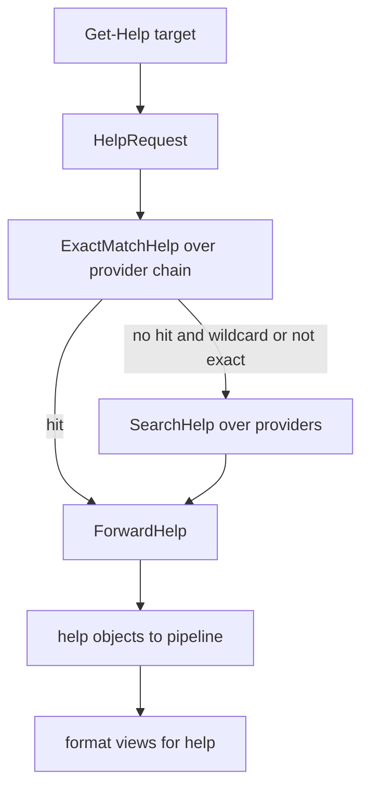

# Help system

> STATIC-ONLY — behavior not run-verified. `FACT-SRC` unless marked. Scope `EXTENDED`. Help output is shaped by [formatting-and-output](formatting-and-output.md) (help views are format data); command lookup used by help is [command-discovery-and-invocation](command-discovery-and-invocation.md).

## 1. Purpose and scope [SPEC]

`Get-Help` finds documentation for a command, provider, alias, class, or conceptual topic and returns help objects. Sources: XML help files (MAML) shipped with modules, *comment-based help* inside functions and scripts, conceptual `about_*` text files, and auto-generated default help derived from command metadata. *Updatable help* downloads and installs help packages (`Update-Help`, `Save-Help`).

## 2. Source map

| path | type | role | tier |
|---|---|---|---|
| src/System.Management.Automation/help/HelpSystem.cs::HelpSystem@L88-L798 | class | provider list, request dispatch, exact and search modes, forwarding | B |
| src/System.Management.Automation/help/HelpProvider.cs::HelpProvider@L43-L254 | abstract class | provider contract | B |
| src/System.Management.Automation/help/HelpRequest.cs::HelpRequest@L22-L177 | class | target, category, flags, max results | B |
| src/System.Management.Automation/help/HelpInfo.cs::HelpInfo@L24-L268 | abstract class | a result, with forward target/category | B |
| src/System.Management.Automation/help/CommandHelpProvider.cs::CommandHelpProvider@L28-L1356 | class | cmdlet and function help (MAML + script help) | B |
| src/System.Management.Automation/help/HelpCommentsParser.cs::HelpCommentsParser@L23-L1225 | class | comment-based help parser | B |
| src/System.Management.Automation/help/MamlNode.cs::MamlNode@L67-L1251 | class | MAML XML reader | B |
| src/System.Management.Automation/help/DefaultCommandHelpObjectBuilder.cs::DefaultCommandHelpObjectBuilder@L43-L933 | class | synthesizes help from metadata | B |
| src/System.Management.Automation/help/HelpCommands.cs::GetHelpCommand@L27-L740 | cmdlet | `Get-Help` | B |
| src/System.Management.Automation/help/UpdatableHelpSystem.cs::UpdatableHelpSystem@L233-L1573 | class | HelpInfo.xml and package download/install | B |
| src/System.Management.Automation/help/UpdateHelpCommand.cs, SaveHelpCommand.cs | cmdlets | `Update-Help`, `Save-Help` | B |
| src/System.Management.Automation/help/AliasHelpProvider.cs, ProviderHelpProvider.cs, HelpFileHelpProvider.cs, PSClassHelpProvider.cs, DefaultHelpProvider.cs, ScriptCommandHelpProvider.cs, DscResourceHelpProvider.cs | classes | the other providers | B |

## 3. Responsibilities and non-responsibilities

Owns: the provider chain and its order, search/forward semantics, help file lookup rules, comment-help keywords, updatable-help flow. Does not own: help content (shipped separately), rendering (format data), web access beyond the downloader.

## 4. Key types and contracts [IMPL]

- **Provider contract** (`HelpProvider`): `Name`, `HelpCategory` (flags), `ExactMatchHelp(request)`, `SearchHelp(request, searchOnlyContent)`, virtual `ProcessForwardedHelp(info, request)` and `Reset()`.
- **Provider chain** (`InitializeHelpProviders`), in order: alias, script-command (comment-based), command (MAML), provider, class (PS classes), help-file (about topics and file-based help), default. (DSC resource help is present in source but disabled in the list, with a comment citing a performance bug.) The chain is built once per `HelpSystem` (src/System.Management.Automation/help/HelpSystem.cs::HelpSystem.InitializeHelpProviders@L563-L593).
- **Exact match** (`ExactMatchHelp`): for each provider whose category intersects the request's category, collect its results; every result is passed through *forwarding*; when a provider has produced at least one result and it is not the script-command provider, the search stops (so script help can be merged with the command provider's result, otherwise the first provider with a hit wins) (src/System.Management.Automation/help/HelpSystem.cs::HelpSystem.ExactMatchHelp@L352-L379).
- **Forwarding**: a help object may name a forward target and category (for example proxy functions or comment keywords `.FORWARDHELPTARGETNAME`, `.FORWARDHELPCATEGORY`); `ForwardHelp` asks providers of the forward category to process it and recurses; if no provider handles the category the original result is returned; a result that forwards to its own request raises `CircularDependencyInHelpForwarding` (src/System.Management.Automation/help/HelpSystem.cs::HelpSystem.ForwardHelp@L392-L435).
- **Command help lookup** (`CommandHelpProvider.GetHelpInfo`): for a cmdlet, check the in-memory cache by module and name; else find the cmdlet's help file (see below), load it into the cache, and read from cache or from the cmdlet metadata (auto-generated); for a function, load its declared help file if any; for any script-based command, parse comment-based help from its script block (also taking a `.LINK` URI as the online help URI). Candidates come from a `CommandSearcher` configured for exact match, filtered by session visibility for the request's origin; duplicate help names are skipped; `MaxResults` stops early (src/System.Management.Automation/help/CommandHelpProvider.cs::CommandHelpProvider.GetHelpInfo@L189-L410).
- **Help file search**: the file name is the cmdlet's declared help file (assembly-name based, `<assembly>.dll-Help.xml`; a `.ni.dll` name is first tried as `.dll`). If the name is not an existing path, search directories are, in order: for a snap-in, the user help folder then the snap-in application base; for a module cmdlet, the user help folder for that module version then the module base; otherwise the user help folder, the shell's default path and the cmdlet assembly's folder. `MUIFileSearcher` locates the file for the current UI culture (falling back through parent cultures, `UNVERIFIED` exact order). Engine modules use a built-in map from module to help file under the culture folder (src/System.Management.Automation/help/CommandHelpProvider.cs::CommandHelpProvider.GetHelpFile@L494-L551).
- **Comment-based help keywords** (case-insensitive after a dot in a comment block): `SYNOPSIS`, `DESCRIPTION`, `PARAMETER <name>`, `EXAMPLE`, `INPUTS`, `OUTPUTS`, `NOTES`, `LINK`, `COMPONENT`, `ROLE`, `FUNCTIONALITY`, `FORWARDHELPTARGETNAME`, `FORWARDHELPCATEGORY`, `REMOTEHELPRUNSPACE`, `EXTERNALHELP` (src/System.Management.Automation/help/HelpCommentsParser.cs::HelpCommentsParser.AnalyzeCommentBlock@L712-L808; the placement rules for the comment block — before the function, at the start of the body, or at script start — are `UNVERIFIED`, VB-043).
- **Updatable help**: `HelpInfo.xml` (validated against an embedded schema with `SupportedUICultures` → `UICultureName`, `UICultureVersion`) describes available help packages per culture; `Update-Help` resolves a module's `HelpInfoUri`, downloads the package for each requested UI culture (default: the current UI culture and its parents), checks versions, and installs; `Save-Help` stores packages for offline installation (src/System.Management.Automation/help/UpdatableHelpSystem.cs, src/System.Management.Automation/help/UpdateHelpCommand.cs; details `UNVERIFIED`, VB-044).

## 5. Data model

`HelpRequest`: target string, `HelpCategory` flags (alias, cmdlet, provider, general, FAQ, glossary, help file, class, DSC resource, default…), `CommandOrigin`, `MaxResults`, search options. `HelpInfo`: name, synopsis, category, components, role, functionality, full object (`PSObject` with `TypeNames` such as `HelpInfo`/`MamlCommandHelpInfo`), forward target/category, online URI. Providers keep caches (command cache keyed by help file identifier and command name; loaded-file set). `HelpSystem` keeps the last errors and last category, a search-path list built from loaded module bases, and a script-block token cache for comment help.

## 6. Control flow

Ordered: validate request and help culture → exact match through providers in chain order → forward results → if nothing found, search mode (wildcards, content search) → default help when no target. `UNVERIFIED` in detail: the branch conditions between exact and search modes (`DoGetHelp`, lines not read).

## 7. Algorithms

Chain, forwarding and file search are in §4. Comment-based help parsing (tokens of the comment, section splitting by keyword line, parameter descriptions merged with those written next to parameters) is in `HelpCommentsParser` (`UNVERIFIED` in detail).

## 8. Observable behavior [SPEC]

- `Get-Help Name` returns the first provider's match; `-Full`, `-Examples`, `-Parameter`, `-Online`, `-ShowWindow` select views or actions; wildcards search.
- Functions with comment help return it without any file; `.EXTERNALHELP` points to an XML file; missing help yields auto-generated help (syntax only).
- `Update-Help` installs per-culture help for installed modules.
- Tests: §16. No golden sample: STATIC-ONLY.

## 9. Error handling and edge cases

Provider errors are collected (`LastErrors`) and optionally shown in verbose mode (`VerboseHelpErrors`); a missing help file only traces; XML load errors are reported when `reportErrors` is set; circular forwarding raises an exception; invalid HelpInfo URI → `InvalidHelpInfoUri`; unsupported UI culture → `FailedToUpdateHelpWithLocaleNoUICulture`.

## 10. Concurrency and threading

Help runs on the pipeline thread; the downloader is asynchronous inside `UpdatableHelpSystem` (`UNVERIFIED` threading); provider caches are per-`HelpSystem` (per runspace) and not locked in the code read.

## 11. Extension points and customization hooks

Comment-based help and `.EXTERNALHELP`; `HelpInfoUri` and `HelpVersion` in module manifests; the user help folder (per-user installed help); `$env:`-independent culture via UI culture; custom help providers are internal (no public registration).

## 12. Dependencies

Inbound: `Get-Help`, `-?` handling (`CreateGetHelpCommandProcessor` in command processors), tab completion (help text), `Get-Command` online URIs. Outbound: `CommandSearcher`, session state visibility, module info (base paths, `HelpInfoUri`), script-block parsing, XML, web client for updates, file system.

## 13. Performance notes

Help files are loaded once into a cache per file; the token cache avoids re-parsing script blocks; default help is cheap; loading all help for a wildcard search is expensive.

## 14. Security considerations

Updatable help downloads files from a module-controlled URI and installs them under the module or user help folder: it is a network and file-write surface (`UNVERIFIED` validation of downloaded packages, signature or hash checks; Phase 5). Help text can reference online URIs that the shell opens only with `-Online`. Comment help is parsed, not executed. Help file lookup trusts the module folder.

### Security surface

<!--GEN:secseeds-->
| Category | Seed hits |
|---|---:|
| remoting-deser | 5 |
| jea | 3 |
| **total** | 8 |

Files with most hits:

| File | Hits |
|---|---:|
| `src/System.Management.Automation/help/ProviderContext.cs` | 4 |
| `src/System.Management.Automation/help/CommandHelpProvider.cs` | 1 |
| `src/System.Management.Automation/help/DscResourceHelpProvider.cs` | 1 |
| `src/System.Management.Automation/help/PSClassHelpProvider.cs` | 1 |
| `src/System.Management.Automation/help/ProviderHelpProvider.cs` | 1 |

These are regex scanner hits (`APPROX`, `verified: false`, no `SEC-ENF` ID yet). Phase 5 verifies them and assigns IDs; none is claimed here as an enforcement point.
<!--/GEN:secseeds-->

What the new shell must guarantee here: downloaded help is integrity-checked (hash or signature) before installation; help lookup is read-only; online navigation requires explicit user action and uses a policy-approved opener.

## 15. Enterprise considerations

Security first: §14. Observability: help error tracer (`HelpErrorTracer`), `LastErrors`. Supportability: offline help via `Save-Help` and shares; per-culture versions. Testability: providers are small classes; engine tests exist. Resource limits: none on cache size. Missing: signed help packages, an air-gapped catalog format.

## 16. Tests

<!--GEN:tests-->
| Pester file | Describe | Context | It |
|---|---:|---:|---:|
| `test/powershell/Language/Scripting/ScriptHelp.Tests.ps1` | 3 | 28 | 92 |
| `test/powershell/engine/Help/HelpSystem.OnlineHelp.Tests.ps1` | 3 | 0 | 3 |
| `test/powershell/engine/Help/HelpSystem.Tests.ps1` | 21 | 2 | 30 |
| `test/powershell/engine/Help/UpdatableHelpSystem.Tests.ps1` | 11 | 0 | 2 |
| **total (4 files)** | 38 | 30 | 127 |

No xUnit file matched the path keywords.

Matching is by path keyword (`APPROX`): `engine/Help/`, `Scripting/ScriptHelp`.
<!--/GEN:tests-->

## 17. Design decisions and trade-offs

- `FACT-SRC`: help is looked up by *providers in a fixed order* rather than a registry, so user-defined functions can shadow built-in help simply by being earlier in the command search.
- `FACT-SRC`: help for functions can be comment-based so documentation travels with the code.
- `INFERENCE`: DSC resource help was disabled for performance; the code remains.
- `FACT-SRC`: help is localized by UI culture with per-culture folders and versions.

## 18. Guidance for the new shell [LESSON]

- **LSN-RTHELP-01** [REPLICATE] (area: NLD-TOOL) Comment-based help with the keyword set above and `.EXTERNALHELP`/forwarding, since scripts written for PowerShell carry it. Evidence: src/System.Management.Automation/help/HelpCommentsParser.cs::HelpCommentsParser.AnalyzeCommentBlock@L712-L808.
- **LSN-RTHELP-02** [ADAPT] (area: NLD-TOOL) Replace the fixed provider list with registered providers that declare category and priority, keeping the same default order. Evidence: src/System.Management.Automation/help/HelpSystem.cs::HelpSystem.InitializeHelpProviders@L563-L593.
- **LSN-RTHELP-03** [ADAPT] (area: NLD-TOOL) Keep forwarding but make cycles a static check at load rather than a run-time exception. Evidence: src/System.Management.Automation/help/CommandHelpProvider.cs::CommandHelpProvider.ExactMatchHelp@L425-L472.
- **LSN-RTHELP-04** [REDESIGN] (area: NLD-SEC) Deliver updatable help as signed packages with a catalog and an offline mode, verified before install. DEV: DEV-HELP-165. Evidence: src/System.Management.Automation/help/UpdatableHelpSystem.cs::UpdatableHelpSystem@L233-L1573.
- **LSN-RTHELP-05** [AVOID] (area: NLD-TOOL) Do not port MAML as the authoring format or the DSC resource provider; use a lighter structured format (and the comment-based format) for built-in help. DEV: DEV-HELP-166. Evidence: src/System.Management.Automation/help/MamlNode.cs::MamlNode@L67-L1251.

## 19. Open questions / UNVERIFIED items

- `UNVERIFIED` (VB-043): `DoGetHelp`/`SearchHelp` branch rules, comment-block placement, `MUIFileSearcher` culture fallback, `Get-Help` parameter handling, `ProviderHelpProvider`, `HelpFileHelpProvider` (about topics), `DefaultCommandHelpObjectBuilder`.
- `UNVERIFIED` (VB-044): `UpdatableHelpSystem` download/install/verification, `CabinetNativeApi`, `SaveHelpCommand`.

Verification: `HelpSystem.cs` lines 158–260, 352–460, 563–640, `CommandHelpProvider.cs` lines 189–300, 425–640, `HelpCommentsParser.cs` keyword switch region (lines 726–790, 889–915), `UpdatableHelpSystem.cs`/`UpdateHelpCommand.cs` selected lines were read; other files are named from the file list. Ranges are in `T31_T39.csv`.
