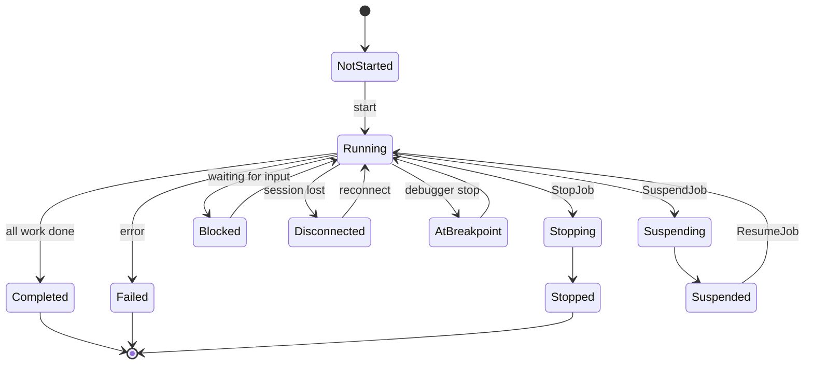

# Jobs and concurrency

> STATIC-ONLY — behavior not run-verified. `FACT-SRC` unless marked. Scope `EXTENDED`. Threading inside one pipeline is described in [runspace-and-pipeline](runspace-and-pipeline.md) §10; runspace pools there too. Remoting transports are Phase 4.

## 1. Purpose and scope [SPEC]

Ways to run script concurrently: **jobs** (`Start-Job`: a background process; `Start-ThreadJob`: a module not in this repo's engine; remoting and workflow-style jobs through `Job2` sources), **`ForEach-Object -Parallel`** (script block per input object in pooled runspaces within the process), and **runspace pools** (SDK). This document covers the job object model and states, the job repository and source adapters, the process-based background job, the in-process parallel task pool, and the concurrency rules.

## 2. Source map

| path | type | role | tier |
|---|---|---|---|
| src/System.Management.Automation/engine/remoting/client/Job.cs::Job@L408-L1719 | abstract class | job base: state, child jobs, six streams, events | B |
| src/System.Management.Automation/engine/remoting/client/Job.cs::JobState@L31-L90 | enum | job states | B |
| src/System.Management.Automation/engine/remoting/client/Job2.cs::Job2@L51-L447 | abstract class | adds async start/stop/suspend/resume APIs | B |
| src/System.Management.Automation/engine/remoting/client/JobManager.cs::JobManager@L24-L1054 | class | registry of job source adapters; `Get-Job`-style queries across sources | B |
| src/System.Management.Automation/engine/remoting/client/JobSourceAdapter.cs::JobSourceAdapter@L375-L544 | abstract class | a source of jobs by type name (a job provider) | B |
| src/System.Management.Automation/engine/remoting/commands/JobRepository.cs::JobRepository@L139-L188 | class | the session's table of jobs | B |
| src/System.Management.Automation/engine/remoting/commands/StartJob.cs::StartJobCommand@L22-L822 | cmdlet | `Start-Job` | B |
| src/System.Management.Automation/engine/remoting/client/Job.cs::PSRemotingJob@L1728-L2672 | class | job whose children run in (remote or child-process) runspaces | B |
| src/System.Management.Automation/engine/remoting/client/ThrottlingJob.cs::ThrottlingJob@L28-L1262 | class | parent job that throttles how many child jobs run at once | B |
| src/System.Management.Automation/engine/hostifaces/PowerShellProcessInstance.cs::PowerShellProcessInstance@L16-L292 | class | the child `pwsh` process used by background jobs | B |
| src/System.Management.Automation/engine/hostifaces/PSTask.cs::PSTaskPool@L640-L987 | class | in-process task pool for `-Parallel` | B |
| src/System.Management.Automation/engine/hostifaces/PSTask.cs::PSTaskJob@L996-L1184 | class | job wrapper for `ForEach-Object -Parallel -AsJob` | B |
| src/System.Management.Automation/engine/InternalCommands.cs::ForEachObjectCommand@L65-L1271 | cmdlet | `ForEach-Object` including `-Parallel` | B |

## 3. Responsibilities and non-responsibilities

Owns: job state machine, job tables, throttling, child-process job runspaces, task pool and its data-stream merging. Does not own: the PSRP protocol (Phase 4), the `ThreadJob` module, scheduled jobs (module), runspace pools (T31).

## 4. Key types and contracts [IMPL]

- **`JobState`**: `NotStarted=0`, `Running`, `Completed`, `Failed`, `Stopped`, `Blocked`, `Suspended`, `Disconnected`, `Suspending`, `Stopping`, `AtBreakpoint` (src/System.Management.Automation/engine/remoting/client/Job.cs::JobState@L31-L90). Finished states are `Completed`, `Failed`, `Stopped`.
- **`Job`** has an auto-incremented `Id` (static seed), `InstanceId`, `Name` (auto-generated "Job" + number unless given), `Command`, `JobStateInfo`, `ChildJobs`, begin/end times, the streams (`Output`, `Error`, `Warning`, `Verbose`, `Debug`, `Progress`, `Information`) as `PSDataCollection`s, `HasMoreData`, `Location`, `StatusMessage`, abstract `StopJob()`, and events (`StateChanged`). `SetJobState(state, reason)` under a lock replaces the state info, stamps `PSBeginTime` on the first `Running` and `PSEndTime` on the first finished state, and for finished states closes all streams; it then raises `StateChanged` (handler exceptions are swallowed and traced) and, for finished states, sets the "finished" event (src/System.Management.Automation/engine/remoting/client/Job.cs::Job.SetJobState@L1386-L1462). A state in `Disconnected` or `Suspended` counts as "can be waited on" for waiters.
- **`Job2`** adds `StartJob`/`StartJobAsync`, `StopJobAsync`, `SuspendJob`, `ResumeJob`, `UnblockJob` and a `JobInvocationInfo`; `ContainerParentJob` aggregates child `Job2`s. `JobSourceAdapter`s register by type name in `JobManager` (public constructor required; constructed by reflection); `JobRepository` holds the session's jobs (lookup methods not read).
- **Background process job** (`Start-Job`): `PSRemotingJob` with child jobs backed by runspaces whose connection is a child `pwsh` process started with `-s -NoLogo -NoProfile` (server mode over standard streams); the parameters of `Start-Job` were not read (`UNVERIFIED`, VB-051); `PowerShellProcessInstance` starts the process and raises an event when it exits (src/System.Management.Automation/engine/hostifaces/PowerShellProcessInstance.cs::PowerShellProcessInstance@L16-L292).
- **`ThrottlingJob`**: a parent that starts `StartableJob` children subject to a throttle limit and a queue; jobs are started as capacity frees (`UNVERIFIED` details).
- **`ForEach-Object -Parallel`**: parameters `Parallel` (script block), `ThrottleLimit` (default **5**), `TimeoutSeconds` (0 = none; a timer stops all tasks when it fires), `UseNewRunspace`, `AsJob`. `BeginProcessing` captures `$using:` values from the script block (`GetUsingValuesForEachParallel`), creates a `PSTaskDataStreamWriter` and a `PSTaskPool(ThrottleLimit, UseNewRunspace)`; `ProcessRecord` creates one `PSTask` per input object (with `$_` set, the current location path and the using-values map) and adds it to the pool, which **blocks the pipeline thread** when the pool is full (src/System.Management.Automation/engine/InternalCommands.cs::ForEachObjectCommand@L65-L1271, `PSTaskPool.Add@L762-L800`). `EndProcessing` waits for all tasks and drains the data-stream writer.
- **Task pool** (`PSTaskPool`): `size` limit; by default runspaces are *reused* from a queue (`_useRunspacePool`) unless `UseNewRunspace` creates a new one per task; a manual-reset event `_addAvailable` is reset when the pool is at its limit and set when a task completes; `_stopAll` unblocks adders. `PSTaskBase.Start(runspace)`: sets the task's location in the runspace, creates a `PowerShell` for it, wires stream-data-added handlers (`PSTask` forwards output/error/warning/verbose/debug/progress/information into the shared `PSTaskDataStreamWriter` as `PSStreamObject`s), adds the script text (`ToString()` of the block) with `$_`, binds the using-values map through the verbatim-argument parameter, and calls `BeginInvoke`. `SignalStop` calls `BeginStop`. Task ids come from a static counter; task runspaces are named "PSTask" (src/System.Management.Automation/engine/hostifaces/PSTask.cs::PSTaskBase@L321-L502).

## 5. Data model

Job: id, instance id, name, command, state info, child jobs, stream collections, begin/end times, `Location`, `StatusMessage`, finished wait handle, `PSJobTypeName`, and tracing. `JobRepository`: a list of jobs (keyed lookups). `JobManager`: dictionary of adapters by type name and a static map to reuse job ids across sessions by GUID. `PSTaskPool`: dictionary of active tasks by id, queue of idle runspaces, set of all active runspaces, counters.

## 6. Control flow

`UNVERIFIED`: which transitions are enforced; the code read shows state setting but no transition table (`SetJobState` accepts any state). The diagram is the vocabulary of states (`INFERENCE` for edges).

**Parallel run, ordered**: `ForEach-Object -Parallel` — begin: build pool and writer; each input object: build task, wait for a free slot, start task in a runspace; meanwhile task output flows to the writer which the cmdlet drains on its own thread (so output order is completion order, not input order); end: wait for tasks, flush streams, dispose pool.

## 7. Algorithms

Throttle: block adder when `taskPool.Count == sizeLimit`; unblock on completion. Timeout: a timer with due time `TimeoutSeconds × 1000` stops all tasks. Job id reuse: `JobManager` keeps ids by GUID so a re-attached job keeps its id (`UNVERIFIED`).

## 8. Observable behavior [SPEC]

- `EXTERNAL` (public cmdlet documentation, cmdlets not read): `Start-Job` returns a job object immediately; `Receive-Job` collects output; `Wait-Job` waits for finished states; `Stop-Job` stops; `Remove-Job` deletes.
- `FACT-SRC`: background jobs run in a separate `pwsh` process started with `-NoProfile`; `INFERENCE`: they therefore do not inherit the parent's variables.
- `FACT-SRC`: `ForEach-Object -Parallel` runs at most 5 script blocks at a time by default, in separate runspaces, with `$using:` for outer values; output order follows completion.
- Tests: §16. No golden sample: STATIC-ONLY.

## 9. Error handling and edge cases

Stream data from tasks is marshalled to the cmdlet thread; a task failure is reported as an error record; timeouts stop tasks and end the pipeline with an error (`UNVERIFIED` text); a job in `Disconnected` can be reconnected; job disposal while running requires stop. Non-finished state changes are not validated.

## 10. Concurrency and threading

Locks: `Job.syncObject` guards state; `PSTaskPool._syncObject` guards the task table; concurrent collections for idle/active runspaces; manual-reset events for slot availability and stop; static id counters use `Interlocked`. Events (`StateChanged`) run on whichever thread changes the state. Task data events fire on the task's thread and are queued into a thread-safe writer drained by the cmdlet thread, which keeps all pipeline writes on the pipeline thread (see write-permission rule in [cmdlet-infrastructure](cmdlet-infrastructure.md)).

## 11. Extension points and customization hooks

Custom job types (derive from `Job`/`Job2`), `JobSourceAdapter` registration (internal in this version), `Register-ObjectEvent -AsJob` style event jobs (`PSEventJob`, see [eventing](eventing.md)), `-InitializationScript`, `-ThrottleLimit`, `-UseNewRunspace`, `-TimeoutSeconds`.

## 12. Dependencies

Inbound: job cmdlets, `ForEach-Object`, event subscriptions with actions, debugger (`DebugJob`). Outbound: runspaces and `PowerShell` (T31), remoting client (child-process transport, Phase 4), `PSDataCollection`, session state (`JobRepository`/`JobManager` on the runspace).

## 13. Performance notes

Process jobs pay process start-up (hundreds of ms); `-Parallel` reuses runspaces by default to avoid creating one per object, with `UseNewRunspace` trading speed for isolation; each task re-parses the script text (`ToString()` of the block is added as script).

## 14. Security considerations

A background job is a new process running as the same user with a fresh session: it does **not** inherit the language mode or restricted session state of the parent unless the engine passes it (`UNVERIFIED`: lockdown propagation, Phase 5). `ForEach-Object -Parallel` runspaces are created from the current session's initial state (`UNVERIFIED` exact policy inheritance). `$using:` values are copied by reference/serialization, which can expose objects across runspaces. Job output streams are retained in memory until received or removed.

### Security surface

<!--GEN:secseeds-->
| Category | Seed hits |
|---|---:|
| language-mode | 10 |
| app-control | 2 |
| **total** | 12 |

Files with most hits:

| File | Hits |
|---|---:|
| `src/System.Management.Automation/engine/hostifaces/PSTask.cs` | 6 |
| `src/System.Management.Automation/engine/remoting/commands/StartJob.cs` | 6 |

These are regex scanner hits (`APPROX`, `verified: false`, no `SEC-ENF` ID yet). Phase 5 verifies them and assigns IDs; none is claimed here as an enforcement point.
<!--/GEN:secseeds-->

What the new shell must guarantee here: child runspaces and processes inherit the parent's language mode, visibility and policy by default and can only be more restricted; `$using` captures follow the same trust rules as module exports; jobs have quotas (count, memory) and an owner recorded in audit logs.

## 15. Enterprise considerations

Security first: §14. Observability: job states, begin/end times, streams per job, tracing in job code. Supportability: `Get-Job` over multiple sources; job sources are pluggable. Testability: job logic is exercised via cmdlets. Resource limits: throttle limit per `-Parallel` (default 5) and `ThrottlingJob`; no global cap on jobs or memory. Missing: quotas, job priorities, durable jobs across restarts (scheduled jobs are a module), structured audit records.

## 16. Tests

<!--GEN:tests-->
| Pester file | Describe | Context | It |
|---|---:|---:|---:|
| `test/powershell/Language/Scripting/ForeachParallel.Tests.ps1` | 1 | 5 | 10 |
| `test/powershell/Language/Scripting/SwitchParallel.Tests.ps1` | 1 | 3 | 5 |
| `test/powershell/Modules/Microsoft.PowerShell.Core/ForEach-Object.Tests.ps1` | 1 | 0 | 5 |
| `test/powershell/Modules/Microsoft.PowerShell.Core/Job.Tests.ps1` | 4 | 7 | 30 |
| `test/powershell/Modules/Microsoft.PowerShell.Utility/Foreach-Object-Parallel.Tests.ps1` | 5 | 0 | 55 |
| `test/powershell/Modules/ThreadJob/ThreadJob.Tests.ps1` | 2 | 0 | 27 |
| `test/powershell/engine/Job/Jobs.Tests.ps1` | 1 | 7 | 32 |
| **total (7 files)** | 15 | 22 | 164 |

No xUnit file matched the path keywords.

Matching is by path keyword (`APPROX`): `Core/Job.Tests`, `Core/ForEach-Object.Tests`, `Modules/ThreadJob/`, `Foreach-Object-Parallel`, `engine/Job/`, `ForeachParallel`, `SwitchParallel`.
<!--/GEN:tests-->

## 17. Design decisions and trade-offs

- `FACT-SRC`: process isolation for background jobs (safe against crashes and state leaks, slow, no object sharing).
- `FACT-SRC`: in-process parallelism through runspace pools (fast, isolated sessions, but objects are shared through `$using`).
- `INFERENCE`: blocking the pipeline thread when the pool is full gives natural back-pressure for `-Parallel`.
- `FACT-SRC`: jobs unify different execution backends behind one object with child jobs and streams.

## 18. Guidance for the new shell [LESSON]

- **LSN-RTJOB-01** [REPLICATE] (area: NLD-RUN) One `Job` abstraction with child jobs, per-stream collections, finished-state semantics and a state-changed event. Evidence: src/System.Management.Automation/engine/remoting/client/Job.cs::Job.SetJobState@L1386-L1462.
- **LSN-RTJOB-02** [REPLICATE] (area: NLD-RUN) `ForEach-Object -Parallel` semantics: throttle default 5, `$using:` capture, completion-order output, timeout. Evidence: src/System.Management.Automation/engine/InternalCommands.cs::ForEachObjectCommand@L65-L1271.
- **LSN-RTJOB-03** [ADAPT] (area: NLD-RUN) Add an explicit transition table to the job state machine (the source accepts any transition). Evidence: src/System.Management.Automation/engine/remoting/client/Job.cs::Job.SetJobState@L1386-L1462.
- **LSN-RTJOB-04** [REDESIGN] (area: NLD-SEC) Child processes and parallel runspaces inherit policy, language mode and visibility from the parent as a hard rule, plus per-job quotas. DEV: DEV-JOB-190. Evidence: src/System.Management.Automation/engine/hostifaces/PowerShellProcessInstance.cs::PowerShellProcessInstance@L16-L292.
- **LSN-RTJOB-05** [AVOID] (area: NLD-RUN) Do not port `ThrottlingJob`, `ContainerParentJob` and the job source-adapter registry in the first version; one local job type plus the parallel pool suffices. DEV: DEV-JOB-191. Evidence: src/System.Management.Automation/engine/remoting/client/ThrottlingJob.cs::ThrottlingJob@L28-L1262.

## 19. Open questions / UNVERIFIED items

- `UNVERIFIED` (VB-051): `PSRemotingJob`/`PSRemotingChildJob` internals, `ThrottlingJob`, `Job2` async methods, `JobManager` query methods, `StartJob` parameter handling and lockdown inheritance, `PSTaskJob`/`PSTaskChildJob`, `ForEachObjectCommand` lines outside the parallel setup.
- `UNVERIFIED` (VB-052): the `ThreadJob` module (outside this engine), scheduled jobs, workflow jobs.

Verification: `Job.cs` lines 408–470, 1386–1462 and the `JobState` enum, `JobManager.cs` lines 24–80, `PSTask.cs` lines 23–140, 321–500, 640–800, `InternalCommands.cs` parallel-related lines (240–271, 377–470, 543–565 via grep), `PowerShellProcessInstance.cs` argument lines were read; the rest is from signatures. Ranges in `T31_T39.csv`.
