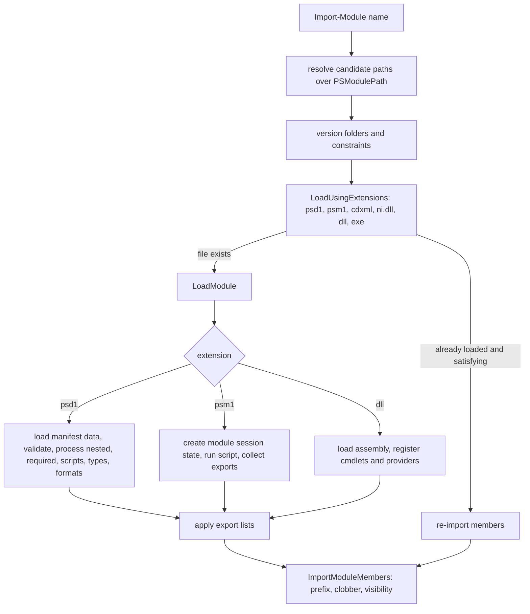

# Modules

> STATIC-ONLY — behavior not run-verified. `FACT-SRC` unless marked. Scope `CORE` for script modules and manifests, binary modules are `EXTENDED`. Where modules enter command lookup: [command-discovery-and-invocation](command-discovery-and-invocation.md) (auto-loading, auto-discovery). Module scope and session state: [execution-context-and-session-state](execution-context-and-session-state.md). Script blocks bound to modules: [SCRIPT-BLOCKS](../02-language/SCRIPT-BLOCKS.md).

## 1. Purpose and scope [SPEC]

A *module* packages commands, variables, types, formats and scripts under a name and version, with its own session state so internals stay private. Kinds: *script module* (`.psm1`), *binary module* (`.dll` containing cmdlets/providers), *manifest module* (`.psd1` describing and wiring the others), *dynamic module* (`New-Module`, created from a script block), *CIM-cmdlet module* (`.cdxml`). This document covers the manifest model, module path resolution, the load and import algorithm, export and import rules, auto-loading and the analysis cache, and removal.

## 2. Source map

| path | type | role | tier |
|---|---|---|---|
| src/System.Management.Automation/engine/Modules/ModuleCmdletBase.cs::ModuleCmdletBase@L40-L7478 | abstract class | base of `Import-Module`, `Get-Module`, `New-Module`, `Remove-Module`...: loading, manifests, imports, removal | B |
| src/System.Management.Automation/engine/Modules/ImportModuleCommand.cs::ImportModuleCommand@L44-L2183 | cmdlet | `Import-Module` and its parameter sets (name, path, assembly, PSSession, CIM, WinCompat) | B |
| src/System.Management.Automation/engine/Modules/PSModuleInfo.cs::PSModuleInfo@L23-L1554 | class | the module object: name, version, path, exports, session state, nested/required modules | B |
| src/System.Management.Automation/engine/Modules/ModuleIntrinsics.cs::ModuleIntrinsics@L29-L1725 | class | `$ExecutionContext.Modules`: module table, path computation, export engine, version matching | B |
| src/System.Management.Automation/engine/Modules/AnalysisCache.cs::AnalysisCache@L31-L643 | static class | exported-command analysis cache for auto-discovery | B |
| src/System.Management.Automation/engine/Modules/ModuleUtils.cs::ModuleUtils@L14-L648 | static class | module file discovery and version folders | B |
| src/System.Management.Automation/engine/Modules/ModuleSpecification.cs::ModuleSpecification@L32-L339 | class | name/GUID plus version constraints | B |
| src/System.Management.Automation/engine/Modules/ExportModuleMemberCommand.cs::ExportModuleMemberCommand@L22-L190 | cmdlet | `Export-ModuleMember` | B |
| src/System.Management.Automation/engine/Modules/NewModuleManifestCommand.cs, TestModuleManifestCommand.cs, GetModuleCommand.cs, RemoveModuleCommand.cs, NewModuleCommand.cs | cmdlets | manifest creation/validation, listing, removal, dynamic modules | B |
| src/System.Management.Automation/engine/Modules/ScriptAnalysis.cs::ScriptAnalysis@L17-L116 | class | static analysis of script module exports | B |

## 3. Responsibilities and non-responsibilities

Owns: module file formats and discovery order, manifest keys and validation, version selection, the load algorithm, export lists, import (prefix, visibility, clobber), removal, auto-load/analysis cache. Does not own: the cmdlets' command-line surface (Phase 4 families), session-state tables themselves (T29), help lookup beyond `HelpInfoUri` (help document), remoting import (PSSession import, Phase 4).

## 4. Key types and contracts [IMPL]

- **Module types** (`ModuleType`): `Script=0`, `Binary=1`, `Manifest=2`, `Cim=3` (src/System.Management.Automation/engine/Modules/PSModuleInfo.cs::ModuleType@L1559-L1578).
- **Manifest keys** (the list the engine knows): `ModuleToProcess`, `RootModule`, `NestedModules`, `GUID`, `Author`, `CompanyName`, `Copyright`, `ModuleVersion`, `Description`, `PowerShellVersion`, `PowerShellHostName`, `PowerShellHostVersion`, `CLRVersion`, `DotNetFrameworkVersion`, `ProcessorArchitecture`, `RequiredModules`, `TypesToProcess`, `FormatsToProcess`, `ScriptsToProcess`, `PrivateData`, `RequiredAssemblies`, `ModuleList`, `FileList`, `FunctionsToExport`, `VariablesToExport`, `AliasesToExport`, `CmdletsToExport`, `DscResourcesToExport`, `CompatiblePSEditions`, `HelpInfoURI`, `DefaultCommandPrefix` (src/System.Management.Automation/engine/Modules/ModuleCmdletBase.cs::ModuleCmdletBase@L40-L7478, the `ModuleManifestMembers` table near line 251). A required-module entry is a string or a hashtable with `ModuleName`, `GUID`, `ModuleVersion` (plus required/maximum version).
- **Flags**: `ManifestProcessingFlags` = `WriteErrors=1`, `NullOnFirstError=2`, `LoadElements=4`, `WriteWarnings=8`, `Force=0x10`, …; `ImportModuleOptions` (no-clobber, local, service-side import, …).
- **Implicit module file extensions** tried in order when a name has no extension: `.psd1`, `.psm1`, `.cdxml`, `.ni.dll`, `.dll`, `.exe` (`PSModuleExtensions`; the `.ni.dll` precedes `.dll` so the native image wins) (src/System.Management.Automation/engine/Modules/ModuleIntrinsics.cs::ModuleIntrinsics.PSModuleExtensions@L896-L905).
- **`LoadUsingExtensions(name, baseName, extension, …)`**: for each candidate extension, resolve the file path (skip if unresolved or if it is the module currently being processed); if the module is already in the module table and loading is not forced and the loaded module satisfies the constraints, **re-import its members** (prefix, options), write it out if `-PassThru`/`-AsCustomObject`, and return it; else if the file exists, remove an already-loaded satisfying module when `-Force`, then call `LoadModule` (src/System.Management.Automation/engine/Modules/ModuleCmdletBase.cs::ModuleCmdletBase.LoadUsingExtensions@L5422-L5518).
- **Multi-version folders**: `LoadUsingMultiVersionModuleBase(moduleBase)` iterates version sub-folders of the module base (`ModuleUtils.GetModuleVersionSubfolders`, order from that function — `UNVERIFIED`, expected highest first), skips versions that do not satisfy the required/minimum/maximum version, builds `<base>/<version>/<name>.psd1`, accepts the folder only if the manifest's `ModuleVersion` equals the folder version (else it is skipped with a verbose message), and loads the first valid one (src/System.Management.Automation/engine/Modules/ModuleCmdletBase.cs::ModuleCmdletBase.LoadUsingMultiVersionModuleBase@L433-L478).
- **Module path** (`$env:PSModulePath`): `GetModulePath(includeSystem, context)` splits the variable (or computes the default when unset), resolves each entry (UNC paths kept as is; file-system provider paths resolved and de-duplicated case-insensitively; non-existing directories dropped when the provider is not loaded), and appends the PowerShell home `Modules` folder when `includeSystem` is true. The default value is built from: the per-user module folder (`~/.local/share/powershell/Modules` style on Unix via XDG, `Documents\PowerShell\Modules` on Windows), the shared folder (`/usr/local/share/powershell/Modules` on Unix, `Program Files\PowerShell\Modules` on Windows) and the PowerShell home `Modules` folder; on Windows the Windows PowerShell system path is also added for compatibility (src/System.Management.Automation/engine/Modules/ModuleIntrinsics.cs::ModuleIntrinsics.GetModulePath@L1397-L1419, GetPersonalModulePath@L965-L975, GetSharedModulePath@L1017-L1031; exact default composition in `SetModulePath`/`GetModulePath(string, …)` `UNVERIFIED`, VB-045).
- **Export** (`ExportModuleMembers`): sets the session state's "use export list" flag; for each category with patterns: *functions* in the module scope's function table (skipping `AllScope` items) that match any wildcard are added to `ExportedFunctions` (sorted by name, duplicates removed); *cmdlets* (compiled exports and module-scope cmdlets, minus a do-not-export list); *variables* (skipping `AllScope` and built-in variable names); *aliases* (compiled alias exports and module-scope aliases, skipping `AllScope`) (src/System.Management.Automation/engine/Modules/ModuleIntrinsics.cs::ModuleIntrinsics.ExportModuleMembers@L1529-L1689). A module that never exports and has no manifest export lists exports all functions, cmdlets and aliases by default (`UNVERIFIED` default for variables: none; see `PSModuleInfo` and `ModuleCmdletBase.LoadModule`).
- **Import** (`ImportModuleMembers(sourceModule, prefix, options)`): imports cmdlets, aliases, functions and variables the module exports into the target session state. Order: cmdlets, aliases, functions, variables. With `-Prefix` (or the manifest's `DefaultCommandPrefix`) names get the prefix after the verb (`Get-Foo` → `Get-PrefixFoo`) and aliases pointing to prefixed commands are rewritten; with `-NoClobber` commands/variables whose names already exist in the target are skipped (verbose message); items go to the module scope of the target (or the current scope with `-Local`); `-Global`/`-Scope` select the target session state; if the importing cmdlet is private or the target defaults to private visibility, imported commands become private. Unless `-DisableNameChecking`, the first non-approved verb or invalid noun triggers one warning, the rest verbose messages (`Sort-Object` and `Tee-Object` are exempt) (src/System.Management.Automation/engine/Modules/ModuleCmdletBase.cs::ModuleCmdletBase.ImportModuleMembers@L7022-L7251, `ValidateCommandName@L7375-L7458`).
- **Analysis cache** (`AnalysisCache.GetExportedCommands(path, testOnly, context)`): returns the exported-command map (`name → CommandTypes`) for a module file from a cache keyed by path and validated by the file's last write time; on a miss, analysis depends on the extension: `.psd1` — read a fast subset of manifest properties and the export lists (with a check that a versioned folder matches the manifest version), `.psm1` — static script analysis, `.cdxml`, `.dll`, `.exe` — binary/cdxml analysis; a result queues serialization of the cache to disk after a delay of 10 seconds; no analysis when `testOnly` (src/System.Management.Automation/engine/Modules/AnalysisCache.cs::AnalysisCache.GetExportedCommands@L44-L96, `AnalysisCacheData@L645-L1131`).

<!--CF:CF-MOD-001-->**Module load, export and auto-load rules (CF-MOD-001).** (1) A module name without a path is searched in each `PSModulePath` entry in order (entries marked to skip the system folder are skipped; on Unix the folder name is matched case-insensitively): in an entry, the module base is `<entry>/<name>`; its version sub-folders are tried first (the first whose version satisfies the constraints and equals its manifest's `ModuleVersion` is loaded); if none loads, the files `<entry>/<name>/<name>` + extension are tried in the order `.psd1`, `.psm1`, `.cdxml`, `.ni.dll`, `.dll`, `.exe` (a name that already carries a module extension is tried as given); the first successful load ends the search and its exports are added to the analysis cache. (2) A manifest is read as data and its keys are checked against the known key list (§4); the processing of the root module, nested modules, required modules (version-constrained; a cyclic-requirement check exists), required assemblies, scripts to process, types and formats follows, in an order that is `UNVERIFIED` (VB-046); how the manifest export lists combine with a script module's own exports is `UNVERIFIED` (VB-046). (3) A module already loaded that satisfies the requested constraints is not loaded again unless `-Force`; only its members are re-imported with the requested prefix and options. (4) Each module has its own session state; exported commands are copied into the importer's session state. (5) `Export-ModuleMember` selects exports by wildcard patterns per category (functions, cmdlets, variables, aliases), skipping `AllScope` items and built-in variable names. (6) Import applies `-Prefix`/`DefaultCommandPrefix`, `-NoClobber`, visibility and the verb/noun checks, in that order: cmdlets, aliases, functions, variables. (7) **Auto-loading** happens during command lookup: a module-qualified name loads exactly that module; any other unknown command name is looked up in the analysis cache of every module file on `PSModulePath` and the first module exporting a command of that exact name is imported (`$PSModuleAutoLoadingPreference`: `None`, `ModuleQualified`, `All`). (8) Removal of a module (`RemoveModule`) is `UNVERIFIED` here (VB-046).<!--/CF-->

## 5. Data model

`PSModuleInfo`: name, path, base, version, GUID, description, author, module type, root module, nested modules, required modules, exported functions/cmdlets/aliases/variables/commands (dictionaries), `SessionState` (the module's), `ModuleBase`, `PrivateData`, `ExperimentalFeatures`, `CompatiblePSEditions`, `AccessMode`, `HelpInfoUri`, and fields for compiled exports. `ModuleIntrinsics` holds the module table (`ModuleTable`: path → module), the nesting depth counter (to limit recursion), and the "previously imported" map used to prefer a module when a command exists in several. Session state fields: `UseExportList`, `FunctionsExported`, `FunctionsExportedWithWildcard`, `ExportedFunctions/Aliases/Variables`, `Module`, `ModuleScope`.

## 6. Control flow

## 7. Algorithms

Load, export, import and analysis are described in §4 and CF-MOD-001. Detailed manifest processing (`LoadModuleManifest`, ~2,000 lines) is `UNVERIFIED` (VB-046): key validation order, handling of `NestedModules` vs `RootModule`, `RequiredAssemblies`, `ScriptsToProcess`, `CompatiblePSEditions` and `PowerShellVersion` checks, and the required-module cycle check (`HasRequiredModulesCyclicReference`).

## 8. Observable behavior [SPEC]

- `Import-Module Name` finds the highest-version valid module in `PSModulePath` order; a module-qualified call `Name\Command` imports on demand; a plain unknown command is searched in all installed modules' exports.
- Functions not exported stay private to the module; module-scoped variables are invisible outside; `Export-ModuleMember` limits exports; manifest lists win.
- `Get-Module` lists loaded modules; `-ListAvailable` lists installed ones from the path; `Remove-Module` unloads.
- A warning appears the first time a module exports a command with an unapproved verb.
- Tests: §16. No golden sample: STATIC-ONLY.

## 9. Error handling and edge cases

Module not found → `Modules_ModuleNotFound`-style errors; version-folder mismatch → skipped with verbose; invalid manifest member → `InvalidModuleManifest...` errors via `WriteInvalidManifestMemberError`; cyclic `RequiredModules` rejected; name conflict between parameter set or alias and parameter (not here); `-AsCustomObject` with a binary module → `Modules_CantUseAsCustomObjectWithBinaryModule`; dot-sourcing disallowed in some contexts (`CheckForDisallowedDotSourcing`); nesting depth limit (`IncrementModuleNestingDepth`).

## 10. Concurrency and threading

The module table lives on the execution context (single pipeline thread). The analysis cache is static and shared: concurrent dictionaries, background serialization task with a delay, and a concurrent set of modules being analyzed to avoid re-entrancy (`s_modulesBeingAnalyzed`). Auto-discovery runs on the pipeline thread.

## 11. Extension points and customization hooks

Manifests (`.psd1`) with `PrivateData`; `$PSModulePath`; `$PSModuleAutoLoadingPreference`; `InitialSessionState` modules and `ImportPSModule`; module logging policy (`SetModuleLoggingInformation`: policy-controlled lists of module names); `DefaultCommandPrefix`; script blocks `OnRemove` handlers (`PSModuleInfo.OnRemove`; `UNVERIFIED`); `ScriptsToProcess`; `FormatsToProcess`/`TypesToProcess`.

## 12. Dependencies

Inbound: command discovery (auto-load/discovery), `Import-Module`/`Get-Module`/`Remove-Module`, `#requires -Modules`, `InitialSessionState`. Outbound: session state (module scopes, tables), the parser (manifest data and script analysis), execution policy / authorization (script modules), type/format updaters, assembly loading, the file system, help (`HelpInfoUri`), experimental features.

## 13. Performance notes

Module discovery reads the file system on every miss; auto-discovery uses the analysis cache to avoid loading modules, and persists it to disk lazily. Binary module analysis may require reflection over assemblies. `PSModuleExtensions` order puts `.psd1` first to prefer manifests (cheap data load). Multi-version folders cost one manifest read per version considered.

## 14. Security considerations

Modules are code loaded from the file system and executed with the caller's rights, so the module path is a trust boundary: whoever can write a folder on `PSModulePath` (or earlier in it) can shadow commands (auto-discovery imports the *first* module that exports the name). Enforced here: execution policy and signature checks when loading scripts (`GetScriptInfoForFile(..., checkExecutionPolicy)`); manifests are parsed as restricted data; command visibility for imported commands in restricted sessions; module logging by policy; application-control language-mode handling for modules (modules defined in a trusted state keep it; `UNVERIFIED` where, Phase 5); `RequiredAssemblies` loads assemblies (policy-gated, `UNVERIFIED`).

### Security surface

<!--GEN:secseeds-->
| Category | Seed hits |
|---|---:|
| language-mode | 36 |
| app-control | 31 |
| logging | 17 |
| execution-policy | 2 |
| trust-boundary | 1 |
| **total** | 87 |

Files with most hits:

| File | Hits |
|---|---:|
| `src/System.Management.Automation/engine/Modules/ModuleCmdletBase.cs` | 65 |
| `src/System.Management.Automation/engine/Modules/ExportModuleMemberCommand.cs` | 7 |
| `src/System.Management.Automation/engine/Modules/NewModuleCommand.cs` | 6 |
| `src/System.Management.Automation/engine/Modules/PSModuleInfo.cs` | 5 |
| `src/System.Management.Automation/engine/Modules/ModuleIntrinsics.cs` | 3 |
| `src/System.Management.Automation/engine/Modules/ImportModuleCommand.cs` | 1 |

These are regex scanner hits (`APPROX`, `verified: false`, no `SEC-ENF` ID yet). Phase 5 verifies them and assigns IDs; none is claimed here as an enforcement point.
<!--/GEN:secseeds-->

What the new shell must guarantee here: module identity is (name, version, GUID, hash) with a signed or allow-listed catalog; the search path is configured per policy and ordered by trust; auto-load is off by default for untrusted paths; imports record who loaded what from where in the audit log; a module cannot weaken the importing session's language mode or visibility.

## 15. Enterprise considerations

Security first: §14. Observability: module logging policy, verbose messages for each import/skip, ETW events around analysis. Supportability: manifests carry version, GUID, edition compatibility and help URI; `Test-ModuleManifest` validates. Testability: module loading is observable through cmdlets; internal functions are large and entangled (the 7,500-line base class). Resource limits: nesting depth limit; unbounded analysis cache. Missing: lock files / reproducible resolution, per-module resource limits, package source integration (separate PowerShellGet).

## 16. Tests

<!--GEN:tests-->
| Pester file | Describe | Context | It |
|---|---:|---:|---:|
| `test/powershell/Modules/Microsoft.PowerShell.Core/Get-Module.Tests.ps1` | 2 | 2 | 18 |
| `test/powershell/Modules/Microsoft.PowerShell.Core/Import-Module.Tests.ps1` | 8 | 2 | 19 |
| `test/powershell/Modules/Microsoft.PowerShell.Core/ModuleManifest.Tests.ps1` | 5 | 0 | 5 |
| `test/powershell/Modules/Microsoft.PowerShell.Core/Remove-Module.Tests.ps1` | 6 | 0 | 16 |
| `test/powershell/engine/Module/IsolatedModule.Tests.ps1` | 1 | 0 | 2 |
| `test/powershell/engine/Module/ModulePath.Tests.ps1` | 3 | 0 | 12 |
| `test/powershell/engine/Module/ModuleSpecification.Tests.ps1` | 1 | 3 | 11 |
| `test/powershell/engine/Module/NewModuleManifest.Tests.ps1` | 2 | 0 | 6 |
| `test/powershell/engine/Module/SubmodulePathInManifest.Tests.ps1` | 1 | 0 | 2 |
| `test/powershell/engine/Module/TestModuleManifest.Tests.ps1` | 3 | 0 | 15 |
| `test/powershell/engine/Module/UpdateModuleManifest.Tests.ps1` | 1 | 0 | 1 |
| **total (11 files)** | 33 | 7 | 107 |

No xUnit file matched the path keywords.

Matching is by path keyword (`APPROX`): `Core/ModuleManifest`, `Core/Get-Module`, `Core/Remove-Module`, `Core/Import-Module`, `engine/Module/`.
<!--/GEN:tests-->

## 17. Design decisions and trade-offs

- `FACT-SRC`: loading is "find file by extension order" rather than a registry, which makes folder layout the interface.
- `FACT-SRC`: the manifest is data (restricted language), the script module is code; the manifest's export lists are mirrored in the analysis cache so discovery does not execute code.
- `INFERENCE`: re-importing members of an already-loaded module instead of reloading gives cheap repeated `Import-Module` and supports different prefixes in different scopes.
- `FACT-SRC`: version sub-folders must match the manifest version, protecting against copied folders.
- `FACT-SRC`: a hidden global cache persisted with a 10-second delay trades freshness for speed (validated by last write time).

## 18. Guidance for the new shell [LESSON]

- **LSN-RTMOD-01** [REPLICATE] (area: NLD-MOD) Module = folder + manifest + optional root script/binary, with per-module session state and an export list; manifest is data, not code. Evidence: src/System.Management.Automation/engine/Modules/ModuleCmdletBase.cs::ModuleCmdletBase.LoadUsingExtensions@L5422-L5518.
- **LSN-RTMOD-02** [REPLICATE] (area: NLD-MOD) Version-folder rule (folder version equals manifest version) and constraint matching with required/minimum/maximum. Evidence: src/System.Management.Automation/engine/Modules/ModuleCmdletBase.cs::ModuleCmdletBase.LoadUsingMultiVersionModuleBase@L433-L478.
- **LSN-RTMOD-03** [REPLICATE] (area: NLD-MOD) Export engine with wildcard patterns per category and manifest lists overriding script exports. Evidence: src/System.Management.Automation/engine/Modules/ModuleIntrinsics.cs::ModuleIntrinsics.ExportModuleMembers@L1529-L1689.
- **LSN-RTMOD-04** [ADAPT] (area: NLD-MOD) Keep the exported-command analysis cache but make it a versioned, signed, explicitly refreshed index (see DEV-DISC-120), validated by content hash rather than last write time. Evidence: src/System.Management.Automation/engine/Modules/AnalysisCache.cs::AnalysisCache.GetExportedCommands@L44-L96.
- **LSN-RTMOD-05** [REDESIGN] (area: NLD-SEC) Module search path entries carry trust levels, and auto-load applies only from trusted entries unless policy allows more. DEV: DEV-MOD-170. Evidence: src/System.Management.Automation/engine/Modules/ModuleIntrinsics.cs::ModuleIntrinsics.GetModulePath@L1397-L1419.
- **LSN-RTMOD-06** [ADAPT] (area: NLD-MOD) Split the 7,500-line loader class by responsibility: path resolution, manifest reader, module factory per kind, export engine, importer, remover. Evidence: src/System.Management.Automation/engine/Modules/ModuleCmdletBase.cs::ModuleCmdletBase@L40-L7478.
- **LSN-RTMOD-07** [AVOID] (area: NLD-MOD) Do not implement Windows PowerShell compatibility imports (`ImportModulesUsingWinCompat`), `.cdxml` CIM modules or DSC resource exports in the first version. DEV: DEV-MOD-171. Evidence: src/System.Management.Automation/engine/Modules/ModuleCmdletBase.cs::ModuleCmdletBase.ImportModulesUsingWinCompat@L4972-L5006.

## 19. Open questions / UNVERIFIED items

- `UNVERIFIED` (VB-045): `SetModulePath` and the default `PSModulePath` composition, `ModuleUtils.GetModuleVersionSubfolders` ordering, `ModuleSpecification` matching rules (`IsVersionMatchingConstraints`).
- `UNVERIFIED` (VB-046): `LoadModuleManifest` (lines 1528–3580), `LoadModule` (5627–6120), `RemoveModule` (5022–5270), required-module resolution (3822–4210), binary module loading, `PSModuleInfo` members, `Import-Module` parameter handling.
- `UNVERIFIED` (VB-047): where language-mode and application-control rules are applied to module loading.

Verification: `ModuleCmdletBase.cs` lines 251–285 (manifest keys), 433–478, 5422–5520, 7022–7252 (selected), 7375–7458, `ModuleIntrinsics.cs` lines 896–905, 965–1031, 1397–1530, 1529–1695, `AnalysisCache.cs` lines 44–140 (selected) and 645–690 (selected) were read. Everything else is from signatures. Ranges are in `T31_T39.csv`.
