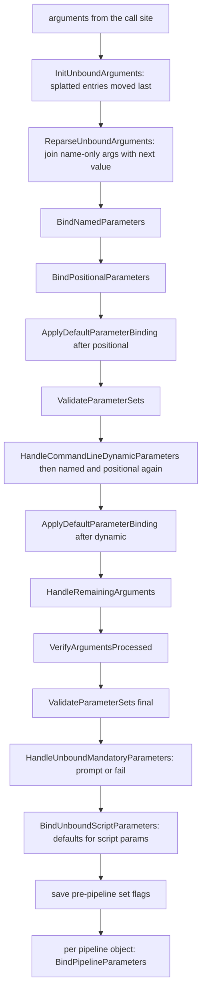

# Parameter binding

> STATIC-ONLY — behavior not run-verified. `FACT-SRC` unless marked. Where binding sits in the command lifecycle: [runspace-and-pipeline](runspace-and-pipeline.md) (CF-LCY-001). Cmdlet base classes: [cmdlet-infrastructure](cmdlet-infrastructure.md). Splatting and argument forms in the parser: [02.2-parser](../02-language/02.2-parser.md). Conversion rules: [CONVERSION-RULES](../02-language/CONVERSION-RULES.md).

## 1. Purpose and scope [SPEC]

Parameter binding connects the arguments written after a command name (and the objects arriving on the pipeline) to the declared parameters of a cmdlet, function or script. It decides which *parameter set* applies, converts and validates values, supplies defaults, prompts for mandatory values, and reports errors. Native (external) programs have their own argument builder (see [command-discovery-and-invocation](command-discovery-and-invocation.md) §7).

## 2. Source map

| path | type | role | tier |
|---|---|---|---|
| src/System.Management.Automation/engine/ParameterBinderController.cs::ParameterBinderController@L19-L1325 | abstract class | named, positional and splatted binding; argument re-parsing | A |
| src/System.Management.Automation/engine/CmdletParameterBinderController.cs::CmdletParameterBinderController@L22-L4270 | class | the full algorithm: parameter sets, defaults, dynamic parameters, mandatory, pipeline binding | A |
| src/System.Management.Automation/engine/ParameterBinderBase.cs::ParameterBinderBase@L57-L1937 | abstract class | binds one value: transformation, coercion, validation, set | A |
| src/System.Management.Automation/engine/MergedCommandParameterMetadata.cs::MergedCommandParameterMetadata@L12-L637 | class | all bindable parameters of a command (declared, common, dynamic) with prefix matching and set bitmasks | A |
| src/System.Management.Automation/engine/CompiledCommandParameter.cs::CompiledCommandParameter@L15-L568 | class | one parameter's compiled metadata | A |
| src/System.Management.Automation/engine/ParameterSetSpecificMetadata.cs::ParameterSetSpecificMetadata@L6-L213 | class | per-set facts: position, mandatory, pipeline flags | B |
| src/System.Management.Automation/engine/TypeMetadata.cs::InternalParameterMetadata@L1117-L1566 | class | builds parameter metadata from a type or a script block | B |
| src/System.Management.Automation/engine/scriptparameterbindercontroller.cs::ScriptParameterBinderController@L14-L230 | class | script/function variant | A |

## 3. Responsibilities and non-responsibilities

Owns the order of binding steps, parameter-set selection, mandatory handling, pipeline-input binding order, and the per-value conversion/validation order. Does not own: type conversion rules (`LanguagePrimitives`, T28), the attribute classes themselves, the cmdlet lifecycle (T31), `$PSDefaultParameterValues` storage (a variable), or parsing of `-name:value` forms (parser).

## 4. Key types and contracts [IMPL]

- `MergedCompiledCommandParameter` = a parameter plus its *binder association* (`DeclaredFormalParameters`, `DynamicParameters`, common/ShouldProcess/paging/transaction parameter binders). `MergedCommandParameterMetadata` keeps two maps: bindable names and alias names; adding a name or alias that already exists raises a `MetadataException` (`ParameterNameAlreadyExistsForCommand`, `ParameterNameConflictsWithAlias`, `AliasParameterNameAlreadyExistsForCommand`) (src/System.Management.Automation/engine/MergedCommandParameterMetadata.cs::MergedCommandParameterMetadata.AddMetadataForBinder@L78-L157).
- **Parameter sets are bit flags**: each distinct set name gets one bit of a 32-bit mask (`MaxParameterSetCount = 32`); a parameter in `__AllParameterSets` has flag 0 and `IsInAllSets`; the default set name (from `DefaultParameterSetName`) is added first so it gets bit 0 (src/System.Management.Automation/engine/MergedCommandParameterMetadata.cs::MergedCommandParameterMetadata.GenerateParameterSetMappingFromMetadata@L278-L341). More than 32 sets is an error at metadata construction (`UNVERIFIED` which error: `AddParameterSetToMap` throws when the index reaches 32).
- `ParameterSetSpecificMetadata` per (parameter, set): `Position` (`int.MinValue` = not positional), `IsMandatory`, `ValueFromPipeline`, `ValueFromPipelineByPropertyName`, `ValueFromRemainingArguments`, `ParameterSetFlag`, `IsInAllSets` (used throughout the controller).
- `ParameterBindingFlags`: `ShouldCoerceType`, `IsDefaultValue`, `DelayBindScriptBlock`, `ThrowOnParameterNotFound`, `None`.
- `GetMatchingParameter(name, throwOnNotFound, tryExactMatching, invocationInfo)`: strips one leading dash; collects every parameter name and alias for which the typed text is a **case-insensitive prefix** (invariant culture); with `tryExactMatching`, an exact (case-insensitive) match returns at once; several candidates are narrowed to declared or dynamic parameters (not common ones) when exactly one remains; otherwise `AmbiguousParameter` is thrown listing the candidates; none → `NamedParameterNotFound` only if asked to throw (src/System.Management.Automation/engine/MergedCommandParameterMetadata.cs::MergedCommandParameterMetadata.GetMatchingParameter@L445-L578).

## 5. Data model

The controller holds: `BindableParameters` (merged metadata), `UnboundParameters` (list), `BoundParameters` (name → parameter), `BoundArguments`, `UnboundArguments` (remaining command-line arguments), `CommandLineParameters` (what `$PSBoundParameters` exposes), `_currentParameterSetFlag` (bitmask of sets still possible; starts as `uint.MaxValue`), `_prePipelineProcessingParameterSetFlags` (saved at the end of command-line binding and restored for each pipeline object), `_delayBindScriptBlocks`, `ParametersBoundThroughPipelineInput`, `BoundDefaultParameters`, `DefaultParameterBindingInUse`, `_allDefaultParameterValuePairs`, and the dynamic-parameter binder. `CommandParameterInternal` is the internal form of one argument: optional parameter name text, optional argument value/AST, flags `FromHashtableSplatting`, `SpaceAfterParameter`.

## 6. Control flow

<!--CF:CF-BND-001-->**Parameter binding order and parameter-set resolution (CF-BND-001).** Command-line binding runs these steps in order: (1) arguments that came from hashtable splatting are moved after all other arguments; (2) a parameter name with no value is joined with the next argument as its value (a switch parameter takes `$true` instead; a name followed by another recognizable parameter name, or a name at the end, is a `MissingArgument` error); (3) **named binding**: every argument with a name is matched (exact name or alias first, then unambiguous prefix); a parameter already bound is an error (`ParameterAlreadyBound`) except that a splatted entry whose name was already bound explicitly is skipped; the `--%` verbatim marker is consumed here; (4) **positional binding**: unbound parameters that have a position in the still-valid sets are grouped by position number in ascending order; arguments without a name are taken in order; each is offered to the parameters of that position in four attempts — default set without type coercion, all valid sets without coercion, default set with coercion, all valid sets with coercion — and an argument no parameter accepts stays unbound; (5) values from `$PSDefaultParameterValues` are bound to still-unbound parameters, after positional binding and again after dynamic parameters; (6) `ValidateParameterSets`; (7) dynamic parameters are fetched once from the command (`GetDynamicParameters`), merged into the parameter table and set bitmasks, and named and positional binding are repeated for the leftover arguments; (8) leftover arguments are bound to the single `ValueFromRemainingArguments` parameter (two such parameters in the current sets is an error); (9) any argument still unbound is an error (`NamedParameterNotFound` for a named one, `PositionalParameterNotFound` otherwise); (10) the final parameter-set check and the mandatory-parameter step (§7); (11) script parameters that are still unbound get their declared default values; (12) the set mask is saved for pipeline binding. **Parameter-set resolution:** each bound parameter narrows the current set mask to the sets it belongs to. After binding, with *one* valid set that set is chosen. With *several* valid sets: if the mask is "all sets" and the command has no default set, the call is accepted as set-less; else if the command defines a default set and it is among the valid sets, the command's parameter-set name is set to the default set, and the mask is narrowed to the default set only in validation calls that ask for it (the final check after command-line binding does; the checks made before dynamic parameters and during pipeline binding may not); else, if pipeline input is still expected and some valid set has an unbound parameter that takes pipeline input, the decision is postponed to pipeline binding; else the mask is reduced to sets with no unbound mandatory parameter; if exactly one set remains it is chosen, otherwise `AmbiguousParameterSet`. With *zero* valid sets (conflicting parameters) the result is `AmbiguousParameterSet` as well. **Pipeline-object binding** for each input object restores the saved mask and the original values of parameters bound by the previous object, then makes four passes over the unbound parameters that accept pipeline input — (a) by value without coercion, (b) by property name without coercion, (c) by value with coercion, (d) by property name with coercion — trying the default set before the other valid sets in each pass; a successful bind narrows the set mask again.<!--/CF-->

**Binding one value** (src/System.Management.Automation/engine/ParameterBinderBase.cs::ParameterBinderBase.BindParameter@L224-L224): (1) argument-transformation attributes run in declaration order — the internal type-converter attribute only when coercion is allowed; other transformation attributes run for non-null values, and for null values only if the parameter is mandatory in some set, cannot be null, or the attribute asks for it (and the value is not a default); a failure becomes `ParameterBindingArgumentTransformationException`; (2) if coercion is allowed the value is converted to the parameter type (collections are encoded element-wise), else a non-coercing check decides whether to continue; (3) a `PSTypeName` constraint is validated for each element; (4) unless the value is a default value, every validation attribute runs in order (`ParameterBindingValidationException` on failure), then a null/empty check for mandatory parameters; (5) an obsolete script parameter (non-cmdlet-binding scripts) emits a warning; (6) the value is set on the target (property/field or runtime-defined parameter) and recorded in `$PSBoundParameters`; errors from the setter become `ParameterBindingFailed`.

**Delay-bind script blocks**: during command-line binding, if an argument is a script block for a parameter that accepts pipeline input and whose type is not itself script-block-compatible, binding is postponed; the parameter counts as bound for set selection, and for every pipeline object the script block is invoked with the object as `$_` and its result is bound (`ScriptBlockArgumentNoInput` if the command can receive no pipeline input at all) (src/System.Management.Automation/engine/CmdletParameterBinderController.cs::CmdletParameterBinderController.BindParameter@L1198-L1317).

## 7. Algorithms

**Mandatory handling** (src/System.Management.Automation/engine/CmdletParameterBinderController.cs::CmdletParameterBinderController.HandleUnboundMandatoryParameters@L2780-L2788, `GetMissingMandatoryParameters`): after command-line binding, collect unbound parameters that are mandatory in the current sets. Without expected pipeline input every such parameter is missing. With pipeline input expected, parameters that accept pipeline input (by value or property name) are *not* reported — they may still be bound per object — but non-pipeline mandatory parameters of the chosen set are. Complex rules decide which set to latch onto when the default set and another set both remain (they prefer the default set unless another set takes pipeline input without non-pipeline mandatory parameters); the read part of that function (lines 1756–2000 of 2393) is described here, the remainder is `UNVERIFIED` (VB-030). If any are missing: when the command is public and the host can prompt, the host is asked for each (field descriptions with per-parameter help, element-wise for arrays) and the answers are bound with coercion; otherwise `MissingMandatoryParameter` is thrown listing the names. During pipeline binding, `Read()` calls the same check per object (with `processMissingMandatory = false`) and writes a non-terminating `InputObjectMissingMandatory` error instead (see CF-LCY-001).

**Default parameter values** (src/System.Management.Automation/engine/CmdletParameterBinderController.cs::CmdletParameterBinderController.BindDefaultParameters@L390-L465): pairs from `$PSDefaultParameterValues` qualified by command name patterns apply only to parameters not yet bound and valid in the current sets; a script-block value is evaluated with a state object; zero results skip, one result is used, several results become a collection; values are bound with coercion and delay-bind allowed; a failure produces a one-time warning per command/parameter and is otherwise ignored; bound defaults are recorded in `BoundDefaultParameters`. `UNVERIFIED` (VB-031): the key matching rules in `GetDefaultParameterValuePairs` (lines 591–846).

**Pipeline binding detail** (src/System.Management.Automation/engine/CmdletParameterBinderController.cs::CmdletParameterBinderController.BindPipelineParametersPrivate@L3255-L3347): scanning order inside a pass is from the *last* unbound parameter to the first; by-property-name binding looks up a property of the input object with the parameter's name, then each alias, in that order; errors of kinds transformation, validation or default-value are rethrown (elaborated when default binding is in use), plain binding failures just mean "not bound"; a `PSInvalidCastException` during the non-coercing pass is not an error. If a set was prioritized (the default set when another set takes pipeline input), the whole four-pass sequence runs first restricted to that set and then, if not yet decided, to the others.

## 8. Observable behavior [SPEC]

- Parameter names can be abbreviated to any unambiguous prefix; aliases take part in the prefix match; `-name:value` and `-name value` are equivalent; a switch needs no value.
- Positional arguments fill positions in increasing order, only among parameters of still-possible sets.
- Splatting a hashtable cannot override a parameter bound explicitly.
- A command with several parameter sets and no way to decide fails with "Parameter set cannot be resolved using the specified named parameters"-style `AmbiguousParameterSet`.
- A mandatory parameter that is missing is prompted for (public commands, interactive host) or fails.
- Pipeline input binds by value first, then by property name, exact type before coerced.
- Tests: §16. No golden sample: STATIC-ONLY.

## 9. Error handling and edge cases

`ParameterBindingException` family: `ParameterBindingArgumentTransformationException`, `ParameterBindingValidationException` (has `SwallowException` for positional trials), `ParameterBindingParameterDefaultValueException`. Error ids seen: `MissingArgument`, `ParameterAlreadyBound`, `AmbiguousParameter`, `NamedParameterNotFound`, `PositionalParameterNotFound`, `AmbiguousPositionalParameterNoName`, `AmbiguousParameterSet`, `MissingMandatoryParameter`, `ScriptBlockArgumentNoInput`, `GetDynamicParametersException`, `ParameterArgumentTransformationError`, `ParameterArgumentValidationError`, `ParameterBindingFailed`, `InputObjectNotBound`, `InputObjectMissingMandatory`. When default-parameter binding was used, binding errors are re-thrown as an "elaborated" exception that names the default parameter source (`ThrowElaboratedBindingException`). In the non-coercing positional/pipeline passes a failure whose cause chain contains a `PSInvalidCastException` is swallowed (the coercing pass will retry); other exceptions rethrow. Binding failures at pipeline time are non-terminating per object; failures at command-line time are terminating.

## 10. Concurrency and threading

Binding runs on the pipeline thread inside `DoPrepare` (command line) and `Read()` (per object); it uses the command's own controller; nothing is shared across threads. The language mode may change temporarily during binding of a script command (see [runspace-and-pipeline](runspace-and-pipeline.md) §14).

## 11. Extension points and customization hooks

Attributes: `Parameter`, `Alias`, `ArgumentTransformation` (user-derivable), `ValidateArgumentsAttribute` family, `PSTypeName`, `Obsolete`, `AllowNull`/`AllowEmptyString`/`AllowEmptyCollection`; `IDynamicParameters.GetDynamicParameters()` returning a `RuntimeDefinedParameterDictionary` or an object with attributed members; `$PSDefaultParameterValues`; script-block arguments for pipeline-bindable parameters; `DefaultParameterSetName` and `ConfirmImpact` in `CmdletBinding`.

## 12. Dependencies

Inbound: `CommandProcessor.Prepare` and `Read`. Outbound: `LanguagePrimitives` conversion (T28), `PSObject`/ETS property lookup (T35) for by-property-name, the host UI for prompting, `MshCommandRuntime` (warnings, pipeline-input expectation), the script `ScriptBlock` invoke for delay-bind and default script blocks, `$PSBoundParameters` support in `PSBoundParametersDictionary`.

## 13. Performance notes

Metadata is compiled once per command info and cached (`CommandMetadata`); per call the controller allocates sets and lists. Pipeline binding repeats up to four passes per object, so commands with many pipeline-bindable parameters pay per object; the per-object restore of default values (`RestoreDefaultParameterValues`) re-runs for parameters bound by the previous object.

## 14. Security considerations

Binding is a policy-relevant boundary: (a) argument-transformation attributes and `ValidateScript`/`ArgumentCompleter` run user code during binding (the language-mode switch for script commands and the `LanguageModeTransitionInParameterBinding` flag exist so that code running there cannot be elevated or leak trusted data) — see src/System.Management.Automation/engine/CommandProcessor.cs::CommandProcessor.Prepare@L193-L254; (b) prompting for mandatory parameters is allowed only for commands whose visibility is public; (c) obsolete/deprecated warnings and `LogPipelineExecutionDetail` record bound values (truncated to about 256 characters per value) into logs when module/pipeline logging is on, which is a data-leak channel for secrets bound as strings (`SecureString`/credential types are the mitigation, `INFERENCE`).

### Security surface

<!--GEN:secseeds-->
| Category | Seed hits |
|---|---:|
| language-mode | 8 |
| **total** | 8 |

Files with most hits:

| File | Hits |
|---|---:|
| `src/System.Management.Automation/engine/ParameterBinderBase.cs` | 8 |

These are regex scanner hits (`APPROX`, `verified: false`, no `SEC-ENF` ID yet). Phase 5 verifies them and assigns IDs; none is claimed here as an enforcement point.
<!--/GEN:secseeds-->

What the new shell must guarantee here: (1) transformation and validation callbacks run with the *callee's* trust level or lower, never higher, and cannot observe unbound trusted values; (2) logging of bound values is redacted by parameter type/attribute; (3) binding never changes the active language mode for code outside the binding call; (4) a binder cannot be used to write to members other than declared parameters.

## 15. Enterprise considerations

Security first: §14. Observability: a binding tracer (`bindingTracer`, per-step scoped messages) exists for diagnostics (`Trace-Command ParameterBinding`) and pipeline-detail logging records each bound parameter. Supportability: error ids and `TargetObject`/extent make binding errors precise. Testability: binding is observable end to end through the language; a unit-testable "static" binder exists for completion and analysis (`StaticParameterBinder`, `UNVERIFIED` here). Resource limits: 32 parameter sets per command; no limit on argument count. Missing: a dry-run "explain binding" result usable by tooling without a tracer.

## 16. Tests

<!--GEN:tests-->
| Pester file | Describe | Context | It |
|---|---:|---:|---:|
| `test/powershell/Language/Parser/ParameterBinding.Tests.ps1` | 3 | 0 | 14 |
| `test/powershell/Language/Scripting/CommonParameters.Tests.ps1` | 1 | 10 | 22 |
| `test/powershell/Language/Scripting/Dynamicparameters.Tests.ps1` | 1 | 0 | 5 |
| `test/powershell/Language/Scripting/ParameterBinding.Tests.ps1` | 1 | 2 | 40 |
| `test/powershell/engine/ParameterBinding/BooleanParameterDCR.Tests.ps1` | 1 | 0 | 3 |
| `test/powershell/engine/ParameterBinding/NullableBooleanDCR.Tests.ps1` | 1 | 0 | 3 |
| `test/powershell/engine/ParameterBinding/ParameterBinding.Tests.ps1` | 1 | 3 | 24 |
| `test/powershell/engine/ParameterBinding/Splatting.Tests.ps1` | 1 | 2 | 11 |
| `test/powershell/engine/ParameterBinding/StaticParameterBinder.Tests.ps1` | 1 | 0 | 1 |
| **total (9 files)** | 11 | 17 | 123 |

No xUnit file matched the path keywords.

Matching is by path keyword (`APPROX`): `engine/ParameterBinding/`, `Parser/ParameterBinding`, `Scripting/ParameterBinding`, `Scripting/CommonParameters`, `Dynamicparameters`.
<!--/GEN:tests-->

## 17. Design decisions and trade-offs

- `FACT-SRC`: bitmask parameter sets give constant-time set intersection at the cost of a hard limit of 32 sets.
- `FACT-SRC`: two-stage typed attempts (without, then with coercion) make exact-type matches win over convertible ones for positional and pipeline binding.
- `INFERENCE`: restoring parameters per pipeline object (instead of re-creating the binder) trades a restore pass for lower allocation.
- `FACT-SRC`: default-parameter binding is spread over several points of the sequence (after positional, after dynamic, after pipeline) because dynamic parameters and pipeline sets change which defaults are valid.
- `FACT-SRC`: the controller carries much repeated "default binding in use → elaborate exception" logic; this is a readability cost.

## 18. Guidance for the new shell [LESSON]

- **LSN-RTBIND-01** [REPLICATE] (area: NLD-CMD) Keep the binding order (named → positional → defaults → dynamic → remaining → mandatory → pipeline) and the exact → coerced two-pass for positional and pipeline binding; it is observable. Evidence: src/System.Management.Automation/engine/CmdletParameterBinderController.cs::CmdletParameterBinderController.BindCommandLineParametersNoValidation@L202-L277.
- **LSN-RTBIND-02** [REPLICATE] (area: NLD-CMD) Parameter sets as bit masks with a default set and the ambiguity-by-mandatory tie-break. Evidence: src/System.Management.Automation/engine/CmdletParameterBinderController.cs::CmdletParameterBinderController.ValidateParameterSets@L2532-L2640.
- **LSN-RTBIND-03** [REPLICATE] (area: NLD-CMD) Unambiguous-prefix parameter names including aliases; exact match wins. Evidence: src/System.Management.Automation/engine/MergedCommandParameterMetadata.cs::MergedCommandParameterMetadata.GetMatchingParameter@L445-L578.
- **LSN-RTBIND-04** [ADAPT] (area: NLD-CMD) Lift the 32-set limit by using a set-index bit vector type, keeping the same semantics. Evidence: src/System.Management.Automation/engine/MergedCommandParameterMetadata.cs::MergedCommandParameterMetadata.MaxParameterSetCount@L171-L171.
- **LSN-RTBIND-05** [ADAPT] (area: NLD-CMD) Factor the "default binding in use → elaborate error" pattern into one wrapper, and the binding steps into an explicit pipeline of stages with a trace result object. Evidence: src/System.Management.Automation/engine/ParameterBinderController.cs::ParameterBinderController.ThrowElaboratedBindingException@L1017-L1049.
- **LSN-RTBIND-06** [REPLICATE] (area: NLD-SEC) Run transformation/validation callbacks under the callee's language mode; keep the explicit transition flag. Evidence: src/System.Management.Automation/engine/CommandProcessor.cs::CommandProcessor.Prepare@L193-L254.
- **LSN-RTBIND-07** [REDESIGN] (area: NLD-SEC) Redact bound values in execution-detail logging by parameter type and attribute instead of logging the first 256 characters of every value. DEV: DEV-BIND-130. Evidence: src/System.Management.Automation/engine/ParameterBinderBase.cs::ParameterBinderBase.BindParameter@L329-L667.

## 19. Open questions / UNVERIFIED items

- `UNVERIFIED` (VB-030): `GetMissingMandatoryParameters` lines 2000–2393 and `NewParameterSetPromptingData`; `PromptForMissingMandatoryParameters`/`BuildLabel` (prompt UI); `CoerceTypeAsNeeded` and `EncodeCollection` (`ParameterBinderBase` 984–1900; collection encoding rules).
- `UNVERIFIED` (VB-031): `GetDefaultParameterValuePairs` key-matching rules; `RestoreDefaultParameterValues`; `InvokeAndBindDelayBindScriptBlock` details.
- `UNVERIFIED` (VB-032): how `InternalParameterMetadata` builds metadata from attributes and script blocks (limits, error ids), `ScriptParameterBinder`, `ReflectionParameterBinder`, common-parameter binders (`-Verbose`, `-ErrorAction`, …).

Verification: all non-comment lines of `ParameterBinderController.cs` lines 133–330, 514–870, 919–1190, `CmdletParameterBinderController.cs` lines 104–470, 854–990, 1198–1320, 1463–1580, 1595–1735, 1756–2000, 2532–2700, 2752–2905, 3147–3630, `ParameterBinderBase.cs` lines 329–667 and `MergedCommandParameterMetadata.cs` lines 78–160, 278–345, 445–580 were read. Ranges are in `T31_T39.csv`. Test counts from `data/tests.json` through `tools/gen_T3.py`.
