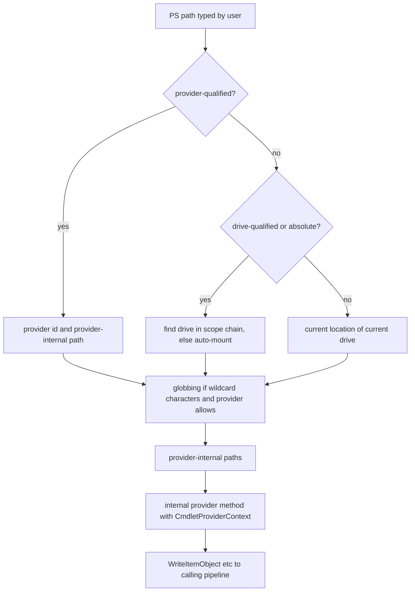

# Provider model

> STATIC-ONLY — behavior not run-verified. `FACT-SRC` unless marked. Scope: `EXTENDED` (providers are not part of the language core). Scopes and drives as language-visible concepts: [SCOPE-AND-VARIABLES](../02-language/SCOPE-AND-VARIABLES.md); the cmdlets that use providers (`Get-ChildItem` etc.) belong to the command-module families (Phase 4).

## 1. Purpose and scope [SPEC]

A *provider* exposes a hierarchical data store (file system, registry, variables, aliases, functions, environment, certificates, WSMan configuration) through one uniform set of verbs, so that the same cmdlets work on all of them. A provider is mounted on one or more *drives* (`C:`, `HKLM:`, `Env:`, `Variable:`); a *path* names an item within a provider. This document describes the provider class hierarchy and contracts, the drive and provider tables, and path resolution (drive-qualified, provider-qualified, relative, globbed).

## 2. Source map

| path | type | role | tier |
|---|---|---|---|
| src/System.Management.Automation/namespaces/ProviderBase.cs::CmdletProvider@L54-L1981 | abstract partial class | base: `Start`/`Stop`, context-bound properties, stream-writing API, `ShouldProcess` | B |
| src/System.Management.Automation/namespaces/DriveProviderBase.cs::DriveCmdletProvider@L20-L235 | abstract class | `NewDrive`, `RemoveDrive`, `InitializeDefaultDrives` | B |
| src/System.Management.Automation/namespaces/ItemProviderBase.cs::ItemCmdletProvider@L22-L687 | abstract class | `GetItem`, `SetItem`, `ClearItem`, `InvokeDefaultAction`, `ItemExists`, `IsValidPath`, `ExpandPath` | B |
| src/System.Management.Automation/namespaces/ContainerProviderBase.cs::ContainerCmdletProvider@L30-L1083 | abstract class | children, names, rename, new, remove, copy, `HasChildItems`, `ConvertPath` | B |
| src/System.Management.Automation/namespaces/NavigationProviderBase.cs::NavigationCmdletProvider@L21-L1088 | abstract class | `MakePath`, `GetParentPath`, `NormalizeRelativePath`, `GetChildName`, `IsItemContainer`, `MoveItem` | B |
| src/System.Management.Automation/namespaces/IContentProvider.cs::IContentCmdletProvider@L29-L146 | interface | content reader/writer/clear | B |
| src/System.Management.Automation/namespaces/IPropertiesProvider.cs::IPropertyCmdletProvider@L29-L198 | interface | item properties | B |
| src/System.Management.Automation/namespaces/IDynamicPropertyProvider.cs::IDynamicPropertyCmdletProvider@L28-L336 | interface | create/rename/copy/move/remove properties | B |
| src/System.Management.Automation/namespaces/IPermissionProvider.cs::ISecurityDescriptorCmdletProvider@L24-L107 | interface | security descriptors | B |
| src/System.Management.Automation/namespaces/LocationGlobber.cs::LocationGlobber@L17-L4731 | class | path forms, globbing, drive and provider resolution | B |
| src/System.Management.Automation/namespaces/CoreCommandContext.cs::CmdletProviderContext@L24-L1147 | sealed class | per-operation context: stream sink, filters, credential, force, drive | B |
| src/System.Management.Automation/engine/DataStoreAdapterProvider.cs::ProviderInfo@L22-L687 | class | description of a registered provider; creates instances | B |
| src/System.Management.Automation/engine/DataStoreAdapter.cs::PSDriveInfo@L22-L831 | class | one mounted drive | B |
| src/System.Management.Automation/engine/SessionStateProviderAPIs.cs, SessionStateDriveAPIs.cs | partial `SessionStateInternal` | provider table and per-scope drive tables | B |
| src/System.Management.Automation/namespaces/FileSystemProvider.cs, RegistryProvider.cs, AliasProvider.cs, FunctionProvider.cs, VariableProvider.cs, EnvironmentProvider.cs | provider classes | built-in providers | B |
| src/System.Management.Automation/namespaces/SessionStateProviderBase.cs | abstract class | shared base of the alias/function/variable/environment providers | B |

## 3. Responsibilities and non-responsibilities

Owns: the provider class contracts, provider and drive registration, path-to-provider resolution, per-operation context. Does not own: the command-line surface (`*-Item`, `*-ChildItem`, … cmdlets), format views of items (T36), session-state scope mechanics (T29), the implementations of individual providers beyond their declaration.

## 4. Key types and contracts [IMPL]

- **Hierarchy**: `CmdletProvider` → `DriveCmdletProvider` → `ItemCmdletProvider` → `ContainerCmdletProvider` → `NavigationCmdletProvider`. A provider class derives from the deepest level it supports; optional capabilities are interfaces (`IContentCmdletProvider`, `IPropertyCmdletProvider`, `IDynamicPropertyCmdletProvider`, `ISecurityDescriptorCmdletProvider`). The engine obtains the needed level with `GetDriveProviderInstance`, `GetItemProviderInstance`, `GetContainerProviderInstance`, `GetNavigationProviderInstance`, each of which fails when the provider does not derive from that level.
- **Declaration**: `[CmdletProvider(name, ProviderCapabilities)]`. `ProviderCapabilities` flags: `None=0`, `Include=1`, `Exclude=2`, `Filter=4`, `ExpandWildcards=8`, `ShouldProcess=0x10`, `Credentials=0x20`, `Transactions=0x40` (src/System.Management.Automation/namespaces/ProviderDeclarationAttribute.cs). Built-in declarations: FileSystem (`Credentials | Filter | ShouldProcess`), Alias, Function, Variable, Environment (`ShouldProcess`), Registry (`ShouldProcess`, plus `Transactions` on Windows), Certificate (`ShouldProcess`), WSMan (`Credentials`).
- **Virtual surface** (protected, empty or throwing by default): Drive level `NewDrive`, `RemoveDrive`, `InitializeDefaultDrives`, `NewDriveDynamicParameters`; Item level `GetItem`, `SetItem`, `ClearItem`, `InvokeDefaultAction`, `ItemExists`, `ExpandPath`, abstract `IsValidPath`, plus a `…DynamicParameters` twin for each; Container level `GetChildItems(path, recurse[, depth])`, `GetChildNames`, `ConvertPath`, `RenameItem`, `NewItem`, `RemoveItem`, `HasChildItems`, `CopyItem`; Navigation level `MakePath`, `GetParentPath`, `NormalizeRelativePath`, `GetChildName`, `IsItemContainer`, `MoveItem`; base level `Start`, `StartDynamicParameters`, `Stop`, `ItemSeparator`, `AltItemSeparator`, `GetResourceString`.
- **Internal call pattern**: every engine call goes through an *internal* method that stores the `CmdletProviderContext` into the provider's `Context` and then calls the protected virtual (`GetItem(path, context)` → `Context = context; GetItem(path)`). `ItemExists` additionally catches every exception and returns false (src/System.Management.Automation/namespaces/ItemProviderBase.cs::ItemCmdletProvider.ItemExists@L248-L266).
- **Output from providers** is written through `WriteItemObject(item, path, isContainer)`, `WritePropertyObject`, `WriteSecurityDescriptorObject` and `WriteError`, which forward to the context (and so to the calling cmdlet's pipeline); `ShouldProcess`/`ShouldContinue` forward to the calling cmdlet's runtime. The context-bound properties `Credential`, `Filter`, `Include`, `Exclude`, `Force`, `DynamicParameters`, `PSDriveInfo`, `ProviderInfo`, `Stopping`, `Host` and `SessionState` are read from the current context.
- **A new provider instance per operation**: `ProviderInfo.CreateInstance` calls `Activator.CreateInstance` on the implementing type every time; the comment in source explains that thread-local caching was dropped because a shared instance's `Context` gets overwritten when two commands using the same provider are piped together (src/System.Management.Automation/engine/DataStoreAdapterProvider.cs::ProviderInfo.CreateInstance@L546-L638). Provider classes must therefore not keep state between calls (state lives in the drive object or the store).

## 5. Data model

`ProviderInfo`: name, implementing type, capabilities, home, drives, module/snap-in, help file, `ItemSeparator`. `PSDriveInfo`: name, provider, root, current location, description, credential, `IsAutoMounted`, display root, scope-specific. Session state holds a provider table (name → list of `ProviderInfo`; the same name can exist in several modules, and a lookup that matches more than one raises `ProviderNameAmbiguousException`), per-scope drive tables, and `ProvidersCurrentWorkingDrive` (provider → current drive). Path forms (from `LocationGlobber`): *drive-qualified* `name:path`; *provider-qualified* `provider::path` (detected when a `::` follows the first colon, the text before it is non-empty and the path does not start with `.\` or `./`); *provider-internal* path (what the provider itself understands); *relative* (resolved against the current location of the current drive); *home* (`~`); *absolute* if it starts with a single file-system absolute form or contains a drive name before any path separator.

## 6. Control flow

**Drive lookup** (src/System.Management.Automation/engine/SessionStateDriveAPIs.cs::SessionStateInternal.GetDrive@L415-L477): search the current scope, then each parent scope; an auto-mounted drive found is first validated and dropped if stale; if none is found, try to *auto-mount* a file-system drive for that name (and then a built-in default drive); else `DriveNotFoundException`.

**Provider initialization** (`InitializeProvider`): ask the drive-level provider for its default drives; the first becomes the provider's current working drive; each drive whose provider name matches is validated with the provider (`NewDrive`) and added to the **global scope**; a failure writes an error rather than aborting. A new drive (`New-PSDrive`) is validated by the provider, must have a legal name, may keep a different name than requested only if names match case-insensitively (else `NewDriveProviderFailed`), is added to the current or named scope, and becomes the provider's current drive if none is set.

## 7. Algorithms

Path resolution from a PS path to provider paths: `GetGlobbedProviderPathsFromMonadPath(path, allowNonexistingPaths, context, out provider, out providerInstance)`: if the path is provider-qualified the context's drive is cleared; the path is resolved to a provider path and drive (`GetProviderPath`); if the provider returns no path the result is empty; the drive is placed in the context; the PS path is globbed (`GetGlobbedMonadPathsFromMonadPath`) and the provider-internal parts of the results are returned (src/System.Management.Automation/namespaces/LocationGlobber.cs::LocationGlobber.GetGlobbedProviderPathsFromMonadPath@L732-L790). Globbing (expand wildcard characters, generate paths for a glob leaf, match child names) is implemented in `ExpandGlobPath`, `ExpandMshGlobPath`, `GenerateNewPathsWithGlobLeaf` and `IsChildNameAMatch` (`UNVERIFIED` in detail, VB-035); whether a path is globbed at all depends on the provider's capabilities and on the context (`ShouldPerformGlobbing`).

## 8. Observable behavior [SPEC]

- `Get-PSProvider` lists providers; `Get-PSDrive` lists drives; `Set-Location Env:` changes the current drive; a path like `HKLM:\Software` is resolved through the Registry provider.
- The same commands act differently per provider, controlled by capabilities (`-Filter` only if the provider declares `Filter`; `-Credential` only with `Credentials`).
- File-system drives for existing volumes are auto-mounted on first use.
- A provider that throws during an operation produces a `ProviderInvocationException` with the provider and path.
- Tests: §16. No golden sample: STATIC-ONLY.

## 9. Error handling and edge cases

`DriveNotFoundException`, `ProviderNotFoundException` (also for provider constructor failures: the constructor's inner exception is attached), `ProviderNameAmbiguousException`, `ItemNotFoundException`, `NotSupportedException`/`PSNotSupportedException` when a provider lacks a level or interface, `ProviderInvocationException` wrapping provider exceptions. During path resolution, `ItemNotFoundException`, `DriveNotFoundException`, `ProviderNotFoundException`, an unset provider home (`InvalidOperationException`), provider errors and "provider does not implement the container level" are all caught when the command searcher resolves a command name through a path (it returns no match) (src/System.Management.Automation/engine/CommandSearcher.cs::CommandSearcher.GetNextFromPathUsingWildcards@L520-L566).

## 10. Concurrency and threading

Providers are created per operation and run on the calling pipeline thread; the `Context` field is not thread-safe and is the reason instances are not shared. `Stopping` reflects the calling pipeline's stop state. Content readers/writers returned by providers are used from the calling cmdlet.

## 11. Extension points and customization hooks

A new provider class with `[CmdletProvider]`; registration through `InitialSessionState` (`SessionStateProviderEntry`) or module manifests/snap-ins; dynamic parameters per operation (`…DynamicParameters` methods); `ItemSeparator` / `AltItemSeparator`; per-provider resource strings (`GetResourceString`); custom drives from `New-PSDrive -PSProvider` with the provider's `NewDrive`. The default built-in set registered in `InitialSessionState` is Registry (Windows), Alias, Environment, FileSystem, Function, Variable (src/System.Management.Automation/engine/InitialSessionState.cs::PSSnapInHelpers@L5030-L5613 — the table in source); Certificate and WSMan come from their own assemblies.

## 12. Dependencies

Inbound: item/location cmdlets, `Resolve-Path`, the command searcher (path lookup), tab completion, `Test-Path`, native argument globbing (`PossiblyGlobArg`, [command-discovery-and-invocation](command-discovery-and-invocation.md)), session-state variable/function/alias lookups (the variable, function and alias providers are views over session state). Outbound: session state (drive tables, provider table), the host (prompts), the file system and registry APIs, `PSObject` (items written as `PSObject` with provider-path properties added; `UNVERIFIED` in detail).

## 13. Performance notes

New instance per operation (activator call) is cheap relative to I/O but adds allocation per call; globbing may enumerate directories; auto-mounting scans system drives on a miss; `PSDrive` validation calls the provider for each new drive.

## 14. Security considerations

The provider boundary is where scripts reach the host's file system, registry and credentials. Enforced here: provider capabilities gate `-Credential`, `-Filter`; `ShouldProcess` capability routes destructive operations through consent; visibility of providers and drives is a session-state property (restricted runspaces can omit providers). Not enforced here: path allow-listing, sandbox roots (the file-system provider accepts any path the process can access), and symbolic-link policy (`UNVERIFIED`). Credentials flow into the provider as `PSCredential` on the context.

### Security surface

<!--GEN:secseeds-->
| Category | Seed hits |
|---|---:|
| language-mode | 3 |
| trust-boundary | 2 |
| securestring | 1 |
| **total** | 6 |

Files with most hits:

| File | Hits |
|---|---:|
| `src/System.Management.Automation/namespaces/FileSystemProvider.cs` | 6 |

These are regex scanner hits (`APPROX`, `verified: false`, no `SEC-ENF` ID yet). Phase 5 verifies them and assigns IDs; none is claimed here as an enforcement point.
<!--/GEN:secseeds-->

What the new shell must guarantee here: all item access goes through a mediation point that can apply a capability policy (root confinement, read/write/delete rights) *before* the provider code; provider-supplied paths are normalized by the mediation point, never by provider code alone; credentials on the context are not retained by provider instances.

## 15. Enterprise considerations

Security first: §14. Observability: path-resolution and provider-base tracers exist (`s_pathResolutionTracer`, `providerBaseTracer`); provider exceptions carry provider name and path. Supportability: the uniform verbs make third-party stores scriptable. Testability: a provider can be tested through the cmdlets; internal methods are `internal`, so unit tests need friend access. Resource limits: none. Missing: asynchronous provider operations, cancellation tokens (only the `Stopping` flag), per-operation audit events.

## 16. Tests

<!--GEN:tests-->
| Pester file | Describe | Context | It |
|---|---:|---:|---:|
| `test/powershell/Modules/Microsoft.PowerShell.Core/ImportProvider.Tests.ps1` | 1 | 0 | 1 |
| `test/powershell/Modules/Microsoft.PowerShell.Management/Alias.Tests.ps1` | 2 | 1 | 11 |
| `test/powershell/Modules/Microsoft.PowerShell.Management/FileSystem.Tests.ps1` | 12 | 26 | 146 |
| `test/powershell/Modules/Microsoft.PowerShell.Management/FileSystemProviderExtended.Tests.ps1` | 2 | 16 | 86 |
| `test/powershell/Modules/Microsoft.PowerShell.Management/FunctionProvider.Tests.ps1` | 1 | 4 | 15 |
| `test/powershell/Modules/Microsoft.PowerShell.Management/Get-PSDrive.Tests.ps1` | 3 | 0 | 12 |
| `test/powershell/Modules/Microsoft.PowerShell.Management/Get-PSProvider.Tests.ps1` | 1 | 1 | 6 |
| `test/powershell/Modules/Microsoft.PowerShell.Management/New-PSDrive.Tests.ps1` | 1 | 1 | 4 |
| `test/powershell/Modules/Microsoft.PowerShell.Management/PSDrive.Tests.ps1` | 2 | 4 | 14 |
| `test/powershell/Modules/Microsoft.PowerShell.Management/Push-Location.Tests.ps1` | 1 | 0 | 9 |
| `test/powershell/Modules/Microsoft.PowerShell.Management/Registry.Tests.ps1` | 2 | 13 | 52 |
| `test/powershell/Modules/Microsoft.PowerShell.Management/Resolve-Path.Tests.ps1` | 1 | 0 | 8 |
| `test/powershell/Modules/Microsoft.PowerShell.Management/Set-Location.Tests.ps1` | 1 | 4 | 23 |
| `test/powershell/Modules/Microsoft.PowerShell.Management/Variable.Tests.ps1` | 2 | 0 | 10 |
| `test/powershell/Modules/Microsoft.PowerShell.Security/CertificateProvider.Tests.ps1` | 2 | 5 | 19 |
| `test/powershell/Modules/Microsoft.PowerShell.Utility/Environment-Variables.Tests.ps1` | 1 | 1 | 7 |
| **total (16 files)** | 35 | 76 | 423 |

| xUnit file | Facts | Theories | Classes |
|---|---:|---:|---|
| `test/xUnit/csharp/test_FileSystemProvider.cs` | 9 | 0 | `FileSystemProviderTests` |

Matching is by path keyword (`APPROX`): `Management/FileSystem.Tests`, `Management/FileSystemProviderExtended`, `Management/Registry.Tests`, `Management/Alias.Tests`, `Management/FunctionProvider`, `Management/Variable.Tests`, `Management/PSDrive.Tests`, `Management/New-PSDrive`, `Management/Get-PSDrive`, `Management/Get-PSProvider`, `Security/CertificateProvider`, `ImportProvider`, `Management/Resolve-Path`, `Management/Set-Location`, `Management/Push-Location`, `Environment-Variables`, `test_FileSystemProvider`.
<!--/GEN:tests-->

## 17. Design decisions and trade-offs

- `FACT-SRC`: no provider instance sharing (documented in source).
- `FACT-SRC`: capabilities are declared in an attribute and also expressed by the class level; both must agree.
- `INFERENCE`: `ItemExists` swallowing exceptions makes `Test-Path` robust at the cost of hiding provider faults.
- `FACT-SRC`: drives live in scopes (like variables), so a script can mount a drive visible only to its callees.
- `INFERENCE`: the variable, alias and function stores are exposed as providers so that the same verbs (`Get-ChildItem Variable:`) work on them.

## 18. Guidance for the new shell [LESSON]

- **LSN-RTPROV-01** [ADAPT] (area: NLD-MOD) Keep the verb contract (item, container, navigation, content, property) as interfaces with capability flags instead of a five-level class hierarchy with context-bound state. Evidence: src/System.Management.Automation/namespaces/NavigationProviderBase.cs::NavigationCmdletProvider@L21-L1088.
- **LSN-RTPROV-02** [REPLICATE] (area: NLD-MOD) Drive-qualified, provider-qualified and relative path forms and per-scope drives. Evidence: src/System.Management.Automation/namespaces/LocationGlobber.cs::LocationGlobber.IsProviderQualifiedPath@L1371-L1431.
- **LSN-RTPROV-03** [REDESIGN] (area: NLD-SEC) Put a mandatory policy mediation layer between the engine and providers (root confinement, rights, audit) and pass an explicit per-call context object instead of mutating a `Context` field on the provider. DEV: DEV-PROV-140. Evidence: src/System.Management.Automation/engine/DataStoreAdapterProvider.cs::ProviderInfo.CreateInstance@L546-L638.
- **LSN-RTPROV-04** [REPLICATE] (area: NLD-MOD) Treat variables, functions, aliases and environment as providers over session state. Evidence: src/System.Management.Automation/engine/InitialSessionState.cs::PSSnapInHelpers@L5030-L5613.
- **LSN-RTPROV-05** [ADAPT] (area: NLD-MOD) Replace the all-exceptions-swallowed `ItemExists` with a typed result (exists, absent, failed) and let `Test-Path` decide. Evidence: src/System.Management.Automation/namespaces/ItemProviderBase.cs::ItemCmdletProvider.ItemExists@L248-L266.
- **LSN-RTPROV-06** [AVOID] (area: NLD-MOD) Do not implement file-system auto-mounting of Windows volumes on lookup miss as an engine feature; mount drives explicitly or from configuration. DEV: DEV-PROV-141. Evidence: src/System.Management.Automation/engine/SessionStateDriveAPIs.cs::SessionStateInternal.GetDrive@L415-L477.

## 19. Open questions / UNVERIFIED items

- `UNVERIFIED` (VB-035): globbing internals in `LocationGlobber` (`ExpandGlobPath` etc.), `GetProviderPath` variants, home-path rules, `CmdletProviderContext` members, `ProviderIntrinsics` (`InvokeProvider`) facade, `SessionStateContainer`/`SessionStateItem` call routing.
- `UNVERIFIED` (VB-036): `FileSystemProvider` (9,600 lines), `RegistryProvider`, `CertificateProvider`, `WSManConfigProvider` implementations; symbolic-link handling; content stream encodings.
- `UNVERIFIED` (VB-037): how items written by providers are decorated (`PSPath`, `PSParentPath`, `PSChildName`, `PSDrive`, `PSProvider` note properties) — believed from the type-extension data, not read here.

Verification: `LocationGlobber.cs` lines 732–790, 1348–1445, 1469–1560 and 2380–2454, `ProviderBase.cs` outline and lines 1883–1950, `ItemProviderBase.cs` lines 22–330, `SessionStateProviderAPIs.cs` lines 253–297 and 953–1070, `SessionStateDriveAPIs.cs` lines 64–232 and 410–477, `DataStoreAdapterProvider.cs` lines 546–620 and the `[CmdletProvider]` declarations were read. All other members are from signatures only (tier B). Ranges in `T31_T39.csv`.
