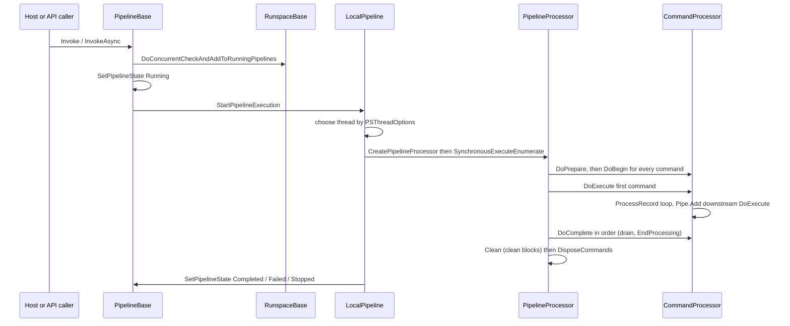
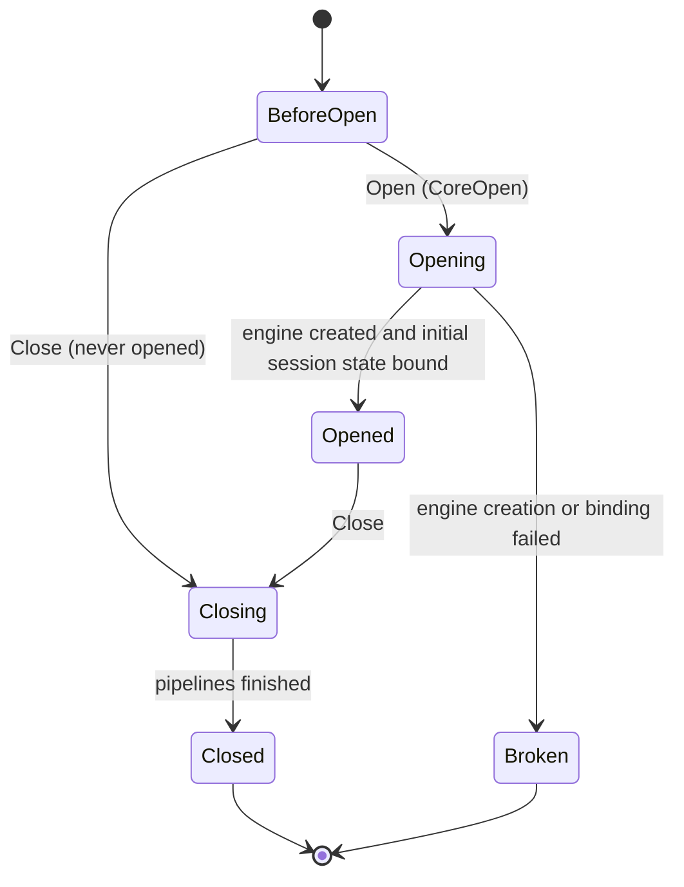
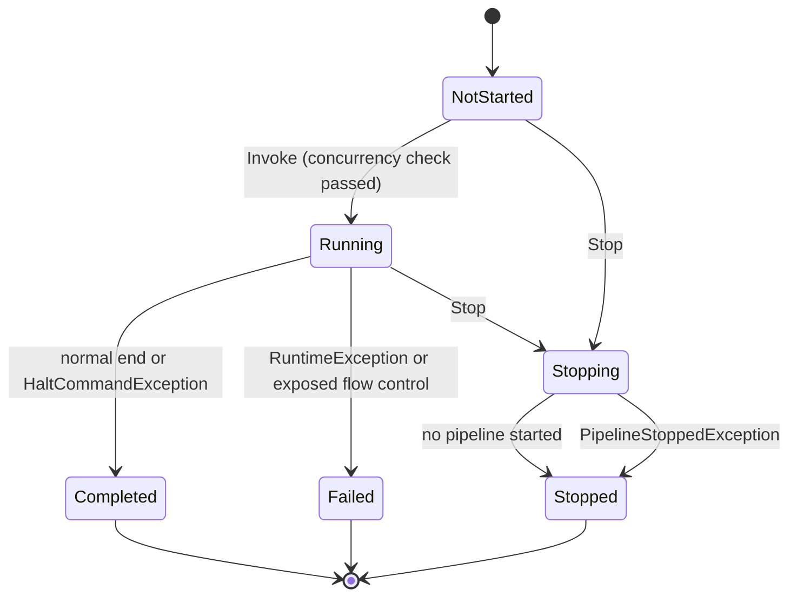

# Runspace and pipeline

> STATIC-ONLY — behavior not run-verified. `FACT-SRC` unless marked. Command resolution is in [command-discovery-and-invocation](command-discovery-and-invocation.md); parameter binding in [parameter-binding](parameter-binding.md); the execution context in [execution-context-and-session-state](execution-context-and-session-state.md). The path from host to script is in [LIFECYCLE-script-execution](../02-language/LIFECYCLE-script-execution.md).

## 1. Purpose and scope [SPEC]

A *runspace* is one isolated engine instance (one `ExecutionContext`, one session state, one language mode). A *pipeline* is one request to run a list of commands in a runspace. The engine runs a pipeline as a chain of *command processors* joined by *pipes*. This document covers: the three public layers (`PowerShell` API, `Pipeline`, `Runspace`/`RunspacePool`), the engine-internal pipeline (`PipelineProcessor`, `Pipe`, `CommandProcessorBase`, `CommandProcessor`), the state machines, the thread model, stop/cancel, and object flow. Remote runspaces and PSRP are out of scope (Phase 4); only the points where the local code branches on "remote" are named.

## 2. Source map

| path | type | role | tier |
|---|---|---|---|
| src/System.Management.Automation/engine/pipeline.cs::PipelineProcessor@L29-L1667 | class | engine pipeline: owns the command list, drives begin/process/end, error and stop state | A |
| src/System.Management.Automation/engine/Pipe.cs::Pipe@L29-L621 | class | one connection between two commands (queue or sink) | A |
| src/System.Management.Automation/engine/CommandProcessorBase.cs::CommandProcessorBase@L16-L1043 | abstract class | per-command driver: prepare/begin/execute/complete/cleanup wrappers | A |
| src/System.Management.Automation/engine/CommandProcessor.cs::CommandProcessor@L21-L868 | class | processor for cmdlets and for advanced functions/scripts | A |
| src/System.Management.Automation/engine/hostifaces/LocalPipeline.cs::LocalPipeline@L21-L1143 | sealed class | public-layer pipeline that runs on a thread and owns a `PipelineProcessor` | B |
| src/System.Management.Automation/engine/hostifaces/LocalPipeline.cs::PipelineStopper@L1266-L1399 | class | stack of active `PipelineProcessor`s; stop fan-out | B |
| src/System.Management.Automation/engine/hostifaces/pipelinebase.cs::PipelineBase@L20-L1071 | abstract class | invoke/stop state machine, streams, events | B |
| src/System.Management.Automation/engine/hostifaces/ConnectionBase.cs::RunspaceBase@L24-L1610 | abstract class | runspace state machine, running-pipeline list, concurrency checks | B |
| src/System.Management.Automation/engine/hostifaces/LocalConnection.cs::LocalRunspace@L31-L1306 | class | local runspace: open creates the engine | B |
| src/System.Management.Automation/engine/hostifaces/RunspacePoolInternal.cs::RunspacePoolInternal@L19-L1668 | class | pool of runspaces (min/max, get/release) | B |
| src/System.Management.Automation/engine/hostifaces/PowerShell.cs::PowerShell@L575-L5954 | sealed class | fluent API over a runspace or pool | B |
| src/System.Management.Automation/engine/AutomationEngine.cs::AutomationEngine@L15-L128 | class | creates the context, parser and command discovery for a runspace | B |

## 3. Responsibilities and non-responsibilities

Owns: object flow between commands, ordering of the command lifecycle, the first-error rule, stop propagation, one-pipeline-at-a-time per runspace, runspace/pipeline/`PowerShell` state machines. Does not own: command lookup (T32), argument binding (T33), cmdlet base class behavior and stream-writing APIs (T33), formatting of results (T36), the host UI (Phase 4).

## 4. Key types and contracts [IMPL]

- **`Pipe`** is a one-way connection owned by the *upstream* command. Its sink is exactly one of: a queued `ObjectQueue` with a `DownstreamCmdlet`; a nested `PipelineProcessor`; a `Collection<PSObject>`; a `List<object>`; an `ExternalWriter`. `Add` drops `AutomationNull`, appends to the `-OutVariable`-style lists, honours the null pipe, updates the `-PipelineVariable`, then writes to the sink in the order *nested pipeline processor → result collection → result list → external writer → queue* (src/System.Management.Automation/engine/Pipe.cs::Pipe.Add@L406-L425, src/System.Management.Automation/engine/Pipe.cs::Pipe.AddToPipe@L435-L466). `AddItems` enumerates its argument and adds each element; `AutomationNull` elements are skipped (src/System.Management.Automation/engine/Pipe.cs::Pipe.AddItems@L483-L532).
- **Read order of a pipe**: queued objects first, then the wrapped enumerator (skipping `AutomationNull`), then the external reader; end of input is signalled by `AutomationNull.Value`; a closed or disposed external reader is treated as end of input (src/System.Management.Automation/engine/Pipe.cs::Pipe.Retrieve@L541-L601).
- **`PipelineProcessor.Add`** wires a command: the first command takes no input; every later command takes the previous command's output pipe (or its error pipe when `readErrorQueue`), and a pipe may have only one downstream consumer (`PipeAlreadyTaken`). A command that merges unclaimed earlier error results (`MergeUnclaimedPreviousErrorResults`) redirects the error pipes of all earlier commands that have no consumer into its input pipe (src/System.Management.Automation/engine/pipeline.cs::PipelineProcessor.AddCommand@L331-L440). A command processor can be added once (`CommandProcessorAlreadyUsed`) and not after execution started (`ExecutionAlreadyStarted`).
- **Native chains**: when two native commands are adjacent, the first records the second as `DownStreamNativeCommand` and the second sets `UpstreamIsNativeCommand`, so bytes can pass between processes (the experimental `PSNativeCommandPreserveBytePipe` feature; here only the wiring is read) (src/System.Management.Automation/engine/pipeline.cs::PipelineProcessor.Add@L270-L296).
- **`CommandProcessorBase`** wraps every phase in the same frame: remember the current command processor, switch the engine session state and scope to the command's scope (`SetCurrentScopeToExecutionScope`), run the phase, restore both in `finally` (src/System.Management.Automation/engine/CommandProcessorBase.cs::CommandProcessorBase.DoPrepare@L451-L481, src/System.Management.Automation/engine/CommandProcessorBase.cs::CommandProcessorBase.DoExecute@L566-L582). `DoBegin` runs `BeginProcessing` once (`RanBeginAlready`); `Complete` first drains remaining input through `ProcessRecord`, then calls `EndProcessing`; `DoCleanup` runs the `clean` block.
- **Write permission**: a command may write to the pipeline only inside `AllowThisCommandToWrite(true)` scopes, which wrap begin, each process call, end and clean; preparation wraps binding in `AllowThisCommandToWrite(false)` (src/System.Management.Automation/engine/CommandProcessor.cs::CommandProcessor.BindCommandLineParameters@L164-L179).
- **`ManageInvocationException`** converts exceptions into the pipeline's stop signal: provider errors become `CmdletProviderInvocationException`; `PipelineStoppedException`, `CmdletInvocationException`, `ActionPreferenceStopException`, `HaltCommandException`, flow-control exceptions, `ScriptCallDepthException` and exceptions from a `throw` statement pass through; any other exception is wrapped in `CmdletInvocationException`; the result is handed to the command runtime (`ManageException`), which returns a `PipelineStoppedException` (src/System.Management.Automation/engine/CommandProcessorBase.cs::CommandProcessorBase.ManageInvocationException@L848-L947).
- **`PipelineBase`** keeps the public state (`PipelineState`), the three object streams (input, output, error), and a queue of state events that are raised outside the lock (src/System.Management.Automation/engine/hostifaces/pipelinebase.cs::PipelineBase.SetPipelineState@L798-L823, src/System.Management.Automation/engine/hostifaces/pipelinebase.cs::PipelineBase.RaisePipelineStateEvents@L837-L890). A state-change handler that throws is swallowed.

## 5. Data model

State enumerations (values from source): `RunspaceState` = BeforeOpen, Opening, Opened, Closed, Closing, Broken, Disconnecting, Disconnected, Connecting (src/System.Management.Automation/engine/hostifaces/Connection.cs::RunspaceState@L160-L198); `RunspacePoolState` has the same nine members (src/System.Management.Automation/engine/hostifaces/RunspacePool.cs::RunspacePoolState@L199-L240); `PipelineState` and `PSInvocationState` = NotStarted, Running, Stopping, Stopped, Completed, Failed, Disconnected (src/System.Management.Automation/engine/hostifaces/Pipeline.cs::PipelineState@L132-L162, src/System.Management.Automation/engine/hostifaces/PowerShell.cs::PSInvocationState@L133-L163); `RunspaceAvailability` = None, Available, AvailableForNestedCommand, Busy, RemoteDebug (src/System.Management.Automation/engine/hostifaces/Connection.cs::RunspaceAvailability@L358-L386); `PSThreadOptions` = Default, UseNewThread, ReuseThread, UseCurrentThread (src/System.Management.Automation/engine/hostifaces/Connection.cs::PSThreadOptions@L203-L226).

`PipelineProcessor` state: the command list, `_executionStarted`, `_stopping`, the first terminating error (`ExceptionDispatchInfo`, `_firstTerminatingError`), optional external input reader, external success/error writers, redirection pipelines, a `CancellationToken` source (`PipelineStopToken`), the execution scope, and an event-log buffer used only when some command asks for pipeline execution logging (src/System.Management.Automation/engine/pipeline.cs::PipelineProcessor@L29-L1667). Each command's `MyInvocation` receives `PipelinePosition` (1-based), `PipelineLength`, a shared `PipelineIterationInfo` counter array (element 0 counts input objects of command 1, element *i* counts process calls of command *i*), and `ExpectingInput` (src/System.Management.Automation/engine/pipeline.cs::PipelineProcessor.Start@L1029-L1147, src/System.Management.Automation/engine/CommandProcessor.cs::CommandProcessor.ProcessRecord@L310-L421).

## 6. Control flow

**Ordered steps of `PipelineProcessor.SynchronousExecuteEnumerate`** (the top-level run; src/System.Management.Automation/engine/pipeline.cs::PipelineProcessor.SynchronousExecuteEnumerate@L493-L590): (1) throw `PipelineStoppedException` if already stopping; (2) `Start`; (3) attach the external input reader to the first command's input pipe; (4) `Inject` the input (an enumerable input is wrapped in a pipe over its enumerator; a scalar is added to the first pipe) and call `DoExecute` on the first command; (5) `DoCompleteCore`; (6) in `finally`, `Clean`; (7) on success, complete redirection pipelines and return the results of the last command; (8) on a `RuntimeException`, rethrow the *first* recorded terminating error; (9) always `DisposeCommands`.

**`Start`** (src/System.Management.Automation/engine/pipeline.cs::PipelineProcessor.Start@L1029-L1147): checks disposed/stopping/already-started and that at least one command exists; fixes the execution scope to the first command's current scope; connects the external success and error writers; marks the first command's input closed when there is neither external input nor an incoming stream; reads `$PSDefaultParameterValues`; then for every command in order logs "started", fills `MyInvocation` and calls `DoPrepare` (which binds command-line parameters, so **all commands are bound before any begin block runs**); then sets up `-OutVariable`/`-ErrorVariable`/`-WarningVariable`/`-PipelineVariable`/`-InformationVariable` for every command; finally calls `DoBegin` for every command in order.

<!--CF:CF-LCY-001-->**Command lifecycle (CF-LCY-001).** For a pipeline of commands C1…Cn the engine (1) builds all command processors and wires pipes; (2) *prepares* every command in order (parameter binding from the command line, with default parameter values applied) and sets up common-parameter variables; (3) runs the *begin* phase of every command in order C1…Cn (`BeginProcessing`, or the `begin` block); (4) runs the *process* phase *depth-first and synchronously*: C1 reads its input (or runs once with no input if none is expected), and each object it writes into its output pipe causes C2 to run its process phase over everything queued (the default buffer threshold is zero), recursively; every input object is bound before each call (pipeline parameter binding, then mandatory-parameter check); an object that cannot be bound or misses a mandatory parameter produces a non-terminating error and is skipped; (5) when C1's input is exhausted the *end* phase runs for C1…Cn in order — each command first drains any input still queued through its process phase, then runs `EndProcessing` (or the `end` block); (6) the *clean* phase (`clean` blocks, only for commands that have one) runs for every command in `finally`, with stopping suspended, and its errors are written to the command's error output; (7) all command processors are disposed. The first terminating error is recorded; later failures are logged as health events and do not replace it. A stop request cancels the pipeline token and calls `StopProcessing` on every command.<!--/CF-->

**Object flow and back-pressure.** Within one pipeline the flow is a synchronous push: `Pipe.AddToPipe` enqueues, and when the downstream command exists and the queue length exceeds `OutBufferCount` (default 0) it calls the downstream command's `DoExecute` on the same thread, so the producer is suspended while the consumer runs (src/System.Management.Automation/engine/Pipe.cs::Pipe.AddToPipe@L435-L466, src/System.Management.Automation/engine/Pipe.cs::Pipe.OutBufferCount@L110-L110). There is no queue limit between commands and no blocking; memory is bounded by the producer's batch, not by a limit. The only bounded blocking queue is the host-facing stream: `ObjectStream` has a capacity (default `Int32.MaxValue`) and writers block on a write handle when it is full (src/System.Management.Automation/utils/ObjectStream.cs::ObjectStream@L395-L1517; the capacity chosen by `PipelineBase` for its three streams is `UNVERIFIED`, VB-024).

## 7. Algorithms

**Stop request** (`UNVERIFIED` only where marked). `PipelineBase.CoreStop` (src/System.Management.Automation/engine/hostifaces/pipelinebase.cs::PipelineBase.CoreStop@L287-L351): under the lock, `NotStarted` → `Stopping` then `Stopped` and return; `Stopped`/`Completed`/`Failed` → return; `Stopping` → wait for the finished event if synchronous; `Running` → `Stopping`. Then raise state events; if the state is already `Stopped`, return; else `ImplementStop`. `LocalPipeline.StopHelper` (src/System.Management.Automation/engine/hostifaces/LocalPipeline.cs::LocalPipeline.StopHelper@L773-L798): release the debugger; stop nested pipelines started after this one; close the input stream; call `PipelineStopper.Stop`; wait for the pipeline-finished event. `PipelineStopper.Stop` marks itself stopping (a second call is a no-op) and calls `PipelineProcessor.Stop` on every stacked processor. `PipelineProcessor.Stop` records `PipelineStoppedException` as the first error (returns if the pipeline was already stopping), cancels `PipelineStopToken`, and calls `DoStopProcessing` on each command, ignoring exceptions from each (src/System.Management.Automation/engine/pipeline.cs::PipelineProcessor.Stop@L890-L927). An asynchronous stop runs the same helper on a new thread.

**Early termination by a downstream command** (e.g. `Select-Object -First`): a command throws `StopUpstreamCommandsException`; `SynchronousExecuteEnumerate` and `DoCompleteCore` catch the resulting `PipelineStoppedException` when the first error is that exception, clear the error, and remember the requesting command; the completion pass then skips the requesting command and every command before it, and still completes the ones after it (src/System.Management.Automation/engine/pipeline.cs::PipelineProcessor.DoCompleteCore@L614-L709). `INFERENCE`: the requester has already finished its own work when it asked upstream to stop.

**Concurrency check on invoke** (src/System.Management.Automation/engine/hostifaces/pipelinebase.cs::PipelineBase.DoConcurrentCheck@L617-L700): a non-nested pipeline may start only when no pipeline is running; if the running one is the internal "pulse" pipeline (or a nested pipeline while a pulse exists), the caller waits for it and re-checks; otherwise `ConcurrentInvokeNotAllowed`. A nested pipeline must be started synchronously, from the same thread that runs its parent; otherwise `NestedPipelineInvokeAsync` / `NestedPipelineNoParentPipeline`. A child pipeline with no parent running becomes a normal pipeline.

## 8. Observable behavior [SPEC]

- Output of a pipeline appears incrementally: a downstream command's process block runs as soon as an upstream command writes an object (default buffer threshold 0).
- `begin` blocks of all commands run before the first `process` block; `end` blocks run in command order after input ends.
- A stop (`Ctrl+C`, `Stop()`) makes running commands see `PipelineStoppedException`; `clean` blocks still run.
- One runspace runs one top-level pipeline at a time; a second concurrent invoke fails with `ConcurrentInvokeNotAllowed` (a `RunspacePool` is the way to run several).
- `Pester` specification of pipeline behavior is in the tests of §16 (`PipelineBehaviour.Tests.ps1`, 29 `It` blocks). No golden sample: STATIC-ONLY.

## 9. Error handling and edge cases

- **First error wins**: `RecordFailure` stores the first terminating error under a lock; a second different failure is logged as a health event with both stack traces and does not replace the first; the first call also sets `_stopping`.
- **Command-level errors**: pipeline-object binding errors are written as non-terminating errors with the object as target, then the object is skipped (§6 CF-LCY-001); `InputObjectNotBound` is raised when no parameter accepts the object (src/System.Management.Automation/engine/CommandProcessor.cs::CommandProcessor.Read@L452-L581).
- **Disposal errors**: exceptions thrown while disposing a command are wrapped (`CmdletInvocationException` / `CmdletProviderInvocationException`), logged as warnings and recorded as failures (src/System.Management.Automation/engine/pipeline.cs::PipelineProcessor.DisposeCommands@L1347-L1445).
- **Exit and flow control** at the top level: `exit` records an exit code and asks the host to exit (non-nested) or sets `$LASTEXITCODE` and leaves the nested prompt (nested); other flow-control exceptions are swallowed unless the caller asked to expose them (`ExposeFlowControlExceptions`), in which case the pipeline ends `Failed` with that exception (src/System.Management.Automation/engine/hostifaces/LocalPipeline.cs::LocalPipeline.InvokeHelper@L276-L526).
- **Pipeline end state**: `Completed` on normal end or `HaltCommandException`; `Stopped` on `PipelineStoppedException`; `Failed` on `RuntimeException`, `ScriptCallDepthException` or `SecurityException` (src/System.Management.Automation/engine/hostifaces/LocalPipeline.cs::LocalPipeline.InvokeThreadProc@L551-L726). After the state is set: history entry added (unless an incomplete-parse error), output/error/input streams closed (not for child pipelines), external stream pointers restored, runspace running list updated, state events raised (asynchronous case).
- **Runspace open failure**: any exception while creating the engine sets `Broken` and rethrows; a failure while applying the initial session state also sets `Broken` (src/System.Management.Automation/engine/hostifaces/LocalConnection.cs::LocalRunspace.DoOpenHelper@L628-L721).

## 10. Concurrency and threading

- **Where a pipeline runs** is chosen by `PSThreadOptions` (nested pipelines always use the current thread) (src/System.Management.Automation/engine/hostifaces/LocalPipeline.cs::LocalPipeline.StartPipelineExecution@L132-L252): `Default`/`UseNewThread` start a new thread with a **10,000,000-byte stack** (`DefaultPipelineStackSize`) and the runspace apartment state; `ReuseThread` hands the work to the runspace's single long-lived worker thread (or runs inline when nested); `UseCurrentThread` runs on the caller's thread and restores the previous nested-pipeline thread and culture afterwards. The runspace default is `Default`; a pool creates its runspaces with `ReuseThread` when its own option is `Default` (src/System.Management.Automation/engine/hostifaces/RunspacePoolInternal.cs::RunspacePoolInternal.CreateRunspace@L1257-L1292). `ReuseThread` is rejected for STA runspaces through `IsValidThreadOptionsConfiguration`.
- **Thread-local state**: the current runspace is `Runspace.DefaultRunspace` (set for the duration of the pipeline thread and restored afterwards), and `LocalPipeline.GetExecutionContextFromTLS` reads the context from it.
- **Locks**: the runspace takes its `SyncRoot` for state changes and for the concurrency check; state events are queued under the lock and raised after releasing it so subscribers can call back. `PipelineStopper` has its own lock. `RecordFailure` has `_stopReasonLock`.
- **Session-state proxy**: while a `SessionStateProxy` call is in progress no pipeline may start and no second proxy call may start; a proxy call waits out a pulse pipeline but fails if a real pipeline runs (`NoSessionStateProxyWhenPipelineInProgress`) (src/System.Management.Automation/engine/hostifaces/ConnectionBase.cs::RunspaceBase.DoConcurrentCheckAndMarkSessionStateProxyCallInProgress@L1168-L1223).
- **Pulse pipeline**: `Pulse()` creates and runs an internal empty pipeline (id "0") when nothing runs, so queued engine events and pending actions can be processed (`ProcessPendingActions` runs in the pipeline's `finally`).
- **Pool**: `GetRunspace` blocks on an async result; `ReleaseRunspace` returns an opened runspace to the pool stack if the pool is below its maximum, otherwise destroys it; a runspace not in `Opened` state is destroyed (src/System.Management.Automation/engine/hostifaces/RunspacePoolInternal.cs::RunspacePoolInternal.ReleaseRunspace@L753-L814).
- **`PowerShell` API**: `CoreInvokeHelper` gets a runspace (from the pool, blocking, or its own) and checks it is `Opened` before doing the work; failure sets `PSInvocationState.Failed`. `CoreStop` mirrors the pipeline stop table: `NotStarted` → Stopping + Stopped event; `Running` → Stopping then the worker stops; `Disconnected` → `Failed`; already-final states return a completed result (src/System.Management.Automation/engine/hostifaces/PowerShell.cs::PowerShell.CoreStop@L5078-L5197).

State diagrams (transitions read in code; `Broken` and the remoting states are reachable only as noted):

## 11. Extension points and customization hooks

- `PSThreadOptions`, `ApartmentState`, `InvocationSettings` (host override, `ExposeFlowControlExceptions`, `FlowImpersonationPolicy`, apartment state) per invocation.
- Runspace/pipeline/availability **events** (`StateChanged`, `AvailabilityChanged`) for observers.
- Pipeline streams can be supplied by the caller (`PSDataCollection` input/output), which is how the SDK streams results.
- `PipelineProcessor` accepts external reader/writers and *redirection pipelines*; commands may be added as `CommandInfo` objects directly (alias chains are resolved through `ReferencedCommand`; cmdlet, script/function, application only) (src/System.Management.Automation/engine/hostifaces/LocalPipeline.cs::LocalPipeline.CreateCommandProcessBase@L926-L954).
- Policy hook candidates for the new shell are listed in §18 (they are the places where this code already decides *which command*, *which thread*, *which language mode*).

## 12. Dependencies

Inbound: hosts (`ConsoleHost` `Executor`), SDK users, remoting servers, `Invoke-Command`/jobs, nested prompts. Outbound: `ExecutionContext` and session state (T29), `CommandDiscovery` (T32; used by `Command.CreateCommandProcessor`), parameter binders (T33), `MshCommandRuntime` (stream writing, T33), the event manager (T39), history, `PSHostUserInterface` (transcription calls), `MshLog` (lifecycle and health events), ETW activity ids.

## 13. Performance notes

- Per-command objects are created per invocation: a `MshCommandRuntime`, pipes, binder controller. Cmdlet instances are created through a compiled `new` expression cached per type in a concurrent dictionary, with 13 frequently used cmdlets pre-seeded (`ForEach-Object`, `Where-Object`, `Import-Module`, `Get-Module`, `Get-Help`, `Invoke-Command`, `Get-Command`, `Out-Default`, `Out-Host`, `Out-Null`, `Set-StrictMode`, `Format-Default`, `Out-LineOutput`) (src/System.Management.Automation/engine/CommandProcessor.cs::CommandProcessor.ConstructInstance@L666-L678).
- The synchronous push model avoids queues and threads inside a pipeline; the cost is deep call stacks (stack-depth check on every `DoExecute`, 10 MB thread stacks).
- A runspace pool exists to avoid creating a thread plus engine per request; `ReuseThread` avoids thread creation per pipeline.

## 14. Security considerations

Trust assumptions: whoever can call `Invoke` on a runspace can run any command the session state exposes; the language mode and session-state restrictions are properties of the runspace, not of the pipeline. Enforcement seen while reading: (a) `CommandProcessor.Prepare` switches the language mode to a script block's own mode while binding and flags the Constrained→Full transition for the binder (src/System.Management.Automation/engine/CommandProcessor.cs::CommandProcessor.Prepare@L193-L254); (b) `ValidateCompatibleLanguageMode` refuses to dot-source a script block whose language mode differs from the caller's when the caller is restricted/constrained, unless the block can be converted to a safe `PowerShell` object, and under audit enforcement only logs the violation (src/System.Management.Automation/engine/CommandProcessorBase.cs::CommandProcessorBase.ValidateCompatibleLanguageMode@L199-L250); (c) pools call `EnforceSystemLockDownLanguageMode` on every runspace they create (src/System.Management.Automation/engine/hostifaces/RunspacePoolInternal.cs::RunspacePoolInternal.CreateRunspace@L1257-L1292); (d) impersonation flows to the pipeline thread only when requested (`FlowImpersonationPolicy`, Windows). Transcription hooks (`TranscribeCommand`, `TranscribeCommandComplete`, `TranscribePipelineComplete`) are called from pipeline execution, and a transcribing session appends `Out-Default` to a top-level pipeline that lacks one.

### Security surface

Scanner seeds under this subsystem's paths (unverified; no `SEC-ENF` ID is assigned here, Phase 5 does that):

<!--GEN:secseeds-->
| Category | Seed hits |
|---|---:|
| logging | 95 |
| language-mode | 42 |
| securestring | 7 |
| amsi | 2 |
| app-control | 1 |
| **total** | 147 |

Files with most hits:

| File | Hits |
|---|---:|
| `src/System.Management.Automation/engine/hostifaces/MshHostUserInterface.cs` | 91 |
| `src/System.Management.Automation/engine/hostifaces/Command.cs` | 20 |
| `src/System.Management.Automation/engine/hostifaces/LocalConnection.cs` | 8 |
| `src/System.Management.Automation/engine/hostifaces/InternalHost.cs` | 6 |
| `src/System.Management.Automation/engine/hostifaces/InternalHostUserInterface.cs` | 6 |
| `src/System.Management.Automation/engine/hostifaces/PSTask.cs` | 6 |
| `src/System.Management.Automation/engine/hostifaces/ConnectionBase.cs` | 4 |
| `src/System.Management.Automation/engine/hostifaces/Connection.cs` | 3 |

These are regex scanner hits (`APPROX`, `verified: false`, no `SEC-ENF` ID yet). Phase 5 verifies them and assigns IDs; none is claimed here as an enforcement point.
<!--/GEN:secseeds-->

What the new shell must guarantee here: (1) the decision "which command will run" and "in which language mode" is made once per command, before binding, in one place; (2) a command cannot write to the pipeline outside its begin/process/end/clean windows; (3) a stop request reaches every active command and cannot be swallowed by user code; (4) a pool must apply the same lockdown to every runspace it creates; (5) the audit/transcription calls cover every top-level pipeline.

## 15. Enterprise considerations

Security first: see §14. Observability: command lifecycle events (`Started`, `Stopped`, `Terminated`) go to `MshLog` with an ETW activity id per command; per-command execution detail can be buffered and written as one event when logging is enabled; transcription hooks exist. Supportability: state events and `InvalidPipelineStateException` carry current and expected states. Testability: the engine is hard to test in isolation because `PipelineProcessor` needs a live `ExecutionContext`. Resource limits: thread stack size is fixed (10 MB); no limit on queued objects between commands; stream capacity is unbounded by default; no per-pipeline memory or time limit is enforced here. Missing: cancellation by time budget, a quota on running pipelines per host, structured per-command resource accounting.

## 16. Tests

<!--GEN:tests-->
| Pester file | Describe | Context | It |
|---|---:|---:|---:|
| `test/powershell/Language/Classes/Scripting.Classes.NoRunspaceAffinity.Tests.ps1` | 1 | 0 | 1 |
| `test/powershell/Language/Operators/PipelineChainOperator.Tests.ps1` | 1 | 2 | 7 |
| `test/powershell/Language/Scripting/PipelineBehaviour.Tests.ps1` | 2 | 5 | 29 |
| `test/powershell/Language/Scripting/PipelineStoppedToken.Tests.ps1` | 1 | 0 | 2 |
| `test/powershell/Modules/Microsoft.PowerShell.Utility/RunspaceCmdlets.Tests.ps1` | 1 | 1 | 5 |
| `test/powershell/engine/Api/BasicEngine.Tests.ps1` | 3 | 2 | 9 |
| `test/powershell/engine/Api/InitialSessionState.Tests.ps1` | 2 | 2 | 8 |
| `test/powershell/engine/Api/PSCommand.Tests.ps1` | 1 | 2 | 4 |
| `test/powershell/engine/Api/TaskBasedAsyncPowerShellAPI.Tests.ps1` | 1 | 4 | 9 |
| `test/powershell/engine/Remoting/RunspacePool.Tests.ps1` | 1 | 0 | 1 |
| **total (10 files)** | 14 | 18 | 75 |

| xUnit file | Facts | Theories | Classes |
|---|---:|---:|---|
| `test/xUnit/csharp/test_PowerShellAPI.cs` | 1 | 0 | `PowerShellHostingScenario` |
| `test/xUnit/csharp/test_Runspace.cs` | 3 | 0 | `RunspaceTests` |

Matching is by path keyword (`APPROX`): `PipelineBehaviour`, `PipelineStoppedToken`, `PipelineChainOperator`, `RunspaceCmdlets`, `engine/Remoting/RunspacePool`, `TaskBasedAsyncPowerShellAPI`, `NoRunspaceAffinity`, `engine/Api/PSCommand`, `engine/Api/BasicEngine`, `engine/Api/InitialSessionState`, `test_Runspace`, `test_PowerShellAPI`.
<!--/GEN:tests-->

## 17. Design decisions and trade-offs

- `FACT-SRC`: the engine pipeline is synchronous and thread-affine; concurrency exists only at the runspace level (one thread per running pipeline) and in explicit constructs (jobs, `ForEach-Object -Parallel`, pools).
- `INFERENCE`: pushing objects depth-first gives streaming output with no buffering and no scheduler, at the price of deep stacks and no parallelism between pipeline stages.
- `FACT-SRC`: begin blocks run for all commands before any process block, so a downstream `begin` can observe state produced by an upstream `begin`, but never data.
- `FACT-SRC`: state-change events are queued under the lock and raised outside it, with handler exceptions swallowed.
- `INFERENCE`: the "pulse pipeline" exists to let engine events run when the runspace is idle.

## 18. Guidance for the new shell [LESSON]

- **LSN-RTPIPE-01** [REPLICATE] (area: NLD-PIP) Keep the synchronous depth-first push model with a zero default buffer threshold: it defines the observable streaming behavior of pipelines. Evidence: src/System.Management.Automation/engine/Pipe.cs::Pipe.AddToPipe@L435-L466.
- **LSN-RTPIPE-02** [REPLICATE] (area: NLD-PIP) Bind all commands, then run all begin phases in order, then process, then end in order; keep the clean phase outside the stop path. Evidence: src/System.Management.Automation/engine/pipeline.cs::PipelineProcessor.Start@L1029-L1147.
- **LSN-RTPIPE-03** [REPLICATE] (area: NLD-PIP) First terminating error wins; later failures are logged, not thrown. Evidence: src/System.Management.Automation/engine/pipeline.cs::PipelineProcessor.RecordFailure@L1455-L1498.
- **LSN-RTPIPE-04** [ADAPT] (area: NLD-PIP) Keep the one-pipeline-per-runspace rule but make the state machines explicit tables with a single transition function; the original spreads transitions over several classes with events queued under locks. Evidence: src/System.Management.Automation/engine/hostifaces/pipelinebase.cs::PipelineBase.SetPipelineState@L798-L823.
- **LSN-RTPIPE-05** [ADAPT] (area: NLD-PIP) Replace the fixed 10 MB thread stack plus per-call stack probe with a configurable depth limit that raises the same `ScriptCallDepth` error. Evidence: src/System.Management.Automation/engine/hostifaces/LocalPipeline.cs::LocalPipeline@L21-L1143.
- **LSN-RTPIPE-06** [REDESIGN] (area: NLD-PIP) Offer a bounded, cancellable stream between host and pipeline by default (the original default is effectively unbounded) and a time/memory budget per pipeline, as an opt-in deviation. DEV: DEV-PIPE-110. Evidence: src/System.Management.Automation/utils/ObjectStream.cs::ObjectStream@L395-L1517.
- **LSN-RTPIPE-07** [REPLICATE] (area: NLD-SEC) Create the policy decision point at command-processor construction and before parameter binding: command origin, language mode and session-state visibility are all known there. Evidence: src/System.Management.Automation/engine/hostifaces/LocalPipeline.cs::LocalPipeline.CreatePipelineProcessor@L817-L919.
- **LSN-RTPIPE-08** [AVOID] (area: NLD-PIP) Do not reproduce the "pulse pipeline" (an internal empty pipeline used to run pending engine events); schedule event processing on the runspace's own loop. DEV: DEV-PIPE-111. Evidence: src/System.Management.Automation/engine/hostifaces/ConnectionBase.cs::RunspaceBase.Pulse@L1094-L1150.

## 19. Open questions / UNVERIFIED items

- `UNVERIFIED` (VB-024): capacity and thread-safety of the three `PipelineBase` object streams; behavior of `ObjectWriter.Write` under a full stream.
- `UNVERIFIED` (VB-025): `PowerShell.cs` outside `CoreInvokeHelper`, `CoreStop` and the state enums (about 6,000 lines; the API surface was taken from signatures only); `RunspacePool` public wrapper and async get/cancel paths; `PSTask`; remote branches.
- `UNVERIFIED` (VB-026): `SteppablePipeline` (uses `StartStepping`/`Step`), the `MshCommandRuntime` stream-write rules, `DlrScriptCommandProcessor` begin/process/end handling inside this lifecycle (covered in T29/T210 documents).

Verification: all non-comment lines of `Pipe.cs`, `pipeline.cs`, `CommandProcessorBase.cs` and `CommandProcessor.cs` were read; of the Tier B files only the ranges cited here were read (see ledger proposal `T31_T39.csv`). Enum members were read from source. Test counts come from `data/tests.json` through `tools/gen_T3.py`.
