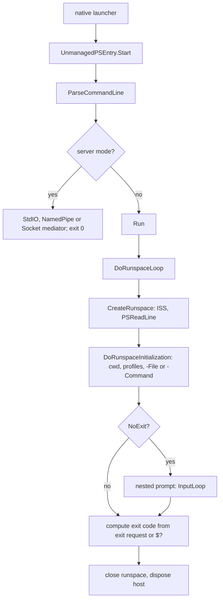

# Console host

> STATIC-ONLY — behavior not run-verified. `FACT-SRC` unless marked. Scope `EXTENDED`. Contract implemented: [host-abstraction](host-abstraction.md). Embedding the engine without this host: [sdk](sdk.md). The `pwsh` executable that calls into this assembly is a separate native launcher (Phase 6 platform notes).

## 1. Purpose and scope [SPEC]

`Microsoft.PowerShell.ConsoleHost` implements the `pwsh` command-line shell: argument parsing, runspace creation, profile loading, running `-Command`/`-File` content, the interactive read-evaluate-print loop, break handling, the server modes used by remoting (`-s`, SSH, named pipe, sockets), and exit codes. It also holds the console UI classes. External dependencies not in this repository: the **PSReadLine** module (line editing, loaded as a module; version 2.4.5 pinned in `src/Modules/PSGalleryModules.csproj`), the native launcher, and the OS console.

## 2. Source map

| path | type | role | tier |
|---|---|---|---|
| src/Microsoft.PowerShell.ConsoleHost/host/msh/ManagedEntrance.cs::UnmanagedPSEntry@L21-L123 | class | entry from the native launcher (`Start(args, argc)`) | B |
| src/Microsoft.PowerShell.ConsoleHost/host/msh/ConsoleShell.cs::ConsoleShell@L15-L80 | static class | public embedding entry (`Start(bannerText, helpText, args)` and an overload taking an `InitialSessionState`) | B |
| src/Microsoft.PowerShell.ConsoleHost/host/msh/ConsoleHost.cs::ConsoleHost@L42-L3121 | class | the `PSHost`; startup, runspace loop, break handling, nested prompt | B |
| src/Microsoft.PowerShell.ConsoleHost/host/msh/ConsoleHost.cs::InputLoop@L2493-L3031 | nested class | the prompt loop | B |
| src/Microsoft.PowerShell.ConsoleHost/host/msh/CommandLineParameterParser.cs::CommandLineParameterParser@L156-L1714 | class | command-line parsing | B |
| src/Microsoft.PowerShell.ConsoleHost/host/msh/Executor.cs::Executor@L25-L708 | class | runs a command or pipeline for the host, adding `Out-Default` | B |
| src/Microsoft.PowerShell.ConsoleHost/host/msh/ConsoleHostUserInterface.cs::ConsoleHostUserInterface@L30-L2267 | class | `PSHostUserInterface` over the console | B |
| src/Microsoft.PowerShell.ConsoleHost/host/msh/ConsoleHostRawUserInterface.cs::ConsoleHostRawUserInterface@L24-L1301 | class | `PSHostRawUserInterface` over the console | B |
| src/Microsoft.PowerShell.ConsoleHost/host/msh/ConsoleControl.cs::ConsoleControl@L47-L3188 | class | Win32 console calls (Windows) | B |
| src/Microsoft.PowerShell.ConsoleHost/host/msh/*Progress*.cs, ProgressPane.cs, PendingProgress.cs | classes | progress rendering | B |

## 3. Responsibilities and non-responsibilities

Owns: process-level startup and shutdown policy, the interactive loop, console UI. Does not own: the engine, line editing (PSReadLine), the remoting protocols behind the server modes (T5xx), the native launcher.

## 4. Key types and contracts [IMPL]

- **Entry**: `UnmanagedPSEntry.Start(args, argc)` runs early startup, sets thread culture from the native resolver, parses the command line (`ConsoleHost.ParseCommandLine`), logs startup, builds the banner, sets `DefaultInitialSessionState = InitialSessionState.CreateDefault2()` and calls `ConsoleHost.Start(banner, help, issProvidedExternally: false)`; a `HostException` caused by Win32 error 6 or 1236 returns the current exit code, any other exception fails fast. `ConsoleShell.Start` lets an embedder supply its own `InitialSessionState` (then a `-ConfigurationFile` on the command line conflicts and aborts).
- **Command-line switches** (case-insensitive, unambiguous prefixes accepted through `MatchSwitch(key, name, shortest)`): `-version`/`-v`, `-help`/`-h`/`-?`, `-login`/`-l`, `-noexit`, `-noprofile`, `-nologo`, `-noninteractive`, `-interactive`/`-i`, `-noprofileloadtime`, `-command`/`-c`, `-commandwithargs`/`-cwa`, `-encodedcommand`/`-e`/`-ec`, `-encodedarguments`/`-ea`, `-file`/`-f`, `-executionpolicy`/`-ep`, `-inputformat`/`-if`, `-outputformat`/`-of`, `-sta`, `-mta`, `-windowstyle`/`-w`, `-workingdirectory`/`-wd`, `-configurationfile`, `-configurationname`/`-config`, `-custompipename`, `-settingsfile`, `-removeworkingdirectorytrailingcharacter`, and the server-mode switches `-servermode`/`-s`, `-sshservermode`, `-namedpipeservermode`, `-socketservermode`, `-v2socketservermode` (Windows) with `-token` and `-utctimestamp`; `-isswait` is debug-only (src/Microsoft.PowerShell.ConsoleHost/host/msh/CommandLineParameterParser.cs::CommandLineParameterParser@L156-L1714, switch chain lines 914–1280). Execution policy values accepted: default, remotesigned, bypass, allsigned, restricted, unrestricted, undefined.
- **`ConsoleHost.Start`** (src/Microsoft.PowerShell.ConsoleHost/host/msh/ConsoleHost.cs::ConsoleHost.Start@L100-L344): (1) reject a configuration file when the session state was supplied externally; (2) prepend the PowerShell executable's folder to `PATH`; (3) set the JIT profile-optimization root to the cache directory; (4) create the singleton host (a `HostException` is deferred); (5) show help/banner on parse errors; `-version` prints `PowerShell <git commit id>` and exits 0; (6) at most one server mode may be given, else exit code **64**; a server mode combined with the file-only-entry policy exits 64; (7) dispatch a server mode and return 0: `-s` and SSH → `StdIOProcessMediator.Run` (SSH combines stderr with stdout), named pipe → `RemoteSessionNamedPipeServer.RunServerMode`, socket modes → `HyperVSocketMediator.Run` (the V2 variant requires a token and timestamp, else 64); (8) otherwise load the PSReadLine decision, bind the break handler and call `Run`; (9) in `finally` dispose the host (on Unix after switching off application-cursor-key mode).
- **`Run` and `DoRunspaceLoop`**: copies output/input formats, no-prompt, no-exit and stdin options; on Windows applies `-ExecutionPolicy` as the *process* scope policy; creates a custom named-pipe server when requested; runs the runspace loop: create runspace (`CreateRunspace` → `DoCreateRunspace`), if `-NoExit` enter a nested prompt else mark the session ended; compute the exit code: if `exit N` was requested use N, else evaluate `$global:?` — success gives 0, failure gives 1 (`0 | 1`); close the runspace; a single pass for STA mode.
- **Runspace creation** (`DoCreateRunspace`): with `-ConfigurationFile` the default session state is replaced by one created from that session configuration file (validated); when no custom configuration is given and `LoadPSReadline()` is true — `(no initial command and no file, or -NoExit) and not -NonInteractive` — the `PSReadLine` module is imported into the initial session state; if opening fails with PSReadLine the host retries without it and prints a message; the runspace uses `ThreadOptions.ReuseThread` (and STA on Windows desktop when requested); it becomes the primary runspace.
- **Initialization** (`DoRunspaceInitialization`): enable local and remote script debugging with the host's `DebuggerStop` handler; set the working directory (`Set-Location -LiteralPath`) if requested; if `-ConfigurationName` is given, create a configured *remote* runspace and push it; otherwise enforce system lockdown language mode, print a banner line for constrained/no/restricted language, define `$PROFILE` and — unless `-NoProfile` — dot-source the four profiles **in order**: all-users all-hosts, all-users host-specific, current-user all-hosts, current-user host-specific (a missing file is skipped; an error is reported and does not stop the others; a load time over 500 ms prints a notice unless suppressed); then run `-File` (a `.ps1`, or on Unix any file read as script text), else `-Command`/`-EncodedCommand` text; parameters after `-File` are passed as command parameters; a failure sets exit code 1 when the host exits after the command.
- **Exit codes** (constants): success 0; initialization failure 70 (`ExitCodeInitFailure`, "internal software error"); bad command line 64 (`ExitCodeBadCommandLineParameter`, "usage error"); Ctrl+Break 149 (`128 + 21`); `exit N` returns N; script failure returns 1.
- **Interactive loop** (`InputLoop.Run`): while the session has not ended: unless no-prompt, write the prompt — `>> ` in continuation (block) mode, else (ensuring the cursor is at column 0, evaluating feedback providers after a non-empty response) the output of the `prompt` function (or the debug prompt in debug mode); read a line with tab completion (`ReadLineWithTabCompletion`; with PSReadLine loaded the module takes over line editing); a null line ends the session when input is redirected; an empty line ends block mode and executes the block, else is ignored (except in debug mode); in debug mode the line is a debugger command; otherwise the line is executed through `Executor` (asynchronously when the host is running async and not nested); errors are reported, and an *incomplete parse* error switches to block mode to read more lines (src/Microsoft.PowerShell.ConsoleHost/host/msh/ConsoleHost.cs::InputLoop.Run@L2600-L2824).
- **`Executor`**: builds pipelines for the host; with the `AddOutputter` option and text output format, a single-command pipeline gets its error stream merged into output and `Out-Default` appended; for multi-statement input `Out-Default` is inserted at the end of each statement, and at the end if the last command is not already `Out-Default`; input objects can be read from redirected stdin through a deserializer when the script uses `$input` (`ReadInputObjects`); the host waits on the pipeline-finished handle and reports a failed pipeline's reason (src/Microsoft.PowerShell.ConsoleHost/host/msh/Executor.cs::Executor@L25-L708).
- **Break handling**: Ctrl+C starts a handler thread that stops the running pipeline (`shouldEndSession: false`); Ctrl+Break breaks into the debugger when interactive, or ends the session when non-interactive; window close/shutdown ends the session; logoff is accepted (`UNVERIFIED` result) ([src/Microsoft.PowerShell.ConsoleHost/host/msh/ConsoleHost.cs::ConsoleHost.MyBreakHandler@L484-L524], Windows).

## 5. Data model

Host state: singleton instance, the command-line parameters (`s_cpp`), the default initial session state, a global lock, the runspace reference (`RunspaceRef`, which can point at a pushed remote runspace), exit code, flags (`ShouldEndSession`, no-exit, running async, nested), a stack of input loops for nested prompts and a break-handler thread. UI state: console colors, progress panes, input buffer.

## 6. Control flow

## 7. Algorithms

Exit-code rule: `exit N` wins; otherwise the last statement's success (`$?` evaluated in the global scope) maps to 0 or 1; init failure 70; usage errors 64. Prompt rule: continuation prompt `>> `; ensure column 0; evaluate feedback after a non-empty response. Profile order as above.

## 8. Observable behavior [SPEC]

- `pwsh -c "..."` runs the text and exits with 0/1 (or the `exit` value); `pwsh -f script.ps1 args` runs the script with args; `pwsh` with no arguments is interactive with PSReadLine; `-NoExit` stays in a nested prompt after the command; `-NoProfile` skips all four profiles; `-NonInteractive` fails prompts and never loads PSReadLine.
- Ctrl+C stops the running command; Ctrl+Break enters the debugger (interactive).
- Output of commands is formatted by `Out-Default`; error output is merged into output for the host's pipeline.
- Tests: §16 (`ConsoleHost.Tests.ps1` has 89 `It` blocks, `test_CommandLineParser.cs` 55 facts and 52 theories). No golden sample: STATIC-ONLY.

## 9. Error handling and edge cases

Startup errors raise `ConsoleHostStartupException` ("shell cannot be started") with the inner cause; profile errors are reported and ignored; a failing `-File`/`-Command` is reported through `ReportException` and sets the exit code; unhandled exceptions are handled by a global handler that reports through the host (`UnhandledExceptionHandler`); `Win32` errors 6 (invalid handle) and 1236 (connection aborted) at startup are treated as normal terminations; when PSReadLine fails to load, the host continues without it; mutually exclusive server modes exit 64.

## 10. Concurrency and threading

The main thread is named "ConsoleHost main thread"; the engine runs commands on its pipeline thread (`ReuseThread`); Ctrl+C/Ctrl+Break handlers run on the console control thread and spawn a separate handler thread; `hostGlobalLock` guards shared host state; the host may run commands asynchronously when `IsRunningAsync` so that break handling can interrupt a command; progress output is serialized by the UI.

## 11. Extension points and customization hooks

Profiles (`$PROFILE`, four locations), `-ConfigurationFile`/`-ConfigurationName` (session configurations), `prompt` function, PSReadLine settings, `PSStyle`, `$env:` settings read at startup, the settings file (`-SettingsFile`, `powershell.config.json` keys, see `PSConfiguration`), policy for file-only entry, embedding via `ConsoleShell.Start(initialSessionState, …)`.

## 12. Dependencies

Inbound: the native launcher, global-tool shim, `dotnet` hosting. Outbound: `System.Management.Automation` (host, runspace, session state), PSReadLine (module), OS console APIs (`ConsoleControl` on Windows, terminal escape codes on Unix), remoting mediators in the engine assembly (server modes), telemetry (`ApplicationInsightsTelemetry`, startup events).

## 13. Performance notes

Start-up uses profile optimization (JIT profile roots by mode: interactive, non-interactive, server modes), `CreateDefault2` (lighter than `CreateDefault`), a startup-time measurement for profiles, and the early-startup initialization class. Non-interactive runs skip PSReadLine. Profile load time over 500 ms triggers a notice.

## 14. Security considerations

The host is where process-level policy is applied: `-ExecutionPolicy` (Windows, process scope), system lockdown language mode enforced after runspace creation (`Utils.EnforceSystemLockDownLanguageMode`), a banner for constrained/no/restricted language, the *file-only entry* policy that forbids server modes, configuration files that create restricted sessions, profile scripts that run with the user's rights before any command (an attack and persistence surface), and `-EncodedCommand` (base64 command, a common abuse vector, logged by engine script-block logging). The Unix `-File` path executes non-`.ps1` files as script text.

### Security surface

<!--GEN:secseeds-->
| Category | Seed hits |
|---|---:|
| logging | 25 |
| execution-policy | 19 |
| securestring | 14 |
| language-mode | 7 |
| jea | 4 |
| app-control | 2 |
| **total** | 71 |

Files with most hits:

| File | Hits |
|---|---:|
| `src/Microsoft.PowerShell.ConsoleHost/host/msh/CommandLineParameterParser.cs` | 21 |
| `src/Microsoft.PowerShell.ConsoleHost/host/msh/ConsoleHost.cs` | 12 |
| `src/Microsoft.PowerShell.ConsoleHost/host/msh/StartTranscriptCmdlet.cs` | 11 |
| `src/Microsoft.PowerShell.ConsoleHost/host/msh/ConsoleHostUserInterface.cs` | 9 |
| `src/Microsoft.PowerShell.ConsoleHost/host/msh/ConsoleHostTranscript.cs` | 7 |
| `src/Microsoft.PowerShell.ConsoleHost/host/msh/StopTranscriptCmdlet.cs` | 4 |
| `src/Microsoft.PowerShell.ConsoleHost/host/msh/ConsoleHostUserInterfaceSecurity.cs` | 3 |
| `src/Microsoft.PowerShell.ConsoleHost/host/msh/ConsoleHostUserInterfaceProgress.cs` | 2 |

These are regex scanner hits (`APPROX`, `verified: false`, no `SEC-ENF` ID yet). Phase 5 verifies them and assigns IDs; none is claimed here as an enforcement point.
<!--/GEN:secseeds-->

What the new shell must guarantee here: profiles and startup scripts run under the same policy and logging as user input; lockdown policy is applied before any user code runs and cannot be disabled by command-line switches; server modes require an explicit privilege and authenticate their peer; encoded commands are decoded and logged in clear text.

## 15. Enterprise considerations

Security first: §14. Observability: ETW startup/perf events (`Perftrack_ConsoleStartup`), profile-load time, transcript options in policy, exit codes distinguishing usage (64), init failure (70) and Ctrl+Break (149). Supportability: stable command-line switches with documented prefixes; `-SettingsFile`. Testability: strong Pester coverage of host behavior; the parser has xUnit tests. Resource limits: none. Missing: a machine-readable startup diagnostic output, signed profiles by default, per-switch policy control other than file-only entry.

## 16. Tests

<!--GEN:tests-->
| Pester file | Describe | Context | It |
|---|---:|---:|---:|
| `test/powershell/Host/Base-Directory.Tests.ps1` | 2 | 2 | 2 |
| `test/powershell/Host/ConsoleHost.Tests.ps1` | 9 | 22 | 89 |
| `test/powershell/Host/Logging.Tests.ps1` | 3 | 0 | 9 |
| `test/powershell/Host/PSVersionTable.Tests.ps1` | 1 | 1 | 15 |
| `test/powershell/Host/Startup.Tests.ps1` | 1 | 0 | 1 |
| `test/powershell/Host/TabCompletion/TabCompletion.Tests.ps1` | 4 | 25 | 249 |
| `test/powershell/Modules/PSReadLine/PSReadLine.Tests.ps1` | 1 | 0 | 8 |
| **total (7 files)** | 21 | 50 | 373 |

| xUnit file | Facts | Theories | Classes |
|---|---:|---:|---|
| `test/xUnit/csharp/test_CommandLineParser.cs` | 55 | 52 | `PSCommandLineParserTests`, `TestDataSettingsFile`, `TestDataLastFile` |

Matching is by path keyword (`APPROX`): `Host/ConsoleHost`, `Host/Startup`, `Host/Logging`, `Host/Base-Directory`, `Host/PSVersionTable`, `PSReadLine`, `Host/TabCompletion/TabCompletion`, `test_CommandLineParser`.
<!--/GEN:tests-->

## 17. Design decisions and trade-offs

- `FACT-SRC`: line editing is an external module loaded into the session, so the host stays small and users can replace it.
- `FACT-SRC`: exit code derives from `$?` of the last statement unless `exit` is used; scripts rely on this for CI.
- `INFERENCE`: appending `Out-Default` in the host (not in the engine) keeps the engine free of display policy; the engine appends it only for transcription.
- `FACT-SRC`: profiles are dot-sourced as separate pipelines so one failing profile does not stop the rest.
- `FACT-SRC`: server modes live in the same executable, selected by switches.

## 18. Guidance for the new shell [LESSON]

- **LSN-HOSTCON-01** [REPLICATE] (area: NLD-RUN) Keep the exit-code rule and the specific codes (0, 1, 64, 70, 149) so automation behaves the same. Evidence: src/Microsoft.PowerShell.ConsoleHost/host/msh/ConsoleHost.cs::ConsoleHost.DoRunspaceLoop@L1643-L1706.
- **LSN-HOSTCON-02** [REPLICATE] (area: NLD-RUN) Four-profile order and per-profile fault isolation; `-NoProfile` skips all. Evidence: src/Microsoft.PowerShell.ConsoleHost/host/msh/ConsoleHost.cs::ConsoleHost.DoRunspaceInitialization@L1882-L2159.
- **LSN-HOSTCON-03** [ADAPT] (area: NLD-RUN) Keep line editing external, but define a small editor interface (read line with completion and history) instead of loading a module by name. Evidence: src/Microsoft.PowerShell.ConsoleHost/host/msh/ConsoleHost.cs::ConsoleHost.DoCreateRunspace@L1766-L1866.
- **LSN-HOSTCON-04** [ADAPT] (area: NLD-RUN) Separate the executable into a thin launcher and a library that exposes `Start(args)` and `Start(initialSessionState, args)` like `ConsoleShell`. Evidence: src/Microsoft.PowerShell.ConsoleHost/host/msh/ConsoleShell.cs::ConsoleShell@L15-L80.
- **LSN-HOSTCON-05** [REDESIGN] (area: NLD-SEC) Apply policy (lockdown, language mode, allowed switches) from a signed policy source before parsing switches that widen access, and refuse to start server modes without an authenticated transport. DEV: DEV-HOST-200. Evidence: src/Microsoft.PowerShell.ConsoleHost/host/msh/ConsoleHost.cs::ConsoleHost.Start@L100-L344.
- **LSN-HOSTCON-06** [AVOID] (area: NLD-RUN) Do not carry the Windows-only pieces (`ConsoleControl` Win32 calls, jump list, `-windowstyle`, `-sta` by default, Hyper-V socket modes) into the first version. DEV: DEV-HOST-201. Evidence: src/Microsoft.PowerShell.ConsoleHost/host/msh/ConsoleControl.cs::ConsoleControl@L47-L3188.

## 19. Open questions / UNVERIFIED items

- `UNVERIFIED` (VB-060): `ConsoleHostUserInterface` (prompt, progress, VT handling, `ReadLineWithTabCompletion`), `ConsoleHostRawUserInterface`, `ConsoleControl`, progress rendering, `CommandLineParameterParser` bodies (value handling of `-command -`, `-file -`, `-encodedcommand`, `-login`), `Executor` async details, `PushRunspace`/`PopRunspace`, debugger stop handling (`OnExecutionSuspended`), `ConsoleHostTranscript`, the native launcher.
- `UNVERIFIED` (VB-061): the PSReadLine module (outside this repository) and the `prompt`/feedback evaluation.

Verification: `ManagedEntrance.cs` and `ConsoleShell.cs` (whole), `ConsoleHost.cs` lines 100–344, 484–560, 1576–1710, 1748–1881, 1882–2200, 2600–2830, `CommandLineParameterParser.cs` switch names (grep), `Executor.cs` lines 150–260 and 330–400 were read. Test counts from `data/tests.json` through `tools/gen_T3.py`.
