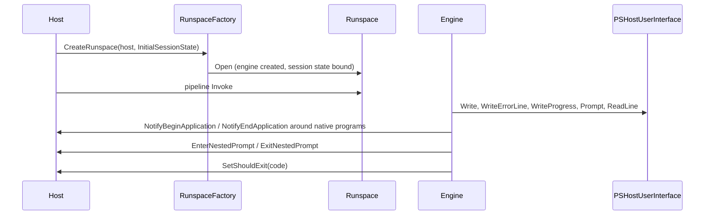

# Host abstraction

> STATIC-ONLY — behavior not run-verified. `FACT-SRC` unless marked. Scope `EXTENDED`. The engine side of host calls is in [runspace-and-pipeline](../03-runtime/runspace-and-pipeline.md) and [formatting-and-output](../03-runtime/formatting-and-output.md); the concrete console host is [console-host](console-host.md); embedding is [sdk](sdk.md).

## 1. Purpose and scope [SPEC]

The engine never touches a console. Everything user-facing goes through a *host*: an object derived from `PSHost` that supplies identity, culture, a user interface (`PSHostUserInterface`) and optionally a raw terminal interface (`PSHostRawUserInterface`), and that receives lifecycle notifications. This document describes the minimal contract a new host must implement, the engine-side wrapper (`InternalHost`) and the runspace configuration object (`InitialSessionState`) that a host supplies when it creates a runspace.

## 2. Source map

| path | type | role | tier |
|---|---|---|---|
| src/System.Management.Automation/engine/hostifaces/MshHost.cs::PSHost@L37-L287 | abstract class | the host contract | B |
| src/System.Management.Automation/engine/hostifaces/MshHost.cs::IHostSupportsInteractiveSession@L294-L327 | interface | push/pop a runspace (interactive remoting) | B |
| src/System.Management.Automation/engine/hostifaces/MshHostUserInterface.cs::PSHostUserInterface@L26-L1187 | abstract class | text I/O, prompts, progress, transcription hooks | B |
| src/System.Management.Automation/engine/hostifaces/MshHostRawUserInterface.cs::PSHostRawUserInterface@L1165-L1914 | abstract class | keyboard, window, buffer | B |
| src/System.Management.Automation/engine/hostifaces/InternalHost.cs::InternalHost@L27-L580 | class | engine-side wrapper that can swap the external host | B |
| src/System.Management.Automation/engine/hostifaces/InternalHostUserInterface.cs::InternalHostUserInterface@L15-L1032 | class | wrapper of the UI with informational-message buffers | B |
| src/System.Management.Automation/engine/hostifaces/DefaultHost.cs::DefaultHost@L17-L134 | class | a minimal host used when none is given | B |
| src/System.Management.Automation/engine/InitialSessionState.cs::InitialSessionState@L1254-L5025 | class | what a runspace starts with | B |

## 3. Responsibilities and non-responsibilities

Owns: the host contract and its engine wrapper, nested prompt bookkeeping, the runspace-creation configuration. Does not own: console behavior (T42), line editing (an external module, see [console-host](console-host.md)), host calls over remoting (Phase 4 remoting), formatting.

## 4. Key types and contracts [IMPL]

- **`PSHost` — abstract members**: `Name`, `Version`, `InstanceId` (a GUID), `UI` (`PSHostUserInterface`), `CurrentCulture`, `CurrentUICulture`, `SetShouldExit(int exitCode)`, `EnterNestedPrompt()`, `ExitNestedPrompt()`, `NotifyBeginApplication()`, `NotifyEndApplication()`. Virtual with defaults: `PrivateData` (null), `DebuggerEnabled` (false; the setter throws `PSNotImplementedException`). The interface `IHostSupportsInteractiveSession` adds `PushRunspace`, `PopRunspace`, `IsRunspacePushed`, `Runspace` (src/System.Management.Automation/engine/hostifaces/MshHost.cs::PSHost@L37-L287).
- **`PSHostUserInterface` — abstract**: `RawUI`, `ReadLine`, `ReadLineAsSecureString`, `Write(string)`, `Write(fg, bg, string)`, `WriteLine(string)`, `WriteErrorLine`, `WriteDebugLine`, `WriteVerboseLine`, `WriteWarningLine`, `WriteProgress(sourceId, ProgressRecord)`, `Prompt(caption, message, fields)`, `PromptForCredential` (two overloads), `PromptForChoice(caption, message, choices, default)`. Virtual: `SupportsVirtualTerminal` (false), `WriteLine()`, `WriteLine(fg, bg, string)`, `WriteInformation(InformationRecord)` (empty). The transcription helpers (`TranscribeCommand`, `TranscribeResult`, …) are internal members of this base class (see [errors-and-diagnostics](../03-runtime/errors-and-diagnostics.md) §4).
- **`PSHostRawUserInterface` — abstract** properties: `ForegroundColor`, `BackgroundColor`, `CursorPosition`, `WindowPosition`, `CursorSize`, `BufferSize`, `WindowSize`, `MaxWindowSize`, `MaxPhysicalWindowSize`, `KeyAvailable`, `WindowTitle`; methods `ReadKey(options)`, `FlushInputBuffer`, `SetBufferContents` (two overloads), `GetBufferContents(rectangle)`, `ScrollBufferContents`. A host that is not a terminal can throw `NotImplementedException` for these; the engine tolerates it where it probes (screen scraping support is detected by trying to read the buffer, see [command-discovery-and-invocation](../03-runtime/command-discovery-and-invocation.md) §7).
- **Engine wrapper** (`InternalHost`): holds the external host reference with `SetHostRef(psHost)`, `RevertHostRef()`, `IsHostRefSet`, `ExternalHost`; pipelines can run with a different host for the duration of one invocation (`InvocationSettings.Host`: `LocalPipeline.InvokeThreadProc` sets it before the pipeline runs and reverts it in `finally`). `NestedPromptCount` counts nested prompts.
- **Nested prompt** (`InternalHost.EnterNestedPrompt(callingCommand)`): refuses to nest while the running pipeline is the internal "pulse" pipeline; increments the count and sets `$NestedPromptLevel`; saves context data (current variables for the executing command and bound parameters, runspace availability, language mode); sets the "currently executing command" variable to the calling command wrapped with `CommandInfo` and `StackTrace` note properties; resets debug trace settings and the shell-function error pipe; **if the runspace has ever used Constrained Language mode, the nested prompt runs in Constrained Language**; marks the runspace `AvailableForNestedCommand` (lines 230-330 read; the call into the external host that follows is `UNVERIFIED`) (src/System.Management.Automation/engine/hostifaces/InternalHost.cs::InternalHost.EnterNestedPrompt@L230-L361). The restore on exit was not read (`UNVERIFIED`, VB-058).
- **`InitialSessionState`** — what a host passes to `RunspaceFactory.CreateRunspace(host, iss)`: factories `Create()` (empty: no commands, no variables; `LanguageMode` property default is `NoLanguage`), `CreateDefault()` (built-in variables, functions and aliases, all applications and scripts allowed (`*`), the engine snap-ins' cmdlets and providers; **FullLanguage**; the standard authorization manager), `CreateDefault2()` (same but imports only the core snap-in via `ImportCorePSSnapIn`; FullLanguage; the standard authorization manager), `CreateRestricted(SessionCapabilities.RemoteServer)` (empty plus built-in functions and aliases, `NoLanguage`, `ThrowOnRunspaceOpenError = true`, no full language in the debugger), `CreateFromSessionConfigurationFile(path[, roleVerifier, validateFile])`; `Clone()`. Properties: `LanguageMode`, `ApartmentState`, `ThreadOptions`, `ThrowOnRunspaceOpenError`, `UseFullLanguageModeInDebugger`, `TranscriptDirectory`, `AuthorizationManager`, `DisableFormatUpdates`; collections `Commands`, `Providers`, `Variables`, `Assemblies`, `Types`, `Formats`, `StartupScripts`, `Modules` (via `ImportPSModule`, `ImportPSModulesFromPath`, `ImportPSSnapIn`) (src/System.Management.Automation/engine/InitialSessionState.cs::InitialSessionState.CreateDefault@L1524-L1583, InitialSessionState.CreateRestricted@L1378-L1387, InitialSessionState.CreateDefault2@L1591-L1606).

## 5. Data model

A host is a plain object graph: identity (name, version, instance id), culture pair, UI object, optional private data (a `PSObject` of host-specific settings that the engine exposes as `$Host.PrivateData`). `InternalHost` adds the external host reference, a stack of saved contexts for nested prompts and the informational-message buffers (`InternalHostUserInterface.SetInformationalMessageBuffers`, set by the pipeline for the duration of a run). `InitialSessionState` entries (`SessionStateCommandEntry`, `…ProviderEntry`, `…VariableEntry`, …) carry a *visibility* (public/private), which restricted sessions use to hide commands.

## 6. Control flow

Ordered: the host creates the runspace with its `PSHost` and an `InitialSessionState`; the engine wraps the host in `InternalHost`; commands call `$Host.UI.*`, `Write-Host`, `Read-Host`, `Out-Default` (through `ConsoleLineOutput` for the console host) which end in the host UI methods; native programs bracket their run with the begin/end notifications; `exit` calls `SetShouldExit`.

## 7. Algorithms

Not applicable beyond §4 (nested prompt state save/restore).

## 8. Observable behavior [SPEC]

- `$Host` is the (wrapped) host: `Name`, `Version`, `InstanceId`, `UI`, `CurrentCulture`, `PrivateData`, `EnterNestedPrompt()`, `ExitNestedPrompt()`.
- `Write-Host` writes to `UI.Write*` with colors; `Read-Host` calls `ReadLine`/`ReadLineAsSecureString`; prompting cmdlets call `Prompt`, `PromptForChoice`, `PromptForCredential`; `Write-Progress` calls `WriteProgress`.
- `exit` ends the session through `SetShouldExit`; a nested prompt (`$NestedPromptLevel` > 0) is left with `exit`.
- Tests: §16. No golden sample: STATIC-ONLY.

## 9. Error handling and edge cases

A host that throws `NotImplementedException`/`PSNotImplementedException` for optional members is tolerated in probing code (`InternalHost` catches `PSNotImplementedException` when reading the runspace); entering a nested prompt from the pulse pipeline is an `InvalidOperationException`; the nested-prompt counter going negative is an internal error (`EnterExitNestedPromptOutOfSync`); `DebuggerEnabled` set on a host that does not support it throws.

## 10. Concurrency and threading

Host methods are called on the pipeline thread (or on the `Out-*` consumer thread); a host used by several runspaces must be thread-safe. The external host reference is swapped under the pipeline thread (`LocalPipeline.InvokeThreadProc`); the console host protects its state with a global lock (see [console-host](console-host.md)). `SetShouldExit` can be called from engine threads.

## 11. Extension points and customization hooks

Subclass `PSHost` (and the UI classes); supply `PrivateData`; implement `IHostSupportsInteractiveSession` for interactive remoting; implement `IHostSupportsInteractiveSession`-style push/pop; `InitialSessionState` entry lists; `InvocationSettings.Host` per call; `PSHost.DebuggerEnabled`. Hosts that want colored/ANSI output declare `SupportsVirtualTerminal`.

## 12. Dependencies

Inbound: every cmdlet that writes or prompts, `Out-Default`, transcription, the progress pipeline, the debugger (`DebuggerStop` handling), remoting (host calls are forwarded). Outbound: culture settings, `ProgressRecord`, `FieldDescription`, `ChoiceDescription`, `PSCredential`, `SecureString`.

## 13. Performance notes

Host calls are synchronous; a slow host slows the pipeline. Output through `Write-Host` and `Out-Default` is line oriented; large outputs benefit from a host that buffers writes. `InitialSessionState.CreateDefault2` avoids loading all engine snap-ins eagerly, which shortens start-up.

## 14. Security considerations

The host is a trust boundary in both directions: the engine trusts the host to display messages faithfully and to implement prompts (consent for `ShouldContinue`, credentials), and the host trusts the engine not to flood or spoof its UI. Enforcement and policy seen: nested prompts inherit Constrained Language once it has been used in the runspace; `InitialSessionState` is where language mode, visibility, authorization manager and `ThrowOnRunspaceOpenError` are fixed for a session (`CreateRestricted` shows the minimal remote-server baseline); the UI carries the transcription hooks that record input and output.

### Security surface

<!--GEN:secseeds-->
| Category | Seed hits |
|---|---:|
| logging | 94 |
| language-mode | 38 |
| jea | 17 |
| execution-policy | 8 |
| securestring | 7 |
| amsi | 1 |
| app-control | 1 |
| constrained-types | 1 |
| **total** | 167 |

Files with most hits:

| File | Hits |
|---|---:|
| `src/System.Management.Automation/engine/hostifaces/MshHostUserInterface.cs` | 91 |
| `src/System.Management.Automation/engine/InitialSessionState.cs` | 64 |
| `src/System.Management.Automation/engine/hostifaces/InternalHost.cs` | 6 |
| `src/System.Management.Automation/engine/hostifaces/InternalHostUserInterface.cs` | 6 |

These are regex scanner hits (`APPROX`, `verified: false`, no `SEC-ENF` ID yet). Phase 5 verifies them and assigns IDs; none is claimed here as an enforcement point.
<!--/GEN:secseeds-->

What the new shell must guarantee here: prompts for consent and credentials are rendered by the host, never forgeable by script output; a restricted `InitialSessionState` is the only way a session starts restricted and cannot be widened from inside; transcription and logging hooks live below the host so a custom host cannot disable them.

## 15. Enterprise considerations

Security first: §14. Observability: transcription, host `InstanceId`, ETW events around startup (console host). Supportability: a tiny required contract (11 abstract members on `PSHost`) makes hosts easy to write; the UI contract is larger. Testability: `DefaultHost` and test hosts allow headless engine tests. Missing: a structured (non-text) UI channel, a capability negotiation (the engine probes by exceptions), localizable consent prompts with policy.

## 16. Tests

<!--GEN:tests-->
| Pester file | Describe | Context | It |
|---|---:|---:|---:|
| `test/powershell/Host/HostUtilities.Tests.ps1` | 5 | 0 | 7 |
| `test/powershell/Modules/Microsoft.PowerShell.Core/Out-Host.Tests.ps1` | 1 | 0 | 1 |
| `test/powershell/Modules/Microsoft.PowerShell.Utility/Read-Host.Tests.ps1` | 1 | 0 | 7 |
| `test/powershell/Modules/Microsoft.PowerShell.Utility/Write-Host.Tests.ps1` | 3 | 0 | 3 |
| `test/powershell/engine/Api/InitialSessionState.Tests.ps1` | 2 | 2 | 8 |
| **total (5 files)** | 12 | 2 | 26 |

| xUnit file | Facts | Theories | Classes |
|---|---:|---:|---|
| `test/xUnit/csharp/test_Runspace.cs` | 3 | 0 | `RunspaceTests` |

Matching is by path keyword (`APPROX`): `Host/HostUtilities`, `Utility/Read-Host`, `Utility/Write-Host`, `Core/Out-Host`, `engine/Api/InitialSessionState`, `test_Runspace`.
<!--/GEN:tests-->

## 17. Design decisions and trade-offs

- `FACT-SRC`: a small abstract core with large optional surfaces (raw UI) keeps simple hosts simple.
- `FACT-SRC`: the engine holds the host through a wrapper, so a pipeline can temporarily use a different host.
- `INFERENCE`: capability probing by catching `NotImplemented` exceptions keeps the contract stable across versions.
- `FACT-SRC`: nested prompts carry the strictest language mode seen in the runspace.

## 18. Guidance for the new shell [LESSON]

- **LSN-HOSTABS-01** [REPLICATE] (area: NLD-RUN) Keep the three-level host contract (host, UI, raw UI) and the lifecycle notifications; host authors depend on them. Evidence: src/System.Management.Automation/engine/hostifaces/MshHost.cs::PSHost@L37-L287.
- **LSN-HOSTABS-02** [ADAPT] (area: NLD-RUN) Replace exception-based capability probing with explicit capability flags on the host (supports raw UI, VT, interactive session, debugger). Evidence: src/System.Management.Automation/engine/hostifaces/MshHost.cs::PSHost@L37-L287.
- **LSN-HOSTABS-03** [REPLICATE] (area: NLD-SEC) Nested prompts and debugger prompts run at the strictest language mode seen. Evidence: src/System.Management.Automation/engine/hostifaces/InternalHost.cs::InternalHost.EnterNestedPrompt@L230-L361.
- **LSN-HOSTABS-04** [ADAPT] (area: NLD-RUN) Provide a headless default host and typed prompt results as part of the SDK so embedders do not subclass the full UI contract. Evidence: src/System.Management.Automation/engine/hostifaces/DefaultHost.cs::DefaultHost@L17-L134.
- **LSN-HOSTABS-05** [REPLICATE] (area: NLD-SEC) A restricted-session baseline factory (empty, no language, fail on open error). Evidence: src/System.Management.Automation/engine/InitialSessionState.cs::InitialSessionState.CreateRestricted@L1378-L1387.

## 19. Open questions / UNVERIFIED items

- `UNVERIFIED` (VB-058): `InternalHost` exit-nested-prompt path and remaining members, `InternalHostUserInterface` buffering, `PSHostUserInterface` transcription code beyond the cited hooks, `HostUtilities` (profile paths, prompt helpers), `DefaultHost` behavior.
- `UNVERIFIED` (VB-059): `InitialSessionState` entry classes, `Bind`, `CreateFromSessionConfigurationFile` (JEA, see [jea](../05-remoting/jea.md)), snap-in handling, `Clone` semantics.

Verification: `MshHost.cs` (abstract/virtual members by grep, lines 222–327), `MshHostUserInterface.cs` and `MshHostRawUserInterface.cs` (member lists by grep), `InternalHost.cs` lines 225–330, `InitialSessionState.cs` lines 1310–1387, 1498–1606, 1749–1850 were read; everything else is from signatures. Test counts from `data/tests.json` through `tools/gen_T3.py`.
