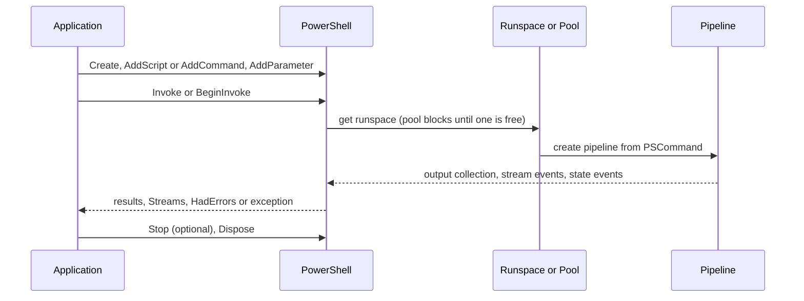

# SDK and embedding

> STATIC-ONLY — behavior not run-verified. `FACT-SRC` unless marked. Scope `EXTENDED`. Engine behavior behind the API: [runspace-and-pipeline](../03-runtime/runspace-and-pipeline.md) (states, threads, stop). Host contract: [host-abstraction](host-abstraction.md).

## 1. Purpose and scope [SPEC]

How a .NET application embeds the engine: create a runspace (or a pool), build commands with the fluent `PowerShell` API, invoke them synchronously or asynchronously, read results and streams, and configure the session. The document also covers the NuGet packaging model and the API stability policy.

## 2. Source map

| path | type | role | tier |
|---|---|---|---|
| src/System.Management.Automation/engine/hostifaces/PowerShell.cs::PowerShell@L575-L5954 | sealed class | fluent API over a runspace or pool | B |
| src/System.Management.Automation/engine/hostifaces/PowerShell.cs::PSInvocationSettings@L313-L415 | sealed class | per-invocation settings | B |
| src/System.Management.Automation/engine/hostifaces/PowerShell.cs::PSDataStreams@L5959-L6142 | sealed class | the six non-output streams of an invocation | B |
| src/System.Management.Automation/engine/hostifaces/ConnectionFactory.cs::RunspaceFactory@L17-L627 | static class | runspace and pool factories | B |
| src/System.Management.Automation/engine/hostifaces/Connection.cs::Runspace@L450-L1665 | abstract class | a runspace (open, close, create pipeline, state events) | B |
| src/System.Management.Automation/engine/hostifaces/Connection.cs::SessionStateProxy@L1671-L1894 | class | variable, language-mode and intrinsics access from outside a pipeline | B |
| src/System.Management.Automation/engine/MshCmdlet.cs::CommandInvocationIntrinsics@L238-L915 | class | `InvokeCommand` helpers (expand string, get command, lookup actions) | B |
| src/System.Management.Automation/engine/hostifaces/PSDataCollection.cs | class | thread-safe observable collection for input and output | B |
| src/Microsoft.PowerShell.SDK/Microsoft.PowerShell.SDK.csproj | project | metapackage | C |
| docs/dev-process/breaking-change-contract.md, docs/host-powershell/README.md | docs | stability policy and a hosting guide with samples | C |

## 3. Responsibilities and non-responsibilities

Owns: the embedding surface and its packaging. Does not own: engine internals, the console host (T42), remoting classes (Phase 4 remoting), the `Microsoft.PowerShell.SDK` dependency pins' upstream content.

## 4. Key types and contracts [IMPL]

- **Create**: `PowerShell.Create()` (a new default runspace), `Create(RunspaceMode)` (`CurrentRunspace` = 0 or `NewRunspace` = 1), `Create(InitialSessionState)`, `Create(Runspace)`; `CreateNestedPowerShell()` for use inside a running pipeline. `RunspaceFactory.CreateRunspace()` (default state), `(PSHost)`, `(InitialSessionState)`, `(PSHost, InitialSessionState)`, `(RunspaceConnectionInfo[, host, typeTable, applicationArguments, name])` for remote runspaces, `CreateOutOfProcessRunspace(typeTable[, PowerShellProcessInstance])`; `CreateRunspacePool(min, max, …)` with overloads for state, host, connection info (src/System.Management.Automation/engine/hostifaces/ConnectionFactory.cs::RunspaceFactory@L17-L627). A runspace must be opened (`Open`) before pipelines run; a `PowerShell` created over a runspace requires state `Opened` at invoke time, else `InvalidRunspaceStateException` (see runspace document §10).
- **Build**: `AddCommand(name[, useLocalScope])`, `AddCommand(CommandInfo)`, `AddScript(text[, useLocalScope])`, `AddParameter(name[, value])`, `AddStatement()` (starts a new statement; mirrors `;`), `Commands` (a `PSCommand` that can be cloned and reused).
- **Invoke**: `Invoke()`, `Invoke(input)`, `Invoke(input, settings)`, typed `Invoke<T>` variants and `Invoke<TInput,TOutput>(input, output, settings)`; asynchronous `BeginInvoke…`/`EndInvoke`, `InvokeAsync…` (task-based), `Stop()`, `BeginStop(callback, state)`; `Dispose`. State is `PSInvocationState` (NotStarted, Running, Stopping, Stopped, Completed, Failed, Disconnected); a `PowerShell` object is single-use per invocation but its commands can be cleared and reused (`UNVERIFIED` exact reuse rule). `PSInvocationSettings`: `ApartmentState`, `Host` (per-call host), `RemoteStreamOptions`, `AddToHistory`, `ErrorActionPreference`, `FlowImpersonationPolicy`, `ExposeFlowControlExceptions` (src/System.Management.Automation/engine/hostifaces/PowerShell.cs::PSInvocationSettings@L313-L415).
- **Results and streams**: output comes back as `Collection<PSObject>` (or typed); input is supplied as a `PSDataCollection<T>` that can be filled while the command runs; `Streams` (`PSDataStreams`) exposes `Error`, `Warning`, `Verbose`, `Debug`, `Progress`, `Information` collections, each raising `DataAdded` events; `HadErrors` reports whether any non-terminating error occurred; terminating errors surface as exceptions from `Invoke` (for example `CmdletInvocationException`) or as the failed state with a reason in async use.
- **Session access without a pipeline**: `Runspace.SessionStateProxy` (`SetVariable`, `GetVariable`, `LanguageMode`, `Applications`, `Scripts`, `Drive`, `Path`, `Provider`, `PSVariable`, `InvokeCommand`, `InvokeProvider`, `Module`); it is rejected while a pipeline is running except while the internal pulse pipeline runs (see runspace document §10). `CommandInvocationIntrinsics` (`$ExecutionContext.InvokeCommand`): `ExpandString`, `GetCommand(name, types[, args])`, `GetCmdlet`, `GetCmdletByTypeName`, `GetCmdlets`, the lookup actions (`PreCommandLookupAction`, `PostCommandLookupAction`, `CommandNotFoundAction`, `LocationChangedAction`) and `HasErrors`.
- **Packaging**: `Microsoft.PowerShell.SDK` is a **metapackage** (`IncludeBuildOutput` false) that references the projects `System.Management.Automation`, `Microsoft.PowerShell.Commands.Utility`, `…Commands.Management`, `…Security` and `…ConsoleHost`, and pins the versions of non-direct .NET packages (for example `System.Data.*`, `System.DirectoryServices*`, `System.Diagnostics.*`, native `System.IO.Ports` runtime packages for each RID) so applications get a consistent runtime set; target framework `net10.0` (`PowerShell.Common.props`). The engine project itself depends on `Newtonsoft.Json`, `Microsoft.ApplicationInsights`, `Microsoft.Management.Infrastructure` (Windows/CIM), `Microsoft.PowerShell.Native` and several `System.*` packages. The hosting guide says runtime assemblies for Windows, Linux and macOS are published as NuGet packages and a sample application builds per runtime identifier (`docs/host-powershell/README.md`).
- **Stability policy** (`docs/dev-process/breaking-change-contract.md`): four buckets — *public contract* (renaming or removing a public type, member or cmdlet parameter, narrowing accepted values, changing a public constant or enum value, changing existing behavior for a given input, changing a protocol without a version bump are unacceptable; adding types, members and cmdlets, changing error behavior into new functionality, and protocol changes with a version increment are acceptable), *reasonable grey area* (timing/order of events, parser strictness: needs judgement, preview and possibly an RFC), *unlikely grey area* and *clearly non-public*. Preview features may change.

## 5. Data model

`PowerShell` holds: a `PSCommand` (list of command lists = statements), a connection (runspace or pool), invocation state info, `Streams`, `HadErrors`, instance id, an `IsNested` flag, and async result objects. `PSDataCollection<T>` is a growable list with a completion state, blocking enumeration and `DataAdded`, `DataAdding`, `Completed` events; it is the unit for streaming input and output.

## 6. Control flow

## 7. Algorithms

Not applicable beyond the invoke path described in the runspace document (runspace acquisition, pipeline construction, state transitions).

## 8. Observable behavior [SPEC]

- A snippet such as `PowerShell.Create().AddScript("Get-Verb -Verb get").Invoke()` returns the command output as `PSObject`s; `AddCommand("Test-Path").AddParameter("Path", p).Invoke<bool>()` returns typed output (these shapes are exercised by the hosting tests).
- Errors that are non-terminating appear in `Streams.Error` and set `HadErrors`; terminating errors throw from `Invoke`.
- Several `PowerShell` objects can share a `RunspacePool`; one runspace runs one pipeline at a time.
- Some cmdlets are restricted in hosted contexts: the xUnit test asserts that `Start-Job` in a hosted scenario throws `CmdletInvocationException` (`UNVERIFIED` reason: background jobs need the PowerShell executable).
- Tests: §16. No golden sample: STATIC-ONLY.

## 9. Error handling and edge cases

`InvalidRunspaceStateException` / `InvalidPowerShellStateException` for wrong states; `ObjectDisposedException` after dispose; `ConcurrentInvokeNotAllowed` when a runspace already runs a pipeline; async exceptions are delivered through the state change (`Failed`) and `EndInvoke`; `PipelineStoppedException` for stopped pipelines; the host-side exceptions from `PSHost` implementations propagate as cmdlet errors.

## 10. Concurrency and threading

A `PowerShell` instance is not safe for concurrent use, except `Stop`/`BeginStop` and reading streams; collections are thread-safe. The thread that runs script is chosen by `PSThreadOptions` (see runspace document); pool runspaces use `ReuseThread` unless set otherwise. Events (`InvocationStateChanged`, `DataAdded`) fire on engine threads.

## 11. Extension points and customization hooks

Custom `PSHost`; `InitialSessionState` (cmdlets, providers, functions, variables, modules, language mode, authorization manager); `PSInvocationSettings`; `Runspace.Events`; `SessionStateProxy`; `PSCommand` reuse; custom cmdlets compiled into the app and registered through `SessionStateCmdletEntry`; `CommandInvocationIntrinsics` lookup actions for command resolution policy; the metapackage for dependency alignment.

## 12. Dependencies

Inbound: embedding applications, the console host, remoting servers, test harnesses. Outbound: the engine runtime ([runspace-and-pipeline](../03-runtime/runspace-and-pipeline.md)), host contract, .NET runtime packages listed in the metapackage.

## 13. Performance notes

Creating a runspace is expensive (engine init, session state binding); applications should reuse runspaces or pools; `InitialSessionState.CreateDefault2` is cheaper than `CreateDefault`; reusing a `PSCommand`/script avoids reparsing is `UNVERIFIED`; async APIs avoid blocking threads; pools bound concurrency.

## 14. Security considerations

An embedder gets full control of the engine in its process: whatever the host process can do, scripts can do unless the `InitialSessionState` restricts it. The knobs are language mode, command visibility, `Applications`/`Scripts` lists, `AuthorizationManager`, restricted factories (`CreateRestricted`), constrained endpoints (JEA) and per-call `ErrorActionPreference`. Input objects and `AddParameter` values are passed by reference to script (no copying), so untrusted .NET objects with powerful members can reach script. `AddScript` runs arbitrary text; building scripts from untrusted strings is injection-prone, `AddCommand` + `AddParameter` is the safe form.

### Security surface

<!--GEN:secseeds-->
| Category | Seed hits |
|---|---:|
| language-mode | 3 |
| **total** | 3 |

Files with most hits:

| File | Hits |
|---|---:|
| `src/System.Management.Automation/engine/hostifaces/Connection.cs` | 3 |

These are regex scanner hits (`APPROX`, `verified: false`, no `SEC-ENF` ID yet). Phase 5 verifies them and assigns IDs; none is claimed here as an enforcement point.
<!--/GEN:secseeds-->

What the new shell must guarantee here: the embedding API defaults to a restricted session (explicit opt-in to full language); parameters and input values are typed data, never concatenated into script text by the API; logging and audit hooks cannot be removed by the embedder without a privileged policy; the API surface is versioned with a published compatibility contract.

## 15. Enterprise considerations

Security first: §14. Observability: state events, streams, host transcription, ETW. Supportability: the stability policy is explicit and public; breaking changes need justification; protocols carry versions. Testability: the API is exercised by xUnit and Pester tests that host the engine. Resource limits: pool min/max, no per-invocation memory/time budget. Missing: a built-in per-invocation timeout/cancellation token API (only `Stop`), structured result types beyond `PSObject`, source-generated or reference assemblies listed in this repository.

## 16. Tests

<!--GEN:tests-->
| Pester file | Describe | Context | It |
|---|---:|---:|---:|
| `test/powershell/SDK/Breakpoint.Tests.ps1` | 1 | 5 | 35 |
| `test/powershell/SDK/Json.Tests.ps1` | 1 | 0 | 6 |
| `test/powershell/SDK/PSDebugging.Tests.ps1` | 2 | 2 | 12 |
| `test/powershell/engine/Api/BasicEngine.Tests.ps1` | 3 | 2 | 9 |
| `test/powershell/engine/Api/PSCommand.Tests.ps1` | 1 | 2 | 4 |
| `test/powershell/engine/Api/Serialization.Tests.ps1` | 1 | 0 | 7 |
| `test/powershell/engine/Api/TaskBasedAsyncPowerShellAPI.Tests.ps1` | 1 | 4 | 9 |
| **total (7 files)** | 10 | 15 | 82 |

| xUnit file | Facts | Theories | Classes |
|---|---:|---:|---|
| `test/xUnit/csharp/test_PSObject.cs` | 8 | 0 | `PSObjectTests` |
| `test/xUnit/csharp/test_PowerShellAPI.cs` | 1 | 0 | `PowerShellHostingScenario` |
| `test/xUnit/csharp/test_SessionState.cs` | 0 | 0 | `SessionStateTests` |

Matching is by path keyword (`APPROX`): `SDK/`, `engine/Api/PSCommand`, `engine/Api/BasicEngine`, `engine/Api/TaskBasedAsyncPowerShellAPI`, `engine/Api/Serialization`, `test_PowerShellAPI`, `test_SessionState`, `test_PSObject`.
<!--/GEN:tests-->

## 17. Design decisions and trade-offs

- `FACT-SRC`: results are `PSObject` wrappers so scripts and C# see the same member view (ETS); typed overloads convert on the way out.
- `FACT-SRC`: the metapackage exists to keep a consistent set of transitive packages rather than expressing them as dependencies of the engine assembly.
- `INFERENCE`: a fluent builder over `PSCommand` keeps one object model for local, remote and pool invocation.
- `FACT-SRC`: stability is governed by a written contract that treats behavior as part of the public surface.

## 18. Guidance for the new shell [LESSON]

- **LSN-HOSTSDK-01** [REPLICATE] (area: NLD-RUN) A fluent command builder (command, script, parameter, statement) with sync, async and streaming-input invocation. Evidence: src/System.Management.Automation/engine/hostifaces/PowerShell.cs::PowerShell@L575-L5954.
- **LSN-HOSTSDK-02** [ADAPT] (area: NLD-RUN) Add cancellation tokens and per-invocation time and memory budgets to the invoke API (the original has `Stop` only). Evidence: src/System.Management.Automation/engine/hostifaces/PowerShell.cs::PSInvocationSettings@L313-L415.
- **LSN-HOSTSDK-03** [REDESIGN] (area: NLD-SEC) Make the default embedded session restricted and require an explicit opt-in to full language and unrestricted command visibility. DEV: DEV-SDK-205. Evidence: src/System.Management.Automation/engine/InitialSessionState.cs::InitialSessionState.CreateRestricted@L1378-L1387.
- **LSN-HOSTSDK-04** [REPLICATE] (area: NLD-RUN) Publish a written compatibility contract that classifies changes and requires a protocol version bump for wire changes. Evidence: docs/dev-process/breaking-change-contract.md@L1-L60.
- **LSN-HOSTSDK-05** [ADAPT] (area: NLD-RUN) Ship a metapackage that pins transitive dependencies, but generate it from the build graph and publish reference assemblies for the public surface. Evidence: src/Microsoft.PowerShell.SDK/Microsoft.PowerShell.SDK.csproj@L1-L40.

## 19. Open questions / UNVERIFIED items

- `UNVERIFIED` (VB-062): `PowerShell` reuse rules after completion, `PSCommand` semantics, `PSDataCollection` internals, `PSDataStreams`, `HadErrors` definition, `RunspacePool` public API details, `Connect`/disconnect APIs, `Runspace` events.
- `UNVERIFIED` (VB-063): `SessionStateProxy` implementation and its concurrency checks beyond those read for the runspace document; the sample application and per-RID publishing; whether reference assemblies are produced.

Verification: member lists of `PowerShell`, `PSInvocationSettings`, `RunspaceFactory`, `SessionStateProxy` and `CommandInvocationIntrinsics` were taken from public-signature greps; `docs/dev-process/breaking-change-contract.md` (first 60 lines) and `docs/host-powershell/README.md` (first 30 lines) and the SDK/SMA project files (selected lines) were read. Test counts from `data/tests.json` through `tools/gen_T3.py`.
