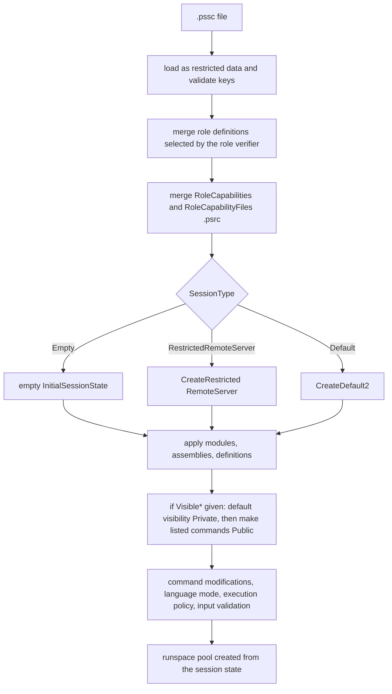

# Session configurations and constrained endpoints (JEA)

> STATIC-ONLY — behavior not run-verified. `FACT-SRC` unless marked. Scope `OUT-OF-SCOPE-DOCUMENTED`: remoting is not first-version scope, but the *declarative restricted-session mechanism* is the model for how a new shell should build locked-down sessions locally. Language modes and enforcement points: Phase 5 (`07-security/`). Session state basics: [execution-context-and-session-state](../03-runtime/execution-context-and-session-state.md); `InitialSessionState`: [host-abstraction](../04-hosting/host-abstraction.md).

## 1. Purpose and scope [SPEC]

A *session configuration* decides what a remote (or local, with `-ConfigurationFile`) runspace looks like when it starts. **Just Enough Administration (JEA)** uses configuration files to expose a narrow, audited command surface to non-administrators. Two file kinds: a **session configuration file** (`.pssc`) describing the endpoint (session type, language mode, visible commands, role mapping, run-as identity) and **role capability files** (`.psrc`) describing what a role may do. This document describes the file model, how the engine turns it into an `InitialSessionState`, how visibility restrictions are applied, and what the engine does *not* enforce itself.

## 2. Source map

| path | type | role | tier |
|---|---|---|---|
| src/System.Management.Automation/engine/remoting/fanin/InitialSessionStateProvider.cs::ConfigFileConstants | static class | the recognized keys and their validators | B |
| src/System.Management.Automation/engine/remoting/fanin/InitialSessionStateProvider.cs::DISCUtils | static class | load, validate and merge configuration files; role definitions | B |
| src/System.Management.Automation/engine/remoting/fanin/InitialSessionStateProvider.cs::DISCPowerShellConfiguration | class | builds an `InitialSessionState` from a configuration (`GetInitialSessionState(PSSenderInfo)`) | B |
| src/System.Management.Automation/engine/remoting/fanin/InitialSessionStateProvider.cs::PSSessionConfiguration | abstract public class | endpoint extensibility (`GetInitialSessionState`, size limits, private data) | B |
| src/System.Management.Automation/engine/InitialSessionState.cs::InitialSessionState.CreateFromSessionConfigurationFile@L1310-L1313 | method | entry used by `pwsh -ConfigurationFile` and the SDK | B |
| src/System.Management.Automation/engine/remoting/commands/CustomShellCommands.cs | cmdlets | `Register-PSSessionConfiguration` family (endpoint registration, SDDL, required groups) | B |
| src/System.Management.Automation/engine/remoting/commands/NewPSSessionConfigurationFile.cs | cmdlet | generates a `.pssc` | B |
| src/System.Management.Automation/engine/remoting/fanin/PSPrincipal.cs | classes | caller identity and `PSSenderInfo` | B |

## 3. Responsibilities and non-responsibilities

Owns: the configuration file schema and validation, role merging, translation to an initial session state with command visibility, and the in-session checks that rely on visibility. Does not own: endpoint registration in the OS (WinRM/SSH), group-based authorization (SDDL / `RequiredGroups` are applied by the registration cmdlets and the OS), virtual account creation (Windows), event logging policy.

## 4. Key types and contracts [IMPL]

- **Session configuration file keys** (validated against a table `ConfigFileKeys`; unknown keys are rejected): `SchemaVersion`, `GUID`, `Author`, `Description`, `CompanyName`, `Copyright`, `PowerShellVersion`, `SessionType`, `LanguageMode`, `ExecutionPolicy`, `ModulesToImport`, `AssembliesToLoad`, `ScriptsToProcess`, `TypesToProcess`, `FormatsToProcess`, `EnvironmentVariables`, `VariableDefinitions`, `AliasDefinitions`, `FunctionDefinitions`, `VisibleAliases`, `VisibleCmdlets`, `VisibleFunctions`, `VisibleProviders`, `VisibleExternalCommands`, `RoleDefinitions`, `RoleCapabilities`, `RoleCapabilityFiles`, `RequiredGroups`, `RunAsVirtualAccount`, `RunAsVirtualAccountGroups`, `GroupManagedServiceAccount`, `MountUserDrive`, `UserDriveMaximumSize`, `TranscriptDirectory`, `EnforceInputParameterValidation` (src/System.Management.Automation/engine/remoting/fanin/InitialSessionStateProvider.cs@L925-L1015).
- **`SessionType`**: `Empty` (an empty session state; core snap-in imported only when modules need it), `RestrictedRemoteServer` (= `InitialSessionState.CreateRestricted(SessionCapabilities.RemoteServer)`: empty, no language, built-in functions and aliases, throw on open errors), `Default` (= `CreateDefault2()`: full engine, full language); a missing value means `Default`.
- **Role capabilities**: `RoleDefinitions` maps a group/user name to customizations (`RoleCapabilities` names or `RoleCapabilityFiles` paths plus inline keys); a role verifier callback (caller's group membership, supplied by the caller of `GetInitialSessionState`) selects which role entries apply. A `.psrc` file is found by name: `RoleCapabilities = 'Module\Name'` or `'Name'` searches each `PSModulePath` entry for a module folder (any, or the named one) containing `RoleCapabilities\<Name>.psrc`; `RoleCapabilityFiles` must end in `.psrc` and exist. **Merging**: for every key, the existing value and the role's value are flattened into one array (values are *concatenated*, never overridden), so several roles' visible commands add up ([src/System.Management.Automation/engine/remoting/fanin/InitialSessionStateProvider.cs::DISCPowerShellConfiguration.MergeConfigHashIntoConfigHash@L1887-L1929]).
- **Visibility model**: when any of `VisibleCmdlets`, `VisibleFunctions`, `VisibleAliases`, `VisibleProviders`, `VisibleExternalCommands` is specified with non-default content, `iss.DefaultCommandVisibility` becomes **Private** and, for the default session type, every existing command entry is switched to private; then each name listed is made **Public** (`ProcessVisibleCommand`: for a bare name, all cmdlet and function entries of that name; for `Module\Name` the command from that module, importing the module name list as context). Private commands cannot be invoked by the remote caller (origin `Runspace`) but remain callable from inside the session by other commands (origin `Internal`) — this is what the command-resolution `ShouldRun` check implements (see [command-discovery-and-invocation](../03-runtime/command-discovery-and-invocation.md) §6). Visible providers are looked up in the provider list; visible external commands become the session's `Applications`/`Scripts` allow-list (`UNVERIFIED` mapping).
- **Parameter-level restriction**: an entry in `VisibleCmdlets`/`VisibleFunctions` may be a hashtable `@{ Name = 'Restart-Service'; Parameters = @{ Name='Name'; ValidateSet='Spooler','DnsClient' } , @{ Name = 'Force'; ValidatePattern = '…' } }`: each parameter entry needs a `Name`; the other keys (validation attribute kinds) collect sets of allowed values per command and parameter and are stored as `iss.CommandModifications`; a syntactically wrong entry throws `InvalidVisibleCommandKeyEntries` ([src/System.Management.Automation/engine/remoting/fanin/InitialSessionStateProvider.cs::DISCPowerShellConfiguration.ProcessCommandModification@L2527-L2612]). Whether and how the engine applies `CommandModifications` when proxying commands is `UNVERIFIED` (VB-070); `EnforceInputParameterValidation = true` is set on the session state at the end.
- **Other keys applied**: `ModulesToImport` (names or module specification hashtables; each name also feeds the module-name context for visible commands), `AssembliesToLoad`, `ScriptsToProcess` (run at session start), `TypesToProcess`/`FormatsToProcess`, `VariableDefinitions`, `AliasDefinitions` (a definition replaces an existing alias entry of the same name), `FunctionDefinitions` (script-block functions added to the session, which become the privileged "proxy" implementations), `EnvironmentVariables`, `LanguageMode` (validated enum), `ExecutionPolicy` (validated), `TranscriptDirectory`, `MountUserDrive`/`UserDriveMaximumSize` (a per-user temporary drive with a size cap). Role-definition validation checks types and extensions (`ValidateExtensions`, `ValidateAbsolutePaths`).
- **Endpoint extensibility**: `PSSessionConfiguration` (public abstract) lets an endpoint implement `GetInitialSessionState(PSSenderInfo)`, `GetMaximumReceivedObjectSize`, `GetMaximumReceivedDataSizePerCommand`, `GetApplicationPrivateData`; the WSMan plugin loads an endpoint's configuration type from registry-configured assembly/type or from the `.pssc` (`DISCPowerShellConfiguration`).

## 5. Data model

A configuration is a hashtable (`_configHash`) parsed from the `.pssc`/`.psrc` as restricted data (no code evaluation), validated key by key, with role customizations merged in as arrays. The result is an `InitialSessionState` (commands with visibility, providers, modules, variables, command modifications, language mode, execution policy, transcript directory, input validation flag). Caller identity (`PSSenderInfo`: user, connection info, application arguments) is available to server-side code.

## 6. Control flow

## 7. Algorithms

Visibility application (§4) and role merge (§4). Order inside `GetInitialSessionState`: determine session type; create the base state; decide whether visibility restrictions apply (`IsNonDefaultVisibilitySpecified` per category); set default visibility; apply visible providers; add assemblies; import modules; apply `VisibleCmdlets`, alias and function definitions, `VisibleAliases`, `VisibleFunctions` and the remaining keys; finally enforce input validation and process copy-item function definitions. (Lines 1979–2451; steps summarized from the portions read, remaining details `UNVERIFIED`.)

## 8. Observable behavior [SPEC]

- A user connecting to a JEA endpoint sees only the commands listed (`Get-Command` shows them), cannot run others even by full path or alias unless allowed, and runs in the configured language mode (typically `NoLanguage` or `ConstrainedLanguage`), often under a virtual account.
- Inline `FunctionDefinitions` appear as commands; parameter restrictions reject disallowed values at binding time.
- Role membership changes which commands are visible (merge adds commands from every matching role).
- Tests: §16 (JEA tests need an endpoint; most are outside the Pester run). No golden sample: STATIC-ONLY.

## 9. Error handling and edge cases

Errors use ids such as `InvalidRoleDefinitionNotHashtable`, `InvalidRoleValueNotHashtable`, `CouldNotFindRoleCapability`, `CouldNotFindRoleCapabilityFile`, `InvalidRoleCapabilityFileExtension`, `InvalidModulesToImportKeyEntries`, `InvalidVisibleCmdletsKeyEntries`, `InvalidVisibleCommandKeyEntries`; an unknown or wrongly typed key fails validation; a session type value that does not parse fails; a module that is both visible-by-name and not imported fails with a missing-module error; exposing `Import-Module` through visible commands while restricting is guarded (comment at `InitialSessionState.cs` ~L3072).

## 10. Concurrency and threading

The configuration is read once per session creation on the endpoint's thread; the resulting `InitialSessionState` is cloned into each runspace; role verification runs per connection. No shared mutable state besides module loading caches.

## 11. Extension points and customization hooks

`.pssc` / `.psrc` authoring (`New-PSSessionConfigurationFile`, `New-PSRoleCapabilityFile`), custom `PSSessionConfiguration` classes, `FunctionDefinitions` (wrapper functions that call restricted cmdlets with fixed parameters), `ScriptsToProcess` for startup logic, `RunAsVirtualAccount`/gMSA for identity, `TranscriptDirectory` for auditing, `RequiredGroups` for conditional access.

## 12. Dependencies

Inbound: WSMan plugin/SSH subsystem/named-pipe servers (when `-ConfigurationName` or `-ConfigurationFile` is used), `pwsh -ConfigurationFile`, the SDK. Outbound: `InitialSessionState`, module loader (role capability search), command visibility in session state and command discovery, language mode and execution policy, the parser (restricted data evaluation).

## 13. Performance notes

Role capability search enumerates module directories per capability name on every connection; configuration parsing is data-only and cheap; large visible-command lists create many entry lookups (`LookUpByName`).

## 14. Security considerations

JEA's guarantees rest on a **chain of in-engine checks**: (1) the configuration is parsed as data, not executed; (2) private visibility blocks invocation from the caller's origin (`CommandSearcher.MoveNext` alias visibility, `CommandDiscovery.ShouldRun`, hidden-command errors); (3) restricted language modes prevent script from reaching around the command table (the baseline `RestrictedRemoteServer` is `NoLanguage`); (4) parameter validation constraints narrow what a visible command accepts; (5) transcripts record activity. Weak points visible in the design: visible commands that are themselves powerful (the author's responsibility), proxy functions that forward parameters, visible *external commands*, `Import-Module` exposure, merge semantics that only add, and run-as accounts. The engine does not itself authenticate the caller or decide role membership (the verifier callback and the transport/OS do).

### Security surface

<!--GEN:secseeds-->
| Category | Seed hits |
|---|---:|
| jea | 246 |
| language-mode | 27 |
| execution-policy | 12 |
| logging | 6 |
| securestring | 1 |
| **total** | 292 |

Files with most hits:

| File | Hits |
|---|---:|
| `src/System.Management.Automation/engine/remoting/commands/CustomShellCommands.cs` | 213 |
| `src/System.Management.Automation/engine/remoting/fanin/InitialSessionStateProvider.cs` | 79 |

These are regex scanner hits (`APPROX`, `verified: false`, no `SEC-ENF` ID yet). Phase 5 verifies them and assigns IDs; none is claimed here as an enforcement point.
<!--/GEN:secseeds-->

What the new shell must guarantee here: restricted sessions are built from a declarative, validated, *deny-by-default* description; visibility is enforced at command resolution and again at invocation; parameter constraints are enforced by the binder, not by wrapper convention; role merging is explicit about allow and deny (deny wins); every restricted session is attributable to an identity and audited.

## 15. Enterprise considerations

Security first: §14. Observability: transcripts per session, module/script block logging, endpoint events. Supportability: files are text and versionable (`GUID`, `SchemaVersion`); `Test-PSSessionConfigurationFile` validates. Testability: a configuration can be turned into an `InitialSessionState` in-process (`CreateFromSessionConfigurationFile`) without a remote endpoint. Resource limits: received-object and data-size limits per endpoint class; user-drive size cap. Missing: deny rules and precedence, per-role resource quotas, policy simulation ("what can role X do?") tooling in the engine, signed configuration files.

## 16. Tests

<!--GEN:tests-->
| Pester file | Describe | Context | It |
|---|---:|---:|---:|
| `test/powershell/Modules/Microsoft.PowerShell.Core/PSSessionConfiguration.Tests.ps1` | 7 | 5 | 26 |
| `test/powershell/engine/Remoting/RoleCapabilityFiles.Tests.ps1` | 1 | 0 | 3 |
| **total (2 files)** | 8 | 5 | 29 |

No xUnit file matched the path keywords.

Matching is by path keyword (`APPROX`): `SessionConfiguration`, `PSSessionConfiguration`, `RoleCapab`, `JEA`, `ConfigurationFile`.
<!--/GEN:tests-->

## 17. Design decisions and trade-offs

- `FACT-SRC`: configurations are data, parsed without code execution, so an endpoint can be reviewed and generated.
- `FACT-SRC`: roles *add* capabilities by concatenation, which keeps the algorithm simple and makes the sum of roles the effective surface.
- `INFERENCE`: using visibility (private vs public) rather than deleting commands lets internal code keep using helpers a caller cannot reach.
- `FACT-SRC`: the restricted baseline starts empty and builds up, instead of removing from a full session.

## 18. Guidance for the new shell [LESSON]

- **LSN-JEA-01** [REPLICATE] (area: NLD-SEC) Deny-by-default restricted sessions built from a declarative data file: empty baseline, named visible commands, parameter constraints, language mode, execution policy, startup scripts and transcripts. Evidence: src/System.Management.Automation/engine/remoting/fanin/InitialSessionStateProvider.cs::DISCPowerShellConfiguration.GetInitialSessionState@L1979-L2451.
- **LSN-JEA-02** [REPLICATE] (area: NLD-SEC) Visibility as a per-command property (public/private) enforced at resolution and invocation, so internal helpers stay callable. Evidence: src/System.Management.Automation/engine/remoting/fanin/InitialSessionStateProvider.cs::DISCPowerShellConfiguration.ProcessVisibleCommand@L2614-L2650.
- **LSN-JEA-03** [REDESIGN] (area: NLD-SEC) Add explicit deny rules and a defined precedence (deny over allow) to role merging, plus a "what can this role do" report. DEV: DEV-JEA-220. Evidence: src/System.Management.Automation/engine/remoting/fanin/InitialSessionStateProvider.cs::DISCPowerShellConfiguration.MergeConfigHashIntoConfigHash@L1887-L1929.
- **LSN-JEA-04** [ADAPT] (area: NLD-SEC) Make parameter constraints part of the command contract (typed policy objects) and enforce them in the binder, instead of attribute-name keys in a hashtable. Evidence: src/System.Management.Automation/engine/remoting/fanin/InitialSessionStateProvider.cs::DISCPowerShellConfiguration.ProcessCommandModification@L2527-L2612.
- **LSN-JEA-05** [ADAPT] (area: NLD-SEC) Sign configuration and role files and verify them at load. Evidence: src/System.Management.Automation/engine/remoting/fanin/InitialSessionStateProvider.cs::DISCUtils.LoadConfigFile@L1453-L1474.

## 19. Open questions / UNVERIFIED items

- `UNVERIFIED` (VB-070): how `CommandModifications` are applied at run time; `VisibleExternalCommands` mapping; `FunctionDefinitions` proxy generation; `RunAsVirtualAccount` and `GroupManagedServiceAccount` handling (registration cmdlets and native plugin); `RequiredGroups` SDDL building; `ValidateRoleDefinitions` rules; `LoadConfigFile` restricted evaluation; the rest of `GetInitialSessionState` (lines 2200–2450).
- `UNVERIFIED` (VB-071): `PSPrincipal`/`PSSenderInfo` construction and how server code uses them; `New-PSRoleCapabilityFile` and `Test-PSSessionConfigurationFile`.

Verification: `InitialSessionStateProvider.cs` lines 870–1015 (keys), 1781–1990, 1990–2200 (grep of key lines), 2475–2680 were read; `InitialSessionState.cs` lines 1378–1400 earlier. Test counts from `data/tests.json` through `tools/gen_T3.py`.
