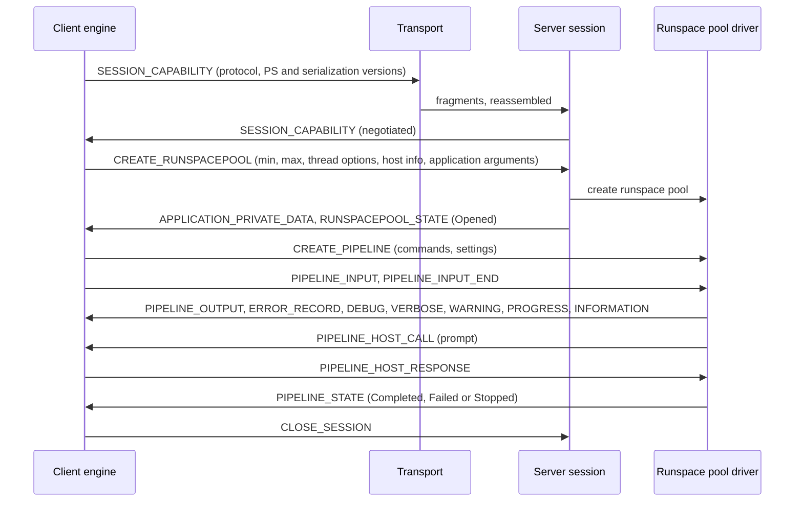

# PowerShell Remoting Protocol (PSRP) layers

> STATIC-ONLY — behavior not run-verified. `FACT-SRC` unless marked. Scope `OUT-OF-SCOPE-DOCUMENTED`: remoting is documented so its design lessons and protocol shape are known, not to be replicated in the first new-shell version. Transports are in [transports](transports.md); the object serialization used inside messages is in [serialization-clixml](serialization-clixml.md); constrained endpoints in [jea](jea.md).

## 1. Purpose and scope [SPEC]

PSRP lets a client engine drive a runspace pool and pipelines hosted by a remote (or child-process) engine. The protocol has four layers: **transport** (moves bytes), **fragmentation** (splits messages into blocks), **message framing** (a typed header plus a serialized payload), and **session/runspace/pipeline semantics** (state machines and message types). This document describes the last three; the first is in the transports document.

## 2. Source map

| path | type | role | tier |
|---|---|---|---|
| src/System.Management.Automation/engine/remoting/common/WireDataFormat/EncodeAndDecode.cs | enums, constants, encoders/decoders | message type ids, data names, version constants, payload builders | B |
| src/System.Management.Automation/engine/remoting/common/WireDataFormat/RemotingDataObject.cs@L15-L268 | class | one protocol message (header + payload) | B |
| src/System.Management.Automation/engine/remoting/common/fragmentor.cs::FragmentedRemoteObject@L29-L426 | class | one fragment (header + blob) | B |
| src/System.Management.Automation/engine/remoting/common/fragmentor.cs::SerializedDataStream@L433-L957 | class | writes a message as fragments | B |
| src/System.Management.Automation/engine/remoting/common/fragmentor.cs::Fragmentor@L965-L1125 | class | fragment size, serialization context, (de)serialization entry points | B |
| src/System.Management.Automation/engine/remoting/common/WireDataFormat/RemoteSessionCapability.cs::RemoteSessionCapability@L19-L91 | class | protocol, PS and serialization versions | B |
| src/System.Management.Automation/engine/remoting/client/clientremotesession.cs, clientremotesessionprotocolstatemachine.cs | classes | client session and state machine | B |
| src/System.Management.Automation/engine/remoting/server/serverremotesession.cs::ServerRemoteSession@L70-L1094 | class | server session, negotiation | B |
| src/System.Management.Automation/engine/remoting/server/ServerRunspacePoolDriver.cs, ServerPowerShellDriver.cs | classes | server-side runspace pool and pipeline drivers | B |
| src/System.Management.Automation/engine/remoting/client/RemoteRunspacePoolInternal.cs, remotepipeline.cs, ClientRemotePowerShell.cs | classes | client-side counterparts | B |
| src/System.Management.Automation/engine/remoting/common/WireDataFormat/RemoteHost*.cs, host/RemoteHostMethodInfo.cs | classes | host method calls over the wire | B |

## 3. Responsibilities and non-responsibilities

Owns: message ids and framing, version negotiation, session/runspace/pipeline message flow, fragmentation, host-call forwarding. Does not own: byte transport (WSMan, SSH, pipes), CLIXML details, authentication (transport), endpoint configuration (JEA).

## 4. Key types and contracts [IMPL]

- **Protocol versions** (`RemotingConstants`): `2.0` (Windows 7 RC), `2.1` (Windows 7 RTM), `2.2` (Windows 8 RTM), `2.3` (Windows 10 RTM; enables the information stream), `2.4` (PowerShell 7.6); `ProtocolVersionCurrent = 2.4`. Version 2.4 **deprecates the session-key exchange**: when both sides are 2.4 or later the messages `PUBLIC_KEY`, `PUBLIC_KEY_REQUEST` and `ENCRYPTED_SESSION_KEY` are obsolete and `SecureString` values are no longer encrypted at the protocol layer; the source comment states the RSA padding used before is not secure and that PSRP must therefore run on a secure transport (src/System.Management.Automation/engine/remoting/common/WireDataFormat/EncodeAndDecode.cs::RemotingConstants@L75-L113).
- **Negotiation rule** (`RunServerNegotiationAlgorithm`): the server accepts when the client protocol version has the same *major* and a *minor* at least the server's (so a 2.4 server accepts clients ≥ 2.4), or — in the normal (non-connect) case — when the client is exactly 2.0, 2.1, 2.2 or 2.3 (the server then lowers itself to the client's version); in the *connect* (reconnect) case only 2.2 and 2.3 are accepted this way. It also requires the client's PS version to have the same major and a minor ≥ the server's, and the client's serialization version the same major and a minor ≥ the server's; any violation is a `PSRemotingDataStructureException` (`ServerNegotiationFailed`) naming the offending item (src/System.Management.Automation/engine/remoting/server/serverremotesession.cs::ServerRemoteSession.RunServerNegotiationAlgorithm@L967-L1058). The client's PS version field is a fixed `2.0` in the capability object (comment: "PSVersionInfo.PSVersion").
- **Message** = header + payload: `Destination` (uint, little-endian: `Client=1`, `Server=2`, `Listener=4`), `DataType` (uint, little-endian, the id below), `RunspacePoolId` (16-byte GUID), `PowerShellId` (16-byte GUID; empty GUID for non-pipeline messages), then the payload as **CLIXML** (UTF-8 XML fragment without declaration, depth 1) when present (src/System.Management.Automation/engine/remoting/common/WireDataFormat/RemotingDataObject.cs@L178-L214). `RemotingTargetInterface`: `Session=1`, `RunspacePool=2`, `PowerShell=3`.
- **Message type ids** (`RemotingDataType`; the high bits group them by target): *session* `0x0001xxxx` — `SessionCapability 0x00010002`, `CloseSession 0x00010003`, `CreateRunspacePool 0x00010004`, `PublicKey 0x00010005`, `EncryptedSessionKey 0x00010006`, `PublicKeyRequest 0x00010007`, `ConnectRunspacePool 0x00010008`; *runspace pool* `0x0002xxxx` — `SetMaxRunspaces 0x00021002`, `SetMinRunspaces 0x00021003`, `RunspacePoolOperationResponse 0x00021004`, `RunspacePoolStateInfo 0x00021005`, `CreatePowerShell 0x00021006`, `AvailableRunspaces 0x00021007`, `PSEventArgs 0x00021008`, `ApplicationPrivateData 0x00021009`, `GetCommandMetadata 0x0002100A`, `RunspacePoolInitData 0x0002100B`, `ResetRunspaceState 0x0002100C`, `RemoteHostCallUsingRunspaceHost 0x00021100`, `RemoteRunspaceHostResponseData 0x00021101`; *pipeline* `0x0004xxxx` — `PowerShellInput 0x00041002`, `PowerShellInputEnd 0x00041003`, `PowerShellOutput 0x00041004`, `PowerShellErrorRecord 0x00041005`, `PowerShellStateInfo 0x00041006`, `PowerShellDebug 0x00041007`, `PowerShellVerbose 0x00041008`, `PowerShellWarning 0x00041009`, `PowerShellProgress 0x00041010`, `PowerShellInformationStream 0x00041011`, `StopPowerShell 0x00041012`, `RemoteHostCallUsingPowerShellHost 0x00041100`, `RemotePowerShellHostResponseData 0x00041101`.
- **Fragmentation**: the header of each fragment is 21 bytes, big-endian: object id (8 bytes, sign bit 0), fragment id (8 bytes, sign bit 0), a flags byte (`S=0x1` start fragment, `E=0x2` end fragment), blob length (4 bytes), then the blob. A message gets one object id; fragment ids count from 0 (`IsStartFragment` is `fragmentId == 0`); the last fragment carries the end flag. The default **fragment size is 32 KB** (`BaseTransportManager.DefaultFragmentSize = 32 << 10`); the blob size per fragment is the fragment size minus the header. Serialization depth for remoting is **1** (`SerializationDepthForRemoting`) with the remoting serialization options (src/System.Management.Automation/engine/remoting/common/fragmentor.cs::FragmentedRemoteObject@L29-L426; src/System.Management.Automation/engine/remoting/fanin/BaseTransportManager.cs::BaseTransportManager.DefaultFragmentSize@L221-L221).
- **Session state machine** (`RemoteSessionState`): `UndefinedState`, `Idle`, `Connecting`, `Connected`, `NegotiationSending`, `NegotiationSendingOnConnect`, `NegotiationSent`, `NegotiationReceived`, `NegotiationPending`, `ClosingConnection`, `Closed`; events (`RemoteSessionEvent`, 32 values) include `CreateSession`, `ConnectSession`, `NegotiationSending`, `NegotiationSendCompleted`, `NegotiationReceived`, `NegotiationCompleted`, `Close`, `CloseCompleted`, `CloseFailed`, `ConnectFailed`, `NegotiationFailed`, `NegotiationTimeout`, `SendFailed`, `ReceiveFailed`, `FatalError`, `MessageReceived`, key-exchange events (`KeySent`, `KeyReceived`, `KeyRequested`, …) and disconnect/reconnect events (`DisconnectStart`, `DisconnectCompleted`, `ReconnectStart`, …) (src/System.Management.Automation/engine/remoting/common/remotesession.cs, misc.cs; the transition table was not read, `UNVERIFIED`).
- **Server dispatch**: session-level messages are handled by the server session (`CreateRunspacePool`, `CloseSession`, `SessionCapability`, `PublicKey`); runspace-pool and pipeline messages go to the runspace pool driver: `CreatePowerShell`, `GetCommandMetadata`, `RemoteRunspaceHostResponseData`, `SetMaxRunspaces`, `SetMinRunspaces`, `AvailableRunspaces`, `ResetRunspaceState` (pool level) and `StopPowerShell`, `PowerShellInput`, `PowerShellInputEnd`, `RemotePowerShellHostResponseData` (pipeline level) (src/System.Management.Automation/engine/remoting/server/ServerRemotingProtocol2.cs@L121-L660).

## 5. Data model

Payload property names are strings in `RemoteDataNameStrings`: for example `MinRunspaces`, `MaxRunspaces`, `PSThreadOptions`, `ApartmentState`, `HostInfo`-style host data, `PowerShell` with `IsNested`, `Cmds` (command list: `Cmd` text, `IsScript`, `UseLocalScope`, `Args` with `N` name and `V` value, and the merge flags `MergeMyResult`, `MergeToResult`, `MergeError`, `MergeWarning`, `MergeVerbose`, `MergeDebug`, `MergeInformation`, `MergePreviousResults`), `NoInput`, `PSInvocationSettings`, `RemoteStreamOptions`, `AddToHistory`, `RedirectShellErrorOutputPipe`, `PipelineState`, `RunspaceState`, `ExceptionAsErrorRecord`, the event-argument fields `PSEventArgs.*`, host-call fields `ci` (call id), `mi` (method id), `mp` (parameters), `mr` (return value), `me` (exception), and capability fields `protocolversion`, `PSVersion`, `SerializationVersion`, `TimeZone`. Notes added to remote objects: `PSComputerName`, `RunspaceId`, `PSShowComputerName`, `PSSourceJobInstanceId`, `PSEventObject` (`RemotingConstants`).

## 6. Control flow

Ordered: (1) transport connects; (2) both sides exchange `SessionCapability` and run the negotiation rule; (3) the client sends `CreateRunspacePool`; the server creates the pool from the configured initial session state and answers with private data and state; (4) each `CreatePowerShell` creates a server pipeline driver bound to the pipeline GUID; input is streamed until `PowerShellInputEnd`; output and stream records flow back as typed messages; host calls (prompts, `Write-Host`, `ReadLine`) travel as `RemoteHostCall…` and wait for `…HostResponseData`; (5) pipeline state ends the pipeline; (6) `CloseSession` ends the session. The pre-2.4 key exchange (`PublicKey`, `EncryptedSessionKey`, `PublicKeyRequest`) occurs only when either side is older than 2.4 (`UNVERIFIED` exact conditions).

## 7. Algorithms

Version negotiation: §4. Fragmentation: serialize the message into a stream that cuts a fragment whenever the current blob reaches `fragmentSize - 21` bytes, assigning increasing fragment ids; the receiver reassembles by object id until the end flag. Priority: outgoing data is kept in one serialized-data store per priority (`DataPriorityType`: `Default = 0`, `PromptResponse = 1`; `PrioritySendDataCollection`) so host prompt answers are not stuck behind bulk output (the scheduling between the stores was not read, `UNVERIFIED`).

## 8. Observable behavior [SPEC]

- A remote command's output appears as deserialized objects with extra properties (`PSComputerName`, `RunspaceId`); streams (error, warning, verbose, debug, progress, information) are relayed; prompts from the remote script are shown on the client host.
- Version mismatch yields a clear negotiation error naming the field and versions.
- `Stop` on the client sends `StopPowerShell`; the server stops the pipeline.
- Tests: §16. No golden sample: STATIC-ONLY.

## 9. Error handling and edge cases

`PSRemotingDataStructureException` for malformed or unexpected messages (wrong destination or type), `PSRemotingTransportException` for transport faults, `PSRemotingDataStructureException(ServerNegotiationFailed / ServerConnectFailedOnNegotiation)` for version failures; a message whose destination is not `Server` (on a server) or whose type is unexpected for the session state is rejected; fragments out of order (`FragmentId` mismatch) fail reassembly (`UNVERIFIED` code path); deserialization of a null payload is an error (`DeserializedObjectIsNull`).

## 10. Concurrency and threading

One session has one transport manager per runspace pool and one per command (pipeline); sends are serialized per transport; receive callbacks run on transport threads and hand off to the session state machine and drivers; server pipelines run on runspace threads (see [runspace-and-pipeline](../03-runtime/runspace-and-pipeline.md)); the throttle manager limits concurrent remote operations on the client (`throttlemanager.cs`).

## 11. Extension points and customization hooks

Protocol version constants (new minor per change); `RemoteHostMethodId`-based host calls; application private data and application arguments (`$PSSenderInfo`, `PSApplicationPrivateData`) exchanged at session creation; session configuration (endpoints) selecting the initial session state; custom transports implement the transport-manager contract.

## 12. Dependencies

Inbound: remoting cmdlets (`Invoke-Command`, `New-PSSession`, `Enter-PSSession`), jobs, `PowerShell`/`Runspace` APIs with remote connection info. Outbound: CLIXML serializer, transport managers, runspace pool/pipeline (server side), host (host calls), crypto helper (pre-2.4 key exchange).

## 13. Performance notes

32 KB fragments and Base64-wrapped transport frames (out-of-process transports) add overhead; serialization depth 1 limits object graph size; large outputs are streamed per object; pool and pipeline messages are small relative to CLIXML payloads.

## 14. Security considerations

PSRP itself provides **no confidentiality or authentication from version 2.4**: it relies on the transport (WSMan with Kerberos/HTTPS, SSH, local pipes). The deprecated session-key exchange used a padding the source calls insecure. Enforcement points here: negotiation rejects incompatible versions; the server session validates message destinations and types per state; deserialization of payloads uses restricted CLIXML types (deserialized objects are data-only, see CLIXML document); the server applies the endpoint's initial session state and language mode to the runspace pool; `$PSSenderInfo` identifies the caller to server-side code.

### Security surface

<!--GEN:secseeds-->
| Category | Seed hits |
|---|---:|
| jea | 59 |
| securestring | 21 |
| language-mode | 18 |
| execution-policy | 12 |
| logging | 6 |
| app-control | 5 |
| remoting-deser | 2 |
| **total** | 123 |

Files with most hits:

| File | Hits |
|---|---:|
| `src/System.Management.Automation/engine/remoting/fanin/InitialSessionStateProvider.cs` | 79 |
| `src/System.Management.Automation/engine/remoting/common/WireDataFormat/RemoteHost.cs` | 7 |
| `src/System.Management.Automation/engine/remoting/fanin/PSSessionConfigurationData.cs` | 5 |
| `src/System.Management.Automation/engine/remoting/common/PSETWTracer.cs` | 4 |
| `src/System.Management.Automation/engine/remoting/fanin/WSManTransportManager.cs` | 4 |
| `src/System.Management.Automation/engine/remoting/server/ServerRunspacePoolDriver.cs` | 4 |
| `src/System.Management.Automation/engine/remoting/server/serverremotesession.cs` | 4 |
| `src/System.Management.Automation/engine/remoting/common/WireDataFormat/RemoteHostEncoder.cs` | 3 |

These are regex scanner hits (`APPROX`, `verified: false`, no `SEC-ENF` ID yet). Phase 5 verifies them and assigns IDs; none is claimed here as an enforcement point.
<!--/GEN:secseeds-->

What the new shell must guarantee here (if remoting is ever built): the transport authenticates both peers and encrypts; the protocol never sends secrets in a weaker envelope than the transport; the server side applies policy before creating the runspace pool and logs every session with identity; message size and rate limits protect the server.

## 15. Enterprise considerations

Security first: §14. Observability: ETW tracers for remoting (`PSETWTracer`), session/runspace/pipeline ids as GUIDs, state events. Supportability: explicit protocol versions with a documented change history; `PSSessionOption` timeouts. Testability: protocol layers are separable (fragmentor, encoders) but tests are mostly end-to-end (§16). Resource limits: runspace pool min/max, fragment size, timeouts and size limits are transport constants and options: maximum received object size 10 MB (`MaximumReceivedObjectSize = 10 << 20`), connection open timeout 3 minutes, operation timeout 3 minutes, close timeout 1 minute, server keep-alive 4 minutes, idle timeout default "use the server's" (src/System.Management.Automation/engine/remoting/fanin/BaseTransportManager.cs@L209-L225, src/System.Management.Automation/engine/remoting/common/RunspaceConnectionInfo.cs@L206-L268). Missing: protocol-level authentication, message signing, per-message size caps independent of transport.

## 16. Tests

<!--GEN:tests-->
| Pester file | Describe | Context | It |
|---|---:|---:|---:|
| `test/SSHRemoting/SSHRemoting.Basic.Tests.ps1` | 1 | 2 | 19 |
| `test/powershell/engine/Remoting/CustomConnection.Tests.ps1` | 1 | 0 | 3 |
| `test/powershell/engine/Remoting/InvokeCommandRemoteDebug.Tests.ps1` | 1 | 0 | 4 |
| `test/powershell/engine/Remoting/PSSession.Tests.ps1` | 2 | 0 | 2 |
| `test/powershell/engine/Remoting/RemoteSession.Basic.Tests.ps1` | 5 | 0 | 19 |
| `test/powershell/engine/Remoting/RemoteSession.Disconnect.Tests.ps1` | 1 | 0 | 1 |
| `test/powershell/engine/Remoting/RoleCapabilityFiles.Tests.ps1` | 1 | 0 | 3 |
| `test/powershell/engine/Remoting/RunspacePool.Tests.ps1` | 1 | 0 | 1 |
| `test/powershell/engine/Remoting/SSHRemotingAPI.Tests.ps1` | 1 | 1 | 3 |
| `test/powershell/engine/Remoting/SSHRemotingCmdlets.Tests.ps1` | 4 | 0 | 4 |
| `test/powershell/engine/Remoting/SessionOption.Tests.ps1` | 1 | 0 | 4 |
| **total (11 files)** | 19 | 3 | 63 |

| xUnit file | Facts | Theories | Classes |
|---|---:|---:|---|
| `test/xUnit/csharp/test_RemoteHyperV.cs` | 0 | 0 | `RemoteHyperVTests`, `of` |

Matching is by path keyword (`APPROX`): `Remoting/`, `engine/Remoting`, `test_RemoteHyperV`.
<!--/GEN:tests-->

## 17. Design decisions and trade-offs

- `FACT-SRC`: a typed binary header around XML payloads keeps routing cheap and payloads self-describing.
- `FACT-SRC`: protocol minor versions are bumped for each change and old versions stay supported by down-negotiation.
- `FACT-SRC`: encryption was moved out of the protocol (2.4) because the in-protocol scheme was weak; transport security became mandatory in practice.
- `INFERENCE`: two priority streams exist so prompt responses are not blocked by large output.
- `FACT-SRC`: host methods are forwarded as RPCs so remote scripts can use the local UI.

## 18. Guidance for the new shell [LESSON]

- **LSN-PSRP-01** [AVOID] (area: NLD-SEC) Do not build remoting in the first version; if built later, do not copy PSRP's XML payload design or its in-protocol key exchange. DEV: DEV-REM-210. Evidence: src/System.Management.Automation/engine/remoting/common/WireDataFormat/EncodeAndDecode.cs::RemotingConstants@L75-L113.
- **LSN-PSRP-02** [ADAPT] (area: NLD-SEC) Keep the lesson that protocol versions are explicit and negotiated downward with a published history, and that security belongs to a mutually authenticated encrypted transport. Evidence: src/System.Management.Automation/engine/remoting/server/serverremotesession.cs::ServerRemoteSession.RunServerNegotiationAlgorithm@L967-L1058.
- **LSN-PSRP-03** [ADAPT] (area: NLD-RUN) Keep length-prefixed fragmentation with start/end flags and a priority lane for control and prompt traffic. Evidence: src/System.Management.Automation/engine/remoting/common/fragmentor.cs::FragmentedRemoteObject@L29-L426.
- **LSN-PSRP-04** [ADAPT] (area: NLD-RUN) Forward host calls (prompts, progress) as typed RPCs with call ids if a remote host UI is ever needed. Evidence: src/System.Management.Automation/engine/remoting/common/WireDataFormat/RemoteHost.cs@L1-L762.

## 19. Open questions / UNVERIFIED items

- `UNVERIFIED` (VB-064): the session state-machine transition tables (client and server), key-exchange conditions, runspace-pool and pipeline driver message handling (`ServerRunspacePoolDriver`, `ServerPowerShellDriver`), client-side classes, `RemoteHost` encoding, `EncodeAndDecode` payload builders, `ThrottleManager`.
- `UNVERIFIED` (VB-065): reassembly error paths in `Defragmentor`, data size limits and timeouts, `PSSenderInfo` construction.

Verification: `EncodeAndDecode.cs` (`RemotingConstants`, type id lists, selected enums), `RemotingDataObject.cs` lines 150–309, `fragmentor.cs` lines 29–280 and 965–1125, `serverremotesession.cs` lines 300–360 and 967–1058, `ServerRemotingProtocol2.cs` case labels, `misc.cs` enums, `BaseTransportManager.cs` line 221 were read; the rest is from signatures. Test counts from `data/tests.json` through `tools/gen_T3.py`.
