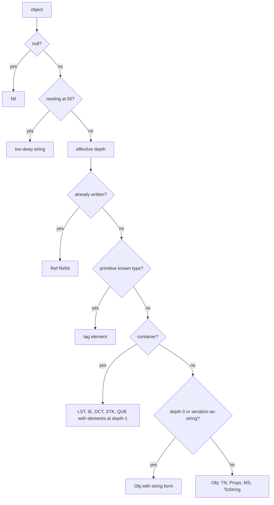

# Serialization (CLIXML) and type fidelity

> STATIC-ONLY — behavior not run-verified. `FACT-SRC` unless marked. Scope `EXTENDED` (used by remoting, jobs, `Export-Clixml`/`Import-Clixml`, `Start-Job`). Object model behind it: [extended-type-system](../03-runtime/extended-type-system.md). Wire use: [psrp-protocol](psrp-protocol.md).

## 1. Purpose and scope [SPEC]

CLIXML is PowerShell's XML object format. It turns an object graph into text and back, preserving *enough* information that a script on the other side can use the result: values of well-known types round-trip exactly, other objects become property bags that carry their type names and a string form. This document covers the element vocabulary, the serializer and deserializer rules (depth, references, string forms), the **type-fidelity rules** (what survives, what is lost), the special handling of secure strings and script blocks, and the safety settings of the XML readers.

## 2. Source map

| path | type | role | tier |
|---|---|---|---|
| src/System.Management.Automation/engine/serialization.cs::PSSerializer@L86-L216 | public static class | `Serialize(object[, depth])`, `Deserialize(string)`, `DeserializeAsList` | B |
| src/System.Management.Automation/engine/serialization.cs::Serializer@L221-L332, Deserializer@L493-L823 | classes | public-ish drivers over an `XmlWriter`/`XmlReader` | B |
| src/System.Management.Automation/engine/serialization.cs::SerializationContext@L46-L81, DeserializationContext@L345-L399 | classes | depth, option flags, crypto helper | B |
| src/System.Management.Automation/engine/serialization.cs::InternalSerializer@L837-L2961 | class | the writer: `WriteOneObject`, containers, PSObject handling | B |
| src/System.Management.Automation/engine/serialization.cs::InternalDeserializer@L2966-L4996 | class | the reader: `ReadOneObject`, known types, containers | B |
| src/System.Management.Automation/engine/serialization.cs::KnownTypes@L5167-L5376 | static class | table of primitive types, tags and (de)serializers | B |
| src/System.Management.Automation/engine/serialization.cs::DeserializingTypeConverter@L6670-L7678 | public sealed class | rehydrates selected types from deserialized property bags | B |
| src/System.Management.Automation/engine/serialization.cs::PSPrimitiveDictionary@L5952-L6644 | public class | a hashtable restricted to primitive values (used for application arguments/private data) | B |
| src/System.Management.Automation/engine/SerializationStrings.cs::SerializationStrings@L9-L311 | constants | element and attribute names | B |

## 3. Responsibilities and non-responsibilities

Owns: the CLIXML grammar, depth and reference rules, the known-type table, rehydration, and reader safety settings. Does not own: the transport framing of serialized text (PSRP fragments), encryption keys (`PSRemotingCryptoHelper`, remoting), the type-data settings themselves (`SerializationDepth`, `SerializationMethod` in type data, see the ETS document).

## 4. Key types and contracts [IMPL]

- **Vocabulary** (`SerializationStrings`): root `Objs` (attributes `Version`), object `Obj` (attributes `RefId`, optional name `N`, stream `S`), type names `TN` (child `T` items) and back-reference `TNRef`, property sections `Props` (adapted properties) and `MS` (member set: extended note properties), note property `N`, string form `ToString`, containers `LST` (list), `IE` (enumerable), `DCT` with `En`/`Key`/`Value` (dictionary), `STK` (stack), `QUE` (queue), object back-reference `Ref`, nil `Nil`; primitive tags: `S` string, `C` char, `B` bool, `By` byte, `SB` sbyte, `I16`/`U16`, `I32`/`U32`, `I64`/`U64`, `Sg` single, `Db` double, `D` decimal, `DT` datetime, `TS` timespan, `G` guid, `BA` byte array (base64), `URI`, `Version`, `SemanticVersion`, `XD` XML document, `SBK` script block, `SS` secure string, `PR` progress record (with child tags `AI`, `PI`, `AV`, `SD`, `CO`, `PC`, `SR`, `T`); namespace `http://schemas.microsoft.com/powershell/2004/04` (prefix `ps`) (src/System.Management.Automation/engine/SerializationStrings.cs).
- **Options** (`SerializationOptions`): `UseDepthFromTypes`, `NoRootElement`, `NoNamespace`, `NoObjectRefIds`, `PreserveSerializationSettingOfOriginal`; `RemotingOptions` = `UseDepthFromTypes | NoRootElement | NoNamespace | PreserveSerializationSettingOfOriginal`. `DeserializationOptions`: `NoRootElement`, `NoNamespace`, `DeserializeScriptBlocks`, `RemotingOptions` = `NoRootElement | NoNamespace`. **Depth**: `SerializationContext` requires depth ≥ 1; the default context depth is 2 (`DefaultSerializationDepth`), `PSSerializer.Serialize(obj)` uses depth **1** (`s_mshDefaultSerializationDepth`), remoting uses depth **1** (`SerializationDepthForRemoting`); nesting is hard-capped at **50** levels below the top regardless of depth (`MaxDepthBelowTopLevel`), where the writer emits the too-deep message string instead of the object.
- **`WriteOneObject` algorithm** (src/System.Management.Automation/engine/serialization.cs::InternalSerializer.WriteOneObject@L971-L1042): (1) `null` → `Nil`; (2) increment the nesting counter; if at the 50-level cap write the "too deep" string and stop; (3) compute the depth for this object (`GetDepthOfSerialization`: `CimInstance`, `PSCredential` and `SwitchParameter` use 1, `PSSenderInfo` uses 4, a depth from type data when `UseDepthFromTypes` and the type data gives a positive value, and a deserialized object whose remaining depth is ≤ 0 uses 1 when `PreserveSerializationSettingOfOriginal`); (4) a primitive known type wrapped in a `PSObject` with extra members is written as an `Obj` with the primitive inside; (5) if the object was already written, emit `<Ref RefId='n'/>` (reference ids make shared and cyclic graphs finite; disabled by `NoObjectRefIds`); (6) a plain primitive known type is written as its tag element; (7) known containers (dictionary → `DCT`, other enumerable → `LST`/`IE`, stack, queue) are written with their elements at depth-1; (8) if the depth is 0 or the type data says **serialize as string** (`SerializationMethod.String`), write the object as its string form (the `ToString` representation) inside `Obj`; (9) otherwise write a complex object through `HandleComplexTypePSObject` (not read, `UNVERIFIED`; `INFERENCE` from the reader's expectations: `TN` type names, `Props` adapted properties at depth-1, `MS` extended properties and a `ToString` string form).
- **Known primitive types** are exact round-trip types (`KnownTypes` table keyed by full type name and by tag): booleans, integer widths, floating types, decimal, char, string, byte array, date/time, time span, GUID, URI, version, semantic version, script block (as text), XML document, secure string, progress record. Enums are written as their underlying value plus type names (`UNVERIFIED` exact handling).
- **Deserializer** (`InternalDeserializer`): `ReadOneObject` reads `Obj` into a `PSObject` (`ReadPSObject`): type names (the first name gets the **`Deserialized.` prefix**, e.g. `Deserialized.System.IO.FileInfo`; if absent the original names stay), `Props` become note properties (read-only data), `MS` populates instance members, a `ToString` element sets the string form and adds a `ToString` method member, and the inner element is read as a primitive, a container (`ReadListContainer`/`ReadDictionary`; the resulting collection types were not read, `UNVERIFIED`) or a nested object; unknown tags raise an XML exception unless unknown tags are allowed (then skipped). The resulting object is *data only*: it is flagged as deserialized and has no methods of the original type.
- **Rehydration** (`DeserializingTypeConverter`, a `PSTypeConverter`): when a script or the engine converts a deserialized object to a specific type, a table maps selected target types to reconstruction functions: `PSPrimitiveDictionary`, `SwitchParameter`, `PSListModifier`, `PSCredential`, `PSSenderInfo`, `CultureInfo`, `ParameterSetMetadata`, `X509Certificate2`, `X500DistinguishedName`, `IPAddress`, `MailAddress`, `DirectorySecurity`/`FileSecurity`/`RegistrySecurity`, the format-data object model (`ExtendedTypeDefinition`, `FormatViewDefinition`, `PSControl`, table/list/wide/custom control classes, `DisplayEntry`, `EntrySelectedBy`) and `CompletionResult`; other types stay property bags (src/System.Management.Automation/engine/serialization.cs::DeserializingTypeConverter@L6670-L7678).
- **Secure strings**: written as `SS` with the text *encrypted* — with the remoting crypto helper if one is in the context, else with the platform data-protection helper (`SecureStringHelper`; Windows DPAPI-style, on Unix a different scheme, `UNVERIFIED`); on read the same helper decrypts (failure → "deserialize secure string failed"). Since protocol 2.4 remoting skips the session-key encryption and relies on the transport (see PSRP document).
- **Script blocks**: serialized as text; deserialized back to a `ScriptBlock` only when `DeserializeScriptBlocks` is set, otherwise as a string — so script blocks do not become executable from untrusted data by default (`UNVERIFIED` default path).
- **Reader safety**: the CLIXML reader prohibits DTDs, has no XML resolver, ignores comments and processing instructions, does not check characters, limits entity expansion to 1,024 characters; the reader for *untrusted XML documents* (`XD` values) allows DTD parsing but with an entity limit of 1,024 characters and a document limit of 512M characters (src/System.Management.Automation/engine/serialization.cs::InternalDeserializer.GetXmlReaderSettingsForCliXml@L4172-L4191).

## 5. Data model

Serializer state: the `XmlWriter`, the context (depth, options, crypto helper, CIM class cache), a reference-id table (`ReferenceIdHandlerForSerializer`: object → id), the current nesting counter, an optional `TypeTable` (type data lookup) and a stop flag. Deserializer state: the `XmlReader`, a reference table (id → object), a type-name table (for `TNRef`), the context and the same `TypeTable`.

## 6. Control flow

## 7. Algorithms

`WriteOneObject` (§4) is the algorithm; the reader mirrors it. Type-name prefix: `Deserialized.` is added to the first type name when reading an object whose type is not a known primitive; helper methods in the same file add and strip the prefix (lines 682–820) and the format system uses the stripped names as a fallback for view selection (see [formatting-and-output](../03-runtime/formatting-and-output.md) §4).

## 8. Observable behavior [SPEC]

- A process object sent through remoting arrives as `Deserialized.System.Diagnostics.Process` with its properties (depth 1: nested objects become strings at depth 0) and prints using its `ToString` or default display; method calls on it fail.
- `Export-Clixml`/`Import-Clixml` and `[System.Management.Automation.PSSerializer]::Serialize` produce and consume the same format; `-Depth` controls nesting (deeper values become strings).
- Primitive values, GUIDs, dates, versions, URIs and byte arrays round-trip as the same .NET types (they are in the known-type table); `EXTERNAL` knowledge (not verified in source here): hashtables come back as hashtables and arrays as object arrays; custom objects come back as property bags.
- Secure strings round-trip only on the same machine/user (file case) or under the same session key/transport (remoting).
- Tests: §16. No golden sample: STATIC-ONLY.

## 9. Error handling and edge cases

Malformed XML or unexpected elements → `XmlException` with line information (`NewXmlException`); version attribute checked (`ValidateVersion`); too deep → the "deserialization too deep" string; cyclic graphs terminate through references; failed secure-string decryption → error; stop requests are honoured between objects (`CheckIfStopping`); unknown CIM class ids are looked up in per-stream caches (`CimClassSerializationCache`).

## 10. Concurrency and threading

A serializer or deserializer instance is used by one thread; the stop flag is set from another thread (`Stop()`); `KnownTypes` and the `TypeTable` are shared read-only; `WeakReferenceDictionary` helps reference tables avoid leaks.

## 11. Extension points and customization hooks

Type data: `SerializationDepth`, `SerializationMethod` (String or default), `PropertySerializationSet` (only listed properties are serialized), `TargetTypeForDeserialization`; `DeserializingTypeConverter` table (internal); `-Depth` on `Export-Clixml`/`ConvertTo-Json`-style cmdlets; `PSSerializer.DeserializeAsList`; `PSPrimitiveDictionary` for safe application data.

## 12. Dependencies

Inbound: remoting (every message payload), `Export-Clixml`/`Import-Clixml`, background jobs (parameters and results), `PSSerializer`, debugger/event forwarding. Outbound: ETS (`PSObject`, type table, adapters), `LanguagePrimitives`, XML APIs, the crypto helper, CIM types (`CimInstance` special cases).

## 13. Performance notes

Text XML is verbose; depth 1 limits size; reference ids avoid duplicating shared sub-objects; `KnownTypes` lookups are dictionary-based; secure-string encryption per value is costly; very large byte arrays are Base64 (+33 %). Writers avoid indentation (`Indent = false`) and character checking is off.

## 14. Security considerations

Deserialization is a classic attack surface: this implementation limits it by design — payloads become inert property bags; rehydration is limited to a fixed allow-list of types (`DeserializingTypeConverter` table) and never instantiates arbitrary types from type names; script blocks are not revived unless asked; DTDs are prohibited in CLIXML and entity expansion is capped; nesting is capped at 50. Risks that remain: allocation attacks through large documents (the CLIXML reader sets no document-size cap in the settings read; the untrusted-XML reader caps at 512M characters), rehydration functions that parse text (certificates, security descriptors, IP addresses) and secure-string handling. Serialization can also leak data: depth-1 property bags include whatever properties the object's adapter exposes (paths, tokens in properties).

### Security surface

<!--GEN:secseeds-->
| Category | Seed hits |
|---|---:|
| remoting-deser | 75 |
| securestring | 23 |
| **total** | 98 |

Files with most hits:

| File | Hits |
|---|---:|
| `src/System.Management.Automation/engine/serialization.cs` | 97 |
| `src/System.Management.Automation/engine/SerializationStrings.cs` | 1 |

These are regex scanner hits (`APPROX`, `verified: false`, no `SEC-ENF` ID yet). Phase 5 verifies them and assigns IDs; none is claimed here as an enforcement point.
<!--/GEN:secseeds-->

What the new shell must guarantee here: deserialization never instantiates types by name; the set of rehydratable types is a fixed allow-list; size, depth and entity limits apply to every reader; secrets are marked sensitive and never serialized in clear text; a deserialized object cannot be passed where a live object with methods is required without an explicit, policy-checked conversion.

## 15. Enterprise considerations

Security first: §14. Observability: ETW analytic events for depth overrides, mode overrides and max-depth hits. Supportability: a documented schema and version attribute; text format is inspectable. Testability: round-trip tests (§16) and `PSSerializer` as a public API. Resource limits: depth and nesting caps; no byte cap on CLIXML input in the settings read. Missing: a binary or schema-validated format, streaming parse limits, content signing.

## 16. Tests

<!--GEN:tests-->
| Pester file | Describe | Context | It |
|---|---:|---:|---:|
| `test/powershell/engine/Api/Serialization.Tests.ps1` | 1 | 0 | 7 |
| **total (1 files)** | 1 | 0 | 7 |

| xUnit file | Facts | Theories | Classes |
|---|---:|---:|---|
| `test/xUnit/csharp/test_Serialization.cs` | 2 | 0 | `SerializationTests` |

Matching is by path keyword (`APPROX`): `Serialization`, `Export-Clixml`, `Import-Clixml`, `CliXml`, `Clixml`, `test_Serialization`.
<!--/GEN:tests-->

## 17. Design decisions and trade-offs

- `FACT-SRC`: fidelity is *selective* — exact for primitives, approximate (property bag + string) for everything else, because live objects cannot cross process boundaries.
- `FACT-SRC`: the default depth is small (1 for remoting and `PSSerializer`, 2 for the internal default) to bound size; type data can raise it for important types.
- `INFERENCE`: keeping `ToString` in the stream preserves readable output on the receiving side.
- `FACT-SRC`: the `Deserialized.` prefix lets format data and type data treat deserialized objects separately from live ones.

## 18. Guidance for the new shell [LESSON]

- **LSN-CLIXML-01** [ADAPT] (area: NLD-TYP) Keep the idea of a self-describing, depth-limited, reference-preserving interchange format with exact primitives and inert property bags for the rest, but choose a schema'd format (for example JSON or CBOR with a type vocabulary) and keep CLIXML import/export as a compatibility adapter. Evidence: src/System.Management.Automation/engine/serialization.cs::InternalSerializer.WriteOneObject@L971-L1042.
- **LSN-CLIXML-02** [REPLICATE] (area: NLD-SEC) Never instantiate types from payload type names; rehydrate through a fixed allow-list only. Evidence: src/System.Management.Automation/engine/serialization.cs::DeserializingTypeConverter@L6670-L7678.
- **LSN-CLIXML-03** [REPLICATE] (area: NLD-SEC) Prohibit DTDs, cap entity expansion and nesting depth in every XML or structured reader. Evidence: src/System.Management.Automation/engine/serialization.cs::InternalDeserializer.GetXmlReaderSettingsForCliXml@L4172-L4191.
- **LSN-CLIXML-04** [REDESIGN] (area: NLD-SEC) Add an explicit maximum input size and a streaming limit to the primary reader, and mark sensitive properties so depth-1 bags cannot leak them. DEV: DEV-SER-215. Evidence: src/System.Management.Automation/engine/serialization.cs::InternalSerializer.GetDepthOfSerialization@L2322-L2381.
- **LSN-CLIXML-05** [REPLICATE] (area: NLD-TYP) Keep a marker on deserialized objects (type-name prefix and flag) so formatting and policy can tell data from live objects. Evidence: src/System.Management.Automation/engine/serialization.cs::Deserializer@L493-L819.

## 19. Open questions / UNVERIFIED items

- `UNVERIFIED` (VB-068): `HandleComplexTypePSObject`, `HandleKnownContainerTypes` and enum handling, CIM instance serialization, `ReadListContainer`/`ReadDictionary` result types, `ReadProperties` details, type-name table (`TNRef`) handling, the `Deserialized.` helper functions (lines 682–820), `PSPrimitiveDictionary` restrictions, SecureString protection on Unix, script block deserialization default path.
- `UNVERIFIED` (VB-069): the cmdlets `Export-Clixml`, `Import-Clixml`, `ConvertTo-CliXml`-style entry points and the PSSerializer corner cases.

Verification: `serialization.cs` lines 34–84, 86–220 (greps), 335–345, 971–1100, 2295–2388, 3656–3757, 4172–4215, 4792–4810, 4910–4975, 5167–5240, 6670–6740 and `SerializationStrings.cs` constants were read. Test counts from `data/tests.json` through `tools/gen_T3.py`.
