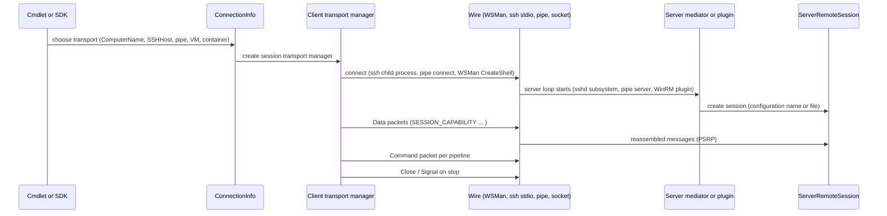

# Remoting transports and remoting commands

> STATIC-ONLY — behavior not run-verified. `FACT-SRC` unless marked. Scope `OUT-OF-SCOPE-DOCUMENTED`. Protocol layers above the transport: [psrp-protocol](psrp-protocol.md). The child-process job transport is described in [jobs-and-concurrency](../03-runtime/jobs-and-concurrency.md).

## 1. Purpose and scope [SPEC]

A transport carries PSRP fragments between a client engine and a server engine. This document covers the transport abstraction, the four concrete families — WSMan (HTTP/HTTPS, Windows-centric), SSH, named pipe / process, and Hyper-V socket (VM and container) — the connection-info classes the SDK uses to select them, the server-side mediators/plugins, and the user-facing remoting command flow (`Invoke-Command`, `New-PSSession`, `Enter-PSSession`).

## 2. Source map

| path | type | role | tier |
|---|---|---|---|
| src/System.Management.Automation/engine/remoting/fanin/BaseTransportManager.cs::BaseTransportManager@L194-L464 | abstract class | common transport-manager base (fragmentor, receive callbacks, constants) | B |
| src/System.Management.Automation/engine/remoting/fanin/BaseTransportManager.cs::BaseClientSessionTransportManager@L1088-L1171, BaseClientCommandTransportManager@L1173-L1283 | abstract classes | client session and per-command managers | B |
| src/System.Management.Automation/engine/remoting/fanin/BaseTransportManager.cs::AbstractServerSessionTransportManager@L1533-L1560 | abstract class | server session manager | B |
| src/System.Management.Automation/engine/remoting/fanin/WSManTransportManager.cs::WSManClientSessionTransportManager@L281-L2775, WSManClientCommandTransportManager@L2782-L4170 | classes | WSMan client over the native WSMan API | B |
| src/System.Management.Automation/engine/remoting/fanin/WSManNativeAPI.cs | classes | P/Invoke declarations for WSMan | B |
| src/System.Management.Automation/engine/remoting/fanin/WSManPlugin.cs, WSManPluginShellSession.cs, WSManPluginTransportManager.cs, WSManPluginFacade.cs | classes | WSMan server plugin (`pwrshplugin.dll` hosts the engine inside the WinRM service) | B |
| src/System.Management.Automation/engine/remoting/fanin/OutOfProcTransportManager.cs | classes | out-of-process client managers (child process, SSH, named pipe, Hyper-V socket) and server managers | B |
| src/System.Management.Automation/engine/remoting/server/OutOfProcServerMediator.cs | classes | server-side loops: stdio, named pipe, Hyper-V socket | B |
| src/System.Management.Automation/engine/remoting/common/RunspaceConnectionInfo.cs::WSManConnectionInfo@L386-L1538, NewProcessConnectionInfo@L1545-L1704, NamedPipeConnectionInfo@L1705-L1927, SSHConnectionInfo@L1928-L2947, VMConnectionInfo@L2948-L3091, ContainerConnectionInfo@L3092-L3803 | classes | what the SDK/cmdlets pass to select a transport | B |
| src/System.Management.Automation/engine/remoting/common/RemoteSessionNamedPipe.cs | classes | named-pipe client/server and pipe naming | B |
| src/System.Management.Automation/engine/remoting/commands/PSRemotingCmdlet.cs, InvokeCommandCommand.cs, newrunspacecommand.cs | cmdlets | remoting command surface | B |

## 3. Responsibilities and non-responsibilities

Owns: moving fragments, connection setup and teardown, timeouts, server-side session creation per transport, remoting cmdlet parameter sets. Does not own: message semantics (PSRP), authentication providers of the OS or SSH, endpoint configuration (JEA), job objects.

## 4. Key types and contracts [IMPL]

- **Transport manager contract**: a *session* manager per runspace pool and a *command* manager per pipeline; each exposes create, send data (fragments produced by the shared `Fragmentor`; default size 32 KB), receive callback (reassembly in the base class), close, and error events (`TransportErrorOccuredEventArgs`). Constants: connection open timeout 3 minutes, operation timeout 3 minutes, close timeout 1 minute, server keep-alive 4 minutes, maximum received object size 10 MB, idle timeout default "server's" (src/System.Management.Automation/engine/remoting/fanin/BaseTransportManager.cs@L209-L225).
- **Connection info classes** (all derive from `RunspaceConnectionInfo`, which carries `OpenTimeout`, `CancelTimeout`, `OperationTimeout`, `IdleTimeout`, credentials and culture): `WSManConnectionInfo` (URI, port, `AuthenticationMechanism`, SSL options, proxy, `IncludePortInSPN`, shell URI/configuration name), `NewProcessConnectionInfo` (internal: start a child `pwsh` with `-s`), `NamedPipeConnectionInfo` (process id or pipe name, app domain), `SSHConnectionInfo` (user, host, key file, port, **subsystem default `powershell`**, connecting timeout default infinite, extra `-o` options), `VMConnectionInfo` (Hyper-V VM id), `ContainerConnectionInfo` (container id; Windows containers over Hyper-V sockets or named pipes). `AuthenticationMechanism`: `Default`, `Basic`, `Negotiate`, `NegotiateWithImplicitCredential`, `Credssp`, `Digest`, `Kerberos`.
- **WSMan**: the client calls the native WSMan client API (declared in `WSManNativeAPI.cs`); the server side is a native plugin (`pwrshplugin.dll`, `PSPluginDLLName`) loaded by the WinRM service (`INFERENCE` from the class names and the DLL constant), with managed entry wrappers (`WSManPluginManagedEntryWrapper`) and per-shell/per-command session classes. On Unix the client explicitly **disallows Basic authentication over plain HTTP** (`BasicAuthOverHttpNotSupported`); WSMan server hosting is Windows-only (`UNVERIFIED` full conditional-compilation picture; 4 and 6 `#if UNIX` regions in the native API and client files).
- **SSH**: the client starts the local `ssh` executable with the target and the arguments `-s <subsystem>` (default `powershell`) plus optional `-o key=value` options (other arguments such as port, key file and user are properties of the connection info; how they map to `ssh` arguments was not read, `UNVERIFIED`); it talks to the child's stdin/stdout/stderr using the out-of-process packet protocol; the **server** must define a `Subsystem powershell … pwsh -SSHServerMode -NoLogo -NoProfile` line in `sshd_config` (source comment gives the three example lines). `pwsh -sshs` runs `StdIOProcessMediator` with `combineErrOutStream: true` (src/System.Management.Automation/engine/remoting/common/RunspaceConnectionInfo.cs::SSHConnectionInfo.StartSSHProcess@L2196-L2342).
- **Out-of-process packet protocol** (used by child process, SSH, named pipe, Hyper-V socket): newline-delimited XML elements — `<Data Stream='Default|PromptResponse' PSGuid='…'>base64 fragment</Data>` with acknowledgement `<DataAck PSGuid='…'/>`, `<Command PSGuid='…'/>` and `<CommandAck/>` (create a pipeline transport), `<Close PSGuid='…'/>` and `<CloseAck/>`, `<Signal PSGuid='…'/>` and `<SignalAck/>` (stop); the server/reader parses each element with an XML reader configured for fragments with comments and processing instructions ignored and no resolver; any text node outside an element is a transport error; a `Data` element must have exactly the two attributes (src/System.Management.Automation/engine/remoting/fanin/OutOfProcTransportManager.cs::OutOfProcessUtils@L37-L403). `DataPriorityType`: `Default = 0`, `PromptResponse = 1`.
- **Named pipe**: pipe name `PSHost.<process start time>.<process id>.<app domain>.<process name>` (the default app domain name is used by the host process); on Unix the .NET runtime prefixes the file name with `CoreFxPipe_`, so discovery searches `CoreFxPipe_PSHost*`. Windows server pipe: message mode, **remote clients rejected**, one instance, a DACL granting full control to Administrators and, if the process is not elevated, to the current user; Unix: `CurrentUserOnly` (src/System.Management.Automation/engine/remoting/common/RemoteSessionNamedPipe.cs@L29-L125, `GetServerPipeSecurity@L651-L700`, `CreateNamedPipe@L426-L492`). `pwsh -NamedPipeServerMode` runs `RemoteSessionNamedPipeServer.RunServerMode`; `-CustomPipeName` creates an additional named-pipe listener in an interactive host (see [console-host](../04-hosting/console-host.md)).
- **Hyper-V sockets** (VM and container, Windows): `HyperVSocketMediator` on the server with a token and UTC time stamp (`-v2socketservermode`) and client managers for VM and container (src/System.Management.Automation/engine/remoting/common/RemoteSessionHyperVSocket.cs, `UNVERIFIED` details).
- **Remoting commands** (`PSRemotingCmdlet.cs` parameter-set constants): target selection sets `ComputerName`, `Uri`, `Session` (existing PSSession), `SSHHost`, `SSHHostHashParam`, `ContainerId`, `VMId`, `VMName`, `UseWindowsPowerShellParameterSet` (Windows PowerShell compatibility), plus `FilePath…` variants for `-FilePath`; `Invoke-Command` runs the script block (or file) on every target in parallel up to a throttle limit; `New-PSSession` creates runspaces (kept in the runspace repository); `Enter-PSSession` pushes a remote runspace onto the console host (`IHostSupportsInteractiveSession.PushRunspace`) so the prompt is remote until `Exit-PSSession`; `Receive-PSSession`/`Connect-PSSession`/`Disconnect-PSSession` manage disconnected sessions; job cmdlets use `PSRemotingJob` ([jobs-and-concurrency](../03-runtime/jobs-and-concurrency.md)).

## 5. Data model

Client: connection info → transport manager (one per pool, one per command) → `Fragmentor` and priority send collection → bytes. Server: transport manager per session/command, `ServerRemoteSession`, runspace pool driver, per-pipeline drivers. Out-of-process: text writer/reader wrapping stdin/stdout (or pipe/socket) with base64 payloads.

## 6. Control flow

## 7. Algorithms

Not applicable beyond §4 (packet grammar, pipe naming, SSH argument construction).

## 8. Observable behavior [SPEC]

- `New-PSSession -HostName h -UserName u` (SSH) starts a local `ssh -s powershell` and talks PSRP over its stdio; `-ComputerName` uses WSMan; `Enter-PSSession -ProcessId n` connects to a local process by named pipe.
- Output of a remote command carries `PSComputerName`; a timeout or broken connection raises `PSRemotingTransportException` and the session goes to `Broken`/`Disconnected`.
- Basic auth over HTTP is refused on Unix clients.
- Tests: §16 (many remoting tests require a configured endpoint). No golden sample: STATIC-ONLY.

## 9. Error handling and edge cases

`PSRemotingTransportException` (with error ids such as `ConnectFailed`, `IPCUnknownNodeType`, `IPCWrongAttributeCountForDataElement`, `IPCInsufficientDataforElement`, `IPCOnlyTextExpectedInDataElement`) for connection and parsing faults; timeouts raise transport errors and close; SSH process exit before negotiation is a connection failure; named pipe creation failure reports the Win32 error (`CannotCreateNamedPipe`); invalid port numbers are rejected (`PortIsOutOfRange`, range 0–65535); Windows-only transports raise platform errors on Unix.

## 10. Concurrency and threading

Reads of stdout/stderr from the SSH child run on dedicated reader threads that parse packets and post to the session state machine; writes are serialized by `OutOfProcessTextWriter`; WSMan callbacks come from native threads and are marshalled; the client throttle manager caps concurrent operations; server loops are single-threaded readers feeding drivers that run pipelines on runspace threads.

## 11. Extension points and customization hooks

Subclass `RunspaceConnectionInfo` / transport managers (public abstract `ClientSessionTransportManagerBase`); `PSSessionOption` (timeouts, culture, proxy, size limits); `sshd_config` subsystem entry; WSMan endpoint registration; session configuration name/file passed to `-ConfigurationName`/`-ConfigurationFile`; `$PSSenderInfo` and `PSSessionConfiguration` (see [jea](jea.md)).

## 12. Dependencies

Inbound: remoting cmdlets, `RunspaceFactory`, jobs. Outbound: `Fragmentor`/CLIXML, OS `ssh`, WinRM and the WSMan native API (Windows), .NET named pipes, Hyper-V sockets, process APIs.

## 13. Performance notes

Out-of-process transports Base64-encode every fragment (about a third of overhead) and acknowledge data packets; WSMan adds HTTP framing; startup of SSH or process transports costs a process start; named pipes avoid network stack latency; fragment size (32 KB) bounds memory per send.

## 14. Security considerations

Security properties come from the transport: WSMan — Kerberos/Negotiate message-level encryption or HTTPS (Basic and Digest are weaker; Basic-over-HTTP blocked on Unix); SSH — host keys and user auth of OpenSSH, with the server subsystem running as the authenticated user; named pipe — local only, ACL'd to administrators and the creating user (Windows) or current user (Unix); Hyper-V socket — token + timestamp. The protocol relies on this since version 2.4. `-CustomPipeName` and `-NamedPipeServerMode` create listeners that must be protected by the pipe ACL. Server side, the configured endpoint decides the initial session state (language mode, visibility); command-line server modes can be disabled with the file-only-entry policy.

### Security surface

<!--GEN:secseeds-->
| Category | Seed hits |
|---|---:|
| securestring | 4 |
| jea | 2 |
| remoting-deser | 1 |
| **total** | 7 |

Files with most hits:

| File | Hits |
|---|---:|
| `src/System.Management.Automation/engine/remoting/fanin/WSManTransportManager.cs` | 4 |
| `src/System.Management.Automation/engine/remoting/fanin/WSManNativeAPI.cs` | 2 |
| `src/System.Management.Automation/engine/remoting/common/RunspaceConnectionInfo.cs` | 1 |

These are regex scanner hits (`APPROX`, `verified: false`, no `SEC-ENF` ID yet). Phase 5 verifies them and assigns IDs; none is claimed here as an enforcement point.
<!--/GEN:secseeds-->

What the new shell must guarantee here (if remoting is ever built): only authenticated, encrypted transports are offered; local transports are bound to the user and refuse remote peers; listeners are off by default and enabled by policy; every connection is logged with peer identity before the runspace is created.

## 15. Enterprise considerations

Security first: §14. Observability: ETW remoting tracing, transport error events, session/command GUIDs, timeouts surfaced to the caller. Supportability: multiple transports let admins choose; SSH works across platforms; WSMan integrates with Windows management. Testability: out-of-process transports can be tested with child processes; WSMan needs an endpoint. Resource limits: throttle limit per `Invoke-Command`, per-session timeouts, received-object size cap. Missing: a transport-neutral authentication layer, mutual TLS option for PSRP-over-socket, rate limiting per peer.

## 16. Tests

<!--GEN:tests-->
| Pester file | Describe | Context | It |
|---|---:|---:|---:|
| `test/SSHRemoting/SSHRemoting.Basic.Tests.ps1` | 1 | 2 | 19 |
| `test/powershell/engine/Remoting/CustomConnection.Tests.ps1` | 1 | 0 | 3 |
| `test/powershell/engine/Remoting/InvokeCommandRemoteDebug.Tests.ps1` | 1 | 0 | 4 |
| `test/powershell/engine/Remoting/PSSession.Tests.ps1` | 2 | 0 | 2 |
| `test/powershell/engine/Remoting/RemoteSession.Basic.Tests.ps1` | 5 | 0 | 19 |
| `test/powershell/engine/Remoting/RemoteSession.Disconnect.Tests.ps1` | 1 | 0 | 1 |
| `test/powershell/engine/Remoting/RoleCapabilityFiles.Tests.ps1` | 1 | 0 | 3 |
| `test/powershell/engine/Remoting/RunspacePool.Tests.ps1` | 1 | 0 | 1 |
| `test/powershell/engine/Remoting/SSHRemotingAPI.Tests.ps1` | 1 | 1 | 3 |
| `test/powershell/engine/Remoting/SSHRemotingCmdlets.Tests.ps1` | 4 | 0 | 4 |
| `test/powershell/engine/Remoting/SessionOption.Tests.ps1` | 1 | 0 | 4 |
| **total (11 files)** | 19 | 3 | 63 |

| xUnit file | Facts | Theories | Classes |
|---|---:|---:|---|
| `test/xUnit/csharp/test_NamedPipe.cs` | 2 | 0 | `NamedPipeTests` |
| `test/xUnit/csharp/test_RemoteHyperV.cs` | 0 | 0 | `RemoteHyperVTests`, `of` |

Matching is by path keyword (`APPROX`): `Remoting/`, `engine/Remoting`, `SSHRemoting`, `test_NamedPipe`, `test_RemoteHyperV`.
<!--/GEN:tests-->

## 17. Design decisions and trade-offs

- `FACT-SRC`: multiple transports share the same fragment/message layers, so the engine is transport-agnostic.
- `FACT-SRC`: SSH remoting reuses OpenSSH as the authenticated, encrypted pipe and runs the engine as a subsystem (no new listener).
- `INFERENCE`: Base64 text framing on stdio makes the protocol robust to stream corruption and NUL bytes at a size cost.
- `FACT-SRC`: named-pipe transport is limited to the local machine and the same user (or administrators).

## 18. Guidance for the new shell [LESSON]

- **LSN-TRANS-01** [AVOID] (area: NLD-SEC) Do not implement WSMan, Hyper-V socket or container transports; they are Windows-specific and tied to native components. DEV: DEV-REM-211. Evidence: src/System.Management.Automation/engine/remoting/fanin/WSManNativeAPI.cs@L1-L3105.
- **LSN-TRANS-02** [ADAPT] (area: NLD-SEC) If remoting is added, start with an SSH-subsystem or local-pipe transport that delegates authentication and encryption to an existing secure channel. Evidence: src/System.Management.Automation/engine/remoting/common/RunspaceConnectionInfo.cs::SSHConnectionInfo@L1928-L2942.
- **LSN-TRANS-03** [REPLICATE] (area: NLD-SEC) Local pipes bound to the creating user, single instance, remote clients rejected. Evidence: src/System.Management.Automation/engine/remoting/common/RemoteSessionNamedPipe.cs::NamedPipeUtils@L25-L156.
- **LSN-TRANS-04** [ADAPT] (area: NLD-RUN) Use length-prefixed binary frames instead of Base64 XML elements on stdio, keeping acknowledgement and signal semantics. Evidence: src/System.Management.Automation/engine/remoting/fanin/OutOfProcTransportManager.cs::OutOfProcessUtils@L37-L403.

## 19. Open questions / UNVERIFIED items

- `UNVERIFIED` (VB-066): `WSManTransportManager` and `WSManPlugin*` bodies, `WSManNativeAPI`, Hyper-V socket classes, `ContainerProcess`, container/VM connection details, `PSRemotingCmdlet` and `InvokeCommandCommand` bodies (throttling, argument passing), `newrunspacecommand`, session option defaults.
- `UNVERIFIED` (VB-067): the exact `ssh` argument list order in `StartSSHProcess` (only the `-o`, `-s <subsystem>` parts were read), `OutOfProcessMediatorBase` read loop, `NewProcessConnectionInfo`.

Verification: `OutOfProcTransportManager.cs` lines 37–260, `RunspaceConnectionInfo.cs` class list, constants and lines 1928–2070 and 2193–2341 (partly), `RemoteSessionNamedPipe.cs` lines 29–125 (grep) and 426–500, 651–700, `BaseTransportManager.cs` lines 194–225 (constants), `PSRemotingCmdlet.cs` parameter-set constants (grep), class lists of the fanin and server directories were read. Test counts from `data/tests.json` through `tools/gen_T3.py`.
