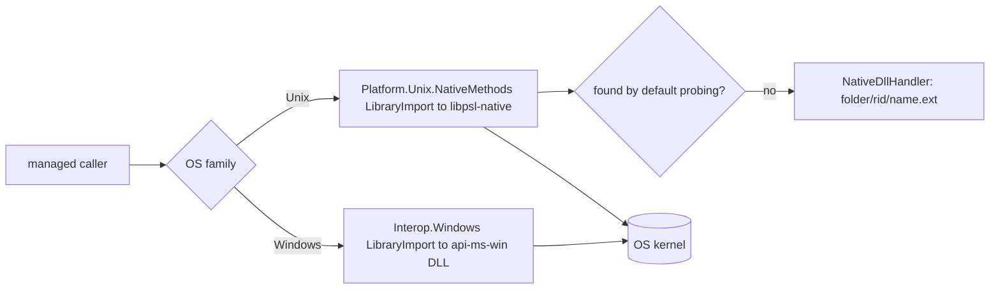

# Native interop and the native libraries

> STATIC-ONLY — behavior not run-verified. `FACT-SRC` unless marked. Scope `EXTENDED`. The OS split that decides which native layer is compiled: [windows-unix-split](windows-unix-split.md). Managed assembly loading: [modules](../03-runtime/modules.md).

## 1. Purpose and scope [SPEC]

The engine reaches the OS through three kinds of native code: (1) the operating system's own libraries (Win32 API sets on Windows), (2) a small C library `libpsl-native` on Linux and macOS, and (3) Windows-only native components that ship as a package (WinRM plugin, ETW provider, `Microsoft.PowerShell.Native`). This document describes how each is declared, marshalled, loaded and tested, and where the sources live. The native C source is **not in this repository** (see §4).

## 2. Source map

| path | type | role | tier |
|---|---|---|---|
| src/System.Management.Automation/CoreCLR/CorePsPlatform.cs::Platform.Unix.NativeMethods@L935-L1122 | internal static partial class | 17 `LibraryImport` entries into `libpsl-native` (Unix) | B |
| src/System.Management.Automation/engine/Interop/Windows/ | folder (33 files) | one small file per Win32 function, `Interop.Windows` partial class, source-generated marshalling | B |
| src/System.Management.Automation/utils/PInvokeDllNames.cs::PinvokeDllNames@L13-L140 | internal static class | 125 string constants naming API-set DLLs | B |
| src/System.Management.Automation/utils/PlatformInvokes.cs::PlatformInvokes@L11-L678 | internal static class | older `DllImport`-era structs, enums and safe handles (FILETIME, STARTUPINFO, privileges) | B |
| src/System.Management.Automation/utils/tracing/SysLogProvider.cs::SysLogProvider.NativeMethods@L370-L532 | nested class | `DllImport` of syslog wrappers (`Native_SysLog`, `Native_OpenLog`, `Native_CloseLog`) | B |
| src/System.Management.Automation/CoreCLR/CorePsAssemblyLoadContext.cs::PowerShellAssemblyLoadContext@L19-L565 | internal sealed class | last-resort native library resolver | B |
| src/System.Management.Automation/engine/remoting/common/RunspaceConnectionInfo.cs::SSHConnectionInfo@L1928-L2942 | public sealed class | Unix `ForkAndExecProcess` for the SSH child process | B |
| src/libpsl-native/README.md, src/powershell-native/README.md | readme | state that the code moved to the PowerShell-native repository | B |

## 3. Responsibilities and non-responsibilities

Owns: the declaration style, naming of native entry points, the pinned native package, the native library search rule, and the test hooks. Does not own: the C source of `libpsl-native` or the Windows native components (separate repository; this tree holds only two notices), the behavior built on top of the calls (see the subsystem documents), or WSMan protocol details ([transports](../05-remoting/transports.md)).

## 4. Key types and contracts [IMPL]

- **Where the native code lives.** `src/libpsl-native/` and `src/powershell-native/` contain only a README each; both say the code is being migrated to the `PowerShell-native` repository and that new pull requests go there. The engine takes the binaries from the NuGet package `Microsoft.PowerShell.Native` version `700.0.2` (src/System.Management.Automation/System.Management.Automation.csproj@L44-L46). `docs/building/internals.md` names `libpsl-native.so/.dylib` as the Unix dependency and `pwrshplugin.dll` as the WinRM plugin and says they are built once and consumed as packages. The package contents and the C source are `UNVERIFIED` (VB-074).
- **Unix: `libpsl-native`.** The class `Platform.Unix.NativeMethods` declares `private const string psLib = "libpsl-native"` and 17 `LibraryImport` entries: `GetErrorCategory`, `GetPPid`, `GetLinkCount`, `IsExecutable`, `GetCurrentThreadId`, `KillProcess`, `WaitPid`, `SetDate`, `CreateSymLink`, `CreateHardLink`, `GetUserFromPid`, `IsSameFileSystemItem`, `GetInodeData`, `GetCommonLStat`, `GetCommonStat`, `GetPwUid`, `GetGrGid`. String marshalling is UTF-8 (`StringMarshalling.Utf8`); the file comment says "Ansi is a misnomer, it is hardcoded to UTF-8 on Linux and macOS". C `bool` is one byte, so returns are marked `UnmanagedType.I1` where the native side returns a C `bool` and `UnmanagedType.Bool` for `KillProcess`/`WaitPid` (a mixed convention in the same class; the native header decides, `UNVERIFIED`). Calls that report errors use `SetLastError = true` (`GetLinkCount`, `SetDate`, `GetCommonLStat`, `GetCommonStat`) (src/System.Management.Automation/CoreCLR/CorePsPlatform.cs::Platform.Unix.NativeMethods@L935-L1122).
- **Struct contracts with C.** `UnixTm` (9 ints, `Pack = 4`) mirrors `private_tm` in the native `setdate.h`; `CommonStatStruct` presents "each member of the stat structure as the largest type of that member across all stat structures on the platforms we support" (22 fields: inode, mode, ids, counts, sizes, three times, block size, device, blocks, seven item-kind flags and three mode flags). These layouts are a hand-kept ABI: there is no generated header. A changelog entry (6.1) records a memory-corruption bug in `SetDate` caused by exactly this kind of mismatch (CHANGELOG/6.1.md line 433).
- **Syslog and process spawn.** Syslog wrappers are `DllImport` with `CharSet.Ansi` and explicit `EntryPoint` names (`Native_SysLog`, `Native_OpenLog`, `Native_CloseLog`). SSH child-process creation on Unix calls `ForkAndExecProcess` (`DllImport("libpsl-native", CharSet.Ansi, SetLastError = true)`) with null-terminated `argv`/`envp` arrays built by hand in unmanaged memory and freed in a `finally` (src/System.Management.Automation/engine/remoting/common/RunspaceConnectionInfo.cs@L2355-L2600). Hence **two declaration styles** exist on the Unix side: source-generated `LibraryImport` (new) and runtime-marshalled `DllImport` (older).
- **Windows: API sets and per-function files.** New Win32 declarations are one file each under `engine/Interop/Windows/` (33 files such as `CreateHardLink.cs`, `FindFirstFile.cs`, `CoInitializeEx.cs`, `GetOEMCP.cs`, `NetShareEnum.cs`, `WNetAddConnection2.cs`). Each is `#nullable enable`, in `internal static partial class Interop.Windows`, uses `[LibraryImport("api-ms-win-…dll", EntryPoint = "…W", StringMarshalling = Utf16, SetLastError = true)]` and, where a handle is returned, a `SafeHandle` subclass (`SafeFindHandle` in `FindFirstFile.cs`). The DLL names are API-set contracts (`api-ms-win-core-file-l2-1-0.dll`), not `kernel32.dll`, so the code binds to the OneCore surface. 51 of those files set `SetLastError` (grep count, APPROX). The 125 constants in `PinvokeDllNames` hold the same API-set names for the older `DllImport` declarations (note its numbering comments skip `/*29*/`) (src/System.Management.Automation/utils/PInvokeDllNames.cs::PinvokeDllNames@L13-L140).
- **Counts (APPROX, grep).** `DllImport(` 282 and `LibraryImport(` 78 occurrences in 66 files under `src/`. Biggest `DllImport` files: `Microsoft.PowerShell.CoreCLR.Eventing/.../UnsafeNativeMethods.cs` (46), `security/nativeMethods.cs` (44), `ConsoleControl.cs` (32), `WSManNativeAPI.cs` (26), `PdhHelper.cs` (23), `security/Win32Native/WinTrust.cs` (18), `PlatformInvokes.cs` (14). Of the `LibraryImport` entries, 32 are under `System.Management.Automation/engine` (the Interop folder).
- **Native library search.** The engine registers `AssemblyLoadContext.Default.ResolvingUnmanagedDll += NativeDllHandler` as a "last resort" (the comment lists the default order: `DllImportResolver` callbacks, then `LoadUnmanagedDll`, then this event). `NativeDllHandler(Assembly, libraryName)` builds `<folder of the calling assembly>/<rid>/<libraryName><ext>` with `rid` = `win-`, `linux-` or `osx-` plus the lower-case process architecture and `ext` = `.dll`, `.so`, `.dylib`, and loads it with `NativeLibrary.TryLoad`; failure returns `IntPtr.Zero` (src/System.Management.Automation/CoreCLR/CorePsAssemblyLoadContext.cs::PowerShellAssemblyLoadContext.NativeDllHandler@L243-L250 and GetNativeDllSubFolderName@L539-L563). This rule lets a module ship per-RID native libraries beside its managed assembly. The default probing (app directory) is what finds `libpsl-native` itself (`UNVERIFIED`, VB-074).
- **Native assembly loading from memory.** `PowerShellUnsafeAssemblyLoad.LoadAssemblyFromNativeMemory` is an `UnmanagedCallersOnly` entry that lets a native host hand a managed assembly image to the engine; the xUnit test calls it through an `unmanaged` function pointer (src/System.Management.Automation/CoreCLR/CorePsAssemblyLoadContext.cs::PowerShellUnsafeAssemblyLoad@L596-L625; test: test/xUnit/csharp/test_NativeInterop.cs).

## 5. Data model

Marshalled structures: `UnixTm`, `CommonStatStruct` (Unix); `FILETIME`, `STARTUPINFO`, `PROCESS_INFORMATION`, `SECURITY_ATTRIBUTES`, `TOKEN_PRIVILEGE`, `LUID`, `PRIVILEGE_SET` and flag enums (Windows, `PlatformInvokes.cs`). Safe handles: `SafeFindHandle`, `SafeLocalMemHandle`. Strings are UTF-8 (Unix) or UTF-16 (Windows, `…W` entry points).

## 6. Control flow

## 7. Algorithms

Native resolver path building (§4). Stat conversion: the native call fills `CommonStatStruct`; the managed side copies fields, converts seconds since epoch to local `DateTime` with an exception fallback, and chooses `ItemType` by the first flag equal to 1 in the order directory, file, symbolic link, block device, character device, named pipe, otherwise socket ([windows-unix-split](windows-unix-split.md) §4).

## 8. Observable behavior [SPEC]

A missing or incompatible `libpsl-native` makes the first Unix call that needs it throw a load error (`DllNotFoundException` or `EntryPointNotFoundException`, `INFERENCE` from the .NET rules); the hosting test `test_HostingBasic.cs` notes that `New-Item -ItemType SymbolicLink` "uses libpsl-native, hence" serves to validate native dependencies. `Assembly.LoadNative.Tests.ps1` builds `<tmp>/testDllNativeFolder/<rid>/nativedll.<ext>` from a runtime host library and checks that the resolver finds it.

## 9. Error handling and edge cases

- Unix calls that fail return non-zero and the managed code reads `Marshal.GetLastWin32Error()` (works for `errno` on Unix) and throws `Win32Exception`; `GetErrorCategory` maps `errno` to `ErrorCategory` in native code.
- `ForkAndExecProcess` failure after the arrays are built is converted to an exception; the arrays are freed on all paths (`finally`).
- `GetNativeDllSubFolderName` returns an empty string on an unknown OS family (for example FreeBSD); the resolver would then probe `<folder>/<name>` with an empty extension (`INFERENCE`).
- On a Windows build, Unix `NativeMethods` is not compiled; on a Unix build, `Interop.Windows` is removed. Both are compile-time facts ([windows-unix-split](windows-unix-split.md) §4).

## 10. Concurrency and threading

The native calls are stateless wrappers. Static caches around them are not synchronized ([windows-unix-split](windows-unix-split.md) §10). `GetCurrentThreadId` returns the OS thread id so ETW and syslog entries correlate with OS tools.

## 11. Extension points and customization hooks

Modules can ship per-RID native libraries under `<module>/<rid>/` and rely on the resolver. The engine itself offers no plug-in point for replacing `libpsl-native`.

## 12. Dependencies

Inbound: file system provider (links, stat, hard-link count), native command processor (executable test, kill, wait), tracing (syslog), SSH transport (process spawn), formatting (user and group names), `Set-Date`. Outbound: .NET interop marshaller, the NuGet package `Microsoft.PowerShell.Native`, the OS C library.

## 13. Performance notes

Source-generated `LibraryImport` avoids runtime IL stub generation and is trim-friendly (`INFERENCE` from the generator's purpose; no measurement). The stat path makes one native call per item plus lazy name lookups with managed caches ([windows-unix-split](windows-unix-split.md) §13).

## 14. Security considerations

- Every native boundary is a place where managed safety checks end: hand-built `argv`/`envp` arrays, fixed struct layouts, `SetDate` writing system time, `KillProcess(pid)`. The engine passes caller-chosen strings (paths, command lines) across it.
- `ForkAndExecProcess` receives `filename`, `argv`, `envp` and a working directory. The managed side builds `envp` from `ProcessStartInfo.Environment` (`CopyEnvVariables`), so the child sees the full parent environment unless the caller changes it.
- The last-resort resolver loads any `<rid>/<name>.<ext>` found beside the calling assembly. Anyone who can write to a module folder can place a native library there (`INFERENCE`); this relies on file-system permissions and signing, not on the resolver.
- No Windows or Unix native call in the files read checks the language mode: enforcement must happen before the call ([Phase 5](../README.md)).

### Security surface

<!--GEN:secseeds-->
No scanner seed hit under the prefixes of this subsystem (`UNVERIFIED`: absence of a hit is not proof of absence of a check).
<!--/GEN:secseeds-->

What the new shell must guarantee here: one reviewed, versioned native surface per OS with generated bindings and layout checks; a native library search rule that does not load from writable locations by default; no caller-controlled string reaches a process-spawn or time-setting call without a policy check.

## 15. Enterprise considerations

Supportability: the Unix half depends on a binary that must match the OS and architecture (`linux-*`, `osx-*` packages); a container image without it breaks links, stat and process control. The native source being in a separate repository splits review and release. Observability: syslog entries carry a commit hash and thread id (see `SysLogProvider` header). Packaging: `tools/packaging/boms/linux.json` and `mac.json` list `libpsl-native.so/.dylib` as required files and `build.psm1` lists the same file as a required dependency for xUnit runs on Unix.

## 16. Tests

<!--GEN:tests-->
| Pester file | Describe | Context | It |
|---|---:|---:|---:|
| `test/powershell/engine/Basic/Assembly.LoadNative.Tests.ps1` | 1 | 0 | 1 |
| `test/powershell/engine/Basic/NativeCommandBytePiping.Tests.ps1` | 1 | 0 | 8 |
| **total (2 files)** | 2 | 0 | 9 |

| xUnit file | Facts | Theories | Classes |
|---|---:|---:|---|
| `test/xUnit/csharp/test_CorePsPlatform.cs` | 12 | 0 | `PlatformTests` |
| `test/xUnit/csharp/test_NativeInterop.cs` | 1 | 0 | `NativeInterop`, `Utt` |

Matching is by path keyword (`APPROX`): `Assembly.LoadNative`, `NativeCommandBytePiping`, `test_NativeInterop`, `test_CorePsPlatform`.
<!--/GEN:tests-->

## 17. Design decisions and trade-offs

- `FACT-SRC`: a small native library supplies POSIX calls .NET does not expose (link count, inode, `setdate`, user and group names, `errno` mapping); the alternative of calling libc directly was not taken (the reason is not recorded in the files read).
- `FACT-SRC`: new Windows bindings are split one function per file with source generation; old bindings remain in `PlatformInvokes.cs` and large `DllImport` files, so the code base carries three generations of interop style.
- `FACT-SRC`: native code moved out of the main repository and arrives as a package, which speeds builds ("the native component code seldom changes", `docs/building/internals.md`) at the cost of hand-kept struct layouts on the managed side.
- `INFERENCE`: API-set DLL names keep the Windows build portable across SKUs (Nano, IoT, desktop), which fits the headless-SKU queries in [windows-unix-split](windows-unix-split.md).

## 18. Guidance for the new shell [LESSON]

- **LSN-NAT-01** [REDESIGN] (area: NLD-PLAT) Keep one small native surface per OS with generated bindings and a layout check in CI, instead of hand-copied structs. Evidence: src/System.Management.Automation/CoreCLR/CorePsPlatform.cs::Platform.Unix.NativeMethods@L935-L1122. DEV: DEV-PLAT-231.
- **LSN-NAT-02** [REPLICATE] (area: NLD-PLAT) One file per native function, source-generated marshalling, `SafeHandle` for owned handles, UTF-16 on Windows and UTF-8 on Unix. Evidence: src/System.Management.Automation/engine/Interop/Windows/FindFirstFile.cs.
- **LSN-NAT-03** [ADAPT] (area: NLD-PLAT) Pick one interop style (source-generated) and one `bool` marshalling convention per class; do not let three generations coexist. Evidence: src/System.Management.Automation/CoreCLR/CorePsPlatform.cs::Platform.Unix.NativeMethods@L935-L1122.
- **LSN-NAT-04** [REDESIGN] (area: NLD-SEC) Native library resolution must prefer the application directory and a signed or pinned per-RID folder, and refuse writable locations unless a policy allows them. DEV: DEV-PLAT-232. Evidence: src/System.Management.Automation/CoreCLR/CorePsAssemblyLoadContext.cs::PowerShellAssemblyLoadContext.NativeDllHandler@L243-L250.

## 19. Open questions / UNVERIFIED items

- `UNVERIFIED` (VB-074): the C source and exported symbol list of `libpsl-native` (not in this tree); the contents of the `Microsoft.PowerShell.Native` package; how default probing finds `libpsl-native` in the publish layout; the Windows native components (`pwrshplugin.dll`, ETW provider) beyond the names in `docs/building/internals.md`.
- `UNVERIFIED` (VB-075): the bodies of the 33 `Interop/Windows` files other than the three sampled (`CoInitializeEx.cs`, `CreateHardLink.cs`, `FindFirstFile.cs` header), `security/nativeMethods.cs`, `WinTrust.cs`, `ConsoleControl.cs`, `WSManNativeAPI.cs`, `PdhHelper.cs`, `UnsafeNativeMethods.cs`.
- `UNVERIFIED`: whether `ForkAndExecProcess` is used by anything besides the SSH transport; the exact end of the Unix process-creation region.

Verification: `CorePsPlatform.cs` lines 1–1125 read in full; `PInvokeDllNames.cs` read in full; `PlatformInvokes.cs` only the type list; `CorePsAssemblyLoadContext.cs` lines 98–108, 205–260, 300–370, 539–566 read; `RunspaceConnectionInfo.cs` lines 2355, 2401, 2490–2525, 2585–2600 read; `SysLogProvider.cs` header and `NativeMethods` entry names via grep; `CoInitializeEx.cs`, `CreateHardLink.cs` and the head of `FindFirstFile.cs` read; the two README stubs and `docs/building/internals.md` lines 100–125 read; `test_NativeInterop.cs` lines 10–60 and `Assembly.LoadNative.Tests.ps1` lines 1–40 read. Counts are from `grep` over `src/`. Test counts from `data/tests.json` through `tools/gen_T3.py`.
