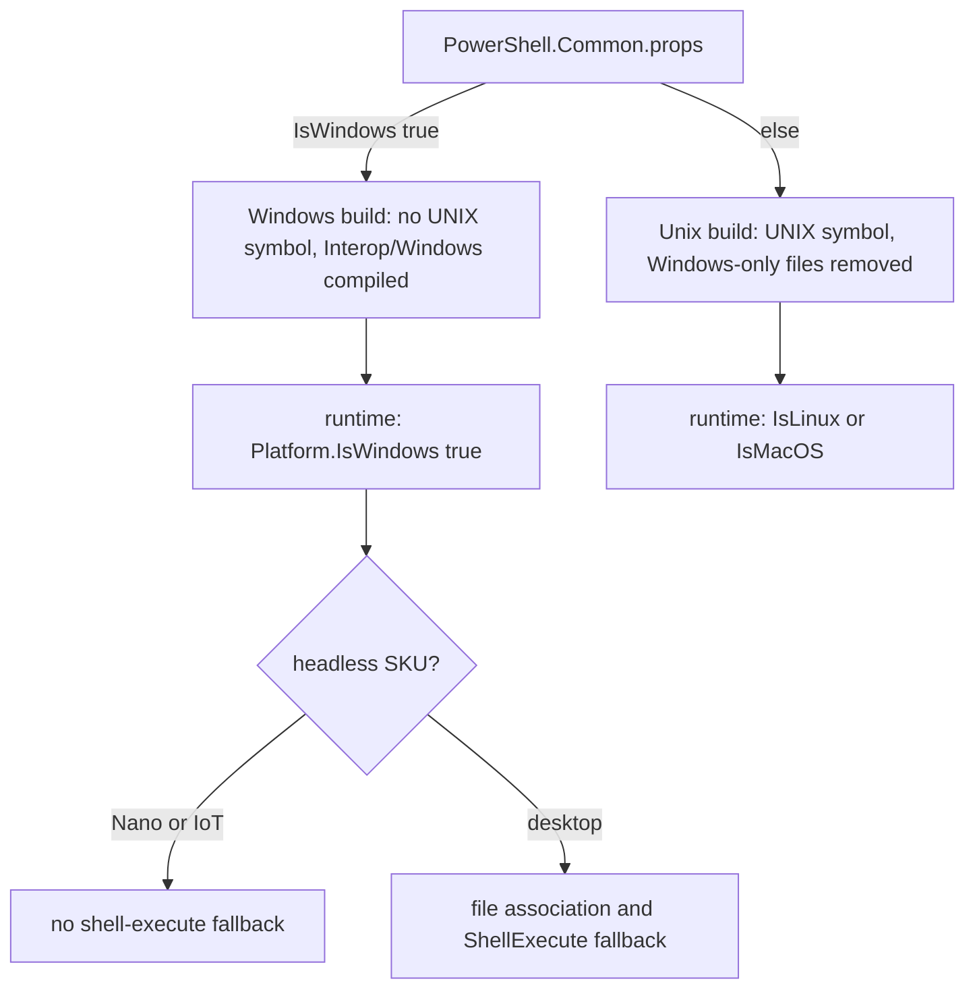

# Windows and Unix platform split

> STATIC-ONLY — behavior not run-verified. `FACT-SRC` unless marked. Scope `EXTENDED`. The native layer behind the Unix half: [native-interop](native-interop.md). Hosting differences: [console-host](../04-hosting/console-host.md). Native command launch: [command-discovery-and-invocation](../03-runtime/command-discovery-and-invocation.md).

## 1. Purpose and scope [SPEC]

PowerShell 7 runs on Windows, Linux and macOS from one code base. This document records *how* the code base is divided: which decisions are made at build time, which at run time, what the `Platform` class offers, and which engine behaviors differ per OS. It is the input for the new shell's decision on how to isolate OS differences (LSN-PLAT-01 to LSN-PLAT-04).

## 2. Source map

| path | type | role | tier |
|---|---|---|---|
| src/System.Management.Automation/CoreCLR/CorePsPlatform.cs::Platform@L16-L1124 | public static partial class | runtime platform queries, directories, `NonWindows*` shims | B |
| src/System.Management.Automation/CoreCLR/CorePsPlatform.cs::Platform.Unix@L507-L1123 | internal static partial class | stat model, `/proc` parent lookup, native method table | B |
| src/System.Management.Automation/CoreCLR/CorePsPlatform.cs::XDG_Type@L298-L312 | public enum | directory kinds for XDG lookup | B |
| PowerShell.Common.props@L164-L172 | build props | defines `CORECLR`; defines `UNIX` when `IsWindows` is not true | B |
| src/System.Management.Automation/System.Management.Automation.csproj@L61-L76 | build file | removes Windows-only or Unix-only source files per OS | B |
| data/conditional-compilation.json | generated data | files and types that use each preprocessor symbol | B |
| src/System.Management.Automation/engine/NativeCommandProcessor.cs | class | native command launch, file-association fallback, exit-code text | B |
| src/System.Management.Automation/namespaces/FileSystemProvider.cs | class | links, name rules, open-with-default-app, mapped drives | B |
| src/System.Management.Automation/security/SecurityManager.cs, security/SecuritySupport.cs | classes | origin (zone) check, execution policy store | B |
| src/System.Management.Automation/engine/PSConfiguration.cs | class | `powershell.config.json`; syslog identity and keywords on Unix | B |
| src/System.Management.Automation/CoreCLR/CorePsAssemblyLoadContext.cs::PowerShellAssemblyLoadContext | internal sealed class | managed and native load rules; GAC fallback only on Windows | B |

## 3. Responsibilities and non-responsibilities

Owns: the two-level split (preprocessor symbol and runtime query), the platform class, the per-OS directory rules, and the places where behavior is intentionally different. Does not own: the P/Invoke declarations and the native library ([native-interop](native-interop.md)); WSMan and SSH transport differences ([transports](../05-remoting/transports.md)); language-mode and policy enforcement ([Phase 5](../README.md)).

## 4. Key types and contracts [IMPL]

- **Two switches, not one.** (1) *Build time*: `PowerShell.Common.props` defines `CORECLR` for every build and adds `UNIX` when `IsWindows` is not `true`; `IsWindows` is true if set to true or if `$(OS)` is `Windows_NT` (PowerShell.Common.props@L164-L172). The engine assembly is therefore **built per OS family**: a Linux assembly does not contain the Windows branches, and a Windows assembly does not contain the Unix branches. (2) *Run time*: `Platform.IsLinux`, `IsMacOS`, `IsWindows` forward to `OperatingSystem.IsLinux/IsMacOS/IsWindows`; `IsCoreCLR` is the constant `true` (src/System.Management.Automation/CoreCLR/CorePsPlatform.cs::Platform@L16-L1124).
- **Counts (APPROX, grep and generated data).** `data/conditional-compilation.json` lists the `UNIX` symbol in 122 files and 247 types. A line count of `#if UNIX` and `#if !UNIX` under `src/` gives 390 directives in 121 files. `Platform.IsWindows` appears 39 times in 24 files. The attributes `DllImport(` (282) and `LibraryImport(` (78) appear in 66 files (see [native-interop](native-interop.md)).
- **Source removal per OS.** On non-Windows builds the project removes `engine\COM`, `engine\ComInterop`, `ExtraAdapter.cs`, `engine\Interop\Windows`, `ManagementObjectAdapter.cs` and five remoting command files (`ConnectPSSession.cs`, `CustomShellCommands.cs`, `DisconnectPSSession.cs`, `ReceivePSSession.cs`, `TestPSSessionConfigurationFile.cs`). On Windows builds it removes `engine\Interop\Unix`; **no such directory exists in this tree** (only `engine/Interop/Windows`, 33 files), so that line is a leftover or a reserved path (`INFERENCE`). Windows builds also reference the project `Microsoft.PowerShell.CoreCLR.Eventing` (src/System.Management.Automation/System.Management.Automation.csproj@L25-L27 and @L61-L76). Consequence: `Register-PSSessionConfiguration` and the other session-configuration registration cmdlets (see [jea](../05-remoting/jea.md)) **do not exist on Unix builds**; Unix remoting uses SSH.
- **Windows SKU queries.** `IsNanoServer`, `IsIoT`, `IsWindowsDesktop` read the registry (`...\Server\ServerLevels` value `NanoServer`; `...\CurrentVersion` value `ProductName` equal to `IoTUAP`) once and cache the result; on Unix they return `false`. `IsWindowsDesktop` is `!IsNanoServer && !IsIoT`. `IsStaSupported` is `false` on Unix; on Windows it calls `CoInitializeEx(STA)`, balances it with `CoUninitialize` when it succeeds, and reports success unless the result is `E_NOTIMPL` (src/System.Management.Automation/CoreCLR/CorePsPlatform.cs::Platform@L16-L1124).
- **Directories.** On Windows, cache is `LocalApplicationData\Microsoft\PowerShell` and config is `Personal\PowerShell` (via `SafeDeriveFromSpecialFolder`, which returns an empty string when the base path is blank). On Unix, `SelectProductNameForDirectory(XDG_Type)` honours `XDG_CONFIG_HOME`, `XDG_DATA_HOME`, `XDG_CACHE_HOME` and otherwise uses `~/.config/powershell`, `~/.local/share/powershell` (+`Modules`), `~/.cache/powershell`; shared modules are the fixed path `/usr/local/share/powershell/Modules`; default-path directories are created on demand; an `UnauthorizedAccessException` returns the empty string, which makes the process working directory the fallback. `XDG_DATA_DIRS` is a documented TODO (issue 1060). If `HOME` is unset, a temporary home `pwsh-<user>-98288ff9-5712-4a14-9a11-23693b9cd91a` is created under the temp path (src/System.Management.Automation/CoreCLR/CorePsPlatform.cs::Platform.SelectProductNameForDirectory@L317-L390). The home variable name differs: `HOME` on Unix, `USERPROFILE` on Windows (`CommonEnvVariableNames.Home`).
- **`Platform.GetFolderPath` on Unix** supports only `ProgramFiles` (returns `/bin` if present) and `MyDocuments` (home); any other special folder throws `NotSupportedException` (src/System.Management.Automation/CoreCLR/CorePsPlatform.cs::Platform.GetFolderPath@L396-L408).
- **`NonWindows*` shim pattern.** `NonWindowsIsHardLink`, `NonWindowsGetUserFromPid`, `NonWindowsInternalGetLinkType`, `NonWindowsCreateSymbolicLink`, `NonWindowsCreateHardLink`, `NonWindowsSetDate`, `NonWindowsIsSameFileSystemItem`, `NonWindowsGetInodeData`, `NonWindowsIsExecutable`, `NonWindowsGetThreadId`, `NonWindowsGetProcessParentPid`, `NonWindowsKillProcess`, `NonWindowsWaitPid` keep Unix code out of Windows-origin source files. The file's own comment states the rule: use them only behind an `IsWindows` query. The parent pid comes from the native library on macOS and from `/proc/<pid>/status` (`PPid:\t` line) on Linux; failure returns `-1`.
- **`CommonStat` model.** The Unix stat structure is copied into a managed class (inode, mode, uid, gid, link count, size, three times, block size, device, blocks, item type, setuid/setgid/sticky). `GetModeString()` returns an `ls`-style string with fast paths for three common modes (`-r--r--r--`, `-rw-r--r--`, `drwxr-xr-x`). Times that overflow fall back to the Unix epoch (a note names Raspbian). User and group names are resolved lazily through two **static, unsynchronized** `Dictionary` caches (src/System.Management.Automation/CoreCLR/CorePsPlatform.cs::Platform.Unix.CommonStat@L587-L745).

## 5. Data model

No persistent model. Two global facts decide behavior: the compile-time symbol (fixed per assembly) and the cached runtime queries (`IsNanoServer`, `IsIoT`, `IsWindowsDesktop`, `IsStaSupported`; computed once per process). Per-process static caches on Unix: user-name map, group-name map, temp home string.

## 6. Control flow

## 7. Algorithms

Directory selection (§4). Native command executability: Unix asks the native library (`Platform.NonWindowsIsExecutable`); Windows compares the file extension with `PATHEXT` (default list `.exe .com .bat .cmd` when the variable is empty) (src/System.Management.Automation/engine/NativeCommandProcessor.cs::NativeCommandProcessor.IsExecutable@L1892-L1921). Command-name expansion adds each `PATHEXT` suffix only on Windows (`#if !UNIX` in `CommandSearcher`, around L1346). Everything else is selection by symbol; no algorithm of note.

## 8. Observable behavior [SPEC]

Behavior differences found in the code read (each `FACT-SRC`, run behavior `UNVERIFIED`):

| area | Windows | Unix |
|---|---|---|
| native command fails to start | if the SKU is a desktop, look up the file association (`FindExecutable`), choose argument mode via `IsWindowsApplication`, allocate a hidden console when needed, then retry; headless SKU rethrows | rethrow the `Win32Exception` |
| non-zero exit text | exit code shown as `0x{0:X8}` | `0x{0:X2}` |
| screen scraping for minishell error stream | probed via the host raw UI | disabled (`false`) |
| child cleanup on dispose | background GUI apps keep running | the child is killed unless it runs in the background |
| `Invoke-Item` | `UseShellExecute` only on desktop SKUs | directories and non-executable files use `UseShellExecute` (xdg-open or open); a permission-denied (13) on start triggers that fallback |
| links | `WinCreateSymbolicLink`, `CreateHardLink`; failure code 1314 = elevation required | native library; elevation message when the error category is `PermissionDenied` |
| forbidden characters in remote-supplied item names | `\` `/` `:` | `\` `/` |
| mapped network drives | supported | `PlatformNotSupportedException` |
| `Set-ExecutionPolicy` store | registry or policy file | `PlatformNotSupportedException` |
| origin check (`IsLocalFile`) | security zone (MyComputer, Intranet, Trusted are local) | always local (no zone concept) |
| OEM encoding | code page from `GetOEMCP` | `Encoding.Default` |
| thread id | `GetCurrentThreadId` | native library call |
| break handler | console control handler (`ConsoleControl`) | `Console.CancelKeyPress` |
| `-File` target | run by path | a file without `.ps1` is read as text and run as a script (shebang support) |
| virtual terminal | n/a | DECCKM is switched on when the terminal supports VT |
| logging sink | ETW | syslog (`PSSysLogProvider`, `GetSysLogIdentity`, default keywords in config) |
| assembly load | GAC fallback (`TryFindInGAC`) | none |
| `STA` threads | supported if COM allows | not supported |

Sources: src/System.Management.Automation/engine/NativeCommandProcessor.cs@L798-L830, @L1176-L1200, @L1408-L1430, @L1492-L1520, @L1855-L1921; src/System.Management.Automation/namespaces/FileSystemProvider.cs@L595-L606, @L1348-L1385, @L2393-L2423, @L5000-L5010; src/System.Management.Automation/security/SecurityManager.cs@L416-L433; src/System.Management.Automation/security/SecuritySupport.cs@L136-L145; src/System.Management.Automation/utils/PsUtils.cs@L103-L110; src/System.Management.Automation/utils/ClrFacade.cs@L116-L130; src/Microsoft.PowerShell.ConsoleHost/host/msh/ConsoleHost.cs@L1338-L1350, @L2028-L2042, @L2650-L2660.

## 9. Error handling and edge cases

- Directory creation failures on Unix are swallowed into an empty path: the process working directory then becomes the profile or cache location. This is silent (`INFERENCE`: a read-only home produces files in the current directory).
- `Win32Exception(Marshal.GetLastWin32Error())` is used on Unix too; the file comment states .NET maps `errno` to the message, so no manual mapping is needed. `Platform.Unix.GetErrorCategory(errno)` calls the native library to map `errno` to `ErrorCategory`.
- Stat time conversion catches any exception and substitutes the epoch.
- `IsHardLink` returns `false` for missing paths and directories and throws `Win32Exception` when the native call fails.

## 10. Concurrency and threading

Windows SKU flags use a nullable-bool cache without a lock (a benign race: same value). `IsStaSupported` and the cache directories are `Lazy`/static-initialized. The Unix user-name and group-name dictionaries are plain `Dictionary<int,string>` with `Add` after `TryGetValue`: two threads formatting `Get-ChildItem` output at once can race (`INFERENCE`, not reproduced; `UNVERIFIED`, VB-072).

## 11. Extension points and customization hooks

None for end users. Contributors add Unix-only code behind `#if UNIX` and put the shim in `Platform`. Environment variables `XDG_*` and `HOME` steer Unix paths. `powershell.config.json` carries the syslog identity and keywords on Unix.

## 12. Dependencies

Inbound: nearly every subsystem that touches files, processes, consoles, links, logging or security zones. Outbound: .NET `OperatingSystem`, `Microsoft.Win32.Registry` (Windows), `libpsl-native` (Unix), `Interop.Windows` P/Invokes (Windows).

## 13. Performance notes

Mode-string fast paths and name caches exist to avoid P/Invoke per file when listing directories; the code comment says user and group lookups are done lazily "so we don't need to have a pinvoke for each file".

## 14. Security considerations

- Zone-based origin checks have **no Unix equivalent**: every file counts as local, so `RemoteSigned` semantics reduce to "no check" there (`INFERENCE` from `IsLocalFile`; the execution-policy read path on Unix is `UNVERIFIED`, VB-072).
- Execution policy cannot be set on Unix (`PlatformNotSupportedException`); policy there comes from other means (`UNVERIFIED`).
- Name rules for remote-supplied file names differ (`:` forbidden only on Windows because of alternate data streams), so a name safe on one OS is not safe on the other.
- Process kill on dispose (Unix) is a resource-safety measure; Windows leaves GUI children running.

### Security surface

<!--GEN:secseeds-->
| Category | Seed hits |
|---|---:|
| execution-policy | 76 |
| signature | 39 |
| amsi | 25 |
| trust-boundary | 8 |
| app-control | 1 |
| **total** | 149 |

Files with most hits:

| File | Hits |
|---|---:|
| `src/System.Management.Automation/security/SecuritySupport.cs` | 94 |
| `src/System.Management.Automation/security/SecurityManager.cs` | 55 |

These are regex scanner hits (`APPROX`, `verified: false`, no `SEC-ENF` ID yet). Phase 5 verifies them and assigns IDs; none is claimed here as an enforcement point.
<!--/GEN:secseeds-->

What the new shell must guarantee here: security decisions must not silently weaken per OS. Where an OS lacks a concept (zones, registry policy), the shell must define an equivalent or state "not enforced" in one place and report it through the status API.

## 15. Enterprise considerations

Config and cache locations follow XDG on Unix and known folders on Windows, which matters for roaming profiles and containers (read-only home). Logging goes to ETW or syslog, not to one portable sink. Remoting differs by OS (WSMan and endpoint registration only on Windows; SSH on both).

## 16. Tests

<!--GEN:tests-->
| Pester file | Describe | Context | It |
|---|---:|---:|---:|
| `test/powershell/Host/Base-Directory.Tests.ps1` | 2 | 2 | 2 |
| `test/powershell/Language/Scripting/NativeExecution/NativeCommandProcessor.Tests.ps1` | 6 | 0 | 15 |
| `test/powershell/Language/Scripting/NativeExecution/NativeLinuxCommands.Tests.ps1` | 2 | 0 | 8 |
| `test/powershell/Language/Scripting/NativeExecution/NativeUnixGlobbing.Tests.ps1` | 1 | 0 | 17 |
| `test/powershell/Modules/Microsoft.PowerShell.Management/FileSystem.Tests.ps1` | 12 | 26 | 146 |
| `test/powershell/Modules/Microsoft.PowerShell.Security/ExecutionPolicy.Tests.ps1` | 5 | 8 | 21 |
| **total (6 files)** | 28 | 36 | 209 |

| xUnit file | Facts | Theories | Classes |
|---|---:|---:|---|
| `test/xUnit/csharp/test_CorePsPlatform.cs` | 12 | 0 | `PlatformTests` |
| `test/xUnit/csharp/test_FileSystemProvider.cs` | 9 | 0 | `FileSystemProviderTests` |
| `test/xUnit/csharp/test_PSConfiguration.cs` | 15 | 0 | `PowerShellPolicyFixture`, `PowerShellPolicyTests` |

Matching is by path keyword (`APPROX`): `FileSystem.Tests`, `NativeCommandProcessor`, `NativeLinuxCommands`, `NativeUnixGlobbing`, `Base-Directory`, `ExecutionPolicy.Tests`, `test_CorePsPlatform`, `test_FileSystemProvider`, `test_PSConfiguration`.
<!--/GEN:tests-->

## 17. Design decisions and trade-offs

- `FACT-SRC`: build-time split removes dead code and avoids shipping Windows P/Invokes on Unix, at the price of **one managed assembly per OS family** and 390 conditional blocks that are only compiled on one OS (so a Windows-only developer cannot compile-check the Unix branches).
- `FACT-SRC`: runtime queries (`OperatingSystem.*`) are used where both branches must compile on both OSes (for example `GetNativeDllSubFolderName`, `NonWindowsGetProcessParentPid`).
- `FACT-SRC`: the `NonWindows*` shims keep the original Windows files readable and move Unix code to one class (the file comment gives this as the reason).
- `INFERENCE`: because some Windows-only features (COM, WMI adapter, session-configuration registration) are removed by file, the public surface differs per OS without a single capability table.

## 18. Guidance for the new shell [LESSON]

- **LSN-PLAT-01** [REDESIGN] (area: NLD-PLAT) Isolate OS differences behind one platform interface (paths, process launch, links, console, logging, identity) with a runtime capability table, and keep conditional compilation for the interface implementations only. Evidence: src/System.Management.Automation/CoreCLR/CorePsPlatform.cs::Platform@L16-L1124. DEV: DEV-PLAT-230.
- **LSN-PLAT-02** [REPLICATE] (area: NLD-PLAT) Honour XDG directories on Unix and known folders on Windows, create on demand, and report (not hide) a failure to create them. Evidence: src/System.Management.Automation/CoreCLR/CorePsPlatform.cs::Platform.SelectProductNameForDirectory@L317-L390.
- **LSN-PLAT-03** [REDESIGN] (area: NLD-SEC) Define the security-zone and execution-policy concept for every OS the shell supports, or declare it unsupported through one status API. DEV: DEV-PLAT-233. Evidence: src/System.Management.Automation/security/SecurityManager.cs@L416-L433.
- **LSN-PLAT-04** [ADAPT] (area: NLD-PLAT) Replace unsynchronized static caches for lazily resolved OS data with a concurrent map or a per-call lookup. Evidence: src/System.Management.Automation/CoreCLR/CorePsPlatform.cs::Platform.Unix.CommonStat@L587-L745.

## 19. Open questions / UNVERIFIED items

- `UNVERIFIED` (VB-072): the execution-policy read path on Unix, other `UNIX` branches in `SecuritySupport.cs` (lines 282–428, 1344–1655), `Utils.cs`, `ProviderBase.cs`, `CommandDiscovery.cs`; Unix-only `FileSystemProvider` blocks other than those listed in §8; the rest of the 390 conditional blocks; whether the user-name cache race is reachable.
- `UNVERIFIED` (VB-073): Windows-only behavior of `Process.cs`, `Service.cs`, `Computer.cs` (`ComputerUnix.cs` exists for Unix); how the build selects the `IsWindows` property in CI and packaging (`build.psm1` was not read for this).

Verification: `CorePsPlatform.cs` lines 1–1125 were read in full; `PowerShell.Common.props` lines 160–175; the csproj lines 20–90; `NativeCommandProcessor.cs`, `FileSystemProvider.cs`, `SecurityManager.cs`, `SecuritySupport.cs` (lines 132–145 only), `PSConfiguration.cs` (250–262, 375–383), `PsUtils.cs` (103–110), `ClrFacade.cs` (116–130), `CommandSearcher.cs` (1340–1358), `ConsoleHost.cs` (1338–1350, 2028–2042, 2650–2660), `CorePsAssemblyLoadContext.cs` (98–108, 205–260, 300–370, 539–566) were read in the windows quoted. Counts are from `grep` and `data/conditional-compilation.json`. Test counts from `data/tests.json` through `tools/gen_T3.py`.
