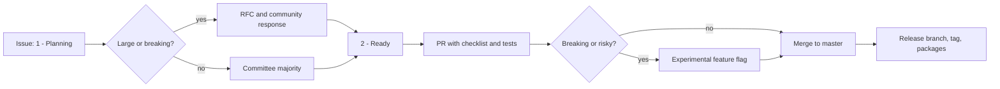

# Engineering and governance processes

> STATIC-ONLY — behavior not run-verified.

## 1. Purpose and scope [SPEC]

The processes around the code: governance and RFCs, pull-request rules, breaking-change policy, the experimental-feature mechanism, release steps and changelogs. Coding standards are in [coding-standards](../01-repository/coding-standards.md); localization in [localization](localization.md); testing in [test-strategy](test-strategy.md).

## 2. Source map

| Path | Role | Tier |
|---|---|---|
| `docs/community/governance.md`, `working-group*.md` | Committee, RFC rules, working groups | C |
| `docs/maintainers/{README,best-practice,issue-management,releasing}.md` | Maintainer processes, label taxonomy, release steps | C |
| `.github/{CONTRIBUTING,PULL_REQUEST_TEMPLATE,CODEOWNERS,SECURITY,SUPPORT}.md|…`, `.github/ISSUE_TEMPLATE/*`, `.github/policies/*` | Contribution and automation policy | C |
| `docs/dev-process/breaking-change-contract.md` | Four-bucket policy | C |
| `src/System.Management.Automation/engine/ExperimentalFeature/*.cs` | Experimental feature runtime | B |
| `CHANGELOG/*.md`, `CHANGELOG.md` | Per-minor changelogs; `CHANGELOG/7.6.md` is current | C |
| `tools/releaseTools.psm1`, `tools/releaseBuild/*` | Changelog and release-tag helpers | C |

## 3. Responsibilities and non-responsibilities

Defines how changes are proposed, reviewed, gated, released and rolled back from user-visible experiments.

## 4. Key types and contracts [IMPL]

- **RFC rule** (`docs/community/governance.md`, "Changes that require an RFC"): new features or capabilities, anything that may be a breaking change under the contract, new modules/cmdlets/parameters in the core modules, and changes to the maintenance process need a written RFC and community response time before work begins; small changes need a simple majority of Committee Members on an issue in the planning state.
- **PR checklist** (`.github/PULL_REQUEST_TEMPLATE.md`): meaningful title (present tense, imperative), copyright header on `.h/.cpp/.cs/.ps1/.psm1`, ready-to-merge or draft, breaking changes none or an experimental feature name, documentation issue for user-facing changes, tests added when existing tests do not cover the change.
- **Breaking-change contract**: four buckets; see coding-standards section 17.
- **Experimental features** (`engine/ExperimentalFeature/ExperimentalFeature.cs`): class `ExperimentalFeature` (`@L18`) with `Name`, `Description`, `Source`, `Enabled`; engine features are registered in the type initializer (`static ExperimentalFeature()@L98`; at this pin the registered engine features are `PSLoadAssemblyFromNativeCode`, `PSSerializeJSONLongEnumAsNumber`, `PSProfileDSCResource`), enabled names come from `powershell.config.json` through `PowerShellConfig.Instance.GetExperimentalFeatures()`; invalid or unavailable names are ignored; `ExperimentalFeature.IsEnabled(name)`@L285 gates behavior; `ExperimentalAttribute(name, ExperimentAction)` (`@L318`, `ExperimentAction` = `None`/`Hide`/`Show` at `@L296-L311`) shows or hides cmdlets and parameters depending on the feature state. Module-defined features are recognized by name format (`IsModuleFeatureName`).
- **Release steps** (`docs/maintainers/releasing.md`): release branch `release-<tag>` in a private repository, build/sign/verify packages, update `CHANGELOG.md` and docs, verify Dockerfiles, create NuGet packages, push the release tag, publish the GitHub release, merge the release branch back, publish Linux packages to YUM/APT, update Homebrew.

## 5. Data model

Labels (`docs/maintainers/issue-management.md`): long-living issue and PR labels, feature areas, operating systems and process tags; process states include `1 - Planning` and `2 - Ready` (`governance.md`).

## 6. Control flow

## 7. Algorithms

Not applicable.

## 8. Observable behavior [SPEC]

Experimental features appear in `Get-ExperimentalFeature` and are toggled by `Enable-ExperimentalFeature`/`Disable-ExperimentalFeature` (both defined in the engine assembly, see [System.Management.Automation](../10-command-modules/System.Management.Automation.md)); effects apply after restarting the session because enabled names are read once in the type initializer (comment in `ExperimentalFeature.cs`: read "when the type is used for the first time"). No golden sample: STATIC-ONLY.

## 9. Error handling and edge cases

Bad config values for experimental features are ignored and exceptions during config read are swallowed after logging (`catch (Exception e) when (LogException(e))`, `ExperimentalFeature.cs` type initializer).

## 10. Concurrency and threading

The enabled-feature set is immutable after type initialization, so reads are thread-safe without locks (design stated in the type-initializer comment).

## 11. Extension points and customization hooks

Add a feature by appending to the engine feature array or declaring one in a module manifest; attribute on cmdlet/parameter picks `Hide`/`Show`.

## 12. Dependencies

`PowerShellConfig` (config file reader), telemetry (`ApplicationInsightsTelemetry` sends activation/deactivation metrics for features: `ExperimentalFeature.cs`), `.github/policies` automation.

## 13. Performance notes

Feature checks are dictionary/bag lookups on an immutable set.

## 14. Security considerations

Experimental features can change parse or runtime behavior but are opt-in per configuration; configuration location and who may edit it are enforcement concerns for Phase 5. Telemetry metrics on feature (de)activation are sent from the engine (opt-out env var documented in CI as `POWERSHELL_TELEMETRY_OPTOUT`, `.github/workflows/linux-ci.yml`).

## 15. Enterprise considerations

Strong: written breaking-change contract, RFC gate, security-SME review rule, experimental flags for risky changes. Gap: process lives in prose, and the release machinery depends on Microsoft-internal infrastructure (see ci-cd document).

## 16. Tests

`test/powershell/engine/ExperimentalFeature/*` (`EnableDisable-ExperimentalFeature`, `ExperimentalFeature.Basic`, `Get-ExperimentalFeature`).

## 17. Design decisions and trade-offs

Experimental flags let behavior changes ship preview-only before becoming contract; the cost is behavior forks in code (`ExperimentalAttribute` checks) and a restart requirement.

## 18. Guidance for the new shell [LESSON]

- **LSN-PROC-01** [REPLICATE] (area: NLD-MOD) Provide a feature-flag mechanism for language and cmdlet changes with attribute-based show/hide and an immutable enabled set per process. Evidence: `src/System.Management.Automation/engine/ExperimentalFeature/ExperimentalFeature.cs@L296-L318`.
- **LSN-PROC-02** [REPLICATE] (area: NLD-TOOL) Gate behavior changes through a written breaking-change contract plus an RFC step before implementation. Evidence: `docs/community/governance.md`; `docs/dev-process/breaking-change-contract.md`.
- **LSN-PROC-03** [ADAPT] (area: NLD-SEC) Keep telemetry off by default in enterprise builds; PowerShell sends feature metrics unless opted out. Evidence: `src/System.Management.Automation/engine/ExperimentalFeature/ExperimentalFeature.cs@L98`.

## 19. Open questions / UNVERIFIED items

- `UNVERIFIED`: how the telemetry opt-out is implemented in code (variable name seen only in workflow env).
- `UNVERIFIED`: whether `API review` is a separate process (no document found by name).

Verification: governance, PR template, releasing and ExperimentalFeature.cs read directly (partial for the latter: lines 18-60, 90-200, 296-330).
