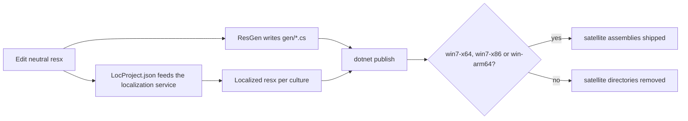

# Localization

> STATIC-ONLY — behavior not run-verified.

## 1. Purpose and scope [SPEC]

How user-facing and error strings are authored, generated into code, translated and shipped.

## 2. Source map

| Path | Role | Tier |
|---|---|---|
| `src/*/resources/*.resx` | Neutral resource files (authoritative strings) | B/C |
| `src/*/resources/<culture>/*.<culture>.resx` | Localized copies, 13 cultures (`cs`, `de`, `es`, `fr`, `it`, `ja`, `ko`, `pl`, `pt-BR`, `ru`, `tr`, `zh-Hans`, `zh-Hant`) | C |
| `src/ResGen/Program.cs` | Generates strongly typed accessor classes into each project `gen/` folder | C |
| `Localize/LocProject.json` | Localization-service project: 1 project, language set `VS_Main_Languages`, 151 source `.resx` items with `CopyOption: LangIDOnPathAndName` | C |
| `docs/dev-process/resx-files.md` | Authoring rules | C |
| `tools/ResxGen` | Helper for resx conversion | C |

## 3. Responsibilities and non-responsibilities

Resource authoring and translation hand-off. Culture selection at run time is the host's job (`ManagedEntrance.cs` sets thread cultures from `NativeCultureResolver`, see [layered-architecture](../00-overview/layered-architecture.md)).

## 4. Key types and contracts [IMPL]

Inventory (`GENERATED`): <!--N:RESX_NEUTRAL_FILES-->150<!--/N--> neutral resx files with <!--N:RESX_NEUTRAL_KEYS-->4169<!--/N--> keys; <!--N:RESX_LOCALIZED_FILES-->1950<!--/N--> localized copies (`APPROX`: all resx minus neutral). `ParserStrings.resx` alone has <!--N:PARSER_ERROR_RESOURCE_KEYS-->412<!--/N--> keys (parser, semantic and compiler error messages; see [ERROR-CATALOG](../02-language/ERROR-CATALOG.md)).
**ResGen** (`src/ResGen/Program.cs`): invoked with no argument it enumerates sibling project folders (`dirs = Directory.EnumerateDirectories("..")`), and for each folder with a `resources` directory writes one C# class per neutral resx into `<project>/gen/<ClassName>.cs`; a resx file named `public.<Name>.resx` produces a `public` class, otherwise `internal`; dotted class names split into namespace and class (`Program.Main`, `GetStronglyTypeCsFileForResx`). With one argument it processes a single resx. `Start-PSBuild` runs it when `src/Microsoft.PowerShell.ConsoleHost/gen` does not exist or `-ResGen` is passed (`build.psm1@L664-L669`).
**Satellite assemblies**: shipped only for `win7-x64`, `win7-x86`, `win-arm64` (non-minimal) builds; other runtimes get `SatelliteResourceLanguages=en` and `System.Management.Automation.resources.dll` directories are removed (`build.psm1@L563-L572`, `@L748-L760`).

## 5. Data model

Resource key -> string; consumers reference `Class.Key` (for example `ParserStrings.<Key>`), which `data/resources.json` indexes with use sites.

## 6. Control flow

## 7. Algorithms

Not applicable.

## 8. Observable behavior [SPEC]

Messages follow the UI culture; the console host sets `CurrentUICulture` first thing in startup (`ManagedEntrance.cs`). Message text is not stable API; error IDs are (see errors documents).

## 9. Error handling and edge cases

A key referenced in code but missing from the resx fails at compile time (strongly typed accessor), which is the point of generation (`INFERENCE`). Localized resx edits must not be made by hand: they are service output (`LangIDOnPathAndName` copy option, `FACT-SRC`; the hand-editing prohibition itself is `INFERENCE`).

## 10. Concurrency and threading

Not applicable.

## 11. Extension points and customization hooks

Add a resx and re-run ResGen; add its path to `Localize/LocProject.json` to get translations.

## 12. Dependencies

Microsoft localization service (external, `UNVERIFIED` which), MSBuild resource embedding (`EmbeddedResource ... ManifestResourceName` in `System.Management.Automation.csproj`).

## 13. Performance notes

Satellite assemblies avoid loading unused cultures; non-Windows packages ship English only.

## 14. Security considerations

Error text can leak paths or script fragments; localized copies are untrusted-by-origin text produced outside the repo and ship as data (no code). No enforcement points.

## 15. Enterprise considerations

13-language coverage for the engine; multi-language support is only partly shipped (MSIX/Windows). Gap for a new product: define which cultures ship on every platform.

## 16. Tests

`test/powershell/engine/ResourceValidation` (directory listing; contents not read, `UNVERIFIED`).

## 17. Design decisions and trade-offs

Typed accessors generated by an in-repo tool instead of MSBuild resource generation, for control over visibility (`public.` prefix) and namespaces (`INFERENCE`).

## 18. Guidance for the new shell [LESSON]

- **LSN-L10N-01** [REPLICATE] (area: NLD-ERR) Keep all diagnostics in resource files keyed by stable IDs, with typed accessors generated at build time. Evidence: `src/ResGen/Program.cs`.
- **LSN-L10N-02** [ADAPT] (area: NLD-TOOL) Ship the same culture set on every platform using standard .NET satellite assemblies, and test messages for localization-safe formatting. Evidence: `build.psm1@L563-L572`.

## 19. Open questions / UNVERIFIED items

- `UNVERIFIED`: contents of `test/powershell/engine/ResourceValidation`.
- `UNVERIFIED`: the translation service behind `LocProject.json`.

Verification: resx counts from `data/resources.json` (neutral) and `files.csv`; `LocProject.json` counted with Python `json` (151 items, 1 project); ResGen read lines 1-80.
