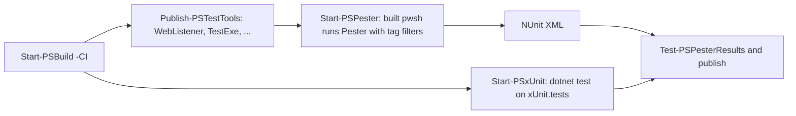

# Test strategy and layout

> STATIC-ONLY — behavior not run-verified. Test files were inventoried (regex extraction; no `pwsh` parser available) and a sample of the runner code was read; no test was executed.

## 1. Purpose and scope [SPEC]

How behavior of the language and engine is specified by tests in this repository, which frameworks and tags are used, how tests are run per platform, and which test tooling exists. This is the model for the new shell's specification-test suite; the language-specific corpus is grouped in [REFERENCE-TEST-CORPUS](../02-language/REFERENCE-TEST-CORPUS.md).

## 2. Source map

| Path | Role | Tier |
|---|---|---|
| `test/powershell/` | Pester tests (PowerShell). Top-level areas: `Host`, `Installer`, `Language` (`Classes`, `Interop`, `Operators`, `Parser`, `Scripting`), `Modules` (one folder per shipped module), `Provider`, `SDK`, `dsc`, `engine` (`Api`, `Basic`, `COM`, `Cdxml`, `ETS`, `ExperimentalFeature`, `Formatting`, `Help`, `Job`, `Module`, `ParameterBinding`, `Remoting`, `ResourceValidation`, `Security`) | C |
| `test/xUnit/` | C# xUnit tests (project `xUnit.tests`, namespaces start with `PSTests`) | C |
| `test/hosting/` | Hosting/SDK tests (project `hosting.tests`) | C |
| `test/perf/` | BenchmarkDotNet benchmarks and comparison tools | C |
| `test/infrastructure/ciModule.Tests.ps1` | Tests of `tools/ci.psm1` | C |
| `test/shebang/` | Third-party shebang test | C |
| `test/tools/` | Test helpers: `WebListener`, `TestExe`, `TestService`, `UnixSocket`, `NamedPipeConnection`, `TestAlc` (isolated assembly-load-context samples), `Modules`, `CodeCoverageAutomation`, `OpenCover`, `TestMetadata.json` | C |
| `tools/failingTests/` | Deliberately failing test used to test CI scripts | C |
| `build.psm1` | `Start-PSPester`, `Start-PSxUnit`, `Get-PesterTag`, `Publish-PSTestTools`, result processing | C |

## 3. Responsibilities and non-responsibilities

Tests are the executable specification of observed behavior. They do not replace a language specification: the repository has no separate language spec document; behavior is spread over Pester files such as `test/powershell/Language/Parser/*.Tests.ps1`, `Language/Operators/*.Tests.ps1`, `Language/Scripting/*.Tests.ps1` (`FACT-SRC`, directory listing).

## 4. Key types and contracts [IMPL]

Inventory (regex extraction, `APPROX`): <!--N:PESTER_FILES-->410<!--/N--> Pester files with <!--N:PESTER_DESCRIBE_BLOCKS-->881<!--/N--> literal-named `Describe` blocks and <!--N:PESTER_IT_BLOCKS-->6385<!--/N--> literal-named `It` blocks; <!--N:XUNIT_FILES-->29<!--/N--> xUnit files, <!--N:XUNIT_FACTS-->146<!--/N--> `[Fact]`/`[Theory]` attributes in <!--N:XUNIT_TEST_FILES_WITH_FACTS-->23<!--/N--> files. Counts under-estimate parameterized tests (`-TestCases`/`-ForEach` multiply `It` blocks at run time) and exclude dynamically named blocks.

**Tag contract** (`docs/testing-guidelines/testing-guidelines.md`, `build.psm1::Get-PesterTag@L1469`): every `Describe` must carry exactly one priority tag: `CI` (run on every PR), `Feature` (daily/cron and when the last commit title contains `[Feature]`), `Scenario` (larger multi-area or remote tests, daily). Optional: `Slow`, `RequireAdminOnWindows`, `RequireSudoOnUnix`. `Get-PesterTag` parses test files with the PowerShell AST, verifies tags are static strings, flags unknown tags and missing or duplicate priority tags, and returns a `Pass`/`Fail` result. Tag usage in this tree (Describe blocks, `APPROX`): `CI` <!--N:PESTER_TAG_CI-->668<!--/N-->, `Feature` <!--N:PESTER_TAG_FEATURE-->203<!--/N-->, `Scenario` <!--N:PESTER_TAG_SCENARIO-->3<!--/N-->, `Slow` <!--N:PESTER_TAG_SLOW-->9<!--/N-->, `RequireAdminOnWindows` <!--N:PESTER_TAG_REQUIREADMINONWINDOWS-->189<!--/N-->, `RequireSudoOnUnix` <!--N:PESTER_TAG_REQUIRESUDOONUNIX-->25<!--/N-->.

**Runner contract** (`build.psm1::Start-PSPester@L1703`): launches the freshly built `pwsh` with the bundled Pester module, default `-Path test/powershell`, default tags `CI` and `Feature`, default `-ExcludeTag Slow`, NUnit XML output (`pester-tests.xml`). Elevation handling: with `-Unelevate` (Windows only, requires an administrator) or on Windows generally the default exclusion adds `RequireAdminOnWindows` unless the caller supplied `-ExcludeTag`; on Unix without `-Sudo` the default exclusion adds `RequireSudoOnUnix`; with `-Sudo` the default tag becomes `RequireSudoOnUnix`. `-ExperimentalFeatureName` runs the suite with a named experimental feature enabled via a temporary config file; `-IncludeFailingTest` adds `tools/failingTests`.

## 5. Data model

Test results: NUnit XML per run; `ConvertFrom-PesterLog`@L3755, `Merge-TestLogs`@L3697, `Test-PSPesterResults`@L2416 and `Test-XUnitTestResults`@L2352 summarize results; `.github/actions/test/process-pester-results` publishes them in GitHub Actions.

## 6. Control flow

CI splits the same suite into four Linux jobs by elevation and tag family (`linux_test_unelevated_ci`, `linux_test_elevated_ci`, `linux_test_unelevated_others`, `linux_test_elevated_others`) plus a separate `xunit_tests` job (`.github/workflows/linux-ci.yml`).

## 7. Algorithms

Tag/elevation exclusion logic as described in section 4; PR trigger of `Feature` tests by `[Feature]` in the first line of the latest commit message (`testing-guidelines.md`). Code coverage: `docs/testing-guidelines/getting-code-coverage.md`, `test/tools/CodeCoverageAutomation`, `codecov.yml` (reporting configured with `comment: off`).

## 8. Observable behavior [SPEC]

Areas under test that specify the language core (paths under `test/powershell/Language`): operators (`ComparisonOperator`, `NullConditional`, `PipelineChainOperator`, `RangeOperator`, `ReplaceOperator`, `SplitOperator`, `TernaryOperator`), parser (`Ast`, `AutomaticVariables`, `Conversions`, `LineContinuance`, `MethodInvocation`, `ParameterBinding`, `Parser`, `Parsing`, `RedirectionOperator`, `TypeAccelerator`, `UsingAssembly`, `UsingNamespace`, ...), scripting (`ActionPreference`, `Adapter`, `Array`, `CheckRestrictedlanguage`, `CleanBlockErrorHandling`, `CmdletDeclaration`, `CommandErrorHandling`, `CommonParameters`, `ConstrainedLanguageMode`, `Debugging`, ...), classes and enums (`Classes/*`). No golden sample: STATIC-ONLY.

## 9. Error handling and edge cases

Test tool builds can be skipped (`-SkipTestToolBuild`); `Show-PSPesterError`@L2223 prints failures; `Get-PesterFailureFileInfo`@L2277 locates failing files.

## 10. Concurrency and threading

CI jobs run in parallel; within a run, Pester executes serially (`INFERENCE`, not verified).

## 11. Extension points and customization hooks

`-Tag`/`-ExcludeTag` filters, `-ExperimentalFeatureName`, test tool projects under `test/tools`, `Pester` module restore (`Restore-PSPester`@L1190), `tools/failingTests`.

## 12. Dependencies

Pester (restored into the build output for `-CI`), .NET SDK for xUnit, test tools built from `test/tools/*`, network resources for `Feature`/`Scenario` tests.

## 13. Performance notes

`Slow` tag marks tests above roughly one second (guideline: "97% of our `CI` tests take 100ms or less"; `testing-guidelines.md`). Benchmarks live in `test/perf` and are excluded from push triggers.

## 14. Security considerations

Tests of enforcement points exist (`CheckRestrictedlanguage.Tests.ps1`, `ConstrainedLanguageMode.Tests.ps1`, `engine/Security`); Phase 5 maps them to `SEC-ENF` IDs. Elevated tests need administrator/sudo and are isolated in separate CI jobs.

## 15. Enterprise considerations

Strengths: tagged tiers give fast PR feedback; elevation split avoids accidental privileged runs. Gaps: no separate language conformance suite, and parameterized tests make test counts unstable (`INFERENCE`).

## 16. Tests

This document is about tests; see [ci-cd-and-packaging](../01-repository/ci-cd-and-packaging.md) for pipeline wiring.

## 17. Design decisions and trade-offs

Pester-first (script-level behavior tests) with C# xUnit tests only for APIs and internals that scripts cannot reach. The test guideline states Pester needed substantial changes to run on non-Windows systems and that "These changes are not yet in the official Pester code base" (`testing-guidelines.md`, `FACT-SRC`; the statement may be dated).

## 18. Guidance for the new shell [LESSON]

- **LSN-TEST-01** [REPLICATE] (area: NLD-TOOL) Require exactly one priority tag per test group and validate tags mechanically, as `Get-PesterTag` does. Evidence: `build.psm1::Get-PesterTag@L1469`.
- **LSN-TEST-02** [ADAPT] (area: NLD-TOOL) Build the specification suite as data-driven golden files (input script, expected streams/errors) that both an oracle PowerShell and the new shell can run, instead of PowerShell-only assertions. Evidence: `test/powershell/Language/Parser/Parser.Tests.ps1`; study prompt section 5.4.
- **LSN-TEST-03** [REPLICATE] (area: NLD-SEC) Keep privileged tests behind explicit tags and separate CI jobs. Evidence: `build.psm1::Start-PSPester@L1703`.

## 19. Open questions / UNVERIFIED items

- `UNVERIFIED`: exact number of executed test cases (parameterized tests), pass rates, and platform skips.
- `UNVERIFIED`: contents of `test/tools/TestMetadata.json`.

Verification: counts from `data/tests.json` (regex; `numbers.json` keys PESTER_*, XUNIT_*); `Start-PSPester` parameters and exclusion logic read at `build.psm1@L1703-L1880`; layout from directory listings.
