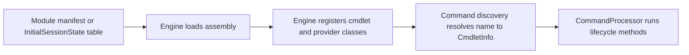

# Command module family: Microsoft.PowerShell.Commands.Diagnostics

> STATIC-ONLY — behavior not run-verified. Inventory is `APPROX` (regex/own-scanner extraction); cmdlets are listed by name and file only (no per-cmdlet walkthroughs, by design).

## 1. Purpose and scope [SPEC]

Windows diagnostics commands: `Get-Counter` (performance counters), `Get-WinEvent` and `New-WinEvent` (event log and ETW). Shipped only in Windows runtimes (the `powershell-win-core` project references it; `powershell-unix` does not).

## 2. Source map

| Path | Type/class | Role | Tier |
|---|---|---|---|
| `src/Microsoft.PowerShell.Commands.Diagnostics/Microsoft.PowerShell.Commands.Diagnostics.csproj` | project | Library, TFM net10.0 | C |
| `src/Microsoft.PowerShell.Commands.Diagnostics/` | 8 C# files, 4727 lines | assembly sources | C |

## 3. Responsibilities and non-responsibilities

Provides the cmdlets/providers inventoried in section 4; contains no language, parser or pipeline logic (those live in `System.Management.Automation`).

## 4. Key types and contracts [IMPL]

**Cmdlet inventory** (<!--N:CMDLET_CLASSES-->300<!--/N--> cmdlet classes in the whole tree; this assembly: 3; `APPROX`, `GENERATED` from `data/cmdlets.json`). Platform-conditional classes are marked by their `#if` condition.

| Cmdlet | Class | File@Line | Parameter sets | ShouldProcess | Dynamic params | Condition |
|---|---|---|---:|---|---|---|
| `Get-Counter` | `GetCounterCommand` | `src/Microsoft.PowerShell.Commands.Diagnostics/GetCounterCommand.cs@L23` | 2 |  |  |  |
| `Get-WinEvent` | `GetWinEventCommand` | `src/Microsoft.PowerShell.Commands.Diagnostics/GetEventCommand.cs@L30` | 7 |  |  |  |
| `New-WinEvent` | `NewWinEventCommand` | `src/Microsoft.PowerShell.Commands.Diagnostics/NewWinEventCommand.cs@L22` | 1 |  |  |  |

## 5. Data model

Not applicable beyond the cmdlet and provider classes listed above.

## 6. Control flow

The flow is the generic registration path; see [command discovery](../03-runtime/command-discovery-and-invocation.md) and [modules](../03-runtime/modules.md).

## 7. Algorithms

Not applicable: no non-trivial algorithm is documented at family level.

## 8. Observable behavior [SPEC]

Cmdlet behavior is out of scope for this family-level document. No golden sample: STATIC-ONLY.

## 9. Error handling and edge cases

Cmdlets report through the engine's error-record APIs (`WriteError`, `ThrowTerminatingError`), described in [errors-and-diagnostics](../03-runtime/errors-and-diagnostics.md).

## 10. Concurrency and threading

Cmdlets run on the pipeline thread of their runspace; lifecycle overrides per class are in `data/cmdlets.json` (`lifecycle_overrides`). 

## 11. Extension points and customization hooks

### Registration and discovery (`FACT-SRC`)

No module manifest under `src/Modules` loads this assembly by name (registered another way — see annotations).

## 12. Dependencies

Project references: `System.Management.Automation`. Packages: System.Configuration.ConfigurationManager 10.0.14, System.Diagnostics.EventLog 10.0.14, System.Security.Cryptography.ProtectedData 10.0.14, System.Diagnostics.PerformanceCounter 10.0.14. `InternalsVisibleTo` granted by this assembly: none.

## 13. Performance notes

Not applicable at family level.

## 14. Security considerations

No dedicated enforcement point identified at family level (`UNVERIFIED`; Phase 5 enumerates enforcement points across the tree).

## 15. Enterprise considerations

Replaceable surface: a new shell chooses its own cmdlet set; the engine contracts these cmdlets use are the stable part.

## 16. Tests

Pester tests under `test/powershell/Modules` and `test/powershell/engine` exercise these cmdlets (see [REFERENCE-TEST-CORPUS](../02-language/REFERENCE-TEST-CORPUS.md)).

## 17. Design decisions and trade-offs

Not applicable.

## 18. Guidance for the new shell [LESSON]

- **LSN-DIAG-01** [AVOID] (area: NLD-CMD) Leave OS-specific diagnostics out of the initial command set and offer them as optional modules. Evidence: src/powershell-win-core/powershell-win-core.csproj@L53. DEV: DEV-CMD-120

## 19. Open questions / UNVERIFIED items

- `UNVERIFIED`: per-cmdlet behavior (out of scope).

**Shipped type/format XML (project folder):** none in the project folder. **Resource files:** `GetEventResources.resx` (55 keys).

Verification: inventory from `data/cmdlets.json` filtered by project (`Microsoft.PowerShell.Commands.Diagnostics`); manifests parsed from `src/Modules/**/*.psd1`; counts reconcile with `numbers.json` key CMDLET_CLASSES for the whole tree.
