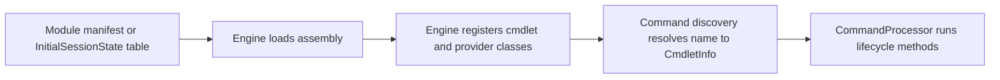

# Command module family: Microsoft.PowerShell.Commands.Management

> STATIC-ONLY — behavior not run-verified. Inventory is `APPROX` (regex/own-scanner extraction); cmdlets are listed by name and file only (no per-cmdlet walkthroughs, by design).

## 1. Purpose and scope [SPEC]

Provider-facing and system-management commands: item/content/property commands over providers (`Get-ChildItem`, `Get-Item`, `Set-Content`, `New-Item`, `Copy-Item`, ... `*-ItemProperty`), location stack (`Get-Location`, `Set-Location`, `Push-Location`, `Pop-Location`), path commands (`Join-Path`, `Split-Path`, `Resolve-Path`, `Test-Path`, `Convert-Path`), drives and providers (`*-PSDrive`, `Get-PSProvider`), process and service commands, computer commands (`Restart-Computer`, `Stop-Computer`, `Rename-Computer`, `Get-ComputerInfo`, `Get-HotFix`), `Test-Connection`, time zone and clipboard commands. Platform-conditional classes carry an `#if` condition in section 4.

## 2. Source map

| Path | Type/class | Role | Tier |
|---|---|---|---|
| `src/Microsoft.PowerShell.Commands.Management/Microsoft.PowerShell.Commands.Management.csproj` | project | Library, TFM net10.0 | C |
| `src/Microsoft.PowerShell.Commands.Management/` | 61 C# files, 33198 lines | assembly sources | C |

## 3. Responsibilities and non-responsibilities

Provides the cmdlets/providers inventoried in section 4; contains no language, parser or pipeline logic (those live in `System.Management.Automation`).

## 4. Key types and contracts [IMPL]

**Cmdlet inventory** (<!--N:CMDLET_CLASSES-->300<!--/N--> cmdlet classes in the whole tree; this assembly: 63; `APPROX`, `GENERATED` from `data/cmdlets.json`). Platform-conditional classes are marked by their `#if` condition.

| Cmdlet | Class | File@Line | Parameter sets | ShouldProcess | Dynamic params | Condition |
|---|---|---|---:|---|---|---|
| `Add-Content` | `AddContentCommand` | `src/Microsoft.PowerShell.Commands.Management/commands/management/AddContentCommand.cs@L16` | 0 | yes |  |  |
| `Clear-Content` | `ClearContentCommand` | `src/Microsoft.PowerShell.Commands.Management/commands/management/ClearContentCommand.cs@L13` | 0 | yes | yes |  |
| `Clear-Item` | `ClearItemCommand` | `src/Microsoft.PowerShell.Commands.Management/commands/management/Navigation.cs@L3769` | 2 | yes | yes |  |
| `Clear-ItemProperty` | `ClearItemPropertyCommand` | `src/Microsoft.PowerShell.Commands.Management/commands/management/ClearPropertyCommand.cs@L14` | 2 | yes | yes |  |
| `Clear-RecycleBin` | `ClearRecycleBinCommand` | `src/Microsoft.PowerShell.Commands.Management/commands/management/ClearRecycleBinCommand.cs@L22` | 0 | yes |  | !UNIX |
| `Convert-Path` | `ConvertPathCommand` | `src/Microsoft.PowerShell.Commands.Management/commands/management/ConvertPathCommand.cs@L16` | 2 |  |  |  |
| `Copy-Item` | `CopyItemCommand` | `src/Microsoft.PowerShell.Commands.Management/commands/management/Navigation.cs@L3510` | 2 | yes | yes |  |
| `Copy-ItemProperty` | `CopyItemPropertyCommand` | `src/Microsoft.PowerShell.Commands.Management/commands/management/CopyPropertyCommand.cs@L13` | 2 | yes | yes |  |
| `Debug-Process` | `DebugProcessCommand` | `src/Microsoft.PowerShell.Commands.Management/commands/management/Process.cs@L1423` | 2 | yes |  |  |
| `Get-ChildItem` | `GetChildItemCommand` | `src/Microsoft.PowerShell.Commands.Management/commands/management/GetChildrenCommand.cs@L17` | 2 |  | yes |  |
| `Get-Clipboard` | `GetClipboardCommand` | `src/Microsoft.PowerShell.Commands.Management/commands/management/GetClipboardCommand.cs@L20` | 0 |  |  |  |
| `Get-ComputerInfo` | `GetComputerInfoCommand` | `src/Microsoft.PowerShell.Commands.Management/commands/management/GetComputerInfoCommand.cs@L31` | 0 |  |  | !UNIX |
| `Get-Content` | `GetContentCommand` | `src/Microsoft.PowerShell.Commands.Management/commands/management/GetContentCommand.cs@L20` | 0 |  | yes |  |
| `Get-HotFix` | `GetHotFixCommand` | `src/Microsoft.PowerShell.Commands.Management/commands/management/Hotfix.cs@L24` | 2 |  |  | !UNIX |
| `Get-Item` | `GetItemCommand` | `src/Microsoft.PowerShell.Commands.Management/commands/management/Navigation.cs@L1847` | 2 |  | yes |  |
| `Get-ItemProperty` | `GetItemPropertyCommand` | `src/Microsoft.PowerShell.Commands.Management/commands/management/GetPropertyCommand.cs@L14` | 2 |  | yes |  |
| `Get-ItemPropertyValue` | `GetItemPropertyValueCommand` | `src/Microsoft.PowerShell.Commands.Management/commands/management/GetPropertyCommand.cs@L169` | 2 |  | yes |  |
| `Get-Location` | `GetLocationCommand` | `src/Microsoft.PowerShell.Commands.Management/commands/management/Navigation.cs@L339` | 2 |  |  |  |
| `Get-PSDrive` | `GetPSDriveCommand` | `src/Microsoft.PowerShell.Commands.Management/commands/management/Navigation.cs@L1663` | 2 |  |  |  |
| `Get-PSProvider` | `GetPSProviderCommand` | `src/Microsoft.PowerShell.Commands.Management/commands/management/Navigation.cs@L4126` | 0 |  |  |  |
| `Get-Process` | `GetProcessCommand` | `src/Microsoft.PowerShell.Commands.Management/commands/management/Process.cs@L441` | 6 |  |  |  |
| `Get-Service` | `GetServiceCommand` | `src/Microsoft.PowerShell.Commands.Management/commands/management/Service.cs@L564` | 1 |  |  | !UNIX |
| `Get-TimeZone` | `GetTimeZoneCommand` | `src/Microsoft.PowerShell.Commands.Management/commands/management/TimeZoneCommands.cs@L22` | 3 |  |  |  |
| `Invoke-Item` | `InvokeItemCommand` | `src/Microsoft.PowerShell.Commands.Management/commands/management/Navigation.cs@L3958` | 2 | yes | yes |  |
| `Join-Path` | `JoinPathCommand` | `src/Microsoft.PowerShell.Commands.Management/commands/management/CombinePathCommand.cs@L18` | 0 |  |  |  |
| `Move-Item` | `MoveItemCommand` | `src/Microsoft.PowerShell.Commands.Management/commands/management/Navigation.cs@L2797` | 2 | yes | yes |  |
| `Move-ItemProperty` | `MoveItemPropertyCommand` | `src/Microsoft.PowerShell.Commands.Management/commands/management/MovePropertyCommand.cs@L14` | 2 | yes | yes |  |
| `New-Item` | `NewItemCommand` | `src/Microsoft.PowerShell.Commands.Management/commands/management/Navigation.cs@L2016` | 2 | yes | yes |  |
| `New-ItemProperty` | `NewItemPropertyCommand` | `src/Microsoft.PowerShell.Commands.Management/commands/management/NewPropertyCommand.cs@L17` | 2 | yes | yes |  |
| `New-PSDrive` | `NewPSDriveCommand` | `src/Microsoft.PowerShell.Commands.Management/commands/management/Navigation.cs@L1082` | 0 | yes | yes |  |
| `New-Service` | `NewServiceCommand` | `src/Microsoft.PowerShell.Commands.Management/commands/management/Service.cs@L2006` | 0 | yes |  | !UNIX |
| `Pop-Location` | `PopLocationCommand` | `src/Microsoft.PowerShell.Commands.Management/commands/management/Navigation.cs@L971` | 0 |  |  |  |
| `Push-Location` | `PushLocationCommand` | `src/Microsoft.PowerShell.Commands.Management/commands/management/Navigation.cs@L813` | 2 |  |  |  |
| `Remove-Item` | `RemoveItemCommand` | `src/Microsoft.PowerShell.Commands.Management/commands/management/Navigation.cs@L2370` | 2 | yes | yes |  |
| `Remove-ItemProperty` | `RemoveItemPropertyCommand` | `src/Microsoft.PowerShell.Commands.Management/commands/management/RemovePropertyCommand.cs@L14` | 2 | yes | yes |  |
| `Remove-PSDrive` | `RemovePSDriveCommand` | `src/Microsoft.PowerShell.Commands.Management/commands/management/Navigation.cs@L1485` | 2 | yes |  |  |
| `Remove-Service` | `RemoveServiceCommand` | `src/Microsoft.PowerShell.Commands.Management/commands/management/Service.cs@L2371` | 2 | yes |  | !UNIX |
| `Rename-Computer` | `RenameComputerCommand` | `src/Microsoft.PowerShell.Commands.Management/commands/management/Computer.cs@L1283` | 0 | yes |  | !UNIX |
| `Rename-Item` | `RenameItemCommand` | `src/Microsoft.PowerShell.Commands.Management/commands/management/Navigation.cs@L3171` | 2 | yes | yes |  |
| `Rename-ItemProperty` | `RenameItemPropertyCommand` | `src/Microsoft.PowerShell.Commands.Management/commands/management/RenamePropertyCommand.cs@L13` | 2 | yes | yes |  |
| `Resolve-Path` | `ResolvePathCommand` | `src/Microsoft.PowerShell.Commands.Management/commands/management/ResolvePathCommand.cs@L16` | 2 |  |  |  |
| `Restart-Computer` | `RestartComputerCommand` | `src/Microsoft.PowerShell.Commands.Management/commands/management/Computer.cs@L114` | 1 | yes |  | !UNIX |
| `Restart-Computer` | `RestartComputerCommand` | `src/Microsoft.PowerShell.Commands.Management/commands/management/ComputerUnix.cs@L24` | 0 | yes |  | UNIX |
| `Restart-Service` | `RestartServiceCommand` | `src/Microsoft.PowerShell.Commands.Management/commands/management/Service.cs@L1435` | 0 | yes |  | !UNIX |
| `Resume-Service` | `ResumeServiceCommand` | `src/Microsoft.PowerShell.Commands.Management/commands/management/Service.cs@L1401` | 0 | yes |  | !UNIX |
| `Set-Clipboard` | `SetClipboardCommand` | `src/Microsoft.PowerShell.Commands.Management/commands/management/SetClipboardCommand.cs@L21` | 0 | yes |  |  |
| `Set-Content` | `SetContentCommand` | `src/Microsoft.PowerShell.Commands.Management/commands/management/SetContentCommand.cs@L14` | 0 | yes |  |  |
| `Set-Item` | `SetItemCommand` | `src/Microsoft.PowerShell.Commands.Management/commands/management/Navigation.cs@L2167` | 2 | yes | yes |  |
| `Set-ItemProperty` | `SetItemPropertyCommand` | `src/Microsoft.PowerShell.Commands.Management/commands/management/SetPropertyCommand.cs@L13` | 4 | yes | yes |  |
| `Set-Location` | `SetLocationCommand` | `src/Microsoft.PowerShell.Commands.Management/commands/management/Navigation.cs@L638` | 3 |  |  |  |
| `Set-Service` | `SetServiceCommand` | `src/Microsoft.PowerShell.Commands.Management/commands/management/Service.cs@L1489` | 2 | yes |  | !UNIX |
| `Set-TimeZone` | `SetTimeZoneCommand` | `src/Microsoft.PowerShell.Commands.Management/commands/management/TimeZoneCommands.cs@L127` | 3 | yes |  | !UNIX |
| `Split-Path` | `SplitPathCommand` | `src/Microsoft.PowerShell.Commands.Management/commands/management/ParsePathCommand.cs@L27` | 8 |  |  |  |
| `Start-Process` | `StartProcessCommand` | `src/Microsoft.PowerShell.Commands.Management/commands/management/Process.cs@L1604` | 2 | yes |  |  |
| `Start-Service` | `StartServiceCommand` | `src/Microsoft.PowerShell.Commands.Management/commands/management/Service.cs@L1336` | 0 | yes |  | !UNIX |
| `Stop-Computer` | `StopComputerCommand` | `src/Microsoft.PowerShell.Commands.Management/commands/management/Computer.cs@L1123` | 0 | yes |  | !UNIX |
| `Stop-Computer` | `StopComputerCommand` | `src/Microsoft.PowerShell.Commands.Management/commands/management/ComputerUnix.cs@L61` | 0 | yes |  | UNIX |
| `Stop-Process` | `StopProcessCommand` | `src/Microsoft.PowerShell.Commands.Management/commands/management/Process.cs@L1053` | 3 | yes |  |  |
| `Stop-Service` | `StopServiceCommand` | `src/Microsoft.PowerShell.Commands.Management/commands/management/Service.cs@L1283` | 0 | yes |  | !UNIX |
| `Suspend-Service` | `SuspendServiceCommand` | `src/Microsoft.PowerShell.Commands.Management/commands/management/Service.cs@L1368` | 0 | yes |  | !UNIX |
| `Test-Connection` | `TestConnectionCommand` | `src/Microsoft.PowerShell.Commands.Management/commands/management/TestConnectionCommand.cs@L31` | 5 |  |  |  |
| `Test-Path` | `TestPathCommand` | `src/Microsoft.PowerShell.Commands.Management/commands/management/TestPathCommand.cs@L35` | 2 |  | yes |  |
| `Wait-Process` | `WaitProcessCommand` | `src/Microsoft.PowerShell.Commands.Management/commands/management/Process.cs@L802` | 2 |  |  |  |

## 5. Data model

Not applicable beyond the cmdlet and provider classes listed above.

## 6. Control flow

The flow is the generic registration path; see [command discovery](../03-runtime/command-discovery-and-invocation.md) and [modules](../03-runtime/modules.md).

## 7. Algorithms

Not applicable: no non-trivial algorithm is documented at family level.

## 8. Observable behavior [SPEC]

Cmdlet behavior is out of scope for this family-level document. No golden sample: STATIC-ONLY.

## 9. Error handling and edge cases

Cmdlets report through the engine's error-record APIs (`WriteError`, `ThrowTerminatingError`), described in [errors-and-diagnostics](../03-runtime/errors-and-diagnostics.md).

## 10. Concurrency and threading

Cmdlets run on the pipeline thread of their runspace; lifecycle overrides per class are in `data/cmdlets.json` (`lifecycle_overrides`). 

## 11. Extension points and customization hooks

### Registration and discovery (`FACT-SRC`)

No module manifest under `src/Modules` loads this assembly by name (registered another way — see annotations).

## 12. Dependencies

Project references: `Microsoft.PowerShell.Security`. Packages: System.Diagnostics.EventLog 10.0.14, System.ServiceProcess.ServiceController 10.0.14. `InternalsVisibleTo` granted by this assembly: none.

## 13. Performance notes

Not applicable at family level.

## 14. Security considerations

The item/content commands are the user-facing entry to provider operations, so provider capability checks (`ShouldProcess`, credentials) apply (see [provider-model](../03-runtime/provider-model.md)). `Start-Process`, `Stop-Process`, service and computer commands act on the host OS.

## 15. Enterprise considerations

Replaceable surface: a new shell chooses its own cmdlet set; the engine contracts these cmdlets use are the stable part.

## 16. Tests

Pester tests under `test/powershell/Modules` and `test/powershell/engine` exercise these cmdlets (see [REFERENCE-TEST-CORPUS](../02-language/REFERENCE-TEST-CORPUS.md)).

## 17. Design decisions and trade-offs

Not applicable.

## 18. Guidance for the new shell [LESSON]

- **LSN-MGMT-01** [REPLICATE] (area: NLD-CMD) Keep path- and item-commands provider-agnostic (the same verb set for files, registry, environment, functions) and let providers declare capabilities. Evidence: src/Microsoft.PowerShell.Commands.Management/commands/management/GetChildrenCommand.cs@L1.
- **LSN-MGMT-02** [ADAPT] (area: NLD-SEC) Route OS-level actions (process, service, computer) through an explicit capability so they can be denied per policy. Evidence: src/Microsoft.PowerShell.Commands.Management/commands/management/Process.cs@L1.

## 19. Open questions / UNVERIFIED items

- `UNVERIFIED`: evidence anchors above point to the start of the named files; Phase 5 will replace them with exact enforcement lines.

**Shipped type/format XML (project folder):** none in the project folder. **Resource files:** `ClearRecycleBinResources.resx` (8 keys), `ClipboardResources.resx` (17 keys), `CmdletizationResources.resx` (24 keys), `ComputerInfoResources.resx` (8 keys), `ComputerResources.resx` (90 keys), `HotFixResources.resx` (1 keys), `NavigationResources.resx` (24 keys), `ProcessCommandHelpResources.resx` (5 keys), `ProcessResources.resx` (38 keys), `ServiceResources.resx` (32 keys), `TestConnectionResources.resx` (4 keys), `TestPathResources.resx` (1 keys), `TimeZoneResources.resx` (2 keys).

Verification: inventory from `data/cmdlets.json` filtered by project (`Microsoft.PowerShell.Commands.Management`); manifests parsed from `src/Modules/**/*.psd1`; counts reconcile with `numbers.json` key CMDLET_CLASSES for the whole tree.
