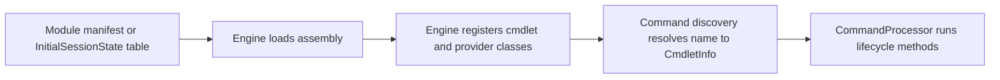

# Command module family: Microsoft.PowerShell.Commands.Utility

> STATIC-ONLY — behavior not run-verified. Inventory is `APPROX` (regex/own-scanner extraction); cmdlets are listed by name and file only (no per-cmdlet walkthroughs, by design).

## 1. Purpose and scope [SPEC]

General-purpose utility commands: object and pipeline manipulation (`Select-Object`, `Sort-Object`, `Group-Object`, `Measure-Object`, `Compare-Object`, `New-Object`, `Add-Member`, `Get-Member`), formatting (`Format-List`, `Format-Table`, `Format-Wide`, `Format-Custom`, `Out-File`, `Out-String`), conversion and serialization (CSV, JSON, XML, CLIXML, HTML, Markdown), web commands (`Invoke-WebRequest`, `Invoke-RestMethod`), `Add-Type` (C# compilation through Roslyn), variables (`*-Variable`), tracing, events (`*-Event`, `Register-*Event`), debugging breakpoints, runspace commands, random numbers, mail, `Get-Date`, `Start-Sleep`, `Write-*` stream commands, `Out-GridView` and `Show-Command` (Windows UI) and others. Inventory in section 4 lists all of them.

## 2. Source map

| Path | Type/class | Role | Tier |
|---|---|---|---|
| `src/Microsoft.PowerShell.Commands.Utility/Microsoft.PowerShell.Commands.Utility.csproj` | project | Library, TFM net10.0 | C |
| `src/Microsoft.PowerShell.Commands.Utility/` | 143 C# files, 45004 lines | assembly sources | C |

## 3. Responsibilities and non-responsibilities

Provides the cmdlets/providers inventoried in section 4; contains no language, parser or pipeline logic (those live in `System.Management.Automation`).

## 4. Key types and contracts [IMPL]

**Cmdlet inventory** (<!--N:CMDLET_CLASSES-->300<!--/N--> cmdlet classes in the whole tree; this assembly: 118; `APPROX`, `GENERATED` from `data/cmdlets.json`). Platform-conditional classes are marked by their `#if` condition.

| Cmdlet | Class | File@Line | Parameter sets | ShouldProcess | Dynamic params | Condition |
|---|---|---|---:|---|---|---|
| `Add-Member` | `AddMemberCommand` | `src/Microsoft.PowerShell.Commands.Utility/commands/utility/AddMember.cs@L21` | 4 |  |  |  |
| `Add-Type` | `AddTypeCommand` | `src/Microsoft.PowerShell.Commands.Utility/commands/utility/AddType.cs@L67` | 10 |  |  |  |
| `Clear-Variable` | `ClearVariableCommand` | `src/Microsoft.PowerShell.Commands.Utility/commands/utility/Var.cs@L1218` | 0 | yes |  |  |
| `Compare-Object` | `CompareObjectCommand` | `src/Microsoft.PowerShell.Commands.Utility/commands/utility/Compare-Object.cs@L17` | 0 |  |  |  |
| `ConvertFrom-CliXml` | `ConvertFromClixmlCommand` | `src/Microsoft.PowerShell.Commands.Utility/commands/utility/XmlCommands.cs@L690` | 0 |  |  |  |
| `ConvertFrom-Csv` | `ConvertFromCsvCommand` | `src/Microsoft.PowerShell.Commands.Utility/commands/utility/CsvCommands.cs@L784` | 2 |  |  |  |
| `ConvertFrom-Json` | `ConvertFromJsonCommand` | `src/Microsoft.PowerShell.Commands.Utility/commands/utility/WebCmdlet/ConvertFromJsonCommand.cs@L16` | 0 |  |  |  |
| `ConvertFrom-Markdown` | `ConvertFromMarkdownCommand` | `src/Microsoft.PowerShell.Commands.Utility/commands/utility/ConvertFromMarkdownCommand.cs@L25` | 3 |  |  |  |
| `ConvertFrom-SddlString` | `ConvertFromSddlStringCommand` | `src/Microsoft.PowerShell.Commands.Utility/commands/utility/ConvertFrom-SddlString.cs@L20` | 0 |  |  | !UNIX |
| `ConvertFrom-StringData` | `ConvertFromStringDataCommand` | `src/Microsoft.PowerShell.Commands.Utility/commands/utility/ConvertFrom-StringData.cs@L16` | 0 |  |  |  |
| `ConvertTo-CliXml` | `ConvertToClixmlCommand` | `src/Microsoft.PowerShell.Commands.Utility/commands/utility/XmlCommands.cs@L640` | 0 |  |  |  |
| `ConvertTo-Csv` | `ConvertToCsvCommand` | `src/Microsoft.PowerShell.Commands.Utility/commands/utility/CsvCommands.cs@L688` | 0 |  |  |  |
| `ConvertTo-Html` | `ConvertToHtmlCommand` | `src/Microsoft.PowerShell.Commands.Utility/commands/utility/ConvertTo-Html.cs@L23` | 2 |  |  |  |
| `ConvertTo-Json` | `ConvertToJsonCommand` | `src/Microsoft.PowerShell.Commands.Utility/commands/utility/WebCmdlet/ConvertToJsonCommand.cs@L20` | 0 |  |  |  |
| `ConvertTo-Xml` | `ConvertToXmlCommand` | `src/Microsoft.PowerShell.Commands.Utility/commands/utility/XmlCommands.cs@L385` | 0 |  |  |  |
| `Debug-Runspace` | `DebugRunspaceCommand` | `src/Microsoft.PowerShell.Commands.Utility/commands/utility/DebugRunspaceCommand.cs@L24` | 4 | yes |  |  |
| `Disable-PSBreakpoint` | `DisablePSBreakpointCommand` | `src/Microsoft.PowerShell.Commands.Utility/commands/utility/Disable-PSBreakpoint.cs@L13` | 0 | yes |  |  |
| `Disable-RunspaceDebug` | `DisableRunspaceDebugCommand` | `src/Microsoft.PowerShell.Commands.Utility/commands/utility/EnableDisableRunspaceDebugCommand.cs@L414` | 0 |  |  |  |
| `Enable-PSBreakpoint` | `EnablePSBreakpointCommand` | `src/Microsoft.PowerShell.Commands.Utility/commands/utility/Enable-PSBreakpoint.cs@L13` | 0 | yes |  |  |
| `Enable-RunspaceDebug` | `EnableRunspaceDebugCommand` | `src/Microsoft.PowerShell.Commands.Utility/commands/utility/EnableDisableRunspaceDebugCommand.cs@L315` | 3 |  |  |  |
| `Export-Alias` | `ExportAliasCommand` | `src/Microsoft.PowerShell.Commands.Utility/commands/utility/ExportAliasCommand.cs@L34` | 2 | yes |  |  |
| `Export-Clixml` | `ExportClixmlCommand` | `src/Microsoft.PowerShell.Commands.Utility/commands/utility/XmlCommands.cs@L23` | 2 | yes |  |  |
| `Export-Csv` | `ExportCsvCommand` | `src/Microsoft.PowerShell.Commands.Utility/commands/utility/CsvCommands.cs@L146` | 0 | yes |  |  |
| `Export-FormatData` | `ExportFormatDataCommand` | `src/Microsoft.PowerShell.Commands.Utility/commands/utility/FormatAndOutput/common/WriteFormatDataCommand.cs@L14` | 2 |  |  |  |
| `Export-PSSession` | `ExportPSSessionCommand` | `src/Microsoft.PowerShell.Commands.Utility/commands/utility/ImplicitRemotingCommands.cs@L33` | 0 |  |  |  |
| `Format-Custom` | `FormatCustomCommand` | `src/Microsoft.PowerShell.Commands.Utility/commands/utility/FormatAndOutput/format-object/Format-Object.cs@L15` | 0 |  |  |  |
| `Format-Hex` | `FormatHex` | `src/Microsoft.PowerShell.Commands.Utility/commands/utility/FormatAndOutput/format-hex/Format-Hex.cs@L22` | 3 |  |  |  |
| `Format-List` | `FormatListCommand` | `src/Microsoft.PowerShell.Commands.Utility/commands/utility/FormatAndOutput/format-list/Format-List.cs@L15` | 0 |  |  |  |
| `Format-Table` | `FormatTableCommand` | `src/Microsoft.PowerShell.Commands.Utility/commands/utility/FormatAndOutput/format-table/Format-Table.cs@L15` | 0 |  |  |  |
| `Format-Wide` | `FormatWideCommand` | `src/Microsoft.PowerShell.Commands.Utility/commands/utility/FormatAndOutput/format-wide/Format-Wide.cs@L17` | 0 |  |  |  |
| `Get-Alias` | `GetAliasCommand` | `src/Microsoft.PowerShell.Commands.Utility/commands/utility/GetAliasCommand.cs@L18` | 2 |  |  |  |
| `Get-Culture` | `GetCultureCommand` | `src/Microsoft.PowerShell.Commands.Utility/commands/utility/GetCultureCommand.cs@L19` | 3 |  |  |  |
| `Get-Date` | `GetDateCommand` | `src/Microsoft.PowerShell.Commands.Utility/commands/utility/GetDateCommand.cs@L20` | 4 |  |  |  |
| `Get-Error` | `GetErrorCommand` | `src/Microsoft.PowerShell.Commands.Utility/commands/utility/Get-Error.cs@L18` | 4 |  |  |  |
| `Get-Event` | `GetEventCommand` | `src/Microsoft.PowerShell.Commands.Utility/commands/utility/GetEventCommand.cs@L15` | 2 |  |  |  |
| `Get-EventSubscriber` | `GetEventSubscriberCommand` | `src/Microsoft.PowerShell.Commands.Utility/commands/utility/GetEventSubscriberCommand.cs@L15` | 2 |  |  |  |
| `Get-FileHash` | `GetFileHashCommand` | `src/Microsoft.PowerShell.Commands.Utility/commands/utility/GetHash.cs@L19` | 3 |  |  |  |
| `Get-FormatData` | `GetFormatDataCommand` | `src/Microsoft.PowerShell.Commands.Utility/commands/utility/FormatAndOutput/common/GetFormatDataCommand.cs@L23` | 0 |  |  |  |
| `Get-Host` | `GetHostCommand` | `src/Microsoft.PowerShell.Commands.Utility/commands/utility/GetHostCmdlet.cs@L13` | 0 |  |  |  |
| `Get-MarkdownOption` | `GetMarkdownOptionCommand` | `src/Microsoft.PowerShell.Commands.Utility/commands/utility/MarkdownOptionCommands.cs@L247` | 0 |  |  |  |
| `Get-Member` | `GetMemberCommand` | `src/Microsoft.PowerShell.Commands.Utility/commands/utility/GetMember.cs@L61` | 0 |  |  |  |
| `Get-PSBreakpoint` | `GetPSBreakpointCommand` | `src/Microsoft.PowerShell.Commands.Utility/commands/utility/Get-PSBreakpoint.cs@L34` | 7 |  |  |  |
| `Get-PSCallStack` | `GetPSCallStackCommand` | `src/Microsoft.PowerShell.Commands.Utility/commands/utility/Get-PSCallStack.cs@L13` | 0 |  |  |  |
| `Get-Random` | `GetRandomCommand` | `src/Microsoft.PowerShell.Commands.Utility/commands/utility/GetRandomCommand.cs@L14` | 0 |  |  |  |
| `Get-Runspace` | `GetRunspaceCommand` | `src/Microsoft.PowerShell.Commands.Utility/commands/utility/GetRunspaceCommand.cs@L20` | 3 |  |  |  |
| `Get-RunspaceDebug` | `GetRunspaceDebugCommand` | `src/Microsoft.PowerShell.Commands.Utility/commands/utility/EnableDisableRunspaceDebugCommand.cs@L471` | 0 |  |  |  |
| `Get-SecureRandom` | `GetSecureRandomCommand` | `src/Microsoft.PowerShell.Commands.Utility/commands/utility/GetSecureRandomCommand.cs@L14` | 0 |  |  |  |
| `Get-TraceSource` | `GetTraceSourceCommand` | `src/Microsoft.PowerShell.Commands.Utility/commands/utility/trace/GetTracerCommand.cs@L14` | 0 |  |  |  |
| `Get-TypeData` | `GetTypeDataCommand` | `src/Microsoft.PowerShell.Commands.Utility/commands/utility/Update-TypeData.cs@L1276` | 0 |  |  |  |
| `Get-UICulture` | `GetUICultureCommand` | `src/Microsoft.PowerShell.Commands.Utility/commands/utility/GetUICultureCommand.cs@L13` | 0 |  |  |  |
| `Get-Unique` | `GetUniqueCommand` | `src/Microsoft.PowerShell.Commands.Utility/commands/utility/GetUnique.cs@L15` | 2 |  |  |  |
| `Get-Uptime` | `GetUptimeCommand` | `src/Microsoft.PowerShell.Commands.Utility/commands/utility/GetUptime.cs@L17` | 1 |  |  |  |
| `Get-Variable` | `GetVariableCommand` | `src/Microsoft.PowerShell.Commands.Utility/commands/utility/Var.cs@L238` | 0 |  |  |  |
| `Get-Verb` | `GetVerbCommand` | `src/Microsoft.PowerShell.Commands.Utility/commands/utility/GetVerbCommand.cs@L14` | 0 |  |  |  |
| `Group-Object` | `GroupObjectCommand` | `src/Microsoft.PowerShell.Commands.Utility/commands/utility/Group-Object.cs@L215` | 1 |  |  |  |
| `Import-Alias` | `ImportAliasCommand` | `src/Microsoft.PowerShell.Commands.Utility/commands/utility/ImportAliasCommand.cs@L19` | 3 | yes |  |  |
| `Import-Clixml` | `ImportClixmlCommand` | `src/Microsoft.PowerShell.Commands.Utility/commands/utility/XmlCommands.cs@L296` | 2 |  |  |  |
| `Import-Csv` | `ImportCsvCommand` | `src/Microsoft.PowerShell.Commands.Utility/commands/utility/CsvCommands.cs@L526` | 4 |  |  |  |
| `Import-LocalizedData` | `ImportLocalizedData` | `src/Microsoft.PowerShell.Commands.Utility/commands/utility/Import-LocalizedData.cs@L19` | 0 |  |  |  |
| `Import-PSSession` | `ImportPSSessionCommand` | `src/Microsoft.PowerShell.Commands.Utility/commands/utility/ImplicitRemotingCommands.cs@L170` | 0 |  |  |  |
| `Import-PowerShellDataFile` | `ImportPowerShellDataFileCommand` | `src/Microsoft.PowerShell.Commands.Utility/commands/utility/ImportPowerShellDataFile.cs@L16` | 2 |  |  |  |
| `Invoke-Expression` | `InvokeExpressionCommand` | `src/Microsoft.PowerShell.Commands.Utility/commands/utility/InvokeExpressionCommand.cs@L15` | 0 |  |  |  |
| `Invoke-RestMethod` | `InvokeRestMethodCommand` | `src/Microsoft.PowerShell.Commands.Utility/commands/utility/WebCmdlet/Common/InvokeRestMethodCommand.Common.cs@L28` | 0 |  |  |  |
| `Invoke-WebRequest` | `InvokeWebRequestCommand` | `src/Microsoft.PowerShell.Commands.Utility/commands/utility/WebCmdlet/CoreCLR/InvokeWebRequestCommand.CoreClr.cs@L20` | 0 |  |  |  |
| `Join-String` | `JoinStringCommand` | `src/Microsoft.PowerShell.Commands.Utility/commands/utility/Join-String.cs@L22` | 3 |  |  |  |
| `Measure-Command` | `MeasureCommandCommand` | `src/Microsoft.PowerShell.Commands.Utility/commands/utility/TimeExpressionCommand.cs@L20` | 0 |  |  |  |
| `Measure-Object` | `MeasureObjectCommand` | `src/Microsoft.PowerShell.Commands.Utility/commands/utility/Measure-Object.cs@L156` | 2 |  |  |  |
| `New-Alias` | `NewAliasCommand` | `src/Microsoft.PowerShell.Commands.Utility/commands/utility/NewAliasCommand.cs@L15` | 0 | yes |  |  |
| `New-Event` | `NewEventCommand` | `src/Microsoft.PowerShell.Commands.Utility/commands/utility/NewEventCommand.cs@L15` | 0 |  |  |  |
| `New-Guid` | `NewGuidCommand` | `src/Microsoft.PowerShell.Commands.Utility/commands/utility/NewGuidCommand.cs@L16` | 2 |  |  |  |
| `New-Object` | `NewObjectCommand` | `src/Microsoft.PowerShell.Commands.Utility/commands/utility/New-Object.cs@L28` | 2 |  |  |  |
| `New-TemporaryFile` | `NewTemporaryFileCommand` | `src/Microsoft.PowerShell.Commands.Utility/commands/utility/NewTemporaryFileCommand.cs@L15` | 0 | yes |  |  |
| `New-TimeSpan` | `NewTimeSpanCommand` | `src/Microsoft.PowerShell.Commands.Utility/commands/utility/NewTimeSpanCommand.cs@L17` | 2 |  |  |  |
| `New-Variable` | `NewVariableCommand` | `src/Microsoft.PowerShell.Commands.Utility/commands/utility/Var.cs@L370` | 0 | yes |  |  |
| `Out-File` | `OutFileCommand` | `src/Microsoft.PowerShell.Commands.Utility/commands/utility/FormatAndOutput/out-file/Out-File.cs@L25` | 2 | yes |  |  |
| `Out-GridView` | `OutGridViewCommand` | `src/Microsoft.PowerShell.Commands.Utility/commands/utility/FormatAndOutput/OutGridView/OutGridViewCommand.cs@L40` | 3 |  |  |  |
| `Out-Printer` | `OutPrinterCommand` | `src/Microsoft.PowerShell.Commands.Utility/commands/utility/FormatAndOutput/out-printer/Out-Printer.cs@L14` | 0 |  |  |  |
| `Out-String` | `OutStringCommand` | `src/Microsoft.PowerShell.Commands.Utility/commands/utility/FormatAndOutput/out-string/Out-String.cs@L16` | 2 |  |  |  |
| `Read-Host` | `ReadHostCommand` | `src/Microsoft.PowerShell.Commands.Utility/commands/utility/ReadConsoleCmdlet.cs@L20` | 2 |  |  |  |
| `Register-EngineEvent` | `RegisterEngineEventCommand` | `src/Microsoft.PowerShell.Commands.Utility/commands/utility/RegisterPSEventCommand.cs@L14` | 0 |  |  |  |
| `Register-ObjectEvent` | `RegisterObjectEventCommand` | `src/Microsoft.PowerShell.Commands.Utility/commands/utility/RegisterObjectEventCommand.cs@L13` | 0 |  |  |  |
| `Remove-Alias` | `RemoveAliasCommand` | `src/Microsoft.PowerShell.Commands.Utility/commands/utility/RemoveAliasCommand.cs@L14` | 0 |  |  |  |
| `Remove-Event` | `RemoveEventCommand` | `src/Microsoft.PowerShell.Commands.Utility/commands/utility/RemoveEventCommand.cs@L13` | 2 | yes |  |  |
| `Remove-PSBreakpoint` | `RemovePSBreakpointCommand` | `src/Microsoft.PowerShell.Commands.Utility/commands/utility/Remove-PSBreakpoint.cs@L13` | 0 | yes |  |  |
| `Remove-TypeData` | `RemoveTypeDataCommand` | `src/Microsoft.PowerShell.Commands.Utility/commands/utility/Update-TypeData.cs@L1042` | 3 | yes |  |  |
| `Remove-Variable` | `RemoveVariableCommand` | `src/Microsoft.PowerShell.Commands.Utility/commands/utility/Var.cs@L1069` | 0 | yes |  |  |
| `Select-Object` | `SelectObjectCommand` | `src/Microsoft.PowerShell.Commands.Utility/commands/utility/Select-Object.cs@L69` | 4 |  |  |  |
| `Select-String` | `SelectStringCommand` | `src/Microsoft.PowerShell.Commands.Utility/commands/utility/MatchString.cs@L400` | 6 |  |  |  |
| `Select-Xml` | `SelectXmlCommand` | `src/Microsoft.PowerShell.Commands.Utility/commands/utility/XmlCommands.cs@L892` | 4 |  |  |  |
| `Send-MailMessage` | `SendMailMessage` | `src/Microsoft.PowerShell.Commands.Utility/commands/utility/Send-MailMessage.cs@L19` | 0 |  |  |  |
| `Set-Alias` | `SetAliasCommand` | `src/Microsoft.PowerShell.Commands.Utility/commands/utility/SetAliasCommand.cs@L14` | 0 | yes |  |  |
| `Set-Date` | `SetDateCommand` | `src/Microsoft.PowerShell.Commands.Utility/commands/utility/SetDateCommand.cs@L21` | 2 | yes |  |  |
| `Set-MarkdownOption` | `SetMarkdownOptionCommand` | `src/Microsoft.PowerShell.Commands.Utility/commands/utility/MarkdownOptionCommands.cs@L22` | 3 |  |  |  |
| `Set-PSBreakpoint` | `SetPSBreakpointCommand` | `src/Microsoft.PowerShell.Commands.Utility/commands/utility/Set-PSBreakpoint.cs@L21` | 3 |  |  |  |
| `Set-TraceSource` | `SetTraceSourceCommand` | `src/Microsoft.PowerShell.Commands.Utility/commands/utility/trace/SetTracerCommand.cs@L15` | 3 |  |  |  |
| `Set-Variable` | `SetVariableCommand` | `src/Microsoft.PowerShell.Commands.Utility/commands/utility/Var.cs@L563` | 0 | yes |  |  |
| `Show-Command` | `ShowCommandCommand` | `src/Microsoft.PowerShell.Commands.Utility/commands/utility/ShowCommand/ShowCommand.cs@L22` | 0 |  |  |  |
| `Show-Markdown` | `ShowMarkdownCommand` | `src/Microsoft.PowerShell.Commands.Utility/commands/utility/ShowMarkdownCommand.cs@L26` | 3 |  |  |  |
| `Sort-Object` | `SortObjectCommand` | `src/Microsoft.PowerShell.Commands.Utility/commands/utility/Sort-Object.cs@L16` | 3 |  |  |  |
| `Start-Sleep` | `StartSleepCommand` | `src/Microsoft.PowerShell.Commands.Utility/commands/utility/StartSleepCommand.cs@L16` | 3 |  |  |  |
| `Tee-Object` | `TeeObjectCommand` | `src/Microsoft.PowerShell.Commands.Utility/commands/utility/Tee-Object.cs@L16` | 3 |  |  |  |
| `Test-Json` | `TestJsonCommand` | `src/Microsoft.PowerShell.Commands.Utility/commands/utility/TestJsonCommand.cs@L22` | 9 |  |  |  |
| `Trace-Command` | `TraceCommandCommand` | `src/Microsoft.PowerShell.Commands.Utility/commands/utility/trace/TraceExpressionCommand.cs@L20` | 2 |  |  |  |
| `Unblock-File` | `UnblockFileCommand` | `src/Microsoft.PowerShell.Commands.Utility/commands/utility/UnblockFile.cs@L26` | 2 | yes |  |  |
| `Unregister-Event` | `UnregisterEventCommand` | `src/Microsoft.PowerShell.Commands.Utility/commands/utility/UnregisterEventCommand.cs@L13` | 2 | yes |  |  |
| `Update-FormatData` | `UpdateFormatDataCommand` | `src/Microsoft.PowerShell.Commands.Utility/commands/utility/Update-TypeData.cs@L890` | 0 | yes |  |  |
| `Update-List` | `UpdateListCommand` | `src/Microsoft.PowerShell.Commands.Utility/commands/utility/Update-List.cs@L22` | 2 |  |  |  |
| `Update-TypeData` | `UpdateTypeDataCommand` | `src/Microsoft.PowerShell.Commands.Utility/commands/utility/Update-TypeData.cs@L23` | 2 | yes |  |  |
| `Wait-Debugger` | `WaitDebuggerCommand` | `src/Microsoft.PowerShell.Commands.Utility/commands/utility/EnableDisableRunspaceDebugCommand.cs@L509` | 0 |  |  |  |
| `Wait-Event` | `WaitEventCommand` | `src/Microsoft.PowerShell.Commands.Utility/commands/utility/WaitEventCommand.cs@L15` | 0 |  |  |  |
| `Write-Debug` | `WriteDebugCommand` | `src/Microsoft.PowerShell.Commands.Utility/commands/utility/Write.cs@L16` | 0 |  |  |  |
| `Write-Error` | `WriteErrorCommand` | `src/Microsoft.PowerShell.Commands.Utility/commands/utility/Write.cs@L374` | 0 |  |  |  |
| `Write-Host` | `WriteHostCommand` | `src/Microsoft.PowerShell.Commands.Utility/commands/utility/WriteConsoleCmdlet.cs@L15` | 0 |  |  |  |
| `Write-Information` | `WriteInformationCommand` | `src/Microsoft.PowerShell.Commands.Utility/commands/utility/Write.cs@L148` | 0 |  |  |  |
| `Write-Output` | `WriteOutputCommand` | `src/Microsoft.PowerShell.Commands.Utility/commands/utility/Write-Object.cs@L13` | 0 |  |  |  |
| `Write-Progress` | `WriteProgressCommand` | `src/Microsoft.PowerShell.Commands.Utility/commands/utility/WriteProgressCmdlet.cs@L13` | 0 |  |  |  |
| `Write-Verbose` | `WriteVerboseCommand` | `src/Microsoft.PowerShell.Commands.Utility/commands/utility/Write.cs@L60` | 0 |  |  |  |
| `Write-Warning` | `WriteWarningCommand` | `src/Microsoft.PowerShell.Commands.Utility/commands/utility/Write.cs@L104` | 0 |  |  |  |

## 5. Data model

Not applicable beyond the cmdlet and provider classes listed above.

## 6. Control flow

The flow is the generic registration path; see [command discovery](../03-runtime/command-discovery-and-invocation.md) and [modules](../03-runtime/modules.md).

## 7. Algorithms

Not applicable: no non-trivial algorithm is documented at family level.

## 8. Observable behavior [SPEC]

Cmdlet behavior is out of scope for this family-level document. No golden sample: STATIC-ONLY.

## 9. Error handling and edge cases

Cmdlets report through the engine's error-record APIs (`WriteError`, `ThrowTerminatingError`), described in [errors-and-diagnostics](../03-runtime/errors-and-diagnostics.md).

## 10. Concurrency and threading

Cmdlets run on the pipeline thread of their runspace; lifecycle overrides per class are in `data/cmdlets.json` (`lifecycle_overrides`). 

## 11. Extension points and customization hooks

### Registration and discovery (`FACT-SRC`)

Module manifests that load this assembly (`NestedModules`/`RootModule`):

| Manifest | Platform content folder | Cmdlets exported | Aliases | Types/Formats |
|---|---|---:|---:|---|
| `src/Modules/Unix/Microsoft.PowerShell.Utility/Microsoft.PowerShell.Utility.psd1` | Unix | 114 | 1 | - |
| `src/Modules/Windows/Microsoft.PowerShell.Utility/Microsoft.PowerShell.Utility.psd1` | Windows | 118 | 1 | - |

Consistency `src/Modules/Unix/Microsoft.PowerShell.Utility/Microsoft.PowerShell.Utility.psd1`: exported but not found as a `[Cmdlet]` class in this assembly: none; `[Cmdlet]` classes in this assembly not exported by this manifest: 4 (ConvertFrom-SddlString, Out-GridView, Out-Printer, Show-Command) (`APPROX`; differences arise from platform-conditional classes, cmdlets exported by other manifests, or verb/noun expressions the extractor could not resolve).

Consistency `src/Modules/Windows/Microsoft.PowerShell.Utility/Microsoft.PowerShell.Utility.psd1`: exported but not found as a `[Cmdlet]` class in this assembly: none; `[Cmdlet]` classes in this assembly not exported by this manifest: 0 (`APPROX`; differences arise from platform-conditional classes, cmdlets exported by other manifests, or verb/noun expressions the extractor could not resolve).

## 12. Dependencies

Project references: `System.Management.Automation`. Packages: Microsoft.Win32.SystemEvents 10.0.14, Markdig.Signed 0.44.0, Microsoft.PowerShell.MarkdownRender 7.2.1, Microsoft.CodeAnalysis.CSharp 5.0.0, System.Drawing.Common 10.0.14, JsonSchema.Net 7.4.0. `InternalsVisibleTo` granted by this assembly: none.

## 13. Performance notes

The `Select-Object`, `Sort-Object`, `Group-Object` family processes the whole pipeline in memory; no streaming guarantees are asserted here (`UNVERIFIED`).

## 14. Security considerations

Policy-relevant members: `Add-Type` (compiles and loads arbitrary code), `Invoke-Expression`, `Invoke-WebRequest`/`Invoke-RestMethod` (network egress, credentials), `Import-/Export-Clixml` and `ConvertFrom-CliXml` (deserialization), `New-Object` (type instantiation; constrained-language restrictions apply), `Unblock-File` (removes zone mark). `UNVERIFIED` until Phase 5 verifies each enforcement point.

## 15. Enterprise considerations

Replaceable surface: a new shell chooses its own cmdlet set; the engine contracts these cmdlets use are the stable part.

## 16. Tests

Pester tests under `test/powershell/Modules` and `test/powershell/engine` exercise these cmdlets (see [REFERENCE-TEST-CORPUS](../02-language/REFERENCE-TEST-CORPUS.md)).

## 17. Design decisions and trade-offs

Not applicable.

## 18. Guidance for the new shell [LESSON]

- **LSN-UTIL-01** [ADAPT] (area: NLD-CMD) Split the utility set by risk: pure data/formatting commands vs code-loading (`Add-Type`, `Invoke-Expression`) and network commands, so a policy can grant them independently. Evidence: src/Microsoft.PowerShell.Commands.Utility/commands/utility/AddType.cs@L67.
- **LSN-UTIL-02** [REPLICATE] (area: NLD-CMD) Implement object-manipulation commands against the public cmdlet base-class API only, so third-party modules can replace them. Evidence: src/Microsoft.PowerShell.Commands.Utility/commands/utility/Compare-Object.cs@L17.

## 19. Open questions / UNVERIFIED items

- `UNVERIFIED`: which Utility cmdlets are Windows-only beyond those with a visible `#if` condition (conditions are shown per row).

**Shipped type/format XML (project folder):** none in the project folder. **Resource files:** `AddMember.resx` (13 keys), `AddTypeStrings.resx` (13 keys), `AliasCommandStrings.resx` (17 keys), `ConvertFromStringData.resx` (2 keys), `ConvertHTMLStrings.resx` (1 keys), `ConvertMarkdownStrings.resx` (4 keys), `CsvCommandStrings.resx` (11 keys), `Debugger.resx` (20 keys), `EventingStrings.resx` (9 keys), `FormatAndOut_out_gridview.resx` (9 keys), `GetFormatDataStrings.resx` (1 keys), `GetMember.resx` (1 keys), `GetRandomCommandStrings.resx` (3 keys), `GetUptimeStrings.resx` (1 keys), `HostStrings.resx` (1 keys), `HttpCommandStrings.resx` (1 keys), `ImplicitRemotingStrings.resx` (32 keys), `ImportLocalizedDataStrings.resx` (10 keys), `MatchStringStrings.resx` (5 keys), `MeasureObjectStrings.resx` (2 keys), `NewObjectStrings.resx` (14 keys), `OutPrinterDisplayStrings.resx` (1 keys), `SelectObjectStrings.resx` (5 keys), `SendMailMessageStrings.resx` (1 keys), `SortObjectStrings.resx` (1 keys), `StartSleepStrings.resx` (1 keys), `TestJsonCmdletStrings.resx` (6 keys), `TraceCommandStrings.resx` (2 keys), `UnblockFileStrings.resx` (2 keys), `UpdateDataStrings.resx` (22 keys), `UpdateListStrings.resx` (3 keys), `UtilityCommonStrings.resx` (19 keys), `VariableCommandStrings.resx` (9 keys), `WebCmdletStrings.resx` (44 keys), `WriteErrorStrings.resx` (1 keys), `WriteProgressResourceStrings.resx` (3 keys).

Verification: inventory from `data/cmdlets.json` filtered by project (`Microsoft.PowerShell.Commands.Utility`); manifests parsed from `src/Modules/**/*.psd1`; counts reconcile with `numbers.json` key CMDLET_CLASSES for the whole tree.
