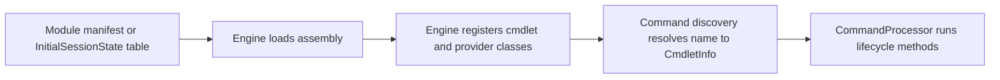

# Command module family: Microsoft.PowerShell.ConsoleHost

> STATIC-ONLY — behavior not run-verified. Inventory is `APPROX` (regex/own-scanner extraction); cmdlets are listed by name and file only (no per-cmdlet walkthroughs, by design).

## 1. Purpose and scope [SPEC]

The console host assembly also defines the two transcript cmdlets, `Start-Transcript` and `Stop-Transcript`, because transcription is a host feature (`ConsoleHostTranscript.cs`, `StartTranscriptCmdlet.cs`, `StopTranscriptCmdlet.cs` under `host/msh`). The host itself is documented in [console-host](../04-hosting/console-host.md).

## 2. Source map

| Path | Type/class | Role | Tier |
|---|---|---|---|
| `src/Microsoft.PowerShell.ConsoleHost/Microsoft.PowerShell.ConsoleHost.csproj` | project | Library, TFM net10.0 | C |
| `src/Microsoft.PowerShell.ConsoleHost/` | 26 C# files, 17831 lines | assembly sources | C |

## 3. Responsibilities and non-responsibilities

Provides the cmdlets/providers inventoried in section 4; contains no language, parser or pipeline logic (those live in `System.Management.Automation`).

## 4. Key types and contracts [IMPL]

**Cmdlet inventory** (<!--N:CMDLET_CLASSES-->300<!--/N--> cmdlet classes in the whole tree; this assembly: 2; `APPROX`, `GENERATED` from `data/cmdlets.json`). Platform-conditional classes are marked by their `#if` condition.

| Cmdlet | Class | File@Line | Parameter sets | ShouldProcess | Dynamic params | Condition |
|---|---|---|---:|---|---|---|
| `Start-Transcript` | `StartTranscriptCommand` | `src/Microsoft.PowerShell.ConsoleHost/host/msh/StartTranscriptCmdlet.cs@L17` | 3 | yes |  |  |
| `Stop-Transcript` | `StopTranscriptCommand` | `src/Microsoft.PowerShell.ConsoleHost/host/msh/StopTranscriptCmdlet.cs@L15` | 0 | yes |  |  |

## 5. Data model

Not applicable beyond the cmdlet and provider classes listed above.

## 6. Control flow

The flow is the generic registration path; see [command discovery](../03-runtime/command-discovery-and-invocation.md) and [modules](../03-runtime/modules.md).

## 7. Algorithms

Not applicable: no non-trivial algorithm is documented at family level.

## 8. Observable behavior [SPEC]

Cmdlet behavior is out of scope for this family-level document. No golden sample: STATIC-ONLY.

## 9. Error handling and edge cases

Cmdlets report through the engine's error-record APIs (`WriteError`, `ThrowTerminatingError`), described in [errors-and-diagnostics](../03-runtime/errors-and-diagnostics.md).

## 10. Concurrency and threading

Cmdlets run on the pipeline thread of their runspace; lifecycle overrides per class are in `data/cmdlets.json` (`lifecycle_overrides`). 

## 11. Extension points and customization hooks

### Registration and discovery (`FACT-SRC`)

No module manifest under `src/Modules` loads this assembly by name (registered another way — see annotations).

## 12. Dependencies

Project references: `System.Management.Automation`. Packages: none. `InternalsVisibleTo` granted by this assembly: `powershell-tests`.

## 13. Performance notes

Not applicable at family level.

## 14. Security considerations

No dedicated enforcement point identified at family level (`UNVERIFIED`; Phase 5 enumerates enforcement points across the tree).

## 15. Enterprise considerations

Replaceable surface: a new shell chooses its own cmdlet set; the engine contracts these cmdlets use are the stable part.

## 16. Tests

Pester tests under `test/powershell/Modules` and `test/powershell/engine` exercise these cmdlets (see [REFERENCE-TEST-CORPUS](../02-language/REFERENCE-TEST-CORPUS.md)).

## 17. Design decisions and trade-offs

Not applicable.

## 18. Guidance for the new shell [LESSON]

- **LSN-CHOST-01** [REPLICATE] (area: NLD-TOOL) Keep transcription as a host service behind a command pair, so non-console hosts can supply their own sink. Evidence: src/Microsoft.PowerShell.ConsoleHost/host/msh/StartTranscriptCmdlet.cs@L1.

## 19. Open questions / UNVERIFIED items

- `UNVERIFIED`: per-cmdlet behavior (out of scope).

**Shipped type/format XML (project folder):** none in the project folder. **Resource files:** `CommandLineParameterParserStrings.resx` (38 keys), `ConsoleControlStrings.resx` (27 keys), `ConsoleHostRawUserInterfaceStrings.resx` (19 keys), `ConsoleHostStrings.resx` (20 keys), `ConsoleHostUserInterfaceSecurityResources.resx` (2 keys), `ConsoleHostUserInterfaceStrings.resx` (25 keys), `ManagedEntranceStrings.resx` (7 keys), `ProgressNodeStrings.resx` (3 keys), `TranscriptStrings.resx` (8 keys).

Verification: inventory from `data/cmdlets.json` filtered by project (`Microsoft.PowerShell.ConsoleHost`); manifests parsed from `src/Modules/**/*.psd1`; counts reconcile with `numbers.json` key CMDLET_CLASSES for the whole tree.
