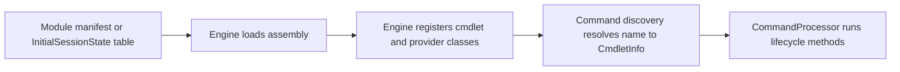

# Command module family: Microsoft.PowerShell.GraphicalHost

> STATIC-ONLY — behavior not run-verified. Inventory is `APPROX` (regex/own-scanner extraction); cmdlets are listed by name and file only (no per-cmdlet walkthroughs, by design).

## 1. Purpose and scope [SPEC]

WPF-based UI assembly (project `Microsoft.Management.UI.Internal`, assembly `Microsoft.PowerShell.GraphicalHost`) behind `Out-GridView`, `Show-Command` and `Get-Help -ShowWindow`; included only when the build uses the WindowsDesktop SDK (conditional `ProjectReference` in `powershell-win-core.csproj`). The engine reaches it through a reflection wrapper (`src/System.Management.Automation/utils/GraphicalHostReflectionWrapper.cs`). Contains no cmdlets.

## 2. Source map

| Path | Type/class | Role | Tier |
|---|---|---|---|
| `src/Microsoft.Management.UI.Internal/Microsoft.PowerShell.GraphicalHost.csproj` | project | Library, TFM net10.0 | C |
| `src/Microsoft.Management.UI.Internal/` | 165 C# files, 26235 lines | assembly sources | C |

## 3. Responsibilities and non-responsibilities

Provides the cmdlets/providers inventoried in section 4; contains no language, parser or pipeline logic (those live in `System.Management.Automation`).

## 4. Key types and contracts [IMPL]

**Cmdlet inventory** (<!--N:CMDLET_CLASSES-->300<!--/N--> cmdlet classes in the whole tree; this assembly: 0; `APPROX`, `GENERATED` from `data/cmdlets.json`). Platform-conditional classes are marked by their `#if` condition.

No `[Cmdlet]` classes in this assembly.

## 5. Data model

Not applicable beyond the cmdlet and provider classes listed above.

## 6. Control flow

The flow is the generic registration path; see [command discovery](../03-runtime/command-discovery-and-invocation.md) and [modules](../03-runtime/modules.md).

## 7. Algorithms

Not applicable: no non-trivial algorithm is documented at family level.

## 8. Observable behavior [SPEC]

Cmdlet behavior is out of scope for this family-level document. No golden sample: STATIC-ONLY.

## 9. Error handling and edge cases

Cmdlets report through the engine's error-record APIs (`WriteError`, `ThrowTerminatingError`), described in [errors-and-diagnostics](../03-runtime/errors-and-diagnostics.md).

## 10. Concurrency and threading

Cmdlets run on the pipeline thread of their runspace; lifecycle overrides per class are in `data/cmdlets.json` (`lifecycle_overrides`). 

## 11. Extension points and customization hooks

### Registration and discovery (`FACT-SRC`)

No module manifest under `src/Modules` loads this assembly by name (registered another way — see annotations).

## 12. Dependencies

Project references: `System.Management.Automation`, `Microsoft.PowerShell.Commands.Utility`. Packages: none. `InternalsVisibleTo` granted by this assembly: none.

## 13. Performance notes

Not applicable at family level.

## 14. Security considerations

No dedicated enforcement point identified at family level (`UNVERIFIED`; Phase 5 enumerates enforcement points across the tree).

## 15. Enterprise considerations

Replaceable surface: a new shell chooses its own cmdlet set; the engine contracts these cmdlets use are the stable part.

## 16. Tests

Pester tests under `test/powershell/Modules` and `test/powershell/engine` exercise these cmdlets (see [REFERENCE-TEST-CORPUS](../02-language/REFERENCE-TEST-CORPUS.md)).

## 17. Design decisions and trade-offs

Not applicable.

## 18. Guidance for the new shell [LESSON]

- **LSN-GFX-01** [ADAPT] (area: NLD-TOOL) Keep GUI helpers behind a late-bound host service (reflection or plug-in) so the engine never references UI assemblies. Evidence: src/System.Management.Automation/utils/GraphicalHostReflectionWrapper.cs@L1.

## 19. Open questions / UNVERIFIED items

- `UNVERIFIED`: per-cmdlet behavior (out of scope).

**Shipped type/format XML (project folder):** none in the project folder. **Resource files:** `public.GraphicalHostResources.resx` (1 keys), `public.HelpWindowResources.resx` (36 keys), `public.InvariantResources.resx` (8 keys), `public.ShowCommandResources.resx` (38 keys), `public.UICultureResources.resx` (30 keys), `public.XamlLocalizableResources.resx` (89 keys).

Verification: inventory from `data/cmdlets.json` filtered by project (`Microsoft.PowerShell.GraphicalHost`); manifests parsed from `src/Modules/**/*.psd1`; counts reconcile with `numbers.json` key CMDLET_CLASSES for the whole tree.
