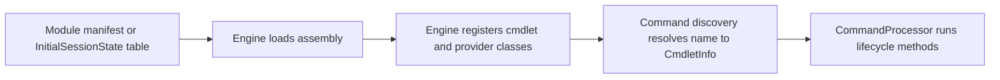

# Command module family: Microsoft.PowerShell.Security

> STATIC-ONLY — behavior not run-verified. Inventory is `APPROX` (regex/own-scanner extraction); cmdlets are listed by name and file only (no per-cmdlet walkthroughs, by design).

## 1. Purpose and scope [SPEC]

Security commands and the certificate provider: execution policy (`Get-ExecutionPolicy`, `Set-ExecutionPolicy`), Authenticode (`Get-AuthenticodeSignature`, `Set-AuthenticodeSignature`), CMS encryption (`Protect-CmsMessage`, `Unprotect-CmsMessage`, `Get-CmsMessage`), file catalogs (`New-FileCatalog`, `Test-FileCatalog`), ACLs (`Get-Acl`, `Set-Acl`), credentials and secure strings (`Get-Credential`, `ConvertTo-SecureString`, `ConvertFrom-SecureString`), PFX certificates (`Get-PfxCertificate`), and one provider (the certificate store provider, `Microsoft.PowerShell.Security` project).

## 2. Source map

| Path | Type/class | Role | Tier |
|---|---|---|---|
| `src/Microsoft.PowerShell.Security/Microsoft.PowerShell.Security.csproj` | project | Library, TFM net10.0 | C |
| `src/Microsoft.PowerShell.Security/` | 11 C# files, 8196 lines | assembly sources | C |

## 3. Responsibilities and non-responsibilities

Provides the cmdlets/providers inventoried in section 4; contains no language, parser or pipeline logic (those live in `System.Management.Automation`).

## 4. Key types and contracts [IMPL]

**Cmdlet inventory** (<!--N:CMDLET_CLASSES-->300<!--/N--> cmdlet classes in the whole tree; this assembly: 15; `APPROX`, `GENERATED` from `data/cmdlets.json`). Platform-conditional classes are marked by their `#if` condition.

| Cmdlet | Class | File@Line | Parameter sets | ShouldProcess | Dynamic params | Condition |
|---|---|---|---:|---|---|---|
| `ConvertFrom-SecureString` | `ConvertFromSecureStringCommand` | `src/Microsoft.PowerShell.Security/security/SecureStringCommands.cs@L116` | 1 |  |  |  |
| `ConvertTo-SecureString` | `ConvertToSecureStringCommand` | `src/Microsoft.PowerShell.Security/security/SecureStringCommands.cs@L231` | 1 |  |  |  |
| `Get-Acl` | `GetAclCommand` | `src/Microsoft.PowerShell.Security/security/AclCommands.cs@L606` | 3 |  |  | !UNIX |
| `Get-AuthenticodeSignature` | `GetAuthenticodeSignatureCommand` | `src/Microsoft.PowerShell.Security/security/SignatureCommands.cs@L264` | 0 |  |  |  |
| `Get-CmsMessage` | `GetCmsMessageCommand` | `src/Microsoft.PowerShell.Security/security/CmsCommands.cs@L199` | 3 |  |  |  |
| `Get-Credential` | `GetCredentialCommand` | `src/Microsoft.PowerShell.Security/security/CredentialCommands.cs@L18` | 2 |  |  |  |
| `Get-ExecutionPolicy` | `GetExecutionPolicyCommand` | `src/Microsoft.PowerShell.Security/security/ExecutionPolicyCommands.cs@L29` | 0 |  |  |  |
| `Get-PfxCertificate` | `GetPfxCertificateCommand` | `src/Microsoft.PowerShell.Security/security/CertificateCommands.cs@L20` | 2 |  |  |  |
| `New-FileCatalog` | `NewFileCatalogCommand` | `src/Microsoft.PowerShell.Security/security/CatalogCommands.cs@L138` | 0 | yes |  | !UNIX |
| `Protect-CmsMessage` | `ProtectCmsMessageCommand` | `src/Microsoft.PowerShell.Security/security/CmsCommands.cs@L23` | 3 |  |  |  |
| `Set-Acl` | `SetAclCommand` | `src/Microsoft.PowerShell.Security/security/AclCommands.cs@L885` | 3 | yes |  | !UNIX |
| `Set-AuthenticodeSignature` | `SetAuthenticodeSignatureCommand` | `src/Microsoft.PowerShell.Security/security/SignatureCommands.cs@L308` | 0 | yes |  |  |
| `Set-ExecutionPolicy` | `SetExecutionPolicyCommand` | `src/Microsoft.PowerShell.Security/security/ExecutionPolicyCommands.cs@L119` | 0 | yes |  |  |
| `Test-FileCatalog` | `TestFileCatalogCommand` | `src/Microsoft.PowerShell.Security/security/CatalogCommands.cs@L217` | 0 | yes |  | !UNIX |
| `Unprotect-CmsMessage` | `UnprotectCmsMessageCommand` | `src/Microsoft.PowerShell.Security/security/CmsCommands.cs@L347` | 4 |  |  |  |

**Provider inventory**

| Provider | Class | File@Line | Condition |
|---|---|---|---|
| `Certificate` | `CertificateProvider` | `src/Microsoft.PowerShell.Security/security/CertificateProvider.cs@L562` | !UNIX |

## 5. Data model

Not applicable beyond the cmdlet and provider classes listed above.

## 6. Control flow

The flow is the generic registration path; see [command discovery](../03-runtime/command-discovery-and-invocation.md) and [modules](../03-runtime/modules.md).

## 7. Algorithms

Not applicable: no non-trivial algorithm is documented at family level.

## 8. Observable behavior [SPEC]

Cmdlet behavior is out of scope for this family-level document. No golden sample: STATIC-ONLY.

## 9. Error handling and edge cases

Cmdlets report through the engine's error-record APIs (`WriteError`, `ThrowTerminatingError`), described in [errors-and-diagnostics](../03-runtime/errors-and-diagnostics.md).

## 10. Concurrency and threading

Cmdlets run on the pipeline thread of their runspace; lifecycle overrides per class are in `data/cmdlets.json` (`lifecycle_overrides`). 

## 11. Extension points and customization hooks

### Registration and discovery (`FACT-SRC`)

No module manifest under `src/Modules` loads this assembly by name (registered another way — see annotations).

## 12. Dependencies

Project references: `System.Management.Automation`. Packages: none. `InternalsVisibleTo` granted by this assembly: none.

## 13. Performance notes

Not applicable at family level.

## 14. Security considerations

This family is the user-facing side of the engine's security features; the enforcement itself lives in `src/System.Management.Automation/security/` (see Phase 5 `execution-policy.md`, `amsi-logging.md`). The assembly receives `InternalsVisibleTo` from the engine (see section 12 of `layered-architecture.md`).

## 15. Enterprise considerations

Replaceable surface: a new shell chooses its own cmdlet set; the engine contracts these cmdlets use are the stable part.

## 16. Tests

Pester tests under `test/powershell/Modules` and `test/powershell/engine` exercise these cmdlets (see [REFERENCE-TEST-CORPUS](../02-language/REFERENCE-TEST-CORPUS.md)).

## 17. Design decisions and trade-offs

Not applicable.

## 18. Guidance for the new shell [LESSON]

- **LSN-SEC-01** [REPLICATE] (area: NLD-SEC) Expose signature validation and policy queries as ordinary commands over a policy service so audit tooling can use the same API as users. Evidence: src/Microsoft.PowerShell.Security/security/SignatureCommands.cs@L1.
- **LSN-SEC-02** [ADAPT] (area: NLD-SEC) Do not rely on `SecureString` cmdlets as a secrets boundary; replace with an OS-keychain-backed secret type (see Phase 5 blueprint). Evidence: src/Microsoft.PowerShell.Security/security/SecureStringCommands.cs@L1.

## 19. Open questions / UNVERIFIED items

- `UNVERIFIED`: file names in lesson evidence are anchors to the assembly's security sources; verify exact paths in Phase 5.

**Shipped type/format XML (project folder):** none in the project folder. **Resource files:** `CertificateCommands.resx` (3 keys), `CertificateProviderStrings.resx` (23 keys), `CmsCommands.resx` (3 keys), `ExecutionPolicyCommands.resx` (7 keys), `SecureStringCommands.resx` (2 keys), `SignatureCommands.resx` (4 keys), `UtilsStrings.resx` (13 keys).

Verification: inventory from `data/cmdlets.json` filtered by project (`Microsoft.PowerShell.Security`); manifests parsed from `src/Modules/**/*.psd1`; counts reconcile with `numbers.json` key CMDLET_CLASSES for the whole tree.
